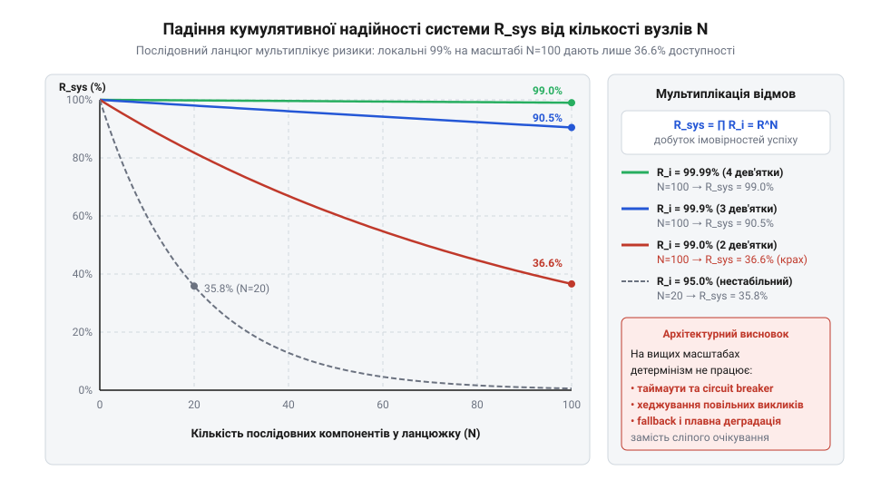
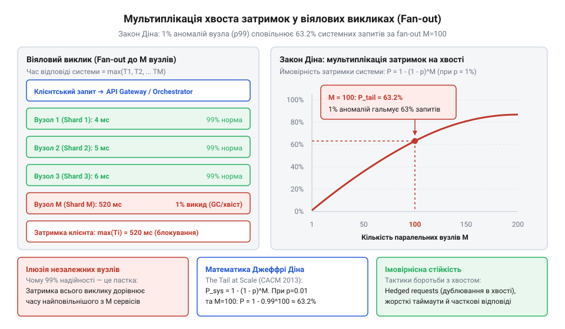

# Математичний апарат аналізу надійності та затримок у багаторівневих архітектурах

<preknowlist>
- [Архітектура](root:progarch/what-is-architecture) — розбиття системи на компоненти, поняття зв'язності та міжсервісної взаємодії
</preknowlist>

## Практична пастка масштабу: чому надійні вузли дають збій у мережі

Усі інженерні інтуїції формуються в локальному контексті. Коли програміст пише функціональний модуль у межах одного процесу, виклик методу виконується в оперативній пам'яті за лічені наносекунди з детерміністичною надійністю. У такій середі відмова виклику означає фатальну помилку самого коду або апаратний збій системи. Проте під час переходу від монолітного застосунку до розподіленої мережевої системи локальні гарантії детермінізму повністю руйнуються.

Уявімо розробника, який проєктує розподілений сервіс і спирається на гарантії постачальника хмарної інфраструктури. Кожен окремий вузол має високий рівень доступності (англ. @@en|Service Level Agreement@@, SLA), наприклад 99.9% (три дев'ятки), що означає не більше ніж 8.7 години сумарного простою на рік. На перший погляд здається, що з'єднання кількох таких надійних вузлів у єдину систему має зберігати високу якість обслуговування.

Однак у реальній розподіленій системі обробка одного користувацького запиту (наприклад, оформлення замовлення або формування стрічки новин) вимагає послідовного або паралельного звернення до десятків окремих мікросервісів: від автентифікації та перевірки прав до розрахунку знижок, перевірки залишків на складі та надсилання сповіщень. При цьому користувачі починають регулярно отримувати помилки HTTP 504 Gateway Timeout або 502 Bad Gateway, а загальний час відповіді системних операцій стає нестабільним.

Виникає фундаментальна суперечність: кожен окремий сервіс працює майже бездоганно, але представлена ними система в цілому зазнає постійних збоїв. Ця ситуація ілюструє пастку масштабу турботи (scale of care): інтуїтивне припущення про те, що надійність системи дорівнює надійності її найгіршого елемента, є хибним для розподілених мереж. Для ухвалення обґрунтованих архітектурних рішень потрібен суворий математичний апарат розрахунку кумулятивних ризиків.

> 🔧 **Навіщо це.**
> Розуміння кумулятивних втрат надійності дозволяє інженеру завчасно оцінити реальну доступність розподіленої системи ще на етапі проєктування та запобігти передчасним обвинуваченням окремих сервісів у нестабільності.

## Математична модель послідовної надійності R_sys = ∏ R_i

Для кількісної оцінки стабільності розглянемо систему, що складається з `N` незалежних компонентів, з'єднаних у послідовний ланцюжок викликів. Це означає, що для успішного виконання загальної операції кожен із `N` вузлів повинен відпрацювати безпомилково й повернути відповідь у межах установленого таймауту.

Нехай `R_i` позначає ймовірність безвідмовної роботи `i`-го компонента (`0 ≤ R_i ≤ 1`). Оскільки відмови незалежних мережевих вузлів та процесів є статистично незалежними подіями, за теорією ймовірностей підсумкова кумулятивна надійність системи `R_sys` обчислюється як добуток ймовірностей безвідмовної роботи всіх елементів ланцюжка:

```
R_sys = R₁ · R₂ · ... · Rₙ
      = ∏ᵢ₌₁ⁿ Rᵢ      [добуток ймовірностей незалежних подій]
```

Якщо припустити, що всі `N` компонентів мають однакову індивідуальну надійність `R_i = R`, формула спрощується до піднесення ймовірності до степеня `N`:

```
R_sys = Rⁿ             [піднесення ймовірності до степеня N]
```

Проаналізуємо, як змінюється підсумкова надійність системи зі зростанням кількості послідовних залежностей `N`, якщо кожен окремий вузол має високий показник `R = 0.999` (99.9% доступності):

**Приклад обчислення для N = 10:**
```
R_sys = 0.999¹⁰
      ≈ 0.990045     [піднесення 0.999 до степеня 10]
```
*Висновок:* При 10 послідовних викликах підсумкова надійність падає з 99.9% до 99.0%, що означає відмову вже кожного 100-го користувацького запиту.

**Приклад обчислення для N = 50:**
```
R_sys = 0.999⁵⁰
      ≈ 0.951214     [піднесення 0.999 до степеня 50]
```
*Висновок:* При 50 послідовних вузлах надійність системи деградує до 95.1% (відмовляє майже кожен 20-й запит).

**Приклад обчислення для N = 100:**
```
R_sys = 0.999¹⁰⁰
      ≈ 0.904792     [піднесення 0.999 до степеня 100]
```
*Висновок:* При 100 послідовних залежностях підсумкова доступність становить лише 90.5% — кожен 10-й запит користувача закінчується помилкою!


*Крива падіння кумулятивної надійності R_sys залежно від кількості послідовних вузлів N; видно стрімке руйнування доступності при масштабуванні.*

Щоб отримати повну картину впливу базової надійності окремого сервісу на стійкість цілої системи, зведемо значення підсумкової доступності `R_sys` для різних комбінацій індивідуальної надійності вузла `R ∈ {0.99, 0.999, 0.9999}` та глибини ланцюжка залежностей `N ∈ {10, 50, 100}` у порівняльну таблицю.

| Надійність вузла `R` | Рівень доступності | N = 10 вузлів | N = 50 вузлів | N = 100 вузлів |
|---|---|---|---|---|
| `0.99` | 99.0% («дві дев'ятки») | `0.99¹⁰ ≈ 0.9044` (90.44%) | `0.99⁵⁰ ≈ 0.6050` (60.50%) | `0.99¹⁰⁰ ≈ 0.3660` (36.60%) |
| `0.999` | 99.9% («три дев'ятки») | `0.999¹⁰ ≈ 0.9900` (99.00%) | `0.999⁵⁰ ≈ 0.9512` (95.12%) | `0.999¹⁰⁰ ≈ 0.9048` (90.48%) |
| `0.9999` | 99.99% («чотири дев'ятки») | `0.9999¹⁰ ≈ 0.9990` (99.90%) | `0.9999⁵⁰ ≈ 0.9950` (99.50%) | `0.9999¹⁰⁰ ≈ 0.9900` (99.00%) |

Аналіз матриці кумулятивних втрат виявляє три фундаментальні закономірності, які визначають архітектурні обмеження при масштабуванні:

1. **Катастрофічний провал на звичайному рівні доступності (`R = 0.99`).** Сервіс із доступністю 99% у монолітній або локальній архітектурі вважається цілком прийнятним (допускається майже 3.65 доби простою на рік). Проте в розподіленій системі ланцюжок із 50 таких вузлів втрачає майже 40% усіх запитів (`R_sys ≈ 60.50%`), а при 100 вузлах майже дві третини користувацьких звернень (`63.40%`) завершуються відмовою. Система стає практично непрацездатною без використання паттернів повторних спроб або асинхронного розв'язування.

2. **Закон знецінення дев'яток.** Збільшення кількості послідовних залежностей `N` геометрично «з'їдає» дев'ятки доступності. Наприклад, щоб зберегти підсумковий SLA системи на рівні «двох дев'яток» (`R_sys ≥ 0.99`) при довжині ланцюжка `N = 100`, кожен окремий компонент зобов'язаний гарантувати не менше «чотирьох дев'яток» (`R = 0.9999`). Масштабування за кількістю вузлів вимагає експоненційного зростання вимог до надійності кожного окремого елемента.

3. **Нелінійність ціни стійкості.** Перехід індивідуального сервісу від `R = 0.99` до `R = 0.999` вимагає значних інженерних зусиль (дублювання екземплярів, автоматичне виявлення збоїв), але при `N = 100` підсумкова надійність піднімається лише з 36.6% до 90.5%, що все ще залишає систему непридатною для критичних бізнес-процесів. Тільки досягнення `R = 0.9999` дозволяє утримувати надійність вище 99% на великих масштабах.

Отже, чисто математична спроба досягти високого підсумкового SLA шляхом безкінечного підвищення надійності окремих вузлів упреться в економічний та технологічний бар'єр. Кожна додаткова дев'ятка на рівнях `0.999` і вище коштує на порядок дорожче за попередню, але при високих `N` її ефект швидко розмивається кумулятивним добутком.

Навіть якщо кожен вузол досягає виняткового рівня «чотирьох дев'яток» (`R = 0.9999`), ланцюжок із 100 сервісів дасть `0.9999¹⁰⁰ ≈ 0.9900` (99% підсумкової надійності). Експоненційне падіння доказово демонструє: локальні гарантії детермінізму не масштабуються лінійно.

> 🔧 **Навіщо це.**
> Формула послідовної надійності дає математичне обґрунтування для жорсткого обмеження глибини міжсервісних викликів та встановлення лімітів на кількість залежностей у кожній бізнес-транзакції.

## Мультиплікація затримок на хвості та модель Джеффрі Діна

Повні відмови компонентів (англ. @@en|downtime@@) — це лише частина проблеми. У реальних розподілених системах значно підступнішою загрозою є **хвіст затримок** (англ. @@en|tail latency@@).

Розглянемо поширений штамп архітектури: шлюз (англ. @@en|API Gateway@@) виконує паралельне віялове опитування (англ. @@en|fan-out@@) `M` незалежних бджолиних сервісів (наприклад, паралельний збір цільових рекомендацій, цін, банерів, профілю та залишків складів). Щоб сформувати кінцеву сторінку для користувача, шлюз змушений чекати відповіді від **найповільнішого** з `M` паралельно опитаних вузлів.

Розглянемо математичну модель Джеффрі Діна (англ. @@en|Jeffrey Dean@@). Нехай `p` позначає ймовірність того, що окремий сервіс поверне відповідь з аномальною затримкою, тобто потрапить у 99-й перцентиль розподілу часу відповіді (`p = 0.01`). Ймовірність того, що сервіс відповість у межах норми, дорівнює `1 - p`.

Якщо затримки `M` незалежних вузлів є статистично незалежними, то ймовірність того, що **всі** `M` сервісів дадуть нормальну швидку відповідь, становить `(1 - p)ᵐ`. Звідси кумулятивна ймовірність `P_tail` того, що хоча б один із `M` паралельних вузлів зазнає затримки хвоста і сповільнить увесь системний запит користувача, обчислюється за формулою:

```
P_tail = 1 - (1 - p)ᵐ   [ймовірність щонайменше одного сповільнення серед M вузлів]
```

Простежимо ефект мультиплікації затримок при ймовірності аномального сповільнення вузла `p = 0.01` (1% аномалій) для різної кількості паралельних викликів `M`:

**Обчислення для M = 10 паралельних викликів:**
```
P_tail = 1 - (1 - 0.01)¹⁰
       = 1 - 0.99¹⁰
       = 1 - 0.904382      [обчислення 0.99 у степені 10]
       ≈ 0.095618          [тобто ~9.56%]
```
*Висновок:* При 10 паралельних викликах майже 10% усіх системних операцій стають повільними.

**Обчислення для M = 100 паралельних викликів:**
```
P_tail = 1 - (1 - 0.01)¹⁰⁰
       = 1 - 0.99¹⁰⁰
       = 1 - 0.366032      [обчислення 0.99 у степені 100]
       ≈ 0.633968          [тобто ~63.4%]
```
*Висновок:* При 100 паралельних викликах майже 63.4% усіх користувацьких запитів зазнають сповільнення! Хоча кожен окремий вузол тормозит лише в 1% випадків, більшість системних запитів стають повільними.


*Схема віялового виклику (fan-out) до M вузлів та графік зростання ймовірності сповільнення системного запиту P_tail; видно, як 1% аномалій окремого сервісу сповільнює 63.4% запитів.*

> 🔧 **Навіщо це.**
> Модель Джеффрі Діна доказово пояснює, чому вимірювання середньої затримки (mean/median latency) є ілюзією на великих масштабах і чому архітектура повинна проєктуватися з огляду на 99-й та 99.9-й перцентилі.

## Перехід від детермінізму до імовірнісних тактик стійкості

Математичні моделі `R_sys = ∏ R_i` та `P_tail = 1 - (1 - p)ᵐ` підводять до головного архітектурного висновку: **на високих масштабах турботи детерміністична бездоганність є математично неможливою**.

Намагання побудувати розподілену систему, вимагаючи 100% безвідмовності від кожного вузла, є глухим кутом. Замість цього архітектура повинна виходити з припущення про неминучість відмов та затримок і застосовувати імовірнісні тактики стійкості (англ. @@en|resilience patterns@@):

1. **Жорсткі таймаути (Timeouts):**
   Обрізають «довгий хвіст» розподілу затримок, примусово перериваючи виклики, що перевищують поріг `T_max`. Це перетворює невизначене очікування на швидку помилку, що дозволяє повернути дегрідовану або кешовану відповідь.

2. **Хеджування запитів (Hedged Requests - англ. @@en|hedged requests@@):**
   Якщо перший запит до вузла не повернувся протягом 95-го перцентиля очікуваного часу, система надсилає дублюючий запит до паралельного екземпляра того самого сервісу. Ймовірність того, що обидва незалежні екземпляри одночасно потраплять у 99-й перцентиль затримки, становить `p² = 0.01² = 0.0001` (0.01%), що кардинально зрізає хвіст затримок.

   Математичне доведення ефективності хеджування базується на правило множення ймовірностей двох незалежних аномальних подій. Якщо ймовірність того, що один екземпляр сервісу дасть аномальну затримку або збій, дорівнює `p`, то для двох однакових незалежних екземплярів `A` та `B` ймовірність одночасної відмови `P_both_fail` обчислюється так:

   ```
   P_both_fail = P(A_fail) · P(B_fail)
               = p · p                  [множення ймовірностей незалежних подій]
               = p²                     [піднесення ймовірності до квадрата]
   ```

   **Приклад обчислення для p = 0.01 (1% аномалій):**
   ```
   P_both_fail = 0.01 · 0.01
               = 0.0001                 [квадрат ймовірності]
               = 0.01%
   ```

   *Висновок:* Дублювання запиту знижує ймовірність підсумкового сповільнення з 1% до 0.01% — тобто в 100 разів! Навіть у віяловому виклику до `M = 100` паралельних вузлів підсумкова ймовірність сповільнення системи `P_tail_hedged` зменшується з критичних 63.4% до всього лише 0.995%:

   ```
   P_tail_hedged = 1 - (1 - p²)ᵐ
                 = 1 - (1 - 0.0001)¹⁰⁰
                 = 1 - 0.9999¹⁰⁰
                 = 1 - 0.990049           [піднесення 0.9999 до степеня 100]
                 ≈ 0.009951               [тобто ~0.995%]
   ```

   Ціною цього кардинального підвищення швидкості є незначне додаткове навантаження на мережу. Якщо дублюючий запит надсилається лише на 95-му перцентилі, то додатковий трафік `L_extra` становить лише 5% від загальної кількості запитів:

   ```
   L_extra = 1 - 0.95
           = 0.05                         [лише 5% дублюючих викликів]
   ```

   Детальніше тактику розкрито у матеріалі [Патерн Hedged Requests](root:sf-distributed/hedged-requests).

3. **Запобіжники / Вимикачі (Circuit Breakers - англ. @@en|circuit breaker@@):**
   Відстежують відсоток помилок `(1 - R_i)` на ковзному часовому вікні. Якщо надійність вузла падає нижче критичного межі, запобіжник розмикає ланцюг і миттєво відхиляє наступні виклики, блокуючи лавиноподібну деградацію всієї системи `R_sys`.

   Математична умова розмикання запобіжника визначається через середню надійність у ковзному часовому вікні `W`. Якщо відсоток відмов `F_window` перевищує поріг `F_threshold` (наприклад, 15%):

   ```
   F_window = 1 - R_window
   F_window > F_threshold ⟹ State = OPEN   [розмикання запобіжника при падінні R_sys]
   ```

   Розмикання ланцюга штучно ізолює збійний вузол `k`, виключаючи його з кумулятивного добутку `R_sys = ∏ R_i`, і перенаправляє запити на резервний шлях (англ. @@en|fallback@@). Детальніше див. [Патерн Circuit Breaker](root:sf-apps/pattern-circuit-breaker). Це запобігає множенню відмов та блокує падіння загальної доступності системи.

Загальні принципи побудови розподілених систем детальніше висвітлено в розділі [Архітектура](root:progarch/what-is-architecture). Для простих локальних систем, де мультиплікація затримок ще не виникає, див. [Digital Homes v0 — один датчик](root:progarch/dh-v0-one-sensor).
