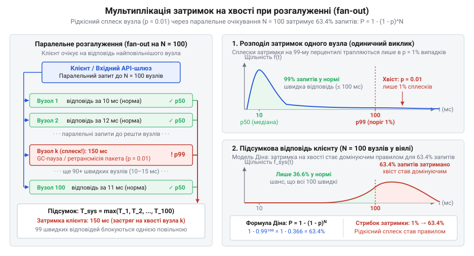
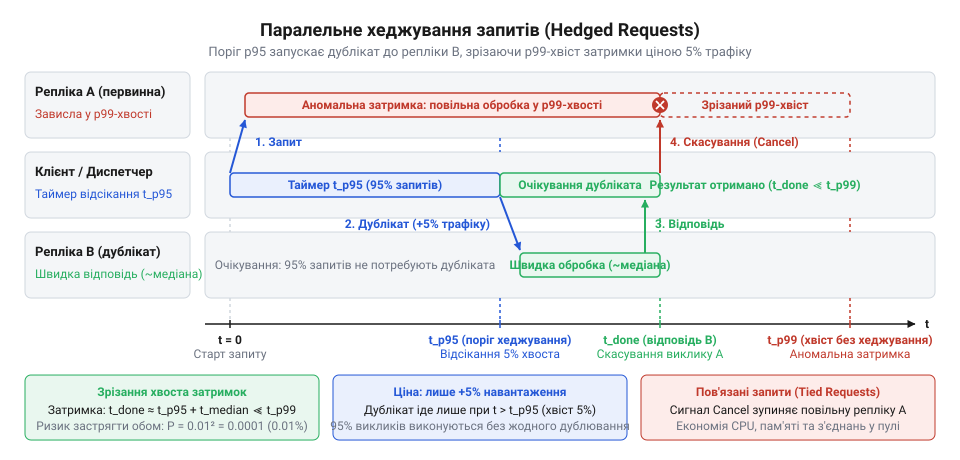

# Ампліфікація затримок на хвості та накопичення відмов у розподілених ланцюжках

<preknowlist>
- [Digital Homes v0 — один датчик](root:progarch/dh-v0-one-sensor) — базова монолітна архітектура розумного дому в одному процесі (зчитування локального датчика температури та перемикання реле), простота локального виклику без затримок мережі та неминучість розширення системи до багатьох розподілених сенсорів і пристроїв
</preknowlist>

## Ілюзія надійності в розподіленому ланцюжку

Коли [монолітну версію системи](root:progarch/dh-v0-one-sensor) платформи Digital Homes масштабували до розмірів великого житлового комплексу, інженери винесли збір кліматичних показників у розподілену мережу мікросервісів. Щоб згенерувати зведений звіт про стан будинку, запит користувача мусить послідовно пройти крізь ланцюжок із 20 сервісів — автентифікацію, шлюзи, профіль мешканця, білінг, стан реле та сенсорів, — а на останньому кроці розгалужується у віяло (англ. @@en|fan-out@@, від *fan* — віяло та *out* — назовні), одночасно опитуючи 100 контролерів квартир.

Звіти моніторингу заспокоювали розробників: кожен окремий мікросервіс демонстрував бездоганні «три дев'ятки» доступності — 99.9% за угодою про рівень обслуговування (англ. @@en|Service Level Agreement@@, скорочено SLA), а медіанна затримка відповіді становила лише 10 мс. Проте мешканці комплексу постійно стикалися зі збоями: щонайменше кожен десятий запит повертав аварійну помилку 500 або зависав на кілька секунд.

Причина крилася в оманливій природі локальних метрик: показник 99.9% означає лише один збій на 1 000 звернень до окремого компонента. Але наскрізний клієнтський запит потребує успішної відповіді від кожного вузла на своєму маршруті. Зі збільшенням кількості залучених сервісів імовірність безпомилкового виконання стрімко падає, а частка збоїв нагромаджується:

| Кількість компонентів у запиті | Локальний @@en|SLA@@ вузла | Підсумкова доступність | Сумарний відсоток збоїв | Частота відмов для користувача |
| :--- | :--- | :--- | :--- | :--- |
| 1 | 99.9% («три дев'ятки») | 99.90% | 0.10% | 1 збій на 1 000 запитів |
| 10 | 99.9% («три дев'ятки») | 99.00% | 1.00% | 1 збій на 100 запитів |
| 20 (послідовний ланцюжок) | 99.9% («три дев'ятки») | 98.02% | 1.98% | ~1 збій на 50 запитів |
| 50 | 99.9% («три дев'ятки») | 95.12% | 4.88% | ~1 збій на 20 запитів |
| 100 (паралельне віяло) | 99.9% («три дев'ятки») | 90.48% | 9.52% | ~1 збій на 10 запитів |
| 120 (повний наскрізний шлях) | 99.9% («три дев'ятки») | 88.69% | 11.31% | Понад 1 збій на 10 запитів |

Для системи зі 120 компонентів підсумкова надійність неминуче просідає нижче 89%, перетворюючи поодинокі збої надійних сервісів на понад 11% аварійних відповідей для кінцевого користувача.

Команди звинувачували сусідні сервіси й показували зелені графіки власних вузлів. Мережеві адміністратори не знаходили втрат пакетів, а спроба сліпо збільшити таймаут (від англ. @@en|timeout@@ — вичерпання часу очікування) лише поглибила кризу: завислі з'єднання швидко вичерпали пули потоків, викликавши лавиноподібне падіння вхідних шлюзів.

Виник архітектурний парадокс: система, побудована з індивідуально надійних та швидких компонентів, поводиться як ненадійна та хронічно повільна. Локальні показники приховують фізичну реальність: серійне проходження викликів перемножує ризики відмов, а паралельне розгалуження неминуче прирікає весь запит на очікування найповільнішого вузла. Щоб подолати цю прірву між локальними метриками та досвідом користувача, інтуїтивних оцінок недостатньо — потрібен строгий математичний апарат серійної доступності та ампліфікації (від лат. @@la|amplificatio@@ — посилення, збільшення) затримок на хвості (англ. @@en|tail latency@@) розподілу.

## Серійна надійність та добуток доступності

Розподілена система складається з багатьох окремих вузлів, і збій будь-якого з них може зруйнувати виконання всього користувацького сценарію. Якщо виконання операції вимагає послідовного виклику кожного сервісу, загальна надійність визначається правилами серійного ланцюга: відмова хоча б однієї ланки перериває весь процес.

Визначимо доступність (англ. @@en|availability@@, від латинського *valere* — мати силу, бути вартим) окремого вузла `i` як імовірність того, що він поверне коректну відповідь у довільний момент часу: `A[i] = P(вузол i доступний)`. Коли запит проходить крізь `N` послідовних компонентів, система функціонує лише за умови одночасної доступності кожного з них.

Якщо припустити, що відмови окремих компонентів є [взаємно незалежними випадковими подіями](root:math-probability/system-reliability-math), сукупну доступність системи `A_sys` отримують перемноженням імовірностей коректної відповіді окремих ланок `A[i]`:
```text
A_sys = P(вузол 1) · P(вузол 2) · ... · P(вузол N)
      = ∏ A[i]                                    [правило добутку ймовірностей для N незалежних подій]
```
Оскільки успішне завершення вимагає безпомилкової роботи кожної проміжної ланки, збій хоча б одного вузла унеможливлює отримання кінцевого результату.

Для ланцюжка з `N` однакових вузлів зі спільною базовою доступністю `A` підсумкову доступність `A_sys` записують у вигляді степеня:
```text
A_sys = A · A · ... · A
      = A^N                                       [піднесення до степеня однакових множників]
```
Оскільки величина `A` суворо менша за одиницю (`A < 1`), зі зростанням глибини ланцюжка `N` загальна надійність системи згасає експоненційно.

**Розрахунок доступності та річного простою ланцюжка в @@en|Digital Homes@@**
Розглянемо розвиток [монолітної архітектури розумного дому](root:progarch/dh-v0-one-sensor) до розподіленої системи, де комплексний запит послідовно проходить крізь `N = 20` мікросервісів. Кожен вузол має паспортну доступність «три дев'ятки»: `A = 0.999` (99.9%), що допускає річний простій 8.76 годин із 8760 годин у календарному році (`8760 × (1 - 0.999)`).

Обчислимо підсумкову доступність ланцюжка `A_sys` із правила степеневої залежності:
```text
A_sys = 0.999²⁰
      ≈ 0.98018                                   [піднесення показника 0.999 до 20-го степеня]
```
Підсумкова доступність ланцюжка впала з 99.9% до 98.0%, тобто ймовірність успішного опрацювання скоротилася на два відсоткові пункти.

Обчислимо сумарний річний час простою всієї системи `T_down` у годинах, перемноживши загальний фонд годин на частку відмов:
```text
T_down = 8760 · (1 - 0.98018)
       ≈ 173.6                                    [множення річного фонду годин на частку простою]
```
Річний час простою зріс із припустимих 8.8 годин до 173.6 годин — понад тиждень повної недоступності сервісу. Для довшого ланцюжка з `N = 50` компонентів доступність обвалюється до `0.999⁵⁰ ≈ 0.951`: майже кожен двадцятий запит зазнає краху, доводячи оманливість високої доступності окремого вузла.

Цей розрахунок дає оптимістичну оцінку, оскільки спирається на припущення про взаємну незалежність збоїв. На практиці компоненти пов'язані спільною інфраструктурою: вони використовують спільні мережеві комутатори, сервери віртуалізації, розподілені кеші та пули з'єднань із базами даних. Коли один сервіс ланцюжка зазнає збою або уповільнює відповіді, сусідні ланки блокують власні потоки в очікуванні, накопичують черги запитів і вичерпують пам'ять. Виникає позитивна кореляція (англ. @@en|correlation@@, від латинського *correlatio* — взаємозв'язок) збоїв, що переростає в каскадний збій (англ. @@en|cascading failure@@): умовна ймовірність відмови наступного вузла за умови падіння попереднього стрімко наближається до одиниці, а не дорівнює базовій частці відмов `1 - A`. Через такий ефект доміно підсумкова доступність системи обвалюється значно швидше, ніж передбачає степенева модель незалежних подій: замість поодиноких і швидкоплинних збоїв окремих запитів виникає системний колапс інфраструктури, коли весь ланцюжок одночасно стає недоступним, а час відновлення розтягується на години.

## Ампліфікація затримок у паралельному розгалуженні

Навіть якщо всі вузли працюють без помилок, користувачі розподілених систем часто страждають від повільного відгуку інтерфейсу. Середнє арифметичне або медіана (50-й квантиль, `p50`) не показують реальної картини затримок, оскільки рідкісні аномалії формують так званий важкий «хвіст» (англ. @@en|tail latency@@).

Для аналізу хвоста використовують перцентилі (від латинського *per centum* — на сотню; позначення `p`): 95-й перцентиль (`p95`) визначає час, у який укладаються 95% найшвидших запитів, а 99-й (`p99`) та 99.9-й (`p99.9`) фіксують локальні сплески повільних відповідей.

В архітектурному патерні розсіювання-збирання (англ. @@en|scatter-gather@@) агрегатор паралельно розсилає запити (віялове розгалуження, англ. @@en|fan-out@@) до `M` незалежних вузлів і чекає на відповідь від усіх. Загальний час очікування `T_total` визначається часом відповіді найповільнішого компонента серед окремих затримок `T₁`, `T₂`, ..., `T_M`:
```text
T_total = max(T₁, T₂, ..., T_M)                    [вибір максимального часу відповіді серед M вузлів]
```
Будь-яке локальне гальмування хоча б на одній гілці розгалуження примушує клієнта чекати на всю операцію.

Джеффрі Дін (англ. @@en|Jeffrey Dean@@) показав, як затримки на хвості накопичуються при паралелізмі. Нехай імовірність окремого сервера перевищити поріг `p99` становить `p = 0.01`, тоді ймовірність швидкої відповіді вузла дорівнює `1 - p`. Якщо часи відповідей незалежні, імовірність швидкої відповіді всіх `M` вузлів `P(all_fast)` дорівнює добутку їхніх імовірностей:
```text
P(all_fast) = (1 - p) · (1 - p) · ... · (1 - p)
            = (1 - p)^M                           [добуток імовірностей успіху для M вузлів]
```
Зі зростанням кількості паралельних вузлів `M` шанс того, що всі вони встигнуть відповісти вчасно, стрімко спадає.

Імовірність того, що комплексний запит застрягне на хвості через повільну відповідь хоча б одного вузла, `P(tail)`, обчислюють як протилежну подію до одночасного успіху всіх ланок:
```text
P(tail) = 1 - P(all_fast)
        = 1 - (1 - p)^M                           [імовірність застрягання хоча б одного компонента]
```
Формула демонструє нелінійну ампліфікацію: локальний ризик потрапляння в хвіст посилюється шириною розгалуження `M`.

**Оцінка затримки агрегатора при масштабуванні розгалуження**
Розрахуємо підсумковий ризик `P(tail)` потрапляння комплексного запиту в повільний локальний хвіст `p99` (`p = 0.01`) для різної кількості паралельних компонентів `M`:
```text
P(tail, M=10)  = 1 - (1 - 0.01)¹⁰  ≈ 0.0956       [розгалуження на 10 вузлів: 9.6% запитів у хвості]
P(tail, M=50)  = 1 - (1 - 0.01)⁵⁰  ≈ 0.3950       [розгалуження на 50 вузлів: 39.5% запитів у хвості]
P(tail, M=100) = 1 - (1 - 0.01)¹⁰⁰ ≈ 0.6340       [розгалуження на 100 вузлів: 63.4% запитів у хвості]
```


*Зі зростанням ширини розгалуження M локальний одновідсотковий сплеск затримки перетворюється на хронічне уповільнення 63.4% комбінованих клієнтських запитів.*

Якщо при `M = 10` у хвіст потрапляє менше десятої частини звернень, то при `M = 100` уже майже дві третини запитів користувачів відчувають найгіршу `p99`-затримку системи. Рідкісна локальна аномалія в 1% за умов паралелізму стає домінуючим правилом для більшості користувачів.

## Порушення незалежності та корельовані сплески

Розрахунки серійної доступності та віялової затримки на хвості спираються на фундаментальну передумову теорії ймовірностей: часи відгуку та збої окремих вузлів вважаються незалежними й однаково розподіленими випадковими величинами (англ. @@en|independent and identically distributed@@, скорочено `i.i.d.`). За цієї аксіоми стан будь-якого сервера не має впливати на сусідні. Проте в реальних розподілених системах це припущення систематично порушується через виникнення сильної позитивної кореляції (від латинського *correlatio* — взаємозв'язок).

Корельовані сплески породжують спільні ресурси та приховані зворотні зв'язки. Сервіси на однаковій віртуальній машині одночасно зазнають блокувальних пауз збирання сміття (англ. @@en|Stop-the-World@@) під спільним піковим навантаженням. На рівні хмари ресурси непередбачувано захоплюють «шумні сусіди» (англ. @@en|noisy neighbors@@), а фізично рознесені репліки вперто впираються у спільну інфраструктурну каналізацію: перевантаження стійкового комутатора (англ. @@en|top-of-rack switch@@), вичерпання дисків @@en|SAN@@ або блокування в базі даних. Деградацію перетворює на лавину [шторм повторних спроб](root:sf-distributed/retry-storm) (англ. @@en|retry storm@@): локальне уповільнення вузла змушує клієнтів масово повторювати запити, що миттєво добиває решту працездатних екземплярів.

Оцінимо ймовірність одночасного збою або затримки двох вузлів `P(A ∩ B)` через умовну ймовірність `P(B | A)` настання події `B` за умови, що подія `A` вже відбулася:
```text
P(A ∩ B) = P(A) · P(B | A)                            [теорема множення ймовірностей через умовну подію]
         > P(A) · P(B)                                [нерівність за умови позитивної кореляції P(B | A) > P(B)]
```
Оскільки деградація першого вузла перекидає паразитичне навантаження на сусідів, умовна ймовірність `P(B | A)` виявляється значно вищою за ізольовану ймовірність `P(B)`.

Унаслідок позитивної кореляції дисперсія (від латинського *dispersio* — розсіювання) сукупної затримки системи різко зростає. Замість поодиноких і розмитих у часі сплесків затримки й аварії збиваються в руйнівні просторово-часові кластери, здатні повністю паралізувати розподілену мережу. Сліпе припущення про незалежність компонентів створює оманливе відчуття безпеки та занижує реальні системні ризики на порядки.

## Математичне обґрунтування таймаутів та хеджування

Коли окремий вузол у ланцюжку зависає, першим захисним механізмом стає таймаут. Проте визначення точки відсікання хвоста (англ. @@en|tail cut-off@@) ставить жорстку дилему. Завищений таймаут блокує клієнтські потоки очікуванням, вичерпуючи пули з'єднань і паралізуючи систему. Занижений таймаут передчасно обриває успішні операції, породжує помилки та провокує [шторм повторних спроб](root:sf-distributed/retry-storm).

Щоб знайти границю між нормальною роботою та аномальним хвостом, будують функцію накопиченого розподілу затримок (англ. @@en|cumulative distribution function@@, від латинського *cumulare* — накопичувати; скорочено `CDF`): `F(t) = P(T ≤ t)`, де `T` — фактичний час відповіді. Значення `F(t)` показує частку запитів, завершених до часу `t`: рівень `0.95` відповідає перцентилю `p95`, а рівень `0.99` визначає важкий хвіст `p99`.

Проте таймаут лише фіксує відмову, не рятуючи затримку. Задля придушення хвоста без перевантаження мережі Джеффрі Дін запропонував хеджування запитів (англ. @@en|hedged requests@@, від англійського *hedge* — обмежувати ризик). Клієнт надсилає запит до репліки `A`, але засікає час `t_hedge` на рівні 95-го перцентиля затримки `p95`. Якщо відповідь за цей термін не надійшла, паралельно запускається дублікат до репліки `B`.

Оскільки за межу `p95` виходить лише 5% звернень (`1 - F(t_p95) = 0.05`), додатковий мережевий трафік суворо обмежений цією часткою. Обчислимо сукупний ризик `P(tail_hedged)` потрапляння обох викликів у хвіст `p99` за базової ймовірності `p = 0.01` для окремого вузла:
```text
P(tail_hedged) = P(T_A > t_p99) · P(T_B > t_p99)
               = 0.01 · 0.01                                  [правило добутку ймовірностей для двох реплік]
               = 0.0001                                       [зменшення ймовірності затримки з 1% до 0.01%]
```
Імовірність комплексного запиту застрягти в хвості падає на два порядки — з 1% до 0.01%, зрізаючи затримку до рівня медіани навіть за наявності помірної кореляції між серверами.


*Швидка відповідь репліки B після порогу p95 дозволяє отримати результат і скасувати повільний виклик до репліки A ціною 5% додаткового мережевого навантаження.*

Щоб дублікати не марнували обчислювальні ресурси серверів, застосовують пов'язані запити (англ. @@en|tied requests@@, від англійського *tie* — зв'язувати): репліки координуються короткими повідомленнями [контекстного скасування](root:sf-distributed/timeouts-deadlines), і щойно один сервер повертає результат чи розпочинає обробку, інший негайно вилучає запит зі своєї локальної черги.

## Кількісні пороги вимикачів та деградації

Коли вузол зазнає збою, хеджування безсиле: дублювання запитів лише поглиблює кризу. Для ізоляції відмов застосовують [вимикач навантаження](root:sf-distributed/circuit-breaker-pattern) (англ. @@en|circuit breaker@@, від англійського *circuit* — електричне коло та *breaker* — переривач).

Вимикач аналізує потік на ковзному вікні (англ. @@en|sliding window@@) розміром `W` викликів або секунд. За кількості збоїв та таймаутів `E` частка помилок становить `θ = E / W`. Коли `θ` перевищує поріг `θ_trip` (зазвичай `0.5`), коло переходить у стан «розімкнено» (англ. @@en|open@@), відсікаючи виклики без звернення до мережі.

За малого трафіку виникає ризик помилки першого роду (англ. @@en|type I error@@): якщо з двох запитів упав один (`W = 2, E = 1`), частка `θ = 0.5` формально досягає порогу через брак статистичної значущості. Щоб усунути хибне спрацьовування, вводять поріг мінімального обсягу вибірки `N_min`. Перехід у стан @@en|open@@ дозволений лише за одночасного виконання нерівностей `W ≥ N_min` та `θ > θ_trip`.

Після паузи вимикач переходить у стан «напіввідкрито» (англ. @@en|half-open@@). Повний потік миттєво перевантажить вузол після рестарту, тому стан перевіряють часткою пробних запитів `α ≪ 1` (зазвичай `α = 0.01 … 0.05`, тобто 1–5%). Лише за їхньої успішності коло замикається.

Якщо деградує сам сервер, ядро захищають адаптивним скиданням навантаження (англ. @@en|load shedding@@, від англійського *shed* — скидати). За [законом Літтла](root:math-probability/littles-law) середня довжина черги `L` залежить від інтенсивності потоку `λ` та часу очікування `W_time`: `L = λ · W_time`. Уповільнення бекенду роздуває чергу `L`. Щоб утримати безпечний ліміт `L_target`, надлишок відкидають з імовірністю `P(drop)`:
```text
P(drop) = max(0, 1 - L_target / L)
        = max(0, 1 - L_target / (2 · L_target))        [двократне перевантаження L = 2 · L_target]
        = 0.5                                          [скидання 50% трафіку]
```
Якщо `L ≤ L_target`, втрат немає (`P(drop) = 0`), а подвоєння черги відсікає половину звернень, повертаючи затримку в норму.
