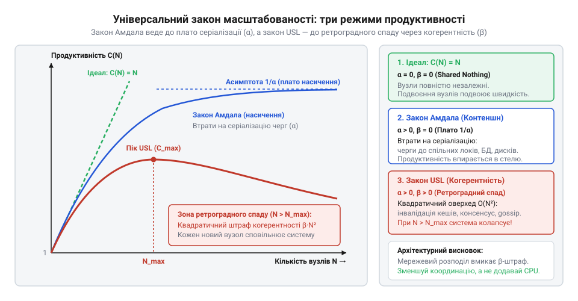
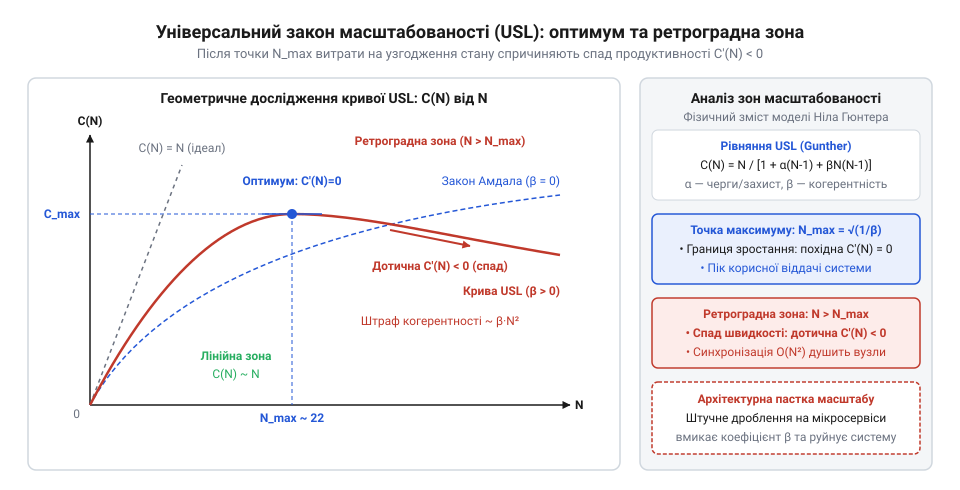
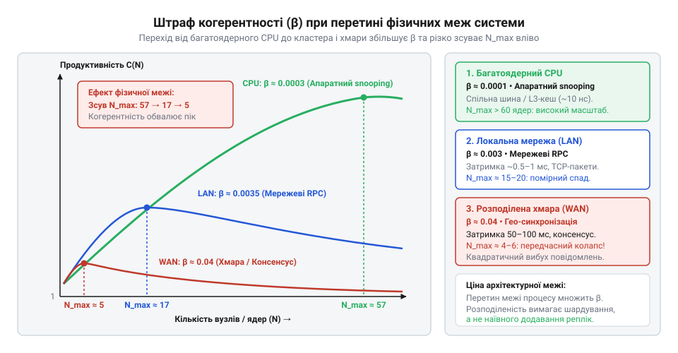

# Математична модель універсального закону масштабованості Ніла Гюнтера

<preknowlist>
- [Digital Homes v0 — один датчик](root:progarch/dh-v0-one-sensor) — Розуміння базової моделі однопотокового обчислення в межах одного процесу без черг очікування та міжвузлової синхронізації.
</preknowlist>

## Пастка лінійного масштабування

Коли система починає захлинатися від потоку вхідних запитів, найперше інженерне бажання — додати ще серверів. Інтуїція підказує просту арифметику: якщо один обчислювальний вузол обробляє тисячу операцій на секунду, то два вузли повинні подужати дві тисячі, десять — десять тисяч, а сотня — сто тисяч. Цю уявну залежність називають лінійним масштабуванням (@@en|linear scalability@@, від латинського *scala* — сходи, драбина). У ній відносна продуктивність системи `C(N)` просто дорівнює кількості виділених машин `N`:

    C(N) = N

У навчальному проєкті [Digital Homes v0](root:progarch/dh-v0-one-sensor) один датчик опитується в межах єдиного процесу на одній платі: там пам'ять неподільна, перешкод немає, а час реакції передбачуваний. Проте в промисловій експлуатації потік телеметрії від мільйонів розумних осель спрямовують у розподілений кластер обробки. Команда впевнено розгортає чотири сервери, але замість чотириразового прискорення отримує лише трикратне: кластер обробляє не чотири тисячі операцій на секунду, а три тисячі двісті. Навантаження зростає далі — інженери масштабують кластер до дванадцяти машин, проте пропускна здатність ледь доповзає до шести тисяч. Додавання тринадцятого, чотирнадцятого й шістнадцятого серверів не дає взагалі нічого: графік продуктивності лягає в горизонтальну полицю.

А далі стається інженерна катастрофа. Керівництво вирішує подвоїти потужності й розгортає тридцять два вузли. Замість очікуваного прориву загальна швидкість обробки раптово обвалюється: кластер із 32 машин подужує лише дві тисячі операцій на секунду — втричі гірше, ніж коли вузлів було дванадцять, і повільніше, ніж працювали чотири машини. Час відповіді на кожен окремий запит злітає від десяти мілісекунд до десятків секунд, черги переповнюються, а моніторинг показує парадоксальну картину: усі тридцять два процесори завантажені на сто відсотків, але корисна робота майже не виконується.

Цей провал називають ретроградним масштабуванням (@@en|retrograde scalability@@, від латинського *retrogradus* — «той, що ступає назад», від *retro* — назад і *gradus* — крок). Додавання нових обчислювальних ресурсів за певною критичною точкою не просто марнує бюджет — воно активно нищить пропускну здатність системи.

Причина парадоксу криється в тому, чим саме зайняті процесори, коли утилізація сягає ста відсотків. У повністю незалежній системі, де вузли не знають про існування один одного, продуктивність справді зростала б лінійно. Проте реальні системи мають спільні дані: залишки на рахунках, стан кімнатних термостатів, глобальні лічильники або спільні таблиці в базі даних. Що більше вузлів з'являється в системі, то більшу частку свого тактового часу кожен процесор спалює не на бізнес-логіку, а на внутрішнє тертя:

1. Очікування в черзі на спільний неподільний ресурс: блокування таблиць, доступ до диска чи монопольні м'ютекси (@@en|contention delay@@, від латинського *contentio* — змагання, напруження).
2. Обмін повідомленнями заради підтримки узгодженості стану: пересилання інвалідацій кешу, узгодження розподілених транзакцій та збирання кворумів (@@en|coherence delay@@, від латинського *cohaerere* — бути зв'язаним, триматися разом).

Коли кількість вузлів невелика, це тертя майже непомітне на тлі корисної роботи. Але в міру зростання кластера час на координацію зростає швидше, ніж сумарна обчислювальна потужність. Настає момент, коли новий сервер приносить у систему стільки додаткових накладних витрат на синхронізацію з іншими вузлами, що вони перевищують його власний внесок в обробку запитів.

> 🔧 **Навіщо це.**
>
> Розуміння нелінійної природи масштабування рятує від найдорожчої помилки в інфраструктурі — спроби «залити аварію залізом». Коли сервіс під піковим навантаженням сповільнюється, перша реакція інцидентної команди — підняти кількість реплік удвічі чи втричі. Якщо система вже перебуває біля піку своєї узгодженості, автоматичне масштабування (@@en|autoscaling@@) штовхає її в ретроградну прірву, перетворюючи контрольовану деградацію на повний колапс системи. [Архітектурне рішення](root:progarch/what-is-architecture) полягає в тому, щоб знати математичну стелю своєї системи до настання інциденту й будувати межі модулів так, щоб усувати джерела взаємного гальмування.

Наївна лінійна модель `C(N) = N` абсолютно сліпа до цих ефектів, тому не дає відповіді на головні інженерні питання: до якої саме межі має сенс додавати машини, коли настане насичення і за якої кількості вузлів розпочнеться незворотне ретроградне падіння?

Щоб знайти точну числову межу, потрібен математичний апарат, здатний кількісно описати обидва види тертя — очікування в чергах та витрати на синхронізацію. Першим кроком до такої моделі став закон Джина Амдала, який показав, як навіть крихітна послідовна ділянка коду встановлює залізобетонну межу зростання будь-якої обчислювальної системи.

## Закон Амдала: межа послідовних ділянок

Щоб розібратися, чому системи не масштабуються лінійно, звернемося до класичної моделі, яку 1967 року запропонував комп'ютерний архітектор Джин Амдал (@@en|Gene Amdahl@@). Амдал досліджував, яке максимальне прискорення (@@en|speedup@@) може отримати програма на багатопроцесорній машині, якщо лише частину її коду вдається розпаралелити.

Уявімо обчислювальну задачу, загальний час виконання якої на одному процесорі становить одиницю: `T(1) = 1`. Будь-яка реальна програма складається з двох частин:
1. Послідовна частка `α` (коефіцієнт серіалізації, @@en|serialization ratio@@, від латинського *series* — ряд, ланцюг) — операції, які принципово неможливо виконувати одночасно: взяття блокування в пам'яті, запис у спільний лог транзакцій, дискове введення-виведення або централізована координація.
2. Паралельна частка `(1 - α)` — обчислення, які можна безперешкодно розділити порівну між `N` однаковими обчислювачами (наприклад, незалежна обробка окремих кадрів телеметрії).

Якщо ми виділяємо для задачі `N` вузлів, паралельна частина прискорюється в `N` разів, тоді як послідовна частина залишається незмінною. Загальний час виконання `T(N)` скорочується за правилом:

    T(N) = α + (1 - α) / N

Відносна продуктивність (або прискорення) `C(N)` показує, у скільки разів зросла пропускна здатність системи порівняно з одним вузлом. Зведемо формулу до канонічного вигляду:

    C(N)
    = T(1) / T(N)                 [означення відносного прискорення]
    = 1 / (α + (1 - α) / N)       [підставляємо T(1) = 1 та час виконання T(N)]
    = N / (N·α + 1 - α)           [множимо чисельник і знаменник на N]
    = N / (1 + α·(N - 1))         [групуємо доданки в знаменнику за коефіцієнтом α]

Отримана залежність і є законом Амдала. Вона розкриває математичний механізм черг і конкуренції (@@en|contention@@). Що більше вузлів `N` додається до системи, то менший внесок робить паралельна частина, і то сильніше час виконання визначається очікуванням у послідовному вузькому горлі `α`.

Дослідимо поведінку системи за нескінченного збільшення ресурсів, коли `N` прямує до нескінченності:

    lim_{N → ∞} C(N)
    = lim_{N → ∞} [N / (1 + α·(N - 1))]
    = lim_{N → ∞} [1 / (1/N + α - α/N)]    [ділимо чисельник і знаменник на N]
    = 1 / α                                [при N → ∞ доданки 1/N та α/N прямують до нуля]

**Обчислення граничного прискорення.** Нехай у сервісі обробки телеметрії лише 5% коду вимагає монопольного доступу до бази даних (`α = 0.05`), а 95% обчислень виконуються повністю паралельно. Обчислимо прискорення для 5, 20, 100 та нескінченної кількості серверів:

    C(5)    = 5 / (1 + 0.05·4)    = 5 / 1.20   ≈ 4.17
    C(20)   = 20 / (1 + 0.05·19)  = 20 / 1.95  ≈ 10.26
    C(100)  = 100 / (1 + 0.05·99) = 100 / 5.95 ≈ 16.81
    C(∞)    = 1 / 0.05            = 20.00

*Висновок:* навіть якщо 95% роботи розпаралелено ідеально, неможливо отримати прискорення більше ніж у 20 разів. Стократне збільшення серверів дає менше сімнадцятикратного результату, а решта обчислювальної потужності просто спалюється в очікуванні блокувань.

> 🔧 **Навіщо це.**
>
> Закон Амдала встановлює теоретичну стелю будь-якої оптимізації. Якщо профілювання показує, що 10% часу транзакції припадає на очікування блокування таблиці (`α = 0.10`), то гранична пропускна здатність кластера ніколи не перевищить `1 / 0.10 = 10` разів від базової, скільки б машин ви не додали. Закон захищає архітектора від інженерних ілюзій: доки не розщеплено послідовну ділянку `α`, нарощувати кількість воркерів безглуздо.

Проте закон Амдала має критичну межу застосовності. Зверніть увагу на його математичну властивість: функція `C(N) = N / (1 + α·(N - 1))` є строго монотонно зростаючою. Її похідна завжди додатна: додавання нових машин у цій моделі завжди збільшує продуктивність, хоча й з меншою віддачею. Закон Амдала вміє описувати насичення й вихід на плато, але принципово не здатний передбачити спад. За Амдалом, 32 сервери завжди швидші за 4, хоча на практиці вони нерідко працюють гірше за один.

Чому ж реальні системи обвалюються вниз? Тому що Амдал вважав паралельні процесори безмовними островами: вони чергуються біля спільного ресурсу `α`, але не витрачають ані мікросекунди на спілкування між собою. У розподілених системах це припущення хибне.

## Закон Гюнтера: квадратична ціна узгодженості

1993 року австралійський фахівець із моделювання продуктивності Ніл Гюнтер (@@en|Neil J. Gunther@@) звернув увагу на те, чого не бачив закон Амдала: у багатопроцесорних та розподілених архітектурах вузли не просто чекають черги до спільних ресурсів, а постійно обмінюються повідомленнями для підтримки узгодженості даних (@@en|coherence delay@@).

У розподіленій системі з `N` вузлів кожен вузол повинен звіряти свій локальний стан з іншими. Якщо вузол оновлює значення або кешує запис, йому потрібно сповістити решту `(N - 1)` учасників. Загальна кількість парних інформаційних каналів між `N` вузлами обчислюється комбінаторним числом невпорядкованих пар:

    K(N)
    = N·(N - 1) / 2    [число парних зв'язків між N вузлами]

Кількість парних взаємодій зростає не лінійно, а пропорційно квадрату `N²`. У міру зростання кластера мережу затоплюють службові пакети: інвалідація кешів, протоколи двофазної фіксації, опитування доступності (heartbeat) та підтвердження отримання. Цей взаємний інформаційний шум (@@en|crosstalk@@) змушує процесори переривати обчислення й чекати відповідей від сусідніх машин.

Гюнтер запропонував доповнити розклад питомого часу виконання задачі квадратичним штрафом за когерентність:

    T(N) = 1 + α·(N - 1) + β·N·(N - 1)

Тут параметр `β` — коефіцієнт когерентності (@@en|coherence ratio@@, від латинського *cohaerere* — триматися разом). Він визначає частку часу, яку кожен вузол витрачає на синхронізацію з іншими. Підставляючи цей час у формулу відносної продуктивності, дістаємо універсальний закон масштабованості (@@en|Universal Scalability Law@@, USL):

    C(N)
    = N / T(N)
    = N / (1 + α·(N - 1) + β·N·(N - 1))

Формула USL елегантно об'єднує всі три режими роботи обчислювальної системи:

1. **Ідеальний паралелізм (`α = 0`, `β = 0`):** знаменник дорівнює одиниці, і продуктивність строго лінійна: `C(N) = N`.
2. **Конкуренція за Амдалом (`α > 0`, `β = 0`):** квадратичний член зникає, залишаючи лінійний опір черг: `C(N) = N / (1 + α·(N - 1))`. Система асимптотично прямує до плато `1/α`.
3. **Реальна узгодженість Гюнтера (`α > 0`, `β > 0`):** при малих `N` система намагається зростати, але при великих значеннях `N` квадратичний член `β·N·(N - 1)` починає домінувати над чисельником `N`. При `N → ∞` продуктивність прямує до нуля: `C(N) ≈ N / (β·N²) = 1 / (β·N) → 0`.

*Порівняння трьох кривих масштабованості: лінійний ідеал без тертя, закон Амдала з асимптотичним виходом на плато через черги α та закон USL Гюнтера з ретроградним спадом через квадратичні втрати на узгодженість β.*

**Обчислення впливу когерентності на прикладі.** Візьмемо попередній сервіс із конкуренцією `α = 0.05` і додамо крихітний коефіцієнт когерентності `β = 0.002` (лише 0.2% часу на парну синхронізацію). Порівняємо очікування за Амдалом із реальністю за USL:

    N = 5:
    C_Amdahl(5) = 5 / (1 + 0.05·4)              = 5 / 1.20   ≈ 4.17
    C_USL(5)    = 5 / (1 + 0.05·4 + 0.002·5·4)  = 5 / 1.24   ≈ 4.03

    N = 10:
    C_Amdahl(10) = 10 / (1 + 0.05·9)              = 10 / 1.45 ≈ 6.90
    C_USL(10)    = 10 / (1 + 0.05·9 + 0.002·10·9) = 10 / 1.63 ≈ 6.13

    N = 25:
    C_Amdahl(25) = 25 / (1 + 0.05·24)              = 25 / 2.20 ≈ 11.36
    C_USL(25)    = 25 / (1 + 0.05·24 + 0.002·25·24) = 25 / 3.40 ≈ 7.35

    N = 50:
    C_Amdahl(50) = 50 / (1 + 0.05·49)              = 50 / 3.45 ≈ 14.49
    C_USL(50)    = 50 / (1 + 0.05·49 + 0.002·50·49) = 50 / 8.35 ≈ 5.99

*Висновок:* на 25 вузлах система за USL досягає продуктивності 7.35, але подальше розширення до 50 машин обвалює її до 5.99. Кластер із 50 серверів виконує менше роботи, ніж кластер із 10 серверів (`6.13`). Квадратичне зростання комунікацій розбило ілюзію масштабування.

> 🔧 **Навіщо це.**
>
> Чітке розрізнення параметрів `α` та `β` визначає стратегію лікування системи. Якщо вузьким місцем є черга `α`, інженер оптимізує критичні секції: замінює ексклюзивні блокування на читацько-письмацькі, шардує базу даних або застосовує неблокувальні алгоритми. Але якщо систему душить когерентність `β`, оптимізація коду всередині вузла не допоможе: треба зменшувати кількість комунікаційних ребер. Це вимагає кардинального [архітектурного рішення](root:progarch/what-is-architecture) — переходу до архітектури без спільного стану (@@en|shared nothing@@), де вузли взагалі не потребують синхронного узгодження.

Отже, універсальний закон масштабованості пояснив причину ретроградного спаду. Але як знайти точну координату вершини пагорба? За якої саме кількості вузлів кластер видає максимум, і як обчислити точку, за якою кожен новий сервер починає шкодити? Відповідь дає аналітичне дослідження функції USL на екстремум за допомогою похідної.

## Дослідження екстремуму: точка зламу та ретроградна зона

У попередньому розділі ми з'ясували, що наявність квадратичного штрафу когерентності `β > 0` перетворює монотонну криву на пагорб із вираженим піком. Для архітектора життєво важливо знати точну вершину цього пагорба: скільки саме вузлів здатна ефективно утилізувати система і де пролягає межа, за якою масштабування стає самогубним.

Щоб знайти точку максимуму, дослідимо функцію універсального закону масштабованості `C(N)` на екстремум (від латинського *extremum* — крайній) за допомогою першої похідної:

    C(N) = N / D(N)

Розпишемо знаменник `D(N)` як поліном від аргументу `N`:

    D(N)
    = 1 + α·(N - 1) + β·N·(N - 1)
    = 1 + α·N - α + β·N² - β·N          [розкриваємо дужки]
    = (1 - α) + (α - β)·N + β·N²        [групуємо доданки за степенями N]

Знайдемо похідну `dC/dN` за правилом диференціювання частки двох функцій `(u / v)' = (u'·v - u·v') / v²`:

    dC/dN
    = [N'·D(N) - N·D'(N)] / D(N)²
    = [1·D(N) - N·((α - β) + 2·β·N)] / D(N)²           [знаходимо похідні чисельника і знаменника]
    = [(1 - α) + (α - β)·N + β·N² - (α - β)·N - 2·β·N²] / D(N)² [розкриваємо дужки в чисельнику]
    = (1 - α - β·N²) / D(N)²                           [скорочуємо взаємно протилежні члени]

Оскільки знаменник `D(N)²` завжди строго додатний для будь-яких фізичних значень `N ≥ 1`, знак похідної повністю визначається чисельником:

    Чисельник = 1 - α - β·N²

Прирівняємо похідну до нуля, щоб знайти критичну точку функції:

    1 - α - β·N² = 0                    [умова стаціонарної точки]
    β·N² = 1 - α                        [переносимо члени рівняння]
    N² = (1 - α) / β                    [виражаємо квадрат кількості вузлів]
    N_max = √((1 - α) / β)              [знаходимо додатний корінь для фізичного N]

Ми отримали фундаментальний аналітичний результат: оптимальна кількість обчислювальних вузлів `N_max`, яка дає максимальну пропускну здатність системи, залежить виключно від співвідношення між послідовною часткою `α` та коефіцієнтом когерентності `β`.

Підставивши `N_max` назад у функцію `C(N)`, дістанемо точний вираз для пікової продуктивності системи `C_max`:

    C_max
    = C(N_max)
    = 1 / (α - β + 2·√(β·(1 - α)))

Поведінка системи чітко розпадається на три характерні геометричні зони:

1. **Лінійна зона (`N << N_max`):** за низької кількості вузлів втрати на синхронізацію мізерні, похідна `C'(N) ≈ 1`, і додавання машин дає майже пропорційний приріст швидкодії.
2. **Точка насичення (`N = N_max`):** похідна дорівнює нулю (`C'(N) = 0`), дотична до графіка горизонтальна. Система досягає абсолютної стелі `C_max`.
3. **Ретроградна зона (`N > N_max`):** оскільки `N > N_max`, то `β·N² > 1 - α`, а отже, чисельник похідної стає від'ємним: `C'(N) < 0`. Графік незворотно нахиляється вниз. Кожен наступний сервер додає більше накладних витрат на синхронізацію, ніж власної корисної роботи.

*Геометричне дослідження кривої USL з позначенням трьох зон: лінійної області, точки максимуму (N_max, C_max) та ретроградної зони спаду продуктивності з дотичною C'(N) < 0.*

**Розрахунок точки зламу на практичному прикладі.** Повернемося до нашого сервісу обробки телеметрії з попереднього розділу, де конкуренція за базу даних становила `α = 0.05`, а коефіцієнт когерентності дорівнював `β = 0.002`. Обчислимо аналітичну межу масштабування:

    N_max
    = √((1 - 0.05) / 0.002)
    = √(0.95 / 0.002)
    = √475
    ≈ 21.79 ≈ 22 вузли

    C_max
    = C(21.79)
    = 21.79 / (1 + 0.05·20.79 + 0.002·21.79·20.79)
    = 21.79 / (1 + 1.0395 + 0.9060)
    = 21.79 / 2.9455
    ≈ 7.40

*Висновок:* система досягає свого абсолютного максимуму на 22 серверах із прискоренням `7.40`. Двадцять третій сервер уже знижує загальну швидкість обробки, а на тридцяти двох вузлах продуктивність падає нижче рівня чотирьох машин.

> 🔧 **Навіщо це.**
>
> Значення `N_max` — це жорсткий математичний обмежувач для політик автоматичного масштабування (@@en|autoscaling@@). Якщо в хмарному конфігураторі вказати `max_replicas = 50`, коли реальний `N_max = 22`, система під час сплеску трафіку потрапляє в смертельну петлю: навантаження зростає → автоскейлер додає вузли понад 22 → пропускна здатність падає → черги ростуть ще швидше → автоскейлер додає ще більше машин, остаточно добиваючи систему. Встановлення межі `max_replicas = N_max` рятує кластер від самознищення.

## Емпіричне калібрування моделі та архітектурна діагностика

Формули `N_max` і `C_max` мають бездоганний вигляд на папері, але як інженеру визначити невідомі коефіцієнти `α` та `β` для живої системи, де немає готових математичних описів? Відповідь полягає в калібруванні моделі за даними навантажувального тестування.

Ніл Гюнтер запропонував математичний трюк, який перетворює нелінійне рівняння USL на звичайну лінійну регресію (@@en|regression@@, від латинського *regressio* — зворотний рух). Почнемо з вихідного рівняння відносної ємності `C(N)`:

    C(N) = N / [1 + α·(N - 1) + β·N·(N - 1)]

Перевернемо дріб і помножимо обидві частини на `C(N)`:

    N / C(N) = 1 + α·(N - 1) + β·N·(N - 1)

Віднімемо одиницю від обох частин:

    N / C(N) - 1 = α·(N - 1) + β·N·(N - 1)

Тепер поділимо обидві частини на `(N - 1)` (для будь-якої конфігурації з `N > 1`):

    [N / C(N) - 1] / (N - 1) = α + β·N

Позначимо ліву частину як трансформовану змінну `Y(N)`:

    Y(N) = [N / C(N) - 1] / (N - 1)

Дістаємо рівняння прямої лінії:

    Y(N) = α + β·N

Ця лінеаризація має величезну практичну цінність:
- Вільний член прямої (точка перетину з віссю ординат при `N = 0`) дорівнює коефіцієнту серіалізації `α`.
- Кутовий коефіцієнт нахилу прямої дорівнює коефіцієнту когерентності `β`.

**Покрокове калібрування на реальних вимірюваннях.** Припустимо, під час тестування сервісу ми зафіксували продуктивність `X(N)` (запитів за секунду) для трьох конфігурацій:
1. Базовий сервер (`N = 1`): `X(1) = 1000` оп/с (`C(1) = 1.00`).
2. Кластер із 5 серверів (`N = 5`): `X(5) = 4030` оп/с.
3. Кластер із 10 серверів (`N = 10`): `X(10) = 6130` оп/с.

Обчислимо відносну продуктивність `C(N) = X(N) / X(1)` та значення трансформованої змінної `Y(N)`:

    C(5)  = 4030 / 1000 = 4.03
    Y(5)  = [5 / 4.03 - 1] / (5 - 1)  = [1.2407 - 1] / 4  = 0.2407 / 4  ≈ 0.06018

    C(10) = 6130 / 1000 = 6.13
    Y(10) = [10 / 6.13 - 1] / (10 - 1) = [1.6313 - 1] / 9 = 0.6313 / 9  ≈ 0.07014

Маючи дві точки `(5, 0.06018)` та `(10, 0.07014)`, обчислимо параметри прямої:

    Кутовий нахил β:
    β = (Y(10) - Y(5)) / (10 - 5)
      = (0.07014 - 0.06018) / 5
      = 0.00996 / 5
      ≈ 0.002

    Вільний член α:
    α = Y(5) - β·5
      = 0.06018 - 0.002·5
      = 0.06018 - 0.010
      ≈ 0.050

Параметри системи виявилися рівно тими, які ми досліджували: `α = 0.05` (5% послідовного коду) та `β = 0.002` (0.2% на міжвузлову узгодженість). За наявності багатьох точок вимірювання замість двох точок застосовують метод найменших квадратів (@@en|ordinary least squares@@).

Співвідношення знайдених коефіцієнтів дає архітекторові точний діагноз внутрішнього стану системи:

- **Домінує серіалізація (`α >> β`):** система хворіє на монопольні блокування. Крива довго тримається на плато, а ретроградний спад відсунутий далеко вправо. Оптимізувати слід структури даних всередині сервісу: розділяти блокування, переходити на шардовані сховища або усувати вузькі місця в транзакціях.
- **Домінує когерентність (`β >> α`):** система перевантажена взаємним спілкуванням. Навіть якщо черг немає, вершина `N_max` наступає рано, за чим слідує стрімкий обвал. Оптимізація локального коду тут безсила: необхідно скорочувати комунікаційні зв'язки.

> 🔧 **Навіщо це.**
>
> Калібрування USL дозволяє перевірити архітектуру на міцність без проведення руйнівних тестів на сотнях машин. Достатньо протестувати систему на 2, 4 та 8 вузлах, розрахувати параметри `α` і `β`, і математична модель точно покаже, де саме зупиниться зростання, чи є загроза ретроградного спаду та який саме тип тертя обмежує систему.

Ми навчилися розраховувати точку зламу `N_max` та оцінювати коефіцієнти за емпіричними даними. Але залишається головне архітектурне питання: чому в межах однієї машини коефіцієнт `β` майже непомітний, а щойно ми розносимо систему по мережі на окремі сервіси, `β` раптово стрибає вгору й обвалює стелю масштабування? Цей перехід визначається концепцією масштабу турботи.

## Архітектурний вибір масштабу: приборкання коефіцієнта β

У попередніх розділах ми розібрали математичну механіку універсального закону масштабованості: навчилися виводити формулу, знаходити вершину пагорба `N_max = √((1 - α) / β)` та калібрувати параметри за вимірюваннями навантаження. Проте головне архітектурне питання залишається відкритим: від чого насправді залежить чисельне значення коефіцієнта когерентності `β` і чому в одних системах воно дорівнює нулю, а в інших — нещадно душить продуктивність?

Відповідь лежить у фізиці взаємодії компонентів та фундаментальному понятті «масштабу турботи» (@@en|scale of care@@). Фізична відстань між обчислювальними елементами визначає затримку сигналу (@@en|latency@@, від латинського *latens* — прихований), а затримка безпосередньо масштабує ціну узгодженості.

Розглянемо, як поводиться система на трьох якісно різних фізичних масштабах:

1. **Масштаб кристала (багатоядерний процесор):** обчислювальні ядра розміщені на одній кремнієвій пластині на відстані міліметрів. Вони синхронізують локальні кеші L1, L2 та L3 через апаратні шини з підтримкою протоколів когерентності кешу (@@en|cache coherence@@). Затримка обміну становить від 10 до 50 наносекунд (`10⁻⁸` секунди). На цьому масштабі коефіцієнт когерентності настільки мізерний (`β ≈ 0.00001`), що ним можна знехтувати. Розрахуємо точку зламу для послідовної частки `α = 0.05`:
   
       N_max = √((1 - 0.05) / 0.00001) = √(0.95 / 0.00001) = √95000 ≈ 308 ядер

   У межах однієї машини система надійно живе за законом Амдала: вона масштабується на десятки й сотні ядер без будь-якої загрози потрапити в ретроградну прірву.

2. **Масштаб дата-центру (локальна мережа):** компоненти рознесені на окремі сервери, з'єднані мережевими комутаторами крученої пари або оптики. Затримка пакетного передавання між вузлами становить від 0.5 до 2 мілісекунд (`10⁻³` секунди). Порівняно з кристалом затримка стрибає на п'ять порядків — у сто тисяч разів! Навіть якщо алгоритм синхронізації не змінився (наприклад, розподілене блокування або звірка кешів), час простою процесорів у парних очікуваннях зростає пропорційно. Коефіцієнт `β` миттєво злітає до `0.002`, обвалюючи критичну межу:
   
       N_max = √((1 - 0.05) / 0.002) = √(0.95 / 0.002) = √475 ≈ 22 сервери

3. **Масштаб хмари (розподілені регіони, глобальна мережа):** сервіси розгорнуті в різних зонах доступності чи географічних дата-центрах. Затримка сягає 50–200 мілісекунд (`10⁻¹` секунди) — це вже сім порядків різниці з локальною пам'яттю. Спроба зберегти тут синхронну когерентність (наприклад, розподілені двофазні транзакції 2PC чи синхронний кворум) підкидає `β` до значень порядку `0.02`:
   
       N_max = √((1 - 0.05) / 0.02) = √(0.95 / 0.02) = √47.5 ≈ 7 серверів

   Стеля масштабування падає до мізерних 7 вузлів: уже восьмий сервер спричиняє ретроградний спад.

*Зростання штрафу когерентності β при перетині фізичних меж: локальний багатоядерний процесор (апаратна когерентність, β ≈ 0), локальна мережа та розподілена хмара з різким зсувом N_max вліво; читач бачить ціну зміни масштабу на криву зростання.*

Ці розрахунки безжально викривають найнебезпечнішу помилку сучасної розробки — наївний перехід до мікросервісів. Коли команда бере модульний моноліт і «розпилює» його на десятки дрібних сервісів, зберігаючи між ними синхронні виклики та спільну базу даних, вона не розв'язує задачу масштабованості. Вона власноруч переносить комунікацію через мережеву межу, де коефіцієнт `β` стрибає в тисячі разів, і заштовхує систему в жорсткі рамки ретроградного обмеження.

Як же будувати великі системи, не сплачуючи квадратичний податок за когерентність? Швидкість світла збільшити неможливо. Єдиний спосіб приборкати формулу USL — це змінити саму топологію взаємодії так, щоб обнулити параметр `β`.

Для цього [архітектурне рішення](root:progarch/what-is-architecture) спирається на три взаємопов'язані принципи:

1. **Архітектура без спільного стану (@@en|shared nothing@@):** кожен вузол володіє своїм власним шматочком даних і ніколи не питає дозволу в інших вузлів для виконання операції. Немає спільної пам'яті — немає парних інформаційних каналів `K(N) = N·(N - 1) / 2`.
2. **Шардування та секціонування:** потік вхідних даних розбивається на незалежні потоки за природним бізнес-ключем (наприклад, за ідентифікатором розумного будинку в проєкті [Digital Homes v0](root:progarch/dh-v0-one-sensor)). Кожен воркер обробляє лише свої оселі. Комунікація між воркерами повністю відсутня: `β = 0`.
3. **Асинхронні події замість синхронних кворумів (@@en|event-driven architecture@@):** перехід від суворої негайної узгодженості до кінцевої узгодженості (@@en|eventual consistency@@). Замість очікування підтвердження від усіх вузлів сервіс фіксує подію в локальному сховищі й асинхронно публікує її в чергу повідомлень.

Коли взаємний інформаційний шум між вузлами ліквідовано на рівні архітектури даних, коефіцієнт `β` прямує до нуля. Крива USL розпрямляється, позбувається ретроградного пагорба й повертається до передбачуваного закону Амдала або лінійного зростання.

> 🔧 **Навіщо це.**
>
> Концепція масштабу турботи нагадує: інженерні прийоми, які бездоганно працюють на одному фізичному масштабі, стають отрутою на іншому. Усередині одного процесу архітектор турбується про структури даних, акуратні блокування та паралелізм. Але щойно межу перетнуто і виклик пішов у мережу, турбота про синхронну узгодженість стану мусить поступитися місцем автономності компонентів. Математичний закон USL доводить: наймасштабованіша розподілена система — це не та, яка швидко пересилає повідомлення між вузлами, а та, в якій вузлам взагалі не потрібно розмовляти один з одним.
