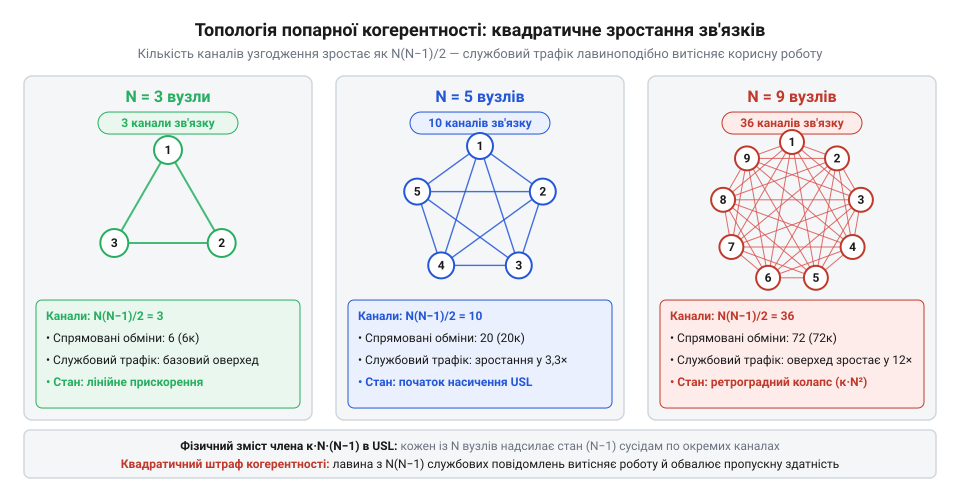
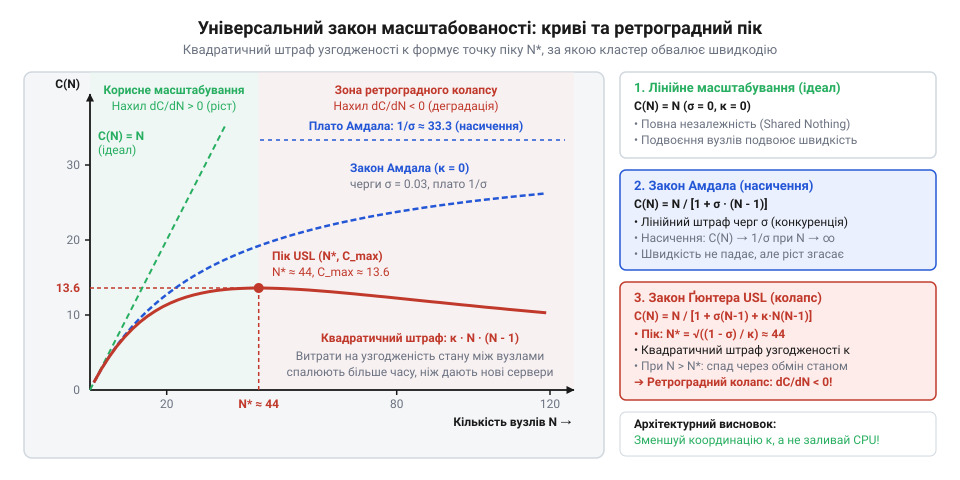

# Універсальний закон масштабованості Ґюнтера: математика узгодженості та конкуренції

<preknowlist>
- [Digital Homes v0 — один датчик](root:progarch/dh-v0-one-sensor) — базова архітектура збору телеметрії від сенсорів та первинне уявлення про навантаження системи при переході від локального опитування одного датчика до кластерної обробки потоків подій
</preknowlist>

## Пастка наївного горизонтального масштабування

У платформі керування розумними будинками Digital Homes сервіс узгодження стану пристроїв перестає витримувати наплив даних: тисячі пристроїв щомиті надсилають оновлення температури, положення замків і команди керування. Природна інженерна інтуїція підказує очевидний вихід — застосувати @@en|горизонтальне масштабування@@ (англ. *horizontal scaling*, від лат. *scala* — сходи) і розподілити навантаження між додатковими серверами. Якщо чотири вузли обробляють сорок тисяч запитів за секунду, то вісім мали б подужати вісімдесят тисяч, а тридцять два — розігнати систему майже ввісьмох.

Проте додавання серверів приводить до несподіваного зриву. Перехід із 4 до 8 вузлів збільшує @@en|пропускну здатність@@ (англ. *throughput*) лише до шістдесяти тисяч операцій замість очікуваних вісімдесяти. На 16 вузлах зростання майже зупиняється, ледь сягаючи сімдесяти тисяч, а підключення 32 серверів спричиняє обвал: загальний потік падає до тридцяти тисяч запитів за секунду, тоді як @@en|затримка@@ (англ. *latency*, від лат. *latens* — прихований) зростає в десятки разів.

Замість ефективної [обробки потоків подій](root:progarch/dh-v0-one-sensor) сервери спалюють процесорні такти в чергах блокувань, а внутрішня мережа задихається від координаційних повідомлень. Кожен новий вузол змушений узгоджувати стан з усіма іншими учасниками кластера. Кластер потрапляє в зону @@lat|ретроградної деградації@@ (від лат. *retrogradus* — той, що задкує, зворотний рух): нове залізо не просто втрачає користь, а активно знищує загальну швидкодію.

Цей зрив руйнує наївну віру в безмежну лінійність кластерів. Доки внутрішні накладні витрати на черги й узгодження стану не описані математично, нарощування вузлів лишається сліпою лотереєю. Щоб заздалегідь обчислити межу ефективності й не допустити колапсу, потрібна строга аналітична модель.

## Закон Амдала та штраф серіалізації

Коли система не масштабується лінійно, виникає потреба кількісно оцінити, де саме втрачається продуктивність. У 1967 році комп'ютерний архітектор Джин Амдал сформулював @@en|закон Амдала@@ (англ. *Amdahl's law*, на честь автора), який розділяє будь-яку обчислювальну роботу на дві складові: ту, яку можна виконувати паралельно, і ту, що виконується строго послідовно.

У контексті [архітектури програмних систем](root:progarch/what-is-architecture) послідовна частка часу `σ` (грецька літера «сигма», де `0 ≤ σ ≤ 1`) — це не просто неоптимізований код. Це @@lat|серіалізація@@ (від лат. *series* — ряд, черга), тобто @@en|конкуренція@@ (англ. *contention*, від лат. *contendere* — змагатися) за спільні неподільні ресурси. Вузли змушені ставати в чергу до єдиного журналу транзакцій, очікувати на захоплення централізованого м'ютекса чи блокування спільних рядків у базі даних. У @@en|теорії черг@@ (англ. *queueing theory*) такий монопольний ресурс моделюють чергою @@en|M/M/1@@, де затримка очікування прямує до нескінченності при наближенні навантаження до пропускної здатності черги. Цей зв'язок розкриває фізичний зміст частки серіалізації `σ`: якщо одиничний обсяг роботи на одному вузлі триває час `T(1)`, то частка `σ·T(1)` вимагає монопольного доступу й не прискорюється взагалі, тоді як паралельна частина `(1 - σ)·T(1)` рівномірно ділиться між `N` вузлами.

Час виконання сумарної роботи `T(N)` на кластері з `N` вузлів обчислюється як сума послідовної та розподіленої частин:

```
T(N)
= T_seq + T_par / N              [розподіл часу виконання]
= σ·T(1) + (1 - σ)·T(1) / N       [підстановка часток]
```

Знаючи час виконання, знаходимо @@en|коефіцієнт прискорення@@ (англ. *speedup*) `C(N)` як відношення часу обробки на одному вузлі `T(1)` до часу на `N` вузлах `T(N)`:

```
C(N)
= T(1) / T(N)                    [означення коефіцієнта прискорення]
= 1 / (σ + (1 - σ) / N)          [скорочення на T(1)]
= N / (1 + σ·(N - 1))            [множення чисельника й знаменника на N]
```

Отриманий вираз показує, як лінійний знаменник `1 + σ·(N - 1)` сповільнює приріст системи. Якщо спрямувати кількість вузлів до нескінченності (`N → ∞`), дріб `(1 - σ) / N` прямує до нуля, а максимальне прискорення `C_max` неминуче впирається в горизонтальне плато:

```
C_max
= lim_{N → ∞} C(N)               [граничний перехід за кількістю вузлів]
= 1 / σ                          [обчислення границі]
```

**Розрахунок межі прискорення за частки серіалізації σ = 0.05:**

```
C_max
= 1 / 0.05                       [підстановка частки серіалізації]
= 20                             [теоретична стеля прискорення]
```

Навіть якщо послідовна частка становить лише п'ять відсотків (`σ = 0.05`), система фізично не здатна прискоритися більше ніж у 20 разів, скільки б серверів до неї не додали: за ста вузлів прискорення складе лише `C(100) = 100 / (1 + 0.05 · 99) ≈ 16.8`.

Проте @@en|закон Амдала@@ має критичну ваду. Функція `C(N)` є строго монотонною: вона зростає й наближається до асимптоти `1 / σ`, але ніколи не спадає. Модель стверджує, що додавання серверів у гіршому разі просто перестане приносити користь. Вона принципово не здатна пояснити катастрофу, коли після 16 вузлів пропускна здатність стрімко падає. Для опису колапсу потрібен ще один фізичний фактор.

## Когерентність стану та квадратичний штраф

Причину ретроградного колапсу відкрив комп'ютерний аналітик Ніл Ґюнтер, сформулювавши @@en|універсальний закон масштабованості@@ (англ. *Universal Scalability Law*, скорочено @@en|USL@@). У розподілених і багатоядерних системах вузли не лише простоюють у чергах до серійних ресурсів, а й змушені постійно синхронізувати спільні дані між собою. Цю координацію називають @@lat|когерентністю@@ (від лат. *cohaerere* — бути зв'язаним, зчіплюватися) або @@en|перехресними завадами@@ (англ. *crosstalk*): вона виникає під час інвалідації розподіленого кешу, голосування за лідера чи узгодження реплік.

Щоб підтримувати єдиний стан у системі з `N` вузлів без виділеного координатора, кожен сервер має обмінятися повідомленнями з усіма іншими `(N - 1)` учасниками. Утворюється @@en|повнозв'язна топологія@@ (англ. *full mesh*), де загальна кількість попарних каналів зв'язку `P(N)` визначається кількістю комбінацій із `N` елементів по 2:

```
P(N)
= N·(N - 1) / 2                  [кількість ребер у повному графі з N вершин]
```


*Зі збільшенням кількості вузлів число координаційних зв'язків зростає комбінаторно як N·(N - 1) / 2, перетворюючи мережу на вузьке місце системи.*

Оскільки кожен із `N` вузлів надсилає сповіщення `(N - 1)` сусідам і обробляє `(N - 1)` відповідей, загальне комунікаційне навантаження системи масштабується пропорційно `N·(N - 1)`. Якщо кожна попарна транзакція узгодження затримує роботу вузла на безрозмірний коефіцієнт когерентності `κ` (грецька літера «каппа», `κ ≥ 0`), сумарний штраф за узгодженість стану зростає квадратично як `κ·N·(N - 1)`.

Фізичну основу цього штрафу розкриває розподіл часу виконання операції `T(N)` на кожному з `N` обчислювальних вузлів. Як і в моделі Амдала, корисна обчислювальна робота `(1 - σ)·T(1)` рівномірно ділиться між `N` серверами, а послідовна частка `σ·T(1)` витрачається на очікування в чергах до монопольних ресурсів. До них додається час, який вузол витрачає на попарний обмін повідомленнями з усіма іншими `(N - 1)` учасниками: кожна транзакція затримує його на частку `κ·T(1)`, утворюючи локальну затримку `κ·(N - 1)·T(1)`. Додавши ці три складові, дістаємо середній час обробки завдання одним вузлом кластера:

```
T(N)
= (1 - σ)·T(1) / N + σ·T(1) + κ·(N - 1)·T(1) [додавання витрат на координацію до закону Амдала]
= T(1)·[(1 - σ) / N + σ + κ·(N - 1)]         [винесення базового часу T(1) за дужки]
```

Локально для окремого вузла комунікаційна затримка `κ·(N - 1)` зростає лише лінійно зі збільшенням кількості сусідів у кластері. Проте системний @@en|коефіцієнт прискорення@@ є оберненою величиною до часу: `C(N) = T(1) / T(N) = 1 / [(1 - σ) / N + σ + κ·(N - 1)]`. Щоб усунути дріб у знаменнику, чисельник і знаменник множать на кількість вузлів `N`. Паралельна та послідовна частини дають знайомий вираз конкуренції `(1 - σ) + σ·N = 1 + σ·(N - 1)`. Водночас локальний комунікаційний штраф вузла `κ·(N - 1)` через домноження знаменника на `N` масштабується на весь кластер і перетворюється на квадратичний член `κ·N·(N - 1)`. Додавши квадратичний штраф когерентності до знаменника функції відносного прискорення поруч зі штрафом @@en|конкуренції@@ `σ·(N - 1)`, дістаємо повне рівняння універсального закону масштабованості:

```
C(N)
= N / (1 + σ·(N - 1) + κ·N·(N - 1)) [повне рівняння USL Ґюнтера]
```

Рівняння @@en|USL@@ узагальнює попередні моделі через поведінку коефіцієнтів:
— за відсутності витрат на когерентність (`κ = 0`) квадратичний член зникає, і формула вироджується в класичний @@en|закон Амдала@@ `C(N) = N / (1 + σ·(N - 1))`;
— за відсутності як когерентності, так і конкуренції (`σ = 0` та `κ = 0`), знаменник дорівнює одиниці, даючи ідеальне лінійне масштабування `C(N) = N`.

Параметри `σ` та `κ` мають принципово різну фізичну природу: лінійний штраф `σ` описує затримки очікування в чергах до монопольних ресурсів, тоді як квадратичний штраф `κ` відображає вибух координаційного трафіку між вузлами. Саме присутність доданка `κ·N²` у знаменнику спричиняє обвал: коли `N` стає достатньо великим, квадратичні витрати на узгодження починають зростати швидше за кількість обчислювачів, неминуче штовхаючи пропускну здатність униз.

## Точка екстремуму та ретроградний колапс

Рівняння @@en|USL@@ описує не лише зростання продуктивності, а й наступний спад. Оскільки знаменник містить квадратичний член `κ·N²`, крива швидкодії `C(N)` має локальний максимум — @@lat|точку екстремуму@@ (від лат. *extremum* — край, крайня межа), за якою подальше масштабування починає руйнувати систему.

Щоб знайти пік пропускної здатності, візьмемо першу похідну функції відносного прискорення за кількістю вузлів `N`:

```
dC/dN
= d/dN (N / (1 + σ·(N - 1) + κ·N·(N - 1)))            [похідна частки]
= ((1 - σ) - κ·N²) / (1 + σ·(N - 1) + κ·N·(N - 1))²   [диференціювання за N]
```

Знаменник дробу завжди додатний, тому знак похідної визначається винятково чисельником. Прирівнявши його до нуля `(1 - σ) - κ·N² = 0`, виводимо аналітичну формулу точки глобального максимуму `N*`:

```
N*
= √((1 - σ) / κ)                     [розв'язок відносно N]
```

Знак похідної розмежовує два стани системи:
— за `N < N*` похідна додатна (`dC/dN > 0`), і кластер демонструє корисне масштабування;
— за `N > N*` похідна стає від'ємною (`dC/dN < 0`), занурюючи систему в @@lat|ретроградну зону@@ (від лат. *retrogradus* — зворотний рух, що задкує) колапсу, де кожен додатковий сервер безповоротно знищує корисну пропускну здатність через вибух координаційного трафіку.


*Геометрія кривої USL: точка піку розмежовує ефективне розширення та ретроградний спад, де додавання нових вузлів руйнує швидкодію.*

Щоб знайти пікову швидкодію, поділимо чисельник і знаменник вихідного рівняння @@en|USL@@ на кількість серверів `N`, записавши знаменник функції у формі `(1 - σ) / N + σ + κ·(N - 1)`. Для реальних розподілених систем оптимальний розмір кластера значно перевищує одиницю (`N* ≫ 1`), що дозволяє знехтувати одиницею у штрафі когерентності та прийняти спрощення `N* - 1 ≈ N*`. Підставивши значення точки екстремуму `N* = √((1 - σ) / κ)` у знаменник, розкриваємо покрокові алгебраїчні перетворення для оберненої величини швидкодії `1 / C(N*)`:

```
1 / C(N*)
= (1 - σ) / N* + σ + κ·(N* - 1)               [ділення чисельника й знаменника на N*]
≈ (1 - σ) / N* + σ + κ·N*                     [спрощення N* - 1 ≈ N* за умови N* ≫ 1]
= (1 - σ) / √((1 - σ) / κ) + σ + κ·√((1 - σ) / κ) [підстановка координати екстремуму N*]
= √(κ·(1 - σ)) + σ + √(κ·(1 - σ))             [внесення коефіцієнтів під знак кореня]
= σ + 2·√(κ·(1 - σ))                          [зведення подібних доданків]
```

У точці глобального максимуму питомий час паралельних обчислень `(1 - σ) / N*` точно врівноважує питомі втрати на узгодження стану `κ·N*`: обидва доданки набувають однакового значення `√(κ·(1 - σ))` і формують подвоєний корінь `2·√(κ·(1 - σ))`. Підставивши координату `N*` у вихідне рівняння, обчислюємо граничну пропускну здатність системи `C_max`:

```
C_max
= C(N*)                              [значення швидкодії в точці екстремуму]
≈ 1 / (σ + 2·√(κ·(1 - σ)))           [підстановка N* у вираз USL]
```

**Розрахунок оптимального розміру кластера за σ = 0.03 та κ = 0.001:**

```
N*
= √((1 - 0.03) / 0.001)              [підстановка параметрів кластера]
= √(0.97 / 0.001)                    [обчислення підкореневого виразу]
≈ 31                                 [цілочисельний оптимум вузлів]
```

За 31 вузла кластер [обробки потоків подій](root:progarch/dh-v0-one-sensor) платформи Digital Homes сягає пікового прискорення `C_max ≈ 11.8`. Проте додавання 64 вузлів через ретроградний колапс відкидає продуктивність системи до рівня лише 6 серверів.

## Підбір коефіцієнтів за вимірюваннями навантаження

Щоб застосувати @@en|USL@@, параметри `σ` та `κ` вилучають із навантажувальних випробувань. Вимірявши стабільну пропускну здатність `X(N)` за різної кількості вузлів `N`, обчислюють емпіричний @@en|коефіцієнт прискорення@@ `C(N) = X(N) / X(1)` відносно одного сервера `X(1)`.

Замість ітеративних методів [числової нелінійної оптимізації](root:math-numeric/nonlinear-optimization-algorithms) (алгоритму Левенберга–Марквардта чи градієнтного спуску), рівняння @@en|USL@@ зводять до лінійної форми. Поділивши кількість вузлів `N` на прискорення `C(N)` і віднявши одиницю, отримуємо надлишкові витрати системи:

```
N / C(N) - 1
= 1 + σ·(N - 1) + κ·N·(N - 1) - 1        [підстановка USL для N / C(N)]
= σ·(N - 1) + κ·N·(N - 1)                [зведення подібних доданків]
```

Вираз розпадається на два лінійні доданки. Позначивши залежну змінну `Y = N / C(N) - 1`, а предиктори `X₁ = N - 1` та `X₂ = N·(N - 1)`, маємо лінійну формулу `Y = σ·X₁ + κ·X₂`. Для серії спостережень вектор параметрів `β = [σ, κ]ᵀ` обчислюють у замкненому вигляді через @@lat|регресію@@ (від лат. *regressio* — зворотний рух) @@en|методом найменших квадратів@@ (англ. *least squares*) без вільного члена:

```
β
= (Xᵀ·X)⁻¹·Xᵀ·Y                          [оцінка параметрів МНК]
```

Матриця `X` містить стовпці `X₁` та `X₂`, а вектор `Y` — результати випробувань, даючи точний аналітичний розв'язок.

Якість моделі оцінюють статистично. @@lat|Коефіцієнт детермінації@@ (від лат. *determinare* — визначати) `R²` показує частку поясненої дисперсії. У класичній @@lat|регресії@@ цей показник зіставляє суму квадратів залишків `∑ (y - ŷ)²` між виміряними точками `y` та оцінками моделі `ŷ` із загальною сумою квадратів відхилень навколо вибіркового середнього `∑ (y - ȳ)²`. Вільний член змушує лінію проходити крізь вибіркове середнє `ȳ`: сума залишків тотожно дорівнює нулю, а загальна дисперсія строго розпадається на пояснену та залишкову частини, утримуючи значення `R²` у межах від нуля до одиниці.

Проте лінеаризоване рівняння @@en|USL@@ принципово позбавлене вільного члена: для одного вузла `N = 1` надлишкові витрати строго дорівнюють нулю (`Y = 1 / 1 - 1 = 0`), що фіксує модель у точці початку координат `(0, 0)`. Лінія без вільного члена не зобов'язана проходити крізь вибіркове середнє `ȳ`. Через це сума залишків не дорівнює нулю, а класичний розклад дисперсії навколо середнього руйнується: залишкова сума квадратів `∑ (y - ŷ)²` може перевищити варіацію навколо середнього `∑ (y - ȳ)²`. Класична формула дає штучно спотворене або навіть від'ємне значення `R²`, хибно вказуючи на непридатність цілком точної моделі.

Щоб усунути це спотворення, відлік повної дисперсії переносять із середнього значення у зафіксований нуль, замінюючи знаменник нецентрованою сумою квадратів `∑ y²`. Завдяки ортогональності залишків до простору предикторів розклад повної суми квадратів зберігається, визначаючи нецентрований коефіцієнт детермінації:

```
R²
= 1 - ∑ (y - ŷ)² / ∑ y²                   [нецентрована дисперсія відносно нуля]
= ∑ ŷ² / ∑ y²                            [частка поясненої суми квадратів]
```

Отримана оцінка коректно відображає якість апроксимації через початок координат, а значення `R² > 0.95` свідчить про надійну відповідність кривої даним. Додатково аналізують @@lat|залишки регресії@@ (від лат. *residuum* — залишок) — різницю між виміряними та розрахованими точками: їхній випадковий розкид навколо нуля підтверджує коректність моделі.

Систематична кривина залишків викриває пастки вимірювання:
— недостатній прогрів кешів завищує штраф конкуренції `σ` через початкові промахи;
— переповнення системних буферів і черг сокетів спричиняє штучний стрибок затримок;
— нестаціонарне фонове навантаження спотворює коефіцієнт когерентності `κ`.

Усунувши ці похибки під час тестування [кластера телеметрії датчиків](root:progarch/dh-v0-one-sensor), інженер отримує достовірні коефіцієнти для точного розрахунку точки екстремуму й межі горизонтального масштабування.

## Архітектурні компроміси та межі моделі

Формули моделі безпосередньо керують [вибором системної архітектури](root:progarch/what-is-architecture). Дослідження чутливості точки екстремуму `N* = √((1 - σ) / κ)` розкриває фундаментальну асиметрію між коефіцієнтами. Чисельник `(1 - σ)` обмежений одиницею, тому навіть ідеальна ліквідація черг до спільних ресурсів (`σ → 0`) зсуває пік продуктивності лише на лічені відсотки. Натомість коефіцієнт когерентності `κ` стоїть у знаменнику під коренем. Зменшення `κ` у сто разів відсуває межу колапсу `N*` рівно вдесятеро. Оскільки штраф за когерентність масштабується квадратично, боротьба з перехресними завадами дає на порядок більший інженерний важіль, ніж оптимізація послідовних ділянок.

Ця залежність математично обґрунтовує ключові патерни розподілених систем. Замість синхронних [протоколів розподіленого консенсусу](root:sf-distributed/consensus-problem) (Raft чи Paxos) та блокувальної @@en|двофазної фіксації@@ (англ. *two-phase commit*, скорочено 2PC), високонавантажені сервіси обирають @@en|кінцеву узгодженість@@ (англ. *eventual consistency*). Щоб звести до нуля попарні координаційні зв'язки `N·(N - 1)`, стан розділяють за принципом @@en|архітектури без спільного стану@@ (англ. *shared-nothing architecture*) або ізолюють через @@en|шардування@@ (від англ. *shard* — уламок). Кожне з цих рішень є спрямованим ударом по параметру `κ`: воно мінімізує попарну балакучість вузлів і наближає систему до лінійного зростання.

Водночас USL лишається аналітичною моделлю з чіткими межами застосовності:
— **Однорідність і топологія.** Рівняння припускає ідентичну продуктивність вузлів і симетричний повнозв'язний обмін. Поява виділеного лідера, асиметричних зв'язків або одного повільного вузла спотворює геометрію втрат.
— **Стаціонарність черг.** Модель фіксує незмінний профіль навантаження. Різкий стрибок частки операцій запису миттєво змінює емпіричні коефіцієнти `σ` та `κ`.
— **Фазові переходи.** USL згладжує спад продуктивності неперервною функцією. У реальності вичерпання пулу з'єднань, дефіцит оперативної пам'яті чи тривалі паузи збирача сміття спричиняють лавиноподібний обвал системи задовго до розрахованого піку.

Розуміння цих меж дозволяє архітектору спиратися на аналітичні розрахунки USL для вибору компромісів між узгодженістю та масштабованістю, водночас чітко розпізнаючи границі, де спрощена модель потребує корекції.
