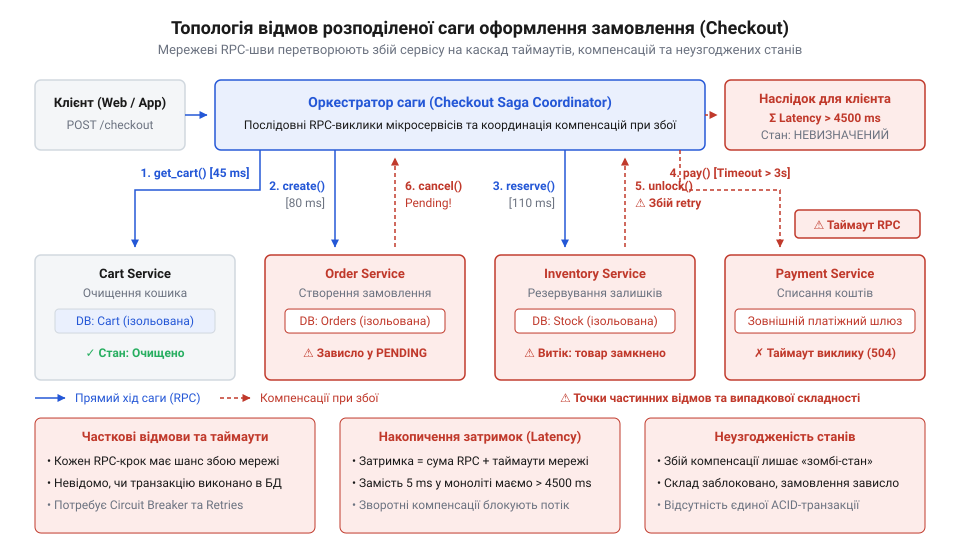
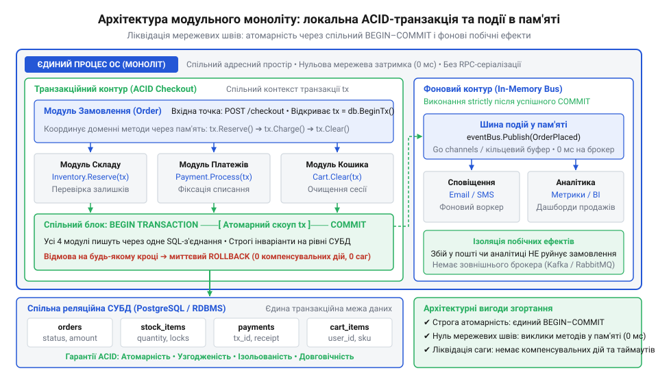

# Ліквідація масштабового перекосу: згортання розподіленої саги в модульний моноліт

<preknowlist>
- [Digital Homes v0 — один датчик](root:progarch/dh-v0-one-sensor) — відокремлення внутрішньої логіки від публічного інтерфейсу модуля та принципи інкапсуляції стану при збереженні автономності компонентів
</preknowlist>

## Аварія саги та діагностика перекосу

Під час святкового розпродажу покупець натискає кнопку оформлення замовлення: браузер підвисає на кілька секунд і повертає помилку сервера. Покупець перевіряє банківський застосунок — кошти з картки списано. Проте в особистому кабінеті статус замовлення позначено як скасований, а потрібний товар у магазині зник, бо складська система вважає його зарезервованим. Бізнес-процес розірвався посередині, залишивши дані системи у взаємно суперечливому стані.

Такий збій виникає через спробу координувати транзакційний процес через фізичну мережу. Процес покупки штучно розділили між чотирма сервісами: `Cart`, `Inventory`, `Payment` та `Order`. Щоб узгодити їхній стан без спільної бази даних, застосовано [патерн розподіленої саги](root:sf-distributed/saga-pattern) (від давньоісл. @@non|saga@@ — оповідь; англ. @@en|saga pattern@@) з викликами через центральний @@en|оркестратор@@ (від грец. @@grc|orkhestra@@ — майданчик перед сценою; англ. @@en|orchestrator@@). Склад успішно забронював позиції, платіжний шлюз провів транзакцію, а служба замовлень створила запис. Аварія сталася на фінальному кроці: мережевий виклик очищення кошика завершився таймаутом. Не отримавши підтвердження, координатор ініціював зворотний ланцюжок — @@en|компенсувальні дії@@ (від лат. @@la|compensare@@ — урівноважувати; англ. @@en|compensating transactions@@) для повернення коштів і зняття броні. Проте під піковим навантаженням мережеві канали деградували: запити на компенсацію самі зазнали таймаутів, а лавиноподібні повторні спроби остаточно перевантажили черги повідомлень.

*Каскад частинних відмов у мережевій сазі: мережевий збій очищення кошика руйнує узгодженість стану між сервісами, а таймаути компенсувальних дій перевантажують черги повідомлень і блокують ресурси.*

Ця катастрофа наочно виявляє @@en|масштабовий перекіс@@ (англ. @@en|scale mismatch@@): штучне рознесення цілісної бізнес-операції по мережевих вузлах породило важку [випадкову складність](root:progarch/what-is-architecture). Замість надійності система отримала каскадні таймаути, неможливість гарантувати строгу атомарність і крихку компенсаційну логіку, супровід якої коштує дорожче за сам продукт. Якщо підсистемам не потрібне незалежне масштабування різними темпами, розподілений контур лише шкодить. Інженерне розв'язання цієї кризи полягає в ліквідації мережевих швів: згортанні взаємодії в єдиний процес — @@en|модульний моноліт@@ (від лат. @@la|modulus@@ — міра та грец. @@grc|monolithos@@ — суцільний камінь; англ. @@en|modular monolith@@) зі строгими локальними транзакціями.

## Ліквідація мережевих швів та консолідація

Кожна міжсервісна взаємодія між розрізненими компонентами `Cart`, `Inventory`, `Payment` та `Order` змушена проходити крізь мережевий стек операційної системи. Сервіс-відправник виділяє буфери пам'яті, копіює дані, виконує серіалізацію у формат `Protobuf` або `JSON` і надсилає байти крізь мережевий сокет. На боці отримувача процес розбирає пакети, виділяє пам'ять під проміжні структури й транслює потік у локальні типи. Цей транспортний бар'єр утворює @@en|мережеві шви@@ (англ. @@en|network seams@@) — штучні розриви в адресному просторі, де звичайний виклик функції перетворюється на мережевий запит із ризиком таймаутів, затримок і втрати пакетів.

Рефакторинг розпочинається з фізичного об'єднання розрізнених сервісів в єдину кодову базу — @@en|консолідації@@ (від лат. @@la|consolidare@@ — ущільнювати, з'єднувати; англ. @@en|consolidation@@) компонентів усередині одного процесу операційної системи. Щойно сервіси опиняються в спільному просторі пам'яті, потреба в мережевому транспорті зникає. У розподіленій системі компоненти взаємодіяли крізь @@en|клієнтські заглушки@@ (англ. @@en|client stubs@@), які імітували виклики локальних методів, але насправді керували мережевими сокетами, таймаутами та повторними спробами. Під час @@en|консолідації@@ ці заглушки разом із клієнтами `HTTP` чи `gRPC` та проміжними моделями серіалізації — @@en|об'єктами передачі даних@@ (англ. @@en|data transfer objects@@, `DTO`) — повністю усувають. Замість віддалених викликів використовують @@en|впровадження залежностей@@ (англ. @@en|dependency injection@@) екземплярів модулів під час ініціалізації процесу: точка входу програми створює екземпляри `Cart`, `Inventory` та `Payment` і передає прямі посилання на них у конструктор модуля `Order`. Звернення модуля замовлень до модуля складу більше не вимагає мережевих сокетів і перемикання контексту ядра: передача типізованих структур зводиться до прямого виклику методу в спільній оперативній пам'яті та швидкого копіювання вказівника за лічені наносекунди.

Фізичне об'єднання не повинно призводити до розмивання архітектурних кордонів, інакше моноліт перетвориться на некерований «клубок спагеті». Щоб зберегти логічну автономію, [межі доменних модулів](root:sf-apps/modular-domain-boundaries) фіксують на рівні ізольованих пакетів кодової бази. За зразком [відокремлення внутрішньої логіки](root:progarch/dh-v0-one-sensor) від публічного контракту, кожен контекст робить власні структури даних, схеми сховища та службові методи приватними. Взаємодія між модулями відбувається виключно через експортований типізований @@en|інтерфейс@@ (від лат. @@la|inter@@ — між та @@la|facies@@ — зовнішній вигляд; англ. @@en|interface@@). Така ізоляція забезпечує сувору інкапсуляцію доменів без мережевих накладних витрат.

## Згортання саги в локальну транзакцію

Хоча мережеві шви між модулями ліквідовано, збереження старої логіки саги залишає систему крихкою. Якщо [архітектура бізнес-процесу](root:progarch/what-is-architecture) продовжує координувати оформлення покупки через покроковий @@en|оркестратор@@ із чергами та компенсувальними діями, програма й далі страждає від проміжних неузгоджених станів. Будь-який збій на фінальному кроці вимагає складного ланцюжка ручного відновлення, дарма що всі учасники операції вже працюють у спільному середовищі й можуть використовувати єдине сховище даних.

Оскільки доменні пакети `Inventory`, `Payment` та `Order` тепер під'єднані до спільної реляційної бази даних, розподілений оркестратор повністю демонтують. Усі операції з оформлення замовлення переносять під захист [локальної ACID-транзакції](root:sf-data/transactions-acid) (від лат. @@la|transactio@@ — здійснення, угода; англ. @@en|local transaction@@). Перевірку й резервування залишків на складі, запис статусу платежу та створення сутності замовлення об'єднують у межах одного блоку `BEGIN TRANSACTION ... COMMIT`. Усі три домени виконують свої запити крізь спільне транзакційне з'єднання, отримуючи гарантії абсолютної атомарності та ізоляції без жодних мережевих протоколів узгодження.

Коли кілька покупців одночасно оформлюють замовлення на останній товар на складі, виникає @@en|стан гонитви@@ (англ. @@en|race condition@@): без належної ізоляції система списує залишок двічі й продає те, чого вже немає. У розподіленій архітектурі захист від таких конфліктів вимагав складних розподілених блокувань. У модульному моноліті модуль `Inventory` розв'язує проблему безпосередньо в реляційній базі даних: під час перевірки залишків він виконує запит `SELECT ... FOR UPDATE`. Ця операція накладає ексклюзивне @@en|блокування рядків@@ (англ. @@en|row-level locking@@) на запис конкретного товару, шикуючи конкурентні транзакції в чергу до завершення поточної операції. Головна перевага такого переходу розкривається під час збоїв: якщо товару на складі бракує або банківський шлюз повертає помилку, СУБД виконує автоматичний @@en|відкат@@ (англ. @@en|rollback@@). За лічені мікросекунди рушій бази даних повертає змінені рядки до вихідного стану на рівні журналу випереджального запису та знімає блокування. Системі більше не потрібні фонові координатори, таблиці @@en|Outbox@@ чи ненадійні @@en|компенсувальні дії@@: незавершена транзакція просто не фіксується, що миттєво повертає дані до строго узгодженого стану.

*Цільова архітектура після згортання: локальна ACID-транзакція гарантує атомарність оновлення замовлення, складу й оплати, а побічні ефекти обробляє внутрішньопроцесна шина подій.*

Дії, які неможливо скасувати відкатом бази даних — надсилання листів покупцеві чи збір аналітики, — виносять за межі транзакційного контуру. Щойно блок `COMMIT` успішно зафіксував зміни, домен замовлень публікує подію у [внутрішньопроцесну шину подій](root:sf-apps/in-memory-event-bus) (англ. @@en|in-memory event bus@@). Асинхронні підписники отримують типізовані структури безпосередньо з оперативної пам'яті. Таке розмежування відокремлює повільні побічні операції від транзакційного ядра, захищаючи базу даних від довгих блокувань і гарантуючи миттєву відповідь користувачеві.

## Типізовані події в пам'яті процесу

Об'єднання операцій у локальну транзакцію гарантує цілісність даних, проте створює спокусу виконувати всі подальші дії всередині того самого атомарного блоку. Якщо модуль замовлень намагається надіслати листа з квитанцією, відправити @@en|push-сповіщення@@ (англ. @@en|push notification@@) клієнту чи оновити аналітичну панель до фіксації змін, транзакція стає заручником зовнішніх мережевих запитів. Затримка звернення до поштового сервера чи аналітичного шлюзу може коливатися від сотень мілісекунд до десятків секунд у разі таймауту. Упродовж усього цього часу відкрите транзакційне з'єднання утримує @@en|блокування рядків@@ (англ. @@en|row-level locking@@) у таблиці залишків, вичерпує пул з'єднань із базою даних і паралізує обслуговування інших покупців. Ба більше, мережевий збій під час надсилання листа змусив би виконати @@en|відкат@@ успішно оплаченого замовлення, що спотворює бізнес-логіку.

Щоб не перевантажувати транзакційне ядро, другорядні @@en|побічні ефекти@@ (від лат. @@la|effectus@@ — дія, наслідок; англ. @@en|side effects@@) відокремлюють від критичних інваріантів системи. У розподіленій архітектурі для цього зазвичай розгортають важкі зовнішні @@en|брокери повідомлень@@ (англ. @@en|message brokers@@) на зразок `Kafka` чи `RabbitMQ`. Проте всередині єдиного процесу зовнішня черга повертає ту саму випадкову складність: приносить мережеві затримки, вимагає серіалізації структур у байти та змушує підтримувати окремий інфраструктурний кластер. Оскільки всі доменні модулі тепер виконуються в спільному адресному просторі, взаємодію організовують через @@en|внутрішньопроцесну шину подій@@ за моделлю @@en|публікація-підписка@@ (від лат. @@la|publicare@@ — робити публічним; англ. @@en|publish-subscribe@@).

Механізм базується на суворому розмежуванні часових меж: модуль замовлень спочатку завершує транзакцію викликом `COMMIT`, і лише після її успіху публікує незмінну [доменну подію](root:sf-apps/domain-events) (від лат. @@la|evenire@@ — траплятися; англ. @@en|domain event@@) `OrderPlaced`. Шина подій не виконує серіалізації, а миттєво доставляє типізований вказівник на структуру в оперативній пам'яті зареєстрованим підписникам. Модулі сповіщень та аналітики підписуються на подію й обробляють виклики асинхронно в окремих @@en|горутинах@@ (англ. @@en|goroutines@@) або фонових потоках виконання. Така [архітектура взаємодії](root:progarch/what-is-architecture) скорочує час відповіді клієнту до лічених мілісекунд, надійно захищає базу даних від довгих блокувань і позбавляє систему потреби у важких зовнішніх чергах.

## Порівняння метрик та обґрунтування спрощення

Коли змінюється [архітектура програмної системи](root:progarch/what-is-architecture), бізнесу й технічному керівництву потрібні тверді інструментальні докази, а не естетичні уподобання інженерів. Без чисельних вимірювань повернення до модульного моноліту сприйматимуть як крок назад. Комплексний тестовий стенд перевіряє систему до і після згортання за трьома осями: затримка відповіді, утилізація ресурсів і складність кодової бази.

Перша вісь — затримка обробки запиту. Навантажувальне тестування виявляє поведінку системи на 99-му @@la|перцентилі@@ (від лат. *per centum* — на сотню), або @@en|P99@@. У розподіленій схемі послідовні виклики `Cart`, `Inventory`, `Payment` та `Order` спричиняли [накопичення затримок на хвості](root:sf-distributed/tail-latency-amplification) (@@en|tail latency amplification@@, від англ. *tail* — хвіст, *latency* — прихованість, затримка; *amplification* — підсилення) через мережеві буфери й серіалізацію пакетів: затримка @@en|P99@@ сягала 600 мс. У модульному моноліті ті самі операції виконуються прямими викликами функцій у спільній пам'яті, що знижує @@en|P99@@ до 6 мс і стабілізує пропускну здатність.

Друга вісь — утилізація обчислювальних ресурсів. Усунення мережевих швів дозволяє повністю вимкнути допоміжні @@en|sidecar@@-проксі (від англ. *sidecar* — причіпний візок) та черги брокерів, які витрачали системні ресурси на маршалінг даних і мережеві протоколи. Споживання процесора та оперативної пам'яті скорочується на 65–70%, що прямо зменшує щомісячні рахунки за хмарну інфраструктуру.

Третя вісь — складність і обсяг коду. Ліквідація сага-оркестратора, розподілених повторних спроб, таймаутів і транзитних @@en|DTO@@ скорочує кодову базу контуру замовлення на 80%. Разом із мережевим клеєм зникає приховане джерело дефектів, пов'язане з розсинхронізацією контрактів між сервісами.

Практичний алгоритм захисту архітектурного спрощення будується як послідовний ланцюжок доказів. Спершу керівництву показують пряму фінансову економію від скорочення серверних ресурсів. Далі демонструють стократне прискорення відгуку на @@en|P99@@, яке захищає конверсію оформлення замовлень від мережевих збоїв. Фінальним доказом стає скорочення кодової бази: інженери перестають супроводжувати інфраструктурний клей, що повертає продукту високу швидкість розвитку.
