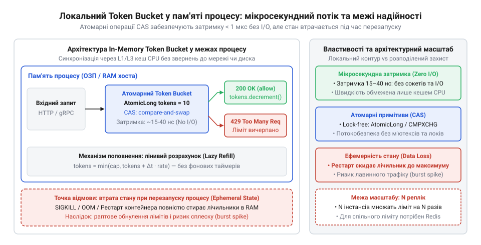
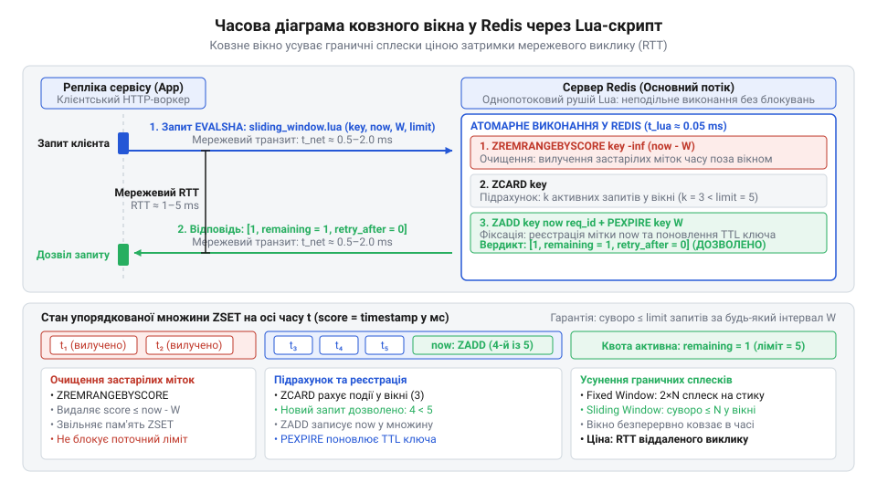
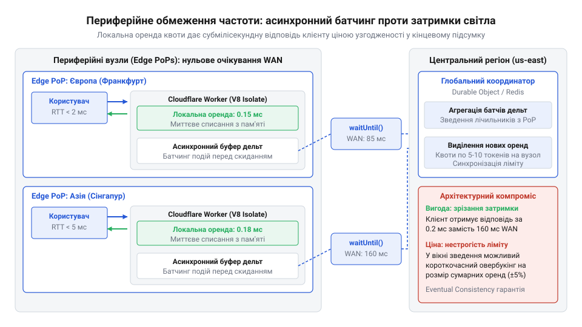
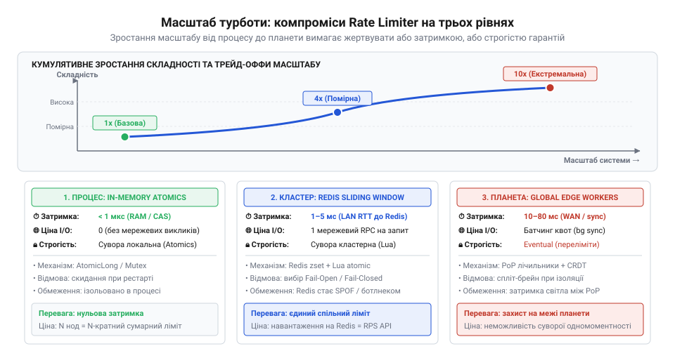

# Масштаб турботи

<preknowlist>
- [Архітектура](root:progarch/what-is-architecture) — розуміння якісних атрибутів (продуктивність, надійність) та концепції компромісів в архітектурних рішеннях.
- [Digital Homes v0 — один датчик](root:progarch/dh-v0-one-sensor) — базове уявлення про структуру сервісів та потік запитів від пристрою до сервера.
</preknowlist>

## Неконтрольований потік і три масштаби захисту

Уявіть ситуацію: розгорнута система розумного дому, така як у [Digital Homes v0 — один датчик](root:progarch/dh-v0-one-sensor), нормально обробляє сотні запитів на секунду. Раптово у мікрорайоні відновлюється електропостачання після аварійного відключення. Тисячі датчиків одночасно перезавантажуються й синхронно надсилають телеметрію на сервер. Або інший випадок: у сторонньому мобільному клієнті через помилку в коді цикл повторних спроб (@@en|retry loop@@) починає без паузи бомбардувати API.

Шторм запитів миттєво вичерпує пул потоків обробки, завантажує процесор на 100% та переповнює пул з'єднань із базою даних. Усі наступні легітимні користувачі отримують таймаути або помилки 500. Ще катастрофічніша ситуація виникає, коли сервіс викликає платне зовнішнє API (наприклад, платіжний шлюз Stripe або модель OpenAI): за кілька хвилин неконтрольованого зациклення система згенерує рахунок на десятки тисяч доларів.

Щоб захистити обчислювальні ресурси та бюджет від таких сплесків, в архітектуру впроваджують обмежувач частоти запитів (@@en|rate limiter@@). Це механізм, який рахує інтенсивність звернень від конкретного клієнта або джерела трафіку та відхиляє запити, що перевищують задану норму.

> 🔧 **Навіщо це.** Обмежувач частоти запитів створює керований бар'єр на шляху трафіку, захищаючи обчислювальні ресурси сервісу від перевантаження та запобігаючи неконтрольованим фінансовим витратам на зовнішні API.

Проте обмежувач частоти не є універсальною функцією, яку можна просто вставити в будь-яке місце коду. Його реалізація та гарантії фундаментально залежать від обраного масштабу турботи (@@en|scale of care@@). Як ми знаємо з матеріалу [Архітектура](root:progarch/what-is-architecture), будь-яке архітектурне рішення є компромісом між якісними атрибутами — затримкою відгуку (@@en|latency@@), строгістю гарантій та надійністю під час аварій.

У цій практичній роботі ми розглянемо три якісно різних масштаби розташування обмежувача:

1. **Локальний масштаб (пам'ять процесу / in-memory).** Обмежувач живе безпосередньо у пам'яті застосунку. Перевірка ліміту виконується за наносекунди без мережевого I/O. Проте стан лімітера знищується при перезапуску процесу, а кілька реплік сервісу не знають про витрату квоти одна одної.
2. **Кластерний масштаб (розподілений координатор / Redis).** Спільне сховище зберігає стан для всіх вузлів кластера, забезпечуючи суворе дотримання глобального ліміту. Ціна цього — мережевий стрибок (1–5 мс RTT) на кожен запит та ризик зупинки всього трафіку у разі падіння мережі до сховища (що вимагає вибору аварійних стратегій Fail-Open чи Fail-Closed).
3. **Граничний масштаб (планетарна межа / Edge CDN).** Перевірка відбувається на периферійних вузлах (Cloudflare Workers чи Fastly Compute) поблизу користувача. Це зрізає затримку світла (WAN latency), але вимагає оптимістичного виділення пачок токенів (оренди) та асинхронного фонового батчингу при тимчасовій неузгодженості стану (@@en|eventual consistency@@).

Для уніфікації роботи з обмежувачами на різних масштабах ми визначаємо єдиний Go-інтерфейс `Limiter` та структуру `Decision`, яка повертає вердикт перевірки разом із причинами ухваленого рішення:

:::code proj-multi-scale-rate-limiter/go/ratelimit.go

Інтерфейс `Limiter` приймає контекст, ключ ідентифікації клієнта (наприклад, IP-адресу або ID користувача) та запитувану кількість токенів. Якщо квоту вичерпано, обмежувач повертає `Allowed = false` та час очікування `WaitTime`, за який з'явиться нова квота.

## Локальний Token Bucket на атомарних змінних пам'яті

Коли перед архітектором стоїть завдання захистити окремий вузол обробки з мінімально можливою затримкою, обмежувач реалізують прямо у пам'яті процесу. Найпопулярнішим алгоритмом для цього є Token Bucket (@@en|token bucket@@).

Наївна реалізація алгоритму часто спирається на фоновий таймер, який щосекунди додає токени у відро, та м'ютекс (@@en|mutex@@) для захисту лічильника. Проте фоновий таймер марно витрачає ресурси процесора, коли запитів немає, а м'ютекс під високим паралельним навантаженням створює конкурування потоків (@@en|thread contention@@) та блокує горутини.

Щоб досягти мікросекундної швидкодії з нульовим мережевим I/O, застосовують обчислення токенів за відрізком часу (@@en|lazy refill@@) та безблокувальні атомарні інструкції [Безблокувальне програмування на CAS](root:sf-tasks/cas-lock-free).

Замість постійного фонового поповнення стан відра оновлюється лише в момент надходження запиту. Обмежувач обчислює час `elapsed`, що минув від останнього списання `lastRefill`, і додає відповідну кількість токенів:

```
tokens = min(capacity, oldTokens + elapsed * refillRate)
```

Якщо токенів достатньо, вони списуються, а мітка `lastRefill` оновлюється на поточний час. Усі ці операції виконуються атомарно за допомогою інструкції Compare-And-Swap (CAS).

> 🔧 **Навіщо це.** Безблокувальний Token Bucket на атомарних операціях дозволяє перевіряти й списувати квоту за кілька наносекунд без використання м'ютексів та без мережевих затримок, що ідеально підходить для високонавантажених індивідуальних вузлів.


*Схема поповнення та списання токенів у пам'яті процесу за допомогою атомарних лічильників: розрахунок за відрізком часу забезпечує наносекундне списання без мережевого I/O, проте стан знищується під час перезапуску.*

Розглянемо реалізацію безблокувального обмежувача `AtomicTokenBucket` мовою Go, де знімок стану `bucketState` зберігається в `atomic.Pointer`:

:::code proj-multi-scale-rate-limiter/go/atomic_bucket.go

У цьому коді метод `Allow` працює через безкінечний цикл CAS:
1. `b.state.Load()` зчитує поточний покажчик на стан без блокування інших потоків.
2. Пропорційно до часу, що минув (`elapsed`), обчислюється актуальний залишок токенів `currentTokens`.
3. Якщо доступних токенів менше ніж потрібно (`currentTokens < reqTokens`), обмежувач розраховує час очікування `WaitTime` та негайно повертає відмову `Allowed = false`. Стан у пам'яті при цьому не змінюється.
4. Якщо токени є, формується новий об'єкт `newState` із зменшеним запасом токенів та оновленою міткою часу `now`.
5. Виклик `b.state.CompareAndSwap(oldState, newState)` атомарно замінює покажчик. Якщо за цей час інша горутина не змінила стан, CAS повертає `true`, і запит вважається схваленим (`Allowed = true`). Якщо інша горутина встигла оновити стан раніше — CAS повертає `false`, цикл повторюється і розрахунок виконується заново з актуальними даними.

Такий підхід повністю усуває блокування потоків і дедлоки. Проте локальний масштаб турботи має два суттєві обмеження:

1. **Втрата стану при перезапуску (волатильність).** Оскільки токени зберігаються в RAM процесу, будь-який деплой нової версії, перезапуск контейнера чи паніка скидають накопичений стан. Після перезапуску відро знову стає повним, і сервіс може бути заповнений сплеском трафіку в найвразливіший момент старту.
2. **Розсинхронізація між репліками (replica divergence).** Якщо за балансувальником працює 10 реплік сервісу, і кожна має локальний ліміт 100 запитів/сек, сумарно система пропустить до 1000 запитів/сек. Якщо ж трафік розподіляється нерівномірно (наприклад, через @@en|sticky sessions@@), один вузол може вичерпати квоту й відхиляти запити клієнта, хоча сусідні репліки залишаються повністю вільними.

## Кластерний масштаб: розподілене ковзне вікно у Redis та Lua

Коли додаток зростає з одного процесу до флоту із десятків паралельних реплік за балансувальником навантаження, локальний обмежувач частоти запитів перестає виконувати свою захисну функцію. Якщо кожен екземпляр сервісу зберігає власний лічильник у пам'яті процесу, клієнт із загальним лімітом у 100 запитів на хвилину може зробити по 100 запитів до кожної з трьох реплік. Балансувальник рівномірно розподілить трафік, і система сумарно пропустить 300 запитів замість дозволених 100. Це призведе до перевантаження баз даних або зовнішніх сервісів, описаних у моделі [Digital Homes v0](root:progarch/dh-v0-one-sensor). Спроба ж узгодити стан між репліками через звичайні мережеві операції прочитати-перевірити-записати (англ. @@en|check-then-act@@) розбивається об стан гоніння (англ. @@en|race condition@@): два паралельні HTTP-запити від одного користувача, потрапивши на різні вузли в один і той самий мікросекундний проміжок, прочитають однакові застарілі значення лічильника й обидва отримають дозвіл. Для підтримки єдиної картини виливу потрібен централізований координатор стану — такий як Redis — та спосіб виконувати перевірку й списання як єдину неподільну операцію.

Щоб уникнути мережевих затримок між проміжними кроками перевірки (англ. @@en|round-trip time@@, RTT) та забезпечити строгу [атомарність](root:sf-distributed/redis-lua-atomicity) (лат. @@la|atomus@@ — неподільний), усередині Redis запускають скрипти мовою Lua. Оскільки Redis виконує Lua-скрипти в єдиному основному потоці, жоден інший мережевий запит не може вклинитися між зчитуванням лічильника та його оновленням. Для побудови найточнішої моделі обмеження — розподіленого ковзного вікна (англ. @@en|sliding window log@@) — у Redis використовують впорядковані множини (англ. @@en|sorted set@@, `ZSET`). Кожен вхідний запит додається до `ZSET` із міткою часу у якості балу (англ. @@en|score@@).

Алгоритм виконання складається з чотирьох послідовних кроків у межах одного Lua-скрипта:
1. **Видалення застарілих подій:** команда `ZREMRANGEBYSCORE` атомарно вилучає з множини всі записи, чия мітка часу менша за `now - window_ms`.
2. **Підрахунок активних запитів:** команда `ZCARD` повертає кількість подій, що залишилися в поточному вікні.
3. **Оцінка квоти:** якщо кількість запитів менша за допустимий ліміт, новий запит додається командою `ZADD`, а для ключа поновлюється час життя через `PEXPIRE`. Скрипт повертає вердикт про дозвіл та залишок квоти.
4. **Обчислення паузи при перевищенні:** якщо ліміт вичерпано, скрипт зчитує мітку найстарішого запису у вікні через `ZRANGE` і розраховує точний час у мілісекундах (`retry_after`), через який звільниться найближчий слот.

Нижче наведено виробничу реалізацію Lua-скрипта ковзного вікна:

:::code proj-multi-scale-rate-limiter/lua/sliding_window.lua 17-75

> 🔧 **Навіщо це.**
> Виконання алгоритму ковзного вікна через Lua-скрипт усередині Redis гарантує абсолютну атомарність перевірки ліміту для довільної кількості реплік сервісу. Це усуває стан гоніння між вузлами без застосування важких розподілених блокувань (англ. @@en|distributed locks@@), зберігаючи цілісність захисних бар'єрів системи.

Перехід від локального обмежувача в пам'яті до централізованого Redis якісно змінює атрибути системи, що безпосередньо впливає на її [архітектуру](root:progarch/what-is-architecture). Замість наносекундної затримки локальних атомарних операцій перевірка коштує ціну мережевого стрибка до Redis (від 1 до 5 мілісекунд у межах дата-центру). Проте головний виклик кластерного масштабу полягає у поведінці системи під час мережевих збоїв, таймаутів або аварій самого сховища.

Коли мережевий виклик до Redis завершується помилкою або перевищує виділений таймаут, додаток опиняється перед інженерним вибором між двома [аварійними стратегіями](root:sf-distributed/fail-open-fail-closed) (англ. @@en|fallback strategies@@):
* **Fail-Open (аварійне відкриття):** у разі недоступності координатора лімітів додаток припускає, що запит дозволено, і пропускає його далі. Ця стратегія ставить у пріоритет доступність (англ. @@en|availability@@) системи для користувачів. Ціна вибору — ризик перевантаження backend-систем, якщо під час аварії Redis відбудеться сплеск шкідливого трафіку.
* **Fail-Closed (аварійне закриття):** у разі мережевого збою запит блокується з помилкою. Ця стратегія ставить у пріоритет захист ресурсів та стабільність цільової системи (англ. @@en|resilience@@). Ціна вибору — відмова в обслуговуванні клієнтів навіть за умови, що самі робочі вузли додатку здорові.

Логіку обробки мережевих відмов та реалізацію обох стратегій у Go показує наступний фрагмент обмежувача `RedisLimiter`:

:::code proj-multi-scale-rate-limiter/go/ratelimit.go 9-33

:::code proj-multi-scale-rate-limiter/go/redis_limiter.go 62-115

Процес атомарної перевірки в Redis та розгалуження на аварійні сценарії Fail-Open/Fail-Closed при мережевому таймауті проілюстровано на схемі:


*Потік атомарного виконання Lua-скрипта в Redis під час перевірки ковзного вікна та розгалуження на стратегії fail-open і fail-closed при мережевому таймауті.*

Таким чином, кластерний масштаб вимагає від архітектора усвідомленого компромісу: централізована узгодженість лімітів купується ціною додаткової мережевої затримки та необхідністю обирати між ризиком перевантаження системи (Fail-Open) або деградацією її доступності (Fail-Closed).

## Обмежувач на планетарній межі: асинхронний батчинг та eventual consistency

Запит користувача з Токіо до центрального дата-центру у Франкфурті долає фізичну відстань оптоволоконними магістралями. Фізика затримки світла встановлює неподолану нижню межу: один мережевий круг (англ. @@en|round-trip time@@, RTT) між різними континентами займає від 150 до 300 мілісекунд. Якщо кожен HTTP-запит клієнта змушений чекати, поки периферійний сервер звернеться до центрального сховища Redis для перевірки ліміту частоти, уся перевага сучасних периферійних обчислень (англ. @@en|edge computing@@) анулюється. У таких системах, як [Digital Homes v0 — один датчик](root:progarch/dh-v0-one-sensor) або глобальних API-платформах, затримка перевірки прав доступу не повинна перевищувати частки мілісекунди.

Щоб зрізати затримку світла з критичного шляху виконання запиту, архітектуру обмежувача переносять безпосередньо на периферійні вузли (Cloudflare Workers або Fastly Compute) та переводять на модель асинхронного орендування токенів (англ. @@en|token lease@@) і батчингу (англ. @@en|async batching@@).

> 🔧 **Навіщо це.** Асинхронний батчинг на межі мережі дозволяє захищати глобальні API від перевантаження з мікросекундною затримкою для користувача, жертвуючи математичною абсолютністю ліміту заради доступності та швидкості систем на базі Cloudflare Workers або Fastly Compute.

Замість синхронного запиту до центральної бази при кожному зверненні клієнта, периферійний вузол замовляє у центрального координатора пачку токенів — «оренду» на певний проміжок часу (наприклад, 5 токенів на 1 хвилину). Наступні запити клієнта перевіряються та списуються миттєво з локальної пам'яті ізоляту (англ. @@en|isolate@@) за 0.05–0.2 мс. Накопичені дельти споживання не відправляються відразу, а буферизуються в пам'яті й скидаються до центрального сховища асинхронно у фоновому режимі через механізми на зразок `ctx.waitUntil(...)`.


*Схема розгортання обмежувача на Edge-вузлах з асинхронним батчингом токенів до центрального регіону, де асинхронні виклики через waitUntil виключають затримку світла з критичного шляху запиту.*

Практична реалізація обмежувача на межі мережі складається з п'яти взаємопов'язаних модулів мовою TypeScript. Першим кроком визначаються контракти даних та конфігурація:

:::code proj-multi-scale-rate-limiter/ts/types.ts

Локальне списання токенів без мережевих викликів забезпечує менеджер оренди. Він зберігає поточний залишок токенів для кожного клієнта у внутрішній карті пам'яті `Map` та перевіряє їхню актуальність:

:::code proj-multi-scale-rate-limiter/ts/token-lease.ts

Накопичення дельт споживання та їхнє відправлення пачками в центральний координатор виконує асинхронний батчер. Якщо центральне сховище тимчасово повертає помилку, батчер повертає накопичені записи назад у буфер для повторної спроби:

:::code proj-multi-scale-rate-limiter/ts/async-batcher.ts

Головний модуль обмежувача `EdgeRateLimiter` об'єднує локальну перевірку, фонове скидання батчів та синхронне поповнення оренди у разі вичерпання локального запасу:

:::code proj-multi-scale-rate-limiter/ts/edge-limiter.ts

Емуляцію центрального сховища з мережевою затримкою 25 мс реалізує тестовий бекенд `MockCentralBackend`. Він демонструє, як центральний координатор виділяє оренду та підсумовує спожиті токени від різних периферійних вузлів:

:::code proj-multi-scale-rate-limiter/ts/central-backend.ts

Точкою входу для середовища Cloudflare Workers є обробник `WorkerHandler`, який вилучає IP-адресу клієнта із HTTP-заголовків, формує стандартні заголовки `X-RateLimit-*` та передає фонові задачі в контекст виконання:

:::code proj-multi-scale-rate-limiter/ts/index.ts

Головний компроміс такої архітектури — перехід від суворої атомарності до узгодженості в кінцевому підсумку (англ. @@en|eventual consistency@@). Якщо клієнт одночасно надсилає запити через десять різних периферійних вузлів по всьому світу, кожен вузол може автономно видати оренду на 5 токенів. Доки фонові батчі дістануться центрального сховища, клієнт може тимчасово перевищити свій глобальний ліміт на 10–20%. Для детального математичного аналізу меж такої похибки див. [Узгодженість у кінцевому підсумку для лічильників](root:sf-distributed/eventual-consistency-limits).

Для захисту від DDoS-атак та фільтрації роботів така тимчасова нестрогість є цілком прийнятною ціною за зрізання 200 мс мережевої затримки на кожному запиті. Більше про організацію виконання коду в периферійних ізолятах див. [Ізоляти серверлесу та периферійні обчислення](root:sf-web/edge-computing-isolates).

## Матриця архітектурних компромісів та алгоритм вибору масштабу захисту

Жоден алгоритм чи масштаб обмеження частоти запитів не є універсальним. Архітектурний вибір завжди є балансуванням між чотирма фундаментальними якісними атрибутами ([Архітектура](root:progarch/what-is-architecture)): затримкою (англ. @@en|latency@@), строгістю дотримання ліміту, накладними витратами на мережеве I/O та складністю інфраструктури.

Проєкт продемонстрував три якісно різні рівні турботи про захист системи:

1. **Локальний процесний масштаб (`AtomicTokenBucket` у Go):** Працює в пам'яті одного процесу на атомарних інструкціях `sync/atomic` без використання м'ютексів. Забезпечує наносекундну затримку (< 0.01 мс) та нульові витрати на мережевий I/O, але не володіє знанням про сусідні репліки й повністю втрачає стан при перезапуску процесу.
2. **Кластерний розподілений масштаб (`RedisLimiter` у Go + `sliding_window.lua` у Redis):** Синхронізує стан лічильників між усіма вузлами кластера через атомарне ковзне вікно в Redis. Гарантує абсолютну математичну строгість ліміту, але вимагає 1–5 мс на мережевий виклик до Redis та потребує чіткої аварійної стратегії (Fail-Open проти Fail-Closed) під час мережевих збоїв.
3. **Планетарний периферійний масштаб (`EdgeRateLimiter` у TypeScript):** Виконується в серверлес-ізолятах на межі мережі (Cloudflare Workers). Поєднує оренду токенів з асинхронним фоновим батчингом, досягаючи затримки 0.1–0.5 мс ціною тимчасової нестрогості ліміту в умовах eventual consistency.

> 🔧 **Навіщо це.** Систематична матриця компромісів перетворює інтуїтивне вгадування на інженерний розрахунок: архітектор бачить, коли варто використати атомарні змінні в пам'яті за нульову ціну, коли необхідна жорстка синхронізація через Redis, а де єдиним рішенням є гібридний захист на Edge-вузлах.

Зростання масштабу системи супроводжується кумулятивним ускладненням інфраструктури та зростанням ціни мережевого I/O, що наочно демонструє порівняльний графік:


*Графік зіставлення трьох продуктів за осі затримки, ціни I/O та строгості гарантій, що ілюструє зростання інфраструктурних витрат при переході на вищі рівні масштабу.*

Для практичного вибору підходу інженер може використовувати підсумкову порівняльну матрицю компромісів:

| Критерій оцінки | Локальний (Atomic Token Bucket) | Кластерний (Redis Lua Sliding Window) | Планетарна межа (Edge Async Batcher) |
| :--- | :--- | :--- | :--- |
| **Затримка (Latency)** | < 0.01 мс (наносекунди в RAM) | 1–5 мс (LAN RTT + Lua) | 0.1–0.5 мс (Edge RAM) |
| **Строгість гарантій** | Відносна (ізольована по вузлах) | Абсолютна (строга атомарність) | Математично м'яка (Eventual Consistency) |
| **Витрати на I/O** | 0 (локальні інструкції CPU) | 1 мережевий запит / HTTP-запит | 1 батч-запит на N токенів у фоні |
| **Складність інфраструктури** | Нульова (стандартна бібліотека) | Середня/Висока (Redis Cluster + Sentinel) | Висока (CDN Workers + KV/DO) |
| **Стійкість до відмов** | 100% (не залежить від мережі) | Залежить від стратегії (Fail-Open / Fail-Closed) | Висока (локальний fallback при відмові центра) |
| **Збереження стану** | Втрачається при перезапуску | Зберігається в Redis (Persistence) | Часткове (оренда в V8-ізоляті) |

### Алгоритм прийняття рішення для архітектора

При проєктуванні системи захисту від перевантаження рекомендується слідувати наступному алгоритму прийняття рішення:

1. **Оцініть ціну помилки перевищення ліміту:**
   - Якщо кожне перевищення квоти завдає безпосередніх фінансових збитків (наприклад, списання коштів через платіжні gateways, надсилання платних SMS чи виклики дорогих моделей LLM), обирайте **Кластерний обмежувач (Redis Lua)** зі стратегією `Fail-Closed`.
   - Якщо обмежувач захищає загальний API від випадкового перевантаження, обирайте **Кластерний обмежувач** зі стратегією `Fail-Open` або **Edge-обмежувач**.

2. **Оцініть географічний розподіл клієнтів та бюджет затримки:**
   - Для сервісів, розгорнутих у межах одного дата-центру або регіону, достатньо кластерного Redis.
   - Для глобальних додатків із суворими вимогами до часу відгуку (до 50 мс на весь HTTP-запит) впроваджуйте **Edge-обмежувач з асинхронним батчингом**.

3. **Застосовуйте багаторівневу оборону (Tiered Defense):**
   - Навіть при наявності кластерного Redis або Edge-шару завжди встановлюйте **Локальний Atomic Token Bucket** безпосередньо перед бізнес-логікою додатка (як реалізовано в `TieredLimiter`). Це дозволить миттєво зрізати локальні сплески трафіку на конкретному вузлі без навантаження мережевого сховища.
