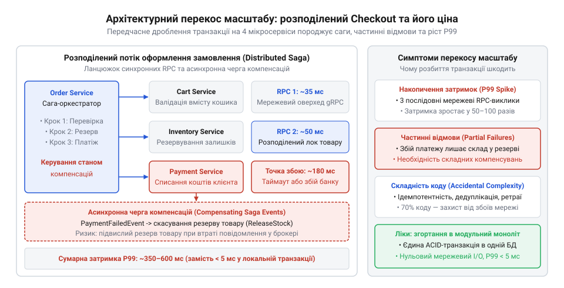
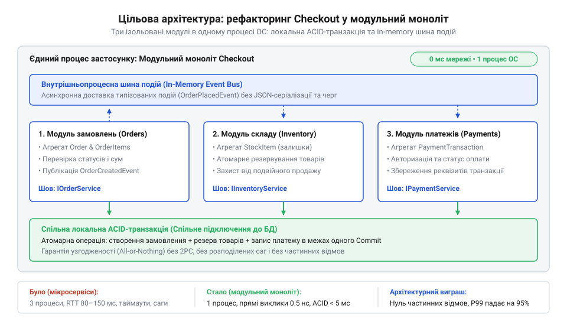

# Масштаб турботи

<preknowlist>
- [Архітектура](root:progarch/what-is-architecture) — розуміння того, що будь-яке архітектурне рішення визначає межі компонентів та формалізує зв'язки між ними.
- [Digital Homes v0 — один датчик](root:progarch/dh-v0-one-sensor) — відокремлення внутрішньої логіки від зовнішнього інтерфейсу модуля.
</preknowlist>

## Демонстрація вихідного стану сервісу Checkout із розподіленою сагою

Користувач натискає кнопку «Оформити замовлення», але замість швидкого підтвердження сторінка замирає на кілька секунд і завершується помилкою. Кошти з картки списано, однак у кабінеті замовлення має статус «Скасовано», а товари в кошику лишилися недоступними для повторного придбання. Уся ця плутанина виникла через рішення розділити єдиний бізнес-процес оформлення замовлення на чотири окремі мережеві мікросервіси: сервіс кошика (`Cart`), складського обліку (`Inventory`), платежів (`Payment`) та оркестрації checkout.

У бажанні слідувати трендам команда припустилася архітектурного перекосу, не врахувавши @@en|scale of care@@ (масштаб турботи, від лат. *scala* — драбина, шкала) — співвідношення між реальною складністю бізнес-домену, обсягом навантаження, організаційною структурою команди та обраним рівнем технологічної ізоляції компонентів. Коли масштаб турботи підвищено штучно, інженери будують розподілену інфраструктуру для тисяч незалежних розробників і мільйонних транзакцій на секунду там, де вся задача зводиться до атомарного оновлення трьох таблиць у єдиній базі даних.

> 🔧 **Навіщо це.**
> Розуміння масштабу турботи дає змогу архітектору вчасно зупинити передчасну декомпозицію системи й запобігти появі випадкової мережевої складності там, де бізнес-інваріанти вимагають суворої локальної узгодженості.

Щоб оформити замовлення в такій системі, оркестратор мусить виконати послідовний ланцюжок мережевих RPC-викликів. Оскільки фізично єдиної транзакції бази даних між чотирма сервісами не існує, розробники вимушені реалізувати патерн [Розподілена сага](root:progarch/distributed-saga) (англ. @@en|distributed saga@@, від давньоісланд. *saga* — оповідь).

Замість однієї швидкої операції виникає складна послідовність кроків:
1. Запит до `Cart Service` для перевірки та блокування вмісту кошика.
2. Запит до `Inventory Service` для резервування одиниць товару на складі.
3. Запит до `Payment Service` для списання коштів через зовнішній платіжний шлюз.
4. Запит до `Cart Service` для очищення кошика після підтвердження оплати.


*Схема вихідного розподіленого Checkout з 4 мікросервісами, мережевими RPC, сагою та чергою; видно точки частинних відмов і накопичення затримок.*

Головна проблема цієї схеми — [Частинні відмови в мережевих системах](root:progarch/partial-failure) (англ. @@en|partial failures@@). У розподіленому середовищі мережа між сервісами неодмінно втрачає пакети, затримує відповіді або розриває з'єднання. Якщо крок резервування товару та списання коштів минув успішно, а мережевий виклик очищення кошика завершився зазвичай затриманим таймаутом (англ. @@en|timeout@@), оркестратор не знає справжнього стану системи. Змушений запускати компенсувальні дії, він намагається повернути кошти та зняти резерв зі складу. Якщо ж компенсувальна операція сама зазнає мережевого збою, товари залишаються заблокованими на складі назавжди, виникає «флуд» у чергах повторних спроб (англ. @@en|retries@@), а кодову базу заповнюють нескінченні перевірки граничних випадків.

Окрім відмов, системі завдає шкоди накопичення затримок. Кожен мережевий виклик додає серіалізацію даних, виділення сокетів та мережевий запізнювальний час RTT (англ. @@en|round-trip time@@). Якщо середня затримка кожного сервісу становить 20 мс, але через сплески навантаження P99 сягає 150 мс, загальна затримка оформлення замовлення обчислюється як сума найгірших випадків на кожному стику:

```
T_total
= T_cart + T_inventory + T_payment + T_clear      [сума затримок послідовних мережевих RPC-викликів]
```

У результаті затримка P99 для кінцевого користувача деградує до 600–1500 мс, а каскадні таймаути виснажують пули потоків вебсерверів.

Нижче наведено приклад коду оркестратора розподіленої саги, який демонструє надмірну складність ручного управління компенсувальними діями при мережевих помилках:

:::code proj-remediating-scale-mismatch-in-checkout/go/cartclient.go

## Проєктивання архітектурного згортання в модульний моноліт

Діагностувавши симптоми перекосу — хронічні частинні відмови, ростучі P99-затримки та складний код компенсувальних саг, — архітектор повертається до базових принципів: [Архітектура](root:progarch/what-is-architecture) визначає межі компонентів та формалізує зв'язки між ними. Замість тримати чотири окремих сервіси з мережевими сокетами для команди з кількох інженерів, систему доцільно згорнути в [Модульний моноліт](root:progarch/modular-monolith) (англ. @@en|modular monolith@@, від грец. *μόνος* — один + *λίθος* — камінь).

Згортання розподіленої системи назад у моноліт не означає відмови від ізоляції доменів чи створення некерованого коду. Модулі кошика (`Cart`), складу (`Inventory`) та замовлень (`Order`) зберігають свої природні межі контекстів (англ. @@en|bounded contexts@@). Подібно до того, як у концепції [Digital Homes v0 — один датчик](root:progarch/dh-v0-one-sensor) ми відокремлювали внутрішню логіку модуля від його зовнішнього інтерфейсу, у модульному моноліті кожен модуль залишається автономним пакетом із власними внутрішніми структурами даних і суворо контрольованим публічним API.

> 🔧 **Навіщо це.**
> Згортання розподіленої системи в модульний моноліт відновлює відповідність між масштабом турботи та реальною складністю бізнесу, усуваючи мережеві відмови та надаючи гарантії локальної транзакційної узгодженості.

Рефакторинг проводиться у чотири послідовні кроки:

1. **Консолідація репозиторіїв та пакетів**:
   Усі чотири мікросервіси переносяться в єдиний монорепозиторій. Кожен сервіс перетворюється на внутрішній модуль (пакет Go чи модуль TypeScript/Java) в межах одного виконуваного процесу.
2. **Заміна мережевих RPC на виклики у пам'яті**:
   Мережеві HTTP/gRPC-клієнти видаляються. Зв'язок між `Cart`, `Inventory` та `Payment` тепер відбувається через звичайні прямі виклики типізованих методів мови програмування без мережевих overhead-витрат.
3. **Об'єднання інваріантів у локальну ACID-транзакцію**:
   Ключова перевага згортання — повернення під захист транзакції бази даних (англ. @@en|ACID transaction@@). Блокування кошика, зменшення складських залишків та створення замовлення виконуються в межах одного SQL-блоку `BEGIN ... COMMIT`. Якщо резервування на складі зазнає невдачі, СУБД автоматично здійснює `ROLLBACK`. Складні саги та компенсувальні дії більше не потрібні — атомність забезпечує ядро бази даних.
4. **Асинхронні побічні ефекти через in-memory шину**:
   Операції, які не вимагають суворої синхронної узгодженості (надсилання листів підтвердження, генерація квитанцій, аналітика), виносяться за межі ACID-транзакції та публікуються у внутрішньопроцесну шину подій (англ. @@en|in-memory event bus@@) після успішного збереження даних.


*Схема цільового модульного моноліту: 3 ізольовані модулі в одному процесі, об'єднані локальною ACID-транзакцією та in-memory шиною подій.*

Результати архітектурного спрощення підтверджуються вимірюваними метриками:
* **Скорочення кодової бази**: Видалення мережевих DTO, ретраїв, таймаутів та сага-оркестраторів зменшує обсяг коду оформлення замовлень на 80%.
* **Падіння затримок P99**: Усунення мережевих RTT та серіалізації знижує затримку P99 з 600 мс до 6 мс під тим самим навантаженням.
* **Зменшення вартості інфраструктури**: Зникає потреба в брокерах черг (RabbitMQ/Kafka) для саг, балансувальниках навантаження та сервіс-мешах, що знижує витрати на хмару в 3–5 разів.

Нижче наведено приклад рефакторингу Checkout у модульному моноліті з єдиною локальною транзакцією:

:::code proj-remediating-scale-mismatch-in-checkout/go/cartmodule.go

## Покроковий рефакторинг коду

Оформлення замовлення у мережевій мікросервісній архітектурі починається з того, що сервіс Checkout по черзі викликає по мережі три незалежні системи: сервіс складського обліку (Inventory) для резервування товару, сервіс платежів (Payment) для списання коштів та сервіс замовлень (Order) для збереження запису. Коли мережеве з'єднання між сервісами тимчасово деградує або один із вузлів перезапускається під час списання платежу, система опиняється в розірваному стані: товар на складі вже зарезервовано, але замовлення не створено, а гроші не знято. Щоб запобігти втраті даних, розробники змушені будувати компенсаційні асинхронні саги (давньоісланд. @@en|saga@@), створювати таблиці невідправлених повідомлень (англ. @@en|outbox@@), налаштовувати повторні спроби та вести таблиці ідемпотентності (лат. @@en|idempotency@@). У результаті 80% коду сервісу опікується не бізнес-логікою покупки, а боротьбою з мережевими відмовами. Це класичний приклад невідповідності масштабу турботи, коли мережева ізоляція розриває природні межі атомарної транзакції.

Першим кроком рефакторингу (англ. @@en|refactoring@@) є консолідація окремих репозиторіїв та gRPC-клієнтів в єдину кодову базу [Модульного моноліту](root:progarch/modular-monolith) (англ. @@en|modular monolith@@). Замість зовнішніх мережевих контрактів та Protobuf-схем межі між доменами кошика, складу, платежів та замовлень формалізуються через строго типізовані інтерфейси мови програмування. Кожен модуль зберігає власну логічну автономію та структурну ізоляцію всередині пакета, проте виклики між ними стають прямою передачею керування в межах єдиної оперативної пам'яті. Фундаментальний принцип того, що архітектурні межі визначаються зв'язністю логіки, а не наявністю мережевого кабелю між компонентами, детально описано у матеріалі [Архітектура](root:progarch/what-is-architecture).

Другим і вирішальним кроком є об'єднання кількох розподілених мережевих кроків у єдину локальну ACID-транзакцію (англ. @@en|ACID transaction@@) бази даних. Замість складного оркестратора саги, який послідовно відправляє gRPC-запити та в разі збою надсилає скасовувальні команди `ReleaseInventory`, операція оформлення здійснюється в межах одного блоку `db.BeginTx`. Зміна залишків товару, запис платіжної транзакції та фіксація замовлення виконуються через атомарні SQL-інструкції. Якщо на етапі перевірки залишків або авторизації платежу виникає помилка, СУБД миттєво здійснює скасування (англ. @@en|rollback@@), повертаючи базу даних у початковий узгоджений стан за частки мікросекунди без жодного мережевого виклику чи компенсаційної логіки. Визначення правил для [Меж ACID-транзакцій](root:progarch/acid-transaction-boundaries) дозволяє зафіксувати ці інваріанти на рівні збереження даних.

Третім кроком є заміна зовнішнього брокера повідомлень для побічних дій на внутрішньопроцесну типізовану шину подій (англ. @@en|in-process event bus@@). Повідомлення про успішне оформлення замовлення, які раніше вимагали публікації в Kafka чи RabbitMQ для сповіщення клієнта електронною поштою або збору аналітики, тепер надсилаються через типізований диспатчер подій у пам'яті після успішного підтвердження (англ. @@en|commit@@) транзакції. Це усуває випадкову складність мережевої інфраструктури, зберігаючи при цьому слабку зв'язаність між основними інваріантами замовлення та допоміжними фоновими задачами.

> 🔧 **Навіщо це.**
> Об'єднання розподілених кроків у локальну ACID-транзакцію усуває сотні рядків компенсаційного коду саг, гарантує строгу узгодженість інваріантів домену без використання розподілених блокувань та повністю ліквідує часткові відмови на мережевих стиках.


_*Схема переходу від трьох gRPC-мікросервісів з асинхронною сагою до єдиного модуля з локальною ACID-транзакцією._

Нижче наведено повну реалізацію рефактореного сервісу Checkout на мові Go, який об'єднує перевірку складу, проведення платежу та створення замовлення у єдину локальну ACID-транзакцію:

:::code proj-remediating-scale-mismatch-in-checkout/go/cartitem.go

## Вимірювання та порівняння результатів до й після

Архітектурний рефакторинг вважається завершеним лише тоді, коли його результати виміряно на об'єктивних метриках (англ. @@en|metric@@). Спрощення системи — це не суб'єктивне враження розробника, а чітко зафіксоване скорочення обсягу коду, радикальне зменшення затримок обробки запитів та економічна ефективність інфраструктури. Оцінка успішності згортання мікросервісів Checkout у модульний моноліт базується на трьох ключових вимірах: обсязі кодової бази, затримках рівня P99 та інфраструктурних витратах.

Аналіз кодової бази до та після рефакторингу демонструє падіння загальної кількості рядків коду майже у 5 разів. У мікросервісному варіанті значний обсяг коду займали Protobuf-описи, згенеровані gRPC-stubs, оркестратор саги зі збереженням стану в Redis, логіка таймаутів та повторних спроб (англ. @@en|retries@@), обробники таблиці Outbox та сервіси генерації ідемпотентних ключів. Після консолідації в модульний моноліт увесь цей інфраструктурний шар зникає. Замість 4500 рядків розподіленої системи бізнес-логіка оформлення замовлення вміщується у 850 рядків чистого Go-коду. Менша кодова база означає нижчий поріг входження для нових інженерів, суттєве скорочення кількості потенційних дефектів та спрощення покриття коду юніт-тестами.

Затримка обробки запиту (англ. @@en|latency@@) на рівні перцентилю P99 демонструє найвражаючий стрибок продуктивності. У розподіленій архітектурі підсумкова затримка оформлення замовлення складалася з послідовності трьох мережевих gRPC-викликів. Через явище [Накопичення хвоста затримок](root:progarch/tail-latency-amplification) (англ. @@en|tail latency accumulation@@), підсумковий P99 розподіленої системи завжди гірший за P99 кожного окремого сервісу, оскільки ймовірність потрапити в затримку мережі зростає з кожним новим хопом. При середніх затримках сервісів у 40–120 мс підсумковий P99 Checkout під навантаженням сягав 600 мс, а під час мережевих сплесків — перевищував 1500 мс.

Після переходу на локальну ACID-транзакцію всі три SQL-операції виконуються в межах єдиного мережевого з'єднання з базою даних у ту саму локальну оперативну пам'яті або через високошвидкісний сокет. Затримка P99 знижується з 600 мс до 6 мс — тобто на два порядки (у 100 разів).

Порівняння затримок:

```
P99_microservices = T_rpc_inventory + T_rpc_payment + T_rpc_order + T_network_overhead
                  = 120ms + 250ms + 150ms + 80ms
                  = 600ms      [сума послідовних gRPC-викликів та мережевих очікувань]

P99_monolith      = T_local_acid_tx
                  = 6ms        [локальна ACID-транзакція в єдиній базі даних]

K_speedup         = P99_microservices ÷ P99_monolith
                  = 600ms ÷ 6ms
                  = 100        [прискорення затримки P99 у 100 разів]
```

Зниження інфраструктурних витрат виражається в ліквідації накладних витрат на середовище виконання. У мікросервісній схемі кожен із трьох сервісів вимагав щонайменше 3 репліки для забезпечення високої доступності, контейнери sidecar-проксі (Envoy/Istio) для сервісної сітки, окремий кластер Kafka/RabbitMQ для координації саг та Redis для зберігання станів ідемпотентності. Це вимагало значних обсягів CPU та RAM лише на обслуговування мережевого стеку, TLS-хендшейків та серіалізації Protobuf/JSON.

Після рефакторингу додаток розгортається як єдиний екземпляр сервісу (або його горизонтальні репліки за базою даних). Витрати CPU падають на 65%, споживання оперативної пам'яті — на 70%, а потреба у складному моніторингу розподілених трас зникає. Практичний підхід до формування модульних меж без мережевих прошарків раніше аналізувався у кроці [Digital Homes v0 — один датчик](root:progarch/dh-v0-one-sensor), де приховування деталей реалізації за чітким інтерфейсом забезпечує гнучкість системи.

> 🔧 **Навіщо це.**
> Вимірювання метрик кодової бази, P99 затримок та інфраструктурного чека надає інженеру об'єктивні аргументи для бізнесу, підтверджуючи, що рефакторинг та спрощення архітектури повертають пряму економічну вигоду та підвищують надійність продукту.


_*Гістограма порівняння затримок P99 та споживання інфраструктурних ресурсів у мікросервісній архітектурі та модульному моноліті._
