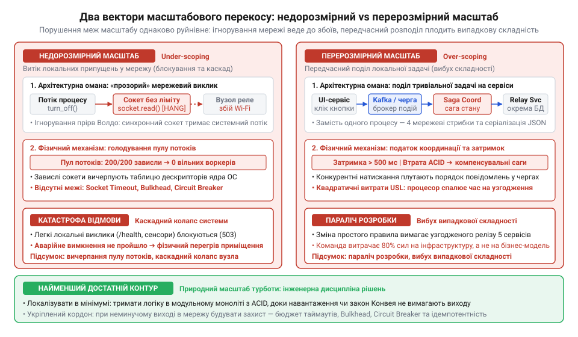
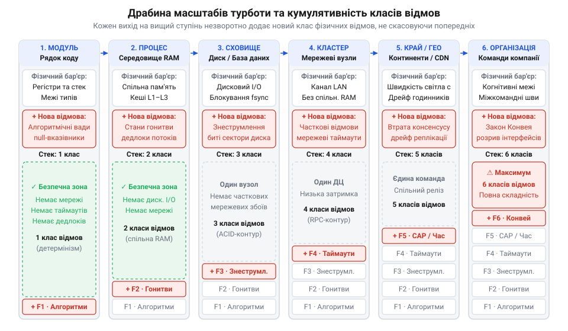
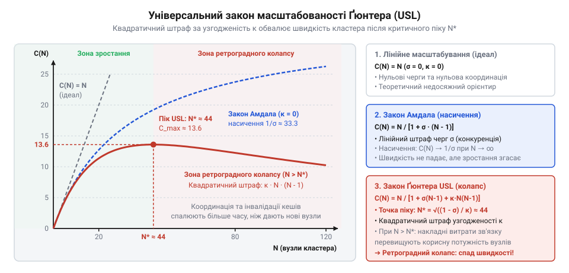
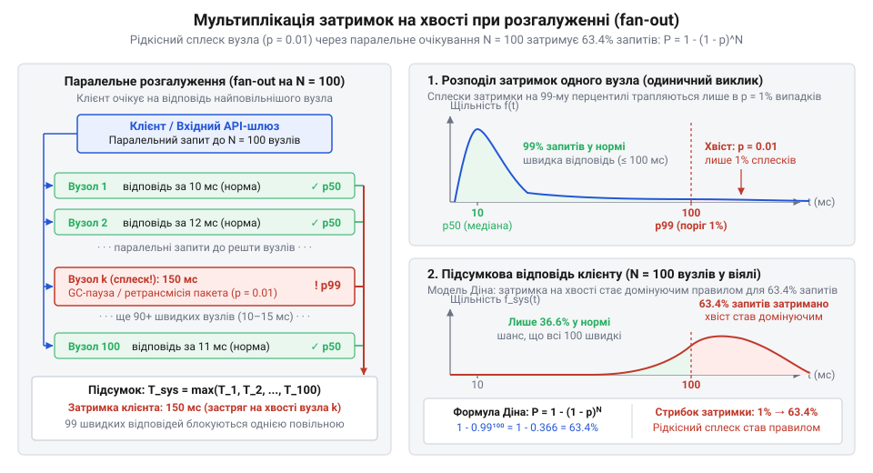
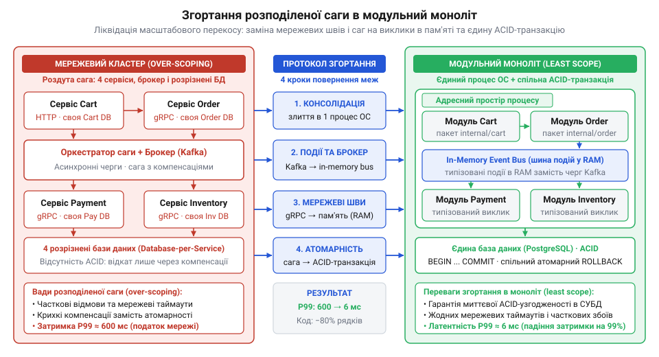

# Масштаб турботи

<preknowlist>
- [Digital Homes v0 — один датчик](root:progarch/dh-v0-one-sensor) — архітектура найпростішої системи розумного дому в одному скрипті (зчитування показників датчика температури та локальне керування реле), межі її застосування в межах одного файлу та неминучість зростання системи від одного вузла до хмари
</preknowlist>

## Криза невідповідності масштабу в системі

У початковій версії [найпростішої системи розумного дому](root:progarch/dh-v0-one-sensor) контур опалення діяв у межах одного процесу: датчик температури опитував апаратний вивід і при перегріві синхронно викликав метод реле нагрівача. Операція тривала мікросекунди в спільній пам'яті та регістрах процесора під контролем єдиного потоку виконання.

Згодом реле винесли на віддалений бездротовий контролер, проте програмний код не змінили: розробники заховали мережевий сокет усередину того самого методу `relay.turn_off()`. Для основного циклу виклик віддаленого пристрою залишився звичайним зверненням до пам'яті.

Під час першого збою Wi-Fi ядро операційної системи заблокувало потік на очікуванні сокета. Потік завис у системному виклику без таймауту. Оскільки покази датчика продовжували надходити, нові обробники потрапляли в те саме блокування, швидко вичерпавши пул потоків середовища виконання. Коли температура сягнула критичної позначки, аварійне вимкнення не змогло навіть стартувати: усі потоки знерухомило мережеве очікування. Нагрівач залишився увімкненим, і приміщення перегрілося.

Намагаючись усунути проблему, команда кинулася в іншу крайність: розбила контролер будинку на десяток мікросервісів із брокером повідомлень Kafka, розподіленим сховищем Cassandra та розподіленими сагами (англ. @@en|saga@@, від давньосканд. *saga* — оповідь) для координації стану.

Після цього звичайне клацання настінного вимикача стало вимагати чотирьох мережевих стрибків, двох серіалізацій JSON і затримки в пів секунди. Конкурентні натискання клавіш порушували порядок повідомлень у чергах, викликаючи розсинхронізацію стану пристроїв, а зміна простого правила опалення почала вимагати синхронного релізу п'яти репозиторіїв.

Ця історія демонструє два вектори єдиної катастрофи — масштабового перекосу (англ. @@en|scale mismatch@@, від *scale* — масштаб, та *mismatch* — невідповідність):

1. **Недорозмірний масштаб (англ. @@en|under-scoping@@, від *under* — під, нижче, та грец. *skopein* — дивитися)** виникає, коли припущення локального масштабу (нульову затримку, спільну пам'ять, детермінований успіх) виносять у мережу. Праця Волдо та співавторів 1994 року довела [ілюзорність прозорого розподілу](root:progarch/scale-of-care/hist-waldo-note-on-distributed-computing.md): чотири прірви — латентність, відсутність спільної пам'яті, часткові відмови та неконтрольовану конкурентність — не приховати синтаксисом. Ігнорування цих меж штовхає розробника в [омани розподілених обчислень](root:sf-distributed/distributed-fallacies) і викликає аварійні блокування.
2. **Перерозмірний масштаб (англ. @@en|over-scoping@@, від *over* — понад, надміру)** виникає, коли для локальної задачі безпідставно розгортають розподілену інфраструктуру. Замість викликів у пам'яті та транзакцій виникають мережеві шви, черги й саги, що спричиняє вибух випадкової складності та різке зростання вартості змін.


*Два вектори масштабового перекосу: недорозмірний масштаб (under-scoping) руйнує надійність системи через ігнорування мережевих бар'єрів, тоді як перерозмірний масштаб (over-scoping) знерухомлює розробку надмірною випадковою складністю.*

Будь-яке інженерне рішення існує на певному масштабі турботи (від нім. *Maßstab* — мірило, та англ. @@en|scale of care@@) — контурі системи з конкретними фізичними обмеженнями та класами відмов. Рішення поза своїм природним масштабом або руйнує надійність системи, або паралізує її еволюцію.

## Драбина масштабів від коду до організації

Щоб уникнути масштабового перекосу, архітектор має спиратися на чітку карту системних меж. Складність систем підпорядкована закону кумулятивності: перехід на кожен вищий рівень монотонно додає новий клас непереборних фізичних відмов, які неможливо приховати абстракціями нижчого ступеня.

Усвідомлення якісної різниці між рівнями системи заклало основу програмної архітектури. У 1975 році Френк ДеРемер і Ганс Крон обґрунтували [відокремлення програмування у великому](root:progarch/scale-of-care/hist-deremer-kron-scale-separation.md) (англ. @@en|programming-in-the-large@@) від програмування «у малому» (англ. @@en|programming-in-the-small@@). Вони довели, що створення окремих модулів спирається на алгоритми та структури даних, тоді як поєднання модулів у систему вимагає зовсім іншої мови мислення — архітектурних абстракцій, інтерфейсних контрактів і структури зв'язків.

Простір рішень розгортається на драбині шести масштабів турботи:

1. **Рядок коду та модуль.** Масштаб внутрішньої логіки функцій і модулів. Стан обмежений регістрами та локальним стеком. Межі ізоляції задають компілятор, область видимості та система типів. Клас відмов — детерміновані алгоритмічні помилки, порушення меж масивів чи нульові вказівники.
2. **Процес та середовище виконання.** Масштаб конкурентних потоків усередині спільного адресного простору пам'яті. З'являється непереборний клас відмов синхронізації: стани гонитви (англ. @@en|race condition@@), взаємні блокування (англ. @@en|deadlock@@), пошкодження стану несинхронізованих об'єктів у купі та затримки узгодження процесорних кешів.
3. **Персистентне сховище.** Масштаб енергонезалежних накопичувачів. Операції вводу-виводу ламають припущення про мікросекундну пам'ять. Зазвичай операційна система приховує повільність накопичувача й спрямовує записи в буфери сторінок (англ. @@en|page cache@@) в оперативній пам'яті, миттєво повертаючи керування. Але якщо живлення зникне до того, як ядро скине ці сторінки на диск, дані буде втрачено або пошкоджено. Щоб гарантувати довговічність, застосунок змушений викликати команду `fsync`, яка примусово виштовхує буфери сторінок ОС на дисковий накопичувач і блокує потік до відповіді контролера. Це породжує різку деградацію пропускної здатності при синхронних операціях запису: швидкість падає на кілька порядків — із сотень тисяч операцій на секунду в пам'яті до лічених сотень на диску. Новий клас відмов охоплює знеструмлення, пошкодження секторів і незавершені записи. Цілісність забезпечують транзакційні гарантії моделі ACID (акронім англ. @@en|Atomicity, Consistency, Isolation, Durability@@).
4. **Мережевий кластер.** Масштаб вузлів у межах локальної мережі датацентру. Спільна пам'ять зникає. Виникає непереборний клас часткових відмов: один вузол аварійно завершує роботу, коли решта системи працює. Пакети затримуються, дублюються чи втрачаються, а час відповіді втрачає детермінізм через таймаути сокетів і мережеві розриви.
5. **Георозподілена та крайова інфраструктура.** Масштаб континентальних відстаней і крайових вузлів (англ. @@en|edge computing@@). Фізичним бар'єром стає швидкість світла: затримка між материками не може бути меншою за десятки мілісекунд. Через відсутність єдиної бази часу та неминучий [дрейф фізичних годинників](root:sf-distributed/clock-offset-drift) неможливо підтримувати миттєву строгу узгодженість. Це змушує будувати системи за теоремою CAP (англ. @@en|CAP theorem@@) на основі кінцевої узгодженості (англ. @@en|eventual consistency@@).
6. **Людська організація.** Соціотехнічний масштаб інженерних команд і компанії. Межами стають когнітивні можливості людини та комунікаційні бар'єри між відділами. Рівень підпорядкований [соціотехнічним межам системи](root:sf-apps/conways-law) за законом Конвея (англ. @@en|Conway's law@@, за ім'ям програміста Мелвіна Конвея): структура модулів неминуче віддзеркалює комунікації команд, а організаційні бар'єри перетворюються на дефекти програмних інтерфейсів.


*Драбина шести масштабів турботи: кожен наступний рівень нашаровує новий непереборний клас відмов, який неможливо приховати абстракціями нижчого ступеня.*

Драбина масштабів доводить: неможливо захиститися від мережевого збою четвертого рівня локальним циклом першого рівня — це лише заблокує ресурси процесу. Так само шкідливо розв'язувати задачу першого рівня розподіленими засобами п'ятого. Обов'язок [архітектурної дисципліни](root:progarch/what-is-architecture) — визначити природний масштаб проблеми, утримати її в межах найменшого достатнього контуру та спроєктувати надійні гарантії на його кордонах.

## Кумулятивність обмежень і класів відмов

Коли інженер розширює архітектурні межі системи, легко піддатися спокусі вважати вищі рівні лише просторими контейнерами для нижчих. Здається, що складність укрупнення можна безкарно сховати за ще одним шаром поліморфної бібліотеки чи мережевого посередника. Проте драбина масштабів підпорядкована закону строгої монотонної кумулятивності: перехід на кожен наступний щабель ніколи не скасовує обмежень попереднього, а неминуче додає новий фізичний бар'єр і новий клас відмов, якого не існувало внизу.

У межах окремого модуля помилка залишається суто алгоритмічною та детермінованою: порушення інваріанта чи вихід за межі масиву локалізовані у виклику функції. Перехід у спільну пам'ять процесу не скасовує алгоритмічних вад, але накладає поверх них непереборний клас відмов паралелізму — конкуренцію за спільний стан, стани гонитви та взаємні блокування потоків. Наступний вихід у персистентне сховище змушує долати мілісекундні затримки дискового введення-виведення, вимагає синхронізації сторінкового кешу командою `fsync` та несе ризик руйнування блоків даних при раптовому знеструмленні.

Вихід у мережевий кластер руйнує фундаментальну бінарну логіку обчислень. Якщо локальний виклик методу в пам'яті завжди повертає визначений результат — або обчислене значення, або явний виняток, — то віддалений виклик процедур (англ. @@en|remote procedure call@@, RPC, від лат. *procedere* — просуватися вперед) переводить взаємодію у тризначну логіку: успіх, явна помилка або невизначеність таймауту. Найяскравіше цю прірву розкриває покроковий сценарій мережевого таймауту під час фінансової транзакції. На першому кроці сервіс відправляє через мережу запит на списання коштів із рахунку покупця і запускає таймер очікування. На другому кроці ліміт часу вичерпується: клієнт не отримує жодного сигналу і фіксує таймаут. На третьому кроці виникає непереборна невизначеність, адже на фізичному рівні однаково вірогідні три несумісні події: пакет запиту загубився в комутаторі дорогою до платіжного вузла (і гроші залишилися на рахунку); сервер банку успішно зняв кошти та зберіг стан у базі даних, але зворотний пакет із підтвердженням зник в аварійному шлюзі (і гроші вже списано); або ж банківський вузол повільно обробляє чергу й операція ще триває. На четвертому кроці клієнт опиняється перед нерозв'язною дилемою: він достеменно не знає, чи списано гроші з рахунку. Якщо програма наївно спробує повторити запит, вона ризикує стягнути платіж удруге; якщо ж оголосить про збій і скасує замовлення — покупець втратить гроші без отримання товару. Віддаленість фізично ховає реальний стан вузла, тому клієнт у принципі не здатний з'ясувати наслідки операції лише за фактом відсутності відповіді. Це відкриває простір часткових відмов (англ. @@en|partial failure@@), коли окремі вузли виходять із ладу незалежно, а система продовжує діяти в невідомому стані.

Планетарний край накладає фізичний бар'єр швидкості світла в оптичному волокні: затримка сигналу між континентами не може бути меншою за десятки мілісекунд, а відсутність єдиного фізичного часу робить миттєвий консенсус неможливим. На соціотехнічному масштабі організації до них додається семантичний розрив предметних моделей між автономними командами, де міжсервісні шви дублюють межі людського спілкування. Кожен вищий ступінь драбини лише нашаровує додаткові закони фізики, монотонно звужуючи гарантії інженера.

У 1990-х роках індустрія спробувала проігнорувати цю кумулятивність за допомогою технологій CORBA, DCOM та EJB, які прагнули зробити віддалені виклики синтаксично однаковими зі звичайними методами в оперативній пам'яті. У 1994 році Джим Волдо, Енн Воллрат, Джефф Ваєнт та Сем Кендалл опублікували класичну працю, яка обґрунтувала [крах ілюзії прозорого розподілу](root:progarch/scale-of-care/hist-waldo-note-on-distributed-computing.md): чотири прірви між локальним і мережевим світом — відсутність спільної пам'яті, кардинальний розрив у латентності, неминучість часткових відмов та неконтрольована конкурентність — роблять будь-яке маскування мережі джерелом прихованих аварій. Мережева віддаленість є якісною зміною фізичного масштабу турботи, а не внутрішньою деталлю реалізації.

Цей принцип узагальнює [закон дірявих абстракцій](root:sf-apps/softeng-law-of-leaky-abstractions) (англ. @@en|law of leaky abstractions@@, від англ. *leak* — протікати, та лат. *abstractio* — відволікання): будь-яка спроба приховати фізику ширшого масштабу за зручним інтерфейсом вужчого зазнає краху за перших же критичних навантажень. Коли мережевий канал зазнає перешкод, «прозорий» виклик блокує системні потоки процесу, вичерпує черги й викликає каскадну зупинку всієї системи. Архітектурна дисципліна вимагає не приховувати межі масштабу, а проєктувати явні захисні бар'єри на кожному його рубежі.

## Математичний податок виходу в розподіленість

Вихід за межі одного процесу в мережевий кластер нерідко сприймають як простий спосіб масштабування: вважається, що додавання машин автоматично й лінійно збільшує продуктивність системи. Проте розподілена взаємодія підпорядкована строгим математичним залежностям, які стягують неминучий податок за вихід за межі локального масштабу.

Закон комп'ютерного архітектора Джина Амдала (англ. @@en|Amdahl's law@@) показав, що зростання швидкості обмежене очікуванням у чергах за неподільні ресурси: якщо частка послідовного коду становить `σ`, то максимальне прискорення впирається в горизонтальну полицю `1 / σ`. Проте модель Амдала вважає, що самі вузли не витрачають час на координацію між собою. У реальному розподіленому кластері вузли змушені безперервно узгоджувати спільний стан: надсилати інвалідації кешів, реплікувати журнали та досягати консенсусу. Кількість парних каналів взаємодії між `N` вузлами зростає квадратично як `N · (N - 1) / 2`.

Комп'ютерний аналітик Ніл Ґюнтер узагальнив закон Амдала, сформулювавши [універсальний закон масштабованості](root:progarch/scale-of-care/math-universal-scalability-law.md) (англ. @@en|Universal Scalability Law@@, USL, від лат. *universalis* — загальний, та *scala* — драбина). Нехай нормалізований час виконання задачі на одному вузлі дорівнює `T(1) = 1`. Загальний час виконання на `N` вузлах `T(N)` складається з ідеального прискорення паралельної частини, лінійного очікування в чергах з коефіцієнтом `σ` та квадратичних витрат на когерентність (англ. @@en|coherence@@, від лат. *cohaerere* — бути зв'язаним, зчепленим) стану між вузлами з коефіцієнтом `κ`. Звідси виводимо відносну пропускну здатність системи `C(N)`:

```
C(N)
= T(1) / T(N)                                [означення відносного прискорення]
= 1 / [1/N · (1 + σ · (N - 1) + κ · N · (N - 1))] [підстановка часу виконання T(N)]
= N / (1 + σ · (N - 1) + κ · N · (N - 1))     [множення чисельника й знаменника на N]
```

Отримана формула описує реальну пропускну здатність: лінійний штраф `σ · (N - 1)` відображає конкуренцію за ресурси, а квадратичний штраф `κ · N · (N - 1)` — накладні витрати на обмін повідомленнями узгодженості.

Дослідження функції `C(N)` на екстремум за допомогою похідної `dC / dN = 0` визначає критичну точку максимуму продуктивності:

```
dC / dN = 0                                   [умова екстремуму функції пропускної здатності]
= 1 - σ - κ · N² = 0                          [похідна частки за правилом диференціювання]
= κ · N² = 1 - σ                              [перенесення членів рівняння]
= N* = √((1 - σ) / κ)                         [критична кількість обчислювальних вузлів]
```

Для типового вебсервісу з часткою серіалізації `σ = 0.03` та коефіцієнтом узгодженості `κ = 0.0005` розрахунок критичної точки піку показує конкретну фізичну стелю масштабування:

```
N*
= √((1 - 0.03) / 0.0005)                      [підстановка параметрів σ = 0.03 та κ = 0.0005]
= √(0.97 / 0.0005)                            [віднімання частки серіалізації]
= √1940                                       [ділення на коефіцієнт узгодженості]
≈ 44                                          [добування квадратного кореня]
```

Кластер досягає максимуму продуктивності вже на 44 серверах із піковим прискоренням `C(44) ≈ 13.6`: через взаємну координацію та очікування в чергах 44 машини виконують корисну роботу лише чотирнадцяти. Щойно розмір кластера перевищує `N*`, квадратичні витрати `κ · N · (N - 1)` починають зростати швидше, ніж корисна потужність. Система входить у зону ретроградного колапсу (англ. @@en|retrograde collapse@@, від лат. *retrogradus* — той, що ступає назад, та *collapsus* — зруйнований): додавання нових серверів спалює процесорний час на взаємні блокування та обмін пакетами, обвалюючи загальну швидкість обробки нижче рівня одного сервера.


*Графік універсального закону масштабованості Ґюнтера: лінійний штраф черг веде до насичення, а квадратичний штраф за узгодженість κ спричиняє ретроградний колапс кластера після точки піку N*.*

Паралельно з деградацією пропускної здатності вихід у мережу руйнує доступність і стабільність затримок. Коли виконання запиту вимагає проходження крізь ланцюжок із `M` незалежних мікросервісів, сумарна доступність системи `A_sys` обчислюється як добуток індивідуальних доступностей `A_i`:

```
A_sys
= A₁ · A₂ · ... · Aₘ
= ∏ᵢ₌₁ᴹ Aᵢ                                    [добуток ймовірностей незалежних подій]
```

Якщо запит опитує `M = 50` компонентів із показником доступності `A = 0.999` (99.9%), підсумкова доступність системи стрімко падає:

```
A_sys
= 0.999⁵⁰                                     [піднесення індивідуальної доступності до 50-го степеня]
≈ 0.951                                       [кумулятивна доступність системи 95.1 %]
```

У результаті система втрачає кожен двадцятий клієнтський запит, попри високу надійність кожного окремого вузла.

Ще руйнівнішою виявляється затримка на хвості (англ. @@en|tail latency@@, від лат. *latens* — прихований). Коли клієнтський запит паралельно розгалужується на `M` вузлів — шаблон розгалуження запиту (англ. @@en|fan-out@@), — клієнт змушений очікувати на відповідь найповільнішого з них. Нехай імовірність потрапити в аномальний 99-й перцентиль затримки `p99` (через фонову паузу збирача сміття чи ретрансмісію пакета) для одного сервера становить `p = 0.01`. Ризик того, що клієнт спіймає затримку хоча б від одного з `M` компонентів, виражається через протилежну подію:

```
P(хвіст)
= 1 - (1 - p)ᴹ                                [ймовірність затримки хоча б одного вузла]
```

За паралельного опитування `M = 100` вузлів апарат [ампліфікації затримок на хвості](root:progarch/scale-of-care/math-tail-latency-and-availability.md) Джеффрі Діна демонструє експоненційний стрибок затримки:

```
P(хвіст)
= 1 - (1 - 0.01)¹⁰⁰                           [підстановка значень p = 0.01 та M = 100]
= 1 - 0.99¹⁰⁰                                 [ймовірність відсутності сплесків на всіх вузлах]
≈ 1 - 0.366                                   [обчислення 100-го степеня]
≈ 0.634                                       [підсумковий ризик затримки 63.4 %]
```

Понад 63% усіх запитів користувачів зазнають затримки найгіршого перцентилю. Рідкісні мікросплески окремих машин у розподіленому контурі стають хронічним правилом для більшості користувачів.


*Мультиплікація затримок на хвості за моделлю Джеффрі Діна: при паралельному розгалуженні запиту (fan-out) клієнт чекає на найповільнішу відповідь, перетворюючи локальний 1% сплесків на 63%+ затриманих операцій.*

Математичний податок виходу в розподіленість доводить: утримання системи в межах локального масштабу пам'яті процесу — це не архітектурна обмеженість, а найефективніший спосіб гарантувати високу швидкість і надійність без квадратичних втрат на узгодженість.

## Анатомія та форми масштабового перекосу

Коли математичні закони та фізичні обмеження розподіленості проігноровано, архітектура неминуче викривлюється в один із двох симетричних перекосів. Замість тверезого вибору контуру інженер підпадає під дію інерції мислення: або проєктує розподілену взаємодію за звичними мірками пам'яті, або атакує просту локальну задачу надлишковою важкою інфраструктурою.

Перша пастка — недорозмірний масштаб (@@en|under-scoping@@). Вона виникає тоді, коли припущення про нульову затримку, нескінченну пропускну здатність і транзакційну миттєвість оперативної пам'яті механічно виносять у мережевий кластер. Розробники проєктують балакучий інтерфейс (англ. @@en|chatty interface@@, від англ. *chat* — невимушено базікати): замість одного зведеного запиту клієнт виконує десятки дрібних мережевих звернень заради окремих полів об'єкта. У середовищі виконання кожен такий виклик захоплює сокет із пулу з'єднань. Під навантаженням мережеві мілісекунди блокують системні потоки, пул з'єднань вичерпується, а черги запитів переповнюють пам'ять. Оскільки мережа не має апаратної транзакційної шини, збій на п'ятому виклику з десяти залишає систему в неузгодженому стані, спричиняючи каскадний колапс суміжних сервісів.

Дзеркальна пастка — перерозмірний масштаб (@@en|over-scoping@@). Вона вражає систему, коли інженер штучно завищує межі задачі та застосовує важку розподілену зброю там, де суттєва складність вільно вміщується в один процес. Локальну предметну логіку передчасно розщеплюють на десятки мікросервісів з асинхронною подійною хореографією, шардингом баз даних (англ. @@en|sharding@@, від англ. *shard* — уламок, скалка) та розподіленим консенсусом. За відсутності гігантських обсягів даних чи сотень тисяч запитів на секунду система не отримує жодної вигоди від масштабування, проте сплачує повний податок складності. Команда витрачає сили не на розвиток бізнес-моделі, а на адміністрування інфраструктури, розплутування розсинхронізованих розподілених саг, підтримку трасування та налагодження мережевих збоїв. Дисципліна, яку пропагує [архітектура модульного моноліту](root:sf-apps/modular-monolith), тут замінюється хаосом передчасної розподіленості.

Як природний масштаб задачі докорінно змінює алгоритм і допустимі гарантії, демонструє [обмеження частоти запитів](root:progarch/scale-of-care/proj-multi-scale-rate-limiter.md) (англ. @@en|rate limiting@@, від англ. *rate* — частота, темп, та *limit* — межа), розгорнуте на трьох якісно відмінних рівнях.

У пам'яті процесу обмеження викликів до одного вузла розв'язується найпростішим атомарним лічильником через процесорну інструкцію `compare-and-swap`. Перевірка триває наносекунди, мережеві таймаути неможливі, а консистентність ліміту є абсолютною. Проте цей захист замкнений у межах єдиного процесу й безсилий проти розподіленого навантаження.

Коли ліміт потрібно синхронізувати між десятками вузлів сервісу, алгоритм вимушено переносять у мережевий кластер — наприклад, організують ковзне вікно (англ. @@en|sliding window@@, від англ. *slide* — ковзати, та *window* — вікно) у сховищі Redis за допомогою атомарних Lua-скриптів. Тепер кожна перевірка сплачує штраф мережевої затримки та ризикує зіткнутися з таймаутом сокета. Системі доводиться ускладнювати логіку захисним вибором: блокувати запити при збої Redis чи аварійно пропускати їх без обмеження.

На глобальному краї інфраструктури спроба звертатися до єдиного сховища через океан руйнує час відповіді через бар'єр швидкості світла. Тут алгоритм вимушено відмовляється від миттєвої консистентності: крайові вузли ведуть локальний підрахунок з асинхронною фоновою агрегацією, свідомо допускаючи тимчасові відхилення ліміту заради субмілісекундної фільтрації трафіку поблизу користувача. Порівняти поведінку токен-бакета, лійкового відра й ковзного вікна та розібрати компроміси між точністю й затримкою допоможуть [патерни та алгоритми обмеження частоти запитів](root:sf-distributed/distsys-rate-limiting-patterns).

Анатомія масштабових викривлень доводить: алгоритм не існує у вакуумі, відірваному від фізичного середовища. Застосування розподілених інструментів для локальної задачі примножує випадкову складність, а перенесення локальних очікувань у мережу спричиняє раптові аварії. Архітектурна дисципліна полягає в утриманні рішення в межах його природного масштабу турботи.

## Принцип найменшого достатнього контуру проєктування

Зіткнувшись із ризиками масштабового перекосу, інженер потребує надійного орієнтира: на якому рівні будувати нове рішення, щоб запобігти прихованим аваріям і не потонути у випадковій складності? Прагнення проєктувати «на виріст» часто штовхає розробників передчасно вводити черги, дроблення на сервіси чи виносити дані у віддалені сховища. Проте кожен рух угору драбиною масштабів монотонно додає нові фізичні бар'єри: дискові затримки, часткові відмови мережі та втрату миттєвої узгодженості. Будь-яка інженерна проблема повинна вирішуватися на найнижчому масштабі турботи, здатному повністю вмістити її суттєву складність. Це — принцип найменшого достатнього контуру (англ. @@en|principle of least sufficient scope@@).

Підвищення масштабу — перехід від пам'яті до персистентного сховища, від сховища до мережевого кластера, а від кластера до георозподіленої системи — є винятково дорогою інвестицією. Вона ніколи не виправдовується технологічною модою чи теоретичними прогнозами. Вихід на вищий рівень легітимізують лише три об'єктивні фізичні фактори:
1. Фізичний обсяг даних або навантаження, що вичерпують апаратні ліміти одного сервера.
2. Фізичне розташування користувачів або заліза, коли закони природи вимагають наближати обчислення до сенсорів чи терміналів.
3. Організаційний поділ системи між автономними командами за [соціотехнічними межами закону Конвея](root:sf-apps/conways-law).

Якщо цих фізичних вимог немає, архітектура повинна залишатися всередині найменшого достатнього контуру — наприклад, у межах модульного моноліту з локальними ACID-транзакціями єдиної бази даних.

Коли ж об'єктивні вимоги бізнесу неминуче змушують вийти на вищий масштаб, прозора передача керування стає джерелом аварій. Лінія перетину масштабів мусить спиратися на [патерни стійкості до відмов](root:sf-distributed/distsys-resilience-patterns) та чотири обов'язкові захисні гарантії.

По-перше, захист від зависання ресурсів. Будь-який виклик у зовнішній контур потребує суворого бюджетування таймаутів (англ. @@en|timeout budgeting@@): клієнтський потік не має нескінченно чекати на відповідь. Повторні запити спрямовують з експоненційним відступом (англ. @@en|exponential backoff@@, від лат. *exponere* — виставляти назовні, та англ. *back off* — відступати) і випадковим розкидом пауз (англ. @@en|jitter@@, від англ. *jitter* — тремтіти), щоб не добивати деградований вузол. Якщо ж відмови тривають, навантаження відсікає запобіжний розрив ланцюга (англ. @@en|circuit breaker@@, від англ. *circuit* — електричне коло, та *breaker* — переривач): він миттєво повертає помилку чи запасне значення, не витрачаючи сокети та захищаючи внутрішній пул обробників.

По-друге, забезпечення коректності повторних спроб. Через тризначну логіку віддаленого виклику клієнт не знає, чи завершився збійний запит успіхом на боці сервера. Повторне виконання операцій, що змінюють стан, створює ризик дублювання замовлень або подвійних транзакцій. Межа контуру вимагає обов'язкової ідемпотентності (англ. @@en|idempotency@@, від лат. *idem* — той самий, та *potens* — спроможний, сильний): наявність унікального ключа операції гарантує, що повторний виклик поверне збережений результат без повторної мутації даних. Для цього клієнт перед надсиланням запиту генерує унікальний ідентифікатор — зазвичай HTTP-заголовок `Idempotency-Key` у форматі UUID (акронім англ. @@en|universally unique identifier@@), прив'язаний до конкретної бізнес-дії. Приймаючи виклик, сервер фіксує операцію в журналі дедуплікації (англ. @@en|deduplication@@, від лат. *de-* — усунення, та *duplicare* — подвоювати) до запуску бізнес-логіки. Структура такого запису об'єднує ключ клієнта, цифровий відбиток запиту та збережений результат:

```json
{
  "idempotency_key": "9b1deb4d-3b7d-4bad-9bdd-2b0d7b3dcb6d",
  "request_hash": "e3b0c44298fc1c149afbf4c8996fb92427ae41e4649b934ca495991b7852b855",
  "status": "COMPLETED",
  "response_code": 201,
  "response_body": "{\"order_id\": 8472, \"status\": \"paid\"}",
  "created_at": "2026-09-14T10:00:00Z"
}
```

Механізм працює через явні переходи станів. Під час першого звернення сервер атомарно створює запис зі статусом обробки `PROCESSING`. Якщо мережа обірветься і клієнт надішле повторний запит до завершення операції, сервер виявить активний стан і відхилить конкурентний виклик, запобігаючи стану гонитви. Після успішного виконання статус переходить у `COMPLETED`, а в запис зберігаються код `response_code` і тіло відповіді `response_body`. Усі наступні повтори з цим ключем негайно отримують збережену відповідь безпосередньо з журналу, оминаючи бізнес-логіку. Контрольний хеш `request_hash` унеможливлює підміну даних: спроба надіслати старий ключ з іншими параметрами операції спричиняє відмову з помилкою конфлікту.

Ідемпотентність вимагає додаткових дискових операцій на кожну мутацію, витрат пам'яті на утримання індексів і журналу, а також суворої транзакційної узгодженості: збереження ключа мусить відбуватися в одній атомарній транзакції зі зміною бізнес-даних. Захист ламається, якщо журнал дедуплікації відокремлюють від бази даних у несинхронізований кеш і вузол аварійно завершує роботу між зміною бізнес-стану та записом ключа. Крім того, збій виникає при вичерпанні часу життя запису (англ. @@en|time to live@@, TTL) у журналі дедуплікації: якщо після тривалого мережевого розриву клієнт повторить запит, коли запис уже видалено, сервер сприйме операцію як нову й повторно мутує стан.

По-третє, локалізація збоїв через ізоляцію відсіків (англ. @@en|bulkhead@@, від давньосканд. *balkr* — перегородка; водонепроникна перебірка судна). Архітектура розділяє критичні ресурси — пули з'єднань, черги задач і ліміти пам'яті — на незалежні сегменти. Уповільнення одного зовнішнього сервісу вичерпує лише виділений йому відсік, не дозволяючи локальній проблемі потопити всю систему.

По-четверте, захист цілісності предметної моделі. При взаємодії автономних контурів семантика бізнес-термінів розмивається. Кордон захищає антикорупційний шар (англ. @@en|anti-corruption layer@@, від грец. *anti* — проти, та лат. *corruptio* — псування): він явно транслює чужі контракти у власну доменну модель, запобігаючи розмиванню внутрішньої логіки.

Принцип найменшого достатнього контуру дає інженерові конструктивне правило стримування: утримувати складність на найнижчому працездатному масштабі, а кожен вихід за його межі перетворювати на укріплений кордон із вичерпними інженерними гарантіями.

## Розпізнавання роздування та інженерія згортання

Коли система з навантаженням у сотні запитів на секунду розпадається на десятки мережевих мікросервісів, продуктова розробка паралізується. Замість створення нових можливостей інженерні команди витрачають тижні на налагодження компенсаційних дій у @@en|розподілених сагах@@ та розгрібання розсинхронізації в базах даних. Вимірювання показують, що до вісімдесяти відсотків часу відповіді витрачається не на обчислення, а на затримки мережевого транспорту й серіалізацію між вузлами. Сукупну пропускну здатність легко витримав би єдиний процес на сучасному сервері, але навіть тривіальна зміна моделі даних вимагає бюрократичних комітетів з узгодження [меж за законом Конвея](root:sf-apps/conways-law). Це класичні прояви хронічного завищення масштабу турботи: інструменти розподіленого кластера нав'язали системі, чия суттєва складність повністю вкладається в локальний контур.

Подолання цієї кризи вимагає інженерного @@en|згортання@@ (англ. @@en|collapsing@@, від лат. *collapsus* — спалий, опадати) — свідомого повернення роздутих сервісів до компактного й природного масштабу. Замість ризикованого переписування всієї системи з нуля рефакторинг реалізують за чітким протоколом:
Спершу аналізують реальні зв'язки даних і групують балакучі сервіси довкола спільних доменних сутностей.
Далі виділені сервіси фізично переносять в єдиний процес @@en|модульного моноліту@@ (англ. @@en|modular monolith@@, від лат. *modulus* — міра та грец. *monolithos* — суцільний камінь), замінюючи мережеві шви на внутрішні мовні пакети.
Після цього ненадійні виклики через HTTP або gRPC замінюють на прямі виклики функцій у спільній пам'яті, що миттєво знімає загрозу часткових відмов і мережевих таймаутів.
Зовнішній брокер повідомлень вилучають із синхронного ланцюжка виконання, довіряючи координацію швидким типізованим подіям усередині процесу.
Наостанок розрізнені бази даних об'єднують під спільне сховище, завдяки чому складні розподілені саги згортаються у надійні локальні @@en|ACID-транзакції@@.


*Інженерний протокол згортання: мережеві шви та брокер замінюються внутрішньопроцесними викликами й типізованими подіями, повертаючи системі атомарні транзакції.*

Практичне застосування цієї техніки у проєкті [згортання розподіленої саги](root:progarch/scale-of-care/proj-collapsing-distributed-checkout.md) підтверджує разючий економічний та інженерний ефект. Затримки скорочуються у десятки разів завдяки відмові від мережевого транспорту, споживання пам'яті й процесора відчутно знижується, а пласти випадкової складності на чолі з повторними спробами та запобіжниками зникають самі собою. Дотримання суворих внутрішніх меж за правилами [дисципліни модульного моноліту](root:sf-apps/modular-monolith) повертає командам високий темп релізів, доводячи головне правило масштабу: зрілість архітектури вимірюється не кількістю розгорнутих вузлів, а сміливістю локалізувати систему в найменшому достатньому контурі турботи.
