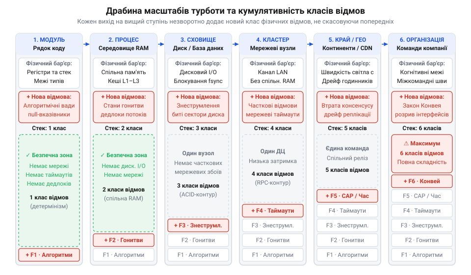

# Масштаб турботи

<preknowlist>
- [Digital Homes v0 — один датчик](root:progarch/dh-v0-one-sensor) — архітектура найпростішої системи розумного дому в одному скрипті (зчитування показників датчика температури та локальне керування реле), межі її застосування в межах одного файлу та неминучість зростання системи від одного вузла до хмари
</preknowlist>

## Криза невідповідності масштабу в системі

Коли в простому [контролері одного датчика](root:progarch/dh-v0-one-sensor) керування обігрівом виносять на бездротове реле, звичайний виклик функції стає мережевим запитом. Під час збою зв'язку потік виконання блокується в очікуванні відповіді. Контролер зависає, реле лишається увімкненим, і кімната зазнає аварійного перегріву. Локальний код розраховував на надійність спільної пам'яті, але зіткнувся з фізикою ненадійної мережі.

Дзеркальна крайність настає тоді, коли цей самий термостат штучно розбивають на @@en|мікросервіси@@ з брокерами повідомлень та розподіленими сагами (від ісл. *saga* — оповідь, @@en|saga@@). Проста реакція на зміну температури тепер розчиняється в серіалізації пакетів, затримках черг і мережевих перегонах. Система втрачає передбачуваність під вагою випадкової складності.

Ці дві крайності утворюють масштабовий перекіс (від англ. @@en|scale mismatch@@). Недорозмірний масштаб (@@en|underscoping@@) наївно переносить припущення процесора й оперативної пам'яті на віддалені вузли. Перерозмірний масштаб (@@en|overscoping@@) атакує компактну локальну задачу важкою розподіленістю. Звідси випливає поняття масштабу турботи (@@en|scope of care@@) — природного контуру системи, який визначається реальними фізичними обмеженнями обладнання та породжує власні класи відмов.

## Драбина масштабів та кумулятивність відмов

Системні контури шикуються у строгу драбину з шести рівнів: рядок коду, процес, сховище даних, мережевий кластер, географічний край та людська організація. Між ними діє закон строгої кумулятивності (від лат. *cumulatio* — нагромадження, @@en|cumulativity@@): вихід на вищий щабель не скасовує обмежень попередніх, а лише нашаровує новий фізичний бар'єр.

*Шість щаблів драбини масштабів турботи: кожен перехід на вищий рівень додає новий клас фізичних відмов, не усуваючи обмежень попередніх рівнів.*

У межах рядка коду та процесу розробник стикається лише з детермінованими алгоритмічними помилками й блокуваннями спільної пам'яті. Але перехід до диска додає ризики знеструмлення, а вихід у мережевий кластер уводить тризначну логіку таймаутів (успіх, помилка, невідомість) і часткові відмови. На планетарному краї рубіж ставить швидкість світла разом із дрейфом годинників, а на рівні організації вмикаються соціотехнічні кордони закону Конвея (@@en|Conway's law@@). Будь-яка спроба приховати віддалений виклик за фасадом локальної функції розбивається об закон дірявих абстракцій (@@en|Law of Leaky Abstractions@@): фізичні бар'єри неминуче проривають код аваріями.

## Принцип найменшого достатнього контуру

Щоб уникнути зайвої випадкової складності, будь-яка зріла [архітектура програмних систем](root:progarch/what-is-architecture) спирається на принцип найменшого достатнього контуру (@@en|principle of least sufficient scope@@). Рішення утримують на найнижчому щаблі драбини, здатному вмістити суттєву складність задачі. Підіймати масштаб дозволено лише через об'єктивні вимоги: вичерпання апаратних лімітів одного сервера, географічну віддаленість клієнтів або організаційну автономію великих команд за законом Конвея.

Коли вихід на вищий рівень неминучий, межу контуру захищають інженерними бар'єрами. Від часткових відмов і зависань мережі рятують таймаути із запобіжниками (@@en|circuit breakers@@) та обов'язкова ідемпотентність повторів (від лат. *idem* — той самий і *potentia* — сила, @@en|idempotency@@). Каскадні збої зупиняє ізоляція ресурсів у відсіках (@@en|bulkheads@@), а несумісність сторонніх моделей даних знешкоджує антикорупційний шар (@@en|anticorruption layer@@).

Якщо ж система витрачає більше ресурсів на серіалізацію та мережеві стрибки, ніж на корисну роботу, це симптом архітектурного роздування. Ліками є протокол інженерного згортання: повернення системи в межі [модульного моноліту](root:sf-apps/modular-monolith). Заміна віддалених викликів викликами в пам'яті та повернення до надійних локальних транзакцій (@@en|ACID transactions@@) ліквідують мережевий податок і повертають системі стійкість.
