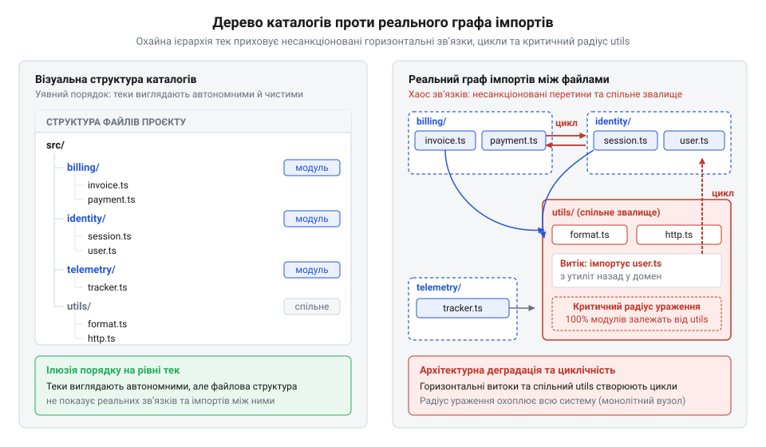
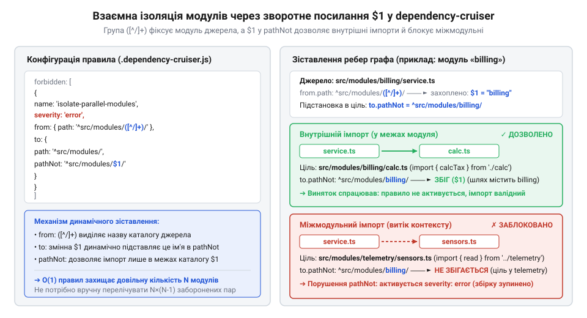

# Програмний інтерфейс правил лінтера dependency-cruiser для ізоляції дерева коду та заборони звалищ

<preknowlist>
- [DH: дерево хмари й дерево хаба](root:progarch/dh-code-trees) — архітектурна розкладка каталогів і пакетів у дереві хмари та хаба Digital Homes, взаємне розміщення модулів і спільних частин
</preknowlist>

## Як неконтрольовані імпорти руйнують дерево коду

Ієрархія каталогів на диску створює ілюзію порядку: модулі розкладені по окремих теках, а межі між ними тримаються на домовленостях команди під час ручного перегляду коду. Проте файлова система не контролює зв'язків виконання. Коли розробник платформи @@en|Digital Homes@@ під тиском стислих термінів імпортує функцію форматування дат із модуля `telemetry` в модуль `billing` або створює файл `src/utils/formatters.ts`, куди звалює спільний код, текстовий перегляд змін не бачить загрози. Звичайне рядкове порівняння фіксує лише локальні правки й приховує глибину транзитивних (від лат. @@la|transitivus@@ — перехідний, від *transire* — переходити) зв'язків. Випадкова залежність потрапляє в основну гілку репозиторію.

Наслідком стає приховане монолітне зрощення компонентів. Зміна протоколу датчиків у телеметрії несподівано зупиняє компіляцію модуля взаєморозрахунків, блокуючи незалежний випуск, на якому тримається [дерево коду хаба](root:progarch/dh-code-trees) у повсякденній розробці. Кожен статичний імпорт додає невидиме спрямоване ребро у фактичний граф залежностей. Спільні утилітарні теки перетворюються на магніт для паразитарних зв'язків, стягуючи непов'язані модулі у вузол взаємних циклів.


*Зіставлення структури тек на диску та реального графа залежностей: позірний порядок каталогів приховує хаос імпортів, який унеможливлює ізоляцію компонентів.*

Людська увага не здатна вручну відстежувати сотні транзитивних ребер у десятках змінених файлів. Захист архітектурних меж вимагає переходу від усної дисципліни до автоматизованої перевірки. Для цього архітектурний лінтер (англ. @@en|linter@@, від @@en|lint@@ — пух, очоси волокон; інструмент вичісування дрібних дефектів) @@en|dependency-cruiser@@ проєктує дерево файлів на орієнтований граф імпортів і перевіряє кожне ребро на відповідність формальним правилам.

## Декларативна конфігурація: секції forbidden та allowed

Щоб архітектурні контракти не лишалися сухими побажаннями у документації, їх переносять у код, який виконується автоматично під час збірки. Конфігурація лінтера @@en|dependency-cruiser@@ задається файлом `.dependency-cruiser.js` у корені репозиторію, що експортує об'єкт із правилами перевірки графа імпортів.

Управління графом спирається на дві протилежні стратегії контролю:
- **Політика білих списків (`allowed`):** реалізує модель «за замовчуванням заборонено» (англ. @@en|default-deny@@). Будь-який імпорт між файлами вважається порушенням, доки його прямо не внесено у перелік дозволених. Цей підхід забезпечує абсолютний контроль меж, проте на живих проєктах він одразу зупиняє розробку сотнями помилок на кожному легітимному зв'язку.
- **Політика чорних списків (`forbidden`):** працює за моделлю «за замовчуванням дозволено» (англ. @@en|default-allow@@). Дозволено все, крім явно перелічених заборонених ребер. Це дозволяє впроваджувати архітектурний нагляд поступово: спершу заблокувати критичні протікання, як-от несанкціоновані імпорти між модулями у [дереві коду хаба](root:progarch/dh-code-trees), а решту графа стабілізувати згодом.

Кожне правило містить метадані, які перетворюють знеособлену помилку аналізатора на точну інженерну підказку:

```javascript
module.exports = {
  forbidden: [
    {
      name: 'no-cross-module-leak',
      severity: 'error',
      comment: 'Прямий імпорт між модулями заборонено; використовуйте публічний API.',
      from: { /* джерело імпорту */ },
      to: { /* ціль імпорту */ }
    }
  ]
};
```

Поле `name` слугує унікальним ідентифікатором правила для звітів. Рівень суворості `severity` (англ. @@en|severity@@ — строгість, критичність) визначає наслідки: `error` фіксує фатальне порушення контракту й зупиняє збірку в конвеєрі, `warn` виявляє технічний борг без зриву збірки, а `info` збирає аналітику. Поле `comment` містить людиночитане пояснення: воно виводиться безпосередньо в термінал розробника, пояснюючи причину блокування та вказуючи легітимну архітектурну альтернативу.

## Селектори from і to: фільтрація шляхів

Оголошення правила не спрацює без визначення того, які саме ребра графа потрапляють під обмеження. Для цього правило використовує два обов'язкові блоки: селектор (від лат. @@la|selector@@ — вибирач, від *seligere* — вибирати) `from`, що зіставляє файл-джерело з інструкцією імпорту, та селектор `to`, що зіставляє цільовий імпортований файл.

Фільтрація шляхів виконується регулярними виразами (від лат. @@la|regula@@ — правило, мірило) у властивості `path`. Шлях відраховується від кореня проєкту. Щоб запобігти випадковим збігам підрядків у назвах каталогів, вираз завжди обмежують якірними символами: `^` фіксує початок шляху, а `$` — кінець. Точки в розширеннях екранують: `^src/modules/billing/.*\\.ts$`.

Інвертований селектор `pathNot` задає винятки: наприклад, блокує імпорт із каталогу модуля, за винятком його публічного інтерфейсного шва `index.ts`. Якщо модуль надає декілька публічних фасадів — скажімо, загальний інтерфейс `index.ts` та тестові контракти `testing.ts`, — об'єднання їх в один вираз через вертикальну риску робить шаблон громіздким і схильним до помилок. У таких випадках властивість `pathNot` приймає масив регулярних виразів: лінтер зіставляє ціль із кожним елементом списку й дозволяє зв'язок, якщо шлях збігається бодай з одним із зазначених файлів. Масив дає змогу винести кожен публічний фасад в окремий рядок, але збільшує обчислювальні витрати: лінтер мусить перевіряти кожне ребро імпорту проти всіх елементів списку. Крім того, оскільки для дозволу достатньо збігу з будь-яким елементом, випадково пропущений якірний символ `$` або надто широкий шаблон в одному з рядків відкриває сторонньому коду доступ до внутрішніх файлів модуля. Проте ручне дублювання правил для десятків каталогів роздуває конфігурацію. Для автоматичної взаємної ізоляції модулів застосовують круглі дужки захоплення (англ. @@en|capture groups@@) у `from.path` та динамічні зворотні посилання (англ. @@en|backreferences@@) `$1`, `$2` у селекторах `to.path` та `to.pathNot`.


*Динамічна ізоляція контекстів: селектор from фіксує ім'я модуля в групу захоплення, а зворотне посилання $1 у to.pathNot дозволяє внутрішні імпорти й блокує доступ до нутрощів сусідніх модулів.*

```javascript
{
  name: 'isolate-parallel-modules',
  severity: 'error',
  comment: 'Модуль може імпортувати лише власні файли або публічний фасад index.ts сусіда.',
  from: { path: '^src/modules/([^/]+)/' },
  to: {
    path: '^src/modules/[^/]+/',
    pathNot: '^src/modules/($1/|[^/]+/index\\.ts$)'
  }
}
```

Вираз `^src/modules/([^/]+)/` у селекторі `from` захоплює назву поточного каталогу в групу `$1`. Якщо файл із `billing` імпортує сусіда `telemetry/sensors.ts`, посилання `$1` у `to.pathNot` вимагає збігу з власним шляхом `src/modules/billing/`. Оскільки ціль належить іншому модулю й не є файлом `index.ts`, виняток `pathNot` не спрацьовує — лінтер перериває операцію та виводить аварійне повідомлення.

## Блокування звалищ і класифікація за dependencyTypes

Навіть за надійної ізоляції модулів кодова база швидко обростає неявним зачепленням, якщо в системі з'являються спільні каталоги на кшталт `utils`, `common` чи `helpers`. Спроба винести туди дрібну функцію перетворює теку на структурне сміттєзвалище, куди стікаються ребра з усіх контекстів. У @@en|dependency-cruiser@@ появу таких накопичувачів блокують правилом у списку `forbidden`: воно відхиляє будь-які імпорти до цих каталогів. Сувора заборона спрямовує інженерів до трьох чистих альтернатив: інлайнінгу (англ. @@en|inlining@@, від лат. *linea* — лінія, вбудовування коду за місцем виклику), локального дублювання допоміжних функцій або виокремлення повноцінних доменних моделей.

Фільтрації лише за шляхами недостатньо: рядок імпорту не розкриває походження зв'язку. Атрибут `dependencyTypes` селектора `to` класифікує залежності на рівні резолвера середовища (англ. @@en|resolver@@, від лат. *resolvere* — розв'язувати, зіставляти шлях до ресурсу). Він розрізняє локальні файли проєкту (`local`), сторонні пакети (`npm`), інструменти розробки й тестів (`npm-dev`), системні модулі платформи (`core`) та застарілі бібліотеки (`deprecated`).

```javascript
{
  name: 'no-shared-utils',
  severity: 'error',
  comment: 'Заборонено імпорт до звалищ; застосовуйте інлайнінг чи доменні типи.',
  to: { path: '(^|/)(utils|common|helpers)/' }
},
{
  name: 'no-dev-in-production',
  severity: 'error',
  comment: 'Виробничий код не може залежати від бібліотек розробки чи тестів.',
  from: { path: '^src/' },
  to: { dependencyTypes: ['npm-dev'] }
}
```

Така класифікація виставляє непроникні межі проти витоків реалізації. Правило блокує потрапляння інструментів тестування чи компіляції у виробниче ядро. Селектор також зупиняє глибокий імпорт (англ. @@en|deep import@@) — пряме затягування внутрішніх файлів бібліотек повз їхні публічні фасади. Коли код напряму підтягує приватні файли сторонніх пакетів, він прив'язується до їхньої внутрішньої структури каталогів. Автор бібліотеки гарантує стабільність контракту лише для публічної точки входу, а внутрішні файли може змінити чи перейменувати в будь-якому патч-релізі. Застосунок стає крихким і ламається під час планового оновлення залежностей. Для захисту меж у списку `forbidden` конфігурують правило, де регулярний вираз у `to.path` відловлює заглиблення всередину пакета, а селектор `dependencyTypesNot` дозволяє винятки для статичних типів:

```javascript
{
  name: 'no-deep-package-imports',
  severity: 'error',
  comment: 'Заборонено прямий імпорт внутрішніх файлів бібліотек повз публічний фасад.',
  to: {
    path: '^node_modules/(@[^/]+/[^/]+|[^/]+)/.+',
    pathNot: '^node_modules/(@[^/]+/[^/]+|[^/]+)/(index|package\\.json)',
    dependencyTypesNot: ['type-only']
  }
}
```

Регулярний вираз перевіряє імпорти як у звичайних пакетах, так і в пакетах із префіксом організації (`@scope/pkg`), блокуючи шляхи з внутрішніми підкаталогами, тоді як фільтр `pathNot` залишає доступними кореневі точки входу. Атрибут `dependencyTypesNot` зі значенням `type-only` гарантує, що заборона діє лише на код виконання й не перешкоджає компілятору імпортувати суто декларативні типи TypeScript. Нарешті, структуруючи модулі в [архітектурному дереві коду](root:progarch/dh-code-trees), конфігурацією з `to: { dependencyTypes: ['core'] }` забороняють доменному шару безпосередньо звертатися до системного введення-виведення чи інфраструктури без портів.

## Командний рядок, звіти та коди виходу

Декларативні правила у файлі `.dependency-cruiser.js` лишаються пасивною схемою, якщо їх не виконувати на кожній зміні дерева сирцевого коду. Для запуску перевірки призначено консольний інтерфейс утиліти `depcruise`. Їй передають цільові каталоги сканування та явний шлях до конфігурації через прапорець `--config`:

```bash
depcruise --config .dependency-cruiser.js src
```

Інструмент аналізує імпорти, будує фактичний граф залежностей і зіставляє кожне ребро із заборонами. Форму представлення результатів визначає прапорець `--output-type` через відповідний репортер (від @@en|reporter@@, лат. *reportare* — повертати звістку):
- `err` — текстовий вивід для розробника в терміналі: локалізує порушення до точного рядка у файлі, показує назву правила, рівень @@en|severity@@ та авторський коментар із вимогою контракту;
- `json` — машиночитаний структурований потік для програмного аналізу, збереження артефактів і збору метрик;
- `dot` — формат утиліти Graphviz для автоматичної генерації наочних схем [дерева коду хаба](root:progarch/dh-code-trees) в архітектурній документації.

Автоматизовані процеси взаємодіють з утилітою через числовий код виходу (@@en|exit code@@). Якщо граф залежностей чистий або містить лише зауваження рівнів `info` чи `warn`, процес завершується з кодом `0`. Спрацювання бодай одного правила з рівнем `error` детерміновано повертає код `1`.

Виклик `depcruise` закріплюють у секції `scripts` файла `package.json`, викликають у git-хуках `pre-commit` та додають як крок верифікації в конвеєр @@en|CI/CD@@. Код виходу `1` негайно зупиняє збірку й блокує злиття гілки, унеможливлюючи появу архітектурного браку в релізі без ручного нагляду.
