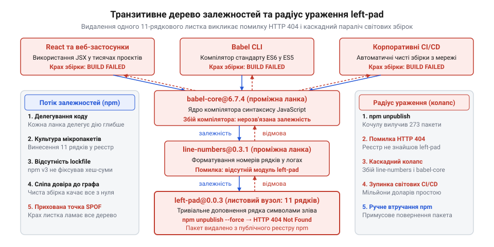
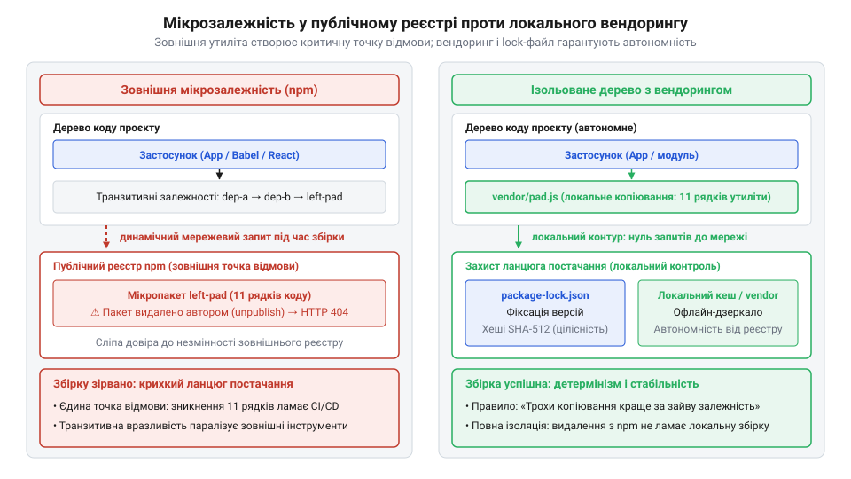

# Збій екосистеми через пакет left-pad та криза спільних утиліт

## Культура мікропакетів та ілюзія нульової вартості

У середині 2010-х років розробники на JavaScript зіткнулися з буденною задачею: вирівнюванням тексту в терміналі та форматуванням числових колонок із додаванням нулів спереду. У тогочасній стандартній бібліотеці мови — специфікації ECMAScript до стандарту 2017 року — були відсутні елементарні операції доповнення рядка на кшталт `padStart` чи `padEnd`. Кожен інженер поставав перед вибором: щоразу писати власний цикл із дописуванням символів або підключати готове стороннє рішення.

Потреба усунути дублювання штовхнула спільноту до крайнощів. Принцип @@en|DRY@@ (англ. @@en|DRY@@, акронім від *Don't Repeat Yourself* — «не повторюйся») перетворився на абсолютний догмат, а філософію Unix із правилом «роби одну річ і роби її добре» сприйняли гіпертрофовано. Замість зберігання дрібних допоміжних функцій у власній кодовій базі розробники масово виносили тривіальні алгоритми на кілька рядків в окремі публічні модулі через реєстр @@en|npm@@.

Виникла ілюзія нульової вартості зовнішнього коду: завантажити мікропакет (від грец. *mikros* — малий; англ. @@en|micro-package@@) однією консольною командою здавалося значно дешевшим, ніж самостійно тестувати десяток рядків. Показовим прикладом став пакет `left-pad`, чий вихідний код складався рівно з 11 рядків:

```javascript
module.exports = leftpad;
function leftpad (str, len, ch) {
  str = String(str);
  var i = -1;
  if (!ch && ch !== 0) ch = ' ';
  len = len - str.length;
  while (++i < len) {
    str = ch + str;
  }
  return str;
}
```

Увесь алгоритм зводився до елементарного циклу `while`: функція віднімала довжину рядка `str` від бажаної довжини `len` і на кожній ітерації дописувала символ `ch` (або пробіл за замовчуванням) ліворуч. Написання такого циклу на місці забирало лічені хвилини, проте розробники масово воліли підключати його як зовнішню залежність. Якщо під час проєктування власного [дерева коду компонентів](root:progarch/dh-code-trees) межі пакування узгоджують із темпами випуску, то відкрита екосистема пішла шляхом тотальної декомпозиції. Коли ключові бібліотеки почали делегувати кожну примітивну дію окремим мікромодулям, це спричинило неконтрольований [вибух транзитивних залежностей](root:sf-apps/transitive-dependency-explosion) (від лат. *transitivus* — перехідний; англ. @@en|transitive dependency@@). Великі інструменти на кшталт компілятора Babel чи бібліотеки React непомітно втягнули сотні сторонніх вузлів: прагнення усунути кілька локальних рядків створило багатошарові крихкі ланцюги невидимих зв'язків.

## Корпоративний конфлікт і демарш Азера Кочулу

У березні 2016 року каталізатором кризи став корпоративний спір за простір імен у публічному реєстрі. Незалежний розробник Азер Кочулу підтримував понад дві сотні бібліотек для @@en|npm@@, серед яких була утиліта з назвою `kik` — генератор шаблонів для вебпроєктів. Канадська компанія Kik Interactive, власник однойменного мобільного месенджера, вирішила випустити власний клієнтський пакет і через патентних повірених висунула автору вимогу передати назву, посилаючись на права на торговельну марку. Кочулу відхилив претензію, наполягаючи, що вільний простір імен у спільноті відкритого коду не підпорядкований приватним брендам.

Тоді юристи звернулися безпосередньо до керівництва компанії npm Inc. За відсутності чіткої політики розв'язання спорів щодо торговельних марок оператор реєстру ухвалив одноосібне адміністративне рішення: примусово відібрав пакет `kik` у автора й передав права корпорації. Розцінивши дію реєстру як зраду засад відкритого коду та диктат великого капіталу, Кочулу оголосив про повний розрив із платформою.

Щоб вилучити свій внесок, 22 березня 2016 року автор запустив у консолі команду `npm unpublish --force`. Тогочасний протокол реєстру дозволяв безперешкодне відкликання опублікованого коду й не перевіряв наявність залежних користувачів. За лічені секунди з публічного доступу зникли всі 273 пакети Кочулу — зокрема й крихітна допоміжна утиліта `left-pad`, чий код складався лише з одинадцяти рядків.

## Ланцюгова реакція та глобальний крах збірок

Упродовж кількох хвилин після видалення світові конвеєри розробки охопив масштабний колапс. Тисячі проєктів на всіх континентах — від внутрішніх систем великих ІТ-компаній до бібліотеки React — раптово зупинили збирання з фатальною помилкою `HTTP 404 Not Found` під час спроби завантажити `left-pad`. Розробники, які ніколи свідомо не підключали цю мікроутиліту й форматували рядки іншими засобами, з подивом виявили, що їхні системи не можуть зібратися без чужого 11-рядкового файлу.

Причиною зупинки стала прихована топологія транзитивних зв'язків. Більшість фронтенд-проєктів використовували компілятор Babel для перетворення сучасного синтаксису JavaScript. Команда `npm ls` наочно розкривала повний транзитивний шлях від кореня проєкту до `left-pad`:

```
$ npm ls left-pad
my-app@1.0.0
└─┬ babel-cli@6.7.5
  └─┬ babel-core@6.7.4
    └─┬ line-numbers@0.3.1
      └── left-pad@0.0.3
```

Компілятор спирався на модуль `babel-core`, той звертався до пакета `line-numbers` для виведення номерів рядків у діагностичних повідомленнях, а вже `line-numbers` викликав `left-pad` заради вирівнювання цих чисел пробілами. Кожна ланка ланцюга делегувала дрібну операцію глибше, і через строгу ієрархію встановлення збій у завантаженні крайнього листка блокував весь батьківський стек. Унаслідок такої структури банальна утиліта перетворилася на [єдину точку відмови](root:sf-apps/single-point-of-failure-dependency) (англ. @@en|single point of failure@@) для глобальної екосистеми.


*Топологія каскадного колапсу: листовий вузол left-pad через проміжний модуль line-numbers тримає компілятор Babel і визначає величезний транзитивний радіус ураження.*

Масштаб руйнувань багаторазово посилила системна вразливість клієнта @@en|npm@@ v3. Тодішній менеджер пакетів за замовчуванням не мав [детермінованих lock-файлів](root:sys-bsystem/version-pinning) (від лат. *determinare* — визначати, обмежувати; англ. @@en|lockfile@@) із фіксацією точних версій і хеш-сум. Кожен чистий запуск на сервері неперервної інтеграції наново опитував реєстр для динамічного розв'язання SemVer-діапазонів. Відсутність локальних замків позбавила збірки захисного буфера: щойно листок дерева зник із центрального сервера, транзитивний радіус ураження (від лат. *radius* — промінь; англ. @@en|blast radius@@) миттєво паралізував усю крону залежностей.

## Безпрецедентне втручання npm та зламана незмінність

Параліч світових систем збирання наростав щохвилини: простій конвеєрів коштував індустрії мільйони доларів, а оновлення тисяч транзитивних бібліотек вимагало б тижнів узгоджень. Керівництво компанії npm Inc. під проводом Айзека Шлютера опинилося перед важким вибором. З одного боку стояла непорушність власних правил реєстру, з іншого — загроза повної зупинки світової інфраструктури розробки.

Через дві з половиною години після початку колапсу оператор реєстру пішов на екстрене втручання. Адміністратори @@en|npm@@ в односторонньому порядку скасували дію команди `unpublish`, примусово відновили видалений пакет `left-pad` версії `0.0.3` та передали права супроводу сторонньому інженеру Кемерону Вестленду. Збірки по всьому світу миттєво повернулися до життя, однак оперативний успіх спричинив глибоку кризу довіри до платформи.

Реєстр відкрито знехтував принципом [незмінності артефактів](root:sf-release/artifact-immutability) (від лат. *immutabilis* — незмінний; англ. @@en|artifact immutability@@), який гарантує постійність опублікованих релізів і захист коду від підміни. Адміністративне свавілля оголило конфлікт довкола суверенітету коду (від лат. *superanus* — найвищий; англ. @@en|code sovereignty@@): кому насправді належить опублікований пакет — авторові, спільноті користувачів чи приватній компанії, що володіє сервером. Порятунок глобальних процесів ціною ручного зламу архітектурних гарантій довів, що в централізованій екосистемі автор позбавлений суверенного контролю над власною працею.

## Анатомія кризи та розвінчання популярних міфів

Після аварії медіа та технологічні форуми вибухнули глузуванням: світову індустрію звинувачували в непрофесіоналізмі, висміюючи розробників, які нібито «настільки ліниві чи нездатні, що не можуть написати одинадцять рядків для доповнення рядка пробілами». Такий погляд підміняє симптом першопричиною. Жоден інженер у великих проєктах не підключав `left-pad` свідомо заради тривіального циклу — утиліта потрапила в системи збирання невидимо, як транзитивний листок на дні багатошарового графа.

Справжній колапс спричинила не особиста некомпетентність і не емоційний демарш автора, а системні архітектурні діри тогочасної платформи. У системних пакетних менеджерах на кшталт @@en|Debian@@ `apt` чи `RPM` цілісність системи захищає механізм перевірки [зворотних залежностей](root:sf-release/reverse-dependency) (англ. @@en|reverse dependency@@): вони контролюють граф споживачів і блокують видалення бібліотек із залежними пакетами. Централізований реєстр @@en|npm@@, навпаки, дозволяв безперешкодне відкликання релізів без жодної перевірки зворотного графа, надаючи одному авторові технічну змогу зламати збірки мільйонів користувачів. Відсутність криптографічних контрольних сум і локальних замків версій змушувала конвеєри щоразу динамічно запитувати файли з мережі без захисного буфера. Необмежена глибина транзитивних зв'язків породила сліпу довіру до зовнішнього графа, через яку індустрія повністю втратила нагляд за власним [ланцюгом постачання програмного забезпечення](root:sf-security/supply-chain-security) (англ. @@en|software supply chain@@).

Видалення функції стало лише випадковим спусковим гачком, що оголив структурну крихкість екосистеми. За таких умов катастрофа була неминучою: за відсутності локальної ізоляції та перевірок цілісності збірки паралізував би будь-який інший листовий пакет.

## Архітектурні уроки та захист дерева залежностей

Крах екосистеми змусив індустрію докорінно переглянути ціну повторного вжитку. Догматичне усунення будь-якого повторення поступилося тверезому інженерному правилу Роба Пайка: «трохи копіювання значно краще за трохи залежності» (англ. @@en|A little copying is better than a little dependency@@). Якщо зовнішній мікропакет несе ризик каскадного зламу, десять рядків власного допоміжного коду дають повну автономію й нульову ймовірність відмови ззовні.

Платформа та інструменти збирання швидко збудували захисні бар'єри. Реєстр @@en|npm@@ назавжди заборонив безповоротне відкликання версій за наявності залежних споживачів. Поява менеджера @@en|Yarn@@ у 2016 році та впровадження `package-lock.json` в @@en|npm@@ 5 закріпили обов'язкову фіксацію дерева через детерміновані lock-файли з криптографічними хешами цілісності: збірка перестала наосліп приймати неперевірений код із мережі. Замість динамічного розв'язання SemVer-діапазонів файл `package-lock.json` фіксує точний стан дерева, прив'язуючи кожен пакет до джерела завантаження та його криптографічного відбитка:

```json
"left-pad": {
  "version": "1.3.0",
  "resolved": "https://registry.npmjs.org/left-pad/-/left-pad-1.3.0.tgz",
  "integrity": "sha512-XI5MPzVNApjAyhQzphX8BkmKsKUxD4LdyK24iZeQGinBN9yTQT3bFlCBy/aVx2HrNcqQGsdot8ghrjyrvMCoEA=="
}
```

Поле `integrity` зберігає контрольний хеш архіву за алгоритмом SHA-512. Під час встановлення менеджер пакетів завантажує файл `.tgz` за адресою з поля `resolved`, локально обчислює його фактичний хеш і звіряє зі значенням у lock-файлі. Якщо контрольні суми збігаються, клієнт розпаковує код у `node_modules`. Якщо ж вміст архіву на сервері бодай на байт відрізняється від зафіксованого — через спробу підмінити реліз чи пошкодження даних у мережі, — процес збирання негайно переривається з помилкою невідповідності цілісності. Це перетворює дерево залежностей на детермінований і незмінний контракт, який захищає збірку від непередбачуваних мутацій у зовнішньому реєстрі.


*Зовнішня мікрозалежність відкриває ланцюг постачання до раптових збоїв, тоді як локальний вендоринг і проксі-кеш гарантують герметичність збірки.*

Організовуючи внутрішнє [дерево коду](root:progarch/dh-code-trees), розробники замінили небезпечні мікропакети [локальним вендорингом](root:sys-bsystem/vendoring-submodules) (від лат. *vendere* — продавати; англ. @@en|vendoring@@) — розміщенням вихідного тексту утиліт безпосередньо у сховищі проєкту. Для захисту від падінь зовнішніх серверів корпоративні конвеєри перейшли на приватні кешувальні проксі-реєстри на кшталт @@en|Verdaccio@@ чи @@en|Nexus@@. Зовнішня залежність перестала бути дешевою дрібницею: кожна стороння бібліотека вимагає свідомого архітектурного аудиту й надійної ізоляції.
