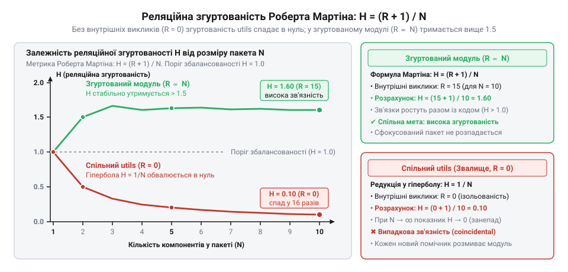
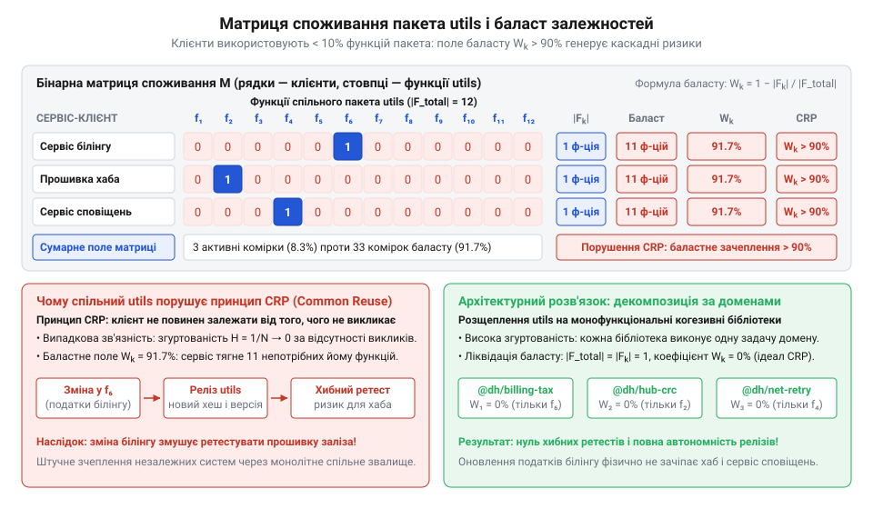

# Метричний аналіз випадкової зв'язності та порушення принципу CRP

<preknowlist>
- [DH: дерево хмари й дерево хаба](root:progarch/dh-code-trees) — архітектурна структура монорепозиторію Digital Homes, поділ коду між хмарним сервером і локальним хабом та первинне розміщення спільних утилітарних пакетів
</preknowlist>

## Хитання релізів без міри зв'язності

Спільний каталог допоміжних функцій зазвичай сприймають як найпростіший спосіб уникнути дублювання: доки код успішно компілюється, структура видається прийнятною. Проте в монорепозиторії Digital Homes, де [код хмари та хаба](root:progarch/dh-code-trees) звертається до спільного пакета `utils`, банальна правка функції форматування рядків для звітів раптово ламає модуль білінгу. Спроба розгорнути черговий випуск прошивки локального хаба зупиняється збоєм на інтеграційних тестах, хоча інженери вбудованих систем узагалі не торкалися платіжного коду.

Усі спроби приборкати хитання випусків організаційними правилами чи посиленням рецензування (@@en|code review@@) швидко зводяться до суб'єктивних суперечок. Одні розробники спираються на абстрактне правило @@en|DRY@@ (акронім від англ. *Don't Repeat Yourself* — «не повторюйся») і наполягають на винесенні будь-якої схожої дії до допоміжних пакетів. Інші протестують проти спільних кодових смітників, але не мають чисельного критерію, щоб довести їхню шкоду. Інтуїтивні уявлення про «чистий код» не дають вимірної межі, залишаючи прихованою небезпечну напругу: формальне прагнення скоротити дублювання рядків створює жорстку фізичну залежність незалежних модулів від чужих змін.

Керувати архітектурою на основі особистих вражень неможливо. Щоб розкрити справжню ціну кодового смітника, потрібен суворий математичний апарат. Лише строгі кількісні метрики внутрішньої згуртованості (@@en|cohesion@@, від лат. *cohaerere* — бути тісно зв'язаним) та зовнішнього небажаного зачеплення (@@en|coupling@@) дають змогу виміряти випадковий зв'язок компонентів і числовими розрахунками обґрунтувати поділ роздутого пакета на стабільні ізольовані одиниці.

## Метрика Мартіна та згасання згуртованості

Інтуїтивне відчуття «брудного пакета» не переконує команду під час архітектурного аудиту. Щоб відокремити сфокусований компонент від смітника, Роберт Мартін запропонував кількісний показник — метрику реляційної згуртованості (@@en|relational cohesion@@, від лат. *cohaerere* — триматися разом). Вона вимірює щільність внутрішніх взаємодій між елементами всередині одного простору імен.

Позначимо через `N` загальну кількість типів і функцій у пакеті, де `N > 0`. Кількість спрямованих внутрішніх викликів та звернень між цими типами позначимо як `R`, де `R ≥ 0`. Одиниця в чисельнику запобігає виродженню показника для неподільного пакета з одного класу. Метрику реляційної згуртованості `H` обчислюють як відношення внутрішніх зв'язків до числа елементів:

```
H = (R + 1) / N      [означення метрики Мартіна]
```

Значення `H = 1` сигналізує про збалансовану щільність зв'язків: кожен елемент у середньому підтримує щонайменше одну внутрішню взаємодію. Якщо ж внутрішні виклики утворюють щільну мережу, показник перевищує одиницю.

В утилітарних каталогах на зразок `utils` у [спільному коді хаба та хмари](root:progarch/dh-code-trees) виникає протилежний феномен. Сюди скидають довільні допоміжні операції: форматування дат, перевірку регулярних виразів, обчислення гешів. Функція форматування рядків не викликає розбір дат, а генератор ключів не залежить від перетворень масивів. Кількість внутрішніх залежностей дорівнює нулю: `R = 0`. Підставимо цю умову у формулу й дослідимо поведінку модуля при додаванні нових утиліт, коли кількість елементів `N` прямує до нескінченності:

```
H(N)
= (0 + 1) / N        [відсутність внутрішніх викликів R = 0]
= 1 / N              [спрощення чисельника]
lim[N → ∞] H(N)
= lim[N → ∞] (1 / N) [підстановка границі]
= 0                  [асимптотичне згасання гіперболи]
```

Отримана гіпербола `H(N) = 1 / N` неминуче спадає в нуль. Що більше «корисних помічників» розробники додають до загального модуля, то нижчою стає його математична згуртованість.

Контраст між розрізненими утилітами та сфокусованим модулем чітко видно при порівнянні двох пакетів однакового розміру з десяти елементів (`N = 10`). Для десяти утилітарних функцій за відсутності внутрішніх викликів (`R = 0`) значення реляційної згуртованості падає вдесятеро:

**Розрахунок згуртованості для пакета з 10 функцій без викликів (`R = 0`):**
```
H
= (0 + 1) / 10           [підстановка N = 10 та R = 0]
= 1 / 10                 [спрощення чисельника]
= 0.1                    [десятикратне падіння згуртованості]
```

Отримане значення `H = 0.1` фіксує глибоку структурну деградацію: функції не викликають одна одну, тому модуль фактично розпадається на ізольовані частини. Натомість для сфокусованого пакета з десяти компонентів і п'ятнадцяти внутрішніх взаємодій (`R = 15`) той самий розрахунок демонструє стабільну внутрішню мережу:

**Розрахунок згуртованості для пакета з 10 компонентів і 15 внутрішніх викликів (`R = 15`):**
```
H
= (15 + 1) / 10          [підстановка N = 10 та R = 15]
= 16 / 10                [додавання в чисельнику]
= 1.6                    [збалансована щільність зв'язків]
```

Показник `H = 1.6` свідчить про шістнадцятикратну перевагу в щільності взаємодій. Якщо сфокусований модуль утримує згуртованість вище одиниці завдяки спільній роботі компонентів, то пакет спільних утиліт деградує до критичного мінімуму: кожен новий помічник без внутрішніх зв'язків лише дужче розмиває модуль.


*Залежність реляційної згуртованості від розміру пакета: внутрішні виклики утримують згуртованість, а їхня відсутність обнуляє її зі зростанням числа компонентів.*

Це граничний стан модульної деградації — випадкова зв'язність (@@en|coincidental cohesion@@, від лат. *coincidere* — збігатися). Елементи пакета опинилися в одному каталозі не через спільну задачу чи інформаційний потік, а суто випадково, за збігом обставин.

## Зачеплення методів та метрика LCOM

Низька реляційна згуртованість пакета спонукає розробників групувати процедури у статичні класи `StringUtils`, `DateUtils` або `SecurityUtils`. Проте штучна класова обгортка не створює об'єктної єдності.

Ступінь зв'язності всередині окремого класу формалізує метрика [браку згуртованості методів](root:sf-apps/metrics-lcom-suite) (@@en|lack of cohesion in methods@@, @@en|LCOM@@), запропонована Чідамбером і Кемерером. Вона аналізує, як методи класу взаємодіють зі спільним станом.

Нехай клас містить `m` методів і множину екземплярних змінних `A`. Для кожного методу визначимо множину полів `I`, до яких він звертається. Розглянемо всі `m · (m - 1) / 2` унікальні невпорядковані пари методів. Позначимо через `P` кількість пар методів, які не мають спільних змінних, а через `Q` — кількість пар, що звертаються хоча б до одного спільного поля:

```
P = { (M_i, M_j) | I_i ∩ I_j = ∅ }    [пари без спільних змінних]
Q = { (M_i, M_j) | I_i ∩ I_j ≠ ∅ }    [пари зі спільними змінними]
```

Значення метрики `LCOM` обчислюють як різницю розмірів цих множин, якщо роз'єднаних пар більше, ніж пов'язаних:

```
LCOM
= |P| - |Q|          [якщо |P| > |Q|]
= 0                  [якщо |P| ≤ |Q|]
```

Анатомія статичних утилітарних класів викриває їхній процедурний характер: вони взагалі не містять інкапсульованих екземплярних змінних. Їхній стан порожній: `A = ∅`. Відповідно, для будь-якої пари статичних методів звернення до стану повертає порожню множину `I_i = ∅`, а їхній перетин завжди порожній:

```
I_i ∩ I_j
= ∅ ∩ ∅              [підстановка порожнього стану утилітарного класу]
= ∅                  [перетин порожніх множин]
```

У результаті жодна пара методів не ділить спільне поле: `|Q| = 0`. Усі можливі пари потрапляють у множину `P`. Обчислимо штрафний бал `LCOM` для утилітарного класу з `m` статичних методів:

```
LCOM
= |P| - |Q|              [визначення за умови |P| > |Q|]
= (m · (m - 1) / 2) - 0  [усі пари не мають спільного стану]
= m · (m - 1) / 2        [максимальне роз'єднання методів]
```

Нормалізована метрика Гендерсона-Селлерса `LCOM*` усуває ваду метрики Чідамбера й Кемерера, шкала якої квадратично зростає від кількості методів `m · (m - 1) / 2`. Вона враховує фактичну кількість звернень до кожного з полів і набуває значень від 0 (ідеальна згуртованість) до 1 (повна роз'єднаність). Для загального випадку класу зі станом, що містить `m` методів (`m > 1`) та `a` екземплярних змінних `a_j` (де `a = |A| > 0`), позначимо через `m(a_j)` кількість методів, які звертаються до конкретного поля `a_j`. Тоді середня кількість методів, що ділять одне поле, становить `(1 / a) · ∑ m(a_j)`, а саму метрику визначають через відхилення цієї середньої залученості від загальної кількості методів:

```
LCOM*
= (m - (1 / a) · ∑ m(a_j)) / (m - 1)    [означення метрики Гендерсона-Селлерса]
```

Якщо кожен метод взаємодіє з кожним доступним полем (`m(a_j) = m`), сума звернень `∑ m(a_j)` дорівнює `a · m`, середня кількість методів сягає `m`, а чисельник стає нульовим: `m - m = 0`, що дає `LCOM* = 0`. Якщо ж кожне поле використовує лише один ізольований метод (`m(a_j) = 1`), середня кількість дорівнює одиниці, чисельник стає `m - 1`, і метрика досягає максимуму `(m - 1) / (m - 1) = 1`. Натомість статичний утилітарний клас узагалі не містить інкапсульованого стану (`A = ∅`, `a = 0`), тому для класу без полів набуває абсолютного граничного штрафу:

```
LCOM* = 1            [повна відсутність об'єктної згуртованості]
```

Клас-помічник позбавлений інкапсуляції. Він є лише синтаксичним фасадом над розрізненими процедурами, де брак згуртованості досягає теоретичного максимуму.

## Матриця споживання та формула зачеплення

Нульова внутрішня згуртованість утилітарного пакета перетворюється на архітектурну проблему, щойно до нього звертаються зовнішні клієнти. Якщо сервісу потрібна єдина функція форматування рядків, він змушений підключати увесь спільний модуль із десятками чужих утиліт. Зміна в алгоритмі шифрування, потрібна лише хмарному хабу, вимагає перезбирання та повторного тестування модуля білінгу, хоча той жодного разу його не викликав.

Щоб кількісно виміряти цей розрив, формують бінарну матрицю споживання можливостей `M`. Нехай маємо `K` сервісів-клієнтів `C[1], C[2], ..., C[K]` та спільний пакет із загальною множиною утиліт `F_total` потужністю `|F_total| = J`, що містить функції `f[1], f[2], ..., f[J]`. Кожен елемент матриці `M[k, j] ∈ {0, 1}` показує факт виклику: значення дорівнює `1`, якщо клієнт `C[k]` використовує функцію `f[j]`, і `0`, якщо не використовує. Рядок матриці задає підмножину потрібних клієнту функцій `F[k] ⊆ F_total` потужністю `|F[k]| = ∑ M[k, j]`.


*Матриця споживання демонструє, що понад 90% комірок утилітарного пакета є баластом, що штучно зачіплює незалежні сервіси.*

Принцип спільних повторних використань (@@en|Common Reuse Principle@@, @@en|CRP@@; від англійського @@en|reuse@@ — повторне використання) вимагає не пакувати разом те, що не використовується разом. В ідеалі клієнт споживає весь вміст пакета: `|F[k]| = |F_total|`. Відхилення від цього ідеалу визначає частка паразитного коду. Зі співвідношення реально потрібних утиліт до повного обсягу пакета дістаємо коефіцієнт небажаного зачеплення `W[k]`:

```
W[k] = 1 - (|F[k]| / |F_total|)
```

Показник `W[k]` вимірює частку чужого вантажу, яку клієнт тягне за собою. Граничне значення `W[k] = 0` відповідає ідеальному стану повної відсутності баласту: коли клієнт споживає абсолютно всі функції модуля (`|F[k]| = |F_total|`), вираз дає `W[k] = 1 - 1 = 0`. Ця рівність слугує математичним критерієм розщеплення спільного пакета на атомарні бібліотеки: спільний каталог утиліт декомпозують на настільки компактні й сфокусовані одиниці, щоб для кожного цільового сервісу коефіцієнт небажаного зачеплення дорівнював нулю. Навпаки, наближення `W[k]` до одиниці сигналізує про критичну надмірність залежності. Досліджуючи [дерево хмари й хаба](root:progarch/dh-code-trees) проєкту @@en|Digital Homes@@, розглянемо сервіс білінгу, що викликає лише 2 функції з 50 наявних у спільному пакеті:

**Обчислення небажаного зачеплення для сервісу білінгу при `|F_total| = 50` та `|F[k]| = 2`:**
```
W[k] = 1 - (|F[k]| / |F_total|)
     = 1 - (2 / 50)             [підстановка значень]
     = 1 - 0.04                 [частка потрібних функцій]
     = 0.96                     [коефіцієнт баласту]
```

Значення `W[k] = 0.96` свідчить: 96% залученого коду є мертвим баластом. Будь-яка модифікація у решті 48 функціях порушує @@en|CRP@@ і спричиняє безпідставні повторні складання клієнта.

## Каскадний ретест та ймовірність збоїв

Коли сервіс підключає монолітний пакет утиліт заради однієї корисної функції, високий коефіцієнт баласту перестає бути лише абстрактною часткою. Він б'є безпосередньо по конвеєру складання. Щоразу, коли розробники з іншої команди вносять правки в сусідні допоміжні процедури, система неперервної інтеграції фіксує оновлення спільного модуля, запускаючи повний цикл компіляції та прогону тестів для клієнта, чий код не змінився ні на символ.

Нехай спільний пакет містить загальну множину функцій `F_total` розміром `|F_total|`, з яких клієнт `k` реально викликає підмножину `F[k]` розміром `|F[k]|`. Решта утворює баласт із `|F_total| - |F[k]| = |F_total| · W[k]` неспоживаних функцій. До того ж сторонні транзитивні залежності утиліт діють еквівалентно додатковим баластним функціям: коли непотрібна клієнту процедура затягує зовнішню бібліотеку, будь-яке її оновлення чи виправлення вразливості система складання сприймає як зміну спільного пакета, підвищуючи сумарний ризик ретесту. Припустимо, що за релізний цикл кожна функція пакета зазнає змін незалежно з імовірністю `pₘ`. Тоді ймовірність того, що окрема баластна функція залишиться незмінною, становить `1 - pₘ`. Конвеєр клієнта уникне марного перезапуску лише тоді, коли всі баластні функції одночасно збережуть стабільність. За незалежності подій імовірність спокою дорівнює `(1 - pₘ)⁽|F_total| - |F[k]|⁾`. Віднімаючи цей показник від одиниці, отримуємо ймовірність хибного спрацьовування конвеєра `P_false[k]`:

```
P_false[k]
= 1 - (1 - pₘ)⁽|F_total| - |F[k]|⁾ [ймовірність протилежної події для баласту]
= 1 - (1 - pₘ)⁽|F_total| · W[k]⁾   [вираження баласту через коефіцієнт W[k]]
```

Вираз розкриває експоненційну природу ризику: імовірність ретесту визначається не частотою власних звернень сервісу, а сумарною масою чужого коду. Навіть слабка активність розробки у спільному смітнику лавиноподібно збільшує шанс хибного запуску.

**Розрахунок імовірності хибного ретесту для клієнта з 40 баластними функціями при `pₘ = 0.05`:**
```
P_false[k]
= 1 - (1 - 0.05)⁴⁰       [підстановка pₘ та 40 баластних функцій]
= 1 - 0.95⁴⁰             [ймовірність стабільності окремої функції]
≈ 1 - 0.1285             [імовірність спокою всіх 40 функцій]
= 0.8715                 [підсумкова ймовірність хибного запуску]
```

Навіть за низької ймовірності модифікації окремої функції сервіс із сорока неспоживаними утилітами з імовірністю понад 87% змушений проходити зайві збірки. Коли через спільне звалище зв'язані [дерева хмари й хаба](root:progarch/dh-code-trees), правка форматування рядків локального хаба зупиняє релізи хмарного білінгу. Непотрібний код розширює динамічний @@en|blast radius@@ (радіус ураження, від лат. @@la|radius@@ — промінь): порушення @@en|Common Reuse Principle@@ (@@en|CRP@@) перетворює автономні модулі на заручників чужих змін.

## Критерії розщеплення та метричний аудит

Формальні метрики мають сліпі зони. Якщо штучно пов'язати випадкові функції циклічними викликами, кількість внутрішніх ребер `R` зросте, і реляційна @@en|згуртованість@@ `H = (R + 1) / N` завищиться без реального зв'язку між задачами. Навпаки, у високомодульному конвеєрі поліморфні обробники реалізують спільний інтерфейс без прямої взаємодії (`R = 0`): тут низьке значення `H` є нормальною властивістю архітектури, а не дефектом.

Щоб уникнути помилкових висновків, проводять @@la|аудит@@ (лат. auditus — слухання) кодової бази за споживанням. Алгоритм складається з трьох дій:
1. Побудувати бінарну матрицю споживання `M`, де рядки відповідають клієнтам, а стовпчики — функціям пакета.
2. Розрахувати попарну спорідненість клієнтів.

Ступінь перетину потреб клієнтів `a` та `b` із множинами споживаних функцій `F_a` та `F_b` визначає @@fr|коефіцієнт Жаккара@@ (від імені ботаніка Поля Жаккара, Paul Jaccard):

```
J(F_a, F_b) = |F_a ∩ F_b| / |F_a ∪ F_b|      [частка спільних функцій у повному об'єднанні]
```

Значення `J(F_a, F_b) ≈ 1` виявляє спільний домен і природний кластер для виділення, тоді як `J(F_a, F_b) → 0` сигналізує про штучне сусідство чужих можливостей.

3. Перевірити числові критерії декомпозиції.

Розщеплення пакета є обов'язковим за одночасного виконання двох нерівностей:

```
H < 0.2          [критично низька внутрішня згуртованість]
W_середній > 0.7  [понад 70% вмісту пакета є баластом]
```

Розбиття сміттєвого каталогу за виявленими кластерами — наприклад, під час реорганізації утиліт у [дереві хаба](root:progarch/dh-code-trees) — розносить несумісні функції по автономних одиницях випуску. У новоутворених пакетах згуртованість прямує до одиниці (`H → 1`), баласт зникає (`W_k ≈ 0`), а конвеєр позбувається ризику хибних каскадних ретестувань.

Впорядкування функцій за виділеними кластерами перетворює первинну бінарну матрицю споживання `M` на блочно-діагональну форму. Кожен діагональний блок відповідає окремому доменному пакету, у якому клієнт залучає практично всі надані можливості (`|F[k]| ≈ |F_total|`), а чужий баласт повністю відсутній (`W[k] = 0`). Розрахуємо підсумкову ймовірність хибного спрацьовування конвеєра `P_false[k]` для сервісу після виділення сфокусованого модуля:

```
P_false[k]
= 1 - (1 - pₘ)⁽|F_total| · W[k]⁾  [загальна формула ймовірності каскадного ретесту]
= 1 - (1 - pₘ)⁰                   [підстановка нульового баласту W[k] = 0]
= 1 - 1                           [піднесення до нульового степеня]
= 0                               [повне усунення хибних спрацьовувань]
```

Нульовий ризик `P_false[k] = 0` показує, що жодні сторонні зміни більше не здатні транзитивно збурити конвеєр клієнта. Динамічний радіус ураження @@en|blast radius@@ стискається точно до межі єдиного пакета. Математичний аудит остаточно примиряє інженерну модульність із виробничою надійністю: принцип @@en|CRP@@ перетворюється з абстрактного гасла на обчислюваний критерій, де кожна одиниця повторного вжитку стає незалежною одиницею випуску. Закріпити отримані межі в конвеєрі неперервної інтеграції та запобігти поверненню випадкової зв'язності допомагає [автоматизована валідація архітектурних меж за допомогою dependency-cruiser](root:progarch/shared-utils-dump/api-dependency-cruiser-tree-rules.md).
