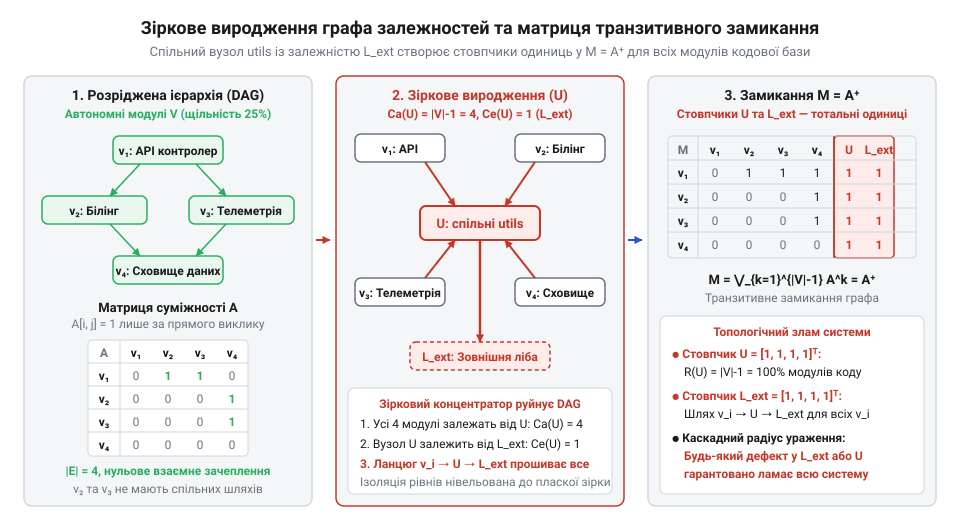
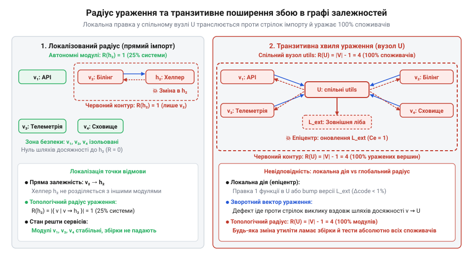

# Графова модель транзитивного замикання та радіуса ураження пакета зі штучною зв'язністю

<preknowlist>
- [DH: дерево хмари й дерево хаба](root:progarch/dh-code-trees) — архітектурна структура каталогів монорепозиторію Digital Homes, взаємне розташування сервісів хмари й хаба та первинне розміщення спільних утилітарних пакетів у дереві проєкту
</preknowlist>

## Пастка локального аналізу прямих залежностей

У [структурі вихідного коду](root:progarch/dh-code-trees) платформи @@en|Digital Homes@@ сервіси білінгу, обробки телеметрії та контролю актуаторів видаються повністю ізольованими. Між цими підсистемами немає прямих викликів, спільних файлів чи перехресних імпортів. Кожен модуль вирішує власну доменну задачу й взаємодіє із зовнішнім світом лише через власні інтерфейси. Така розріджена картина створює враження надійної архітектурної автономності: збій в одному сервісі не повинен зачіпати інші.

Ілюзія незалежності зникає під час першої ж дрібної правки у спільному коді. Розробник змінює сигнатуру допоміжної функції форматування дати та підключає сторонню бібліотеку швидкої серіалізації в загальному пакеті утиліт. Локальна перевірка безпосередніх викликів показує повну безпеку: кожен доменний модуль бере з утиліт лише одну-дві прості допоміжні операції. Проте одразу після оновлення система зазнає масштабного збою. Компіляція модуля білінгу падає через несумісність транзитивних версій серіалізатора, черга телеметрії переповнюється через змінений формат міток часу, а сервіс актуаторів зависає на помилці розбору конфігурації.

Локальний аудит викликів за прямими ребрами дає хибне відчуття контролю. Коли кожен модуль підключає спільний пакет, уся система неявно перетворюється на щільний монолітний клубок взаємозв'язків. Будь-яка зміна або оновлення зовнішньої бібліотеки в такому вузлі миттєво поширюється на всі компоненти, які навіть не підозрювали про існування один одного. Наївний аналіз коду за списком прямих імпортів не бачить цієї загрози. Щоб виявляти приховані зв'язки та оцінювати реальний масштаб можливих руйнувань, системі потрібен строгий графовий апарат топологічного моделювання.

## Граф залежностей та зіркова дегенерація

Для точного математичного аналізу зв'язності архітектуру кодової бази представляють як орієнтований граф `G = (V, E)`. Множина вершин `V` позначає окремі модулі, пакети або сервіси, а множина напрямлених ребер `E` — відношення використання коду. Якщо модуль `u` звертається до модуля `v`, граф містить орієнтовану пару `(u, v) ∈ E`, де стрілка вказує напрямок залежності `u → v`.

Архітектурні властивості кожного вузла визначають через степені його зв'язності. Вхідне аферентне зачеплення (лат. *afferre* — приносити, доправляти) вимірює напівстепінь заходу вершини:

```
C_a(v)
= |{ u ∈ V | (u, v) ∈ E }|               [кількість компонентів, що прямо залежать від v]
```

Величина `C_a(v)` показує архітектурну відповідальність модуля: що більше компонентів спираються на `v`, то вищий ризик зламати систему при його модифікації. Натомість вихідне еферентне зачеплення (лат. *efferre* — виносити, виводити) вимірює напівстепінь виходу вершини:

```
C_e(v)
= |{ w ∈ V | (v, w) ∈ E }|               [кількість сторонніх модулів, від яких залежить v]
```

Показник `C_e(v)` визначає нестабільність вузла: кожен вихідний виклик робить модуль чутливим до змін у сторонньому коді. У збалансованій модульній архітектурі зв'язки утворюють розріджений ієрархічний граф, де більшість компонентів мають помірні показники `C_a` та `C_e`.

Створення спільного пакета утиліт `U` в [структурі дерева коду](root:progarch/dh-code-trees) докорінно спотворює топологію. У збалансованій архітектурі залежності утворюють багаторівневий спрямований ациклічний граф (DAG, від грец. *kyklos* — коло), де виклики проходять строго крізь упорядковані шари — від зовнішніх точок входу через доменні сервіси до адаптерів інфраструктури. Така шарувата ієрархія забезпечує значну топологічну глибину шляхів, а паралельні доменні гілки лишаються ізольованими. Проте коли кожен компонент підключає з пакета `U` дрібні допоміжні функції, вхідне зачеплення вузла стрімко прямує до теоретичної межі `C_a(U) → |V| - 1`. Напрямлені ребра `(v, U)` прошивають усі проміжні рівні наскрізь: і високорівневі контролери, і доменні сервіси, і адаптери інфраструктури звертаються до спільного пакета напряму. Топологічна відстань від довільного модуля системи до вузла `U` скорочується до одиниці, нівелюючи шарувату глибину. Багаторівневий DAG руйнується, а граф кодової бази вироджується (лат. *degenerare* — вироджуватися, відхилятися від роду) у топологічно пласку зіркову структуру. Вузол `U` стає центральним концентратором, у який сходяться ребра від усіх модулів системи, руйнуючи захисні бар'єри між архітектурними шарами.

## Матриця досяжності та транзитивне замикання

Для алгебричного аналізу граф залежностей описують квадратною булевою матрицею суміжності `A` розміром `|V| × |V|`. Елемент матриці `A[i, j] = 1`, якщо в графі існує пряме орієнтоване ребро `(v_i, v_j) ∈ E`, і дорівнює `0` за його відсутності.

Пряма матриця суміжності фіксує лише шляхи довжиною один. Проте збій поширюється далі: якщо модуль `v_i` залежить від `v_k`, а `v_k` викликає `v_j`, виникає непрямий ланцюжок впливу. Наявність орієнтованих шляхів довжиною два визначають булевим множенням матриці `A` самої на себе через логічні операції кон'юнкції `∧` та диз'юнкції `∨`:

```
A²[i, j]
= ⋁_{k} (A[i, k] ∧ A[k, j])             [наявність шляху довжиною 2 через проміжний вузол k]
```

Щоб виявити всі ланцюжки непрямої взаємодії довільної глибини, граф доповнюють до транзитивного замикання (лат. *transitus* — перехід) `G⁺ = (V, E⁺)`. Повну топологічну зв'язність системи визначає матриця досяжності:

```
M
= A ∨ A² ∨ A³ ∨ ... ∨ A^(|V|-1)          [об'єднання шляхів усіх довжин до |V|-1]
= ⋁_{k=1}^{|V|-1} A^k                    [булева матриця транзитивного замикання A⁺]
```

Оскільки найдовший простий шлях в ациклічному графі містить щонайбільше `|V| - 1` ребер, матриця `M` вичерпно показує, чи існує орієнтований шлях `v_i ⇝ v_j` між будь-якою парою вузлів.

У зірковому графі транзитивне замикання спричиняє структурний колапс. Якщо центральний вузол утиліт `U` отримує хоча б одну власну вихідну залежність — зовнішню бібліотеку `L_ext` із `C_e(U) ≥ 1`, — виникає шлях довжиною два `v_i → U → L_ext`. У матриці досяжності `M` стовпчик пакета `U` та стовпчик бібліотеки `L_ext` повністю заповнюються одиницями: кожен компонент системи транзитивно замикається на ці вузли.


*Зіркове виродження графа залежностей навколо спільного пакета утиліт та заповнення матриці досяжності: розріджена модульна структура деградує у зв'язний моноліт.*

Навіть без сторонніх бібліотек спільний вузол створює фіктивне зачеплення між ізольованими сервісами. Пряма матриця суміжності `A` та матриця досяжності `M` не фіксують взаємозв'язку між автономними компонентами, оскільки `A[i, j] = 0` та `M[i, j] = 0`. Проте залежність через спільні ресурси формалізує добуток матриці суміжності `A` на її транспоновану матрицю (лат. *transponere* — переставляти) `Aᵀ`. Значення елемента `(A · Aᵀ)[i, j]` обчислюють як скалярний добуток `i`-го та `j`-го рядків матриці `A`:

```
(A · Aᵀ)[i, j]
= ∑_{k} (A[i, k] · Aᵀ[k, j])             [добуток i-го рядка матриці A на j-й стовпчик Aᵀ]
= ∑_{k} (A[i, k] · A[j, k])              [підстановка Aᵀ[k, j] = A[j, k] за правилом транспонування]
```

Кожен доданок `A[i, k] · A[j, k]` дорівнює одиниці лише тоді, коли обидва вузли `v_i` та `v_j` одночасно залежать від компонента `v_k`, тож сума рахує кількість їхніх спільних залежностей. Оскільки всі сервіси платформи звертаються до спільного пакета `U`, для кожного з них `A[i, U] = 1`, через що для будь-якої пари споживачів позадіагональний елемент `(A · Aᵀ)[i, j] ≥ 1` стає строго додатним. Якщо модуль білінгу ініціює зміни утиліти або вимагає нової поведінки спільного коду, це збурення через концентратор `U` зачіпає модулі телеметрії та актуаторів. Первинно розріджена архітектура математично перетворюється на повний граф прихованої залежності, де незалежний випуск окремих підсистем стає неможливим.

## Зовнішні залежності та радіус ураження

У чистому вигляді пакет утиліт сприймають як термінальний листок графа із нульовим вихідним зачепленням `C_e(U) = 0`. Допоміжні функції вважають безпечними, оскільки вони не залежать від решти системи. Топологічна катастрофа настає в момент, коли у вузлі `U` з'являються власні вихідні ребра `C_e(U) > 0` — зовнішня бібліотека серіалізації, мережевий клієнт або системний драйвер. Спільний вузол перестає бути пасивним листком і стає транзитивним транслятором сторонніх змін.

Масштаб потенційних руйнувань від збою у вузлі `U` формалізують через топологічний радіус ураження (лат. *radius* — промінь, спиця) `R(U)`. У вихідному графі залежностей `G = (V, E)` кожне ребро `(v, U) ∈ E` спрямоване від споживача до утиліти, фіксуючи факт використання коду `v → U`. Проте каскадний збій поширюється у зворотному напрямку — від пошкодженої залежності до модулів, які її викликають. Через це у графі `G` виявлення уражених компонентів вимагає пошуку проти напрямку стрілок, тобто перевірки зворотних шляхів `v ⇝ U`. Щоб звести аналіз поширення відмови до стандартної задачі прямої досяжності, будують транспонований граф залежностей (лат. *transponere* — переставляти) `Gᵀ = (V, Eᵀ)`, де напрямок кожного ребра інвертовано: `(u, v) ∈ Eᵀ ⇔ (v, u) ∈ E`. У такій топології стрілки ребер збігаються з вектором поширення дефекту й ведуть від джерела збою безпосередньо до модулів-споживачів. Відтак у графі `Gᵀ` радіус ураження `R(U)` строго обчислюють як пряму досяжність від вузла збою до модулів-споживачів. Його визначають як потужність множини досяжних вершин `U ⇝ v` у `Gᵀ`, що у вихідному графі `G` відповідає потужності множини модулів `v` із множини вершин `V`, для яких існує орієнтований шлях досяжності `v ⇝ U`:

```
R(U)
= |{ v ∈ V | v ⇝ U }|                        [потужність множини модулів, що мають орієнтований шлях до U]
= |V| - 1                                    [прямий шлях від усіх v ≠ U за умови C_a(U) = |V| - 1]
```

Оскільки спільний вузол вироджує архітектуру в зірку із граничним аферентним зачепленням `C_a(U) → |V| - 1`, кожен модуль системи має до нього пряме ребро `(v, U) ∈ E`. Відтак поява хоча б однієї зовнішньої залежності перетворює `U` на глобальну точку відмови. Будь-яке мінорне оновлення стороннього пакета, внутрішній дефект чи зміна конфігурації утиліт гарантовано потрапляє в конус ураження всієї системи, оскільки хвиля збою поширюється у зворотному напрямку до стрілок залежностей.


*Поширення хвилі ураження вздовж транзитивних шляхів досяжності: локальна зміна сторонньої бібліотеки охоплює 100% споживачів спільного вузла.*

Поєднання граничного `C_a` з ненульовим `C_e` породжує катастрофічний синергетичний ефект. Замість локалізації дефектів архітектура транслює будь-який сторонній збій усім споживачам, унеможливлюючи безпечний випуск окремих підсистем.

## Ймовірність каскадних збоїв та регресій

Топологічний радіус ураження `R(U) = |V| - 1` визначає максимальний розмах потенційної аварії, проте не дає кількісної оцінки ризику звичайних щоденних випусків. Якщо вузол утиліт агрегує десятки непов'язаних операцій, збірки починають ламатися регулярно, навіть коли кожна окрема зміна здається тривіальною.

Нехай спільний пакет `U` містить `k` незалежних функцій або зовнішніх транзитивних бібліотек. Під час випуску пакета кожна `i`-та функція має ймовірність `p_i` внесення дефекту, порушення бінарної сумісності або виникнення регресії (лат. *regressio* — зворотний рух), де `0 < p_i < 1`. Ймовірність того, що окрема зміна не спричинить відмови, становить `1 - p_i`. Якщо модуль-споживач `v` звертається лише до підмножини з `m` функцій (`m ≪ k`), його ізольована ймовірність відмови визначалася б суто цими операціями. Оскільки правки в незалежних утилітах вносяться автономно, добуток `∏_{j=1}^{m} (1 - p_j)` задає ймовірність їхньої спільної безпомилковості, а індивідуальний ізольований ризик модуля `P_iso(v)` обчислюють через протилежну подію:

```
P_iso(v)
= 1 - P(жодна з m функцій не спричинила збій)    [перехід до протилежної події]
= 1 - ∏_{j=1}^{m} (1 - p_j)                     [добуток ймовірностей для m операцій]
```

Проте архітектурне ребро `(v, U)` зв'язує споживача не з окремими функціями, а з усім вузлом `U` як неподільною одиницею випуску. Будь-яка зміна в решті `k - m` невикористовуваних утиліт чи сторонніх бібліотек змушує випускати нову версію артефакту й оновлювати залежності сервісу `v`. Помилка компіляції, порушення бінарної сумісності або транзитивний конфлікт у чужому коді однаково ламає збірку клієнта, навіть якщо його власний код не зазнав змін. Через монолітний реліз індивідуальний ризик модуля штучно розширюється від локального `P_iso(v)` до ризику всього пакета: `P(v) = P(break)`. Оскільки правки в незалежних утилітах вносяться автономно, загальну ймовірність безпомилкового випуску всього пакета обчислюють як добуток величин `1 - p_i`. Сумарну ймовірність каскадного збою або регресії `P(break)` у довільному залежному сервісі знаходять через ймовірність протилежної події:

```
P(break)
= 1 - P(жодна з k функцій не спричинила збій)    [перехід до протилежної події]
= 1 - ∏_{i=1}^{k} (1 - p_i)                     [добуток ймовірностей незалежних подій]
```

Виведена залежність демонструє нелінійне накопичення ризику. Навіть за зневажливо малих імовірностей похибки окремих правок (`p_i ≪ 1`), зі збільшенням кількості функцій `k` добуток `∏_{i=1}^{k} (1 - p_i)` прямує до нуля. Відповідно, сумарна ймовірність збою експоненційно наближається до одиниці (`P(break) → 1`), паралізуючи незалежні релізи.

**Розрахунок для пакета з 50 утилітами за однакової ймовірності дефекту p = 0.01:**

```
P(break)
= 1 - (1 - 0.01)⁵⁰                               [підстановка k = 50 та p = 0.01 у формулу]
= 1 - 0.99⁵⁰                                     [ймовірність безпомилковості окремої утиліти]
≈ 1 - 0.605                                      [обчислення степеня k = 50]
≈ 0.395                                          [сумарна ймовірність відмови]
```

Для пакета з двохсот функцій цей показник сягає `P(break) ≈ 0.866`: збій стається у майже дев'яти релізах із десяти. Об'єднання незв'язаних функцій в одну одиницю випуску перетворює стабільність системи на статистичну неможливість.

## Декомпозиція вузла та мінімізація радіуса

Усунути системний ризик каскадної відмови `P(break) → 1` та зменшити максимальний радіус ураження `R(U) = |V| - 1` можливо лише зміною топології графа `G`. Спільний пакет утиліт створює штучну зв'язність між компонентами, які не мають спільного доменного контексту. Математичним розв'язком є факторизація (лат. *factor* — дільник, чинник) вершини `U`: її розбиття на множину з `m` ізольованих мікропакетів `{U₁, U₂, ..., Uₘ}` або локальне вбудовування (англ. *inlining*, від *in line* — у лінію, безпосередньо в рядок) коду в модулі-споживачі. Математичний критерій вибору між цими двома шляхами спирається на баланс між вхідним зачепленням окремої функції `C_a(f)` та розміром її коду `S(f)`. Вбудовування функції в модулі-споживачі повністю ліквідує орієнтовані ребра в графі й обнуляє радіус ураження, проте породжує надлишковий дубльований код обсягом `(C_a(f) - 1) · S(f)`. Якщо функція має малий розмір `S(f)` (кілька рядків без розгалужень) або вхідне зачеплення `C_a(f) = 1`, обсяг дублювання прямує до нуля: накладні витрати на окрему вершину та ребра залежностей не виправдані, тому код переносять локально в споживачів. Якщо ж функція об'ємна за `S(f)` і водночас має високе зачеплення `C_a(f) ≫ 1`, вартість дублювання та ризик розходження копій стають критичними: функцію виокремлюють в автономний мікропакет `U_j`.

Після декомпозиції кожен новий вузол `U_j` містить лише ті функції, які потрібні його безпосереднім клієнтам. Вхідне зачеплення кожного фрагмента падає від глобального значення до строго локального рівня `C_a(U_j) ≪ |V|`. Якщо відокремлений фрагмент не містить сторонніх вихідних бібліотек (`C_e(U_j) = 0`), топологічний радіус ураження `R(U_j)` обчислюють за формулою досяжності:

```
R(U_j)
= |{ v ∈ V | v ⇝ U_j }|                      [множина вершин з орієнтованим шляхом досяжності до U_j]
= C_a(U_j)                                   [лише прямі абоненти за умови C_e(U_j) = 0]
```

Оскільки `C_a(U_j) ≪ |V| - 1`, конус потенційного ураження стискається до кількох модулів: дефект усередині `U_j` фізично неспроможний вийти за межі його підграфа споживачів. Матриця досяжності `M` відновлює первинну розрідженість. Ліквідація центрального концентратора розриває непрямі шляхи `v_i → U → v_k`: модулі білінгу, телеметрії та актуаторів утрачають штучне зачеплення і стають топологічно розімкненими.

Розрив транзитивних ланцюгів докорінно знижує сумарну ймовірність відмови системи. Оскільки кожен мікропакет містить малу кількість операцій `k_j ≪ k`, ризик регресії під час його оновлення `P(break_{U_j}) = 1 - ∏_{i=1}^{k_j} (1 - p_i)` прямує до нуля. Для непов'язаних сервісів імовірність транзитивного зламу падає до абсолютного нуля через відсутність орієнтованого шляху в графі `G`. Фізичне відокремлення таких автономних утиліт у [дереві коду платформи](root:progarch/dh-code-trees) нейтралізує критичні точки відмови й повертає кодовій базі безпеку незалежних випусків.
