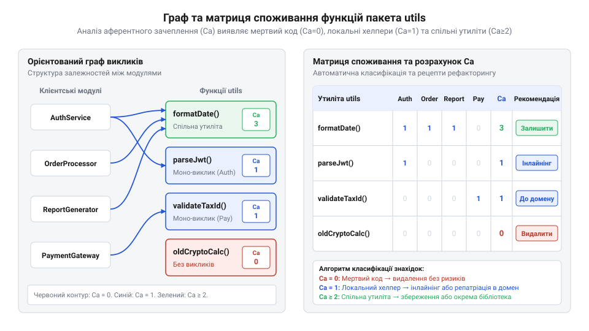
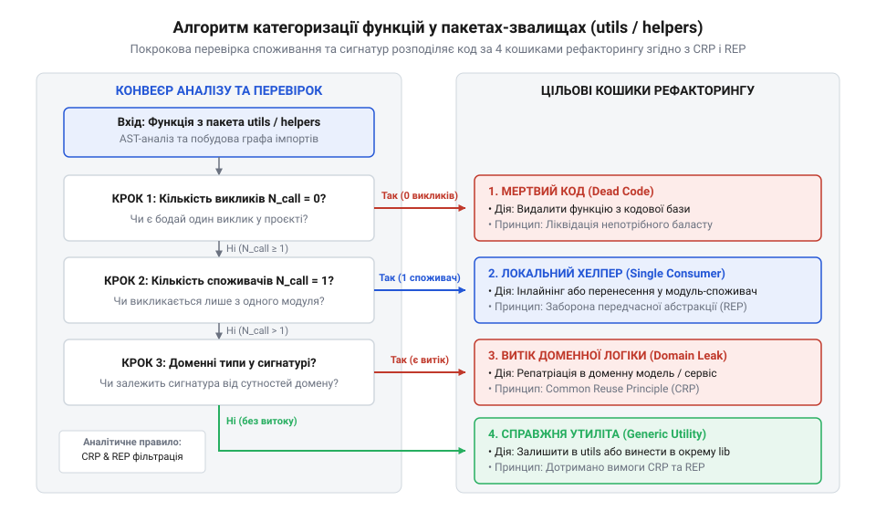

# Інструмент статичного аналізу для аудиту та категоризації вмісту спільних утиліт

<preknowlist>
- [DH: дерево хмари й дерево хаба](root:progarch/dh-code-trees) — архітектурна структура каталогів монорепозиторію Digital Homes, первинне розміщення пакетів спільних утиліт між сервісами хмари й прошивкою хаба та характер міжмодульних витоків залежностей
</preknowlist>

## Сліпий рефакторинг і криза спільних утиліт

Під час чергового оновлення [архітектурної структури монорепозиторію](root:progarch/dh-code-trees) Digital Homes спроба очистити спільний пакет @@en|utils@@ призвела до раптового аварійного зупинення системи. Інженер спробував перемістити звичайний допоміжний метод форматування цінових даних у локальний модуль користувачів, вважаючи його єдиним місцем споживання. Однак під час розгортання в середовищі @@en|production@@ зупинився критичний сервіс білінгу: метод неочікувано використовувався для генерації фінансових звітів через непрямий імпорт.

Спроби запобігти таким інцидентам за допомогою звичайного текстового пошуку @@en|grep@@ (від англ. *global regular expression print*, глобальний вивід за регулярним виразом) виявилися марними. Простий пошук за назвою функції створює безліч хибних спрацьовувань через однакові ідентифікатори в різних файлах, але пропускає виклики через @@en|aliasing@@ (від англ. *alias*, псевдонім), деструктуризацію або повторний @@en|re-export@@. Сліпий @@en|refactoring@@ утилітарних звалищ перетворюється на мінне поле, де будь-яка зміна загрожує прихованою регресією.

Безпечне очищення сміттєвих пакетів вимагає відмови від аналізу текстових рядків на користь синтаксичної структури. Інженеру потрібен автоматизований аналізатор, який будує @@en|AST@@ (від англ. *Abstract Syntax Tree*, абстрактне синтаксичне дерево) для розуміння точної семантики коду. Лише на основі @@en|AST@@ можна побудувати граф споживання функцій між модулями та алгоритмічно розподілити знахідки за архітектурними правилами, відокремивши мертвий код від легітимних спільних бібліотек.

## Синтаксичний розбір AST та реєстр утиліт

Текстовий пошук за інструментами на кшталт `grep` не здатен побудувати достовірний каталог функцій, оскільки він не враховує контекст оголошення, імпорти та типи даних. Для побудови точного реєстру функцій утилітарних пакетів у [дереві коду Digital Homes](root:progarch/dh-code-trees) необхідний статичний аналіз на основі синтаксичного дерева (англ. @@en|abstract syntax tree@@, @@en|AST@@).

Аналізатор реалізує обхід синтаксичного дерева за шаблоном відвідувача (@@en|visitor@@). Він ідентифікує оголошення експортованих функцій через перевірку вузлів `ts.isFunctionDeclaration` або `ts.isVariableStatement` з модифікатором `export`, після чого фіксує їхні точні координати у файлі (рядок і стовпець).

За допомогою семантичного аналізатора типів (@@en|TypeChecker@@ у TypeScript @@en|Compiler API@@ або анотацій у Python `ast`) інструмент вилучає повну сигнатуру утиліти. Він зчитує назви та типи параметрів, тип значення, що повертається, а також виявляє витоки доменних типів, коли доменно-нейтральний модуль починає залежати від бізнес-сутностей. Для цього аналізатор інспектує вузли параметрів і результату у синтаксичному дереві, отримує відповідні семантичні символи оголошень і зіставляє їх із трьома критеріями: відсіює системні примітиви та параметри типізації дженериків (як-от `string`, `Promise` чи `T`), розв'язує фізичний шлях вихідного файла декларації типу (перевіряючи його на належність до доменних каталогів на зразок `/domain/` чи `/models/`), а також виконує евристичний аналіз назви на наявність доменних термінів. Такий комбінований механізм потрібен для того, щоб точно відстежувати зв'язки навіть крізь реекспорти та псевдоніми типів, не даючи бізнес-моделі непомітно проникнути у спільні утиліти. Ціною цього є вища вимогливість до ресурсів, оскільки аналіз потребує повноцінного контексту компіляції (`ts.Program`) замість поверхневого текстового обходу. Водночас розпізнавання ламається на анонімних структурних типах, неявних інтерфейсах без власних імен, знеособленому `any` або коли доменні дані передаються узагальненими словниками на зразок `Record<string, unknown>`, що повністю приховує семантичний контекст за примітивними контейнерами.

:::tabs
:::code proj-codebase-utils-dump-auditor/ts/src/ast-analyzer.ts 80-124
:::code proj-codebase-utils-dump-auditor/py/ast_scanner.py 29-68
:::

Сформований типізований реєстр функцій дає повний зріз публічного API утилітарного пакета, підготовлений до аналізу фактичного споживання коду в проєкті.

## Побудова графа споживання та пошук викликів

Наявність каталогу утиліт не дає відповіді на головне запитання: як і хто використовує ці функції в кодовій базі. Функція може здаватися корисною, але насправді бути мертвим кодом або використовуватися лише в одному місці.

Для виявлення точок споживання аналізатор виконує рекурсивний обхід усіх клієнтських модулів застосунку, шукаючи вузли викликів (@@en|CallExpression@@ у TypeScript чи `ast.Call` у Python). Інструмент розпізнає різні варіанти звернень: прямий виклик після @@en|from-import@@, виклик через об'єкт простору імен (`utils.slugify`) та псевдоніми (@@en|aliasing@@). Алгоритм зіставлення вузлів із реєстром цільових утиліт працює за двокроковою схемою розв'язання символів. Для простих ідентифікаторів та імпортів із псевдонімами (`import { slugify as makeSlug }`) аналізатор формує таблицю локальних аліасів, а під час виклику опитує семантичний контекст через @@en|TypeChecker@@: якщо символ має прапорець аліаса (`ts.SymbolFlags.Alias`), інструмент розгортає ланцюжок через `getAliasedSymbol` до канонічного оголошення, що дозволяє відстежити споживання навіть крізь проміжні реекспорти (@@en|re-export@@). У разі звернення через простір імен (`utils.slugify` чи вузол `ast.Attribute`) алгоритм інспектує вираз властивості, відокремлює ідентифікатор модуля й зіставляє кінцеву назву методу з реєстром експортованих функцій. Завдяки такому розв'язанню символів аналізатор відсікає хибні збіги з однойменними локальними функціями клієнтського модуля. У легковагових AST-відвідувачах без семантичного аналізатора цей механізм коштує збереження таблиці імпортів поточного файла й ламається на непрямих перепризначеннях змінних (`fn = slugify; fn()`), тоді як повноцінний @@en|TypeChecker@@ гарантує точність ціною додаткових витрат ресурсів на побудову всієї компіляційної програми.

*Орієнтований граф споживання та матриця зв'язків для визначення метрики вхідного зачеплення Ca.*

Усі знайдені точки викликів (@@en|call sites@@) агрегуються за модулями-споживачами. Це дозволяє обчислити метрику аферентного зачеплення (англ. Afferent Coupling, Ca) — кількість унікальних зовнішніх підсистем, які залежать від цієї утиліти. @@en|Afferent Coupling@@, @@en|Ca@@) — кількість унікальних зовнішніх підсистем, які залежать від цієї утиліти.

:::tabs
:::code proj-codebase-utils-dump-auditor/ts/src/call-graph-builder.ts 30-82
:::code proj-codebase-utils-dump-auditor/py/ast_scanner.py 70-128
:::

Отриманий орієнтований граф викликів (@@en|Call Graph@@) викриває реальну топологію залежностей, чітко відокремлюючи мертвий код (@@en|Ca@@ = 0) та локальні помічники (@@en|Ca@@ = 1) від справді спільних утиліт (@@en|Ca@@ >= 2).

## Алгоритм категоризації та архітектурні правила

Маючи на руках орієнтований граф викликів та вилучені сигнатури функцій, ми можемо перетворити синтаксичні метрики на автоматичні архітектурні рішення. Для цього розробимо класифікатор, що спирається на аферентне зачеплення (@@en|Afferent Coupling@@, `Ca`) та перевірку витоків домену, розподіляючи функції утиліт за чотирма кошиками.

*Конвеєр автоматичної класифікації утиліт за метрикою аферентного зачеплення Ca та наявністю доменних типів.*

Логіка прийняття рішень будується на послідовній перевірці п'яти архітектурних критеріїв:

1. **Мертвий код (@@en|dead code@@, `Ca = 0`)**. Якщо функція не має жодного зовнішнього виклику, вона засмічує публічний API. Рішення — видалення або зняття модифікатора `export`.
2. **Витік домену (@@en|domain repatriation@@)**. Якщо в типах параметрів чи результату присутні бізнес-сутності проєкту, порушується принцип еквівалентності випуску (@@en|Reuse/Release Equivalence Principle@@, REP; від англ. *reuse* — повторне використання та *release* — випуск). Рішення — репатріація функції в доменний модуль [архітектури Digital Homes](root:progarch/dh-code-trees).
3. **Локальний хелпер (@@en|inline candidate@@, `Ca = 1`)**. Якщо функцію викликає лише один модуль, розміщення її в `utils` порушує принцип спільного повторного використання (@@en|Common Reuse Principle@@, CRP; від англ. *common* — спільний та *reuse* — повторний вжиток). Рішення — інлайнінг за місцем виклику.
4. **Спільна бібліотека (@@en|shared library@@, `Ca >= 2`)**. Якщо функція доменно-нейтральна й має кількох споживачів, вона повністю відповідає правилам пакування.
5. **Тестові хелпери та граничні випадки (@@en|test utility@@; від англ. *test* — випробування та *utility* — утиліта)**. Якщо утиліта викликається виключно з тестових файлів (`*.test.ts`, `*_test.py` або каталогу `tests/`), її продуктивне зачеплення є нульовим (`Ca_prod = 0`). Наївний підрахунок загальної кількості викликів вважав би такі функції активними, однак їх присутність у продуктивному пакунку `utils` роздуває розмір артефакту та переносить тестові залежності в реліз. Якщо такі виклики здійснюються лише з тестів одного модуля (`Ca_test = 1`), функція є прихованим тестовим допоміжним кодом, який підлягає перенесенню в локальну тестову директорію цього модуля або видаленню. Якщо ж її викликають тести кількох незалежних модулів (`Ca_test >= 2`), це тестова фікстура (@@en|test fixture@@; від англ. *test* — випробування та *fixture* — прикріплене обладнання), яку необхідно репатріювати з продуктивних `utils` у спеціалізований пакет тестових утиліт (`test-utils`).

1. **Мертвий код (@@en|dead code@@, `Ca = 0`)**. Якщо функція не має жодного зовнішнього виклику, вона засмічує публічний API. Рішення — видалення або зняття модифікатора `export`.
2. **Витік домену (@@en|domain repatriation@@)**. Якщо в типах параметрів чи результату присутні бізнес-сутності проєкту, порушується принцип еквівалентності випуску (@@en|Reuse/Release Equivalence Principle@@, REP; від англ. *reuse* — повторне використання та *release* — випуск). Рішення — репатріація функції в доменний модуль [архітектури Digital Homes](root:progarch/dh-code-trees).
3. **Локальний хелпер (@@en|inline candidate@@, `Ca = 1`)**. Якщо функцію викликає лише один модуль, розміщення її в `utils` порушує принцип спільного повторного використання (@@en|Common Reuse Principle@@, CRP; від англ. *common* — спільний та *reuse* — повторний вжиток). Рішення — інлайнінг за місцем виклику.
4. **Спільна бібліотека (@@en|shared library@@, `Ca >= 2`)**. Якщо функція доменно-нейтральна й має кількох споживачів, вона повністю відповідає правилам пакування.

:::tabs
:::code proj-codebase-utils-dump-auditor/ts/src/utility-categorizer.ts 87-185
:::code proj-codebase-utils-dump-auditor/py/classifier.py 37-112
:::

## Формування звітів та черга рефакторингу

Класифікація знахідок у внутрішній пам'яті аналізатора не дає користі, доки результати не перетворено на зрозумілі дані для інженерів та автоматизованих конвеєрів збірки. Щоб зупинити накопичення сміття у [дереві коду Digital Homes](root:progarch/dh-code-trees), інструмент має генерувати два види вихідних даних: машиночитаний формат для автоматизації та наочний дашборд для розробників.

Перший формат — серіалізація (лат. *series* — послідовність) знахідок у структурований документ @@en|JSON@@. Він фіксує повні метадані: статус збірки, підсумкову статистику порушень, файлові координати викликів та унікальні ідентифікатори споживачів. Це дозволяє використовувати аналізатор як крок у @@en|CI/CD@@, де відповідний @@en|exit code@@ прямо блокує злиття запевне деструктивних змін. Другий формат — термінальна таблиця, яка дає розробнику миттєвий текстовий зріз проблеми з готовими порадами щодо виправлення.

:::tabs
:::code proj-codebase-utils-dump-auditor/ts/src/report-generator.ts
:::code proj-codebase-utils-dump-auditor/py/reporter.py
:::

Сирий перелік порушень не можна віддати в роботу хаотично: намагання переписати все одразу зупиняє розробку продуктів. Для поетапного очищення кодової бази аналізатор будує впорядковану чергу завдань, пріоритизовану за радіусом ураження (англ. @@en|blast radius@@).

Найвищий пріоритет отримує витік домену, адже бізнес-типи у спільних утилітах зв'язують незалежні контексти й створюють ризик ланцюгових збоїв. Наступним у черзі стоїть мертвий код, оскільки його видалення безпечне й одразу зменшує обсяг збірки. Одноразові хелпери з низьким зачепленням мають найнижчий пріоритет: їхній @@en|refactoring@@ виконують точково під час роботи над відповідним модулем. Такий підхід перетворює розбір кодових звалищ на плановий і вимірюваний процес.

## Консольний запуск, коди виходу та CI/CD

Навіть найточніший аналізатор не має практичної цінності, якщо він існує лише як розрізнений набір бібліотечних класів і не спроможний автономно захистити кодову базу. Перетворення рушія аудиту на повноцінну термінальну утиліти починається з побудови @@en|CLI@@-інтерфейсу, який приймає параметри запуску (`--project`, `--utils`, `--json`, `--output`), налаштовує шляхи до пакетів утиліт та оркеструє синтаксичний обхід дерев @@en|AST@@.

Основним містком між автоматизованим конвеєром збірки та інструментом аналізу є концепція «кодів виходу як інтерфейсу програми». Для термінальної утиліти числове значення @@en|exit code@@ виступає суворим бінарним контрактом взаємодії із зовнішнім середовищем. Повернення коду `0` свідчить про успіх і повну відповідність коду правилам @@en|CRP@@ та @@en|REP@@. Статус `1` сигналізує про виявлення критичних архітектурних аномалій — мертвого коду, одноразових хелперів під інлайнінг чи витоків домену. Код `2` відповідає за помилки конфігурації, неіснуючі шляхи або синтаксичні збої під час розбору файлів.

:::tabs
@tab TypeScript
:::code proj-codebase-utils-dump-auditor/ts/src/cli.ts 24-102

@tab Python
:::code proj-codebase-utils-dump-auditor/py/cli.py 77-161
:::

Вбудовування аналізатора як обов'язкового кроку у @@en|CI/CD@@-конвеєр перетворює ліквідацію спільних звалищ на автоматизований і вимірюваний процес. Під час створення @@en|pull request@@ інструмент перевіряє [дерево коду Digital Homes](root:progarch/dh-code-trees) і в разі повернення ненульового коду завершення автоматично блокує злиття гілки, унеможливлюючи появу нових витоків залежностей.
