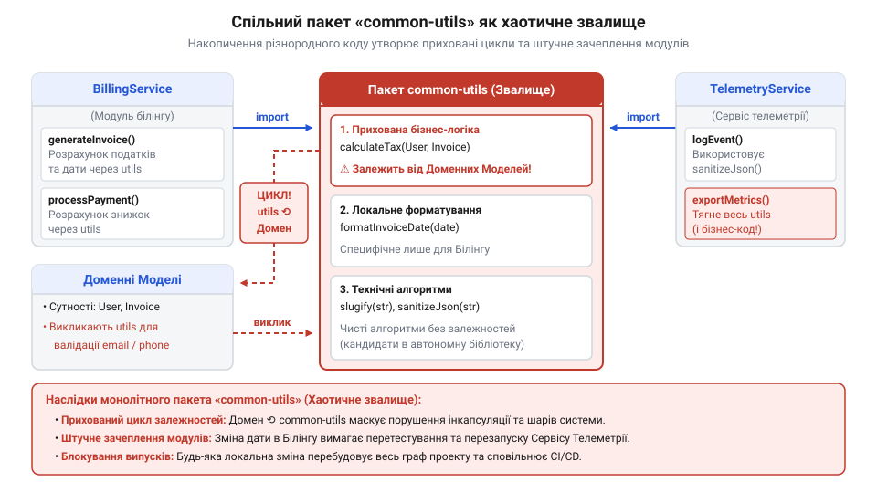
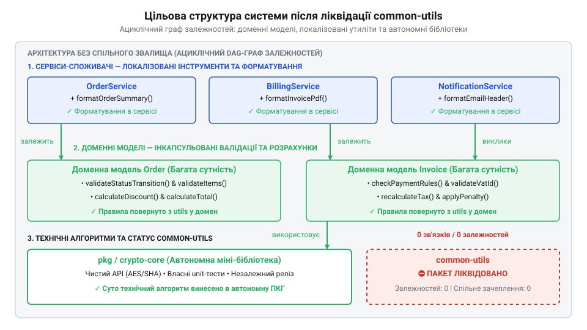

# Покроковий рефакторинг та ліквідація монолітного пакета «common-utils»

<preknowlist>
- [DH: дерево хмари й дерево хаба](root:progarch/dh-code-trees) — початкова структура каталогів монорепозиторію Digital Homes та первинне розташування пакета common-utils відносно сервісів хмари й хаба
</preknowlist>

## Анатомія смітника та зупинка релізів

Коли планова збірка служби керування пристроями в @@en|Digital Homes@@ раптово падає через помилку форматування грошових сум у модулі білінгу, команда стикається з наслідками невидимого зчеплення. Зовні ці сервіси ніяк не пов'язані: один приймає телеметрію від датчиків, інший обробляє щомісячні платежі. Проте обидва імпортують єдиний монолітний пакет @@en|common-utils@@, куди розробники роками додавали довільний повторюваний код. Незначне виправлення логера в утилітах зачепило функцію розрахунку ПДВ, що заблокувало випуск критичного оновлення для хаба. Глибинна причина цієї вразливості описується метрикою @@en|вхідного зачеплення@@ (англ. @@en|Afferent Coupling@@, від лат. @@la|adfero@@ — приносити до центру). @@en|Afferent Coupling@@, від лат. *adfero* — приносити до центру, далі — `Ca`), яка рахує кількість зовнішніх модулів, залежних від цього пакета. Коли всі сервіси системи звертаються до @@en|common-utils@@, значення `Ca` стає максимально високим, через що будь-яке правлення всередині утиліт загрожує зламати кожного споживача. Порядок обчислення цієї загрози визначає [транзитивний радіус ураження](root:progarch/shared-utils-dump/math-transitive-blast-radius-closure.md) залежностей через побудову транзитивного замикання на орієнтованому графі кодової бази: починаючи від модифікованого вузла @@en|common-utils@@, алгоритм обходить граф у зворотному напрямку за ребрами імпорту й формує множину уражених компонентів. Якщо кожен сервіс системи прямо чи опосередковано залежить від утилітарного смітника, транзитивне замикання покриває 100% вузлів графа. У результаті зміна навіть одного рядка в спільній функції змушує конвеєр збірки заново тестувати й перекомпілювати всю кодову базу, зупиняючи незалежні випуски.

Аналіз [структури кодового дерева](root:progarch/dh-code-trees) виявляє патологію топології залежностей. Пакет @@en|common-utils@@ має критично високе @@en|вхідне зачеплення@@ (англ. @@en|Afferent Coupling@@, від лат. @@la|adfero@@ — приносити до центру). @@en|Afferent Coupling@@, від лат. *adfero* — приносити до центру), оскільки від нього залежать усі сервіси системи. Будь-яка зміна в утилітах викликає ланцюгову рекомпіляцію та розширює [транзитивний радіус ураження](root:progarch/shared-utils-dump/math-transitive-blast-radius-closure.md) на всю кодову базу. Гірше того, утиліти починають імпортувати доменні типи для валідації об'єктів, утворюючи циклічний зв'язок між доменним шаром і допоміжним пакетом.


*Схема початкового стану кодової бази з монолітним пакетом common-utils, де високе вхідне зачеплення утворює циклічні зв'язки та блокує незалежні релізи.*

Спроба «просто навести лад» одноразовим видаленням пакета гарантовано зупинить розробку. Безпечний розбір смітника можливий лише покроково, без зупинки виробничого конвеєра. Для цього весь вміст пакета слід розділити на три фундаментальні категорії: приховані доменні правила, локальні помічники форматування та автономні технічні алгоритми.

## Інвентаризація та категоризація утилітарного коду

Перед внесенням змін необхідно провести аудит і побудувати матрицю споживання функцій пакета @@en|common-utils@@. Ручний пошук викликів у багатьох модулях небезпечний: звичайний текстовий пошук пропускає непрямі імпорти та плутає однакові назви функцій. Побудову такої матриці автоматизують інструменти статичного аналізу, зокрема аналізатори залежностей на кшталт @@en|dependency-cruiser@@ та парсери @@en|AST@@ (від англ. @@en|Abstract Syntax Tree@@ — абстрактне синтаксичне дерево). *Abstract Syntax Tree* — абстрактне синтаксичне дерево). Вони розбирають синтаксичні дерева кодової бази й будують точну карту викликів, розраховуючи вхідне зачеплення @@en|Afferent Coupling@@ для кожної утиліти. Автоматичний аналіз вимагає налаштування правил парсингу, а ламається на динамічних імпортах і реекспортах через індексні файли, які приховують справжніх споживачів. Після побудови матриці кожен метод перевіряється на кількість викликачів та характер знань, які він у собі містить. Це дозволяє розбити код на групи з чітко визначеною стратегією ліквідації.

Перша категорія — приховані бізнес-правила. У @@en|common-utils@@ часто потрапляють функції на кшталт перевірки підписки чи розрахунку знижок. Вони оперують бізнес-значеннями й перевіряють доменні @@en|інваріанти@@ (від лат. @@la|invarians@@ — незмінний). *invarians* — незмінний), але винесені за межі сутностей. Це створює анемічну модель даних, де сутності перетворюються на порожні контейнери, а логіка розпорошується по утилітах. Ці функції мають повернутися в доменні агрегати.

Друга категорія — одноразові допоміжні помічники, такі як форматування дат у звітах чи побудова префіксів ідентифікаторів. Аудит показує, що кожна з них використовується лише в одному або двох суміжних модулях. Винесення їх у спільний пакет створює хибне зачеплення: зміна формату дати в одному звіті ризикує поламати відображення на дашборді. Такі функції підлягають інлайнінгу й дублюванню безпосередньо в місцях виклику.

Третя категорія — чисті технічні алгоритми, наприклад обчислення контрольної суми @@en|CRC32@@ чи маніпуляції з бітовими масками. Вони не знають нічого про бізнес-домен @@en|Digital Homes@@ і не мають локального контексту конкретного сервісу. Для цієї групи єдиним правильним рішенням є екстракція в окрему версіовану мікробібліотеку з чистим @@en|API@@ та власними тестами. На основі цієї категоризації формується пріоритизована черга покрокового демонтажу.

## Репатріація бізнес-правил у доменні моделі

Коли валідація стану підписки та обчислення її знижки винесені у статичні хелпери пакета @@en|common-utils@@, доменний @@uk|агрегат@@ (від лат. @@la|aggregare@@ — приєднувати) `Subscription` перетворюється на структуру з відкритими полями. Щоб виконати перевірку, утилітарний клас змушений імпортувати тип доменної сутності. Водночас самі доменні сервіси імпортують утиліти для виклику цих перевірок. Виникає циклічна залежність: домен залежить від утиліт, а утиліти — від домену.

Першим кроком рефакторингу є повернення бізнес-правил у доменну модель. Негайне видалення статичних хелперів із пакета @@en|common-utils@@ зламає виклики у всіх залежних сервісах одночасно. Щоб уникнути масових конфліктів та зупинки розробки, застосовують стратегію збереження @@uk|зворотної сумісності@@ та покрокової міграції. Стару утиліту тимчасово зберігають, перетворюючи її на делегувальний @@en|wrapper@@ (від англ. @@en|wrap@@ — обгортати). Ця обгортка приймає виклик і просто передає його новому методу доменного агрегату. Старий метод позначають через @@en|deprecation@@ (від лат. @@la|deprecari@@ — відвертати проханням), застерігаючи від створення нових залежностей. Команди мігрують клієнтські виклики модуль за модулем, не порушуючи роботу системи під час релізів. Після заміни останнього виклику застарілу утиліту безпечно видаляють, а самі методи перевірки @@uk|інваріантів@@ та розрахунку ціни переносяться всередину сутності `Subscription`:

:::code proj-refactoring-monolithic-utils-dump/ts/subscription.ts

Поля агрегату стають приватними, що забезпечує @@uk|інкапсуляцію@@ (від лат. @@la|in capsula@@ — у скриньку) та захищає бізнес-правила від неконтрольованої зміни ззовні. Споживачі у [структурі каталогу сервісів](root:progarch/dh-code-trees) перемикаються на прямі виклики методів `subscription.calculateDiscount()`.

Ця перебудова ліквідовує @@uk|анемічність моделі@@ та повністю розриває імпорт доменних типів у пакет @@en|common-utils@@, усуваючи циклічний зв'язок на першому етапі демонтажу.

## Локалізація та усвідомлене дублювання помічників

Після вилучення доменних правил у виснаженому пакеті @@en|common-utils@@ залишаються дрібні процедурні функції: форматування часових міток, обрізання рядків і допоміжні перевірки. Коли сервіси білінгу та телеметрії звертаються до спільного хелпера форматування дати, між ними виникає прихований зв'язок. Вимоги білінгу до виводу часових міток у фінансових звітах змінюються, і редагування спільних утиліт несподівано порушує відображення графіків телеметрії.

Причиною такої крихкості є сліпе дотримання принципу @@en|DRY@@ (англ. @@en|Don't Repeat Yourself@@ — «не повторюйся»). *Don't Repeat Yourself* — «не повторюйся»). Прагнучи усунути найменший дубльований рядок, розробники створюють жорстке зачеплення модулів через спільний випускний цикл.

Для розриву цієї залежності застосовують правило @@en|Роба Пайка@@: трохи копіювання краще за трохи залежності. Якщо утилітарна функція використовується лише в одному місці, її вбудовують @@en|інлайнінгом@@ безпосередньо у викликаючий модуль. Якщо процедурний помічник потрібен двом незалежним сервісам, його свідомо копіюють у кожен із них як приватну функцію. Таке дублювання виправдовує себе для тривіальних функцій форматування, бо ізолює сервіси без високих витрат на підтримку. Межа доцільності копіювання виникає зі зростанням кількості споживачів або ускладненням алгоритму. Коли функцію здубльовано у трьох або більше місцях, кожна зміна вимог вимагає синхронного оновлення всіх копій. Пропущене редагування в одному з модулів спричиняє @@en|дрейф коду@@ (англ. @@en|code drift@@). *code drift*), і однакові дані починають оброблятися по-різному. Дублювання також шкідливе для функцій із суворими інваріантами чи математичними розрахунками, де необхідне єдине джерело правди. За таких граничних умов від копіювання переходять до виокремлення алгоритму в автономну версіовану бібліотеку.

У [початковій структурі каталогів](root:progarch/dh-code-trees) усвідомлене дублювання тривіального коду локалізує зміни. Зміна форматування в білінгу більше не зачіпає телеметрію та не вимагає перезбірки усієї системи.


*Інкапсуляція доменних правил у моделях та локалізація форматування в сервісах усувають спільні залежності.*

## Виокремлення технічного алгоритму в мікробібліотеку

Після повернення доменної логіки в агрегати та інлайнінгу локальних допоміжних функцій у `common-utils` лишається єдина категорія коду — чистий технічний алгоритм розрахунку контрольної суми кадру. Сервіси хаба й хмари обчислюють хеш низькорівневих пакетів даних, але цей алгоритм не містить жодних знань про бізнес-правила Digital Homes.

Залишати такий алгоритм у спільному звалищі небезпечно: будь-яка зміна поруч змушує перезбирати всі сервіси-споживачі. За @@en|CRP@@ (англ. @@en|Common Reuse Principle@@, від @@en|common@@ — спільний та @@en|reuse@@ — використовувати повторно). *Common Reuse Principle*, від *common* — спільний та *reuse* — використовувати повторно) класи, які не використовуються разом, не повинні пакуватися разом. Водночас за @@en|REP@@ (англ. @@en|Reuse-Release Equivalence Principle@@, від @@en|release@@ — випуск та @@en|equivalence@@ — рівноцінність). *Reuse-Release Equivalence Principle*, від *release* — випуск та *equivalence* — рівноцінність) одиниця повторного використання має збігатися з одиницею випуску. Математичну оцінку порушення принципу спільного повторного використання та обчислення зв'язності розкриває [аналітичний розрахунок матриць порушення CRP та випадкової зв'язності](root:progarch/shared-utils-dump/math-accidental-cohesion-and-crp-matrix.md).

Розв'язок — виокремлення алгоритму в автономну мікробібліотеку `packages/checksum`. У [структурі каталогів сервісів](root:progarch/dh-code-trees) створюється окремий модуль зі власним маніфестом `package.json`, ізольованими модульно-тестовими прогонами та публічним @@en|API@@ (англ. @@en|Application Programming Interface@@, від @@en|interface@@ — грань взаємодії). *Application Programming Interface*, від *interface* — грань взаємодії). Для цього в модулі налаштовують автономну збірку, яка транспілює сирцевий код у зкомпільовані артефакти та декларації типів, звільняючи сервіси-споживачі від потреби повторно обробляти код бібліотеки під час власної збірки. Усередині монорепозиторію локальне лінкування виконується через механізм робочих просторів (@@en|workspaces@@, англ. *workspaces*, від *work* — робота та *space* — простір), де менеджер пакетів прокидає символічні посилання на зкомпільовані файли прямо в локальні залежності сервісів, ізолюючи їх від прямих імпортів за відносними шляхами. Версіонування цієї мікробібліотеки відбувається за автономним циклом: зміни в алгоритмі вимагають явної фіксації нової версії в її маніфесті, завдяки чому споживачі оновлюють залежність свідомо й без ризику раптових поломок.

```typescript
// packages/checksum/src/index.ts
export function calculateFrameChecksum(payload: Uint8Array): number {
  let crc = 0xffff;
  for (const byte of payload) {
    crc = (crc >>> 8) ^ crcTable[(crc ^ byte) & 0xff];
  }
  return crc;
}
```

Клієнтські сервіси перемикаються на пряму залежність від вузькопрофільного пакета `@dh/checksum` без ризику протягнути зайвий код. Зміна в алгоритмі контрольної суми отримує власну версію за @@en|SemVer@@ (англ. @@en|Semantic Versioning@@, від @@en|semantic@@ — змістовий та @@en|version@@ — версія). *Semantic Versioning*, від *semantic* — змістовий та *version* — версія) і не чіпає бізнес-сервіси, поки вони свідомо не оновлять залежність.

## Остаточний демонтаж пакета та верифікація

Видалення всіх файлів із директорії пакета ще не означає його остаточну ліквідацію: порожній модуль залишається в графі збірки через конфігураційні імпорти та мапінги шляхів робочого простору. Щоб звалище не відродилося, фізичне видалення каталогу @@en|common-utils@@ супроводжується вичищенням його запису з @@en|package.json@@ та файлів налаштування лінтера й компілятора у [структурі каталогів](root:progarch/dh-code-trees) монорепозиторію Digital Homes.

Після очищення конфігурацій проводиться підсумкова аналітична верифікація графа залежностей. Головний показник успіху — зміна архітектурної топології (від грецького @@en|topos@@ — місце та @@en|logos@@ — вчення). Раніше @@en|common-utils@@ утворював зіркову топологію, де десятки незалежних сервісів сходилися в одну точку і створювали штучну зв'язаність. Після рефакторингу показник вхідного зачеплення @@en|Afferent Coupling@@ (`Ca`) для вузла утиліт падає до нуля, а сам вузол повністю зникає з архітектурного графа.

Разом із видаленням центрального вузла повністю розриваються приховані циклічні імпорти між доменними моделями та допоміжним кодом. Оскільки сервіси більше не залежать від єдиного монолітного пакета, конвеєр збірки @@en|CI@@ (від англійського @@en|Continuous Integration@@ — безперервна інтеграція) отримує можливість паралельно збирати й тестувати змінені модулі. Зміна в одному сервісі більше не спричиняє ланцюгову рекомпіляцію всієї системи, що скорочує загальний час випуску релізів і відновлює передбачуваність розгортання.
