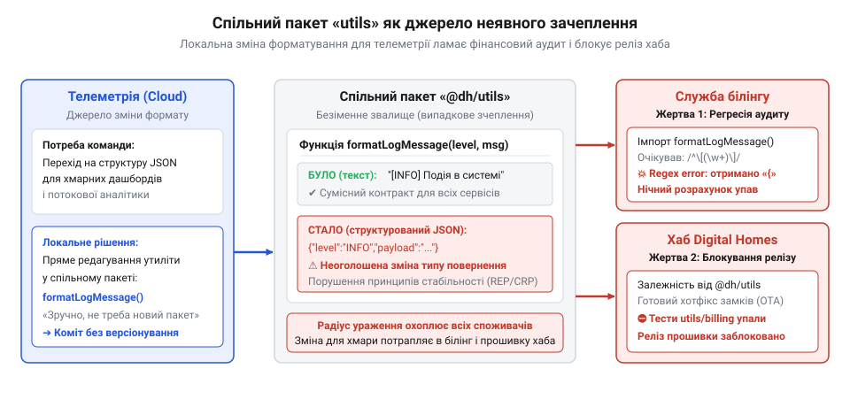
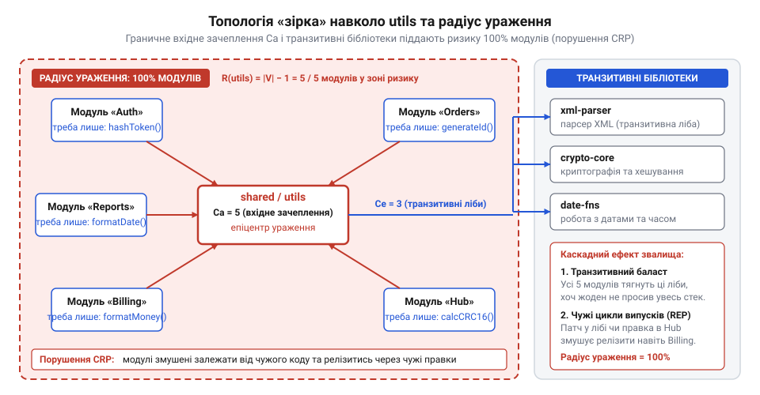
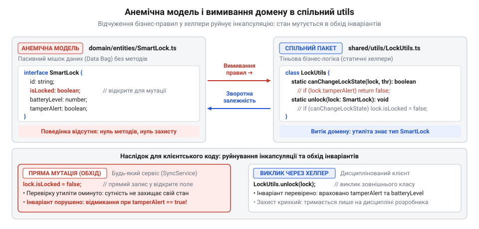
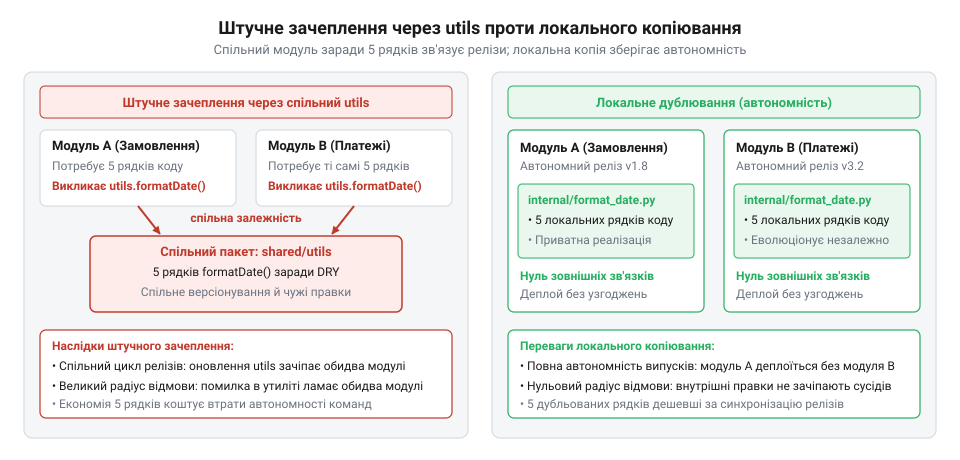
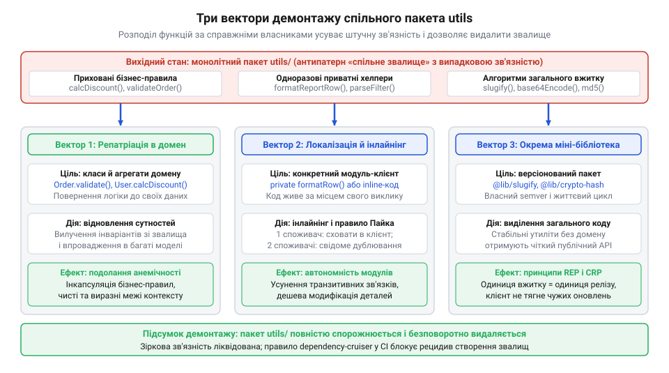

# Спільний «utils» як звалище

<preknowlist>
- [DH: дерево хмари й дерево хаба](root:progarch/dh-code-trees) — архітектурна структура каталогів монорепозиторію Digital Homes та первинне розміщення спільних утилітарних пакетів між хмарою й хабом
</preknowlist>

## Як безневинний хелпер ламає реліз

Спільний каталог допоміжних функцій видається найпростішим інженерним компромісом. Коли розробникові потрібна невелика операція — форматування рядка, перетворення дати чи очищення списку, — для неї неохоче створюють окремий модуль або шукають місце в доменній моделі. Рука сама тягнеться скинути її в каталог `utils` (від лат. @@la|utilis@@ — корисний), де вже лежать десятки чужих функцій-@@en|хелперів@@ (від англ. @@en|helper@@, з @@en|help@@ — допомагати). Здається, що спільний пакет нічого не коштує: він лише позбавляє потреби писати однаковий код двічі. Небезпека такого рішення проявляється в момент, коли цей безіменний модуль змінюють.

Саме так розгортався виробничий збій у проєкті @@en|Digital Homes@@. У [структурі дерева репозиторію](root:progarch/dh-code-trees) хмарні служби та вбудований хаб спиралися на спільну бібліотеку допоміжних функцій. Команда хмарної телеметрії вирішила стандартизувати журналювання: замість звичайного рядка форматувальник мав повертати структурований об'єкт.

```typescript
// Було: звичайний текстовий рядок
export function formatLogMessage(level: string, message: string): string {
  return `[${level.toUpperCase()}] ${message}`;
}

// Стало: розробники телеметрії додали часову мітку та JSON
export function formatLogMessage(level: string, message: string): string {
  return JSON.stringify({
    timestamp: new Date().toISOString(),
    level: level.toUpperCase(),
    payload: message,
  });
}
```

Зміна виглядала цілком безпечною для авторів телеметрії, проте її випуск негайно викликав дві несвідомі @@en|регресії@@ (від лат. @@la|regressio@@, з @@la|regredi@@ — повертатися назад).

Першим упав білінг. Служба нарахування платежів викликала ту саму функцію для запису аудиторського сліду фінансових операцій. Модуль звірки транзакцій вичитував ці рядки регулярними виразами, очікуючи фіксованого префікса. Отримавши замість тексту валідний @@en|JSON@@, парсер завершив роботу з критичною помилкою, і нічний розрахунок заблокувався.

Другий удар припав на фізичний хаб @@en|Digital Homes@@. Команда хаба готувала термінове оновлення прошивки, що виправляло критичну вразливість у замках. Хаб ніяк не взаємодіє з білінгом, але код прошивки імпортував той самий спільний пакет `utils`. У монорепозиторії інструменти автоматизації аналізують спільний [граф збірки](root:sys-bsystem/dependency-manager-model): щойно каталог утиліт зазнав змін, система визначила всі залежні від нього підсистеми як зачеплені та призначила їх до обов'язкової перевірки. Конвеєр випуску прошивки мав суворий бар'єр сумісності — перш ніж скомпілювати й підписати бінарний образ, він вимагав успішного завершення тестів для кожного зачепленого компонента. Тести самого хаба пройшли бездоганно, проте набір перевірок білінгу завершився аварією через неочікуваний формат журналу. Складальний конвеєр зафіксував ненульовий код виходу чужого кроку й негайно обірвав загальне завдання: реліз критичного виправлення для хаба зупинився через дефект у системі, про яку інженери пристрою навіть не підозрювали.


*Неявне зачеплення через безіменний спільний пакет: зміна форматування логів ламає фінансовий аудит білінгу та зупиняє розгортання хаба.*

Усі три підсистеми — телеметрія, білінг і хаб — мали власні цілі та не перетиналися в бізнес-логіці. Жоден архітектор не проєктував зв'язку між фінансовими операціями та прошивкою замка. Цей міст виник випадково: безіменний каталог утиліт злив незалежні підсистеми в єдиний монолітний вузол. Будь-яка локальна правка всередині такого пакета неконтрольовано розширює [радіус ураження змін](root:progarch/shared-utils-dump/math-transitive-blast-radius-closure.md) на всіх його споживачів, перетворюючи автономні модулі на заручників чужих помилок і блокуючи їхні релізи.

## Анатомія звалища та радіус ураження

Коли модуль не має окресленої предметної межі, єдиним критерієм додавання коду стає його абстрактна допоміжна роль. В одній теці опиняються форматувальник рядків, генератор випадкових чисел, розрахунок контрольної суми та конвертер часових поясів. Ці функції не викликають одна одну, не мають спільного стану й не вирішують спільної бізнес-задачі. Єдине, що їх об'єднує, — відсутність власного повноцінного місця в структурі системи.

Таке штучне сусідство називають @@en|випадковою зв'язністю@@ (від лат. @@la|cohaerere@@ — бути зчепленим; англ. @@en|coincidental cohesion@@). Це найслабший рівень внутрішньої згуртованості модуля: код лежить поруч лише завдяки випадковому рішенню автора, а не спільній меті виконання. Що більше різнорідних функцій потрапляє до пакета, то ближчою до нуля стає його внутрішня цілісність, що детально описує [аналіз випадкової зв'язності](root:progarch/shared-utils-dump/math-accidental-cohesion-and-crp-matrix.md).

Ця внутрішня невизначеність негайно руйнує зовнішні зв'язки модулів, ламаючи базові [принципи зв'язності пакетів](root:sf-apps/progarch-package-cohesion-principles). Першим деградує @@en|принцип спільних повторних використань@@ (англ. @@en|Common Reuse Principle@@, @@en|CRP@@): класи та функції, які не використовують разом, не повинні пакуватися разом. Утилітарний пакет діє протилежно. Якщо модулю білінгу потрібна лише одна дрібна функція форматування валюти, він вимушений імпортувати весь спільний пакет разом із десятками чужих помічників.

Слідом руйнується @@en|принцип еквівалентності повторного вжитку та випуску@@ (англ. @@en|Reuse/Release Equivalence Principle@@, @@en|REP@@): одиниця повторного використання має бути одиницею випуску. Спільний пакет утиліт версіонується й поширюється як неподільне ціле. Коли розробники хаба змінюють форматувальник під власні оновлення, зростає версія всього спільного пакета. Білінг не має потреби в цій правці, проте автоматично втягується в чужий цикл релізу, ризикуючи отримати неочікувану поломку.

Оскільки кожен сервіс кодової бази знаходить у безіменному каталозі бодай одну зручну функцію, граф залежностей вироджується. Стрілки звернень з усіх кінців системи сходяться в одну спільну точку. Вхідне зачеплення пакета `Ca` (від лат. @@la|afferens@@ — той, що приносить; англ. @@en|afferent coupling@@) досягає максимуму, перетворюючи граф системи на топологію @@en|зірки@@ (англ. @@en|star topology@@). Спільний модуль опиняється в центрі, утримуючи на собі всі автономні компоненти.

Ситуація загострюється, коли допоміжному коду бракує стандартних засобів платформи. До утилітарного пакета додають сторонні бібліотеки для серіалізації чи складних обчислень, і [керування графом залежностей](root:sys-bsystem/dependency-manager-model) остаточно виходить з-під контролю. Ці бібліотеки стають @@en|транзитивними залежностями@@ (англ. @@en|transitive dependencies@@) для кожного клієнта: простий сервіс отримує важкі зовнішні пакунки, яких ніколи не замовляв. Через топологію зірки сторонній код безперешкодно проникає в легкі середовища — фонові робітники, консольні команди чи локальні хаби, розраховані на суворі обмеження ресурсів. Компонент, якому потрібна лише одна дрібна функція перевірки рядка, змушений тягнути за собою чужі бібліотеки серіалізації, механізми рефлексії чи платформозалежні бінарні модулі, що роздувають розмір збірки та сповільнюють запуск процесу. Ще руйнівнішим наслідком стає @@en|конфлікт версій@@ (від лат. @@la|conflictus@@ — зіткнення; англ. @@en|version conflict@@). Коли клієнтському модулю потрібна нова версія сторонньої бібліотеки для власних завдань, а спільний `utils` через іншого помічника тягне її застарілу версію, у дереві залежностей виникає @@en|ромбоподібна залежність@@ (англ. @@en|diamond dependency@@): прямий і транзитивний шляхи імпорту сходяться внизу на двох взаємовиключних версіях того самого пакета. У спільному середовищі виконання з єдиним простором імен процес не може одночасно завантажити дві різні версії одного коду. Менеджер пакетів або завантажувач змушений підмінити версії та залишити лише одну копію. Якщо система примусово обирає застарілу версію, клієнтський модуль падає під час виконання з помилкою відсутнього методу. Якщо ж перевагу віддають оновленій версії, ламається утилітарний хелпер, чий виклик натрапляє на змінені сигнатури або вилучені функції. Коли середовище намагається ізолювати гілки через окремі завантажувачі класів, передача спільних об'єктів між модулями викликає помилку несумісності типів, а статичний стан і одинаки дублюються в пам'яті. Найпідступнішим наслідком підміни стає тихе зміщення поведінки: метод сторонньої бібліотеки виконується без збоїв, проте змінений формат серіалізації чи інша точність обчислень непомітно спотворюють дані в робочій системі.


*Граф залежностей у формі зірки: через граничне вхідне зачеплення Ca та зовнішні бібліотеки радіус ураження охоплює 100% модулів системи.*

Через @@en|транзитивне замикання@@ (від лат. @@la|transitivus@@ — перехідний; англ. @@en|transitive closure@@) будь-яка модифікація всередині `utils` або оновлення його бібліотек лавиноподібно розходиться всіма вхідними ребрами. @@en|Радіус ураження@@ (від лат. @@la|radius@@ — промінь; англ. @@en|blast radius@@) стає абсолютним: під загрозою виявляється 100% компонентів кодової бази. Математичний [розрахунок радіуса ураження](root:progarch/shared-utils-dump/math-transitive-blast-radius-closure.md) доводить, що за такої топології ймовірність зламу системи прямує до одиниці з кожним новим клієнтом. Архітектура втрачає модульність, перетворюючись на моноліт із випадковими зв'язками.

## Розмивання домену та анемічні схованки

Усвідомивши топологічну загрозу утилітарних смітників, команди часто намагаються домовитися про дисципліну: тримати в спільному пакеті винятково «чисті й безпечні» функції. Проте межа між суто технічним перетворенням рядка та бізнес-правилом надзвичайно тонка. Варто логіці валідації чи розрахунку знадобитися у двох різних компонентах, як розробники неохоче відкривають доменні модулі й обирають найпростіший шлях. Замість збагачення моделей бізнес-правила непомітно вимиваються у спільні хелпери.

Саме так розвивалася деградація кодової бази @@en|Digital Homes@@ у підсистемі керування розумними замками. Коли службі синхронізації та фоновому процесові знадобилося перевіряти стан пристрою перед виконанням команд, інженери не стали наділяти поведінкою саму сутність замка, а винесли перевірку в спільний каталог утиліт.

:::code shared-utils-dump-d/ts/lockutils.ts

Прямим наслідком такого підходу стає [анемічна доменна модель](root:sf-apps/anemic-domain-model) (від грец. @@grc|anaimia@@ — безкровність; англ. @@en|anemic domain model@@). Сутність перетворюється на беззахисний мішок даних із відкритими полями, тоді як уся жива поведінка відчужується в зовнішні статичні процедури. Модель позбавляється відповідальності за власний стан і перетворюється на звичайну структуру передавання даних.

Головна руйнівна дія цього розриву — повна втрата @@en|інкапсуляції@@ (від лат. @@la|in capsula@@ — у скриньці; англ. @@en|encapsulation@@). Доменні @@en|інваріанти@@ (від лат. @@la|invarians@@ — незмінний; англ. @@en|invariants@@) — непорушні бізнес-умови узгодженості, як-от заборона відмикання за тривоги зламу чи критичного розряду батареї, — більше не гарантуються самою сутністю. Будь-який споживач може напряму встановити `lock.isLocked = false`, оминаючи хелпер. У кодовій базі з'являються альтернативні шляхи зміни стану, що неминуче призводить до розсинхронізації та прихованих помилок. На противагу анемічності, відновлення повноцінної @@en|багатої доменної моделі@@ (англ. @@en|rich domain model@@) вимагає неподільності даних і поведінки: поля сутності `SmartLock` роблять приватними, а перевірку інваріантів інкапсулюють безпосередньо в доменному методі `unlock()`. Тоді сутність сама захищає власні межі — відхиляє команду за низького заряду акумулятора чи активної тривоги, — унеможливлюючи появу некоректного стану в обхід правил і роблячи зовнішній утилітарний клас `LockUtils` зайвим.

Водночас сам спільний пакет втрачає статус нейтральної утиліти. Щойно в сигнатурах функцій з'являються доменні типи на кшталт `SmartLock`, пакет виявляється міцно прив'язаним до предметної області. Утилітарний каталог перетворюється на тіньову бізнес-модель застосунку, безладно розмиту серед форматувальників рядків та перетворювачів дат. Такий витік типів неминуче породжує архітектурну пастку. Щоб описати типи параметрів у допоміжних функціях, модуль утиліт змушений імпортувати інтерфейс `SmartLock` із доменного каталогу (`utils → domain`). Водночас сам домен — його служби, фонові процеси чи інші сутності — звертається до `LockUtils` заради перевірок чи виконання операцій (`domain → utils`). Між шарами виникає пряма @@en|циклічна залежність@@ (від грец. @@grc|kyklos@@ — коло; англ. @@en|cyclic dependency@@), яка руйнує спрямованість графа модулів. Обидва пакети втрачають автономність: їх більше не можна окремо скомпілювати, перевірити тестами чи випустити у реліз. Будь-яка зміна бізнес-правила в домені змушує перезбирати утиліти, а випадкова правка форматування у спільному пакеті вимагає повторної збірки та перевірки всього домену. У середовищі виконання закільцьований імпорт ламає порядок завантаження коду: один модуль звертається до іншого ще до завершення його ініціалізації, через що виклики раптово повертають `undefined`. Намагаючись обійти збій збірки чи помилку лінтера, розробники нерідко вдаються до згубного компромісу — переносять саме означення `SmartLock` усередину `utils` або замінюють сутність динамічним об'єктом, остаточно руйнуючи межі доменного ядра.


*Розрив між анемічною моделлю без власної поведінки та статичним класом хелперів: вимивання бізнес-правил у спільні пакети руйнує інкапсуляцію інваріантів.*

Коли розробникам вказують на небезпеку такого вимивання, вони майже завжди виправдовують своє рішення єдиним аргументом: неможливістю дублювати код між двома різними сервісами. Прагнення будь-що позбутися повторень стає головною рушійною силою розростання утилітарного смітника.

## Догма DRY проти незалежності модулів

Покликання на заборону повторень виглядає переконливо: програмістів із перших кроків навчають, що будь-яке дублювання коду є ознакою неякісної архітектури. Проте механічне застосування цього принципу без розуміння його справжньої мети завдає системі значно більшої шкоди, ніж кілька схожих рядків.

У книзі «@@en|The Pragmatic Programmer@@» (1999) Енді Гант і Дейв Томас сформулювали @@en|принцип DRY@@ (англ. @@en|Don't Repeat Yourself@@ — не повторюй себе): «кожна одиниця знань у системі повинна мати єдине, несуперечливе й авторитетне представлення». Йшлося про доменні знання, бізнес-правила та @@en|єдине джерело істини@@ (англ. @@en|single source of truth@@), а не про механічну боротьбу з однаковими послідовностями символів у коді. Проте на початку 2000-х років у корпоративній розробці на Java та C# цей принцип догматизували й звели до примітивної догми синтаксичного пуризму, де будь-які три рядки схожого коду вважалися неприпустимим дублюванням. Це породило модулі з беззмістовними родовими назвами на кшталт `common`, `utils` чи `helpers`, куди зливали будь-який код без чіткого власника й семантики, перетворюючи їх на неконтрольовані смітники без архітектурних меж. Хибне трактування здорової інженерної поради призвело до масового поширення антипатерну звалищ і підміни захисту знань сліпим знищенням схожого синтаксису.

Корінь проблеми полягає в ототожненні двох різних явищ: дублювання бізнес-знань та випадкового структурного збігу. Практика показує, що [випадкове дублювання коду](root:sf-apps/dry-kiss-yagni) (англ. @@en|accidental duplication@@) виникає там, де два незалежні модулі мають схожі алгоритми лише за формою. Практичний критерій розрізнення простий: чи змінюються фрагменти з однієї бізнес-причини від одного стейкхолдера (англ. @@en|stakeholder@@), чи вони розвиваються незалежно. Якщо два фрагменти реалізують одне й те саме бізнес-правило для одного замовника, дублювання знань неприпустиме й вимагає єдиного джерела істини. Якщо ж вони підпорядковані різним вимогам і змінюються за власними траєкторіями, перед нами не спільне правило, а випадковий збіг синтаксису. Наприклад, форматування рядка у звіті білінгу та перевірка префікса датчика в хабі можуть тимчасово збігатися до символу. Проте вони належать різним контекстам і розвиваються з різною швидкістю. Об'єднання їх в один спільний помічник утворює штучне зачеплення й породжує хибну абстракцію (англ. @@en|false abstraction@@). Спершу така функція виглядає компактною й зручною. Проте коли вимоги білінгу змінюються, спільна реалізація перестає задовольняти обидва модулі. Замість розділення коду розробник намагається зберегти спільну утиліту й додає перший булевий параметр конфігурації — наприклад, `isBilling` або необов'язковий об'єкт опцій. Коли з'являється третій споживач із новими вимогами до обробки датчиків, сигнатура обростає черговими прапорцями: `trimPrefix`, `padZeros` чи `strictMode`. Усередині функція перетворюється на лабіринт умовних розгалужень `if-else` та `switch`, де кожна гілка обслуговує чужий для інших контекст. Жоден клієнт не використовує всю цю логіку, але кожен змушений знати про чужі прапорці й залежати від роздутої сигнатури. Будь-яке виправлення крайового випадку для однієї підсистеми неминуче ламає неявні очікування іншої, породжуючи приховані регресії. Хибна абстракція деградує: утиліта не усуває дублювання знань, а лише маскує різні алгоритми, склеює незалежні модулі й перетворює кожну правку на джерело системного ризику.

Справжню ціну такої штучної зв'язності сформулював один із творців мови Go Роб Пайк (англ. @@en|Rob Pike@@): «Трохи копіювання значно краще за трохи залежності» (англ. @@en|A little copying is better than a little dependency@@). Виносячи трирядковий фрагмент у спільний модуль, розробник економить мінімум зусиль на наборі тексту, але натомість сплачує жорсткою зв'язаністю всього графа, спільними релізами та ризиком каскадних збоїв.

Показовим уроком для індустрії став резонансний інцидент березня 2016 року в екосистемі npm. Вилучення з публічного реєстру одинадцятирядкового пакета `left-pad`, який лише доповнював рядок пробілами, миттєво паралізувало збірку тисяч бібліотек і систем по всьому світу, включно з Babel та React. Ця [криза спільних утиліт](root:progarch/shared-utils-dump/hist-left-pad-micro-dependency-collapse.md) наочно продемонструвала, як сліпа боротьба з тривіальним дублюванням ціною внесення зовнішньої залежності перетворює мікроскопічний хелпер на єдину точку відмови світового масштабу.


*Порівняння двох рішень: ліворуч — два модулі штучно зачеплені через спільний вузол заради п'яти спільних рядків; праворуч — локальне дублювання коду, що забезпечує повну автономність релізів.*

Свідоме локальне дублювання невеликих технічних фрагментів коду — це інструмент збереження модульності. Якщо двом компонентам потрібна проста допоміжна операція, наявність власної приватної реалізації всередині кожного з них захищає межі модулів. Кілька скопійованих рядків синтаксису не несуть відчутних витрат, тоді як розв'язаний граф залежностей та автономні цикли випусків гарантують стійкість усієї системи.

## Інвентаризація та аудит утилітарного коду

Розуміння архітектурної шкоди безіменних звалищ і цінності локалізації не дає відповіді на практичне питання: як розібрати вже наявний монолітний каталог `utils`? У зрілій системі спільний пакет накопичує сотні функцій, написаних різними розробниками протягом багатьох років. Спроба видалити такий модуль одним махом або розібрати його «на око» гарантовано викличе масові регресії у виробничому середовищі. Перш ніж ліквідовувати звалище, необхідна ретельна @@en|інвентаризація@@ (від лат. @@la|inventarium@@ — перелік знайденого, з @@la|invenire@@ — знаходити; англ. @@en|inventory@@) та систематичний @@en|аудит@@ (від лат. @@la|auditus@@ — вислуховування, перевірка; англ. @@en|audit@@) усього його вмісту.

Ручний аналіз вихідного тексту не працює у великому репозиторії: жоден інженер не здатен утримати в голові всі точки виклику кожної дрібної процедури. Щоб отримати об'єктивні дані, застосовують синтаксичний аналіз коду на базі @@en|абстрактного синтаксичного дерева@@ (англ. @@en|Abstract Syntax Tree@@, @@en|AST@@; від грец. @@grc|syntaxis@@ — упорядкування, поєднання). Обхід @@en|AST@@ усіх файлів системи дозволяє точно зіставити кожну експортовану функцію з її реальними споживачами та побудувати повну @@en|матрицю використання@@ (від лат. @@la|matrix@@ — джерело, реєстр; англ. @@en|usage matrix@@).

Аналіз синтаксичного дерева та типів у сигнатурах виявляє чотири характерні складові типового утилітарного звалища:
1. @@en|Мертвий код@@ (англ. @@en|dead code@@) — експортовані функції з нулем звернень у всьому проєкті. Це забуті сліди колишніх переробок, які роками лежали в спільній теці лише тому, що через високе зачеплення пакета ніхто не наважувався їх прибрати.
2. Одноразові хелпери — допоміжні процедури, які насправді викликаються лише з одного місця або одного модуля кодової бази. Їх винесли нагору через передчасне припущення, що вони знадобляться іншим.
3. Доменні витоки — функції, чиї параметри або повернені значення використовують типи сутностей предметної області. Наявність таких типів викриває бізнес-правила, що втекли з доменних агрегатів і зруйнували інкапсуляцію.
4. Справжні загальні утиліти — стабільні алгоритми та перетворювачі примітивних типів даних (чисел, рядків чи байтових масивів), що мають багатьох незалежних споживачів у різних підсистемах.

Щоб автоматизувати цей процес, розробляють [інструмент статичного аналізу](root:progarch/shared-utils-dump/proj-codebase-utils-dump-auditor.md), який обходить синтаксичні дерева файлів, перевіряє типи аргументів і формує структурований звіт про стан коду.

На основі звіту функції класифікують за двома критеріями: темпом змін у системі контролю версій та колом споживачів (доменні модулі проти суто технічної інфраструктури). Статичний @@en|граф викликів@@ (англ. @@en|call graph@@; від грец. @@grc|graphein@@ — креслити) фіксує лише миттєву топологію залежностей, але приховує динаміку: процедура з десятьма викликами здається корисною спільною утилітою, хоча насправді щотижня зазнає правок і спричиняє регресії. Для кількісної оцінки темпу змін інструмент аналізує історію комітів у системі контролю версій (англ. @@en|Version Control System@@, @@en|VCS@@) за фіксоване вікно (від шести до дванадцяти місяців), вираховуючи частоту модифікацій (кількість комітів, що зачепили код функції) та обсяг кодових коливань (англ. @@en|code churn@@ — суму доданих і видалених рядків). Зіставлення цих показників із @@en|графом викликів@@ викриває справжню природу кожної процедури. Якщо функція часто змінюється, але має одного споживача, вона розвивається суто під його потреби й лежить у спільній теці випадково. Якщо ж високий темп змін поєднується з багатьма точками виклику, це найнебезпечніший вузол — прихована доменна логіка, переобтяжена прапорцями під різні модулі, де кожна правка загрожує каскадним збоєм. Натомість нульовий темп змін за множинних викликів і примітивних типів підтверджує зріле технічне ядро. Ця класифікація задає чітку послідовність дій — @@en|чергу рефакторингу@@ (від англ. @@en|refactoring@@; лат. @@la|factor@@ — той, що діє):
- Перша черга: негайне видалення мертвого коду. Операція має нульовий ризик і миттєво скорочує розмір пакета, полегшуючи подальшу роботу.
- Друга черга: локалізація одноразових хелперів. Функції з єдиним споживачем переносять безпосередньо у відповідні модулі — шляхом інлайнінгу або розміщення у приватних файлах реалізації поруч із місцем виклику.
- Третя черга: репатріація доменних витоків. Бізнес-правила повертають у доменні класи для відновлення інкапсуляції або оформлюють як доменні сервіси всередині відповідного контексту.
- Четверта черга: стабілізація технічного ядра. Функції з множинними викликами та примітивними типами готують під [проєктування внутрішніх бібліотек](root:sf-apps/progarch-single-purpose-library-design) вузького призначення з власним версіонуванням.

Такий покроковий план усуває хаос: команда починає з безпечного очищення безсумнівного баласту, потім розриває штучні зв'язки одиничних споживачів і лише на фінальних етапах торкається складних доменних та міжмодульних залежностей.

## Ліквідація звалища та архітектурні бар'єри

Сформована черга рефакторингу дає чіткий план дій, проте спроба розібрати багаторічне звалище одним гігантським оновленням гарантовано зупинить постачання продукту. Заморожування релізів і нескінченні конфлікти злиття гілок руйнують довіру до інженерних перетворень. Безпечна ліквідація кодового смітника вимагає інкрементного підходу: замість масового переписування код вилучають невеликими порціями, розподіляючи функції за трьома векторами призначення.


*Три вектори демонтажу кодового звалища: кожна функція повертається до свого справжнього власника, ліквідуючи штучну зіркову зв'язність.*

Перший вектор спрямований на відновлення доменних меж. Функції, що оперують бізнес-даними чи перевіряють інваріанти, вилучають з утиліт і переносять безпосередньо у відповідні класи чи агрегати предметної області. Така @@en|репатріація@@ (від лат. @@la|repatriare@@ — повернення на батьківщину; з @@la|re-@@ — назад та @@la|patria@@ — вітчизна; англ. @@en|repatriation@@) повертає сутностям втрачену поведінку та ліквідує анемічність моделей.

Другий вектор визначає долю функцій з єдиним споживачем. Якщо допоміжний алгоритм викликається лише в одному місці, його не можна залишати в спільних просторах імен. Його переносять у приватну область модуля-клієнта або застосовують @@en|інлайнінг@@ (від англ. @@en|inlining@@, з @@en|in-line@@ — вбудований у рядок) — заміну виклику кодом самої функції. Якщо ж проста операція потрібна двом незалежним підсистемам, за правилом Роба Пайка її раціональніше продублювати: усвідомлене локальне копіювання кількох рядків значно дешевше за внесення зайвої залежності в граф.

Третій вектор стосується перевірених часом утиліт загального призначення, які не мають доменної специфіки. Якщо стабільний алгоритм обробки байтів, криптографії чи роботи з рядками використовують десятки модулів, його оформлюють як самостійний пакет із власним життєвим циклом і версіонуванням. Одиниця повторного вжитку стає одиницею випуску. Такий [покроковий рефакторинг сервісу](root:progarch/shared-utils-dump/proj-refactoring-monolithic-utils-dump.md) вичищає вміст старого пакета до останнього файлу, після чого порожню теку безповоротно видаляють, розриваючи центральний вузол зв'язності.

Проте фізичне видалення каталогу не гарантує захисту від рецидиву. Під тиском дедлайнів інженери схильні обирати шлях найменшого опору й неминуче створять нову теку `common`, зведячи нанівець досягнуту ізоляцію. Усні домовленості та регламенти код-рев'ю не спрацьовують, оскільки людська увага з часом виснажується.

Захист структури потребує механічних обмежень у конвеєрі неперервної інтеграції. Для цього впроваджують @@en|архітектурний лінтер@@ (від англ. @@en|architecture linter@@; з англ. @@en|lint@@ — збирач пуху, очесів) — інструмент перевірки міжмодульних меж безпосередньо за графом залежностей:

```javascript
// .dependency-cruiser.js
module.exports = {
  forbidden: [
    {
      name: 'no-shared-utils-dump',
      comment: 'Заборонено імпортувати неспеціалізовані сміттєві пакети',
      severity: 'error',
      from: { path: '^src/' },
      to: { path: '(^|/)(utils|common|helpers)(/|$)' }
    }
  ]
};
```

Декларативні правила забороняють створення імпортів із неспеціалізованих назв і блокують транзитивні обходи ізоляції. Проте одномоментне введення повної заборони паралізувало б розробку: наявні модулі вже містять десятки історичних викликів до старого смітника, і конвеєр збірки негайно заблокує будь-яке злиття коду. Безпечний перехід забезпечує механізм керування винятками: на старті міграції всі наявні звернення фіксують у списку дозволених імпортів успадкованого коду (@@en|legacy@@) за допомогою негативних фільтрів `pathNot` або спеціальної секції винятків. Правило лінтера суворо забороняє створювати будь-які нові залежності від спільних утиліт, але дає змогу працювати тим компонентам, які ще очікують своєї черги рефакторингу. Головна умова успіху цієї стратегії — одностороннє звуження списку винятків за принципом архітектурного @@en|храповика@@ (від англ. @@en|ratchet@@ — механізм одностороннього руху, що блокує зворотний хід). Щойно чергову функцію повертають у домен або локалізують у клієнті, очищений модуль безповоротно викреслюють зі списку дозволених порушень, і конвеєр збірки назавжди блокує повернення старого зв'язку. Якщо ж послабити дисципліну й дозволити розробникам додавати у винятки нові файли під тиском дедлайнів, смітник законсервується, а лінтер перетвориться на формальність. Щоб усунути людський фактор, дотримання храповика автоматизують безпосередньо в конвеєрі неперервної інтеграції (@@en|CI/CD@@): окремий крок перевірки порівнює конфігурацію винятків поточної гілки з цільовою або контролює загальну кількість дозволених порушень. Якщо розробник спробує внести до конфігурації новий файл чи розширити патерн `pathNot`, перевірка фіксує збільшення списку й завершується помилкою, автоматично блокуючи запит на злиття (@@en|pull request@@). Конвеєр пропускає зміни налаштувань лінтера лише тоді, коли перелік винятків скорочується, змушуючи команду рухатися виключно в бік ліквідації зв'язків. Детальні схеми обмежень описує [конфігурація dependency-cruiser](root:progarch/shared-utils-dump/api-dependency-cruiser-tree-rules.md), що інтегрується в загальне [керування графом збірки](root:sys-bsystem/dependency-manager-model). Автоматичний провал перевірки унеможливлює злиття коду з порушенням архітектурного задуму, закріплюючи чистоту дерева модулів на рівні збірки.
