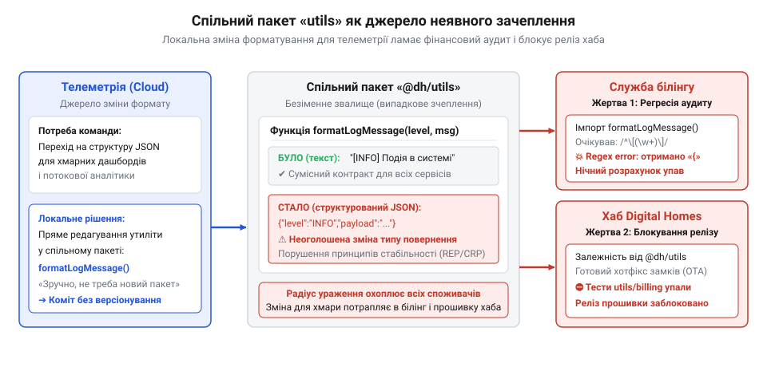
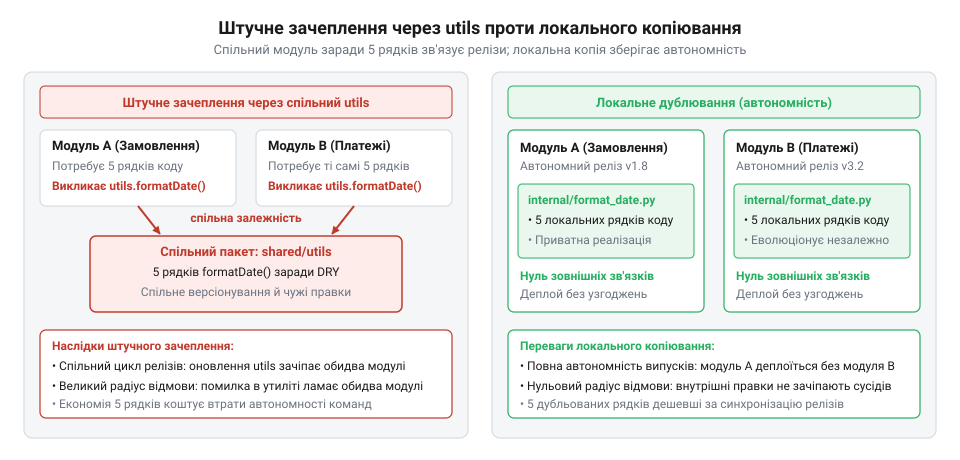
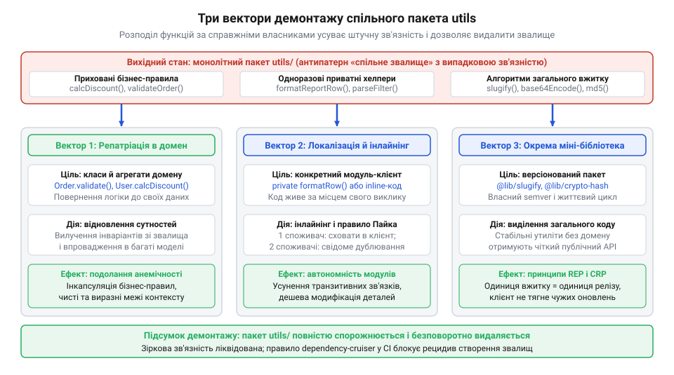

# Спільний «utils» як звалище

<preknowlist>
- [DH: дерево хмари й дерево хаба](root:progarch/dh-code-trees) — архітектурна структура каталогів монорепозиторію Digital Homes та первинне розміщення спільних утилітарних пакетів між хмарою й хабом
</preknowlist>

## Як безневинний хелпер ламає реліз

Бажання уникнути дрібного дублювання спонукає виносити допоміжні функції в каталог `utils` (від лат. utilis — корисний). Спільний модуль здається безкоштовним, але зв'язує незалежні підсистеми в монолітний вузол.

У [дереві коду Digital Homes](root:progarch/dh-code-trees) телеметрія, білінг і хаб залежали від спільних хелперів. Команда телеметрії додала часову мітку до виводу повідомлень. Ця зміна зламала аудит білінгу, парсер якого очікував фіксований префікс. Одночасно зупинився реліз прошивки хаба: спільний граф збірки визначив хаб зачепленим, а провалені тести білінгу зупинили весь конвеєр.

*Неявне зачеплення через спільний пакет: зміна форматування ламає аудит білінгу та блокує прошивку хаба.*

Безпредметний пакет породжує @@en|випадкову зв'язність@@ (від лат. cohaerere — бути зчепленим; англ. @@en|coincidental cohesion@@): код сусідить без спільної мети. Масовий імпорт утворює топологію @@en|зірки@@ (англ. @@en|star topology@@) із граничним вхідним зачепленням. Через @@en|транзитивне замикання@@ (від лат. transitivus — перехідний; англ. @@en|transitive closure@@) @@en|радіус ураження@@ (від лат. radius — промінь; англ. @@en|blast radius@@) правки охоплює всю систему, позбавляючи модулі незалежності випусків.

## Догма DRY та розмивання домену

Спільні звалища виправдовують боротьбою з дублюванням. Проте @@en|принцип DRY@@ (англ. @@en|Don't Repeat Yourself@@ — не повторюй себе) захищає бізнес-знання, а не синтаксис. Коли алгоритми змінюються від різних вимог, спільний хелпер створює хибну абстракцію: функція обростає прапорцями під чужі контексти й породжує регресії.

Вимивання обчислень у хелпери породжує @@en|анемічну доменну модель@@ (від грец. anaimia — безкровність; англ. @@en|anemic domain model@@). Сутність стає набором полів без поведінки, втрачаючи @@en|інкапсуляцію@@ (від лат. in capsula — у скриньці; англ. @@en|encapsulation@@). Бізнес-@@en|інваріанти@@ (від лат. invarians — незмінний; англ. @@en|invariants@@) більше не захищені, бо стан змінюють ззовні. Поява доменних типів у сигнатурах утиліт утворює @@en|циклічну залежність@@ (від грец. kyklos — коло; англ. @@en|cyclic dependency@@) між шарами, руйнуючи граф.

*Порівняння підходів: спільний вузол склеює модулі, тоді як локальне дублювання гарантує автономність.*

За правилом Роба Пайка (англ. @@en|Rob Pike@@), трохи копіювання краще за трохи залежності. Свідоме локальне дублювання простої операції значно безпечніше за внесення спільної залежності.

## Ліквідація звалища та архітектурні бар'єри

Демонтаж звалища починається з @@en|аудиту@@ (від лат. auditus — перевірка; англ. @@en|audit@@). Синтаксичний аналіз викликів і темпу змін у версійному контролі класифікує функції на мертвий код, одноразові хелпери, доменні витоки та стабільні утиліти. Мертвий код видаляють одразу, а решту розбирають за трьома векторами.

*Три вектори демонтажу звалища: повернення правил у домен, локалізація приватного коду та виділення бібліотек.*

Перший вектор — @@en|репатріація@@ (від лат. repatriare — повернення на батьківщину; англ. @@en|repatriation@@): бізнес-правила та перевірку @@en|інваріантів@@ повертають у сутності. Другий вектор — локалізація: одноразовий код переносять до споживача або дублюють. Третій вектор — виділення нейтральних алгоритмів у самостійні бібліотеки з окремим релізом.

Чисті межі закріплює @@en|архітектурний лінтер@@ (від англ. @@en|architecture linter@@; з англ. lint — збирач пуху) у конвеєрі неперервної інтеграції, який блокує спільні неспеціалізовані теки. Успадковані порушення контролює @@en|храповик@@ (від англ. @@en|ratchet@@ — механізм одностороннього руху): список винятків дозволено лише скорочувати, що унеможливлює появу нових смітників.
