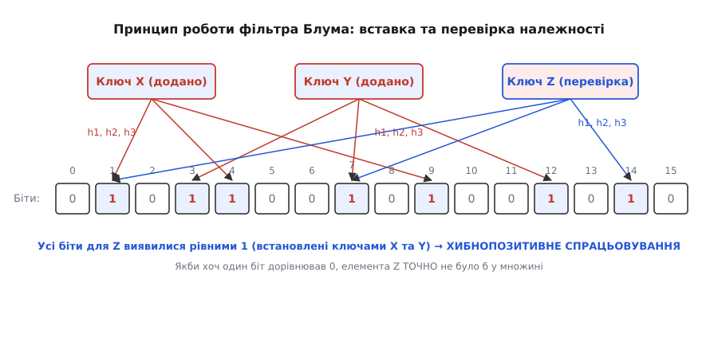
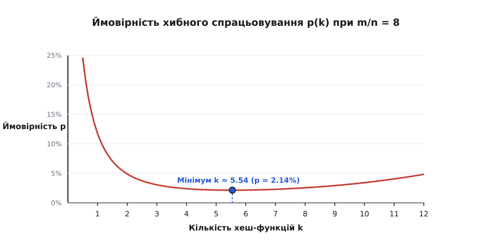

# Фільтр Блума

<preknowlist>
  * [Хеш-таблиці](root:sf-algorithms/hash-table)
  * [Біти, байти та індіанськість](root:sf-algorithms/bits-bytes-endianness)
  * [LSM-дерево](root:sf-data/lsm-tree)
  * [SIMD-векторизація](root:hw-arch/simd-vectorization)
  * [NUMA-архітектура](root:hw-arch/numa)
  * [Фільтр Кукушки](root:sf-algorithms/cuckoo-filter)
  * [Підрахунковий фільтр Блума](root:sf-algorithms/counting-bloom-filter)
  * [Стрічковий фільтр](root:sf-algorithms/ribbon-filter)
  * [Закон Зіпфа](root:math-probability/zipf-law)
</preknowlist>

Уявіть мережевий проксі-сервер або захисний модуль браузера, який щосекунди перевіряє мільйони URL-адрес за базою шкідливих сайтів. База містить 100 мільйонів записів. Якщо зберігати кожен URL у звичайній хеш-таблиці або збалансованому дереві пошуку, середній розмір одного рядка разом із накладними витратами вказівників та метаданих вузлів становитиме близько 64 байтів. Загальний обсяг оперативної пам'яті для такої структури сягне 6.4 гігабайта. Для вбудованих систем, edge-серверів чи операцій у реальних системах така витрата RAM є неприпустимою розкішшю.

Якщо ж відмовитися від збереження самих ключів і залишити лише побітову відбиткову матрицю, розмір структури зменшиться більш ніж у 50 разів — з 6.4 гігабайта до 114 мегабайтів. Ціною такого колосального стиснення є відмова від абсолютної точності: структура виключає хибнонегативні відповіді (False Negative), але допускає контрольовану ймовірність хибнопозитивних спрацьовувань (False Positive). Саме цю задачу вирішує ймовірнісна структура даних, створена Бертоном Блумом у 1970 році. Її еволюційному шляху від ранніх словників до розподілених баз даних присвячено вставку [📜 Історія фільтра Блума](root:sf-algorithms/bloom-filter/hist-bloom-filter.md).

## Проблема великого пошуку та ціна абсолютної точності

У класичному програмуванні структура даних точного пошуку — будь то хеш-таблиця з ланцюжками, хеш-таблиця з відкритою адресацією чи червоно-чорне дерево — повинна зберігати ключ повністю. Повнорозмірне збереження необхідне для розв'язання колізій: коли дві різні теми чи ключі хешуються в одну комірку, система мусить порівняти вихідні байтові послідовності за допомогою `memcmp` або `operator==`.

Пам'ять точної хеш-таблиці складається з двох частин:
1. **Масив вказівників або бакетів**: O(n) комірок для збереження індексів.
2. **Буфер самих ключів**: сума довжин ключів у байтах плюс вирівнювання алокатора.

У високонавантажених СУБД (наприклад, RocksDB, Apache Cassandra чи ClickHouse) дані зберігаються на диску у вигляді незмінних файлів таблиць (SSTables). Коли система шукає ключ `user_1024`, вона змушена зчитувати з диска блоки даних. Зчитування з NVMe SSD займає близько 10–50 мікросекунд, а з класичного жорсткого диска — 5–10 мілісекунд. Якщо ключа в файлі немає, дискове зчитування виявляється даремно витраченим ресурсом. Якщо на один запит припадає 20 SSTable-файлів, перевірка відсутнього ключа призведе до 20 марних операцій введення-виведення (I/O Read Amplification).

```
Запит ключа K
      │
      ▼
┌───────────┐        Ні (Гарантовано відсутній)
│  Фільтр   ├─────────────────────────────────────────► Швидке повернення false
│   Блума   │                                           (0 операцій з диском)
└─────┬─────┘
      │ Так (Можливо є)
      ▼
┌───────────┐
│ Зчитування│
│   SSTable ├─────────────────────────────────────────► Точна перевірка на диску
│ з диска   │                                           (1 операція I/O)
└───────────┘
```

Фільтр Блума виступає в ролі «дешевого гейткіпера». Він швидко відповідає на два питання:
* **«Елемента точно немає у множині»**: Відповідь на 100% достовірна. Виклики дискового зчитування повністю скасовуються.
* **«Елемент з високою ймовірністю є у множині»**: Відповідь імовірна. Система виконує одне точне дискове зчитування для підтвердження.

## Анатомія та механізм побітового масиву

В основі фільтра Блума лежать два компоненти:
1. **Бітовий масив** m бітів, ініціалізований нулями (`0`).
2. **Набір з k незалежних хеш-функцій** h_1, h_2, ..., h_k, кожна з яких відображає байтовий ключ у рівномірно розподілене ціле число в діапазоні [0, m - 1].

### Операція вставки (Add / Insert)

Щоб додати елемент x у фільтр Блума, система обчислює k хеш-значень для цього елемента:

```text
[обчислення індексів хешування]
i_1 = h_1(x) mod m
i_2 = h_2(x) mod m
...
i_k = h_k(x) mod m
```

Після цього біти за обчисленими індексами i_1, i_2, ..., i_k у бітовому масиві встановлюються в стан `1`. Якщо якийсь із бітів уже дорівнював `1` (через вставку попередніх елементів), він залишається `1`. Побітова операція встановлення є ідемпотентною:

```text
[встановлення біта]
bit_array[i_j] = bit_array[i_j] | 1
```

### Операція перевірки (Check / Contains)

Щоб перевірити наявність елемента y у множині, система аналогічно обчислює k індексів:

```text
[обчислення індексів перевірки]
j_1 = h_1(y) mod m
j_2 = h_2(y) mod m
...
j_k = h_k(y) mod m
```

Далі виконується послідовне зчитування бітів:
* Якщо **хоча б один** із бітів `bit_array[j_r] == 0`, система повертає `false`. Елемент y **гарантовано ніколи не додавався** до фільтра, оскільки якби його додали, цей біт обов'язково був би переведений у стан `1`.
* Якщо **всі k бітів** дорівнюють `1`, система повертає `true`. Елемент y **можливо є** у множині.

```
Масив бітів m = 16:
Индекси:  0   1   2   3   4   5   6   7   8   9  10  11  12  13  14  15
        ┌───┬───┬───┬───┬───┬───┬───┬───┬───┬───┬───┬───┬───┬───┬───┬───┐
Значення:│ 0 │ 1 │ 0 │ 0 │ 1 │ 0 │ 1 │ 0 │ 0 │ 1 │ 0 │ 0 │ 1 │ 0 │ 0 │ 0 │
        └───┴───┴───┴───┴───┴───┴───┴───┴───┴───┴───┴───┴───┴───┴───┴───┘
              ▲           ▲       ▲           ▲           ▲
              │           │       │           │           │
           h1("user")  h2("user") │        h3("user")     │
                                  │                       │
                             h1("admin")             h2("admin")
```

На рисунку нижче наочно продемонстровано механізм вставки двох ключів та виникнення хибнопозитивного спрацьовування для третього ключа, який не вставлявся, але всі його біти перекрилися іншими елементами:


*Принцип роботи фільтра Блума: вставка ключів set1 і set2 виставляє відповідні біти. Запит відсутнього ключа key3 повертає false на першому ж нульовому біті. Запит ключа key4 повертає true (False Positive), бо всі його біти випадково перекрилися попередніми ключами.*

### Покроковий приклад зміни стану бітового масиву

Розглянемо покроково, як змінюється стан бітового масиву розміром m = 16 при використанні k = 3 хеш-функцій:

1. **Початковий стан (порожній фільтр)**:
   `[0, 0, 0, 0, 0, 0, 0, 0, 0, 0, 0, 0, 0, 0, 0, 0]`

2. **Вставка ключа `"alice"`**:
   Нехай h_1("alice") = 1, h_2("alice") = 4, h_3("alice") = 9.
   Виставляємо біти 1, 4, 9 у стан `1`:
   `[0, 1, 0, 0, 1, 0, 0, 0, 0, 1, 0, 0, 0, 0, 0, 0]`

3. **Вставка ключа `"bob"`**:
   Нехай h_1("bob") = 4, h_2("bob") = 6, h_3("bob") = 12.
   Біт 4 вже дорівнює `1`. Виставляємо біти 6 та 12 у стан `1`:
   `[0, 1, 0, 0, 1, 0, 1, 0, 0, 1, 0, 0, 1, 0, 0, 0]`

4. **Запит відсутнього ключа `"charlie"`**:
   Нехай h_1("charlie") = 1, h_2("charlie") = 6, h_3("charlie") = 7.
   Перевіряємо біт 1 (стан `1`), біт 6 (стан `1`), біт 7 (стан `0`).
   Оскільки біт 7 дорівнює `0`, перевірка негайно припиняється і повертає `false` (**гарантовано відсутній**).

5. **Запит відсутнього ключа `"eve"` (False Positive)**:
   Нехай h_1("eve") = 1, h_2("eve") = 9, h_3("eve") = 12.
   Перевіряємо біт 1 (`1`), біт 9 (`1`), біт 12 (`1`).
   Усі три біти виявилися виставленими раніше вставками ключа `"alice"` та `"bob"`. Алгоритм повертає `true`, хоча ключ `"eve"` ніколи не додавався (**хибнопозитивне спрацьовування**).

### Оптимізація хешування Кірша-Мітценмахера

Обчислення k незалежних хеш-функцій (наприклад, k = 7 викликів MurmurHash3 або CityHash) для кожного ключа створює високе навантаження на процесор. У 2006 році Адам Кірш та Майкл Мітценмахер довели теорему: для збереження асимптотичної ймовірності хибнопозитивних спрацьовувань достатньо обчислити **лише дві** 64-бітні хеш-функції h_1(x) та h_2(x), а решту k - 2 індексів згенерувати за лінійною комбінацією:

```text
[генерація хеш-функцій]
g_i(x) = (h_1(x) + i · h_2(x)) mod m,  де i = 0, 1, ..., k-1
```

Ця оптимізація зменшує кількість хеш-обчислень до одного 128-бітного виклику хеш-функції (наприклад, `MurmurHash3_x64_128`), що значно прискорює вставку та перевірку.

Погляньмо, як це реалізується у коді:

:::tabs
:::code bloom-filter-d/c/optymizatsiia-kheshuvannia.c
:::code bloom-filter-d/cpp/optymizatsiia-kheshuvannia.cpp
:::

Зверніть увагу на побітову індексацію: замість виділення окремого `bool` на кожен біт (що витрачало б 8 бітів на прапорець у C++ через розмір `sizeof(bool) == 1`), ми пакуємо 8 бітів у один `uint8_t`. Операція `bit_index >> 3` вираховує індекс байта у масиві (аналог ділення на 8), а `bit_index & 7` вираховує номер біта всередині байта (аналог залишки від ділення на 8).

## Математична геометрія та вибір параметрів

Головне інженерне питання при проектуванні фільтра Блума: **як вибрати розмір масиву m та кількість хеш-функцій k, щоб при вставці n елементів ймовірність помилки p не перевищувала заданого порогу (наприклад, 1%)?**

Строге виведення формул, доведення теореми Кірша-Мітценмахера та деградація фільтра при переповненні описані у вставці [🧮 Математика фільтра Блума](root:sf-algorithms/bloom-filter/math-false-positive.md). Розглянемо ключові зв'язки.

### Ймовірність хибнопозитивного спрацьовування

Припустимо, що хеш-функції розподіляють індекси абсолютно рівномірно. Після вставки n елементів, кожен з яких застосовує k хеш-функцій, всього виконується k · n спроб виставити біт. Покрокове обчислення ймовірностей для нульового та одиничного бітів має вигляд:

```text
[обчислення ймовірності заповнення біта]
P(біт = 0) = 1 - 1/m                                  [імовірність не зачепити біт 1 хеш-функцією]
P(біт = 0 після n елементів) = (1 - 1/m)^(k · n)      [імовірність не зачепити біт за k · n спроб]
                            ≈ e^(-k · n / m)          [наближення за границею (1 - 1/m)^m ≈ 1/e]
P(біт = 1) ≈ 1 - e^(-k · n / m)                       [доповняльна ймовірність встановлення біта у 1]
```

Для відсутнього ключа хибнопозитивне спрацьовування відбувається тоді, коли **всі k бітів**, які перевіряються, випадково виявилися виставленими у `1` попередніми вставками:

```text
[імовірність помилки]
p ≈ (1 - e^(-k · n / m))^k
```

### Оптимальна кількість хеш-функцій k

Знайдемо мінімум функції p(k). З одного боку, збільшення k підвищує ймовірність того, що відсутній ключ натрапить хоча б на один `0`. З іншого боку, занадто велике k швидко заповнює масив одиницями. Взявши похідну за k і прирівнявши її до нуля, отримуємо оптимальне значення:

```text
[оптимальна кількість хешів]
k_opt = (m / n) · ln 2 ≈ 0.6931 · (m / n)
```

При такому k_opt рівно половина бітів масиву виявляється заповненою одиницями (P(біт = 1) = 0.5).

### Оптимальний розмір масиву m

Підставивши k_opt у формулу ймовірності p, отримуємо розрахунок необхідної кількості бітів m для забезпечення цільової помилки p:

```text
[оптимальний розмір вектору]
m = - (n · ln p) / (ln 2)^2 ≈ -1.44 · n · log_2(p)
```

Графік нижче ілюструє залежність ймовірності помилки p від кількості хеш-функцій k для різних співвідношень бітів на елемент (m/n):


*Залежність ймовірності False Positive rate від кількості хеш-функцій k. Чітко видно мінімум функції при k = ln(2) * (m/n). Для m/n = 10 мінімальна помилка досягається при k = 7 і становить 0.96%.*

Таблиця орієнтовних розрахунків пам'яті для n = 1 000 000 елементів:

| Цільова помилка p | Бітів на елемент (m / n) | Загальний розмір m | Обсяг у RAM | Оптимальне k |
| :--- | :--- | :--- | :--- | :--- |
| **5.0%** (0.05) | 6.24 | 6 235 224 бітів | 761 КБ | 4 |
| **1.0%** (0.01) | 9.58 | 9 585 058 бітів | 1.17 МБ | 7 |
| **0.1%** (0.001) | 14.38 | 14 377 588 бітів | 1.75 МБ | 10 |
| **0.01%** (0.0001) | 19.17 | 19 170 117 бітів | 2.34 МБ | 13 |

## Апаратна реальність: кеш-локальність та Blocked Bloom Filter

У теоретичному аналізі передбачається, що доступ до будь-якої комірки бітового масиву виконується за сталий час O(1). Проте на сучасній архітектурі процесорів (x86_64, ARM64) оперативна пам'ять працює за ієрархічною схемою кешування:

```
┌────────────────────────────────────────────────────────┐
│ CPU Core (Registers, L1 Cache 32KB, L2 Cache 512KB)     │
└───────────────────────────┬────────────────────────────┘
                            │ Cache Miss (~200 cycles)
                            ▼
┌────────────────────────────────────────────────────────┐
│ L3 Shared Cache (16MB - 64MB)                          │
└───────────────────────────┬────────────────────────────┘
                            │ Cache Miss (~200-300 cycles)
                            ▼
┌────────────────────────────────────────────────────────┐
│ Main RAM (DDR4 / DDR5 - 64GB)                          │
└───────────────────────────┬────────────────────────────┘
```

Коли розмір фільтра Блума перевищує обсяг кешу L3 (наприклад, масив на 500 МБ), кожне з k обчислень індексу `bit_index = (h1 + i * h2) % m` звертається до випадкової адреси у RAM. Це викликає до k послідовних **промахів кешу L3** (L3 Cache Misses). Оскільки один промах кешу вимагає близько 200–300 тактів процесора на очікування шини DDR, перевірка одного елемента при k = 8 може затримати процесор на 2000 тактів!

Профільовування таких промахів у Linux виконується утилітою `perf`:
```bash
perf stat -e L1-dcache-load-misses,LLC-load-misses ./bloom_benchmark
```

### Вирівнювання пам'яті за межею кеш-лінії (64-byte alignment)

Для запобігання міжсторінковим розривам кешу (Cache Line Split Unaligned Access) бітовий масив високоефективного фільтра Блума повинен вирівнюватися за межею 64 байтів. У мові C11 це виконується викликом `aligned_alloc(64, bytes)`, а в C++17 — викликом `std::aligned_alloc` або оператором `new (std::align_val_t{64})`.

Невідповідність вирівнювання може призвести до того, що одна 64-байтова кеш-лінія перетне межу двох фізичних сторінок пам'яті DRAM. При виконанні побітової операції встановлення `bit_array[idx] |= mask` процесор змушений заблокувати шину пам'яті (Bus Lock) та виконати дві окремі операції читання й запису. Застосування строгого вирівнювання за межею 64 байтів гарантує, що будь-яка побітова зміна залишається в межах однієї кеш-лінії.

З фізичного боку контролера пам'яті DDR4/DDR5, незбіг вирівнювання посилює ефект False Sharing при баготопотоковому виконанні. Якщо потік A виставляє біт у 64-байтовому блоці, а потік B зчитує сусідній біт у тій самій кеш-лінії, контролер кеш-когерентності MESI змушений переводити лінію у стан Invalid для всіх інших ядер процесора. Це викликає перевиділення лінії в L1-кеші сусіднього ядра і зменшує загальну пропускну здатність вставки.

Додатковим апаратним фактором є ефективність префетчера процесора (Hardware Data Prefetcher). При випадковому доступі до бітового вектору розміром у сотні мегабайтів префетчер не здатний передбачити наступну адресу читання, тому специфічні інструкції префетчування `_mm_prefetch((const char*)&bits[idx], _MM_HINT_T0)` дозволяють заздалегідь завантажити кеш-лінію у L1 до виконання перевірки.

:::tabs
```c
#include <stdlib.h>
#include <stdint.h>

/* Вирівняна алокація масиву бітів за межею 64 байтів */
uint8_t *bloom_alloc_aligned(size_t bytes) {
    size_t aligned_size = (bytes + 63) & ~((size_t)63);
    return (uint8_t *)aligned_alloc(64, aligned_size);
}
```
:::code bloom-filter-d/cpp/vyrivniuvannia-pamiati-za.cpp
:::

### Кеш-локальний блочний фільтр (Blocked Bloom Filter)

Для подолання цієї проблеми у високонавантажених СУБД (наприклад, у RocksDB та ClickHouse) використовується варіант **Blocked Bloom Filter** (блочний фільтр Блума).

Замість одного суцільного бітового вектору пам'ять розбивається на масив 64-байтових блоків (що строго відповідає розміру однієї кеш-лінії CPU):

1. Перша хеш-функція h_1(x) вираховує індекс 64-байтового блоку у масиві:

```text
[індекс 64-байтового блоку]
block_idx = h_1(x) mod num_blocks
```

2. Процесор зчитує весь 64-байтовий блок у L1-кеш **за один дескриптор шини пам'яті**.
3. Решта k бітових індексів обчислюються за допомогою другої хеш-функції h_2(x) **всередині вибраного 64-байтового блоку** (в діапазоні [0, 511] бітів).

:::tabs
:::code bloom-filter-d/c/kesh-lokalnyi-blochnyi.c
:::code bloom-filter-d/cpp/kesh-lokalnyi-blochnyi.cpp
:::

**Результат оптимізації**: Кількість промахів L3-кешу зменшується з k (тобто 7–10 промахів) до **строго 1 промаху** на один запит. Це підвищує швидкість перевірки у 3–5 разів на реальному апаратному забезпеченні. Повна практична реалізація з SIMD-векторизацією AVX2 представлена у вставці [⚙️ Реалізація фільтра Блума](root:sf-algorithms/bloom-filter/proj-bloom-filter.md).

## Zero-Copy Memory-Mapped Files (`mmap`)

У системному програмуванні великі фільтри Блума (розміром у сотні мегабайтів або гігабайти) часто зберігаються безпосередньо у бінарних файлах на SSD. Замість виділення оперативної пам'яті у гіпі через `malloc` та послідовного зчитування через `read()`, використовується системний виклик POSIX `mmap()`:

:::tabs
:::code bloom-filter-d/c/zero-copy-memory-mapped.c
:::code bloom-filter-d/cpp/zero-copy-memory-mapped.cpp
:::

**Переваги Zero-Copy**: Ядро операційної системи автоматично підвантажує сторінки файлу (Page Faults) у DRAM за необхідністю та підтримує Dirty Page Flush на диск у фоновому режимі через потік `kswapd`.

## Префіксні фільтри Блума для складних первинних ключів

У СУБД RocksDB та Cassandra первинні ключі часто є складеними (Composite Keys), наприклад `user_id:timestamp:session_id`. Ззвичайний фільтр Блума дає змогу перевірити лише точний повний ключ. Якщо виконати діапазонний запит (Range Query) по префіксу `user_1024:*`, точний фільтр Блума буде марним.

Для підтримки префіксних запитів застосовують **Prefix Bloom Filters** (префіксні фільтри Блума):
1. Побудовник індексу обчислює хеш-значення не лише від повного ключа, але й від його визначеного префікса (наприклад, перших 8 байтів `user_1024`).
2. При виконанні сканування діапазону СУБД спершу опитує префіксний фільтр. Якщо префікса немає у SSTable-файлі, весь файл пропускається без зчитування блоків даних.

:::tabs
:::code bloom-filter-d/c/prefiksni-filtry-bluma.c
:::code bloom-filter-d/cpp/prefiksni-filtry-bluma.cpp
:::

## Стиснення та серіалізація бітових векторів (RLE & ZSTD)

Коли фільтр Блума передається через мережу між вузлами розподіленого кластера або зберігається в системних каталогах, розріджений бітовий масив (з заповненням бітів менше ніж на 30%) містить довгі послідовності нульових байтів.

Для мінімізації накладних витрат мережевого трафіку застосовується стиснення Run-Length Encoding (RLE) або алгоритми швидкої декомпресії ZSTD:

:::tabs
:::code bloom-filter-d/c/stysnennia-ta.c
:::code bloom-filter-d/cpp/stysnennia-ta.cpp
:::

При низькому коефіцієнті заповнення fill_ratio < 0.2 таке стиснення зменшує розмір передаваного кадру у 3–4 рази, заощаджуючи пропускну здатність мережевих інтерфейсів 40GbE/100GbE.

## Підрахунок заповнення бітів через процесорну інструкцію POPCNT

Для динамічного моніторингу емпіричного стану фільтра системи обчислюють кількість встановлених одиничних бітів у масиві. На процесорах x86_64 та ARM64 ця операція прискорюється апаратною інструкцією `POPCNT` (`__builtin_popcountll` у GCC / Clang):

:::tabs
:::code bloom-filter-d/c/pidrakhunok-zapovnennia.c
:::code bloom-filter-d/cpp/pidrakhunok-zapovnennia.cpp
:::

## Побітова серіалізація та мережевий порядок байтів

При передачі бітового масиву між вузлами розподіленого кластера (наприклад, у кластері Cassandra або при бінарній передачі через gRPC) виникає задача збереження крос-платформної сумісності. Вказана сумісність вимагає чіткого визначення індіанськості (Endianness) бітового вектору.

Серіалізований бінарний кадр специфікується наступною структурою заголовка:

:::tabs
:::code bloom-filter-d/c/pobitova-serializatsiia-ta.c
:::code bloom-filter-d/cpp/pobitova-serializatsiia-ta.cpp
:::

## SIMD-векторизація AVX2 та пакетне опитування

Для підвищення пропускної здатності на серверах з процесорами Intel Xeon або AMD EPYC використовується векторизоване опитування масивів ключів за допомогою SIMD-інструкцій (Single Instruction, Multiple Data). Замість перевірки ключів по одному, система обробляє пакет з 8 ключів паралельно у 256-бітних векторних регістрах `__m256i`:

:::tabs
:::code bloom-filter-d/c/simd-vektoryzatsiia-avx2.c
:::code bloom-filter-d/cpp/simd-vektoryzatsiia-avx2.cpp
:::

## Багатопотокова синхронізація та алокація у NUMA-вузлах

У сучасних багатопроцесорних серверах із NUMA-архітектурою (Non-Uniform Memory Access) довільний розподіл бітового вектору між NUMA-вузлами призводить до суттєвих затримок міжпроцесорної шини UPI / QPI. Для максимальної пропускної здатності вставка та перевірка виконуються з прив'язкою пам'яті до локального NUMA-вузла:

:::tabs
:::code bloom-filter-d/c/bahatopotokova.c
:::code bloom-filter-d/cpp/bahatopotokova.cpp
:::

Зверніть увагу: оскільки вставка біта є асоціативною та комутативною операцією (`A OR B == B OR A`), використання порядкового модифікатора `std::memory_order_relaxed` при атомарних викликах `fetch_or` забезпечує відсутність накладних витрат бар'єрів пам'яті (Memory Barriers).

## Множинні побітові операції об'єднання у розподілених системах

Для розподілених СУБД (Apache Cassandra, CockroachDB) надзвичайно важливою властивістю фільтра Блума є можливість швидкої алгебраїчної сумації декількох фільтрів.

Якщо два фільтри Блума A та B побудовані з однаковими параметрами m, k та однакове зерно хешування seed, то побітове об'єднання їх вектору:

```text
[побітове об'єднання векторів]
C[i] = A[i] | B[i],  для всіх i від 0 до m-1
```

еквівалентне створенню єдиного фільтра C, до якого вставили всі елементи з об'єднання множин S_A та S_B.

:::tabs
:::code bloom-filter-d/c/mnozhynni-pobitovi.c
:::code bloom-filter-d/cpp/mnozhynni-pobitovi.cpp
:::

## Обробка помилок та крайні випадки

При розробці надійних систем із використанням фільтрів Блума слід враховувати наступні критичні крайні випадки:

1. **Нестача пам'яті при ініціалізації**: При виділенні вектору бітів для великої кількості n = 1 000 000 000 елементів система вимагає близько 1.1 ГБ суцільної пам'яті. У разі помилки виділення `malloc` повертає `NULL`, а C++ викидає `std::bad_alloc`. Код виклику зобов'язаний обробляти цей виняток або переходити на пільговий режим без фільтрації.
2. **Переповнення бітового вектору одиницями**: Якщо коефіцієнт заповнення `fill_ratio` наближається до 1.0, фільтр втрачає селективність і повертає `true` для кожного запиту. Модуль моніторингу повинен сповіщати про необхідність перезапуску або переходу на Scalable Bloom Filter.
3. **Пошкодження бінарного файлу заголовка**: При використанні `mmap` незбіг магічного числа `magic` або контрольної суми CRC32 повинен негайно ініціювати фонову регенерацію фільтра Блума з первинних SSTable-файлів.

## Межі застосовності та суміжні модифікації

Незважаючи на високу ефективність, класичний фільтр Блума має декілька фундаментальних обмежень.

### 1. Неможливість вилучення елементів (No Deletion)

У класичному фільтрі Блума **неможливо видалити вставлений ключ**. Якщо спробувати скинути k бітів елемента x назад у `0`, можна випадково обнулити біти, які належать іншим збереженим ключам y та z (колізія побітового накладання). Це призведе до виникнення катастрофічних **хибнонегативних спрацьовувань** (False Negatives), що порушить головний інваріант алгоритму.

Для систем, де вилучення є критичним, використовується [Підрахунковий фільтр Блума](root:sf-algorithms/counting-bloom-filter) (Counting Bloom Filter). Замість одного біта у масиві зберігається 4-бітний або 8-бітний цілочисельний лічильник. Операція вставки інкрементує лічильники, а операція вилучення — декрементує їх. При досягненні максимального значення 15 (для 4-бітних лічильників) оновлення комірки заблоковується для запобігання переповненню.

### 2. Загасання та старіння лічильників (Counter Decay & Aging)

У довготривалих потокових системах (Streaming Systems) лічильниковий фільтр Блума з часом накопичує старі значення ключів, що призводить до поступової деградації. Для підтримки ковзного часового вікна (Sliding Time Window) застосовують механізм періодичного згасання (Decay): через рівні проміжки часу всі лічильники у масиві діляться на 2 або декрементуються на одиницю. Комірки зі значенням 0 звільняються для нових елементів.

### 3. Секційований фільтр Блума (Partitioned Bloom Filter)

У секційованому фільтрі Блума бітовий масив m розбивається на k незалежних секцій розміром m/k кожна. Перша хеш-функція проектує ключ строго у 1-шу секцію, друга — у 2-гу секцію і так далі. Це усуває проблему кластеризації бітів та спрощує паралельне обчислення індексів на векторизованих SIMD-процесорах.

### 4. Неможливість динамічного розширення без втрати p

Якщо у фільтр з розрахованою ємністю n = 1 000 000 вставити 5 000 000 елементів, масив майже повністю заповниться одиницями (P(біт=1) -> 1.0), і ймовірність хибнопозитивного спрацьовування p зросте до 100%.

Для вирішення цієї проблеми застосовують **Scalable Bloom Filter** (масштабований фільтр Блума). Він складається з ланцюжка шарів F_0, F_1, ..., F_k. Коли шар F_i досягає ліміту заповнення, створюється новий шар F_{i+1} із подвоєним розміром та жорсткішим коефіцієнтом помилки p_{i+1} = p_0 · r^{i+1}.

### Порівняння з альтернативними ймовірнісними структурами

У сучасній розробці фільтр Блума конкурує з більш новими альтернативами:

| Характеристика | Фільтр Блума (Bloom) | [Фільтр Кукушки](root:sf-algorithms/cuckoo-filter) | [Стрічковий фільтр](root:sf-algorithms/ribbon-filter) |
| :--- | :--- | :--- | :--- |
| **Підтримка видалення** | ❌ Ні (лише у Counting) | ✅ Так (із заміщенням комірок) | ❌ Ні |
| **Ефективність пам'яті** | 9.6 бітів/ел (при p = 1%) | 8.6 бітів/ел | **7.1 бітів/ел** (близько до межі Шеннона) |
| **Локальність кешу** | Погана (k промахів) | Добра (2 промахи) | Добра |
| **Продуктивність вставки** | O(k) | O(1) амортизована | O(1) (побудова через Gaussian Elimination) |

Повні інженерні інтерфейси та специфікації функцій опубліковано у довіднику [📋 Специфікація API фільтра Блума](root:sf-algorithms/bloom-filter/api-bloom-filter.md).

## Простеження та діагностика через Linux eBPF та sysfs

При експлуатації фільтрів Блума у реальних ядрах Linux (наприклад, у підсистемі eBPF `BPF_MAP_TYPE_BLOOM_FILTER`) або у RocksDB важливо мати можливість інспектувати стан структури даних без зупинки працюючого сервісу.

У сучасних версіях ядра Linux (починаючи з 5.16) eBPF надає вбудовану тип-карту Блума:

:::tabs
:::code bloom-filter-d/c/prostezhennia-ta.c
:::code bloom-filter-d/cpp/prostezhennia-ta.cpp
:::

Простеження заповнення фільтра у реальному часі через `tracepoints` виконується за допомогою `bpftrace`:
```bash
# Підрахунок кількості перевірок у eBPF Bloom Filter
bpftrace -e 'kprobe:bpf_bloom_map_peek_elem { @lookups = count(); }'
```

Діагностична метрика `fill_ratio` (відношення кількості встановлених бітів до загального розміру m) слугує головним індикатором деградації: коли `fill_ratio` перевищує 0.5, ймовірність False Positive починає зростати за експонентою, що сигналізує про необхідність реорганізації чи виділення більшого масиву пам'яті.

## Практичне використання у промислових системах

Фільтр Блума став фундаментальним цеглинком високопродуктивної розподіленої інфраструктури:

1. **Бази даних RocksDB та LevelDB (LSM-Tree engines)**:
   При виконанні точкового запиту `db.Get("user_1024")` RocksDB спершу перевіряє блочний фільтр Блума у memtable та на кожному рівні SSTable-файлів. Це дозволяє відсіяти 99% файлів на диску і зменшити затримку читання з 5 мілісекунд до 10 мікросекунд.
2. **Мережі доставки контенту Akamai та Squid (CDN Web Caching)**:
   CDN-сервери використовують фільтр Блума для запобігання забрудненню кешу одноразовими запитами (One-Hit Wonders). Запит до ресурсу додається у фільтр Блума. Об'єкт кешується на диск лише тоді, коли він запитується **вдруге** (тобто перевірка у фільтрі повертає `true`).
3. **Google Chrome Safe Browsing**:
   Браузер зберігає локальний компактний фільтр Блума зі списком шкідливих URL-адрес. Перевірка кожної сторінки відбувається локально без виклику мережевого API. Лише у разі позитивної перевірки фільтра браузер робить захищений запит до серверів Google для остаточного підтвердження.
4. **Bitcoin SPV (Simplified Payment Verification) клієнти**:
   Легковажні гаманці надсилають вузлам мережі фільтр Блума, що містить адреси гаманця користувача. Вузол відфільтровує лише ті транзакції, які задовольняють фільтру, не знаючи при цьому точного переліку адрес користувача (забезпечення приватності).
5. **Розподілені СУБД Apache Cassandra та ScyllaDB**:
   У розподілених партиціях Cassandra фільтри Блума зберігаються у системній оперативній пам'яті для кожної таблиці SSTable. Якщо координатор надсилає запит до партиції, фільтр Блума миттєво визначає, чи містить даний файл потрібний партиційний ключ, усуваючи марні звернення до дискового масиву RAID/NVMe.

## Підсумок

Фільтр Блума ілюструє важливий алгоритмічний принцип: **свідома відмова від збереження самих даних на користь збереження їх побітового відбитку дозволяє знизити витрати пам'яті на порядки**. Завдяки відсутності хибнонегативних відповідей та можливості математичного контролю рівня помилки p, ця структура залишається золотим стандартом у проектуванні високонавантажених СУБД, мережевих систем та розподілених кешів.
