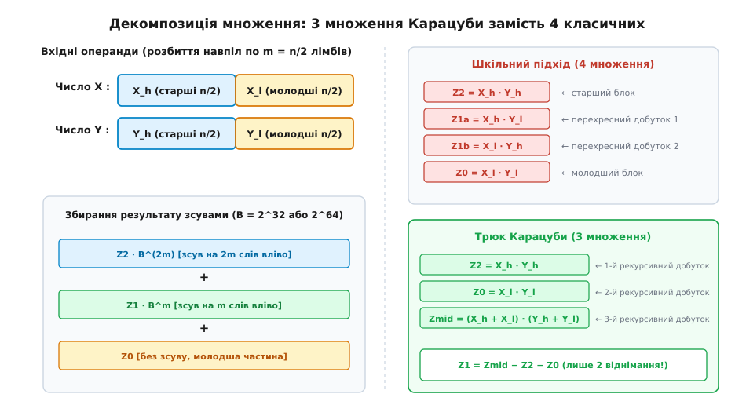
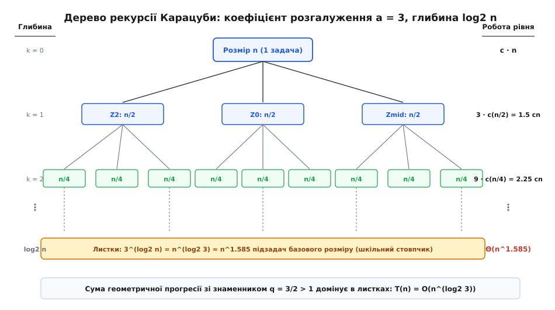
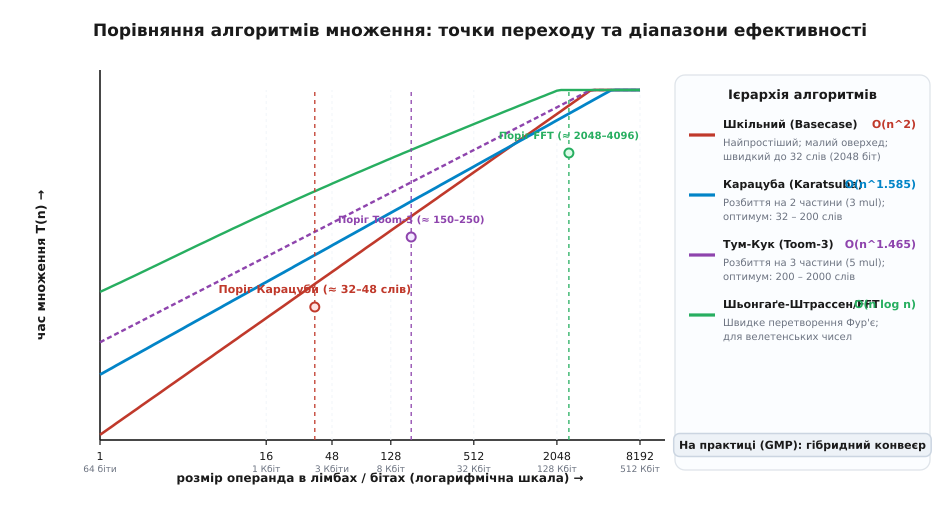
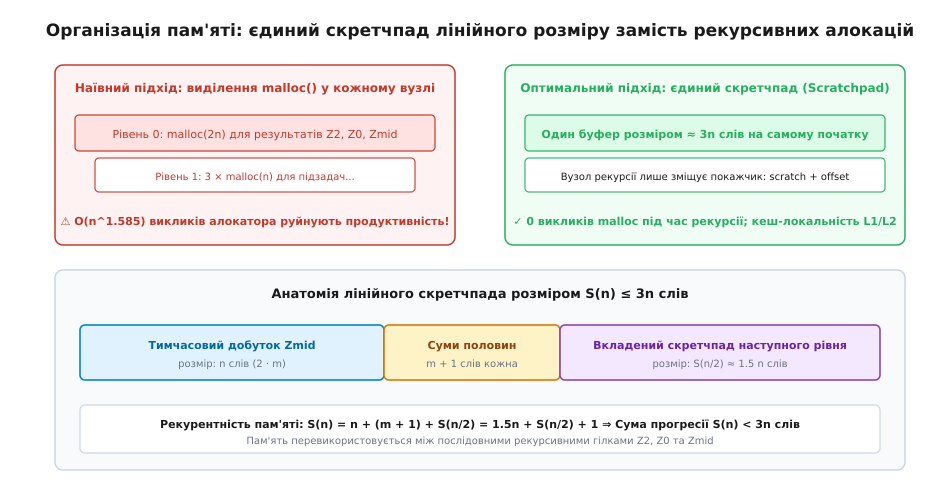

# Множення Карацуби: подолання квадратичного бар'єра

<preknowlist>
- [Асимптотична складність](root:computability/asymptotic-complexity) — оцінка зростання часу роботи алгоритму зі збільшенням розміру входу.
- [Розділяй і володарюй](root:sf-algorithms/divide-and-conquer) — декомпозиція задачі на незалежні підзадачі меншого розміру.
- [Теорема про рекурентності (Master Theorem)](root:computability/master-theorem) — метод обчислення асимптотики рекурсивних рівнянь.
- [Двійкова арифметика](root:hw-digital/binary-arithmetic) — багаторозрядні числа, розряди, перенесення та порозрядні зсуви.
</preknowlist>

Криптографічний сервер генерує сертифікати безпеки за стандартом RSA з довжиною ключа 4096 бітів. Апаратне 64-розрядне процесорне ядро оперує базовими машинними словами — лімбами (англ. *limb* — кінцівка, сегмент; від давньоангл. *lim*). Одне 4096-бітне число займає рівно 64 таких лімби. Під час обчислення модульного зведення в степінь виникає потреба помножити два таких числа сотні разів поспіль. Класичний шкільний алгоритм множення «у стовпчик» вимагає перемножити кожен лімб першого числа з кожним лімбом другого: рівно `64 × 64 = 4096` операцій множення слів із подальшим додаванням переносів. Коли ж довжина операндів сягає мільйона бітів (15 625 слів) у наукових розрахунках чи системах комп'ютерної алгебри, кількість операцій підстрибує до 244 мільйонів. Час роботи алгоритму зростає строго пропорційно квадрату довжини вхідних даних: подвоєння кількості цифр збільшує обчислювальні витрати вчетверо.

Століттями в математиці побутувало переконання, що квадратична складність `O(n²)` є непорушним природним бар'єром. Інтуїція стверджувала: якщо результат залежить від взаємодії кожної цифри першого множника з кожною цифрою другого, уникнути `n²` взаємодій неможливо. 1960 року академік Андрій Колмогоров навіть висунув офіційну гіпотезу про нездоланність квадратичної межі `Ω(n²)`. Проте всього через тиждень 23-річний аспірант Анатолій Карацуба знайшов спосіб обчислити результат швидше, звівши кількість множень половинних блоків із чотирьох до трьох.

Повний перебіг історичного відкриття та відмову Колмогорова від власної гіпотези викладено у вставці [📜 Семінар Колмогорова та спростування гіпотези О(n²)](root:sf-algorithms/karatsuba-multiplication/hist-karatsuba-kolmogorov.md).

---

## Анатомія наївного розділення: чому чотири множення не рятують

Щоб зрозуміти джерело прориву, розглянемо спробу розділити обчислення за класичним принципом «розділяй і володарюй» (лат. *divide et impera*). Нехай задано два довгих додатних цілих числа `X` та `Y`, кожне з яких містить `n` розрядів у системі числення з основою `B` (наприклад, `B = 2³²` або `B = 2⁶⁴` для сучасних мікропроцесорів).

Представимо кожне число у вигляді масиву машинних слів. Для рівномірного розбиття припустимо, що `n` є парним числом. Розділимо кожне число рівно навпіл на дві частини довжиною `m = n/2` лімбів: старшу частину (індекс `h`, від англ. *high*) та молодшу частину (індекс `l`, від англ. *low*).

```
X = X_h · B^m + X_l
Y = Y_h · B^m + Y_l
```

Тут `X_l` та `Y_l` є молодшими половинами (числа від `0` до `B^m - 1`), а `X_h` та `Y_h` — старшими половинами, зсунутими на `m` розрядів вліво за допомогою множення на ваговий коефіцієнт `B^m`.

Запишемо добуток `X · Y` через розкриття звичайних алгебраїчних дужок:

```
X · Y
= (X_h · B^m + X_l) · (Y_h · B^m + Y_l)             [підстановка розбиття операндів]
= X_h·Y_h · B^(2m) + (X_h·Y_l + X_l·Y_h) · B^m + X_l·Y_l [дистрибутивність множення відносно додавання]
```

Отриманий вираз складається з трьох вагових частин:
1. Старша частина `Z₂ = X_h · Y_h`, зсунута на `2m` розрядів;
2. Молодша частина `Z₀ = X_l · Y_l`, що не потребує зсуву;
3. Середня перехресна частина `Z₁ = X_h · Y_l + X_l · Y_h`, зсунута на `m` розрядів.

Наївний підхід для обчислення цих трьох коефіцієнтів виконує чотири незалежні множення чисел довжиною `n/2`:
- Перше множення: `Z₂ = X_h · Y_h`;
- Друге множення: `Z₀ = X_l · Y_l`;
- Третє множення: `Z₁a = X_h · Y_l`;
- Четверте множення: `Z₁b = X_l · Y_h`.

Після цього коефіцієнти додаються зі зсувами: зсув на `m` чи `2m` лімбів у машинній пам'яті є просто зміщенням покажчика на потрібну кількість байтів, що виконується за нульовий або константний час `O(1)`. Додавання ж масивів довжиною `n` слів вимагає лінійного часу `O(n)`.

Запишемо рекурентне рівняння для часу роботи такого наївного підходу:

```
T(n) = 4 · T(n/2) + O(n)
```

За основною теоремою про рекурентності обчислимо критичний показник степеня:

```
показник складності = log_b a = log₂ 4 = 2
```

Оскільки вартість роботи на поточному рівні `f(n) = O(n)` зростає повільніше за кількість підзадач на дні дерева рекурсії `n^(log₂ 4) = n²`, загальний час роботи наївного алгоритму залишається строго квадратичним:

```
T_naive(n) = Θ(n²)
```

Простий поділ на чотири підзадачі не дав жодного виграшу: дерево рекурсії має 4 гілки на кожному рівні, і на дні рекурсії ми отримуємо рівно `4^(log₂ n) = n²` елементарних множень, але з додатковими накладними витратами на виклики функцій та копіювання масивів.

---

## Ідея Карацуби: як прибрати одне множення

Головна здогадка Карацуби полягала в тому, що середній коефіцієнт `Z₁ = X_h·Y_l + X_l·Y_h` не потребує окремого знання величин `X_h·Y_l` та `X_l·Y_h`. Для підсумкового результату потрібна виключно їхня **сума**.

Історично подібна алгебраїчна техніка була відома Карлу Фрідріху Гаусу для множення комплексних чисел: добуток `(a + bi)(c + di) = (ac - bd) + (ad + bc)i` стандартно вимагає 4 дійсних множень, проте Гаус звів їх до 3: `k₁ = a · c`, `k₂ = b · d`, `k₃ = (a + b)(c + d)`, звідки уявна частина дорівнює `k₃ - k₁ - k₂`. Карацуба геніально застосував цей принцип до позиційних чисел із вагами розрядів.

Розглянемо добуток суми половин першого числа на суму половин другого числа:

```
Z_mid
= (X_h + X_l) · (Y_h + Y_l)                        [допоміжний добуток сум]
= X_h·Y_h + X_h·Y_l + X_l·Y_h + X_l·Y_l             [розкриття дужок]
= Z₂ + (X_h·Y_l + X_l·Y_h) + Z₀                    [заміна крайніх членів на Z₂ та Z₀]
```

У цьому виразі миттєво видно шукану суму `X_h·Y_l + X_l·Y_h`. Вона входить до складу `Z_mid` разом із двома іншими доданками — `Z₂` та `Z₀`. Але ж `Z₂ = X_h · Y_h` та `Z₀ = X_l · Y_l` нам і так обов'язково потрібні для формування старшої та молодшої частин відповіді!

Якщо ми вже обчислили `Z₂` та `Z₀`, нам достатньо відняти їх від допоміжного добутку `Z_mid`:

```
Z₁
= Z_mid - Z₂ - Z₀                                  [виділення середнього коефіцієнта]
= (X_h·Y_l + X_l·Y_h)                              [тотожна рівність шуканій сумі]
```

Тепер для множення двох чисел довжини `n` потрібно виконати лише **три** рекурсивні множення чисел довжини `n/2` (або `n/2 + 1`):
1. `Z₂ = X_h · Y_h` — старший блок;
2. `Z₀ = X_l · Y_l` — молодший блок;
3. `Z_mid = (X_h + X_l) · (Y_h + Y_l)` — допоміжний блок.

Середній член знаходиться за допомогою двох лінійних віднімань: `Z₁ = Z_mid - Z₂ - Z₀`. Повний результат збирається складанням:

```
X · Y = Z₂ · B^(2m) + Z₁ · B^m + Z₀
```


*Декомпозиція множення двох чисел: класичний підхід потребує 4 множень половинних блоків, тоді як алгоритм Карацуби обчислює результат лише через 3 рекурсивні добутки Z₀, Z₂ та Z_mid із подальшим лінійним відніманням.*

### Числовий приклад розрахунку

Для наочності простежимо роботу алгоритму на двох десяткових числах `X = 1234` та `Y = 5678` при основі `B = 10` та розмірі розбиття `m = 2` (`B^m = 100`):

1. **Розбиття на половини:**
   `X_h = 12`, `X_l = 34`
   `Y_h = 56`, `Y_l = 78`
2. **Обчислення крайніх добутків:**
   `Z₂ = 12 × 56 = 672`
   `Z₀ = 34 × 78 = 2652`
3. **Обчислення сум половин та допоміжного добутку:**
   `X_h + X_l = 12 + 34 = 46`
   `Y_h + Y_l = 56 + 78 = 134`
   `Z_mid = 46 × 134 = 6164`
4. **Виділення середнього коефіцієнта:**
   `Z₁ = Z_mid - Z₂ - Z₀ = 6164 - 672 - 2652 = 2840`
5. **Складання підсумкового числа:**
   `X · Y = Z₂ · 10000 + Z₁ · 100 + Z₀`
   `X · Y = 672 · 10000 + 2840 · 100 + 2652 = 6720000 + 284000 + 2652 = 7006652`

Пряма перевірка множенням у стовпчик дає точно такий самий результат: `1234 × 5678 = 7006652`. Проте замість 4 множень двозначних чисел ми виконали лише 3 множення (`12×56`, `34×78`, `46×134`).

---

## Асимптотична складність: чому n^1.585 перемагає n²

Завдяки заміні кількості підзадач `a = 4` на `a = 3` рекурентне рівняння часу виконання набуває вигляду:

```
T(n) = 3 · T(n/2) + c · n
```

де `c · n` покриває виконання лінійних операцій: два додавання для обчислення `(X_h + X_l)` та `(Y_h + Y_l)`, два віднімання для отримання `Z₁`, а також фінальне додавання блоків зі зсувами.

Розглянемо структуру дерева рекурсії:
- На рівні `k = 0` (корінь) ми маємо `1` задачу розміру `n`, вартість лінійної роботи становить `c · n`.
- На рівні `k = 1` маємо `3` задачі розміру `n/2`. Лінійна робота становить `3 · c(n/2) = (3/2) · c · n`.
- На рівні `k = 2` маємо `3² = 9` задач розміру `n/4`. Лінійна робота дорівнює `9 · c(n/4) = (3/2)² · c · n`.
- На рівні `k` кількість задач дорівнює `3^k`, розмір кожної — `n / 2^k`, а сумарна робота рівня становить `(3/2)^k · c · n`.


*Дерево рекурсії алгоритму Карацуби: коефіцієнт розгалуження a = 3, глибина log₂ n. Обсяг роботи на рівнях утворює геометричну прогресію зі знаменником 3/2 > 1, тому загальна складність домінує в листках і становить Θ(n^(log₂ 3)).*

Глибина дерева сягає `log₂ n` рівнів. Загальна кількість елементарних операцій є сумою геометричної прогресії зі знаменником `q = 3/2 > 1`. Оскільки знаменник строго більший за одиницю, сума прогресії визначається її останнім членом — кількістю листків на дні дерева:

```
кількість листків = 3^(log₂ n) = n^(log₂ 3) ≈ n^1.58496
```

Суворе математичне виведення суми геометричної прогресії, констант лінійної частини, методу Акри-Бацці та узагальнення на довільні розбиття наведено у вставці [🧮 Математичне виведення та оцінка складності множення Карацуби](root:sf-algorithms/karatsuba-multiplication/math-karatsuba-complexity.md).

Порівняємо зростання кількості операцій для `n²` та `n^1.585` при різних розмірах операндів:

| Розмір операнда `n` (біт / слів) | Шкільний метод `n²` | Карацуба `n^1.585` | Теоретичне прискорення |
|---|---|---|---|
| **64 слова (4096 біт)** | 4 096 | 718 | **5.7×** |
| **256 слів (16 Кбіт)** | 65 536 | 6 463 | **10.1×** |
| **1024 слова (65 Кбіт)** | 1 048 576 | 58 170 | **18.0×** |
| **4096 слів (262 Кбіт)** | 16 777 216 | 523 000 | **32.1×** |
| **16 384 слова (1 Мбіт)** | 268 435 456 | 4 700 000 | **57.1×** |

Різниця між `n²` та `n^1.585` — це не просто кількісна оптимізація константи, це якісна зміна характеру кривої зростання складності.

---

## Поліноміальний погляд: обчислення в точках та інтерполяція

Щоб зрозуміти внутрішню природу трюку Карацуби та його зв'язок із сучаснішими алгоритмами, поглянемо на довгі числа як на поліноми (многочлени; грец. *polys* — численний, лат. *nomen* — ім'я).

Представимо операнди `X` та `Y` як лінійні поліноми від змінної `t`:

```
A(t) = a₁·t + a₀,  де a₁ = X_h, a₀ = X_l
B(t) = b₁·t + b₀,  де b₁ = Y_h, b₀ = Y_l
```

Якщо підставити значення `t = B^m`, ми отримаємо вихідні числа: `X = A(B^m)` та `Y = B(B^m)`.

Добуток двох поліномів степеня 1 дає поліном степеня 2:

```
C(t) = A(t) · B(t) = c₂·t² + c₁·t + c₀
```

Поліном другого степеня однозначно визначається трьома невідомими коефіцієнтами `c₂`, `c₁`, `c₀`. З курсу лінійної алгебри відомо: щоб однозначно відновити поліном степеня `d`, достатньо знати його значення у `d + 1` довільній точці. Для `d = 2` потрібно рівно `3` точки.

Обчислимо значення поліномів `A(t)` та `B(t)` у трьох зручних точках: `t = 0`, `t = 1` та `t = ∞` (граничний перехід старшого коефіцієнта):

```
Точка 0:   A(0) = a₀,       B(0) = b₀       ⇒ C(0) = A(0)·B(0) = a₀·b₀ = c₀
Точка ∞:   A(∞) = a₁,       B(∞) = b₁       ⇒ C(∞) = a₁·b₁ = c₂
Точка 1:   A(1) = a₁ + a₀,  B(1) = b₁ + b₀   ⇒ C(1) = (a₁ + a₀)·(b₁ + b₀)
```

З іншого боку, за означенням полінома `C(t)`:

```
C(1) = c₂·1² + c₁·1 + c₀ = c₂ + c₁ + c₀
```

Оскільки значення `c₀ = C(0)` та `c₂ = C(∞)` ми вже отримали в перших двох точках, середній коефіцієнт `c₁` відновлюється простою підстановкою:

```
c₁ = C(1) - c₂ - c₀ = C(1) - C(∞) - C(0)
```

Цей поліноміальний погляд пояснює всю суть алгоритму: ми переходимо від коефіцієнтного представлення до представлення полінома його значеннями в точках (*evaluation*), виконуємо поштучне множення значень у 3 точках, а потім повертаємося до коефіцієнтів методом інтерполяції (*interpolation*).

Саме це узагальнення привело до появи алгоритму **Тума-Кука (Toom-3)**, який розбиває операнди на 3 частини (поліноми степеня 2). Добуток має степінь 4, що вимагає 5 точок обчислення (`t = 0, 1, -1, 2, ∞`), породжуючи рекурентність `T(n) = 5·T(n/3) + O(n)` зі складністю `O(n^(log₃ 5)) ≈ O(n^1.465)`. А граничним розвитком цієї ідеї є швидке перетворення Фур'є (FFT) в алгоритмах Шьонгаґе-Штрассена та Гарві-Гувена, де поліноми обчислюються у комплексних коренях з одиниці, досягаючи складності `O(n log n)`.

---

## Множення в двійкових полях GF(2)[x]

Окремою важливою сферою застосування алгоритму Карацуби є арифметика в поліномах над полем `GF(2)` (поліноми з двійковими коефіцієнтами, де додавання відповідає побітовому виключальному АБО `XOR`). Такі поліноми широко використовуються в алгоритмах автентифікованого шифрування AES-GCM (множник GHASH на 128 бітів) та еліптичній криптографії над бінарними полями (криві Koblitz).

У полі `GF(2)[x]` відсутні перенесення: `1 + 1 = 0`. Завдяки цьому лінійні операції зводяться до одного векторного `XOR`, а додавання і віднімання стають тотожними:

```
Z_mid = (X_h ⊕ X_l) · (Y_h ⊕ Y_l)
Z₁ = Z_mid ⊕ Z₂ ⊕ Z₀
```

Відсутність бітів переповнення та однаковий розмір усіх трьох проміжних добутків робить апаратну та програмну реалізацію Карацуби для двійкових полів надзвичайно компактною. Сучасні процесори містять спеціальні інструкції безпереносного множення `PCLMULQDQ` (x86) та `PMULL` (ARM NEON), які за один машинний такт перемножують 64-бітні бінарні поліноми, утворюючи основу для швидкого рекурсивного множення Карацуби в ядрі криптографічних протоколів.

---

## Ієрархія алгоритмів множення: де Карацуба незамінний

У сучасних бібліотеках довгої арифметики (зокрема GNU MP) множення реалізовано як багаторівневий конвеєр, де кожен алгоритм відповідає своєму оптимальному діапазону розрядностей:

1. **Шкільний стовпчик (`n ≤ 32` слів / до 2048 бітів):** Складність `O(n²)`. Мінімальні накладні витрати, повне розміщення даних у регістрах процесора.
2. **Алгоритм Карацуби (`32 < n ≤ 192` слів / 2048–12288 бітів):** Складність `O(n^1.585)`. Оптимальний баланс між скороченням кількості множень та простотою лінійних операцій.
3. **Алгоритм Тума-Кука Toom-3 (`192 < n ≤ 2048` слів / 12–130 Кбіт):** Складність `O(n^1.465)`. Зменшує множення з 9 до 5 ціною складнішої інтерполяції (ділення на константи 2, 3, 6).
4. **Алгоритм Тума-Кука Toom-4 / Toom-8 (`2048 < n ≤ 8192` слів / 130–500 Кбіт):** Складність `O(n^1.404)`. Подальше подрібнення блоків для проміжної зони перед FFT.
5. **Алгоритм Шьонгаґе-Штрассена / БШП (`n > 8192` слів / понад 500 Кбіт):** Складність `O(n log n log log n)`. Перетворення Фур'є у кільцях за модулем чисел Ферма `2^(2^k) + 1`.

Чому ж алгоритми вищого порядку (FFT або Toom-3) не витіснили Карацубу в діапазоні криптографічних ключів (2048–4096 бітів)? Відповідь криється у розмірі константи `c` лінійної фази. У швидкому перетворенні Фур'є необхідно виконати пряме перетворення, комплексні множення, зворотне перетворення та округлення, що вимагає тисяч додаткових операцій. Для операндів до 10 000 бітів ця константа повністю нівелює асимптотичну перевагу, роблячи Карацубу абсолютним лідером швидкодії у криптографічному діапазоні.

---

## Інженерні реалії: поріг перемикання та скретчпад

Попри красиву математику, пряма рекурсія Карацуби аж до `n = 1` у чистому вигляді на комп'ютері працюватиме вкрай повільно. Причина полягає у двох суто інженерних факторах:
1. **Накладні витрати на малі розміри:** Для чисел розміром 1–8 слів кілька інструкцій додавання, створення стекових кадрів та перевірка умов займають більше часу, ніж виконання `1 × 1` чи `4 × 4` апаратних множень інструкціями процесора (`MULX`/`ADCX`).
2. **Фрагментація пам'яті:** Наївне виділення масивів через `malloc()` у кожному рекурсивному виклику створює `O(n^1.585)` операцій роботи з купою, що перевантажує системний алокатор і руйнує кеш процесора.

### Гібридний алгоритм та точка переходу (Crossover Threshold)

Щоб усунути накладні витрати на малих розмірах, застосовують гібридний підхід: рекурсія Карацуби виконується лише доти, доки розмір операнда `n` перевищує встановлений поріг відсікання `KARATSUBA_THRESHOLD` (зазвичай від 32 до 64 лімбів). Як тільки `n` стає меншим або рівним за поріг, керування передається оптимізованому асемблерному або векторному шкільному множенню `O(n²)`.


*Зіставлення практичної швидкодії алгоритмів множення: для малих операндів до 32 слів найшвидшим є класичний шкільний стовпчик через мінімальні накладні витрати; у діапазоні 32–200 слів домінує Карацуба; далі першість переходить до Toom-3 та FFT.*

### Управління пам'яттю через єдиний скретчпад

Замість динамічного виділення пам'яті в кожному вузлі застосовують техніку попереднього виділення єдиного лінійного робочого буфера — скретчпада (англ. *scratchpad* — блокнот для чернеток).

Обчислимо необхідний обсяг скретчпада. На кожному рівні рекурсії для задачі розміру `n` (де `m = n/2`) нам потрібні тимчасові буфери:
- `2m = n` слів для збереження проміжного добутку `Z_mid`;
- `m` слів для суми `X_h + X_l`;
- `m` слів для суми `Y_h + Y_l`;
- Вкладений скретчпад для трьох рекурсивних викликів наступного рівня `S(n/2)`.

Оскільки три рекурсивні виклики (`Z₀`, `Z₂`, `Z_mid`) виконуються послідовно один за одним, вони можуть **по черзі перевикористовувати ту саму ділянку скретчпада**.

```
S(n) = 2n + S(n/2) = 2n + 2(n/2) + 2(n/4) + ... < 4n
```


*Розподіл пам'яті в єдиному лінійному скретчпаді: розмір буфера не перевищує 4n лімбів, а рекурсивні виклики Z₀, Z₂ та Z_mid послідовно використовують ту саму вкладену пам'ять без повторних алокацій.*

Виділивши перед початком обчислення один неперервний блок пам'яті розміром `4n` лімбів, ми повністю позбуваємося викликів системного алокатора під час рекурсії.

Детальний опис інтерфейсу функцій та структур пам'яті наведено у вставці [📋 Інтерфейс та контракт модуля швидкого множення Карацуби](root:sf-algorithms/karatsuba-multiplication/api-bignum-karatsuba.md).

---

## Варіант із модулем різниць: усунення бітів переповнення

Під час обчислення суми половин `X_h + X_l` та `Y_h + Y_l` довжина результату може скласти `m + 1` лімбів. Це вимагає або підтримки операндів змінної довжини, або окремого врахування бітів перенесення `carry_a` та `carry_b`.

Для уникнення цієї проблеми існує еквівалентентний варіант алгоритму Карацуби, який базується на відніманні замість додавання:

```
Z_diff = |X_h - X_l| · |Y_h - Y_l|
```

Оскільки різниця двох невід'ємних чисел, кожне з яких строго менше за `B^m`, гарантовано лежить у діапазоні `(-(B^m - 1), B^m - 1)`, її абсолютне значення строго менше за `B^m` і завжди точно вміщується в `m` лімбів без виникнення вихідного біта перенесення.

Розкриємо модуль різниць у залежності від знаків `s_x = sign(X_h - X_l)` та `s_y = sign(Y_h - Y_l)`:

```
(X_h - X_l) · (Y_h - Y_l) = X_h·Y_h - (X_h·Y_l + X_l·Y_h) + X_l·Y_l = Z₂ - Z₁ + Z₀
```

Звідси середній коефіцієнт `Z₁` обчислюється як:

```
Z₁ = Z₂ + Z₀ - (X_h - X_l) · (Y_h - Y_l)
```

Якщо знаки `(X_h - X_l)` та `(Y_h - Y_l)` однакові (`s_x · s_y = +1`), то `Z₁ = Z₂ + Z₀ - Z_diff`.
Якщо знаки протилежні (`s_x · s_y = -1`), то `Z₁ = Z₂ + Z₀ + Z_diff`.

Цей підхід повністю виключає переповнення лімбів, спрощуючи векторні обчислення в бібліотеках довгої арифметики (зокрема у вихідному коді Python та OpenSSL).

---

## Низькорівнева оптимізація: інструкції MULX, ADCX та ADOX

У сучасних процесорах архітектури x86-64 операція множення двох 64-розрядних лімбів реалізується інструкцією `MULX` (введена в розширенні BMI2). На відміну від застарілої інструкції `MUL`, яка жорстко вимагала використання пари регістрів `RAX:RDX` і перезаписувала прапорці процесора, `MULX` записує 128-розрядний результат у два довільні регістри загального призначення і не модифікує прапорці арифметичного стану (`CF` та `OF`).

Це дозволяє організувати подвійний паралельний конвеєр додавання перенесень за допомогою інструкцій `ADCX` (додавання з прапорцем `CF`) та `ADOX` (додавання з прапорцем `OF`). Процесор виконує два додавання з перенесенням одночасно за один машинний такт, повністю завантажуючи суперскалярні обчислювальні порти ALU. На цьому рівні мікроархітектури швидкість базового шкільного множення настільки висока, що поріг переходу на алгоритм Карацуби встановлюється в районі 32–48 слів.

---

## Множення несиметричних операндів (N × M)

У практичних задачах криптографії та комп'ютерної алгебри довжини операндів часто різняться. Наприклад, при піднесенні до квадрата за модулем велике число довжиною 4096 бітів множиться на малий коригуючий множник довжиною 256 бітів.

Наївне доповнення меншого числа нулями до повного розміру більшого числа збільшує обсяг роботи у `(N / M)^1.585` разів. Замість цього застосовують віконне блочне множення: більше число `X` довжиною `N` розбивають на `k = ⌈N / M⌉` блоків розміром `M` слів:

```
X = X_{k-1} · B^((k-1)M) + ... + X₁ · B^M + X₀
```

Після цього кожен блок `X_i` множиться на менший операнд `Y` (довжиною `M`) за стандартною симетричною схемою Карацуби, а проміжні добутки додаються до результуючого масиву з відповідними зсувами:

```
X · Y = ∑_{i=0}^{k-1} (X_i · Y) · B^(i·M)
```

Загальна складність такого комбінованого підходу становить `O((N / M) · M^1.585) = O(N · M^0.585)`, що забезпечує значний виграш у швидкодії порівняно як із наївним доповненням нулями, так і зі шкільним множенням `O(N · M)`.

---

## Захист від атак сторонніми каналами (Side-Channel Attacks)

У криптографічних застосунках (обчислення RSA, протоколи Діффі-Геллмана, еліптичні криві) критично важливо, щоб час виконання операцій не залежав від оброблюваних секретних ключів. Таймінгові атаки (*timing attacks*) дозволяють зловмиснику відновити закритий ключ шляхом статистичного вимірювання мікросекундних коливань часу відповіді сервера.

Алгоритм Карацуби у наївній реалізації містить дві вразливості за часом:
1. **Умовна корекція бітів перенесення:** Якщо в сумі `X_h + X_l` виникає вихідний біт перенесення `carry_a = 1`, програма виконує блок `if (carry_a) add_with_offset(...)`. Ця умовна гілка змінює час виконання на кілька десятків тактів та створює помітний сплеск у блоці передбачення переходів (*branch predictor*).
2. **Нульові лімби в операндах:** Класична оптимізація `if (a[i] == 0) continue;` у шкільному стовпчику скорочує час обчислення, відкриваючи інформацію про кількість нульових розрядів у секретному ключі.

Для захисту у криптографічних бібліотеках (OpenSSL, BoringSSL, Libgcrypt) застосовують підхід обчислень із фіксованим часом (*constant-time programming*):
- Усі умовні переходи замінюються на безумовне маскування через операції побітового `AND`/`OR`/`XOR`. Наприклад, замість перевірки умови формується маска `mask = (uint32_t)(-(int32_t)carry)`, і додавання виконується завжди: `dst[i] += src[i] & mask`.
- Цикли шкільного стовпчика виконують повний перебір без пропуску нульових елементів, забезпечуючи ідентичний графік споживання енергії та стабільний час виконання незалежно від числових значень.

---

## Реалізація довгої арифметики в рантаймах мов програмування

Алгоритм Карацуби інтегровано у стандартні бібліотеки більшості сучасних середовищ виконання:

1. **CPython (`Objects/longobject.c`):** Довгі цілі числа типу `int` представлені масивом лімбів `digit` по 30 бітів на 64-розрядних платформах (залишаючи 2 біти запасу для запобігання переповнення під час додавання слів). Поріг відсікання задано константою `KARATSUBA_CUTOFF = 70` лімбів (близько 2100 бітів). Числа меншого розміру множаться класичним стовпчиком `k_mul()`, а більші — через `k_karatsuba()`.
2. **V8 Engine (Node.js / Chromium):** Тип `BigInt` використовує 64-розрядні лімби на x86-64. Метод `BigInt::Multiply` автоматично перемикається на `MultiplyKaratsuba` при досягненні довжини 64 слова (4096 бітів), використовуючи попередньо виділений стек зонної пам'яті (*Zone allocation*).
3. **Go (`math/big/nat.go`):** Пакет `big` містить високопродуктивні асемблерні версії шкільного стовпчика `mulWW` та функцію `karatsuba`, поріг якої динамічно підбирається під час збірки стандартної бібліотеки.

---

## Робочий приклад: реалізація ядра множення

Розглянемо практичну реалізацію алгоритму Карацуби для 32-розрядних слів `uint32_t` з використанням скретчпада та порогу відсікання.

:::tabs
:::code karatsuba-multiplication-d/c/main.c
:::code karatsuba-multiplication-d/cpp/main.cpp
:::

Повний проект із розширеною обробкою непарних довжин та тестами наведено у вставці [⚙️ Реалізація множення великих чисел алгоритмом Карацуби](root:sf-algorithms/karatsuba-multiplication/proj-karatsuba-bignum.md).

---

> 🔧 **Навіщо це в реальній розробці.**
> Алгоритм Карацуби є стандартним базовим двигуном множення в бібліотеках GNU MP (GMP), OpenSSL/BoringSSL, Crypto++, а також у вбудованих інтерпретаторах мов високого рівня (довга арифметика Python `int`, об'єкти `BigInt` у рушіях V8 та SpiderMonkey для JavaScript, `BigInteger` у Java, пакет `math/big` у мові Go). Кожного разу, коли веб-сервер встановлює захищене TLS-з'єднання, підписує токен JWT або обчислює геш за схемою RSA-2048/4096, саме субквадратична декомпозиція Карацуби запобігає деградації пропускної здатності сервера під високим навантаженням.

---

## Підсумковий синтез: значення відкриття для обчислювальної складності

Алгоритм Карацуби став вододілом в історії комп'ютерних наук. До 1960 року алгоритмічна оптимізація здебільшого сприймалася як інженерне покращення констант або усунення зайвих циклів. Карацуба показав, що алгебраїчна перебудова задачі здатна змінити саму асимптотичну категорію операції.

З математичної точки зору цей метод продемонстрував, що операція множення не є елементарним монолітом: кількість множень завжди можна обміняти на більшу кількість лінійних додавань. У рекурсивних структурах цей обмін виявляється вигідним через різну природу зростання: розгалуження множень формує степінь складності `n^(log_b a)`, тоді як лінійні додавання лишаються підпорядкованим доданком `O(n)`. Цей принцип ліг в основу алгоритмів Штрассена для множення матриць, швидкого перетворення Фур'є Кулі-Тьюкі та сучасних методів множення багатовимірних тензорів у машинному навчанні.
