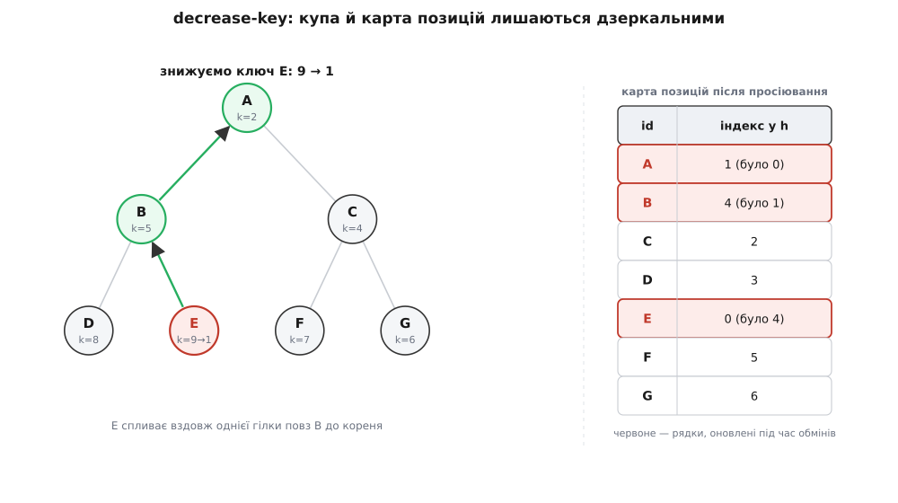

# ⚙️ Двійкова min-купа під бойове навантаження: повна реалізація

Базова min-купа тримає **частковий порядок**: у щільному масиві кожен батько не більший за обох дітей, тож найменший елемент завжди сидить у корені `h[0]`, а зв'язок «батько–дитина» — це арифметика індексів (діти вузла `i` — це `2i+1` і `2i+2`, батько — `(i−1)/2`). Дві короткі процедури, просіювання вгору й вниз, лагодять цей порядок за O(log n). Цього досить для навчального прикладу на числах.

Але купа, яку кладуть у планувальник задач чи в пошук найкоротшого шляху, мусить уміти ще чотири речі, яких у навчальної версії немає:

- **нести вантаж, а не самий ключ** — у черзі лежить не число, а *подія* чи *вершина графа*; ключ лише впорядковує;
- **збиратися з готового набору за O(n)**, а не за O(n log n) — коли всі n елементів відомі наперед;
- **знижувати ключ уже покладеного елемента** (decrease-key) — серце алгоритму Дейкстри;
- **поводитися передбачувано з рівними ключами** — інакше «однаково термінові» задачі виходять у випадковому порядку.

Зберемо купу, яку не соромно вкинути в реальний планувальник. Головну реалізацію ведемо на C++: справжні планувальники тримають купу саме щільним масивом записів у суміжній пам'яті, і ручний контроль розкладки тут не забаганка, а причина швидкодії. Наприкінці той самий код дам дзеркалом на Python — щоб алгоритм було видно без церемоній.

> 🔧 **Навіщо це.** Різниця між навчальною й бойовою купою — не в кількості рядків, а в тому, що бойова тримає збоку ще одну структуру (карту «елемент → його місце») і жодного разу її не губить. Саме ця карта перетворює decrease-key з O(n)-сканування на O(log n)-правку — і саме на ній тримається вся швидкість Дейкстри.

Усі оцінки нижче — в [нотації O великого](root:computability/asymptotic-complexity): вартість рахуємо з точністю до сталого множника, і O(log n) означає «росте як висота дерева», а O(1) — «однаково дешево незалежно від розміру».

## Каркас: щільний масив записів

Запис у черзі — пара «ключ + дескриптор». Ключ (`key`) упорядковує; дескриптор (`id`) — стабільний цілий *номер* елемента, за яким його впізнають ззовні: вершина графа, номер задачі. Домовмось, що дескриптори щільні, `0 … cap−1` — саме так буває в Дейкстрі (вершини занумеровані) чи в планувальнику з пулом задач. Тоді карту «id → місце в купі» можна тримати простим масивом, без жодного хешування.

:::code proj-binary-heap/cpp/karkas-shchilnyi-masyv.cpp

Тут працюють **три інваріанти** водночас, і код нижче існує лише для того, щоб їх утримати:

1. **Порядок купи:** `h[parent].key ≤ h[child].key` для кожної пари батько–дитина. Наслідок — мінімум у `h[0]`.
2. **Дзеркальність карти:** `pos[h[i].id] == i` для кожного `i`. Карта завжди показує правду про місце.
3. **Щільність:** `h` без дірок, тому дерево *повне*, а індексна арифметика чинна.

Перший інваріант — це купа з навчальної версії. Другий — те нове, що робить купу бойовою. Уся складність реалізації зводиться до того, щоб **жодна операція не залишила карту брехати**.

## Один обмін — одне місце правди

Ось найважливіше рішення всієї реалізації, і воно вміщається в чотири рядки. Записи в купі рухаються **тільки** обмінами. Якщо кожен обмін лагодить і карту, то карта не збрешеться ніколи — незалежно від того, скільки процедур її смикають. Тому загорнемо обмін в одну-єдину функцію, і всі інші будуть кликати саме її:

```cpp
    // Єдине місце, де взагалі рухаються записи; тут-таки лагодимо карту.
    void swap_nodes(int i, int j) {
        std::swap(h[i], h[j]);
        pos[h[i].id] = i;
        pos[h[j].id] = j;
    }
```

Це не косметика. Найпідступніша помилка в купі з decrease-key — коли одна гілка коду посунула записи, а карту оновити забула: `pos` починає показувати на чуже місце, і наступний `decrease_key` тихо псує випадковий елемент за кілометр від справжнього. Баг не падає одразу — він проростає пізніше й ловиться пекельно. Звівши **всі** рухи до `swap_nodes`, ми робимо цей клас помилок структурно неможливим: місце, де можна забути карту, лишилося рівно одне, і там ми не забуваємо.

## push і pop_min

Обидві операції — це знайомі просіювання, але тепер вони кличуть `swap_nodes`, тож карта їде разом із записами безкоштовно.

`push` кладе новачка в кінець (єдине місце, де дерево лишиться повним), реєструє його в карті й дає спливти вгору, поки він менший за батька:

:::code proj-binary-heap/cpp/push-i-pop-min.cpp

`pop_min` віддає корінь. Щоб не лишити дірку в корені, туди їде **останній** елемент масиву (він із дозволеного місця), масив коротшає, а великий прибулець тоне вниз. Хитрий момент — той самий, що й у навчальній купі: спускаючись, міняємось саме з **меншою** з двох дітей, інакше зламаємо порядок на рівень нижче.

:::code proj-binary-heap/cpp/push-i-pop-min-2.cpp

Вартість обох — довжина шляху від кореня до листа, тобто висота повного дерева з n вузлів, ⌊log₂ n⌋ обмінів щонайбільше. Отже, `push` і `pop_min` — **O(log n)**, а `peek` читає `h[0]` за **O(1)**. Карту вони тримають правдивою даром: усе рухалося крізь `swap_nodes`.

## Побудова за O(n): Флойдове heapify

Уяви, що всі n елементів у тебе вже є — треба скласти з них купу одним махом. Проста спокуса — покликати `push` n разів. Це працює, але коштує **O(n log n)**: кожен з n новачків може спливати через усю висоту.

Краще — **Флойдове heapify** (Роберт Флойд, 1964, «Algorithm 245: Treesort»; загальновизнаний факт). Кинь усі елементи в масив як є — це вже повне дерево, тільки поки без порядку, — і пройди **просіюванням вниз** кожен внутрішній вузол, з кінця до початку: від останнього батька `n/2−1` до кореня `0`. Листки (друга половина масиву) пропускаємо: їм просіювати нікуди.

```cpp
    // Побудова з готового набору за O(n) (Флойдове heapify).
    MinHeap(const std::vector<Node>& items, int cap) : h(items), pos(cap, NONE) {
        for (int i = 0; i < (int)h.size(); ++i) pos[h[i].id] = i;   // карта
        for (int i = (int)h.size() / 2 - 1; i >= 0; --i) sift_down(i);
    }
```

Чому це раптом **O(n)**, а не O(n log n)? Бо роботи в кожного вузла — не вся висота дерева, а лише його власна висота над дном, і дешевих вузлів переважна більшість. Рівно половина вузлів — листки на самому дні: 0 роботи. Чверть сидить на один рівень вище: щонайбільше 1 крок. Восьма частина — 2 кроки. Дорогих вузлів угорі — одиниці. Просумуй «скільки вузлів × скільки кроків» по рівнях — 8·0 + 4·1 + 2·2 + 1·3 = 11 кроків на 15 вузлів — і побачиш, що сума збігається до величини, пропорційної n, а не n·log n.

## decrease_key і карта позицій

Тепер — операція, заради якої й затівалася вся ця морока з картою. **Знизити ключ** означає підвищити пріоритет елемента, який **уже лежить у купі**. Класичний споживач — [алгоритм Дейкстри](root:sf-algorithms/dijkstra): він шукає найкоротші шляхи, раз по раз беручи з черги найближчу ще не оброблену вершину і **послаблюючи** оцінки відстаней до її сусідів; кожне послаблення — це зниження ключа сусіда, який уже чекає в черзі.

Механіка проста: новий ключ менший, отже елемент міг стати меншим за свого батька — женемо його вгору просіюванням. Уся хитрість в одному слові: щоб просіяти елемент, треба **спершу його знайти**. Без карти довелося б сканувати весь масив у пошуках потрібного `id` — O(n), і вся перевага купи в Дейкстрі випаровується. З картою місце відоме миттєво:

```cpp
    // Знизити ключ елемента id до new_key (new_key <= поточного). O(log n).
    void decrease_key(int id, long long new_key) {
        int i = pos[id];                    // O(1): карта знає, де він лежить
        h[i].key = new_key;
        sift_up(i);                         // новий ключ менший -> угору
    }
```

Один рядок `pos[id]` — і замість O(n)-пошуку маємо O(1)-адресу, а вся операція коштує **O(log n)**: сам `sift_up`. Симетрична операція — *підвищити* ключ — так само дешева, лише женемо елемент униз `sift_down`.



*Зниження ключа E з 9 до 1: елемент спливає вздовж однієї гілки, а кожен обмін тут-таки поправляє карту (рядки A, B, E). Карта й купа лишаються дзеркальними.*

Якщо дескриптори **не** щільні цілі (скажімо, ключі — рядки або розкидані числа), масив `pos` не годиться: заміни його на [хеш-таблицю](root:sf-algorithms/hash-table) `id → індекс` — та сама O(1) у середньому, решта коду не змінюється ані на рядок.

## Повний код разом

Ось уся черга, зібрана докупи: щільний масив, карта позицій, чотири операції та Флойдова побудова. C++ — як у бойовому планувальнику; Python — те саме дзеркалом, де замість ручної пам'яті працює список пар, а карту зручно тримати або списком (щільні id), або словником (будь-які).

:::tabs
:::code proj-binary-heap/cpp/povnyi-kod-razom.cpp
:::code proj-binary-heap/py/main.py
:::

У бойовому коді таку купу рідко пишуть руками: у C++ є `std::priority_queue` (щоправда, max-купа й **без** decrease-key), у Python — модуль `heapq`. Але щойно потрібен decrease-key — а він потрібен усюди, де живе Дейкстра, — стандартних не вистачає, і купу з картою позицій доводиться писати саме так.

## Пастки

Купа коротка, і кожен її рядок має вагу. Ось п'ять місць, де реалізації ламаються найчастіше.

**1. Нуль- проти одиничної індексації.** Формули «батько–дитина» залежать від того, з якого числа нумерувати корінь. Це два різні світи, і мовчазне їх змішування — класична причина, коли купа «майже працює»:

```
корінь у 0 (як масив у C/C++):  діти  2i+1, 2i+2   батько  (i−1)/2
корінь у 1 (клітинку 0 не чіпаємо):  діти  2i, 2i+1   батько  i/2
```

Одинична форма трохи охайніша (менше `+1`), але марнує нульову клітинку або вимагає зсуву. Обери одну й тримайся; ми скрізь на нулі, бо він лягає на масиви без зайвих зсувів.

**2. При спуску міняйся з МЕНШОЮ дитиною.** Якщо поміняти елемент із *більшою* дитиною, вона стане батьком меншого брата — і порядок зламано на рівень нижче:

```
початок:        правильно — з меншою (3):    помилка — з більшою (6):
    7                     3                          6
   / \                   / \                        / \
  3   6                 7   6                       3   7
                                                    ↑ 6 > 3 — купа зламана
```

Тому в `sift_down` спершу шукаємо `smallest` серед обох дітей і аж тоді міняємось.

**3. Карта позицій обов'язкова — і оновлюється при КОЖНОМУ обміні.** Без карти `decrease_key` мусив би сканувати масив у пошуках `id` — O(n), і купа програє звичайному масиву. З картою — O(log n). Але карта корисна лише поки правдива: варто одній гілці посунути записи й забути `pos` — і наступне зниження ключа тихо зіпсує чужий елемент. Саме тому весь рух записів заведено в один `swap_nodes`: місце, де можна забути карту, лишилося рівно одне.

**4. Рівні ключі виходять у непередбачуваному порядку.** Купа **не стабільна**: два записи з однаковим ключем можуть вийти в будь-якому порядку — не в тому, в якому зайшли. Для планувальника, де рівно термінові задачі мають обслуговуватись чесно (хто раніше прийшов), це баг. Ліки — вбудувати в ключ **лічильник вставки** `seq` і порівнювати пари `(key, seq)`: за рівних ключів виграє менший `seq`, тобто той, хто зайшов раніше. Рівність зникає, а з нею й недетермінізм:

```cpp
struct Node { long long key; unsigned long long seq; int id; };

// «менше» тепер за парою (key, seq): рівні ключі впорядковує час приходу
bool less_node(const Node& a, const Node& b) {
    return a.key < b.key || (a.key == b.key && a.seq < b.seq);
}
// push видає кожному новачкові seq = seq_next++ (монотонний лічильник)
```

**5. Не роздавай назовні вказівники всередину масиву.** Купа живе в `std::vector`, а він при рості **переселяється** в іншу пам'ять — і будь-який збережений вказівник чи ітератор на елемент стає висячим. Тому назовні віддаємо стабільний `id`-дескриптор, а справжнє місце завжди питаємо через `pos[id]`. Дескриптор переживає будь-яку перебудову масиву; вказівник — ні.

## Складність — підсумок

```
операція        вартість     чому
peek            O(1)         мінімум завжди в корені h[0]
push            O(log n)     спливання вздовж однієї гілки заввишки log n
pop_min         O(log n)     занурення вздовж однієї гілки
decrease_key    O(log n)     карта дає місце за O(1), далі спливання
побудова з n    O(n)         Флойдове heapify: майже вся вага — на нечисленних верхніх вузлах
пам'ять         O(n)         масив записів + масив (чи хеш) карти позицій
```

Жодна операція не коштує O(n) — і водночас це лише кілька десятків рядків над щільним масивом, дружнім до кеша. Саме тому двійкова купа з картою позицій, а не її теоретично швидші родичі, стоїть у переважній більшості реальних планувальників і реалізацій Дейкстри: мала стала, проста інваріанта, жодного вузла з вказівниками.
