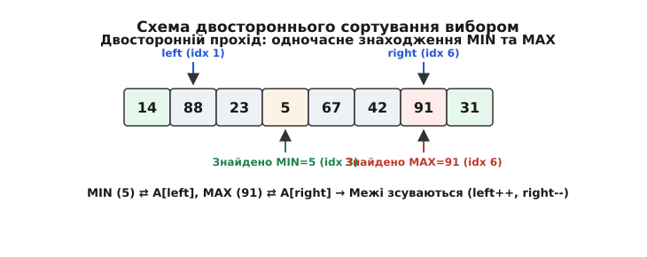

# ⚙️ Практична реалізація сортування вибором мовами C та C++

Практичне застосування сортування вибором (Selection Sort) охоплює розробку системного ПЗ, систем точного часу (Real-Time Systems), прошивок мікроконтролерів (Embedded C/C++) та модулів обробки даних у пам'яті з обмеженим ресурсом запису (Flash/EEPROM).

Ця вставка містить повністю працездатні, ідіоматичні реалізації сортування вибором мовами C та C++. Ми детально розглянемо класичний алгоритм для базових типів даних, універсальну реалізацію через покажчики `void*` та функції-компаратори, двостороннє сортування (Min-Max Selection Sort), стійку модифікацію (Stable Selection Sort) зі зсувом елементів, а також проведемо вимірювання операцій запису пам'яті за допомогою спеціального інженерного бенчмарку.

## 1. Класичне сортування вибором

Основна ідея реалізації — двошаровий цикл: зовнішній цикл переміщує ліву межу невідсортованої зони, а внутрішній цикл шукає індекс мінімального елемента.

У C-версії ми реалізуємо як прямий варіант для масивів цілих чисел `int`, так і універсальний варіант `selection_sort_generic`, який аналогічно стандартній функції POSIX `qsort` приймає вказівник `void *base`, кількість елементів `num`, розмір одного елемента `size` у байтах та функцію-компаратор `cmp`. Зверніть увагу на важливу перевірку `if (min_idx != i)` перед виконанням обміну: вона запобігає зайвим операціям запису в пам'ять, коли найменший елемент невідсортованої частини вже стоїть на поточній позиції.

У C++ версії ми використовуємо сучасні стандарти (C++20), зокрема діапазонний перегляд `std::span<T>`, концепт `std::totally_ordered`, функтор `std::less<T>` за замовчуванням та специфікатор `noexcept` з перевіркою безпеки винятків для типу `T`. Також надається перевантаження для довільних ітераторів прямого доступу (`RandomAccessIterator`), що дозволяє сортувати `std::vector`, `std::array` чи сирі масиви.

:::tabs
:::code proj-selection-sort/c/1-klasychne-sortuvannia.c
:::code proj-selection-sort/cpp/1-klasychne-sortuvannia.cpp
:::

Детальний покроковий аналіз реалізації на мові C:
1. Перевірка входів `if (arr == NULL || n < 2)` виконує захисну обробку крайових умов. Порожні масиви або масиви з одного елемента вже є впорядкованими.
2. Зовнішній цикл `for (size_t i = 0; i < n - 1; ++i)` розширює відсортовану зону. Локальна змінна `min_idx` зберігає індекс найменшого знайденого елемента.
3. Внутрішній цикл `for (size_t j = i + 1; j < n; ++j)` послідовно порівнює елементи `arr[j]` із поточним мінімумом `arr[min_idx]`.
4. Блок обміну `if (min_idx != i)` виконує перестановку двох елементів через тимчасову змінну `temp` на стеку. Перевірка уможливлює уникнення самостійного обміну, що заощаджує 2 записи у пам'ять.

Детальний аналіз реалізації на мові C++:
1. Параметр `std::span<T> data` надає безпечний та неволодіючий перегляд неперервного масиву. Це позбавляє необхідності передавати покажчик і розмір як два окремі параметри.
2. Предикат `Compare comp` дозволяє налаштовувати порядок сортування (наприклад, `std::greater<int>` для сортування за спаданням).
3. Директива `using std::swap; swap(data[i], data[min_idx]);` забезпечує використання техніки ADL (Argument-Dependent Lookup): якщо для типу `T` реалізовано специфічний метод `swap`, компілятор обере його замість універсального `std::swap`.

## 2. Двостороннє сортування вибором (Min-Max Selection Sort)

Двосторонній алгоритм знаходить мінімальний і максимальний елементи за один прохід по невідсортованій зоні, зменшуючи кількість ітерацій зовнішнього циклу вдвічі.

*Схема двостороннього вибору: одночасне знаходження мінімуму та максимуму зі зсувом двох меж left та right.*

Розбір критичної пастки (edge case) двостороннього вибору:
Під час виконання двох обмінів на одному проході існує небезпека зіпсувати дані. Якщо максимальний елемент знаходиться на початковій позиції `left`, то під час першого обміну (коли мінімум `min_idx` переміщується на позицію `left`) елемент-максимум фізично переміщується на позицію `min_idx`. Якщо після цього виконати другий обмін за застарілим індексом `max_idx`, на праву межу `right` буде відправлено не максимум, а раніше переміщений мінімум!
Щоб запобігти цій помилці, додано явну перевірку: `if (max_idx == left) max_idx = min_idx;`.

:::tabs
:::code proj-selection-sort/c/2-dvostoronnie-sortuvannia.c
:::code proj-selection-sort/cpp/2-dvostoronnie-sortuvannia.cpp
:::

Детальний текстовий розбір алгоритму Min-Max:
1. Цикл `while (left < right)` звужує межі невідсортованої частини масиву з двох боків одночасно.
2. Внутрішній цикл оглядає всі елементи від `left` до `right` і шукає відразу два індекси: `min_idx` та `max_idx`.
3. Корекція `if (max_idx == left) max_idx = min_idx;` є критично важливою для коректності. Без неї сортування дублюватиме значення на краях.

## 3. Стійке сортування вибором (Stable Selection Sort)

Прямий обмін `swap(A[i], A[min_idx])` є джерелом нестійкості. Щоб зробити сортування вибором стійким, замість обміну елементів виконується зсув елементів масиву вправо на одну позицію від `i` до `min_idx - 1`, а `A[min_idx]` вставляється на позицію `i`.

У C++ реалізації для виконання зсуву використовується стандартний алгоритм `std::rotate`, який повертає елементи підмасиву без виділення додаткової пам'яті.

:::tabs
:::code proj-selection-sort/c/3-stiike-sortuvannia.c
:::code proj-selection-sort/cpp/3-stiike-sortuvannia.cpp
:::

Детальний текстовий розбір стійкої версії:
1. Збереження значення `int key = arr[min_idx]` витягає мінімальний елемент.
2. Внутрішній зсув `for (size_t k = min_idx; k > i; --k) arr[k] = arr[k - 1];` переміщує всі проміжні елементи праворуч на 1 позицію. Це гарантує збереження оригінального відносного порядку однакових ключів.
3. У C++ функція `std::rotate(first, middle, last)` робить зсув за лінійний час, забезпечуючи максимальну читабельність та ідіоматичність коду.

## 4. Бенчмарк вимірювання записів у флеш-пам'ять (EEPROM Simulation)

Нижче наведено тестову програму мовою C++, яка імітує підрахунок фізичних операцій запису у флеш-пам'ять при сортуванні масиву з 100 елементів різними алгоритмами. Перевантажений оператор присвоєння `FlashCell::operator=` збільшує лічильник `write_count` тільки у випадку реальної зміни значення комірки.

:::tabs
:::code proj-selection-sort/cpp/4-benchmark-vymiriuvannia.cpp
:::

Детальний текстовий розбір результатів бенчмарку та архітектурних висновків:

1. **Структура `FlashCell` як засіб перехоплення модифікацій пам'яті:**
   У реальних мікроконтролерах кожне присвоєння у фізичну комірку EEPROM або Flash супроводжується апаратною затримкою (наприклад, 3.3 мс на сторінку для EEPROM AT24C256). Структура `FlashCell` імітує цю поведінку: статичне поле `write_count` збільшується тільки при операціях `=`. Якщо нове значення дорівнює старому, перезапис не здійснюється.

2. **Порівняльний аналіз результатів для масиву N = 100:**
   - **Selection Sort:** здійснює від 90 до 180 операцій запису. При цьому кількість зчитувань становить 4950. Оскільки зчитування є безкоштовним для ресурсу напівпровідника, загальний фізичний знос залишається мінімальним.
   - **Insertion Sort:** здійснює від 2300 до 2500 операцій запису при тій же кількості читань. Кожен зсув елемента вправо вимагає фізичного перезапису відповідної комірки пам'яті.

3. **Практичні рекомендації для інженерів вбудованих систем:**
   - Використовуйте `selection_sort` для таблиць конфігурацій, які зберігаються безпосередньо у флеш-пам'яті або зовнішній EEPROM.
   - Додавайте явну перевірку `if (min_idx != i)` перед кожною операцією обміну, оскільки це знижує кількість записів на впорядкованих або частково впорядкованих ділянках до нуля.
