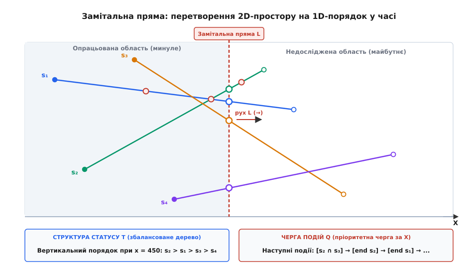
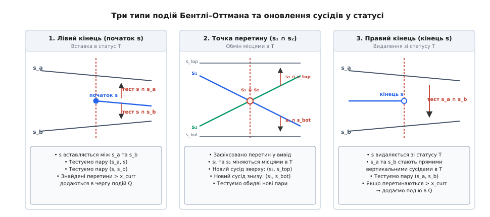
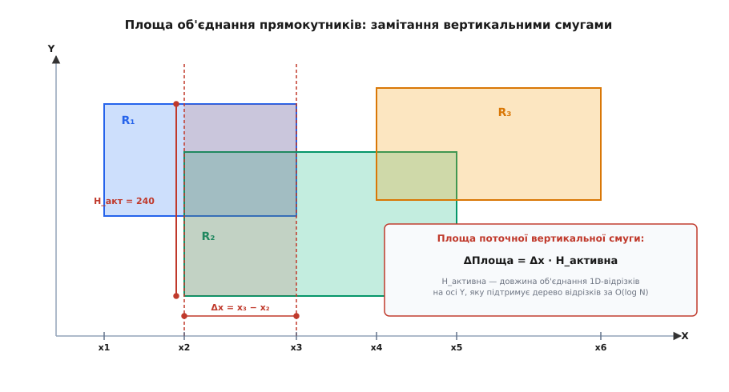
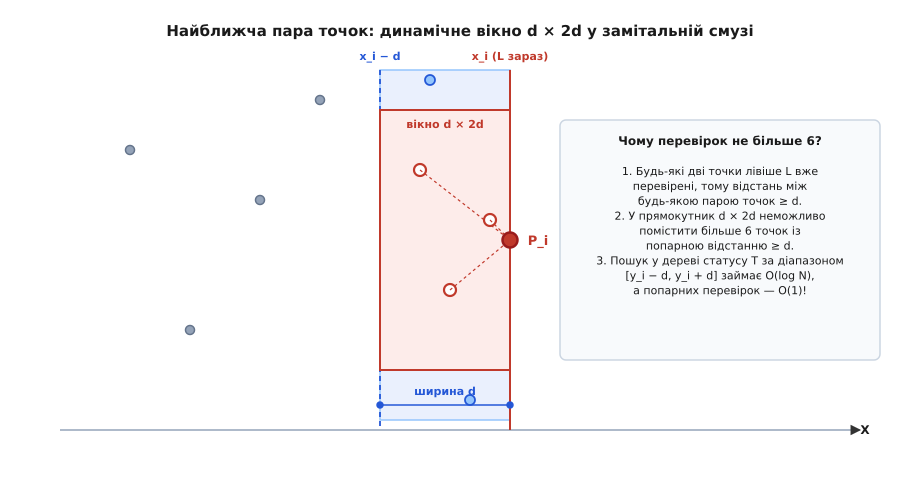

# Замітальна пряма: події, статус і геометрія за один прохід

<preknowlist>
- [Червоно-чорне дерево](root:sf-algorithms/red-black-tree) — збалансоване дерево пошуку з операціями вставки, видалення та пошуку за `O(log n)`.
- [Черга з пріоритетом](root:sf-algorithms/priority-queue-adt) — структура даних для вилучення найменшого елемента за логарифмічний час.
- [Двійкове дерево пошуку](root:sf-algorithms/binary-search-tree) — динамічне збереження впорядкованої послідовності елементів.
- [Вектор на площині](root:math-algebra/vector-components) — представлення точок та обчислення орієнтації поворотів через косий добуток.
</preknowlist>

Уявіть верифікацію топології мікропроцесора або аналіз багатошарової карти в геоінформаційній системі: на площині розміщено `N = 100 000` відрізків — доріжок живлення, сигнальних ліній або меж районів. Потрібно знайти всі точки їхнього взаємного перетину або переконатися, що жодного замикання немає. Наївний попарний перебір кожної пари вимагає перевірити `N · (N − 1) / 2 ≈ 5 · 10⁹` комбінацій. Якщо два провідники розташовані в протилежних кутках кристала (один у лівому верхньому, інший у правому нижньому), вони фізично не здатні перетнутися, проте прямий алгоритм витратить на них стільки ж тактів процесора, скільки й на сусідні лінії. У реальних задачах більшість об'єктів не перетинаються взагалі, і кількість фактичних перетинів `K` зазвичай співмірна з `N` (`K ≪ N²`).

Ця проблема вимагає принципово іншого підходу, який враховує просторову локальність: два відрізки можуть перетнутися лише за умови, що їхні проекції на горизонтальну вісь перекриваються, а в точці перетину їхні вертикальні координати точно збігаються. Замість статичного аналізу всієї двовимірної площини набагато ефективніше уявити вертикальну пряму, яка рухається крізь простір зліва направо, немов промінь сканера чи лезо скальпеля. Ця рухома вертикаль розсікає двовимірну задачу на послідовність одновимірних зрізів у часі.

Такий метод отримав назву **замітальна пряма** (англ. *sweep line*, від давньоанглійського *swapan* — мести, сканувати, та латинського *linea* — лляна нитка, риска) або алгоритм площинного сканування.


*Замітальна пряма L рухається зліва направо вздовж осі X. Усі відрізки, перетнуті прямою в поточний момент, утворюють структуру статусу T, впорядковану за висотою Y. Черга подій Q містить ще не опрацьовані точки початків, кінців та перетинів.*

## Анатомія методу: простір як час

Коли замітальна пряма ковзає площиною, нам не потрібно симулювати неперервний рух крізь нескінченну кількість дійсних чисел `X`. Геометрична конфігурація змінюється дискретно — лише в тих точках, де трапляється щось важливе: відрізок з'являється (починає перетинатися прямою), відрізок зникає (пряма вийшла за його правий кінець) або два відрізки перетинаються між собою.

Увесь алгоритм тримається на взаємодії двох взаємодоповнюючих структур даних:

1. **Черга подій** (англ. *event queue*, від латинського *eventus* — наслідок, випадок, від *evenire* — виходити, траплятися, та латинського *cauda* — хвіст) — упорядкована черга моментів часу (координат `X`), у які геометричний стан зазнає змін. Реалізується як [черга з пріоритетом](root:sf-algorithms/priority-queue-adt) (двійкова купа) або збалансоване дерево пошуку.
2. **Структура статусу** (англ. *sweep-line status*, від латинського *status* — стан, положення, стійка, від *stare* — стояти) — динамічна множина геометричних об'єктів, які перетинає замітальна пряма в поточний момент `x = x_curr`, упорядкована за їхньою висотою (координатою `Y`) на цій прямій. Реалізується як [червоно-чорне дерево](root:sf-algorithms/red-black-tree) або інше збалансоване [двійкове дерево пошуку](root:sf-algorithms/binary-search-tree).

Головний просторовий інваріант замітання формулюється так: **між двома сусідніми точками подій відносний вертикальний порядок відрізків у структурі статусу залишається суворо незмінним**. Відрізки можуть мінятися місцями по висоті лише й виключно в точках свого перетину.

> 🔧 **Навіщо це.**
> Замітальна пряма перетворює статичну 2D-задачу з важкою квадратичною складністю `O(N²)` на динамічну 1D-задачу зі складністю `O((N + K) log N)`. Це фундаментальний каркас для рендерингу шрифтів (FreeType), виявлення колізій у фізичних рушіях, тріангуляції полігонів у САПР та розрахунку видимості в тривимірних сценах. Детальніше про шлях від перших ідей Шамоса до сучасних стандартів читайте в [історичному нарисі](root:sf-algorithms/sweep-line/hist-sweep-line.md).

## Алгоритм Бентлі — Оттмана: пошук усіх перетинів

Найвідомішим і найвиразнішим застосуванням замітальної прямої є алгоритм Джона Бентлі та Томаса Оттмана (1979) для пошуку всіх `K` точок перетину серед `N` відрізків на площині.

### Фундаментальна теорема про сусідів

Чому ми можемо не перевіряти всі пари відрізків? Відповідь дає геометрична лема:

> **Лема про локальність перетину:** Якщо два відрізки `s₁` та `s₂` перетинаються в точці `P(x_p, y_p)`, то безпосередньо перед цією точкою (при `x = x_p − ε` для нескінченно малого `ε > 0`) відрізки `s₁` та `s₂` обов'язково є **безпосередніми сусідами по вертикалі** у структурі статусу `T`.

Це означає, що відрізки, які розділені в просторі іншими лініями, у принципі не можуть перетнутися, не ставши перед цим сусідами в дереві статусу! Тому алгоритм перевіряє на перетин лише ті пари відрізків, які щойно стали сусідами в дереві `T`.


*Обробка подій: при вході відрізка s він тестується на перетин із сусідами зверху й знизу; у точці перетину відрізки міняються місцями в дереві статусу; при виході відрізка його сусіди змикаються й перевіряються між собою.*

### Три типи подій

Алгоритм послідовно витягує з черги подій `Q` точку з найменшою координатою `x` (при однакових `x` — з більшою або меншою `y` залежно від домовленості). Можливі три сценарії:

#### 1. Лівий кінець відрізка (початок `s`)
Відрізок `s` уперше торкається замітальної прямої:
1. Знаходимо місце для `s` у дереві статусу `T` за його `y`-координатою в точці `x = x_curr` і вставляємо його.
2. Нехай `s_above` — новий сусід відрізка `s` зверху в дереві `T`, а `s_below` — новий сусід знизу.
3. Оскільки пара `(s_above, s_below)` більше не є сусідами, якщо між ними раніше було заплановано майбутній перетин, ми можемо його проігнорувати або видалити з `Q`.
4. Перевіряємо на перетин дві нові сусідні пари: `(s_above, s)` та `(s, s_below)`.
5. Якщо будь-яка з цих пар перетинається в точці з координатою `x > x_curr`, ця точка перетину додається в чергу подій `Q` як нова майбутня подія.

#### 2. Правий кінець відрізка (кінець `s`)
Відрізок `s` залишає замітальну пряму:
1. Знаходимо попередника `s_above` та наступника `s_below` для відрізка `s` у дереві `T`.
2. Видаляємо `s` із дерева статусу `T`.
3. Тепер відрізки `s_above` та `s_below` стають безпосередніми вертикальними сусідами.
4. Перевіряємо пару `(s_above, s_below)` на перетин. Якщо вони перетинаються правіше поточної прямої (`x > x_curr`), додаємо цю точку перетину в чергу `Q`.

#### 3. Точка перетину (`s₁ ∩ s₂`)
Замітальна пряма досягла точки, де перетинаються відрізки `s₁` та `s₂`:
1. Заносимо точку перетину до списку знайдених результатів.
2. У дереві статусу `T` відрізки `s₁` та `s₂` міняються своїм відносним порядком (той, що був нижче, стає вище, і навпаки).
3. Після зміни порядку `s₁` та `s₂` отримують нових зовнішніх сусідів: відрізок, що піднявся, тестується з новим сусідом зверху, а відрізок, що опустився — з новим сусідом знизу.
4. Якщо виявлено перетини праворуч від `x_curr`, додаємо їх у чергу `Q`.

## Покрокове трасування роботи алгоритму

Щоб у деталях побачити динаміку оновлення черги та дерева статусу, простежимо виконання алгоритму на конкретному наборі з трьох відрізків:
- `s₁`: від `(1, 1)` до `(5, 5)` (пряма з нахилом `k = 1`)
- `s₂`: від `(1, 5)` до `(5, 1)` (пряма з нахилом `k = −1`)
- `s₃`: від `(0, 3)` до `(6, 3)` (горизонтальна лінія `y = 3`)

Усі три відрізки перетинаються в одній центральній точці `P(3, 3)`. Початкова черга подій `Q` містить 6 точок кінців відрізків, упорядкованих за `X`:

```
Q_початкова = [
  (0, 3): Start s₃,
  (1, 1): Start s₁,
  (1, 5): Start s₂,
  (5, 1): End s₂,
  (5, 5): End s₁,
  (6, 3): End s₃
]
```

**Крок 1. Подія `(0, 3) — Start s₃`:**
Замітальна пряма на `x = 0`. Дерево статусу `T` порожнє. Відрізок `s₃` вставляється в `T`:
- `T = [s₃]`
- Сусідів немає, перевірок немає.

**Крок 2. Подія `(1, 5) — Start s₂`:**
Замітальна пряма на `x = 1`. При `x = 1`: `y(s₃) = 3`, `y(s₂) = 5`.
- Вставляємо `s₂` вище за `s₃`: `T = [s₂, s₃]`.
- Перевіряємо нову пару сусідів `(s₂, s₃)`: прямі `y = 6 − x` та `y = 3` перетинаються в точці `(3, 3)`. Оскільки `x_cross = 3 > 1`, додаємо подію `(3, 3) — Intersect s₂ ∩ s₃` у чергу `Q`.

**Крок 3. Подія `(1, 1) — Start s₁`:**
Замітальна пряма на `x = 1`. При `x = 1`: `y(s₁) = 1`.
- Вставляємо `s₁` нижче за `s₃`: `T = [s₂, s₃, s₁]`.
- Перевіряємо нову пару сусідів `(s₃, s₁)`: прямі `y = 3` та `y = x` перетинаються в точці `(3, 3)`. Додаємо подію `(3, 3) — Intersect s₃ ∩ s₁` у чергу `Q`.

**Крок 4. Подія `(3, 3) — Точка перетину`:**
Замітальна пряма досягає точки `x = 3`. У точці перетину всі три відрізки сходяться разом. Порядок відрізків у дереві `T` інвертується:
- До події: `T = [s₂, s₃, s₁]`
- Після події: `T = [s₁, s₃, s₂]`
- Фіксуємо перетини пар `(s₂, s₃)`, `(s₃, s₁)` та `(s₂, s₁)`.

**Крок 5–6. Події виходу `(5, 1)`, `(5, 5)`, `(6, 3)`:**
Відрізки по черзі видаляються зі статусу, залишаючи дерево `T` знову порожнім. Усі перетини виявлено без жодного зайвого попарного порівняння.

## Математичні предикати та обчислювальна стійкість

У теоретичних описах часто вважають, що координати обчислюються ідеально. На практиці використання чисел із рухомою комою `double` та формул вигляду `y = k·x + b` майже гарантовано призводить до збоїв: похибки округлення порушують строгий порядок у збалансованому дереві пошуку, і дерево втрачає інваріант AVL чи Red-Black.

Надійний алгоритм базується на **предикатах орієнтації** через косий добуток 2D-векторів (детермінант 2×2).

Нехай дано три точки: `A`, `B` та `C`. Орієнтація повороту `orient(A, B, C)` обчислюється через знаковий визначник:

```
orient(A, B, C)
= (B.x − A.x) · (C.y − A.y) − (B.y − A.y) · (C.x − A.x)  [2D косий добуток векторів AB та AC]
```

Знак визначника вказує напрямок повороту:
- `orient(A, B, C) > 0` — поворот ліворуч (проти годинникової стрілки, CCW);
- `orient(A, B, C) < 0` — поворот праворуч (за годинниковою стрілкою, CW);
- `orient(A, B, C) = 0` — точки `A, B, C` лежать на одній прямій (колінеарні).

Два відрізки `AB` та `CD` строго перетинаються тоді й лише тоді, коли кінці кожного відрізка лежать по різні боки від прямої, що містить інший відрізок:

```
d₁ = orient(A, B, C)
d₂ = orient(A, B, D)
d₃ = orient(C, D, A)
d₄ = orient(C, D, B)

строгий_перетин = (d₁ · d₂ < 0) ∧ (d₃ · d₄ < 0)
```

Повне математичне виведення, адаптивні предикати Шевука та формули знаходження точних раціональних координат перетину наведено у [вставці про геометричні предикати](root:sf-algorithms/sweep-line/math-sweep-predicates.md).

## Крайові випадки: де геометрія ламається

При інженерній реалізації замітальної прямої найбільше зусиль витрачається не на основний цикл, а на коректну обробку крайових ситуацій:

1. **Вертикальні відрізки (`x₁ == x₂`):** На вертикальному відрізку координата `X` не змінюється. У структурі статусу неможливо визначити функцію `y(x)` звичайним діленням. Вертикальний відрізок зручно розглядати як миттєву подію: він не вставляється в статус на тривалий час, а в точці `x₁` робить інтервальний запит у дереві `T` за діапазоном `[y₁, y₂]`, фіксуючи перетини з усіма активними лініями, після чого одразу завершується.
2. **Збіг координат кількох подій за X:** Якщо кілька точок мають однаковий `x`, черга подій повинна обробляти їх у суворо визначеному порядку:
   `праві кінці (End)` → `точки перетину (Intersection)` → `ліві кінці (Start)`.
   Це гарантує, що відрізки, які закінчуються в точці `x`, звільнять місце в дереві статусу до того, як нові відрізки почнуть шукати своїх сусідів.
3. **Пучок ліній (множинний перетин в одній точці):** Якщо три або більше відрізків перетинаються в одній точці `P`, звичайна попарна перестановка ламається. Правильний підхід полягає в тому, щоб вилучити всю групу відрізків, що проходять крізь `P`, зі структури статусу `T`, розвернути їхній вертикальний порядок на протилежний (оскільки за точкою `P` їхнє взаємне розташування інвертується) та вставити назад як єдиний блок.
4. **Спільні кінцеві точки:** Якщо два відрізки виходять з однієї вершини, вони не повинні генерувати хибну подію внутрішнього перетину в цій спільній точці.

## Інші класичні задачі замітальної прямої

Метод замітальної прямої виходить далеко за межі простого пошуку перетинів відрізків. Нижче наведено чотири класичні алгоритми, де сканування простору забезпечує оптимальну швидкодію.

### 1. Площа об'єднання прямокутників (Задача Клі)

Нехай на площині задано `N` прямокутників зі сторонами, паралельними осям координат. Потрібно знайти загальну площу їхнього об'єднання (з урахуванням того, що прямокутники можуть багаторазово перекриватися).


*Площа об'єднання прямокутників (задача Клі) розбивається на вертикальні смуги шириною Δx. Загальна площа обчислюється як сума добутків Δx на активну висоту перерізу H_активна, яку підтримує дерево відрізків.*

**Алгоритм:**
1. Кожен прямокутник породжує дві події: вхід лівої вертикальної межі при `x_left` та вихід правої вертикальної межі при `x_right`.
2. Сортуємо всі `2N` вертикальних меж за координатою `X`.
3. Замітальна пряма розбиває площину на вертикальні смуги між сусідніми подіями `x_i` та `x_{i+1}` шириною `Δx = x_{i+1} − x_i`.
4. У кожній смузі геометрія по осі `Y` не змінюється: сумарна площа смуги дорівнює `Δx · H_активна`, де `H_активна` — довжина об'єднання активних вертикальних відрізків прямокутників на осі `Y`.
5. Для динамічної підтримки `H_активна` за час `O(log N)` використовують [дерево відрізків](root:sf-algorithms/segment-tree) (англ. *segment tree*).

Загальний час обчислення площі об'єднання становить `O(N log N)` замість наївного розбиття на сітку за `O(N²)`.

### 2. Пошук найближчої пари точок

Дано `N` точок на площині; потрібно знайти пару точок із мінімальною евклідовою відстанню між ними.


*Алгоритм пошуку найближчої пари точок: у замітальній смузі шириною d перевіряються лише кандидати у прямокутному вікні d × 2d. Завдяки геометрії в такому вікні лежить щонайбільше 6 точок, що гарантує константну кількість перевірок.*

**Алгоритм:**
1. Сортуємо всі точки за координатою `X`. Нехай `d` — найменша відстань між точками, знайдена на даний момент.
2. Замітальна пряма переміщується від точки до точки. У структурі статусу `T` зберігаються лише ті раніше пройдені точки, чия координата `x` потрапляє у вікно `[x_curr − d, x_curr]`. Усі точки з `x < x_curr − d` назавжди видаляються зі статусу.
3. Точки в статусі `T` упорядковані за координатою `Y`.
4. Для нової точки `P(x_curr, y_curr)` ми шукаємо в дереві статусу тільки ті точки, чия ордината лежить у діапазоні `[y_curr − d, y_curr + d]`.
5. **Геометричне диво:** У прямокутнику розміром `d × 2d` може лежати **не більше 6 точок** із попарною відстанню не менше `d`! Тому кількість обчислень відстані для кожної точки становить `O(1)`.

Пошук у дереві займає `O(log N)`, тому весь алгоритм знаходить найближчу пару точок за `O(N log N)` за один прохід, не потребуючи рекурсивного методу «розділяй і володарюй».

### 3. Тріангуляція не опуклого багатокутника

Замітальна пряма дозволяє розбити довільний простий багатокутник із `N` вершинами (зокрема з вирізами та самонеперетинними западинами) на набір монотонних багатокутників за час `O(N log N)`. Після цього кожен монотонний багатокутник тріангулюється лінійним жадібним алгоритмом за `O(N)`, що дає сумарний час повної тріангуляції `O(N log N)`.

### 4. 3D-слайсинг: замітальна площина в адитивному виробництві

У програмному забезпеченні для 3D-друку (слайсерах на кшталт Cura, PrusaSlicer або OrcaSlicer) тривимірна полігональна сітка (STL-модель із сотень тисяч трикутників) розсікається горизонтальною **замітальною площиною** `z = z_layer`.

Замітальна площина рухається вздовж осі `Z` знизу вгору з кроком висоти шару (наприклад, `0.2 мм`). У кожному шарі перетин трикутників моделі з площиною `Z` утворює набір 2D-відрізків. Застосовуючи 2D-замітальну пряму до цих відрізків, слайсер об'єднує їх у замкнені контури (полігони), виявляє внутрішні порожнини й генерує траєкторії руху сопла екструдера (G-code).

## Робочий код: пошук перетинів відрізків (Bentley–Ottmann)

Нижче наведено повну реалізацію алгоритму замітальної прямої для пошуку перетинів відрізків. У C++ застосовано стандартні контейнери `std::set` (червоно-чорне дерево статусу) та `std::priority_queue` з динамічним компаратором; у C — структури даних з явним керуванням пам'яттю та предикатами орієнтації.

:::tabs
:::code sweep-line-d/c/main.c
:::code sweep-line-d/cpp/main.cpp
:::

## Просторова й часова складність

Порівняємо характеристики алгоритмів обчислювальної геометрії для пошуку перетинів `N` геометричних об'єктів при `K` фактичних перетинах:

| Алгоритм | Часова складність | Пам'ять | Чутливість до виходу | Складність реалізації |
| :--- | :--- | :--- | :--- | :--- |
| **Наївний попарний перебір** | `O(N²)` | `O(1)` | Ні (завжди `N²`) | Елементарна |
| **Замітальна пряма (Бентлі — Оттман)** | `O((N + K) · log N)` | `O(N + K)` | Так | Середня (дерево + купа) |
| **Алгоритм Кларксона — Шора** | `O(N · log N + K)` (рандомізований) | `O(N)` | Оптимальна | Висока (трапецоїдна карта) |
| **Алгоритм Чазелла — Едельсбруннера** | `O(N · log N + K)` (детермінований) | `O(N + K)` | Оптимальна | Дуже висока |
| **Просторовий індекс ([R-дерево](root:sf-algorithms/r-tree) / Сітка)** | `O(N · log N + K)` (в середньому) | `O(N)` | Практична евристика | Середня |

### Чому алгоритм Бентлі — Оттмана домінує на практиці

1. **Асимптотичний виграш:** При типовому для інженерних креслень розрідженому розташуванні відрізків (`K = O(N)`) замітальна пряма виконує роботу за `O(N log N)`. Для `N = 100 000` це приблизно `1.7 · 10⁶` операцій порівняно з `5 · 10⁹` у наївного підходу — прискорення у понад **3000 разів**!
2. **Локальність доступу до пам'яті:** У будь-який момент часу в пам'яті зберігаються лише активні відрізки, що перетинають замітальну пряму. Для великих наборів даних, які не вміщаються в оперативну пам'ять, замітальна пряма дозволяє читати вхідний потік відрізків послідовно зі сховища.
3. **Універсальність парадигми:** Опанувавши розбиття простору на чергу подій та структуру статусу, програміст отримує універсальний шаблон для вирішення десятків інших геометричних задач — від побудови карт видимості до розрахунку площ та тріангуляції поверхонь.
