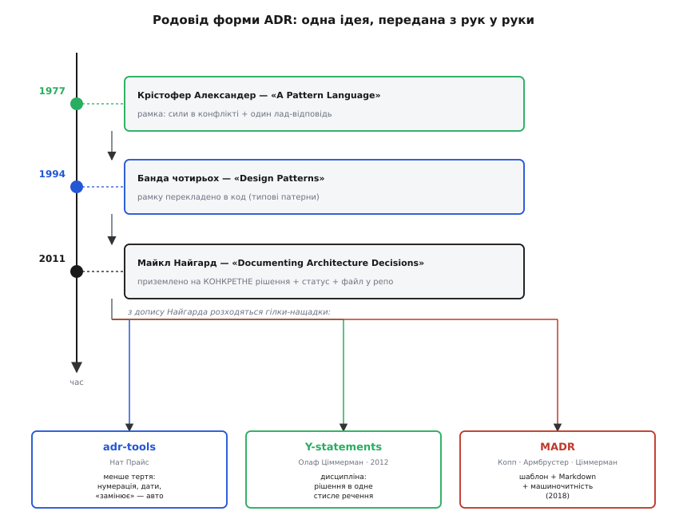
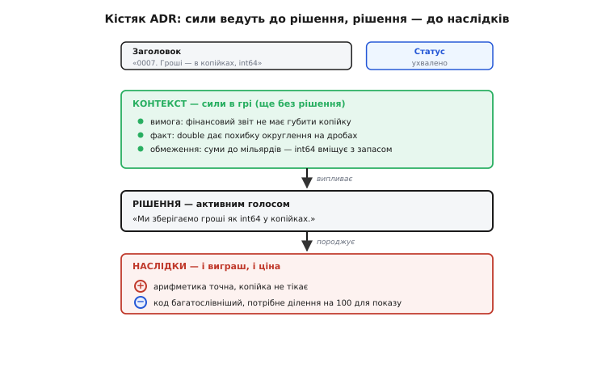
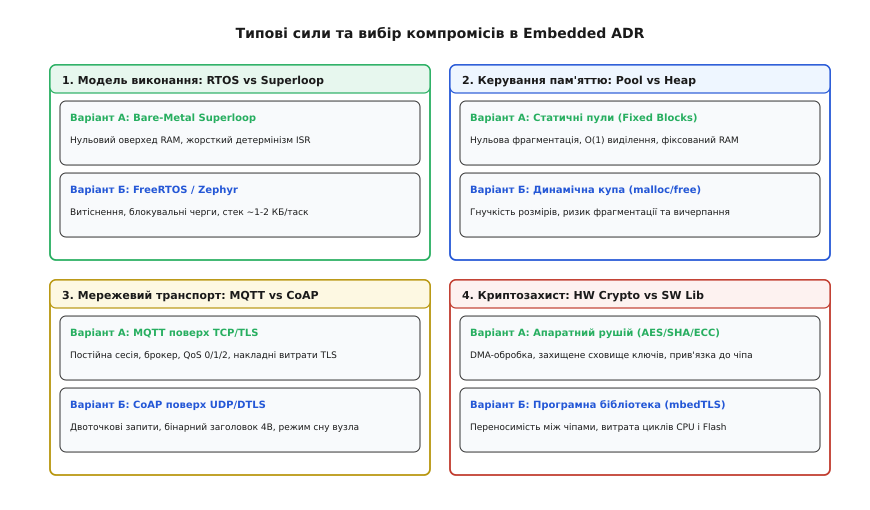
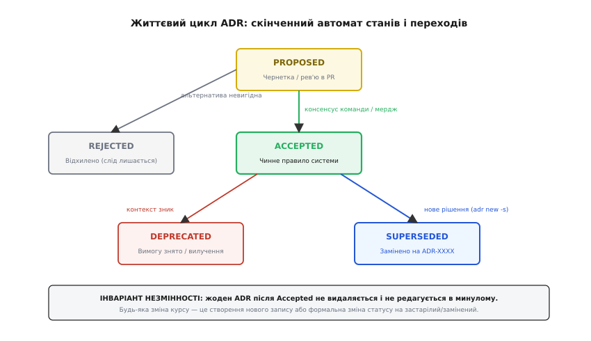
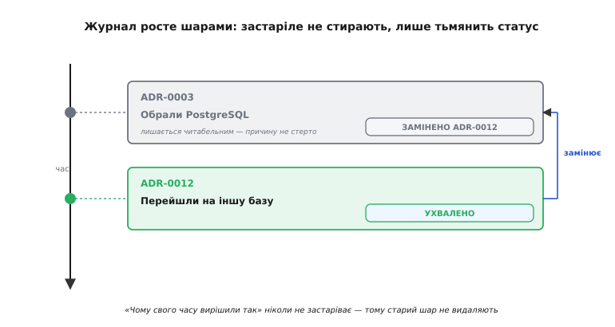
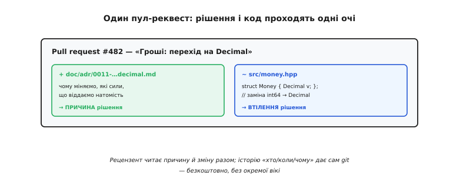

# Запис архітектурного рішення (ADR)

<preknowlist>
- [Зворотні й незворотні рішення](root:sf-apps/reversible-irreversible-decisions) — рішення класифікують за вартістю відкату; саме незворотні найважливіше записувати з причинами.
- [Trade-off-аналіз](root:sf-apps/tradeoff-analysis) — кожне рішення щось віддає за щось; ADR фіксує саме цей обмін і його ціну.
- [Архітектурні драйвери](root:sf-apps/architectural-drivers) — вимоги, обмеження й ризики, що формують систему; вони і є силами в контексті рішення.
- [Еволюційна архітектура](root:sf-apps/evolutionary-architecture) — керована зміна структури в часі; журнал рішень фіксує її траєкторію.
- [Фітнес-функції](root:sf-apps/fitness-functions) — автоматизовані перевірки архітектурних інваріантів, що випливають із ухвалених ADR.
</preknowlist>

Новий інженер відкриває репозиторій прошивки промислового контролера й натрапляє на незвичну ділянку: динамічне виділення пам'яті через стандартний розподілювач `malloc` скрізь суворо заборонене, натомість для передавання пакетів мережевої телеметрії вручну розгорнуто статичний масив фіксованих блоків із бітовою маскою зайнятості. Перша думка розробника — замінити цю громіздку низькорівневу конструкцію на стандартний динамічний буфер або чергу з купою. Якщо автор початкового коду давно залишив компанію, а в репозиторії немає жодного супровідного пояснення, інженер реалізує заміну, успішно проходить короткі функціональні тести на столі й відправляє оновлення на польові випробування. Через сорок діб безперервної роботи сотні пристроїв одночасно зависають на об'єктах: купа фрагментувалася під навантаженням мерехтливого мережевого трафіку, черговий виклик розподілювача пам'яті повернув нульовий вказівник, і система впала в нескінченний цикл аварійного перезапуску.

Сирцевий код бездоганно фіксує, **що саме** реалізовано в системі на рівні інструкцій процесора, але цілковито мовчить про те, **чому** обрано саме таку структуру і **які альтернативи були відкинуті** під час проєктування. Знання про сили, що тиснули на команду, про виснажливі розрахунки детермінізму та про ціну відкинутих рішень випаровуються з колективної пам'яті за лічені місяці. Цей феномен — випаровування архітектурного знання (англ. *architectural knowledge vaporization*) — перетворює зрілу кодову базу на небезпечне мінне поле. За відсутності зафіксованих причин будь-яка спроба модернізації системи наосліп руйнує невидимі, але життєво необхідні інженерні інваріанти.

Запис архітектурного рішення (англ. *architecture decision record*, ADR; лат. *architectura* від грец. *architektonike* — головне будівництво; *decisio* — відсікання, вибір) — це стандартизований, лаконічний документ, що фіксує конкретний вибір разом із контекстом сил, зваженими альтернативами та наслідками. Журнал таких записів ведеться безпосередньо в репозиторії поруч із кодом, накопичуючись як незмінна хроніка інженерної еволюції системи.

## Що робить рішення архітектурно значущим

Спроба задокументувати кожен крок розробника — від найменування локальної змінної до вибору допоміжного макросу чи структури внутрішнього циклу — неминуче знищує ініціативу й топить команду в бюрократичному шумі. Щоб журнал ADR лишався дієвим інструментом, фіксувати належить лише **архітектурно значущі рішення** (англ. *architecturally significant decisions*, ASD).

Рішення вважається архітектурно значущим, якщо воно задовольняє щонайменше один із чотирьох критеріїв:

1. **Висока вартість відкату.** Рішення належить до класу [незворотних дверей](root:sf-apps/reversible-irreversible-decisions). Скасувати його через пів року коштуватиме переписування значної частки кодової бази, заміни апаратних компонентів або перепідписання контрактів зовнішніх протоколів.
2. **Вплив на нефункціональні якісні атрибути (NFR).** Вибір безпосередньо змінює детермінізм реального часу, споживання енергії від акумулятора, захищеність від атак, надійність доставки повідомлень або пропускну здатність системної шини.
3. **Формування структурних обмежень.** Рішення встановлює правила, яких зобов'язані дотримуватися всі підсистеми: заборона блокувального вводу-виводу в обробниках переривань, використання єдиного протоколу серіалізації, розподіл пам'яті виключно на етапі стартової ініціалізації.
4. **Неочевидний компроміс між силами.** Обраний варіант зовні виглядає менш зручним або примітивнішим за загальноприйнятий, проте є єдино життєздатним за специфічних обмежень проєкту.

> 🔧 **Навіщо це.** Якщо вибір можна змінити за пів години роботи без наслідків для сусідніх модулів і зовнішніх інтерфейсів — це технічна деталь, а не архітектура. Якщо ж зміна вибору вимагає координації кількох команд, перерозподілу бюджету Flash/RAM мікроконтролера або модифікації мережевого протоколу — це прямий кандидат на оформлення в ADR.

## Розмежування ролей: RFC, ADR та коментарі в коді

Щоб технічна документація не перетворювалася на хаос, у зрілих інженерних командах діє чіткий розподіл обов'язків між трьома основними формами фіксації знань:

* **RFC (Request for Comments — Запит на коментарі).** Це розгорнутий документ-пропозиція, що ініціює відкриту дискусію довкола великої підсистеми чи системної зміни. RFC може налічувати десятки сторінок, містити попередні результати бенчмарків, графіки навантаження та детальний опис трьох-чотирьох можливих стратегій реалізації. Він існує тимчасово — як робоче поле для дебатів під час проєктування.
* **ADR (Architecture Decision Record — Запис рішення).** Коли обговорення в RFC завершено й консенсус досягнуто, результати кристалізуються в короткий (на 1–2 сторінки) підсумковий документ — ADR. У ньому викидаються всі проміжні чернетки й фіксується фінальний вибір, його сили та ціна. На відміну від RFC, ADR живе в репозиторії вічно як незмінний інженерний контракт.
* **Коментар у коді (In-Code Pointer).** Безпосередньо біля реалізації залишається лише короткий покажчик із одним-двома реченнями суті та обов'язковим посиланням на номер ADR. Коментар відповідає на питання «куди дивитися, щоб дізнатися причину», позбавляючи розробника потреби читати сотні рядків пояснень у сирцевому файлі.

## Анатомія та еволюція форматів: від Найгарда до MADR

Ідея фіксації архітектурних рішень виросла з теорії шаблонів проєктування архітектора Крістофера Александера (Christopher Alexander), який визначив патерн як гармонійне примирення конфліктуючих сил. У програмній інженерії ця лінія пройшла шлях від класичної книги «Банди чотирьох» (GoF) до блог-допису Майкла Найгарда (Michael Nygard, 2011), який запропонував перетворити патерн на датований Markdown-файл у Git-репозиторії. [Як народилася форма ADR](root:sf-apps/architecture-decision-records/hist-adr-origin.md) розкрито в окремому нарисі; тут розберемо інженерну структуру документів.


*Форма ADR виникла як еволюція концепції сил у конфлікті: від архітектури будівель до версіонованих файлів у репозиторії.*

### Класичний кістяк Найгарда

Формат Найгарда навмисно мінімалістичний і містить п'ять обов'язкових елементів: заголовок, статус, контекст, рішення та наслідки.

```markdown
# 0005. Використання статичних пулів пам'яті для кадрів CAN

Date: 2026-03-12

## Status
Accepted

## Context
Контролер збирає телеметрію з 16 давачів по шині CAN 2.0B на швидкості 1 Мбіт/с.
Пікове навантаження сягає 1200 кадрів/с. Обсяг доступної оперативної пам'яті SRAM
становить 64 КБ. Використання стандартного розподілювача malloc() призводить до
непередбачуваного часу виконання (від 2 мкс до 450 мкс під час пошуку вільного
блоку) та ризику фрагментації пам'яті під час тривалої роботи.

## Decision
Ми забороняємо використання динамічної купи для обробки мережевих пакетів.
Усі кадри CAN виділяються з попередньо алокованого статичного пулу на 64 дескриптори
з фіксованим часом взяття O(1) за допомогою бітової карти вільних блоків.

## Consequences
Позитивні:
- Час виділення та звільнення пам'яті суворо детермінований і не перевищує 12 тактів CPU.
- Фрагментація пам'яті неможлива фізично; пристрій витримує необмежений час роботи.

Негативні:
- Якщо черга переповнюється (понад 64 кадри), нові пакети скидаються з інкрементом лічильника втрат.
- 4 КБ SRAM постійно зарезервовано, навіть коли шина CAN неактивна.
```


*Кожен розділ виконує строго одну функцію: контекст описує конфлікт сил без наперед заданої відповіді, рішення фіксує вибір, наслідки розкривають здобутки й ціну.*

Головне правило розділу **Context** — у ньому не повинно бути самого рішення. Контекст описує виключно сили, факти, фізичні обмеження мікроконтролера, вимоги замовника та ризики. Якщо контекст сформульовано правильно, інженер, який його читає, природно доходить того самого висновку, що й автор документа.

Розділ **Consequences** захищає команду від самообману. Будь-яке інженерне рішення є компромісом (англ. *trade-off*): виграючи в швидкодії, ми платимо пам'яттю; спрощуючи архітектуру, втрачаємо гнучкість. ADR без списку негативних наслідків — це не технічний документ, а рекламна заява.

### MADR: розширений аналіз альтернатив

Для систем середньої та високої складності мінімального формату Найгарда часто недостатньо: необхідно детально зафіксувати, які саме альтернативи розглядалися та за якими критеріями вони програли. Для цього використовують **MADR** (англ. *Markdown Architectural Decision Records*), створений Олівером Коппом та Олафом Ціммерманом:

```markdown
# ADR-0012: Вибір криптографічного примітиву для автентифікації прошивки OTA

* Status: accepted
* Deciders: Архітектор безпеки, Lead Embedded Engineer
* Date: 2026-04-15

## Context and Problem Statement
Пристрій отримує бінарні оновлення по радіоканалу BLE/Wi-Fi. Необхідно валідувати
автентичність та цілісність образу прошивки перед записом у Flash. Обчислювальне
ядро — Cortex-M4 (80 МГц) без апаратного модуля асиметричної криптографії.
Ліміт часу на верифікацію пакета розміром 512 КБ становить 1.5 секунди.

## Decision Drivers
* Стійкість до криптоаналізу (мінімум 128 біт еквівалентної безпеки)
* Час перевірки цифрового підпису на частоті 80 МГц
* Розмір коду криптографічної бібліотеки у Flash
* Довжина відкритого ключа та підпису в заголовку прошивки

## Considered Options
* Варіант 1: RSA-2048 з гешуванням SHA-256
* Варіант 2: ECDSA на кривій secp256r1 (NIST P-256)
* Варіант 3: Ed25519 (EdDSA на кривій Curve25519)

## Decision Outcome
Обрано: **Варіант 3 (Ed25519)**, оскільки він забезпечує найвищу швидкодію верифікації
при мінімальному розмірі коду без ризику витоку через часові атаки.

### Positive Consequences
* Час верифікації підпису на Cortex-M4 складає 42 мс (проти 380 мс у ECDSA P-256).
* Реалізація алгоритму (бібліотека `monocypher` або `tweetnacl`) займає менше 6 КБ Flash.
* Підпис (64 байти) та відкритий ключ (32 байти) мають фіксований компактний розмір.
* Алгоритм природно стійкий до атак за часом виконання без складних апаратних захистів.

### Negative Consequences
* Алгоритм Ed25519 не має сертифікації FIPS 140-2 (якщо в майбутньому виникне вимога
  сертифікації для державних замовників, доведеться мігрувати на NIST P-256).

## Pros and Cons of the Options

### RSA-2048
* Добре: Стандарт де-факто, підтримується всіма апаратними HSM.
* Погано: Розмір відкритого ключа та підпису (256 байтів) збільшує заголовок.
* Погано: Високе споживання оперативної пам'яті під час обчислення великих чисел (>3 КБ RAM).

### ECDSA secp256r1
* Добре: Стандарт NIST, легка сертифікація.
* Погано: Реалізація точкового множення на кривій вимагає значного обсягу коду Flash (14-22 КБ).
* Погано: Висока чутливість до атак по сторонніх каналах без спеціальної оптимізації.

### Ed25519
* Добре: Найкраща продуктивність верифікації серед усіх 128-бітних схем на Cortex-M.
* Добре: Детермінований підпис (не вимагає якісного генератора випадкових чисел TRNG під час перевірки).
* Погано: Відсутність у застарілих бібліотеках інфраструктури PKI деяких хмарних платформ.
```

### Формулювання в одне речення (Y-Statements)

Коли повний MADR є надлишковим для невеликих рішень, архітектори послуговуються структурою **Y-statement** (від англ. *Why* — чому), яку розробив Олаф Ціммерман:

```
У контексті  [прийому пакетів телеметрії з давачів],
зважаючи на  [жорсткі обмеження енергоспоживання вузла в режимі сну],
ми обрали    [протокол CoAP поверх UDP з бінарним форматом CBOR]
й відкинули  [MQTT поверх TCP/TLS та HTTP REST],
щоб досягти  [зниження розміру заголовка до 4 байтів та скорочення сесії до 12 мс],
приймаючи те [що доставка пакетів не гарантується брокером і потребує підтверджень на рівні програми].
```

Така конструкція примусово усуває «воду», зв'язуючи вибір із драйверами та платою за компроміс у єдину логічну фразу.

## Застосування ADR у вбудованих та системних розробках

Вбудовані системи (англ. *embedded systems*) накладають на архітектора обмеження, нетипові для класичного бекенду чи вебзастосунків: дефіцит енергії від батареї, пам'ять, що вимірюється кілобайтами, жорсткий детермінізм реального часу та неможливість миттєвого перезапуску після аварії.


*Чотири класичні дилеми вбудованої архітектури: кожна гілка вимагає зважування протилежних сил і фіксації в ADR.*

Розглянемо чотири фундаментальні класи архітектурних рішень у прошивках і сили, що ними керують.

### 1. Модель виконання: RTOS проти Bare-Metal Superloop

У розробці систем реального часу вибір між архітектурою без операційної системи (англ. *bare-metal superloop*) та операційною системою реального часу (RTOS, наприклад FreeRTOS чи Zephyr) є базовим тектонічним вибором.

В архітектурі Superloop головний цикл послідовно опитує прапорці подій, які виставляються в обробниках переривань (ISR). Це забезпечує мінімальний розмір двійкового коду та нульові накладні витрати на диспетчеризацію. Проте, щойно в системі з'являються операції з тривалим часом очікування (запис блоку у Flash-пам'ять, очікування відповіді від модема або складне обчислення цифрового фільтра), Superloop блокує виконання всіх інших задач. У спробі обійти це розробники розбивають задачі на громіздкі скінченні автомати, що швидко стають непідтримуваними.

Використання RTOS розв'язує проблему шляхом витісняльної багатозадачності (англ. *preemptive multitasking*): планувальник перемикає контекст за сигналом системного таймера SysTick або системного виклику PendSV. Кожна задача отримує власний ізольований стек і пріоритет. Проте за це доводиться платити виділенням оперативної пам'яті під Task Control Block (TCB) і стек кожної задачі (зазвичай 1–4 КБ на потік), а також затримками на перемикання регістрів ядра CPU.

Фіксація цього вибору в ADR рятує проєкт від катастрофи: спроба натягнути Superloop на систему з чотирма мережевими інтерфейсами перетворює код на заплутане місиво автоматів, а необґрунтоване тягнення FreeRTOS на мікроконтролер із 8 КБ RAM з'їдає 70% пам'яті лише на системні стеки.

### 2. Керування пам'яттю: Статичні пули проти динамічної купи

Динамічна купа (англ. *heap*) у вбудованому середовищі — постійне джерело прихованих відмов. Стандарти безпеки (MISRA C/C++, IEC 61508, ISO 26262) суворо регламентують або взагалі забороняють виклики `malloc()`/`free()` після завершення етапу ініціалізації пристрою.

Причина заборони полягає у зовнішній фрагментації: коли пам'ять виділяється та звільняється блоками різного розміру, вільний простір розбивається на дрібні ізольовані острівці. У певний момент черговий виклик `malloc(256)` зазнає краху, хоча сумарний обсяг вільної пам'яті в купі може становити кілька кілобайтів. Крім того, час пошуку вільного блоку в алгоритмах First-Fit є недетермінованим і може коливатися від кількох мікросекунд до мілісекунд, що неприпустимо для систем жорсткого реального часу.

Статичні пули фіксованих блоків пам'яті (англ. *fixed-size block allocators*) гарантують час виділення та звільнення `O(1)` за допомогою апаратних інструкцій підрахунку бітів (`__builtin_ctz` або `CLZ`). Усі буфери виділяються у секції BSS на етапі лінкування бінарного образу, унеможливлюючи вичерпання пам'яті під час польової експлуатації.

Ось як виглядає практичне втілення рішення про статичні пули в коді з посиланням на відповідний ADR:

:::tabs
:::code architecture-decision-records-d/c/main.c
:::code architecture-decision-records-d/cpp/main.cpp
:::

### 3. Мережевий транспорт IoT: MQTT проти CoAP

При проєктуванні підключеного польового вузла вибір прикладного протоколу визначає життєвий цикл акумулятора та структуру хмарного бекенду.

Протокол MQTT базується на надійному транспорті TCP з обов'язковим тристороннім рукостисканням (3-way handshake) та сесією шифрування TLS. Підтримання з'єднання вимагає періодичного надсилання пакетів PINGREQ/PINGRESP (Keep-Alive), що не дозволяє мікроконтролеру перейти в режим глибокого сну (Deep Sleep). Кожне відновлення сесії після обриву мережі споживає значний обсяг трафіку на повторні сертифікатні обміни TLS, розряджаючи батарею за лічені місяці.

На противагу цьому, протокол CoAP (Constrained Application Protocol) працює поверх ненадійного транспорту UDP з опційним шифруванням DTLS. Заголовок CoAP займає лише 4 байти. Пристрій може прокинутися за сигналом таймера, передати компактне повідомлення у бінарному форматі CBOR, отримати квитанцію підтвердження (ACK) за 40 мілісекунд і негайно знову заснути з мікроамперним струмом споживання.

ADR фіксує компроміс: якщо пристрій живиться від мережі 220 В і вимагає миттєвого двостороннього керування через стандартний хмарний брокер, обирається MQTT; якщо вузол живиться від літієвої батарейки й повинен автономно працювати десять років, обирається CoAP з передачею даних короткими сесіями.

### 4. Криптозахист: Апаратний прискорювач проти програмної бібліотеки

Безпечне зберігання ключів та підпис повідомлень стикаються з вибором між апаратною інтеграцією (Secure Element, TPM, CryptoCell) та чисто програмною криптографією (mbedTLS, wolfSSL, Monocypher).

Апаратний захищений елемент (наприклад, чіп ATECC608A, підключений по шині I2C) містить апаратне сховище ключів у захищеній пам'яті EEPROM із фізичним захистом від зондування та зняття шарів кремнію. Обчислення еліптичної криптографії та генерація випадкових чисел виконуються всередині чіпа, і приватний ключ ніколи не потрапляє в оперативну пам'ять мікроконтролера. Проте це рішення збільшує вартість компонентів пристрою (BOM) на 0.5–1.5 долара та створює залежність від ланцюжка постачання конкретного виробника.

Програмна реалізація алгоритмів шифрування не вимагає додаткових апаратних мікросхем і працює на будь-якому ядрі ARM Cortex-M. Проте виконання криптографічних операцій навантажує процесор, а приватні ключі, збережені у внутрішній Flash-пам'яті мікроконтролера, можуть бути зчитані зловмисником у разі виявлення вразливостей захисту зчитування (RDP / JTAG unlock).

## Життєвий цикл ADR та керування станами

Журнал ADR — це динамічний скінченний автомат (лат. *status* — стан), що відображає актуальний стан архітектурного консенсусу команди в будь-який момент часу.


*Скінченний автомат переходів статусу ADR: жоден прийнятий документ не редагується retroactively, будь-яка зміна фіксується новим записом.*

Кожен запис перебуває в одному з п'яти канонічних станів:

1. **`Proposed` (Запропоновано).** Рішення оформлено у вигляді чернетки й винесено на обговорення команди. Зазвичай існує у формі активного Pull Request у Git-репозиторії.
2. **`Accepted` (Ухвалено).** Рішення пройшло всебічне рецензування, консенсус досягнуто, Pull Request злито в головну гілку. Від цієї миті положення ADR є **обов'язковим інваріантом** для розробників та рецензентів коду.
3. **`Rejected` (Відхилено).** Пропозиція розглянута, але відкинута через надмірну ціну, технічні ризики або зміну вимог. **Важливо:** файл відхиленого ADR у жодному разі не видаляється з репозиторію. Він лишається в статусі `Rejected` з детальним описом причин відхилення, щоб через пів року команда не витрачала час на повторне обговорення тієї самої ідеї.
4. **`Deprecated` (Застаріло).** Вимоги, що породили рішення, зникли, або підсистему було повністю вилучено з продукту без прямої заміни (наприклад, відмова від підтримки застарілого інтерфейсу RS-232).
5. **`Superseded` (Замінено).** Нові обставини вимагають зміни курсу. Старе рішення скасовується, але його файл лишається незмінним: йому лише виставляється статус `Superseded by ADR-XXXX`, а новий ADR отримує позначку `Supersedes ADR-YYYY`.

### Інваріант незмінності (Immutability)

Головний принцип ведення журналу архітектурних рішень: **ухвалений ADR ніколи не переписується retroactively**.

Якщо два роки тому команда ухвалила зберігати налаштування пристрою у сирій Flash-пам'яті (ADR-0004), а сьогодні мігрує на захищену транзакційну файлову систему LittleFS (ADR-0019), заборонено відкривати ADR-0004 і виправляти його текст. ADR-0004 був абсолютно вірним і раціональним у тодішньому контексті (Flash 128 КБ, відсутність динамічних журналів). Заміна фіксується новим ADR-0019, який містить посилання на попередника.


*Принцип геологічних шарів: історія рішень накопичується послідовно, дозволяючи відновити хід інженерної думки на будь-якому етапі життя системи.*

## Культура ухвалення рішень: Advice Process та консенсус

Найбільший організаційний ризик у веденні ADR — перетворення процесу на диктатуру провідного архітектора або, навпаки, на нескінченний параліч аналізу, коли команда місяцями сперечається в коментарях. Для здорового функціонування журналу застосовують **архітектурний процес поради** (англ. *architecture advice process*).

Суть принципу полягає в тому, що будь-який інженер у команді має право ініціювати ADR. Проте автор зобов'язаний виконати дві непорушні умови перед тим, як перевести документ у статус `Accepted`:

1. **Запитати поради в тих, кого це рішення безпосередньо зачепить.** Якщо розробник вбудованої системи пропонує змінити формат бінарного кадру телеметрії, він зобов'язаний залучити інженерів хмарного бекенду та команду розробки мобільних додатків, чиї парсери зламаються в разі зміни схеми.
2. **Запитати поради в експертів із глибоким фахом у цій царині.** Якщо рішення стосується криптографічного примітиву або схеми автентифікації OTA, консультація з інженером безпеки є обов'язковою, навіть якщо він не пише код для цього конкретного мікроконтролера.

Автор ADR не зобов'язаний беззастережно погоджуватися з кожною отриманою порадою, але зобов'язаний вислухати всі застереження та чесно зафіксувати їх у розділі `Considered Options` або `Negative Consequences`. Якщо після фахового обговорення виявляється критичний блокувальний ризик, рішення або доопрацьовується, або переводиться у статус `Rejected`. Голосування більшістю голосів тут суворо протипоказане: демократичне голосування в інженерії веде до ухвалення «середніх», звичних, але технічно неоптимальних рішень замість точного зважування об'єктивних фізичних сил.

## Практичний комплект ADR реальної вбудованої платформи

Щоб простежити взаємодію документів у реальному житті, розглянемо комплект із трьох пов'язаних ADR для автономного шлюзу телеметрії промислових об'єктів.

### Приклад 1: Вибір RTOS для багатопротокольного шлюзу

```markdown
# ADR-0001: Вибір моделі виконання (FreeRTOS) для телеметричного шлюзу

Date: 2026-01-20
Status: Accepted

## Context
Шлюз виконує одночасне опитування 4 інтерфейсів RS-485 (Modbus RTU), підтримку
стеку Ethernet (LwIP / TLS 1.3), періодичний запис аварійних дампів на SD-карту
та обслуговування локального вебсервера конфігурації. Обчислювальний вузол —
Cortex-M7 (480 МГц) з 1 МБ внутрішньої RAM.
Реалізація архітектури Superloop призводить до блокування мережевих відповідей
під час запису великих секторів на Flash/SD (затримки блокування до 120 мс).

## Decision
Ми обираємо операційну систему FreeRTOS як базову модель виконання.
Задачі розбиваються на 4 пріоритетні потоки з фіксованим виділенням стеків
(`xTaskCreateStatic`):
1. `Task_FieldBus` (Пріоритет: Високий, Стек: 2 КБ) — опитування Modbus.
2. `Task_Network` (Пріоритет: Високий, Стек: 8 КБ) — стек LwIP та сокети TLS.
3. `Task_Storage` (Пріоритет: Середній, Стек: 4 КБ) — черга запису на SD.
4. `Task_WebServer` (Пріоритет: Низький, Стек: 4 КБ) — HTTP-сервер.

## Consequences
Позитивні:
- Мережеві запити обробляються з гарантованою затримкою < 5 мс завдяки витісненню фонових задач.
- Логіка кожного протоколу ізольована у власному потоці з синхронізацією через блокувальні черги (`xQueueHandle`).

Негативні:
- На стеки та TCB задач виділено 18 КБ RAM на етапі компіляції.
- Необхідність суворого аудиту критичних секцій та м'ютексів для уникнення взаємних блокувань.
```

### Приклад 2: Заборона динамічної купи та регламент пам'яті

```markdown
# ADR-0002: Повна відмова від динамічного розподілу пам'яті (malloc/free)

Date: 2026-01-25
Status: Accepted

## Context
Пристрій розрахований на 10 років безперервної автономної роботи без перезапусків.
Стандарт MISRA C:2012 (Директива 4.12) вимагає відмови від динамічної купи.
Попередній прототип на FreeRTOS використовував `pvPortMalloc()` для JSON-пакетів,
що призводило до аварії через фрагментацію пам'яті після 3 тижнів стрес-тестів.

## Decision
Ми повністю забороняємо виклики `malloc`, `free`, `pvPortMalloc` та динамічні
конструкції C++ (`new`, `std::vector`, `std::string`) після виклику `main()`.
Усі буфери, структури потоків, черги FreeRTOS та мережеві пакети виділяються
виключно статично або з фіксованих пулів пам'яті на етапі ініціалізації.
Вводиться перевірка лінкера (фітнес-функція), що блокує збірку при наявності символу `malloc`.

## Consequences
Позитивні:
- Повна ліквідація ризику фрагментації пам'яті та витоків.
- Точний розрахунок використання пам'яті під час лінкування бінарного файлу.

Негативні:
- Максимальні розміри повідомлень обмежені фіксованим лімітом 1024 байти.
- Збільшення споживання статичної пам'яті BSS на 48 КБ.
```

### Приклад 3: Перехід з MQTT на CoAP для батарейного модуля

```markdown
# ADR-0008: Заміна протоколу MQTT на CoAP/CBOR для батарейних радіомодулів

Date: 2026-06-10
Status: Accepted
Supersedes: ADR-0003 (Використання MQTT для бездротових вузлів)

## Context
Бездротові вузли розширення переведено на живлення від неперезаряджуваних батарей LiSOCL2 (2400 мА·год).
Використання протоколу MQTT поверх TCP/TLS (ADR-0003) вимагає тривалого часу перебування
радіомодема увімкненим (TCP handshake + TLS session setup займає 1.8 с, струм 65 мА),
що скорочує час життя батареї до 8 місяців замість планових 5 років.

## Decision
Ми скасовуємо дію ADR-0003 для бездротових батарейних вузлів і переходимо на
протокол CoAP поверх UDP з шифруванням DTLS (Session Resumption) та серіалізацією CBOR.

## Consequences
Позитивні:
- Час активності модема скоротився з 1800 мс до 45 мс на одну транзакцію телеметрії.
- Розрахунковий час автономної роботи батареї зріс до 6.2 року.

Негативні:
- Необхідність розгортання шлюзу-транслятора CoAP-to-MQTT на центральному сервері.
- Пакетні втрати в ефірі тепер потребують обробки на рівні ретраїв CoAP (Confirmable messages).
```

## ADR у повсякденній інженерній практиці

Найкращий спосіб звести користь ADR нанівець — винести їх в окрему зовнішню базу знань (Confluence, Notion чи корпоративну вікі), куди розробники заходять лише під час щорічного аудиту. ADR працює лише тоді, коли він інтегрований у щоденний цикл розробки та Git-робочий процес.


*Архітектурне рішення проходить те саме сито код-рев'ю, що й реалізація. Будь-який розробник може оскаржити припущення в коментарях до PR.*

### Спільний життєвий цикл з кодом

Коли інженер додає нову підсистему або змінює критичний механізм, він створює робочу гілку, де водночас:
1. Додає новий файл `doc/adr/NNNN-slug.md` зі статусом `Proposed`.
2. Реалізує сам сирцевий код і модульні тести.
3. Додає коментарі-посилання на створений ADR біля ключових структур даних та констант.
4. Відкриває Pull Request.

Під час рев'ю команда оцінює не лише синтаксис та стиль коду, а й обґрунтованість рішення в ADR. Якщо виявляється неврахований ризик, оновлюється розділ `Context` або `Considered Options`. Після схвалення обидва файли потрапляють у гілку `main` одночасно в єдиному неподільному коміті.

Для автоматизації створення та зшивання файлів під час заміщення існує утиліта [`adr-tools`](root:sf-apps/architecture-decision-records/proj-adr-tooling.md), що виконує перелінковку статусів через консольну команду `adr new -s <id>`.

Коли в проєкт приходить новий розробник, знайомство з архітектурою починається не з читання застарілих діаграм, а з послідовного читання каталогу `doc/adr/`. Прочитавши тридцять коротких файлів, людина отримує повну ментальну карту системи: вона знає не лише поточний стан модулів, але й усі глухі кути, відкинуті бібліотеки та фізичні обмеження заліза.

## Автоматизація та генерація індексу на Python

Коли в проєкті накопичуються десятки й сотні ADR, орієнтуватися в каталозі безпосередньо стає важко. Рішення полягає у створенні автоматичного генератора покажчика (індексу) та графа залежностей, що запускається у CI/CD-пайплайні при кожному коміті.

Нижче наведено повноцінний інструмент на Python, який сканує теку `doc/adr/`, парсить метадані рішень, генерує зведений Markdown-індекс та формує діаграму Mermaid для візуалізації ланцюжків заміщень:

:::code architecture-decision-records-d/py/main.py

Такий генератор виконує три задачі:
1. Будує прозорий граф еволюції архітектури безпосередньо у вебінтерфейсі GitHub/GitLab завдяки рендерингу Mermaid.
2. Гарантує, що таблиця рішень у `README.md` завжди актуальна й не містить битих посилань.
3. Слугує лінтером цілісності: якщо ADR позначено як `Superseded by 0015`, але файл `0015` не існує, скрипт виявляє розрив ланцюга ще на етапі CI.

## Антипатерни та типові помилки ведення ADR

Практика ADR проста за формою, проте регулярні помилки команд здатні перетворити корисний журнал на мертвий вантаж.

1. **Антипатерн «Рішення заднім числом» (Post-Factum Rationalization).**
   ADR пишуть не перед ухваленням вибору під час архітектурного обговорення, а через три місяці після релізу під тиском зовнішнього аудиту. Як наслідок, з контексту зникають реальні сумніви, відкинуті варіанти та оцінка ризиків; запис перетворюється на штучне виправдання вже написаного коду.
2. **Антипатерн «Вікі-кладовище» (Out-of-Repo Wiki).**
   Збереження ADR у Confluence або Notion окремо від кодової бази. Документи миттєво втрачають актуальність, не проходять код-рев'ю в PR і стають невидимими для інженера, який клонує репозиторій локально на комп'ютер.
3. **Антипатерн «Архітектурний мікроменеджмент».**
   Оформлення ADR на дрібні косметичні зміни (вибір імені каталогу, рефакторинг одного приватного методу). Велика кількість шуму демотивує команду відкривати журнал.
4. **Антипатерн «Рекламний буклет» (No-Consequences ADR).**
   Розділ наслідків містить виключно похвалу обраному варіанту («система працює швидше, код став чистішим»). Відсутність аналізу негативних наслідків призводить до того, що під час першої кризи команда виявляється цілковито не готовою до системних компромісів.

## Зв'язок із фітнес-функціями та перевірками

Архітектурний запис стає по-справжньому дієвим, коли його рішення спирається на автоматизований контроль — [архітектурні фітнес-функції](root:sf-apps/fitness-functions).

Якщо в ADR-0002 ухвалено: *«Заборонити динамічне виділення пам'яті (malloc/free) у модулях обробки CAN»*, цей інваріант не повинен триматися виключно на уважності рецензентів. У пайплайн збірки вбудовується статичний аналізатор або лінтер символів (наприклад, перевірка лінкером `nm` чи `objdump` відсутності символу `malloc` у секціях коду телеметрії), який у разі порушення правила ламає збірку бінарника з інформативним повідомленням:

```
[FATAL] Виявлено заборонений виклик malloc() у модулі src/can_driver.c!
Порушення інваріанту ADR-0002 (doc/adr/0002-no-dynamic-memory.md).
Використовуйте статичний пул дескрипторів pool_acquire().
```

Такий симбіоз перетворює письмовий запис із пасивного історичного артефакту на активного цілодобового вартового архітектурних меж системи.
