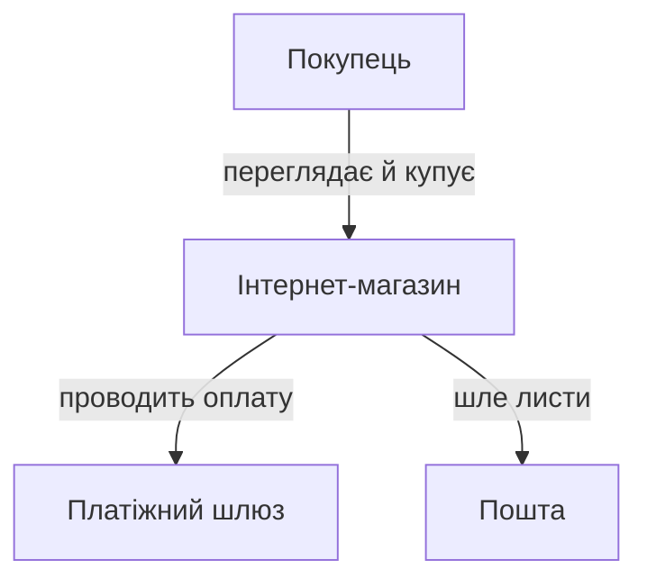
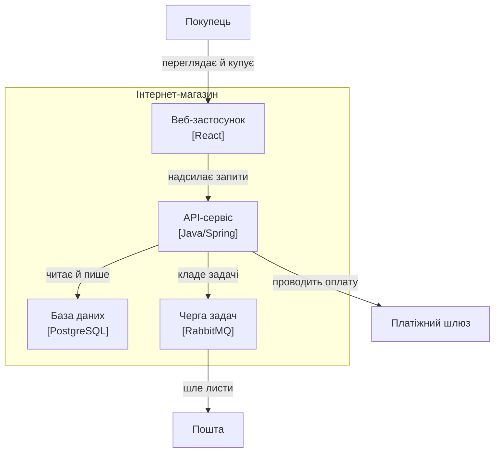

# ⚙️ C4 як код: модель — це дані, діаграма — це запит

Дві діаграми — контекст і контейнер — показують ту саму систему з різної висоти. Намальовані окремо, двома картинками у двох файлах, вони починають брехати одна одній тієї ж миті, коли хтось додав контейнер на одну й забув на іншу. А ще обидві тихо розходяться з кодом: на картинці стрілки одні, в `import`-ах — інші. Полагодимо це в корені — не дисципліною автора, а **побудовою**: зробимо модель єдиним джерелом, а діаграми й перевірку коду виведемо з неї автоматично.

## Задача

Хочемо три речі з одного джерела:

```
1. одна модель системи, описана як типізовані дані в коді;
2. функція-проекція, що з неї друкує ДВІ узгоджені діаграми —
   контекст і контейнер — у текстовому форматі (Mermaid/PlantUML);
3. фітнес-перевірка, що сканує фактичні залежності коду
   й завалює складання, якщо код провів стрілку, якої в моделі нема.
```

Систему беремо ту саму, що на діаграмах цієї теми: інтернет-магазин — веб-застосунок, API-сервіс, база, черга, плюс покупець і два зовнішні сусіди.

## Ідея: модель — граф, діаграма — його запит

Модель C4 — це маленький **позначений орграф**. Вузли — люди, системи, контейнери, компоненти, кожен зі стабільним ID; ребра — зв'язки з підписом. Уся глибина «рівнів» — не в окремих малюнках, а у **вкладенні**: контейнер знає свою систему, компонент — свій контейнер. Це дерево власності поверх графа зв'язків.

Тоді діаграма будь-якого рівня — це **запит до графа**: «дай scope (що в центрі уваги) і рівень (наскільки глибоко зазирати), сховай зайве, намалюй решту». Контекст і контейнер не можуть суперечити одне одному з тієї ж причини, з якої два `SELECT` до однієї таблиці не брешуть: джерело одне, змінюються лише фільтр і масштаб. А якщо той самий граф ще й описує **дозволені залежності**, то з нього виходить не лише картинка, а й правило, яке можна перевірити машиною.

![Схема потоку: ліворуч одна коробка «МОДЕЛЬ як дані (елементи + ID, оголошені зв'язки, єдине джерело правди)»; від неї вгору стрілка у «project(scope, рівень)» і далі в картку «Дві узгоджені діаграми: контекст + контейнер (Mermaid/PlantUML)»; від тієї ж моделі вниз стрілка «оголошені зв'язки» у «checkFitness(модель, код)», куди знизу входить друга стрілка «скан коду» від коробки «КОД: import-и»; праворуч від fitness два виходи — зелений «PASS — код = моделі» і червоний «FAIL: web → db, такої стрілки нема»](img/pipeline.svg)

*Модель — єдиний вхід. Верхня доріжка виводить із неї діаграми, нижня — перевіряє нею код. Обидва споживачі читають той самий граф, тож картинка й код не можуть розійтися: розходитися нема з чим.*

Далі — три кроки рівно за цією схемою.

## Крок 1. Модель як типізовані дані

Спершу — словник понять у типах, і **жодних діаграм тут нема**: сама модель нічого не малює, вона лише описує вузли й ребра. Найважливіше рішення — розділити **`id`** (стабільний ключ, на який посилається все інше) і **`name`** (показове ім'я, яке вільно міняється). Плутати їх — найдорожча помилка, до якої ми ще повернемось.

:::tabs
:::code proj-model-as-code/ts/c4.ts
:::code proj-model-as-code/py/c4.py
:::

Зверни увагу на форму зв'язків: `customer → web`, `web → api`, `api → db`… — це рівні **контейнерів**. Ми ніде не написали окремо «контекстні» зв'язки. І не треба: контекстні виведуться з цих самих ребер автоматично. Це і є робота наступного кроку.

## Крок 2. Проекція — одна функція, дві діаграми

Тепер — серце всього. Функція `project` бере модель, scope і рівень і повертає **текст діаграми**. Уся хитрість — в одній думці, яку легко проґавити: **на вищому рівні коробки нижчого рівня зникають, злипаючись у свого власника**. На контейнерній діаграмі є окремі `web`, `api`, `db`. На контекстній їх нема — там уся система це одна коробка `shop`. Тож ребро `customer → web` на контексті мусить перетворитися на `customer → shop`, а `api → payments` — на `shop → payments`.

Отже, проекція робить дві речі. Спершу для кожного вузла знаходить його **представника** на цьому рівні — найгрубшу видиму коробку, у якій він сидить. Потім переписує кожне ребро на представників його кінців і **викидає ті, що злиплися в петлю** (обидва кінці — той самий `shop`): така залежність лишилася *всередині* коробки, на цьому масштабі її не видно.

:::tabs
:::code proj-model-as-code/ts/krok-2-proektsiia-odna.ts
:::code proj-model-as-code/py/krok-2-proektsiia-odna.py
:::

Обидві реалізації друкують **однаковий текст**. Ось контекст — уся система одна коробка, а три різні контейнерні ребра (`customer→web`, `api→payments`, `queue→email`) піднялися до неї й стали трьома ребрами системи:



А ось контейнер — та сама коробка `shop` розкрилася в межу-`subgraph`, а всередині — окремі контейнери з технологіями:



Придивись до `payments`. Угорі — `shop → payments`, унизу — `api → payments`. Це **не два різні факти**, які треба тримати синхронними; це одне-єдине ребро моделі `api → payments`, показане з двох висот. Тому діаграми фізично не можуть розійтися: додай контейнер — він з'явиться на контейнерній і не з'явиться на контекстній, і жодного ручного узгодження. Рендер у текст — це вже територія прийому [«діаграми як код»](root:sf-apps/diagrams-as-code): та сама модель однаково лягла б у PlantUML чи інший текстовий формат, бо ми відділили *що показати* від *як намалювати*. Промислова, доросла версія рівно цього прийому — [Structurizr](root:sf-apps/diagrams-as-code/comp-structurizr-c4.md), інструмент самого автора C4, де модель описують кодом, а кожна діаграма — її іменований запит; наш `project` — його навчальна мініатюра.

## Крок 3. Фітнес — код не сміє провести стрілку, якої нема

Модель поки що описова: гарний граф, з якого виходять картинки. Але той самий граф несе **правило**. На контейнерній діаграмі є стрілка `web → api` й нема стрілки `web → db`. Отже, у коді модуль веб-застосунку має право імпортувати API-шар і **не має права** лізти прямо в базу в обхід API. Це вже не малюнок — це перевіряне твердження. Виконуваний тест, що стереже архітектурне правило й червоніє, щойно його порушено, називають [фітнес-функцією](root:sf-apps/fitness-functions): він проходить рівно доти, доки код відповідає наміру.

Домовимось, що код кожного контейнера живе у своїй теці верхнього рівня — `web/`, `api/`, `db/`, `queue/`. Тоді перевірка проста: пройди файли, витягни `import`-и, зістав кожен із текою-контейнером, збери **фактичні** ребра «хто кого імпортує» — і порівняй із **дозволеними**, які беруться **прямо з моделі**, не переписані руками.

:::tabs
:::code proj-model-as-code/ts/krok-3-fitnes-kod-ne-smiie.ts
:::code proj-model-as-code/py/krok-3-fitnes-kod-ne-smiie.py
:::

Дозволені ребра тут — `web→api`, `api→db`, `api→queue`: рівно ті стрілки контейнерної діаграми, обидва кінці яких — наш код. Тепер хай хтось у поспіху зробить у веб-застосунку прямий похід у базу:

:::tabs
```typescript
// web/checkout.ts — порушник
import { pool } from "../db/pool";   // ← веб тягнеться ПРЯМО в базу, повз API
```
```python
# web/checkout.py — порушник
from db.pool import pool             # ← веб тягнеться ПРЯМО в базу, повз API
```
:::

Скан знаходить фактичне ребро `web → db`. У дозволених його нема — і `checkFitness` валить складання:

```
C4-фітнес провалено:
  ✗ web → db: на діаграмі такої стрілки нема
```

Ось у чому вся сила. Раніше «веб не ходить у базу напряму» було усною домовленістю, яку новий інженер не знав, а старий забув. Тепер це — **рядок у моделі**, і будь-яке його порушення червоніє в CI ще до рев'ю. Діаграма перестала бути картинкою й стала виконуваним контрактом: намалювати стрілку й провести залежність — тепер одна дія, а не дві, що розповзаються.

## Складність і пастки

**Дрейф моделі проти коду — і напрям, який фітнес не ловить.** Проекція тримає дві *діаграми* узгодженими між собою задарма. Але вона нічого не каже про те, чи *модель* збігається з *кодом* — це робота фітнес-функції, і робить вона лише половину. Наш `checkFitness` ловить **заборонене ребро, що з'явилося** в коді (`web → db`). Він не ловить протилежного — **оголошеного ребра, яке в коді зникло**: модель обіцяє `web → api`, а виклик давно видалили, і стрілка на діаграмі тепер бреше. Замикається діра дзеркальною перевіркою:

```python
unused = allowed_edges(model) - actual_edges(root)   # оголошено, але в коді не використано
for a, b in sorted(unused):
    print(f"  ⚠ {a} → {b}: зв'язок є в моделі, а в коді його вже нема")
```

Порожній `web/` без жодного `import` до `api` пройде основну перевірку (заборонене нічого не з'явилось), але спливе тут як мертвий зв'язок. Обидва боки — заборонене-присутнє й оголошене-відсутнє — місце фітнесу в CI: інакше дрейф накопичується мовчки, аж доки діаграма стане музейним експонатом.

**Надмірне моделювання.** Дивись, як легко в цій моделі додати вузол — один рядок у масиві. Це і є пастка. Спокуса завести компонент на кожен клас, ребро на кожен виклик — і модель перетворюється на **другу кодову базу**, яку теж треба супроводжувати, яка старіє найшвидше й помирає перша. Тримай межу свідомо: вузол виправданий, лише якщо він **з'являється на якійсь діаграмі або обмежує якусь залежність**. Не з'являється й не обмежує — це шум, який лише додає роботи з підтримки. Контейнерна зернистість корисна майже завжди; компоненти — тільки для контейнера, чиє нутро якійсь діаграмі справді треба пояснити. Типізована модель робить *додавання* вузла дешевим — саме тому дисципліну доводиться тримати самому, бо код не спинить.

**Стабільність ідентифікаторів.** `id` — це хребет усього. На нього посилаються ребра, на нього дивиться `SRC_ROOTS` фітнесу, на нього ляжуть майбутні прив'язки розгортання й історія git-дифів. Спокуса — виводити `id` із показового імені; тоді перейменування «API-сервіс» → «Бекенд» тихо переписує ключ і **осиротлює кожне ребро**, що на нього посилалося. Правило: `id` — непрозорий заморожений слаг, `name` — людський підпис, який хай міняється скільки завгодно. Ніколи не переливай звільнений `id` в інший елемент: історія дифів склеїть дві різні речі в одну. І найпідступніше саме в цьому коді: `id` тут ще й **збігається з назвою теки**. Перейменуй контейнер у моделі, не перейменувавши теку, — і `containerOf` почне повертати `undefined`, фактичних ребер не знайдеться зовсім, а фітнес **пройде порожнім**. Зелена перевірка, що не перевіряє нічого, гірша за червону: вона брехливо заспокоює. Тому `id` і структура коду мусять рухатися в одному кроці — або ключ лишається стабільним, або міняється скрізь одночасно.

І це — корінь усього прийому. Коли модель — це дані, діаграма стає запитом до них, перевірка коду — ще одним запитом, а всі троє читають один граф, розходитися просто нема чому. Не сила волі тримає картинку й код разом, а те, що вони виросли з одного джерела.
