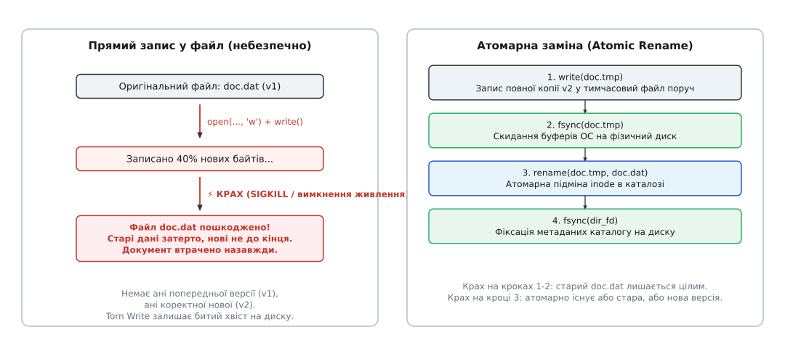

# 📋 Інтерфейси надійності сховищ: POSIX, Windows, Web OPFS та SQLite

Клієнтські застосунки функціонують у неоднорідних середовищах виконання — від нативних операційних систем (Linux, macOS, Windows) до пісочниць сучасних веббраузерів. Рівень гарантій збереження даних, поведінка системних буферів та атомарність операцій радикально відрізняються залежно від використовуваного інтерфейсу сховища.

Коли прикладний код записує байти на диск, він взаємодіє не з фізичним носієм, а з багаторівневою ієрархією кешів: буферами стандартної бібліотеки (`FILE*` у мові C або потоками `std::ofstream` у C++), сторінковим кешем ядра операційної системи (Page Cache), чергою команд контролера диска та внутрішньою енергозалежною пам'яттю DRAM самого накопичувача. Звичайний успішний виклик функції запису свідчить лише про те, що байти скопійовано в оперативну пам'ять ядра. Якщо живлення зникне за мить після цього, контролер накопичувача так і не отримає команди на запис у фізичні комірки, а файл на диску залишиться пустим або пошкодженим.

Нижче наведено структуровану специфікацію системних викликів, контрактів блокування, механізмів синхронізації та прагм надійності, що забезпечують захист від розірваних записів і гарантують повне відновлення після раптової зупинки процесу.

## 1. POSIX: Файлова система (Linux, macOS, BSD)

У стандарті POSIX атомарна заміна файлів і гарантований запис на фізичний носій спираються на комбінацію викликів `fsync`, `rename` та каталожних дескрипторів.


*Контракт заміни: створення тимчасового файлу, примусове скидання кешів через fsync, атомарний rename і фіксація метаданих каталогу.*

### Системні виклики та ідіоматичні обгортки

:::tabs
:::code api-storage-durability/c/systemni-vyklyky-ta.c
:::code api-storage-durability/cpp/systemni-vyklyky-ta.cpp
:::

### Особливості та підводні камені синхронізації в POSIX

1. **Пастка macOS `fsync` та команда `F_FULLFSYNC`:** В операційній системі macOS (ядро XNU/Darwin) стандартний виклик `fsync()` передає дані зі сторінкового кешу в контролер диска, але **не надсилає команду скидання апаратного кешу накопичувача** (ATA/NVMe Flush Command). Якщо живлення вимкнеться після успішного завершення `fsync()`, дані в кеші SSD все одно зникнуть. Для гарантованого запису в енергонезалежні комірки на Apple-платформах обов'язково викликають `fcntl(fd, F_FULLFSYNC)`.
2. **Різниця між `fsync` та `fdatasync`:** Системний виклик `fdatasync()` скидає лише блоки вмісту файлу та розмір, пропускаючи несуттєві метадані (час останнього доступу `atime` або зміни `mtime`). Це зменшує кількість звернень до журналу файлової системи (ext4 journal) і підвищує швидкість роботи без втрати надійності.
3. **Бар'єри файлової системи (Barrier I/O):** Сучасні журнальовані файлові системи (ext4, XFS, Btrfs) використовують бар'єри запису. Виклик `fsync` ініціює операцію `FLUSH / FUA` (Force Unit Access), що гарантує строгий порядок фіксації транзакцій у журналі файлової системи до того, як оновляться вказівники на блоки.

### Матриця гарантій та помилок POSIX

| Операція | Гарантія атомарності | Поведінка при збої живлення | Типові коди помилок |
| :--- | :--- | :--- | :--- |
| `write(fd, buf, len)` | **Ні** (посторінковий запис у кеш ядра) | Розірваний запис (частина нових, частина старих байтів) | `ENOSPC`, `EIO`, `EINTR` |
| `fsync(fd)` | Завершується лише після підтвердження контролером накопичувача | Дані залишаються в безпеці на енергонезалежному диску | `EIO`, `EROFS`, `EINVAL` |
| `rename(tmp, target)` | **Так** (на рівні однієї файлової системи) | На диску залишається або стара, або нова версія | `EXDEV` (різні точки монтування), `EBUSY` |
| `fsync(dir_fd)` | Фіксація запису в каталозі | Запобігає втраті посилання на новий inode після рестарту | `EIO`, `EBADF` |

Прапорець `O_EXCL` гарантує, що застосунок створює свіжий, раніше не існуючий тимчасовий файл. Якщо інший потік чи процес згенерував таке саме ім'я, системний виклик миттєво відхилить операцію з кодом помилки `EEXIST`, захищаючи паралельні дані від перетирання.

> ⚠️ **Пастка `EXDEV`:** Виклик `rename()` гарантує атомарність лише в межах **однієї файлової системи** (одного блокового пристрою). Якщо тимчасовий файл створити в системній теці `/tmp` (яка часто змонтована як `tmpfs` у пам'яті), `rename()` поверне помилку `EXDEV` (Invalid cross-device link). Спроба емулювати перейменування через копіювання знищує атомарність. Тимчасовий файл завжди слід створювати поруч із цільовим файлом.

---

## 2. Windows Win32 API

Операційна система Windows надає транзакційні виклики керування файлами через інтерфейс `Kernel32.dll`.

### Сигнатури та ідіоматичні обгортки Win32 API

:::tabs
:::code api-storage-durability/c/syhnatury-ta-idiomatychni.c
:::code api-storage-durability/cpp/syhnatury-ta-idiomatychni.cpp
:::

### Особливості семантики Windows

- `FILE_FLAG_WRITE_THROUGH`: Інструктує драйвер файлової системи записувати дані без проміжного кешування, безпосередньо відправляючи команди накопичувачу.
- `ReplaceFileW`: Забезпечує атомарне перенесення метаданих (зокрема потоків ACL і дескрипторів безпеки) зі старого файлу на новий. Якщо інший процес тримає файл відкритим без прапорця `FILE_SHARE_DELETE`, функція повертає помилку `ERROR_SHARING_VIOLATION` (`32`).
- `MoveFileExW` із прапорцем `MOVEFILE_REPLACE_EXISTING`: Використовується як резервний шлях, коли цільовий файл створюється вперше і `ReplaceFileW` повертає помилку відсутності файлу.

---

## 3. Web Platform: Origin Private File System (OPFS) та Web Locks

У сучасному вебсередовищі браузерні клієнти мають доступ до приватної високопродуктивної файлової системи (OPFS) всередині Dedicated Web Workers, а також до API координації вкладок.

### Інтерфейс `FileSystemSyncAccessHandle` (OPFS)

:::code api-storage-durability/ts/interfeis.ts

### Координація вкладок через Web Locks API

Для запобігання конфліктам кількох відкритих вкладок браузера над одним документом використовується `navigator.locks`:

:::code api-storage-durability/ts/koordynatsiia-vkladok.ts

### Рівні надійності IndexedDB (`durability`)

При роботі з транзакціями `IndexedDB` розробник явно вказує вимоги до довговічності:

```typescript
const tx = db.transaction(["mutations"], "readwrite", { durability: "strict" });
// "strict"  -> ОС гарантує скидання буферів на диск (fsync) до події oncomplete (безпечно, але повільніше)
// "relaxed" -> Дозволяє відкладене скидання (високий FPS, ризик втрати останніх операцій при краху ОС)
```

---

## 4. SQLite Client WAL: Прагми конфігурації

Коли як вбудоване клієнтське сховище використовується бібліотека SQLite, поведінка відновлення після збоїв налаштовується набором директив `PRAGMA`.

У класичному режимі відкатного журналу (`journal_mode = DELETE | TRUNCATE | PERSIST`) кожен запис вимагає подвійної синхронізації `fsync`: спочатку оригінальні сторінки копіюються в журнал відкату, а після фіксації сам журнал видаляється або обнуляється. Це блокує паралельних читачів на весь час запису.

Перехід на режим `journal_mode = WAL` змінює парадигму:
1. Записи транзакцій послідовно дописуються у файл `db-wal`.
2. Читачі використовують індекс спільної пам'яті `db-shm` (Shared Memory), читаючи свіжі версії сторінок із журналу або старі з основної бази.
3. Читання й запис більше ніколи не блокують одне одного.

:::code api-storage-durability/sql/main.sql

У режимі `journal_mode = WAL` директива `PRAGMA synchronous = NORMAL` забезпечує відмінний компроміс: навіть у разі падіння операційної системи сама база даних SQLite не може бути пошкоджена. Єдиний ризик — втрата останніх транзакцій, які ще не закріпилися контрольною точкою, тоді як у класичному режимі `NORMAL` загрожує повною руйнацією B-дерева.

### Зведена таблиця відповідності механізмів між платформами

| Концепція | POSIX | Windows Win32 | Web Platform | SQLite |
| :--- | :--- | :--- | :--- | :--- |
| **Ексклюзивний доступ** | `flock(fd, LOCK_EX)` | `LockFileEx` | `navigator.locks` | `locking_mode = EXCLUSIVE` |
| **Скидання буферів (Flush)**| `fsync(fd)` / `F_FULLFSYNC` | `FlushFileBuffers` | `accessHandle.flush()` | `PRAGMA synchronous = FULL` |
| **Атомарна заміна файлу** | `rename(tmp, target)` | `ReplaceFileW` | Перейменування в OPFS | Атомарний чекпойнт WAL |
| **Обрізання журналу** | `ftruncate(fd, 0)` | `SetEndOfFile` | `accessHandle.truncate(0)` | `PRAGMA wal_checkpoint(TRUNCATE)` |

Вибір конкретного інтерфейсу визначається цілями продуктивності: настільні застосунки з прямим доступом до файлової системи обирають двійковий WAL із системними викликами `open/fsync/rename`, тоді як складні клієнтські реляційні моделі виграють від готового рушія SQLite WAL. У вебсередовищі стандартним вибором стає поєднання OPFS `SyncAccessHandle` у фоновому воркері для швидких операцій та `IndexedDB` із суворою транзакційністю для збереження метаданих.
