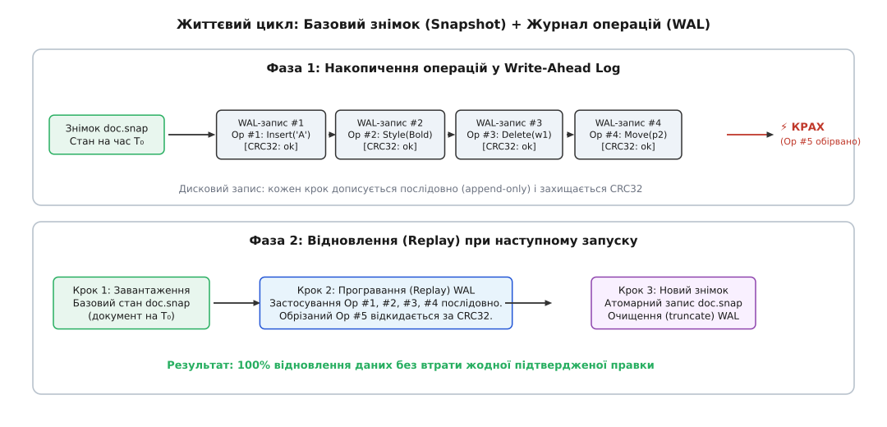

# ⚙️ Рушій журналу випереджувального запису (WAL) та відновлення стану

Надійний клієнтський документ мусить витримувати непередбачувані аварійні зупинки процесу без втрати незбережених змін та без ризику пошкодження дискових файлів. Повне перезаписування документа на кожну дію користувача виснажує накопичувач і блокує інтерфейс, тоді як відкладене автозбереження залишає велике вікно вразливості, у якому втрачаються останні хвилини роботи.

Нижче наведено робочу реалізацію рушія стійкості, що об'єднує двійковий журнал випереджувального запису (WAL) із перевіркою контрольних сум CRC32, атомарну фіксацію контрольних точок (Checkpointing) та автоматичне відновлення стану при холодному старті.

## Завдання та структура бінарного формату

Рушій керує трьома пов'язаними файлами в робочому каталозі документа:
1. `document.snap` — базовий стан документа (повний знімок на момент останньої контрольної точки);
2. `document.wal` — послідовний журнал операцій (дописується лише в кінець, append-only);
3. `document.lock` — файл координації ексклюзивного доступу (запобігає одночасному відкриттю кількома процесами).

Кожен окремий запис у файлі журналу `document.wal` має суворо фіксовану бінарну структуру (обрамлення запису):

```
+---------------+---------------+-------------------+-------------------+-------------------+---------------+
| Magic (4B)    | SeqNum (8B)   | Timestamp (8B)    | PayloadLen (4B)   | Payload (N bytes) | CRC32 (4B)    |
| 0x57414C31    | uint64_t      | int64_t (Unix ms) | uint32_t          | utf-8 / binary    | IEEE 802.3    |
+---------------+---------------+-------------------+-------------------+-------------------+---------------+
```

Заголовок має довжину 24 байти. Поле `Magic` містить сигнатуру `0x57414C31` (ASCII-рядок `WAL1`). Поле `SeqNum` забезпечує монотонну нумерацію операцій, що гарантує строгий порядок виконання під час повтору. Поле `PayloadLen` визначає кількість байтів у тілі мутації.

Контрольна сума CRC32 обчислюється від корисного навантаження (або всього запису) за поліномом IEEE 802.3 (`0xEDB88320`). Вибір некриптографічного алгоритму CRC32 замість важких SHA-256 чи MD5 зумовлений швидкістю: обчислення CRC32 на сучасних процесорах виконується зі швидкістю понад 3 ГБ/с на ядро (а з використанням інструкцій SSE4.2 / ARM CRC32 — до 15 ГБ/с), що повністю усуває затримки при швидкому введенні тексту.

Якщо процес завершився аварійно прямо під час запису операції (розірваний запис), алгоритм відновлення виявляє невідповідність CRC32 на хвості файлу, відкидає пошкоджений фрагмент і відновлює всі попередні коректні транзакції.


*При завантаженні застосунок спочатку читає базовий знімок, після чого послідовно застосовує всі валідні записи з журналу WAL.*

## Реалізація рушія

:::tabs
:::code proj-wal-recovery/cpp/main.cpp
:::code proj-wal-recovery/ts/index.ts
:::

## Покроковий розбір алгоритму та підводні камені

Коректна робота алгоритму стійкості до відмов спирається на суворе дотримання послідовності операцій та обробку граничних станів.

### 1. Сканування та відсікання пошкодженого хвоста (Torn Tail)

Під час аварійного вимкнення живлення остання операція може бути записана на диск лише частково. Якщо файл `document.wal` обірвався посеред заголовка або корисного навантаження, цикл відновлення виявляє одну з трьох типових ситуацій:
- Кількість залишкових байтів у буфері файлу менша за розмір мінімального заголовка (24 байти);
- Поле `Magic` містить нулі або некоректне значення замість сигнатури `0x57414C31`;
- Обчислена контрольна сума `Crc32::calculate(payload)` не збігається зі значенням `stored_crc` у кінці запису.

У кожному з цих випадків цикл парсингу негайно виконує команду `break`. Це принциповий момент: **помилка валідації на хвості журналу не є фатальною катастрофою**. Вона свідчить про те, що аварія перервала останню незавершену транзакцію вводу-виводу. Усі попередні операції, які успішно пройшли перевірку CRC32, гарантовано цілісні й послідовно застосовуються до моделі.

Проте якщо помилка CRC32 виявляється **посередині файлу**, а за нею йдуть інші валідні заголовки, це свідчить про фізичне спотворення накопичувача (Bit Flip або збій сектора). У такій ситуації рушій зобов'язаний зупинити відновлення та попередити користувача, оскільки застосування наступних правок на дефектному стані призведе до розбіжності моделі.

### 2. Атомарність знімка через створення файлу-двійника

Функція `checkpoint` ніколи не записує серіалізований стан безпосередньо у файл `document.snap`. Замість цього створюється тимчасовий файл `document.snap.tmp`. Лише після того, як буфери повністю записані на диск, викликається системна функція `rename` (у Node.js — `renameSync`).

Якщо живлення зникне під час виконання `checkpoint`:
- Базовий файл `document.snap` залишиться старим, але повністю валідним;
- Усі операції, які ще не закріпилися новим знімком, зберігаються у файлі `document.wal`;
- При наступному запуску застосунок коректно відтворить стан зі старого знімка та повного журналу.

### 3. Ексклюзивне блокування та запобігання гонитві процесів

Якщо користувач помилково відкриє той самий документ у двох вікнах програми одночасно, виникає ризик перехресного запису в один файл `document.wal`. Обидва процеси намагатимуться дописувати байти за різними зміщеннями, що призведе до незворотного спотворення бінарних рамок.

Метод `acquire_lock` використовує атомарне блокування на рівні ядра ОС:
- У POSIX-системах виклик `flock(lock_fd, LOCK_EX | LOCK_NB)` повертає помилку, якщо інший процес уже утримує дескриптор;
- У середовищі Windows виклик `CreateFileW` із нульовим прапорцем спільного доступу (`dwShareMode = 0`) забороняє паралельне відкриття файлу іншими процесами;
- У Node.js створення файлу з прапорцем `O_EXCL` гарантує атомарну перевірку створення.

Якщо блокування не вдалося захопити, застосунок повинен повідомити користувача про небезпеку та перейти в безпечний режим перегляду без права запису змін.

### 4. Робота з нульовими копіями пам'яті (Zero-Copy Spans)

У реалізації C++ для парсингу корисної інформації використовується тип `std::span<const uint8_t>`. Він дозволяє обчислювати CRC32 та декодувати текст без виділення додаткової пам'яті в купі (heap allocation) на кожен запис. Увесь файл `document.wal` зчитується в один неперервний вектор, після чого парсер переміщує ковзне вікно по байтах, що гарантує максимальну пропускну здатність під час холодного старту.
