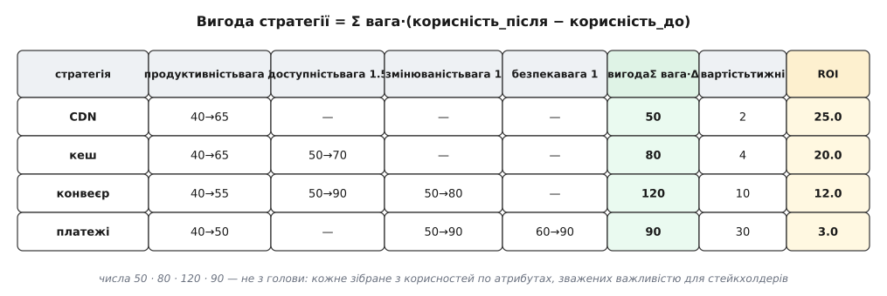
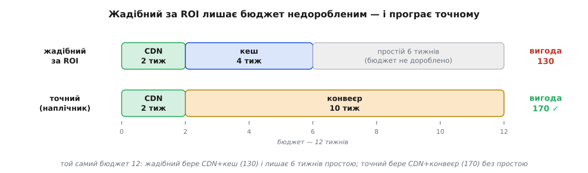

# ⚙️ CBAM-ранжувальник: коли жадібність за ROI обирає гірше

Уяви на столі мішок покращень і тонкий гаманець. Кеш читання, асинхронний конвеєр замовлень, CDN перед статикою, переписати платіжний модуль — усе корисне, кожне щось коштує й щось дає, а часу команди — на два-три пункти, не на всі. Питання, старе як інженерія: **що взяти, щоб за наявний бюджет купити найбільше користі?**

Перший інстинкт правильний: рахуй **віддачу** — скільки користі на одиницю витрати — і бери зверху вниз. Цей інстинкт і зашитий у методі, який ми тут запрограмуємо. Але ми не спинимось на ньому: побудуємо ранжувальник, проженемо його крізь чотири реальні стратегії — і на власні очі побачимо, як він упевнено обирає набір, **гірший** за той, який сам відкинув. А тоді полагодимо це точно, не здогадкою.

## Що це за метод і звідки він

Ідея «прив'яжи до кожного архітектурного рішення його вартість і його вигоду, а тоді ранжуй за віддачею» доведена до методу в Інституті програмної інженерії (SEI) при Університеті Карнегі — Меллона. Метод зветься **CBAM** (англ. *Cost-Benefit Analysis Method* — метод аналізу витрат і вигід); його виклали Джай Асунді, Рік Казман і Марк Кляйн у грудні 2001 року в технічному звіті CMU/SEI-2001-TR-035 «Using Economic Considerations to Choose Among Architecture Design Alternatives». *Статус: усталено* — метод задокументований SEI і відтоді стоїть у канонічному ряду архітектурних оцінювань.

CBAM народився як **економічне продовження** методу ATAM: той показує технічні компроміси й ризики, але мовчить про гроші, а CBAM додає бракуючий вимір — прикручує до кожної стратегії число вартості й число вигоди й питає, який **набір** купити за обмежений бюджет. Про сам клас таких оцінювань і про те, звідки в аналізі беруться компроміси й ризики, — [ATAM-лайт: полегшений аналіз компромісів](root:sf-apps/atam-lite), у якому CBAM продовжує технічну картину грошовою.

> 🔧 **Навіщо це.** Без числа віддачі вибір покращень зводиться до того, хто голосніше в кімнаті: продуктова команда тисне за фічі, безпека — за аудит, платформа — за міграцію, і виграє не найкорисніше, а найнаполегливіше. CBAM ставить на стіл одну спільну лінійку — користь за одиницю витрати — і суперечка з «чия черга» перетворюється на «покажи ROI». Це не робить рішення автоматичним, зате робить його **обговорюваним на цифрах**, а не на гучності.

## Звідки береться вигода

Найкрихкіше слово тут — «вигода». Якщо це смак («мені здається, кеш важливіший»), увесь ранжувальник — театр із цифрами. CBAM робить вигоду **зібраною величиною**, а не оцінкою навмання: кожна стратегія зсуває якісь [якісні атрибути](root:sf-apps/quality-attributes) — додає швидкодії, надійності, змінюваності; кожен атрибут має **вагу** (наскільки він важливий стейкхолдерам) і **корисність** (англ. *utility* — наскільки система добра за цим атрибутом, за шкалою 0–100). Вигода стратегії — сума по атрибутах того, наскільки вона підняла корисність, зважена важливістю:

```text
вигода = Σ  вага · (корисність_після − корисність_до)
        атрибути
```

Звідки беруться самі ваги й корисності — не з нашого пальця: їх дають стейкхолдери на сценаріях якості, розставляючи пріоритети й оцінюючи «наскільки краще стане». Це окреме ремесло — перетворювати розмиті побажання на числа корисності; тут ми беремо його результат готовим, а як він добувається, показує [сценарії атрибутів і дерево корисності](root:sf-apps/attribute-scenarios).

Розкладімо на конкретиці ті самі чотири стратегії. Ваги атрибутів (важливість для стейкхолдерів цього сервісу): продуктивність — 2, доступність — 1.5, змінюваність — 1, безпека — 1. Корисність кожного атрибута «до» — його теперішній стан; «після» — куди його підняла б стратегія:



*Кожне число вигоди зібране, а не вгадане: CDN піднімає лише продуктивність (2·(65−40) = 50); кеш — продуктивність і трохи доступність (50 + 1.5·20 = 80); конвеєр б'є одразу по трьох атрибутах (30 + 60 + 30 = 120); переписати платежі — переважно змінюваність і безпека (20 + 40 + 30 = 90). Зверни увагу: CDN і кеш обидва тягнуть продуктивність із 40 до 65 — це пастка, до якої ми повернемось.*

Ось модель у коді. Стратегія — це назва, вартість у тижнях і список внесків в атрибути; вигода й ROI рахуються з внесків, а не задаються рукою. Ядро задачі — класичні алгоритми (ранжування, наплічник), тому провідну мову беремо еталонну для них, C++, а поряд кладемо ті самі функції сценарними Python і TypeScript, якими справді збирають такий інструмент прийняття рішень:

:::tabs
:::code proj-cbam/cpp/zvidky-beretsia-vyhoda.hpp
:::code proj-cbam/py/zvidky-beretsia-vyhoda.py
:::code proj-cbam/ts/zvidky-beretsia-vyhoda.ts
:::

Проженемо чотири стратегії крізь `benefit()` — і числа з таблиці зійдуться самі:

```text
стратегія   вигода   вартість (тижні)   ROI = вигода/вартість
CDN            50            2                  25.0
кеш            80            4                  20.0
конвеєр       120           10                  12.0
платежі        90           30                   3.0
```

## Перший зріз: ранжування за ROI

Тепер найважливіший — і найдешевший — крок. Відсортуй стратегії за ROI спадно, і ти вже знаєш головне: що дає найбільше на тиждень, а що найменше. Це коштує один `sort`, тобто **O(n log n)**, і одразу вбиває дві поширені дурниці — «беремо найдешевше» (дешеве покращення може давати копійки) і «беремо найважливіше» (найцінніше може коштувати як усе решта разом). Ранг за ROI ставить CDN першим, а переписування платежів — останнім, і це чесно: платежі, хай які привабливі, віддають утричі менше на тиждень, ніж CDN.

Наївний вибір під бюджет напрошується сам: іди по ранжованому списку зверху й бери все, що ще влазить у гаманець. Це **жадібний** алгоритм (англ. *greedy* — бери найкраще локально, тут і зараз):

:::tabs
:::code proj-cbam/cpp/pershyi-zriz-ranzhuvannia.cpp
:::code proj-cbam/py/pershyi-zriz-ranzhuvannia.py
:::code proj-cbam/ts/pershyi-zriz-ranzhuvannia.ts
:::

Бюджет — 12 тижнів. Проженемо:

```text
ранг за ROI:   CDN(25) → кеш(20) → конвеєр(12) → платежі(3)

CDN     вартість 2   → беремо   (витрачено 2,  лишилось 10)
кеш     вартість 4   → беремо   (витрачено 6,  лишилось  6)
конвеєр вартість 10  → 6 + 10 = 16 > 12  → ПРОПУСКАЄМО
платежі вартість 30  → не влазить        → ПРОПУСКАЄМО

жадібний набір: { CDN, кеш },  вигода 130,  витрачено 6 із 12
```

Тут і криється зрада. Жадібний набір коштує **6 тижнів із 12** — половина бюджету лежить невитрачена, бо наступний за рангом конвеєр у ці 6, що лишились, уже не влазить. І з тими простоюючими шістьма тижнями набір набирає вигоду **130**. А тепер спитай інакше: що, якби взяти CDN і одразу конвеєр, пропустивши кеш?

## Пастка: ранг за щільністю — не те саме, що найкращий набір

```text
CDN + конвеєр:   вартість 2 + 10 = 12   (рівно бюджет, простою нема)
                 вигода   50 + 120 = 170
```

**170 проти 130.** Набір, який жадібність відкинула, бо конвеєр має нижчий ROI за кеш, дає на третину більше користі — і при цьому доробляє бюджет до кінця. Жадібність програла, і програла не через дрібну помилку в коді, а тому, що поставила **неправильне питання**.



*Той самий бюджет 12 тижнів, два набори. Жадібний за ROI хапає найщільніші CDN і кеш, упирається в конвеєр, що не влазить у залишок, — і лишає 6 тижнів простою при вигоді 130. Точний вибір міняє кеш на конвеєр: 12 тижнів під зав'язку й вигода 170. Найщільніше по ранку не завжди складається в найкращий кошик — бо предмети неподільні.*

Чому жадібність промахнулась? Бо покращення **неподільні**: не можна взяти пів-конвеєра за пів-ціни й пів-вигоди. Жадібний за щільністю алгоритм ідеальний, коли предмет можна різати (тоді бери найгустіший, поки є місце, — це доведено оптимально). Але наші стратегії — цілі: або весь конвеєр за 10 тижнів, або нічого. А вибір **неподільних** предметів під обмежену місткість — це класична **задача про наплічник** (англ. *0/1 knapsack problem* — «0 або 1»: кожен предмет або кладеш цілим, або ні), де жадібний ранг за щільністю дає **добрий, але не гарантовано найкращий** набір. Різниця між «добрий» і «найкращий» щойно коштувала нам 40 балів вигоди на порожньому місці.

## Точний вибір: наплічник через динамічне програмування

Точну відповідь дає **динамічне програмування** (англ. *dynamic programming* — будуй розв'язок задачі з розв'язків менших підзадач, запам'ятовуючи їх, щоб не рахувати двічі). Ключ — правильно назвати підзадачу. Нехай

```text
dp[i][b] = максимальна вигода, яку можна купити,
           маючи право взяти перші i стратегій і бюджет b
```

Тоді для кожної стратегії i рішення бінарне — брати чи ні, — і кожна гілка зводиться до вже порахованої меншої підзадачі:

```text
dp[i][b] = max(
    dp[i−1][b],                          // НЕ беремо i-ту: бюджет цілий, стратегій менше
    dp[i−1][b − cost[i]] + value[i]      // беремо i-ту (якщо cost[i] ≤ b): бюджет менший на її ціну
)
```

Заповнивши таблицю від меншого до більшого, у `dp[n][B]` знаходимо найкращу досяжну вигоду. Але нам мало числа — потрібен **сам набір**. Його відновлюємо, ідучи таблицею назад: якщо на кроці i найкраще значення взялося не з рядка «без i-ї» (`dp[i][b] ≠ dp[i−1][b]`), значить i-ту стратегію брали — записуємо її й зменшуємо бюджет на її ціну.

:::tabs
:::code proj-cbam/cpp/tochnyi-vybir-naplichnyk.cpp
:::code proj-cbam/py/tochnyi-vybir-naplichnyk.py
:::code proj-cbam/ts/tochnyi-vybir-naplichnyk.ts
:::

Проженемо ті самі чотири стратегії з бюджетом 12 — і подивимось не лише на відповідь, а й на те, як відновлення її **збирає**, крок за кроком назад по таблиці:

```text
dp[4][12] = 170,  dp[3][12] = 170   → однакові ⇒ «платежі» НЕ брали
dp[3][12] = 170,  dp[2][12] = 130   → різні    ⇒ «конвеєр» брали;  бюджет 12 − 10 = 2
dp[2][ 2] =  50,  dp[1][ 2] =  50   → однакові ⇒ «кеш» НЕ брали
dp[1][ 2] =  50,  dp[0][ 2] =   0   → різні    ⇒ «CDN» брали;      бюджет 2 − 2 = 0

точний набір: { CDN, конвеєр },  вигода 170,  витрачено 12 із 12
```

Наплічник знайшов те, що жадібність проґавила: пожертвувати щільнішим кешем заради конвеєра, який один доробляє бюджет до дна й приносить більше. Той самий вхід, той самий бюджет — на 40 балів вигоди більше, і різниця не коштувала нічого, крім правильно поставленого питання.

## Складність і пастки

**Ціна двох відповідей різна, і це навмисне.** Ранг за ROI — **O(n log n)**: миттєвий навіть на сотнях стратегій, і саме він дає найважливіший, найгрубіший зріз — хто взагалі вартий уваги. Точний наплічник — **O(n·B)** за часом і пам'яттю, де B — числове значення бюджету. Це так звана **псевдополіноміальна** складність: вона лінійна не від розміру входу, а від *величини* бюджету. Поки бюджет — 12 тижнів, таблиця 4×13 рахується за мить. Але захочеш точності до пів-дня — помнож усі вартості й бюджет на 10, і таблиця розбухне вдесятеро; візьми бюджет у тисячах людино-годин — і ДП стане непідйомним. Тоді або лишайся на близькому-до-оптимального жадібному ранзі, або бери гілки-й-межі (branch and bound). Практичний висновок тверезий: **ранжуй завжди, а точний наплічник діставай лише коли бюджет тісний і предметів небагато** — тобто рівно там, де жадібна похибка справді щось коштує.

Три пастки серйозніші за складність, бо вони підважують не швидкість, а **сенс** відповіді. Точний наплічник дає точний оптимум **брехливої моделі** — і це небезпечніше за чесне «приблизно».

**Вигоди не додаються, коли стратегії перекриваються.** Уся арифметика вище тихо припускає, що вигода набору — сума вигід його стратегій. Але поглянь на таблицю: CDN і кеш **обидва** тягнуть продуктивність із 40 до 65. Візьми обидва — і ти не отримаєш підйому продуктивності двічі: вони ріжуть частково **ту саму** затримку, для частково тих самих сторінок. Наївна сума 50 + 80 = 130 переоцінює реальність, бо продуктивнісну частину пораховано двічі. І жадібність, і наплічник успадковують цю ману — обидва максимізують суму, яка бреше на перекриттях. Лікування: складати взаємодійні стратегії в один неподільний «пакет» із чесно переоціненою спільною вигодою, або віднімати перекриття явним штрафом, або — найчесніше — переоцінювати корисність усього набору разом, а не сумувати поодинці. Що покращення одного атрибута коштує іншого й що безкоштовних комбінацій не буває — наскрізна тема [аналізу компромісів](root:sf-apps/tradeoff-analysis); тут вона вилазить як нелінійність вигоди.

**Числа корисності — оцінки людей, а не заміри приладу.** Ваги й корисності добуто зі стейкхолдерів; легко хибнути на ±20 %, а то й на знак. Якщо ROI двох стратегій різняться менше, ніж шум оцінок, то їхній взаємний ранг — підкидання монети, і третій знак після коми в ROI = 12.0 — самообман точності. Тому виводь із калькулятора не одну відповідь, а **її стійкість**: поштурхай ключові корисності в межах невпевненості й подивись, чи не розсипається обраний набір. Якщо він тримається — рішенню можна вірити; якщо стрибає від дрібного дотику — вся перевага ілюзорна, і чесніше сказати «в межах похибки ці варіанти рівні». Це той самий рефлекс, що й у [прикидці «на серветці»](root:sf-apps/back-of-envelope): не полірувати цифру, а знати, з якого боку порога вона лежить і наскільки твердо.

**Точковий оптимум — це найкращий вибір для майбутнього, якого не буде.** Кожне число — ставка на завтра: навантаження, ціни, темп росту. Наплічник видає ідеальний набір для **однієї** точки — тих значень, що ти вбив сьогодні, — а реальність прийде розподілом, не точкою. Показово, що справжній CBAM у формулюванні SEI не спиняється на точковому ранзі: він тягне в модель аналіз рішень і статистику саме щоб **охопити невизначеність** і обрати набір, який не розвалиться, коли припущення попливе. Точковий оптимум і стійкий вибір — різні набори, і плутати їх дорого. Як зважувати варіанти по діапазону сценаріїв, а не в одній точці, розкладає [рішення під невизначеністю](root:sf-apps/deciding-under-uncertainty).

Отже, інструмент дає дві відповіді, і обидві потрібні. Ранг за ROI — дешевий, миттєвий, **правильне перше сито**: він відсіює, що взагалі варте бюджету. Точний наплічник — коли гаманець тісний і предмети неподільні: він ловить ті випадки, де жадібність, набравши найщільніше, лишає бюджет недоробленим і програє. Але жоден із двох не чесніший за корисності, що в нього влиті: калькулятор оптимізує рівно ту вигоду, яку ти в нього вписав, — і його точність нічого не варта, якщо сама вигода зібрана недбало, перекриття не враховані, а невизначеність замовчана.
