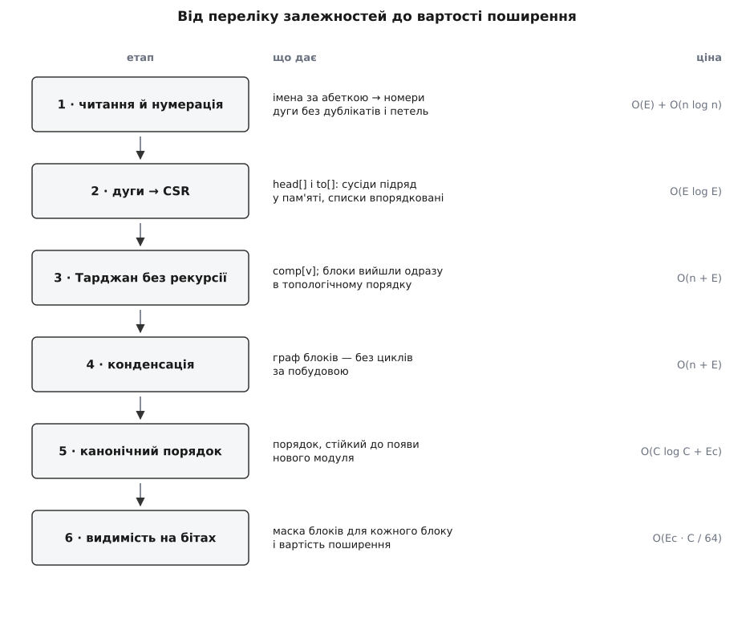
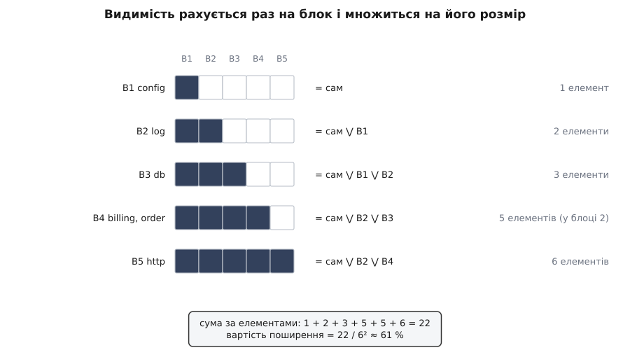

# ⚙️ Програма розбиття: від переліку залежностей до блоків і вартості поширення

<preknowlist>
- [Сильно зв'язні компоненти](root:sf-algorithms/strongly-connected-components) — множини вершин, кожні дві з яких досяжні одна з одної; саме вони стають квадратними блоками на діагоналі, і саме їх шукає алгоритм Тарджана.
- [Обхід у глибину](root:sf-algorithms/depth-first-search) — обхід графа, що йде вглиб, поки є куди, і повертається лише вичерпавши гілку; на його часах входу й виходу тримається весь пошук компонент.
- [Топологічне сортування](root:sf-algorithms/topological-sort) — упорядкування вершин ациклічного графа так, щоб кожна стояла після всіх, від кого залежить; тут воно дає порядок рядків матриці.
- [Транзитивне замикання](root:sf-algorithms/transitive-closure) — від «хто мій сусід» до «хто взагалі досяжний»; воно й перетворює матрицю прямих залежностей на матрицю видимості.
</preknowlist>

Тут уся програма цілком: на вхід — текстовий перелік рядків «модуль → модуль», на вихід — упорядкована матриця з позначеними блоками, поіменний список усіх циклів, вартість поширення і ненульовий код повернення, коли в системі з'явився новий цикл. Її ставлять у конвеєр складання й забувають — доки хтось не замкне залежність, і тоді збірка падає з точним іменем винуватця.

Задача суто системна: мільйон вузлів, обхід графа без рекурсії, бітові слова замість множин, стала пам'ять на кадр стека. C++ дає тут рівно те, що потрібно, — суміжність у суцільному масиві, `std::uint64_t` як маску на 64 елементи, `std::countr_zero`, що лягає в одну машинну інструкцію.

## Що на вході

Програма свідомо стоїть **після** видобувача. Побудова переліку залежностей і його розбиття — дві різні задачі: перша залежить від мови, збірника й угоди про те, що вважати залежністю, друга не залежить ні від чого. Розділивши їх текстовим файлом, ти дістаєш проміжний формат, який видно оком, який лягає в `git diff` і який однаково годиться для Java, Go, TypeScript і C++.

```
# deps.txt — «хто потребує» -> «кого потребує»
log     -> config
db      -> config
db      -> log
order   -> db
order   -> log
order   -> billing
billing -> db
billing -> order
http    -> order
http    -> billing
http    -> log
```

Звідки береться цей файл — окрема робота, і майже завжди її вже зроблено чужими руками: `jdeps` для Java, `go list -deps` для Go, `madge` для TypeScript, а для C++ достатньо файлів залежностей, які компілятор і так пише за ключем `-MMD`. Головне — щоб правило було одне на весь файл: не можна в одному прогоні змішувати імпорти пакетів з успадкуванням класів, бо порівнювати потім не буде чого з чим. Що саме видобувач здатен побачити, а що ні, вирішує [статичний аналіз](root:sf-release/static-analysis): імпорти й виклики він бачить, а залежності, схованої в рядку конфігу, за яким контейнер підставляє реалізацію, — уже ні.

Рядок без стрілки — це просто ім'я елемента, який ні від чого не залежить: так у матрицю потрапляють листки, до яких ніхто не веде дугу.

## Дві структури, а не одна

Перше рішення ухвалюється до першого рядка коду: **як тримати матрицю**.

Спокуса — тримати її щільно, бітами: рядок *i* це маска, біт *j* стоїть, якщо *i* потребує *j*. Виглядає точним відображенням предмета, але коштує *n*²/8 байтів: п'ять тисяч елементів — 3.1 МіБ, п'ятдесят тисяч — 312 МіБ, і будь-який прохід по такій матриці вже не менший за *n*²/64 слів. Тим часом реальні матриці залежностей **порожні**: у кодовій базі з п'яти тисяч файлів дуг зазвичай десятки тисяч, а не двадцять п'ять мільйонів.

Тому основне представлення тут — списки суміжності в суцільному масиві (CSR: один масив `to` з усіма сусідами підряд і масив `head` з межами). Пам'ять O(*n* + *E*), обхід усіх дуг рівно O(*E*), жодних порожніх клітинок.

Бітові слова з'являються там, де відповідь **справді щільна**, — у видимості. Транзитивне замикання може заповнити майже всю площину, і тоді маска на 64 елементи в одному слові перетворює об'єднання множин на один OR: за одну машинну дію робиться те, на що інакше пішло б 64 перевірки. Кожна структура стоїть там, де форма даних збігається з формою відповіді.

Друге рішення теж ухвалюється рано: **номери елементів роздаються за абеткою імен**, а не в порядку появи в файлі. Видобувач може обходити теки в довільному порядку, файлова система на різних машинах віддає їх по-різному — і якби номер залежав від порядку рядків, той самий репозиторій давав би різний вивід на різних машинах. Один `std::sort` по іменах — і вся подальша робота детермінована.



*Кожен етап віддає наступному одну структуру й ніколи не повертається назад. Дорогий тут лише останній: розбиття лінійне від розміру графа, а замикання неминуче квадратичне від кількості блоків — просто поділене на розрядність машинного слова.*

## Читання: імена стають номерами

Далі — сама програма, сім шматків підряд: у тому самому порядку вони складаються в один файл `dsm.cpp`.

:::code proj-dsm-partition/cpp/dsm.cpp

Сортування дуг тут робить одразу три роботи. Воно **прибирає дублікати**: чотириста імпортів того самого модуля перетворюються на одну дугу, інакше подальша лінійність від *E* була б лінійністю від кількості рядків у файлі. Воно **впорядковує списки суміжності** — сусіди кожного вузла виходять за зростанням номера, і на цьому тримається відтворюваність обходу. І воно **збирає петлі в одне місце**: діагональ матриці за угодою порожня, тож дуга «сам на себе» з матриці зникає, але не зникає з обліку.

## Дуги стають CSR

:::code proj-dsm-partition/cpp/duhy-staiut-csr.cpp

Два проходи й жодного окремого виділення пам'яті на вузол. Сусіди елемента *v* лежать у `to[head[v] .. head[v+1])` — суцільним шматком, який процесор читає лінійно й передбачувано. Порівняно з `vector<vector<int>>` це не косметика: там кожен вузол — окреме виділення й окремий промах кеша на кожному переході.

## Тарджан без рекурсії

Тепер головне. Компоненти шукає алгоритм Тарджана: один обхід у глибину, дві мітки на вершину — час входу `idx` і найменший час входу, досяжний із піддерева `low`, — і окремий стек кандидатів. Коли після повернення виявляється `low[v] == idx[v]`, вершина *v* — корінь компоненти, і все, що лежить над нею в стеку кандидатів, разом із нею й становить компоненту.

Класичний виклад пише його рекурсією, і на слайді це справді коротше. У програмі, яку запускають на живій кодовій базі, рекурсія — помилка. Глибина обходу дорівнює найдовшому ланцюжку залежностей, а ланцюжки в шаруватому коді бувають довгі: домен через сервіси через сховище через драйвери. Кадр рекурсивного Тарджана — це адреса повернення, збережені регістри й кілька локальних змінних, десь 48–80 байтів. Типовий стек головного потоку — 8 МіБ на Linux і 1 МіБ на Windows (обидва налаштовуються, але не тим, хто запускає твій бінарник у чужому конвеєрі). Тобто межа — приблизно сто тисяч вершин там і п'ятнадцять тисяч тут, а за нею не помилка з поясненням, а мовчазне падіння.

Явний стек кадрів знімає питання назавжди: кадр тут — два `int`, вісім байтів, і лежить він у купі, а не в стеку потоку. Мільйон вершин углиб — вісім мегабайтів `std::vector`, і жодної різниці між операційними системами.

:::code proj-dsm-partition/cpp/tardzhan-bez-rekursii.cpp

Один рядок тут вартий окремої уваги: `call.back().e = e + 1;` стоїть **до** `call.push_back(...)`, і не випадково. Природний варіант «взяти посилання на верхній кадр і працювати з ним» ламається мовчки: `push_back` може перевиділити масив, і посилання починає вказувати у звільнену пам'ять. Помилка не проявляється на маленьких входах, бо перевиділення трапляється рідко, — і чекає, поки граф підросте. Тому кадр тут читається значеннями, а зміна записується назад одразу.

Друга річ, яку варто взяти безкоштовно. Тарджан **виходить із компонент у зворотному топологічному порядку**: компонента закривається лише тоді, коли всі, до кого вона дотягується, уже закриті. У нашій угоді «рядок потребує стовпця» це означає, що компоненти нумеруються так, що кожна потребує лише менших номерів, — тобто топологічний порядок уже отриманий, і сортувати нема чого. Окремий прохід топологічного сортування далі все одно з'явиться, але не заради порядку — заради його **стійкості**.

## Конденсація і чому порядку замало

:::code proj-dsm-partition/cpp/kondensatsiia-i-chomu.cpp

Різниця між «детермінованим» і «стійким» виводом дорого коштує тим, хто її не помітив.

Порядок, який дає сам Тарджан, **детермінований**: на тих самих вхідних даних він той самий. Але він виходить із порядку обходу, а порядок обходу — з номерів вершин. Додай один новий модуль з іменем на літеру `a` — і всі номери зсунуться, корені обходу підуть іншими шляхами, а незалежні між собою блоки, які нічим не пов'язані з новачком, поміняються місцями. Матриця на екрані не змінилася по суті, зате `git diff` показує триста переставлених рядків, і ніхто вже не бачить у ньому єдиної справжньої зміни.

Сортування за Каном — брати той блок, у якого не лишилося незадоволених потреб, — із чергою з пріоритетом лікує саме це. Серед блоків, готових до виводу, щоразу вибирається один і той самий: той, чий перший за абеткою елемент стоїть раніше. Тепер порядок залежить лише від **самої структури залежностей і від імен**, а не від історії обходу: доки залежності між двома блоками не змінилися, їхнє взаємне положення не зміниться теж.

## Матриця на бітових словах

:::code proj-dsm-partition/cpp/matrytsia-na-bitovykh.cpp

Позначки тут навмисно ASCII, а не гарні `■` і `×`. Вивід програми живе в журналі складання, проходить крізь `grep`, лягає в `diff` і подекуди читається інструментом, що рахує байти замість символів. Кожен символ рамкової графіки в UTF-8 займає три байти, і `%-*s` вирівнює **байти**: одне неанглійське ім'я модуля — і таблиця поїхала. Одна ця обставина ламала більше звітів, ніж усі помилки в алгоритмах разом.

## Видимість і вартість поширення

Видимість рахується не по елементах, а по блоках. Усередині сильно зв'язної компоненти всі бачать те саме — інакше вони не були б однією компонентою, — тож рахувати кожному окремо означає повторити ту саму роботу стільки разів, скільки в блоці членів. Замість цього маска будується одна на блок і **над блоками**: біт *j* стоїть, якщо блок дотягується до блоку *j*. Ціна падає з *n*² до *C*² бітів, а на кодових базах із великими клубками різниця відчутна.

:::code proj-dsm-partition/cpp/vydymist-i-vartist.cpp



*Кожен рядок дістає свою маску одним OR-ом уже готових масок тих, кого він потребує, — жодних степенів матриці й жодних повторних обходів. Блок із двох елементів дає той самий рядок маски, але вносить у суму подвійну вагу: обидва його члени бачать однаково.*

Множення на розмір блоку тут не косметика, а суть: вартість поширення визначена **по елементах**, а не по блоках. Елемент, що втрапив у клубок із десяти модулів, бачить усе, що бачить клубок, — і кожен із десяти вносить у суму цю повну видимість. Саме тому один цикл підіймає число не на дещицю, а стрибком.

## Складання докупи

:::code proj-dsm-partition/cpp/skladannia-dokupy.cpp

**Прогін на файлі з початку.**

```
елементів: 6, дуг: 11, блоків: 5

                    123456
  1  config   B1    #.....
  2  log      B2    x#....
  3  db       B3    xx#...
  4  billing  B4*   ..x#x.
  5  order    B4*   .xxx#.
  6  http     B5    .x.xx#

циклів (блоків більш ніж з одного елемента): 1
  B4  billing,order
      billing -> order
      order -> billing

видимість (скільки елементів бачить кожен член блоку):
  B1   config                                   1
  B2   log                                      2
  B3   db                                       3
  B4   billing, order                           5
  B5   http                                     6

  сума за елементами: 22
  вартість поширення: 22 / 6² = 61.1 %
```

Одна-єдина позначка стоїть вище діагоналі — `billing → order` у клітинці (4, 5), — і вона всередині блоку `B4*`. Жоден інший порядок рядків її звідти не прибере, бо `order` теж потребує `billing`: обидві дуги виписані в переліку циклів під блоком.

## Скільки це коштує

```
читання й нумерація   O(E) хешування + O(n log n) сортування імен
дуги → CSR            O(E log E) сортування, далі O(n + E)
Тарджан               O(n + E), пам'ять 13 байтів на вершину + 8 на кадр
конденсація           O(n + E + Ec log Ec)
канонічний порядок    O(C log C + Ec)
видимість             O(Ec · C / 64) слів
друк матриці          O(n²) символів
```

Розбиття лінійне від розміру графа — і це не наближення, а точний факт: кожна дуга розглядається рівно один раз, кожна вершина кладеться в стек кандидатів рівно один раз. Єдине, що псує чисте O(*V* + *E*), — сортування дуг заради дедуплікації, і його ціна O(*E* log *E*) на живих даних губиться на тлі читання файла.

Дорога частина — замикання. Кожен блок збирає маску з масок усіх, кого потребує; це Σ deg(*b*) · ⌈*C*/64⌉ слів, тобто O(*Ec* · *C*/64), а в найгіршому разі, коли конденсація майже повна, O(*C*³/64). У термінах вихідного графа це та сама відома оцінка O(*V* · *E*/*w*), де *w* — розрядність слова. Ділення на 64 — не косметична поправка: воно перетворює хвилини на секунди, і саме заради нього тут бітові слова.

Пам'ять на кодовій базі з 5 000 файлів і 40 000 імпортів:

```
дуги (двічі, до й після дедуплікації)   40 000 · 8 · 2  ≈  640 КіБ
CSR (to + head)                         40 000 · 4 + 20 КіБ  ≈  180 КіБ
мітки Тарджана (idx, low, onstk)        5 000 · 9  ≈  45 КіБ
маски видимості, якщо C ≈ 5 000         5 000 · 5 000 / 8  ≈  3.1 МіБ
щільна DSM (лише коли друкуємо)         5 000 · 5 000 / 8  ≈  3.1 МіБ
```

Разом менш ніж вісім мегабайтів і частка секунди — тобто перевірку можна ставити не в нічну збірку, а в кожен запит на злиття.

## Пастки на живих кодових базах

**Петлі сам-на-себе.** Вони трапляються частіше, ніж здається, — але не тому, що файл імпортує себе. Вони народжуються при **укрупненні**: коли ти згортаєш матрицю файлів у матрицю пакетів, кожна дуга `a/x.go → a/y.go` стає дугою `a → a`. На рівні пакета це нормально й не значить нічого, на рівні файлів такого не буває взагалі. Тому програма петлю з матриці прибирає (діагональ зайнята) і показує символом `@`, але **не** оголошує циклом: рахувати її порушенням має сенс лише на тому рівні, де вона неможлива в принципі.

**Дублікати дуг.** Модуль, що імпортує сусіда в сорока файлах, дає сорок однакових рядків. Прибрати їх обов'язково, інакше «лінійно від *E*» стає лінійно від кількості згадок. Але перед тим, як прибрати, їх варто **порахувати**: кількість повторів — це вага дуги, і саме вона відрізняє технічну залежність в одному місці від глибокого переплетення, яке не розірвати за годину. Один рядок замість `std::unique` — прохід із підрахунком однакових пар — і з тієї самої структури виходить числова матриця.

**Кілька незв'язаних частин.** У будь-якому великому репозиторії є шматки, які взагалі нічим не пов'язані: інструменти складання, тести, окремий сервіс у тій самій теці. Тому зовнішній цикл обходу мусить пробувати **кожну** вершину як корінь, а не одну. І тому ж взаємний порядок незв'язаних частин лишається довільним — його доводиться закріплювати навмисно, інакше він поїде від найменшого дотику.

**Детермінований — це ще не стійкий.** Три місця в цій програмі можуть тихо давати «правильний, але щоразу інший» вивід: номери вершин (лікується сортуванням імен), порядок сусідів (лікується сортуванням дуг) і вибір серед готових блоків (лікується чергою з пріоритетом). Четверте — `std::partial_sort` у виводі найважчих блоків: він не стабільний, тож при рівних значеннях порядок був би «як вийде», і компаратор доводиться доповнювати порівнянням за іменем. Правило просте: **будь-яке місце, де програма щось вибирає з рівних, — джерело нестійкості**, доки ти не назвав правило вибору вголос.

**Код повернення й еталон.** Перевірка в [конвеєрі складання](root:sf-release/ci-cd) має падати не на будь-якому циклі, а лише на **новому**: у великій системі старі клубки вже є, і вимога вичистити їх усі перед першим запуском означає, що перевірку не ввімкнуть ніколи. Тому еталон — файл із підписами відомих блоків, а порівнюється саме множина підписів, а не їхня кількість: коли один цикл полагодили, а другий завели, число не змінилося, а система стала іншою. Еталону дозволено лише **коротшати**: рядок звідти видаляють, коли цикл розірвано, і не дописують ніколи без окремої розмови. Так із простого коду повернення виходить [фітнес-функція](root:sf-apps/fitness-functions) — виконуване правило, яке система або задовольняє, або ні.

**Реєстр літер і форма шляху.** `src/Foo.ts` і `src/foo.ts` на Windows — той самий файл, а в програмі — два різні елементи, і кожен зі своїм рядком у матриці. Те саме роблять `./src/a` і `src/a`, прямі й зворотні скісні риски, шляхи від кореня репозиторію й від теки збірки. Нормалізувати треба у видобувачі, один раз, і краще звести все до нижнього реєстру й прямих скісних, ніж потім розгадувати, чому блок складається з двох імен, що відрізняються однією великою літерою.

**Матриця, яку ніхто не подивиться.** Триста елементів — це 90 000 символів виводу: надрукувати не проблема, прочитати неможливо. Тому в програмі є `--limit`, а на великих системах працює не картинка, а три числа: кількість блоків, розмір найбільшого й вартість поширення. Картинку тоді малюють окремо, у SVG, і дивляться на візерунок — але це вже інша програма, і живиться вона тими самими `L.row` та бітовими рядками, що вже пораховані тут.

**Порівнюваність чисел.** Вартість поширення від двох різних видобувачів або з двох різних рівнів укрупнення — це два різні числа про різні речі. Порівнювати їх між собою не можна взагалі; порівнювати можна лише одну систему з собою вчорашньою, за незмінного правила видобування. Тому файл `deps.txt` варто зберігати поруч зі звітом: коли через півроку число підстрибне вдвічі, першим питанням буде не «що сталося з кодом», а «чи не змінився видобувач».
