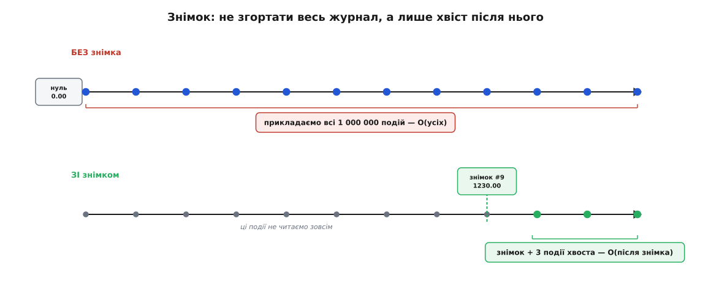
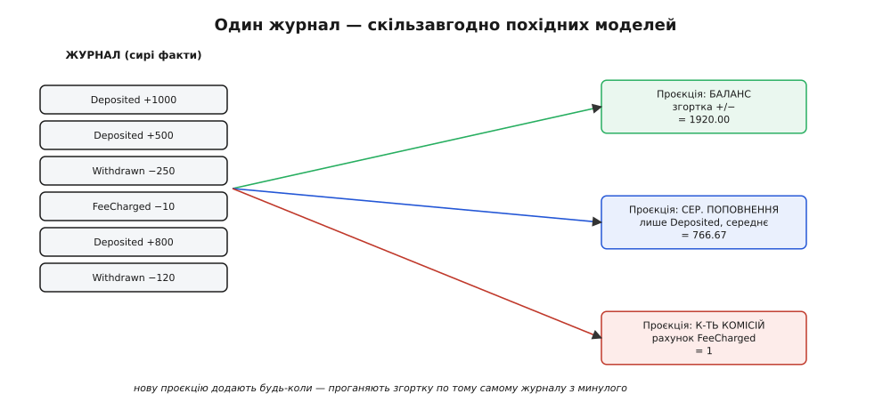

# ⚙️ Рушій відбудови рахунку: журнал, знімок, проєкція з минулого

Про згортання подій легко говорити на пальцях — «прикладай подію за подією, і матимеш стан». Але між цією фразою й системою, що не падає на мільйоні подій і не тихне під конкурентним записом, лежить купа інженерії, яку саме фраза й ховає. Тут ми пройдемо крізь неї на одному наскрізному прикладі — рахунку — і зберемо три речі, кожну з робочим кодом і чесним рахунком за неї: **сховище подій**, що безпечно росте під конкурентними записами; **згортання зі знімком**, що не читає мільйон подій там, де досить трьох; і **побудову нової проєкції заднім числом** — похідної моделі, якої не було, коли перша подія лягала в журнал.

Мова тут — звичайний прикладний бекенд, не залізо й не регістри, тож увесь код наведено двома мовами, якими такий рушій і пишуть на практиці — TypeScript і Python, — вкладками. Логіка в обох та сама, до рядка; різниця лише в ідіомах кожної мови. Читай ту вкладку, що тобі ближча, — друга нічого нового не додасть, крім синтаксису.

Одразу застережу межу. Ми пишемо рушій **у памʼяті**, зі сховищем на простому масиві, щоб уся механіка була видна без шуму драйвера бази. Кожне місце, де справжня система пішла б у Postgres чи EventStoreDB, я називаю прямо — але код лишаю таким, щоб його можна було запустити й потриматися руками. Промислове сховище відрізняється не ідеєю, а тим, що ту саму перевірку версії робить транзакція бази, а не наш `if`.

## Задача: що саме має вміти рушій

Сформулюймо чітко, бо від чіткості залежить, які пастки ми взагалі побачимо. Рушій рахунку мусить:

1. **Приймати команди** (`внести`, `зняти`), перевіряти правила й **дописувати** народжені події в кінець потоку цього рахунку — і ніколи не переписувати вже записане.
2. **Витримувати конкурентний запис.** Два процеси одночасно знімають з того самого рахунку — рушій мусить не дати їм затерти один одного, інакше баланс поїде.
3. **Швидко віддавати поточний стан** навіть тоді, коли подій мільйон, — не згортаючи щоразу весь журнал з початку часів.
4. **Будувати нові похідні моделі із журналу заднім числом** — звіти й вибірки, про які на старті ніхто не думав, з тих самих сирих фактів.

Перші два пункти — про **запис** (сховище й конкуренція). Третій — про **швидке читання стану** (знімок). Четвертий — про **читання нових моделей** (проєкція). Зберемо їх по черзі, у кожному розкриваючи пастку, яка чекає на наївну реалізацію.

## Крок 1. Append-only сховище: потік, версія, оптимістична перевірка

### Задача цього кроку

Сховище подій — це не «таблиця з рядками», а **множина потоків** (англ. *stream*), по одному на агрегат. Потік рахунку `acc-42` — це впорядкована послідовність його подій, і тільки його. Дві речі мусять триматися залізно: події в потоці **впорядковані** (у кожної своя позиція — версія), і запис **тільки в кінець** (нову подію можна лише дописати після останньої, ніколи не вставити всередину й не переписати).

Навіщо взагалі **версія** — окреме число в кожної події? Здавалося б, порядок дає вже сам масив. Але версія працює не на читанні, а на записі: вона — те, об що спотикається конкурентний запис. Ось де народжується головна пастка кроку.

### Ідея: оптимістична перевірка версії

Уяви двох касирів, що одночасно знімають з рахунку `acc-42`. Обидва прочитали журнал, обидва побачили баланс `100`, обидва вирішили зняти `80` — кожен окремо законно (`80 ≤ 100`). Якщо рушій просто допише обидві події, у журналі опиняться два зняття по `80` з рахунку, де було `100`, і баланс стане `−60` — овердрафт, якого жодне правило не дозволяло. Правило перевірялося двічі проти **того самого** старого стану, бо друге зняття не знало про перше.

Полагодити це можна двома способами. **Песимістичний** — узяти замок на потік перед читанням, щоб другий касир чекав. Дорого й крихко: замок треба тримати, звільняти, стерегтися його зависання. **Оптимістичний** — не блокувати нікого, а домовитися так: коли дописуєш подію, ти зобовʼязаний **сказати, на якій версії потоку ти будував своє рішення** (англ. *expected version* — «очікувана версія»). Сховище допише лише тоді, коли потік **досі** тієї самої довжини; якщо хтось устиг дописати раніше, реальна версія вже більша за очікувану — і твій запис відхиляється. Ти перечитуєш свіжий журнал і пробуєш ще раз.

Це та сама ідея, що в промислових сховищ подій: у EventStoreDB append приймає `expectedRevision` і падає з `WrongExpectedVersion`, якщо потік зрушив; у реалізаціях на Postgres append — це одна транзакція «звірити, що збережена версія дорівнює очікуваній, і збільшити її». Ми зберемо рівно цю логіку руками.

> 🔧 **Навіщо це.** Оптимістична перевірка — не «захист про всяк випадок», а єдине, що стоїть між тобою й **мовчазним подвоєнням списань**. Найгидкіше в цій помилці — що вона не падає й нічого не логує: обидва записи «успішні», кожен сам по собі законний, а разом дають стан, заборонений правилами. Такі баги знаходять не в тестах, а в скарзі клієнта через місяць. Версія перетворює невидиму гонку на гучну, видиму відмову запису, яку рушій обробляє тут-таки — перечитав і повторив.

### Код: сховище і команда

Почнемо з форми події та збереженого запису. Кожна збережена подія несе **тіло** (що сталося) і свою **версію** в потоці — позицію, з 1.

:::tabs
:::code proj-account-replay/ts/kod-skhovyshche-i-komanda.ts
:::code proj-account-replay/py/kod-skhovyshche-i-komanda.py
:::

Тепер сама команда — місце, де **народжується** подія. Зверни увагу на розділення: команда читає потік, згортає його у стан, перевіряє правило проти цього стану й тільки тоді народжує подію та віддає сховищу разом з очікуваною версією. Правило спрацьовує **тут**; функція `apply` нижче не перевіряє нічого.

:::tabs
:::code proj-account-replay/ts/kod-skhovyshche-i-komanda-2.ts
:::code proj-account-replay/py/kod-skhovyshche-i-komanda-2.py
:::

Тепер поглянь, як саме перевірка версії гасить гонку двох касирів. Обидва прочитали потік на версії `2` (`expectedVersion = 2`), обидва вирішили зняти. Перший викликає `append(…, 2, …)` — потік справді на `2`, запис проходить, потік стає на `3`. Другий викликає `append(…, 2, …)` — але потік **уже на `3`**, `actual (3) !== expected (2)`, летить `VersionConflict`, `withdraw` повертає `false`. Виклик, отримавши `false`, перечитує **свіжий** журнал (де вже є перше зняття), згортає новий баланс, знову перевіряє правило проти нього — і цього разу правило може чесно сказати «ні, тепер уже недостатньо». Гонка перетворилася на впорядковану чергу без жодного замка.

Петля повтору — на боці виклику, і виглядає так:

:::tabs
:::code proj-account-replay/ts/kod-skhovyshche-i-komanda-3.ts
:::code proj-account-replay/py/kod-skhovyshche-i-komanda-3.py
:::

### Вартість і пастки кроку 1

**Вартість.** Кожна команда зараз читає **весь** потік, щоб згорнути стан і взяти версію: O(подій у потоці) на одну команду. Для короткого рахунку — дрібниця; для потоку в мільйон подій — це стає болем, і саме його лікує крок 2. Запис — O(1) плюс вартість дописування (у справжній базі — один `INSERT`).

**Пастка: перевіряти правило проти застарілого стану.** Якщо в петлі повтору забути перечитати журнал і згорнути **свіжий** баланс — а просто гнати той самий намір, — можна дописати зняття, законне на старому балансі, але вже незаконне на новому. Версія врятує від затирання, але **не** від логічно застарілого рішення: вона стереже позицію, а не сенс. Тому свіже читання-згортання перед кожною спробою — не зайве, а обовʼязкове.

**Пастка: очікувана версія «з голови».** Якщо передати в `append` версію, узяту не з того ж читання, що дало стан (скажімо, кешовану), перевірка стає фікцією — вона пропустить конфлікт або відхилить чесний запис. Очікувана версія й згорнутий стан мусять походити з **одного** читання потоку. У коді вище це видно: `history` читається раз, з нього беруться і `state`, і `expectedVersion`.

## Крок 2. Згортання зі знімком: читати хвіст, а не весь журнал

### Задача цього кроку

Крок 1 читає весь потік на кожну команду. Поки подій сотні — байдуже. Коли їх мільйон, згортати мільйон подій, щоб дізнатися баланс перед черговим зняттям, — безглуздо: ти щоразу переобчислюєш те, що вже обчислював учора, позавчора й мільйон разів до того. Стан **накопичувальний** — кожне наступне обчислення повторює майже всю роботу попереднього. Це кричить про кешування.

### Ідея: знімок як збережений проміжний згорток

Ключ у тому, що стан — це **лівий згорток** послідовності подій, а лівий згорток має чудову властивість: будь-який **проміжний** результат — теж повноцінний стан. Стан після перших 900 000 подій — такий самий валідний стан, як фінальний; він просто «стан рахунку станом на подію 900 000». Раз так, його можна **зберегти окремо** разом із номером події, до якої він порахований, — і назвати **знімком** (англ. *snapshot*).

Тоді відбудова стану стає такою: візьми **останній** знімок, а потім прочитай і приклади лише події **після** його версії — короткий хвіст. Ти пропускаєш згортання всього, що до знімка, бо його результат уже лежить у знімку. Мільйон подій перетворюється на «знімок плюс кілька останніх».

Критично розуміти, чим знімок **не** є. Він **не** джерело правди. Правда завжди в журналі; знімок — суто кеш, похідний і одноразовий. Його можна будь-коли викинути й перебудувати з журналу, і система від цього не постраждає — лише сповільниться на одне повне згортання. Саме тому знімок нічого не «фіксує» назавжди: виправив `apply` (крок 3 покаже, коли це буває) — старі знімки просто викидаєш, бо вони пораховані старою функцією й тепер брешуть.



*Той самий журнал, дві ціни відбудови стану. Без знімка стан щоразу згортають з нуля крізь усі події — O(усіх). Зі знімком беруть останній збережений проміжний стан і докладають лише хвіст подій після нього — O(після знімка). Голову журналу — усе до знімка — не читають зовсім, бо її результат уже в знімку.*

### Код: сховище знімків і відбудова через хвіст

Знімок несе три речі: до якого потоку він, на якій версії порахований і сам стан на ту версію.

:::tabs
:::code proj-account-replay/ts/kod-skhovyshche-znimkiv-i.ts
:::code proj-account-replay/py/kod-skhovyshche-znimkiv-i.py
:::

Одна тонкість, яку легко проґавити: `slice(fromVersion)` / `stream[from_version:]` спирається на те, що версія — це саме **позиція** події в потоці, з 1. Знімок на версії 900 000 означає «враховано перші 900 000 подій», а вони лежать на індексах 0…899 999; отже, хвіст — з індексу 900 000, тобто рівно `stream[900000:]`. Якби версії мали діри (наприклад, глобальний лічильник на всі потоки, а не позиція в потоці), цей зріз був би хибним, і хвіст довелося б відбирати порівнянням `st.version > snap.version`. Тримати версію позицією в потоці — те, що робить зріз таким простим.

### Вартість і пастки кроку 2

**Вартість — головний виграш.** Відбудова стану падає з O(усіх подій) до O(подій після знімка). При `SNAP_EVERY = 100` хвіст — не більш як 100 подій, скільки б їх не було в потоці всього. Формально, якщо подій **N**, а знімок кладемо раз на **k**, то на відбудову йде щонайбільше **k** прикладань замість **N**:

```
без знімка:   вартість відбудови = O(N)          ← росте з історією без стелі
зі знімком:   вартість відбудови = O(k)          ← стеля k, від N не залежить
за N = 1 000 000, k = 100:
   було   ~ 1 000 000 прикладань apply
   стало  ~        100 прикладань apply   (плюс одне читання знімка)
   виграш ~ у 10 000 разів
```

Ціна знімка окремо — рідкісне повне (чи то пак «через попередній знімок») згортання раз на `k` подій плюс місце під збережений стан. Це вигідний обмін: дорога операція раз на сотню подій замість дорогої на кожній.

**Пастка: роздування знімків.** Наївно знімок кладуть на **кожну** команду або тримають **усі** знімки потоку назавжди. І те, й те роздуває сховище знімків так, що воно починає коштувати більше за сам журнал. Знімок раз на команду — це фактично другий журнал, лише зі станами замість подій; тримати всю історію знімків — зберігати сотні проміжних станів, з яких потрібен лише останній. Лікування: клади знімок раз на `k` подій (не на кожну) і тримай **лише останній** на потік (старі перезаписуй або чисти фоном). Знімок — кеш; кеш не архівують.

**Пастка: несумісний знімок після зміни `apply`.** Знімок пораховано **тодішньою** функцією `apply`. Змінив логіку згортання — і старий знімок тепер брехливий: у ньому стан, порахований за старими правилами. Якщо його наївно взяти за базу й докласти хвіст новою `apply`, дістанеш химеру — напівстарий, напівновий стан. Лікування просте й безжальне: під час зміни `apply` (або форми стану) **викинь усі знімки** й дай їм перебудуватися з журналу наново. Це безпечно рівно тому, що знімок — не правда, а кеш: правда в журналі ціла, перебудова її не чіпає.

**Пастка: знімок як «джерело правди».** Найгірше — почати довіряти знімку більше, ніж журналу: чистити старі події, бо «стан же в знімку». Тоді знімок перестає бути кешем і стає єдиною копією стану — а це вже звичайна база, тільки заплутана, і всі надздатності зберігання подій зникають разом з викинутими подіями. Знімок ніколи не дає права рідшати журнал.

## Крок 3. Нова проєкція заднім числом: похідна модель з минулого

### Задача цього кроку

Минув рік. Рахунок жив, події копилися. Приходить бізнес із запитом, якого на старті не існувало: «покажіть **середній розмір поповнення** й **скільки разів списувалася комісія** — за весь час». У звичайній системі, що зберігає лише баланс, ти безсилий: дані, з яких це рахувати, ніхто не збирав, бо про такий звіт ніхто не думав, коли креслив таблицю. У зберіганні подій усі поповнення й усі комісії **лежать у журналі від першого дня** — просто ніхто досі не дивився на них під цим кутом.

### Ідея: інша згортка того самого журналу

Тут спрацьовує головна властивість журналу: він — **сирі факти**, а не одна застигла модель. Баланс — лише **одна** згортка цих фактів. Нічого не заважає написати **іншу** згортку, з іншим станом-акумулятором і іншою `apply`, і прогнати її по тому самому журналу **з минулого** — дістанеш іншу похідну модель. Готовий до показу результат такої згортки й називають **проєкцією** (англ. *projection* — відображення журналу в зручну форму): журнал проєктують у ту модель, яка потрібна саме зараз.

Ключове слово — **заднім числом**. Проєкцію не треба було закладати наперед. Ти пишеш її сьогодні, а годуєш подіями, записаними торік, — і вона рахує так, ніби збирала їх завжди. Це та сама відбудова стану, лише замість «балансу» акумулятор — «сума й кількість поповнень», а замість `apply` рахунку — `apply` статистики. Механіка згортання одна; змінюється лише, **у що** згортаємо.



*Один журнал сирих фактів — скільки завгодно похідних моделей. Баланс — лише одна згортка цих подій; поряд із неї той самий журнал згортається в середнє поповнення, у кількість комісій, у будь-що ще. Нову проєкцію додають будь-коли — проганяють нову згортку по журналу з минулого й дістають модель, якої на старті не існувало.*

### Код: проєкція статистики поповнень

Проєкція — це власний акумулятор плюс власна функція прикладання. Ось модель «статистика поповнень і комісій», порахована з нуля по всьому журналу.

:::tabs
:::code proj-account-replay/ts/kod-proiektsiia-statystyky.ts
:::code proj-account-replay/py/kod-proiektsiia-statystyky.py
:::

Порівняй `applyStats` з `apply` рахунку — вони структурно однакові: акумулятор, розбір за видом події, новий акумулятор. Уся різниця в тому, **що** накопичуємо. `apply` копить баланс; `applyStats` копить суму й кількість поповнень та число комісій. Журнал під ними один і той самий, читається однаково — просто крізь дві різні лінзи. Це і є сенс фрази «журнал — сирі факти»: факт `Deposited +500` не «належить» балансу; він однаково годиться і балансу, і статистиці, і будь-якій третій моделі, яку ти напишеш післязавтра.

Прожену наскрізний приклад, щоб числа були предметні. Хай у журналі шість подій:

**Приклад-умова: журнал рахунку acc-42.**
```
Deposited  +1000
Deposited   +500
Withdrawn   −250
FeeCharged   −10
Deposited   +800
Withdrawn   −120
```

Дві згортки того самого журналу дають дві різні моделі:
```
БАЛАНС (apply):
  0 +1000 +500 −250 −10 +800 −120 = 1920.00

СТАТИСТИКА ПОПОВНЕНЬ (applyStats):
  depositCount = 3        (три Deposited)
  depositTotal = 1000+500+800 = 2300.00
  feeCount     = 1        (один FeeCharged)
  середнє поповнення = 2300.00 / 3 = 766.67
```
Баланс не знав нічого про «середнє поповнення»; статистика не знала нічого про баланс; обидві вийшли з одного журналу, і кожну можна було написати будь-коли — хоч сьогодні, хоч через рік після останньої події.

### Темпоральний запит — та сама згортка з обрізаним журналом

Дрібний, але показовий бонус тієї самої механіки. «Яким був баланс станом на певну мить?» — це згортка **не всього** журналу, а лише подій **до** тієї мітки часу. Ми недарма поклали `at` у кожну збережену подію.

:::tabs
```ts
// Стан на момент asOf: згорнути лише події, що сталися не пізніше за asOf.
function stateAsOf(store: EventStore, streamId: string, asOf: string): Account {
  const upto = store.read(streamId).filter((st) => st.at <= asOf);
  return upto.reduce((s, st) => apply(s, st.event), EMPTY);
}
```
```python
# Стан на момент as_of: згорнути лише події, що сталися не пізніше за as_of.
def state_as_of(store: EventStore, stream_id: str, as_of: str) -> Account:
    upto = [st for st in store.read(stream_id) if st.at <= as_of]
    state = EMPTY
    for st in upto:
        state = apply(state, st.event)
    return state
```
:::

Жодної нової ідеї — це `foldState` з відфільтрованим журналом. Минуле не перезаписане, тож зріз історії до дати береться тривіально; у звичайній базі така відповідь неможлива в принципі, бо старі стани затерті.

### Вартість і пастки кроку 3

**Вартість.** Побудова проєкції з нуля — O(усіх подій у журналі), бо треба пройти всю історію хоч раз. Це роблять **одноразово** (перша побудова), а далі проєкцію **тримають на диску й доводять** новими подіями по одній, як вони прибувають, — тобто підтримка коштує O(1) на подію. Перша повна побудова великого журналу може бути довгою — її й запускають фоновим прогоном, не в запиті користувача.

**Пастка: лаг проєкції.** Проєкцію оновлюють **не миттєво**, а трохи згодом, коли нова подія долетить. У цей проміжок проєкція показує вчорашню правду: щойно зробив поповнення, а звіт середнього ще його не врахував. Це [кінцева узгодженість](root:sf-distributed/eventual-consistency) — той самий лаг, що й у CQRS. Його не «виправляють», а **свідомо проєктують**: там, де користувач чекає негайного результату після своєї дії, або читають стан прямо з журналу (як `loadState`), або показують проєкцію з чесною позначкою «оновлено щойно / із затримкою». Небезпечно мовчки видавати відсталу проєкцію за миттєву правду.

**Пастка: переграння при зміні `apply` проєкції.** Проєкція — теж згортка, тож усе з кроку 2 стосується і її: змінив спосіб рахувати (скажімо, вирішив рахувати комісію інакше) — стару збережену проєкцію треба **перебудувати з журналу наново**, а не латати вручну. Дехто пробує «доправити» готову проєкцію дельтою — і майже завжди отримує розходження, бо ручна правка не еквівалентна чесному перепрогону. Правило те саме: похідне переграється з першоджерела, першоджерело — журнал.

**Пастка: сплутати проєкцію з журналом.** Проєкцію іноді хочеться «підправити руками» — виправити цифру у звіті напряму. Не можна: проєкція похідна, її правда — у журналі. Виправляти треба **джерело** (дописати компенсаційну подію в журнал), а проєкція перерахується сама. Пряма правка проєкції розсинхронить її з журналом, і наступна перебудова тихо затре твою правку — бо перебудова знає лише журнал.

## Що зібралося

Три кроки — і в руках рушій, який не просто «згортає події», а витримує реальність. Пройдімося ще раз по тому, що кожен крок купив і чим за це заплатив, бо саме ця пара — здобуток і ціна — і є суть кожного прийому:

```
КРОК 1 · сховище append-only з версією
   купив:  впорядкований незмінний потік + захист від конкурентного затирання
   ціна:   читання всього потоку на команду (O(подій)) — лікує крок 2
   пастка: правило проти застарілого стану; версія «з голови»

КРОК 2 · згортання зі знімком
   купив:  відбудову стану за O(після знімка) замість O(усіх)
   ціна:   знімок треба класти, чистити, викидати при зміні apply
   пастка: роздування знімків; несумісний знімок; знімок як «правда»

КРОК 3 · проєкція заднім числом
   купив:  нову похідну модель з минулого, якої не було на старті
   ціна:   перша побудова O(усіх); проєкцію треба доводити подіями
   пастка: лаг проєкції; переграння при зміні apply; правка проєкції замість журналу
```

Спільний корінь усіх трьох — одна дія: **прочитати події й згорнути їх функцією**. Сховище дає, що читати, і стереже, як дописувати. Знімок каже, звідки почати згортати, щоб не з нуля. Проєкція міняє, **у що** згортати. Але рух завжди той самий — лівий згорток послідовності фактів, — і саме тому, опанувавши його раз, ти дістаєш і швидке читання стану, і темпоральні запити, і нові моделі заднім числом як три грані однієї здатності, а не три окремі механізми. Уся ціна зберігання подій — версія, знімки, лаг проєкцій — це плата рівно за те, що стан не зберігають, а **виводять**; а виграш — що з тих самих застиглих фактів можна вивести стільки моделей, скільки питань тобі колись поставлять.
