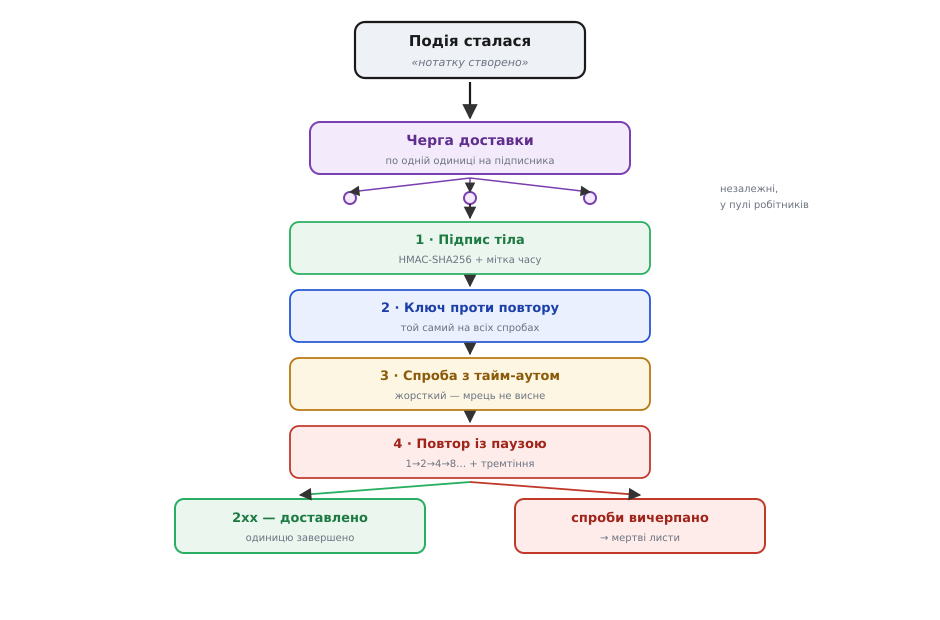

# ⚙️ Відправник вебхуків: що ховається за «просто постукати на чужу адресу»

Споживач лишив тобі адресу: «як щось трапиться — постукай сюди». Стається подія — нотатку створено, оплату прийнято. Ти береш `fetch`, шлеш `POST` на ту адресу, і... на цьому інтуїція «просто постукати» закінчується, а починається інженерія. Бо адреса **не твоя**. За нею — чужий сервер, який ти не бачив, не збирав і не контролюєш. Він може лежати. Може відповідати за десять секунд. Може прийняти твій стук двічі й двічі списати гроші. Може виявитися чиїмось чужим сервером, якому хтось підсунув **твою** адресу як жертву. І поки ти чекаєш на одного мертвого одержувача, тисяча інших твоїх стуків стоїть у черзі.

Кожен із цих «може» — окрема тверда частина доставки назовні, і кожну доводиться розв'язувати в коді. Розберімо всі чотири на робочому відправнику: **підпис** (щоб чужий довів, що постукав справді ти), **повтор із наростанням паузи** (коли чужий сервер лежить), **ключ проти повтору** (щоб твоя ж повторна спроба не спрацювала двічі) та **ізоляцію збою** (щоб один мрець не завалив розсилку всім).

## Задача: доставити звістку туди, де ти нічим не керуєш

Сформулюймо точно, чим доставка назовні відрізняється від виклику власної функції.

Коли ти кличеш свою функцію, вона або відпрацює, або кине виняток — миттєво, у тому ж процесі, під твоїм контролем. Коли ти стукаєш на чужу адресу через мережу, між тобою й одержувачем лягає **ненадійний канал**, а на тому кінці — **ненадійний і недовірений** співрозмовник. Це змінює саму природу задачі, бо тепер істинні всі чотири речі водночас:

- **Стук може не дійти або дійти, а відповідь — загубитися.** Ти надіслав `POST`, мережа моргнула, з'єднання обірвалося. Дійшло? Не дійшло? Ти **не знаєш**. Одержувач, може, уже все зробив, а твоє «успішно» просто не долетіло назад. Це не крайній випадок — це нормальна поведінка мережі.
- **Одержувач тобі не довіряє.** Він отримав `POST` на свою адресу — а звідки йому знати, що це ти, а не хтось, хто вивідав адресу й шле фальшиві «оплату прийнято»? Він **зобов'язаний** сумніватися, і ти маєш дати йому спосіб пересвідчитися.
- **Одержувач буває мертвий.** Його сервер упав, перевантажений, на обслуговуванні. Твій стук тайм-аутить. Кинути звістку — погано (споживач її чекав). Стукати вічно — теж погано (заб'єш власні ресурси на мерця).
- **Одержувачів багато, і один поганий не має чіпати решту.** Тисяча підписників на одну подію. Дев'ятсот дев'яносто дев'ять здорові, один висить по тайм-ауту. Наївна розсилка в один потік по черзі застрягне на мерці — і решта 999 чекатимуть, поки він відтайм-аутить.

Отже задача не «надіслати HTTP-запит». Задача — **надійно доставити звістку крізь ненадійний канал недовіреному одержувачу, не завдавши шкоди ні йому (подвійним спрацюванням), ні собі (застряганням на мерцях)**. Кожне слово тут тягне свою частину коду.

## Ідея: чотири незалежні гарантії, накладені на кожну доставку

Розв'язок не монолітний — це чотири окремі механізми, кожен закриває рівно одну діру, і разом вони роблять доставку надійною. Тримаймо їх нарізно, бо змішувати — плутати.

**Підпис.** Одержувач не довіряє джерелу — дай йому криптографічний доказ. Ти й одержувач заздалегідь ділите **спільний секрет** (довгий випадковий рядок, який знаєте тільки ви двоє). Надсилаючи звістку, ти рахуєш від її тіла **HMAC-SHA256** цим секретом і кладеш результат у заголовок. Одержувач рахує те саме своїм примірником секрету й порівнює. Збіглося — стукав той, хто знає секрет, тобто ти. Хто секрету не знає, підпису не підробить.

**Повтор із наростанням паузи.** Одержувач тимчасово мертвий — не здавайся з першого разу, але й не гати впритул. Спроба провалилася — зачекай і спробуй знову, **щоразу довше**: секунду, дві, чотири, вісім. Так живий-але-моргнув одержувач дістане звістку з другої-третьої спроби, а справді мертвий не з'їсть твої ресурси нескінченним довбанням. Пауза росте **експоненційно** — щоб швидко відступитися від того, хто лежить надовго.

**Ключ проти повтору (idempotency-key).** Повтор рятує від втрати, але породжує нову біду: якщо перший стук **дійшов**, одержувач його обробив, а відповідь загубилася, — твій повтор прийде **вдруге** й одержувач спрацює двічі. Двічі створить нотатку, двічі спише гроші. Ліки — дати кожній звістці **сталий унікальний ключ**, однаковий на всіх повторах однієї доставки. Одержувач запам'ятовує оброблені ключі; бачить знайомий — тихо відповідає «вже зробив», не роблячи вдруге. Твій обов'язок як відправника — **тримати ключ незмінним між повторами**.

**Ізоляція збою.** Один мертвий одержувач не має гальмувати чи валити розсилку решті. Тому доставки йдуть **не в один ряд**, а незалежними одна від одної одиницями роботи: провал чи зависання однієї нічого не знає про інші. Мрець висить у своєму куточку по тайм-ауту й помирає там сам, поки живі отримують звістки вчасно.



*Чотири механізми стоять один за одним на шляху кожної доставки й закривають чотири різні діри; жоден не замінює іншого.*

> 🔧 **Навіщо це.** Спокуса — написати `await fetch(url, {method:"POST", body})` і піти далі: на власному ноутбуку воно «працює». Але цей рядок не має **жодної** з чотирьох гарантій. Перший же одержувач із моргнутим сервером загубить звістку. Перший, хто не довіряє джерелу, відкине твій стук — бо нічим пересвідчитися. Перший повтор спрацює двічі й спише гроші двічі. Перший мрець застопорить розсилку всім. Ці чотири речі — не «покращення на потім», а **мінімум**, нижче якого відправник вебхуків просто недієздатний назовні.

## Частина 1: підпис тіла (HMAC-SHA256)

Почнімо з довіри, бо без неї одержувач має право взагалі не слухати. Мета вузька: дати одержувачу спосіб **пересвідчитися, що звістку надіслав саме ти**, а не самозванець, який вивідав його адресу.

Симетричне шифрування тут ні до чого — нам не треба ховати тіло (одержувач і так має його прочитати), нам треба **засвідчити авторство**. Для цього і є **HMAC (англ. *hash-based message authentication code* — код автентичності на основі хешу)**: береш тіло звістки, домішуєш спільний секрет і проганяєш крізь криптографічну хеш-функцію (SHA-256). Виходить короткий відбиток, який неможливо відтворити, **не знаючи секрету**. Ти кладеш відбиток у заголовок; одержувач рахує свій відбиток своїм примірником того ж секрету й звіряє. Збіглося — підпис міг поставити лише той, хто знає секрет.

Три деталі, кожна з яких критична, і кожну легко проґавити:

**Підписуй сирі байти тіла, а не свій об'єкт.** Одержувач звірятиме підпис проти **точних байтів**, що прийшли по дроту. Якщо ти підпишеш свій об'єкт, а тоді ще раз серіалізуєш його в тіло запиту — пробіл, порядок ключів чи нормалізація Unicode можуть відрізнятися, і підписи розійдуться, хоч дані ті самі. Тому серіалізуй тіло **один раз** у рядок, підпиши **цей самий рядок** і **його ж** відправ. Це не педантизм — платіжні системи як Stripe прямо наголошують: підписуй саме сирий payload, бо будь-яка зміна пробілів чи порядку ключів ламає перевірку.

**Клади в підпис мітку часу — проти повторного програвання.** Голий підпис тіла можна вкрасти разом із тілом і **програти знову** через годину (англ. *replay attack*). Щоб це вбити, додай до підписуваного рядка **поточний час** і поклади його ж у заголовок відкрито. Одержувач звірить: якщо мітка старша за кілька хвилин — відкинути, навіть якщо підпис правильний. Мітка **всередині** підпису, тож підмінити її, не зламавши підпис, не вийде. Це рівно те, що робить Stripe: підписує рядок `час.тіло` й тримає вікно допуску близько п'яти хвилин.

**Звіряй сталий-у-часі порівнянням.** Це вже клопіт одержувача, але відправник має розуміти симетрію: наївне порівняння рядків `==` вертає відповідь тим швидше, чим раніше знайшло розбіжність, і по цих часах зловмисник здатен **вгадувати підпис байт за байтом**. Тому підписи звіряють функцією, чий час **не залежить** від того, де саме вони розійшлися (`crypto.timingSafeEqual`, `hmac.compare_digest`, `hmac.Equal`).

Ось відправник, що підписує звістку правильно за всіма трьома пунктами:

:::tabs
:::code proj-webhook-delivery/ts/chastyna-1-pidpys-tila.ts
:::code proj-webhook-delivery/py/chastyna-1-pidpys-tila.py
:::code proj-webhook-delivery/go/chastyna-1-pidpys-tila.go
:::

Зверни увагу на `v1=` перед підписом. Це той самий урок версіонування, що й у будь-якому зовнішньому контракті: колись ти захочеш перейти з SHA-256 на щось інше, і тег схеми дасть одержувачу зрозуміти, яким алгоритмом рахувати, не ламаючи старих. Заклав його зараз — зекономив собі несумісну зміну потім.

## Частина 2: повтор із наростанням паузи (backoff)

Тепер ненадійний канал. Одержувач моргнув — з'єднання відпало, сервер відповів `503`, тайм-аут вичерпався. Здатися з першого разу — загубити звістку, яку споживач чекав. Гатити впритул — додати мертвому серверу навантаження й спалити власні ресурси. Правильно — **відступати**: почекати й спробувати знову, **щоразу довше**.

Чому пауза має **рости**, і саме експоненційно? Бо ти не знаєш, чому одержувач мовчить. Якщо він моргнув на мілісекунду — вистачить короткої паузи й другої спроби. Якщо він ліг на пів години — короткі спроби марні, лише гатять по трупу. Експонента накриває **обидва** випадки одним правилом: перші спроби близькі (ловлять коротку заминку), дальші швидко розсуваються (перестають доїдати того, хто ліг надовго). Пауза подвоюється щоразу: 1 → 2 → 4 → 8 → 16 секунд.

Але гола експонента має дві вади, і обидві треба залатати. Перша: пауза росте **без стелі** — на десятій спробі це вже сотні секунд. Тому кладемо **стелю (cap)**: хай пауза росте, але не вище, скажімо, п'яти хвилин. Друга, підступніша: якщо тисяча твоїх доставок упала **одночасно** (одержувач ліг на секунду), усі вони відрахують **однакову** паузу й ударять по ньому **знову одночасно** — синхронною хвилею, від якої він знову впаде. Це «стадо, що біжить разом» (англ. *thundering herd*). Ліки — **тремтіння (англ. *jitter* — тремтіння)**: підмішати випадковості, щоб спроби розповзлися в часі.

Канонічну відповідь на обидві вади дав інженерний блог AWS у праці «Exponential Backoff And Jitter»: бери не саму експоненційну паузу, а **випадкове число від нуля до неї**. Формула «повного тремтіння» (*full jitter*):

```
пауза = random(0, min(стеля, база · 2^спроба))

де:
  база    — базова затримка, напр. 1 секунда
  спроба  — номер спроби, 0, 1, 2, 3, …
  стеля   — верхня межа, напр. 300 секунд (5 хв)
  random(0, X) — рівномірно-випадкове число між 0 і X
```

Порахуймо, як розсуваються вікна пауз (`база = 1с`, `стеля = 300с`) — і побачимо, що тремтіння перетворює гострі піки на широкі діапазони:

```
спроба 0:  min(300, 1·1)   =   1  →  пауза ∈ [0,   1]  с
спроба 1:  min(300, 1·2)   =   2  →  пауза ∈ [0,   2]  с
спроба 2:  min(300, 1·4)   =   4  →  пауза ∈ [0,   4]  с
спроба 3:  min(300, 1·8)   =   8  →  пауза ∈ [0,   8]  с
спроба 4:  min(300, 1·16)  =  16  →  пауза ∈ [0,  16]  с
спроба 5:  min(300, 1·32)  =  32  →  пауза ∈ [0,  32]  с
спроба 6:  min(300, 1·64)  =  64  →  пауза ∈ [0,  64]  с
спроба 7:  min(300, 1·128) = 128  →  пауза ∈ [0, 128]  с
спроба 8:  min(300, 1·256) = 256  →  пауза ∈ [0, 256]  с
спроба 9:  min(300, 1·512) → 300  →  пауза ∈ [0, 300]  с   ← стеля тримає
спроба 10: min(300, 1·1024)→ 300  →  пауза ∈ [0, 300]  с   ← далі не росте
```

Двоє твоїх доставок, що впали в ту саму мілісекунду на спробі 3, чекатимуть, скажімо, 5.2 та 0.8 секунди — і вдарять **урізнобіч**, а не хором. Стадо розсіялося.

Ось цикл повтору, що зшиває експоненту, стелю й тремтіння докупи:

:::tabs
:::code proj-webhook-delivery/ts/chastyna-2-povtor-iz.ts
:::code proj-webhook-delivery/py/chastyna-2-povtor-iz.py
:::code proj-webhook-delivery/go/chastyna-2-povtor-iz.go
:::

Тут захована важлива розвилка, яку легко проґавити: **не всякий провал варто повторювати**. Якщо одержувач відповів `503` чи обірвав зв'язок — це тимчасово, повтор має сенс. Але якщо він відповів `400 Bad Request` чи `404 Not Found` — це **твоя** біда: ти шлеш криве тіло або на неіснуючу адресу, і скільки не повторюй, буде те саме. Тому `4xx` (крім `429 Too Many Requests`, що значить «пригальмуй») повтору **не підлягають** — здаємося одразу, не марнуючи спроб. Розрізняти тимчасовий збій і постійний — половина мистецтва повтору.

Зверни й на `AbortSignal.timeout(10_000)` — **жорсткий тайм-аут** на кожну спробу. Без нього мертвий одержувач, що прийняв з'єднання й **завис**, тримав би твій запит відкритим нескінченно. Тайм-аут — це обіцянка собі: жодна спроба не висить довше десяти секунд, хай там що на тому кінці.

## Частина 3: ключ проти повторного виконання (idempotency-key)

Повтор щойно врятував нас від утрати — і тим-таки створив нову небезпеку. Уяви найпідступніший збій: твій перший стук **дійшов**, одержувач його прийняв, створив нотатку, списав гроші — а тоді, на шляху відповіді назад, мережа обірвалася. Ти не дістав `2xx`. З твого боку це виглядає точно як провал, і ти чесно **повторюєш**. Стук приходить **удруге**. Одержувач, якщо не готовий, створює **другу** нотатку й **удруге** списує гроші.

Корінь біди в тому, що мережа дає лише **«принаймні один раз» (англ. *at-least-once delivery*)**: вона гарантує, що звістка дійде — але не гарантує, що **рівно раз**. Домогтися «рівно раз» на ненадійному каналі неможливо в принципі. Тож замість недосяжного «рівно раз доставити» ми беремо досяжне: **доставити скільки завгодно разів, але спрацювати рівно раз**. Це і є **ідемпотентність (англ. *idempotency* — властивість операції давати той самий результат від одного застосування й від багатьох)**.

Механізм простий і покладає обов'язки на **обидві** сторони:

- **Твій обов'язок як відправника:** дати кожній доставці **сталий унікальний ключ** і — головне — **не міняти його між повторами**. Усі десять спроб доставити одну звістку несуть **той самий** `Idempotency-Key`. Ключ народжується разом із доставкою, **до** першої спроби, і живе незмінним крізь усі повтори. Якщо ти згенеруєш новий ключ на кожну спробу — весь механізм марний, бо одержувач бачитиме десять «різних» звісток.
- **Обов'язок одержувача:** запам'ятовувати оброблені ключі й, побачивши знайомий, **не робити роботу вдруге**, а просто відповісти «вже зроблено» (тим самим `2xx`). Причому claim має бути **атомарним** — не «перевір, тоді встав» (між перевіркою й вставкою прослизне дублікат), а одним неподільним рухом: `INSERT ... ON CONFLICT DO NOTHING` у базі чи `SET NX` у Redis.

Ключем зазвичай беруть **ідентифікатор доставки** — той самий `deliveryId`, що ми вже проносимо крізь повтори. Практика галузі саме така: Stripe кладе `evt_…`, GitHub — заголовок `X-GitHub-Delivery` з унікальним GUID; одержувач дедуплікує по ньому. Ось як народжується ключ і як його бачить одержувач:

:::tabs
:::code proj-webhook-delivery/ts/chastyna-3-kliuch-proty.ts
:::code proj-webhook-delivery/py/chastyna-3-kliuch-proty.py
:::code proj-webhook-delivery/go/chastyna-3-kliuch-proty.go
:::

Одна тонкість щодо пам'яті ключів на боці одержувача: таблиця оброблених ключів мусить жити **довше за твоє вікно повторів**. Якщо ти повторюєш до 10 спроб протягом, скажімо, доби, а одержувач забуває ключі за годину — то повтор на другій годині прийде як «новий» і спрацює вдруге. Тому термін пам'яті ключа (TTL) беруть **із запасом більший** за найдовший можливий інтервал твоїх повторів. Дедуплікація коротша за вікно повторів — дірява дедуплікація.

## Частина 4: ізоляція збою — мрець не валить розсилку

Лишилася четверта частина, і вона — про **масштаб**. Три попередні гарантії стосувалися **однієї** доставки одному одержувачу. Але подія «нотатку створено» може мати **тисячу** підписників, і тут вилазить нова біда, якої на одній доставці не видно.

Розглянь наївну розсилку: подія сталася, ти береш список із тисячі адрес і йдеш по ньому **в один ряд** — доставив першому, тоді другому, тоді третьому. Усе гаразд, поки всі живі. Але дев'ятсот перший одержувач **завис** — його сервер прийняв з'єднання й мовчить. Твоя доставка йому висить десять секунд до тайм-ауту, тоді ще повторює з паузами... а всі одержувачі **після** нього в списку — здорові, готові прийняти — **стоять і чекають**, поки ти воюєш з одним мерцем. Один завислий одержувач **затримав звістку дев'яноста дев'яти живим**. А якщо мерців кілька — розсилка застрягає намертво.

Корінь у тому, що доставки **зчеплені в один потік виконання**, хоча за суттю вони **незалежні**: доставка одному не має ані найменшого стосунку до доставки іншому. Тож розчепимо їх. Кожна доставка — **окрема одиниця роботи**, і йдуть вони **не по черзі, а водночас**, обмеженим числом паралельно. Тоді зависла доставка висить **у своїй** одиниці, ізольовано, і поки вона тайм-аутить у своєму куточку, десятки інших спокійно летять живим одержувачам.

Правильна форма для цього — **черга доставки**. Подія не розсилається «прямо зараз, тут-таки»; вона **породжує по одній одиниці-доставці на кожного підписника** й кладе їх у чергу. З черги їх розбирає **пул робітників** — скажімо, двадцять паралельних, — і кожен робітник веде **свою** доставку від першої спроби до успіху чи вичерпання, ні на кого не оглядаючись. Мрець забирає одного робітника на свій тайм-аут; решта дев'ятнадцять тим часом обслуговують живих. Розсилка тече, попри трупи в ній.

:::tabs
:::code proj-webhook-delivery/ts/chastyna-4-izoliatsiia.ts
:::code proj-webhook-delivery/py/chastyna-4-izoliatsiia.py
:::code proj-webhook-delivery/go/chastyna-4-izoliatsiia.go
:::

Тут виринає термін, який замикає всю картину: **черга мертвих листів (англ. *dead-letter queue* — черга мертвих листів: куди відкладають те, що доставити так і не вдалося)**. Коли доставка вичерпала всі десять спроб, а одержувач так і не ожив, у тебе лишається вибір: викинути звістку мовчки (погано — губиш дані й не знаєш про це) чи **відкласти її окремо** на розбір. Другий шлях і є dead-letter: невдалі доставки складають у спеціальне місце, звідки їх видно — можна сповістити власника мертвої адреси, спробувати пізніше вручну чи бодай не втратити слід. Мертвий лист не зникає безслідно; він чекає у відведеній шухляді.

## Складність і пастки: що з'явилося разом із чотирма гарантіями

Кожна з чотирьох частин закрила діру — і кожна привела із собою новий клопіт. Це чесна ціна доставки назовні, і краще знати її наперед, ніж наступити.

**Черга — це стан, який тепер твій назавжди.** Щойно доставки пішли через чергу (а без черги немає ні ізоляції, ні надійного повтору через рестарти), у тебе з'явилася **інфраструктура з пам'яттю**: недоставлені доставки мусять **пережити перезапуск** твого сервера, інакше рестарт під час розсилки тихо проковтне все, що було «в польоті». Черга в пам'яті процесу цього не вміє — треба стійке сховище (база, Redis, брокер повідомлень). Доставка назовні перестала бути кодом і стала **сервісом зі станом**, який живе, доки живе продукт.

**Ліміт ретраїв — це рішення, а не константа.** Скільки разів повторювати? Замало — здашся на одержувачі, що ожив би за годину. Забагато (та ще й із довгими паузами) — доставки **накопичуються**: якщо одержувач лежить добу, а ти тримаєш кожну доставку в черзі й повторюєш, черга **розпухає** сотнями тисяч завислих одиниць, і одержувач, оживши, дістане лавину. Тому `MAX_ATTEMPTS` і стеля паузи — не «наберемо з голови», а свідомий баланс між упертістю доставити й готовністю визнати одержувача мертвим і відпустити доставку в dead-letter.

**Порядок доставки не гарантований — і не намагайся.** Тремтіння, повтори й пул робітників означають, що подія Б цілком може долетіти до одержувача **раніше** за подію А, хоч сталася пізніше. Спроба доставити «строго по порядку» вбиває всю ізоляцію: щоб тримати лад, довелося б знову шикувати доставки в один ряд і чекати на кожну — тобто повернути ту саму пастку, від якої ми втекли ізоляцією. Правильніше не боротися за порядок на доставці, а **вкласти час події в саме тіло** й перекласти впорядкування на одержувача: хай він, отримавши події не по черзі, сам розкладе їх за міткою часу. Гарантувати доставку — так; гарантувати ще й порядок — набагато дорожче, і майже завжди не варте того.

**Секрет треба вміти змінити, не зламавши підпис.** Спільний секрет колись **витече** чи просто застаріє — і його доведеться замінити. Але щойно ти зміниш секрет, усі звістки «в польоті», підписані старим, одержувач відкине. Тому дорослі системи тримають на одержувача **два чинні секрети водночас** під час зміни: новий підписує, старий ще приймається, — і аж коли всі перейшли, старий гасять. Це той самий версійний танець, що й зі схемою підпису (`v1=`), тільки для самого ключа. Заклав можливість двох секретів наперед — зміниш ключ спокійно; не заклав — зміна секрету стане несумісною зміною з нічним простоєм.

**«Принаймні один раз» тече наскрізь — тому ідемпотентність не лише на вході.** Ключ проти повтору зупиняє дублікат **на порозі** одержувача. Але сама подія всередині може ще й далі викликати ланцюг дій (списати гроші, розіслати листи), і кожна з них теж може повторитися від власних збоїв. Тому дорослий одержувач робить **ідемпотентними й самі побічні ефекти** — не «створи нотатку», а «створи нотатку **з таким-то id**, якщо ще немає»; не «додай суму», а «встанови стан на такий-то». Тоді навіть та звістка, що якимось дивом прослизнула повз ключ, нічого не зіпсує, бо друге застосування нічого не змінює. Ідемпотентність на порозі — перший рубіж; ідемпотентні побічні ефекти — останній.

Ось що насправді стоїть за «просто постукати на чужу адресу». Чотири незалежні механізми — підпис, повтор із наростанням паузи, ключ проти повтору, ізоляція збою — і за кожним тягнеться свій хвіст стану, рішень і компромісів. Жоден не зайвий: прибери підпис — і одержувач не повірить; прибери повтор — і моргання губить звістки; прибери ключ — і повтор спрацьовує двічі; прибери ізоляцію — і один мрець валить розсилку всім. Разом вони й перетворюють наївний `fetch` на **надійну доставку крізь ненадійний канал недовіреному одержувачу** — тобто на те, чим доставка вебхуків мусить бути, щойно адреса на тому кінці перестала бути твоєю.
