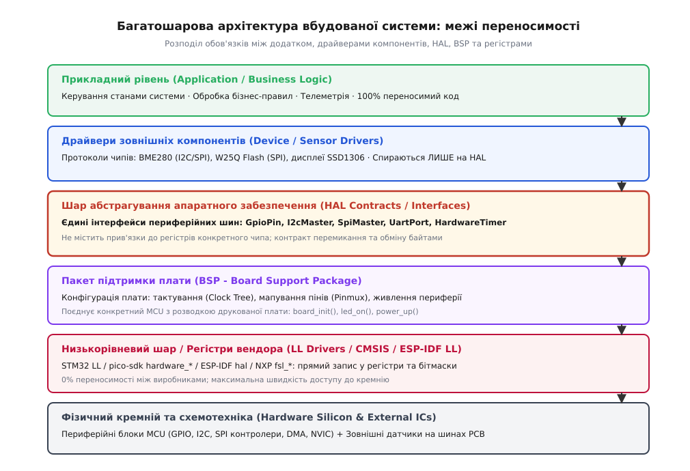
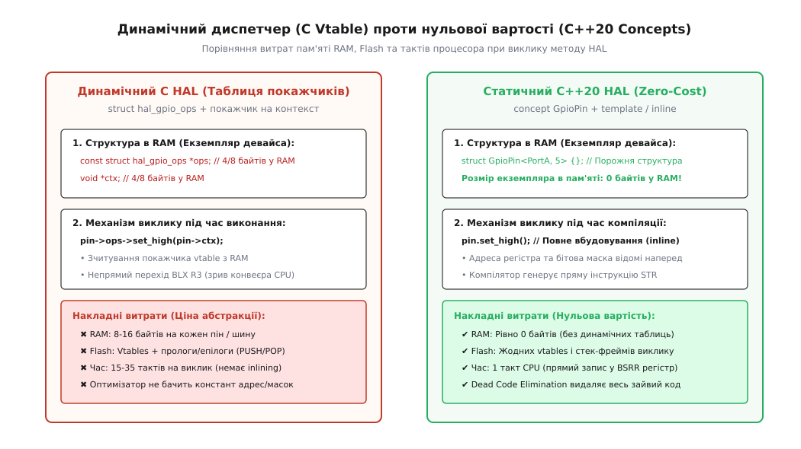

# Шар абстрагування заліза (HAL)

<preknowlist>
- [Інтерфейс проти реалізації](root:sf-apps/interface-vs-implementation) — різниця між тим, ЩО компонент обіцяє ззовні, і тим, ЯК він це робить усередині; HAL формує саме такий шов між залізом і додатком.
- [Принцип інверсії залежностей](root:sf-apps/dependency-inversion) — високорівневі модулі бізнес-логіки не повинні залежати від низькорівневих регістрів периферії; обидва шари спираються на абстрактний контракт шин.
- [Багатошарова архітектура](root:sf-apps/layered-architecture) — принцип організації системи у вертикальні шари з чіткими правилами залежностей зверху вниз.
</preknowlist>

Коли партія з десяти тисяч промислових контролерів стоїть на конвеєрі, а постачальник мікроконтролерів раптово повідомляє про затримку відвантаження чипів на вісім місяців, бізнес опиняється перед вибором: зупинити виробництво або терміново перейти на мікроконтролер іншого виробника. Інженери відкривають вихідний код прошивки й бачать, що виклики прямого запису в регістри та специфічні вендорні функції розсипані по сотнях файлів. Драйвер графічного дисплея напряму смикає регістри порту вводу-виводу одного вендора, модуль опитування датчиків тиску очікує специфічну структуру дескриптора шини I2C іншого вендора, а протокол обміну з пам'яттю жорстко прив'язаний до фірмової бібліотеки периферії. Щоб замінити один чип на інший із тим самим ядром, команді доводиться переписувати майже всю кодову базу, витрачаючи місяці на повторне налагодження прихованих збоїв синхронізації та переривань.

Ця криза виникає через відсутність чіткої межі між прикладною логікою вбудованої системи та фізичним кремнієм. Будь-яка пряма згадка апаратного регістра або вендорного типу даних у коді верхнього рівня перетворює прикладну програму на заручника конкретної мікросхеми.

Шар абстрагування апаратного забезпечення (Hardware Abstraction Layer, або HAL) — це архітектурний шов, що розділяє систему на дві незалежні частини: стабільний, незмінний прикладний код і взаємозамінні низькорівневі драйвери конкретного кремнію.

## Анатомія шарів вбудованої системи: HAL, BSP та LL

У професійній розробці вбудованих систем термін «HAL» часто помилково застосовують до будь-якої бібліотеки, що постачається виробником мікроконтролера. Проте вендорна бібліотека та архітектурний шар HAL у структурі додатку вирішують протилежні завдання. Вендорна бібліотека покликана показати всі унікальні можливості конкретного чипа, тоді як архітектурний HAL покликаний уніфікувати доступ до стандартних шин і функцій, приховавши відмінності між чипами.

Щоб система залишалася модульною та переносимою, вертикальний стек вбудованого програмного забезпечення розділяють на шість чітко розмежованих рівнів.



*Архітектурне розмежування рівнів вбудованої системи: прикладний рівень і драйвери зовнішніх компонентів повністю ізольовані від фізичного кремнію через єдині контракти периферійних інтерфейсів.*

### 1. Прикладний рівень (Application Layer)

На найвищому рівні зосереджена бізнес-логіка пристрою: автомати керування станами (State Machines), алгоритми регулювання температури, інтерфейс користувача, протоколи шифрування телеметрії та правила обробки помилок. Цей шар не має жодного уявлення про те, на якому процесорі він виконується — на ARM Cortex-M4, RISC-V чи у вигляді симулятора на комп'ютері під керуванням Linux. Він оперує суто доменними поняттями: «почати вимірювання», «передати пакет телеметрії», «увімкнути нагрівач».

### 2. Драйвери зовнішніх компонентів (Device / Sensor Drivers)

Під прикладним рівнем розташовані драйвери зовнішніх мікросхем, що розпаяні на друкованій платі або підключені через кабельні шлейфи: цифрових термометрів (наприклад, BME280), акселерометрів (MPU6050), енергонезалежної Flash-пам'яті (W25Q128), контролерів дисплеїв (SSD1306) чи мікросхем годинників реального часу (DS3231).

Головне архітектурне правило цього шару: драйвер зовнішнього чипа описує протокол спілкування з цією конкретною мікросхемою (її карту регістрів, послідовність ініціалізації, формули компенсації температури), але **ніколи не містить коду роботи з регістрами мікроконтролера**. Драйвер датчика знає, що для читання температури треба надіслати байт `0xFA` через абстрактну шину I2C, але поняття не має, який саме периферійний модуль мікроконтролера передає цей байт.

### 3. Шар абстрагування апаратного забезпечення (HAL Contracts)

HAL формує набір строго типізованих контрактів для стандартних периферійних інтерфейсів мікроконтролера:
* **Цифрові лінії вводу-виводу (GPIO)**: встановлення рівня, зчитування, перемикання стану, налаштування режимів входу/виходу/підтяжки.
* **Шина I2C Master**: синхронний та асинхронний запис, читання, комбінована транзакція запису-читання з повторним стартом (`write_read`).
* **Шина SPI Master**: повнодуплексний обмін блоками байтів (`transfer`), роздільний запис і читання, маніпуляція вибором кристала.
* **Послідовний інтерфейс UART**: потокова передача та прийом байтів, налаштування швидкості бодрейту, обробка подій завершення кадру.
* **Апаратні таймери та ШІМ (Timers / PWM)**: генерація прямокутних імпульсів із заданою частотою та шпаруватістю, вимірювання тривалості вхідних імпульсів, тайм-аути мікросекундного діапазону.
* **Аналого-цифровий перетворювач (ADC)**: зчитування напруги каналу, калібрування за внутрішнім джерелом опорної напруги.

HAL містить лише абстрактні декларації інтерфейсів та уніфіковані структури даних. Він не прив'язаний до схемотехніки конкретної плати й не знає, які саме лінії вводу-виводу куди підключені.

### 4. Пакет підтримки плати (BSP — Board Support Package)

Пакет підтримки плати відповідає на запитання: «Як саме цей мікроконтролер підключений на цій конкретній друкованій платі?».

BSP містить:
* Конфігурацію дерева тактування (Clock Tree): налаштування зовнішніх кварцових резонаторів (HSE, LSE), фазового автопідстроювання частоти (PLL) та дільників шин живлення ядра й периферії.
* Матрицю мультиплексування виводів (Pinmux): зіставлення фізичних пінів корпусу чипа з периферійними блоками (наприклад, пін `PB6` як `I2C1_SCL`, `PB7` як `I2C1_SDA`).
* Конфігурацію силових кіл: керування ключами живлення периферійних датчиків, порядок подачі живлення (Power Sequencing).
* Семантичні обгортки компонентів плати: `bsp_led_green_on()`, `bsp_user_button_is_pressed()`, `bsp_sensor_power_enable()`.

Змішування обов'язків HAL і BSP — одна з найпоширеніших помилок архітектури. Якщо в драйвер шини I2C всередині зашити номер піна `PB6` або викликати функцію ініціалізації тактування конкретного порту `RCC->AHB1ENR`, такий HAL втрачає властивість абстракції й стає жорстко прив'язаним до конкретної розводки плати.

### 5. Низькорівневий шар і вендорні драйвери (Low-Layer / CMSIS / SDK)

Низькорівневий шар — це код, створений виробником мікроконтролера або написаний розробником для прямої маніпуляції бітами регістрів кремнію (наприклад, STM32 LL, Raspberry Pi Pico SDK `hardware_*`, Espressif ESP-IDF `hal`/`soc`, NXP MCUXpresso `fsl_*`).

Цей шар не надає переносимості. Його єдине завдання — забезпечити максимальну швидкість доступу до апаратних блоків без накладних витрат: прямий запис у регістри керування (Control Registers), обробка бітів статусних регістрів (Status Registers), налаштування дескрипторів прямого доступу до пам'яті (DMA Descriptors) та векторизація переривань у контролері NVIC.

Архітектурний HAL використовує низькорівневий шар всередині своїх конкретних бекендів, але повністю приховує його від вищих рівнів системи.

## Детальний розбір контрактів периферійних шин

Щоб шар HAL був стійким до реальних апаратних проблем, кожен інтерфейс повинен базуватися на чіткій моделі станів та електричних властивостях фізичного протоколу.

### 1. Контракт цифрових ліній вводу-виводу (GPIO)

Цифрові лінії мікроконтролера підтримують кілька взаємовиключних фізичних режимів:
* **Двотактний вихід (Push-Pull Output)**: Активний каскад із двох комплементарних транзисторів (P-MOSFET підтягує до напруги живлення, N-MOSFET притискає до землі). Забезпечує круті фронти сигналів і швидке перезаряджання ємності навантаження. Застосовується для шин SPI (лінії SCK, MOSI, CS), сигналів вибору напрямку та світлодіодної індикації.
* **Вихід із відкритим стоком (Open-Drain Output)**: Верхній транзистор відсутній або постійно вимкнений; вихід може лише притискати лінію до землі (активний нуль) або переходити у високоімпедансний стан (High-Z). Повернення до логічної одиниці забезпечується зовнішнім підтягувальним резистором. Використовується для шин із можливістю монтажного «АБО» (I2C SDA/SCL, 1-Wire, лінії апаратного скидання NRST).
* **Вхід із внутрішньою підтяжкою (Input with Pull-Up / Pull-Down)**: Підключення внутрішнього резистора номіналом 30–50 кОм. Запобігає некерованому коливанню напруги (Floating Gate) на невикористовуваних пінах або при підключенні механічних кнопок.
* **Аналоговий вхід (Analog Input / High-Z)**: Повне вимкнення цифрових тригерів Шмітта та вихідних транзисторів. Зменшує струм витоку до наноампер і дозволяє підключати пін до внутрішнього комутатора АЦП або переводити чип у режим глибокого енергозбереження.

Інтерфейс HAL абстрагує ці режими за допомогою уніфікованої структури конфігурації, дозволяючи драйверам зовнішніх пристроїв налаштовувати потрібний режим без знання бітових масок регістрів `MODER` чи `PUPDR`.

### 2. Контракт шини I2C Master

Протокол I2C функціонує за напівдуплексною 2-провідною схемою (SDA — лінія даних, SCL — лінія тактування). Шар HAL абстрагує наступні критичні механізми протоколу:
* **Фаза адресації (7-бітний та 10-бітний режими)**: Перший байт після сигналу Start містить 7 бітів адреси веденого пристрою та 1 біт напрямку (0 — запис, 1 — читання). У 10-бітному режимі адресація займає два байти з префіксом `11110xx`.
* **Підтвердження байта (ACK / NACK)**: Після передачі кожного байта приймач зобов'язаний притиснути лінію SDA до землі на дев'ятому тактовому імпульсі (ACK). Якщо лінія залишається високою (NACK), це сигналізує про відсутність пристрою за вказаною адресою або неможливість прийняти подальші дані.
* **Повторний старт (Repeated Start / ReStart)**: Зміна сигналу Start без попереднього сигналу Stop. Необхідна для атомарного перемикання з фази вибору регістра на фазу читання даних без втрати контролю над шиною у багатомайстрових конфігураціях.
* **Розтягування тактового сигналу (Clock Stretching)**: Повільний ведений пристрій може утримувати лінію SCL у низькому стані після прийому байта, призупиняючи майстер до завершення внутрішніх обчислень або АЦП-перетворення. HAL зобов'язаний реалізовувати тайм-аут очікування звільнення SCL, щоб уникнути вічного зависання процесора при несправності веденого чипа.

### 3. Контракт шини SPI Master

Шина SPI є синхронним повнодуплексним інтерфейсом з окремими лініями передачі даних (MOSI — Master Out Slave In, MISO — Master In Slave Out), тактового сигналу (SCK) та індивідуальними лініями вибору кристала (CS / NSS).

Контракт HAL для SPI повинен підтримувати:
* **Матрицю 4 режимів тактування (CPOL / CPHA)**: Полярність базового рівня тактової лінії (CPOL = 0 для низького рівня, CPOL = 1 для високого) та фазу фіксації даних (CPHA = 0 для фіксації по першому фронту, CPHA = 1 для фіксації по другому фронту).
* **Повнодуплексний одночасний обмін (`transfer`)**: Одночасне виштовхування байта в лінію MOSI та зчитування байта з лінії MISO через апаратні зсувні регістри.
* **Управління лінією Chip Select**: Апаратне або програмне керування виводом CS із гарантуванням часових затримок встановлення (Setup Time `t_CSS`) та утримання (Hold Time `t_CSH`).

### 4. Контракт послідовного інтерфейсу UART

Послідовний асинхронний прийомопередавач (UART) передає дані послідовністю бітів без окремої тактової лінії:
* **Формат кадру**: Старт-біт (логічний 0), від 5 до 9 бітів даних (найчастіше 8 бітів), опціональний біт парності (Even, Odd або None) та 1 або 2 стоп-біти (логічна 1).
* **Генерація бодрейту та передискретизація**: Для надійного зчитування даних приймач виконує передискретизацію вхідного сигналу (Oversampling у 8 або 16 разів швидше за швидкість передачі), вибираючи значення біта за трьома центральними вибірками для фільтрації високочастотних завад.
* **Апаратний контроль потоку (Hardware Flow Control RTS/CTS)**: Сигнали готовності до прийому (RTS — Request to Send) та дозволу передачі (CTS — Clear to Send), які запобігають переповненню вхідних буферів мікроконтролера при інтенсивному обміні даними.

### 5. Контракт апаратних таймерів та широтно-імпульсної модуляції (PWM)

Апаратні таймери становлять основу планування подій реального часу та генерації аналогових керуючих впливів:
* **Базовий лічильник**: Регістр рахунку (Counter), що інкрементується або декрементується з кожним імпульсом тактової частоти після переддільника (Prescaler).
* **Регістр автоматичного перезавантаження (Auto-Reload Register, ARR)**: Визначає період повторення таймера або частоту генерації ШІМ.
* **Канали захоплення/порівняння (Capture/Compare Channels, CCR)**: У режимі виходу (Output Compare / PWM) значення CCR задає тривалість активного рівня імпульсу (шпаруватість). У режимі входу (Input Capture) таймер фіксує точне значення лічильника в момент перепаду напруги на зовнішньому піні, що дозволяє вимірювати тривалість імпульсів або частоту вхідного сигналу з точністю до одиниць наносекунд.

### 6. Контракт аналогово-цифрового перетворювача (ADC)

АЦП послідовного наближення (SAR ADC) вимагає суворого дотримання часових інтервалів:
* **Час вибірки (Sampling Time)**: Час, протягом якого внутрішня ємність вибірки `C_adc` підключена до вхідного сигналу. Якщо опір джерела `R_src` занадто великий, конденсатор не встигає зарядитися до реальної напруги, що спотворює результат вимірювання.
* **Калібрування за внутрішнім джерелом `V_REFINT`**: Оскільки напруга живлення `V_DDA` може просідати при роботі від акумулятора, HAL забезпечує динамічний перерахунок напруги на основі заводських констант внутрішнього джерела стабілізованої напруги.

## Динамічний C проти статичного C++20: ціна абстракції

Вбудовані системи на базі мікроконтролерів працюють в умовах жорстких фізичних обмежень. Типовий мікроконтролер класу Cortex-M0+ або Cortex-M4 має від 16 до 128 кілобайтів оперативної пам'яті (SRAM), від 64 до 512 кілобайтів флеш-пам'яті програм (Flash) та працює на тактовій частоті від 48 до 168 мегагерц. У таких умовах кожен додатковий байт пам'яті та кожен зайвий такт процесора мають значення.

В архітектурі програмного забезпечення існує два фундаментальних підходи до реалізації поліморфізму в HAL:
1. **Динамічний поліморфізм у C99** через таблиці покажчиків на функції (Function Pointer Tables / Vtables) та непрозорі контексти.
2. **Статичний поліморфізм нульової вартості у C++20** (Zero-Cost Abstraction) через шаблони, концепти `requires` та повне інлайнінг-розгортання на етапі компіляції.



*Фізичне порівняння витрат пам'яті та тактів CPU: динамічний диспетчер мови C вимагає виділення оперативної пам'яті та непрямих переходів, тоді як статичний C++20 HAL повністю оптимізується компілятором у прямі атомарні інструкції запису в регістри.*

### Механізм динамічного HAL у мові C99

У мові C інтерфейс периферійного пристрою представляють у вигляді структури, що містить покажчики на функції (аналог таблиці віртуальних методів у C++), та структури дескриптора, яка поєднує покажчик на цю таблицю з непрозорим покажчиком на апаратно-залежний контекст екземпляра.

:::tabs
```c
/* Загальний інтерфейс лінії GPIO */
struct hal_gpio_pin;

typedef struct {
    hal_status_t (*set_level)(const struct hal_gpio_pin *pin, hal_gpio_level_t level);
    hal_status_t (*get_level)(const struct hal_gpio_pin *pin, hal_gpio_level_t *out_level);
    hal_status_t (*toggle)(const struct hal_gpio_pin *pin);
} hal_gpio_ops_t;

typedef struct hal_gpio_pin {
    const hal_gpio_ops_t *ops;
    void *ctx;
} hal_gpio_pin_t;
```
```cpp
namespace hal {

/* Еквівалент концептуального контракту C++20 без динамічних покажчиків */
template <typename T>
concept GpioPin = requires(T pin, PinLevel lvl) {
    { pin.set_level(lvl) } -> std::same_as<Status>;
    { pin.get_level() } -> std::same_as<PinLevel>;
    { pin.toggle() } -> std::same_as<Status>;
};

} // namespace hal
```
:::

Коли прикладний код або драйвер датчика викликає операцію встановлення рівня лінії:

:::tabs
```c
hal_gpio_set(pin, HAL_GPIO_LEVEL_HIGH);
```
```cpp
pin.set_level(hal::PinLevel::High);
```
:::

Відбувається наступний ланцюжок дій під час виконання програми:
1. Процесор зчитує з оперативної пам'яті адресу структури `pin`.
2. За нульовим зміщенням зчитується покажчик `ops`, що веде до таблиці функцій у пам'яті Flash.
3. За відповідним зміщенням у таблиці `ops` зчитується адреса конкретної функції реалізації `set_level`.
4. Зчитується поле `ctx` (покажчик на структуру з базовою адресою порту та номером піна).
5. Виконується непрямий виклик підпрограми за допомогою асемблерної інструкції `BLX R3`.
6. Процесор зберігає регістри у стековий фрейм (інструкція `PUSH {r4, lr}`), виконує тіло функції, зчитує адресу порту з контексту, формує бітову маску, записує її в регістр і повертається через інструкцію `POP {r4, pc}`.

#### Аналіз накладних витрат динамічного C HAL:
* **Витрати оперативної пам'яті (RAM Overhead)**: Кожен екземпляр дескриптора лінії або шини займає щонайменше 8 байтів у 32-бітній системі (4 байти на покажчик `ops` + 4 байти на покажчик `ctx`) або 16 байтів у 64-бітній системі. Якщо у складній платі задіяно 40 ліній GPIO, 3 шини I2C, 2 шини SPI та 4 порти UART, лише дескриптори периферії споживають понад 400 байтів оперативної пам'яті.
* **Витрати флеш-пам'яті (Flash Overhead)**: Для кожної реалізації драйвера в пам'яті створюються константні таблиці покажчиків, а також прологи й епілоги функцій, які компілятор не може видалити.
* **Втрата продуктивності (Execution Latency)**: Непрямий перехід `BLX` призводить до скидання конвеєра інструкцій процесора (Pipeline Stall) та промахів передбачувача переходів (Branch Misprediction). Загальний час перемикання одного піна становить від 15 до 35 тактів процесора замість 1 такту прямого запису.
* **Бар'єр оптимізації (Inlining Barrier)**: Оскільки адреса цільової функції завантажується динамічно з оперативної пам'яті, оптимізатор компілятора не може виконати інлайнінг (вбудовування) тіла функції на місце виклику. Компілятор не знає, що номер піна дорівнює 5, тому не може обчислити константу бітової маски `(1 << 5)` на етапі компіляції (Constant Folding) і змушений генерувати код динамічного бітового зсуву під час виконання.

### Механізм статичного HAL у мові C++20 (Zero-Cost Abstraction)

У сучасному стандарті C++20 шар абстракції проєктується на основі концептів (`concepts`) та шаблонних параметрів часу компіляції. Замість динамічних покажчиків поведінка задається строгими вимогами до типу:

:::tabs
```c
/* У C99 статичний поліморфізм вимагає ручного перейменування функцій або препроцесора */
#define STM32_GPIO_SET(port, pin) ((port)->BSRR = (1U << (pin)))
```
```cpp
namespace hal {

template <typename T>
concept GpioPin = requires(T pin, PinLevel lvl) {
    { pin.set_level(lvl) } -> std::same_as<Status>;
    { pin.get_level() } -> std::same_as<PinLevel>;
    { pin.toggle() } -> std::same_as<Status>;
};

} // namespace hal
```
:::

Конкретна реалізація піна для мікроконтролера оформлюється як шаблонний клас, параметризований базовою адресою регістрів та номером піна:

:::tabs
```c
/* C-еквівалент прямого виклику з фіксованими константами */
void stm32_gpioa5_set_high(void) {
    *((volatile uint32_t*)(0x48000000 + 0x18)) = (1U << 5);
}
```
```cpp
namespace hal::stm32 {

template <uintptr_t PortBase, uint8_t PinIndex>
requires (PinIndex <= 15)
struct StaticGpioPin {
    static inline auto* const Port = reinterpret_cast<GpioRegisters*>(PortBase);

    static Status set_level(PinLevel lvl) noexcept {
        if (lvl == PinLevel::High) {
            Port->BSRR = (1U << PinIndex);
        } else {
            Port->BSRR = (1U << (PinIndex + 16));
        }
        return Status::Ok;
    }
};

} // namespace hal::stm32
```
:::

Драйвер датчика або прикладний компонент приймає тип піна як параметр шаблону, обмежений відповідним концептом:

:::tabs
```c
/* У C99 передача здійснюється через покажчик на дескриптор */
typedef struct {
    const hal_gpio_pin_t *led_pin;
} status_indicator_t;

void status_indicator_heartbeat(status_indicator_t *ind) {
    hal_gpio_set(ind->led_pin, HAL_GPIO_LEVEL_HIGH);
}
```
```cpp
template <hal::GpioPin LedPin>
class StatusIndicator {
public:
    void heartbeat() noexcept {
        LedPin::set_level(hal::PinLevel::High);
    }
};
```
:::

#### Чому це абстракція з нульовою вартістю:
1. **0 байтів оперативної пам'яті (Zero RAM Footprint)**: Тип `StaticGpioPin<GPIOA_BASE, 5>` є порожньою структурою без полів даних. Усі параметри (базова адреса регістрів, номер піна, бітова маска) передаються через шаблонні параметри часу компіляції. Екземпляр класу не створюється в пам'яті, таблиці покажчиків відсутні.
2. **Повне вбудовування коду (100% Inlining)**: Оскільки тип і всі методи відомі компілятору під час компіляції одиниці трансляції, оптимізатор повністю ліквідує виклик функції. На місці виклику `LedPin::set_level(PinLevel::High)` компілятор підставляє одну інструкцію запису у фіксовану адресу пам'яті:
```asm
movs  r1, #32          /* 1 << 5 обчислено компілятором заздалегідь */
ldr   r0, =0x48000000  /* Адреса GPIOA відома компілятору */
str   r1, [r0, #24]    /* Прямий запис у регістр BSRR за 1 такт CPU */
```
3. **Агресивне видалення мертвого коду (Dead Code Elimination)**: Якщо драйвер містить кілька режимів обробки помилок, але прикладний код використовує лише один із них, оптимізатор повністю видаляє невикористані гілки з фінального бінарного файлу прошивки.

### Порівняльний аналіз архітектурних рішень

Вибір між динамічним C HAL та статичним C++20 HAL визначається вимогами до системи та середовищем розробки.

| Характеристика | Динамічний C99 HAL (Vtable / Ops) | Статичний C++20 HAL (Concepts / Templates) |
| :--- | :--- | :--- |
| **Витрати RAM на екземпляр** | 8–16 байтів на кожен пін / шину | **Рівно 0 байтів** |
| **Час виклику (ARM Cortex-M)** | 15–35 тактів CPU (непрямий `BLX`) | **1–2 такти CPU (прямий `STR`)** |
| **Використання стека** | 8–16 байтів на пролог/епілог | **0 байтів (повний inlining)** |
| **Підтримка компіляторів** | Будь-який C99/C11 компілятор | GCC 10+, Clang 11+ (C++20) |
| **Динамічна заміна під час роботи** | Так (підміна покажчика `ops`/`ctx`) | Ні (тип фіксується при компіляції) |
| **Стабільність двійкового ABI** | Висока (C ABI підходить для плагінів) | Специфічна для кожної інстанціації |
| **Перевірка контрактів** | Під час виконання (assert / if null) | **На етапі компіляції (requires)** |

## Багатоплатформна переносимість: порівняння вендорів MCU

Щоб шар HAL був по-справжньому універсальним, він повинен абстрагувати кардинальні відмінності у схемотехніці периферійних модулів провідних виробників мікроконтролерів. Розглянемо, як влаштовані базові периферійні блоки в чотирьох найпопулярніших сімействах мікроконтролерів.

### 1. STMicroelectronics STM32 (ARM Cortex-M0+/M3/M4/M7/G0/G4/H7)

Периферія STM32 оптимізована для класичної промислової автоматики:
* **Керування виводами GPIO**: Порти мають 32-бітний регістр атомарного встановлення та скидання `BSRR` (Bit Set/Reset Register). Запис одиниці в молодші 16 бітів встановлює відповідний пін у високий стан, а в старші 16 бітів — скидає в низький стан. Це дозволяє безпечно маніпулювати пінами без використання критичних секцій та операцій «читання-модифікація-запис» над регістром вихідних даних `ODR`.
* **Мультиплексування (Alternate Functions)**: Виводи прив'язуються до периферії через регістри `AFR[0]` та `AFR[1]` (по 4 біти на кожен пін), обираючи одну з 16 можливих альтернативних функцій (AF0–AF15).
* **Шина I2C**: У старих сімействах (STM32F1/F4) контролер I2C мав складний автомат станів із частими апаратними блокуваннями при пропуску подій; у нових сімействах (STM32F7/G0/G4/H7) встановлено сучасний блок із підтримкою апаратного тайм-ауту, фільтрації шумів та прямого перезавантаження.

### 2. Espressif ESP32 / ESP32-S3 / ESP32-C3 (Xtensa / RISC-V)

Архітектура чипів ESP32 орієнтована на бездротовий зв'язок (Wi-Fi/Bluetooth) та гнучке призначення виводів:
* **Матриця GPIO (GPIO Matrix)**: На відміну від фіксованого мультиплексування STM32, в ESP32 практично будь-який внутрішній цифровий сигнал периферії (наприклад, `I2C0_SCL` або `SPI2_MOSI`) можна програмно скерувати на **будь-який фізичний пін** мікроконтролера через матрицю комутації.
* **Атомарне керування**: Регістри `GPIO_OUT_W1TS_REG` (Write 1 to Set) та `GPIO_OUT_W1TC_REG` (Write 1 to Clear) забезпечують атомарні операції, аналогічно до `BSRR`.
* **Шар ESP-IDF**: Архітектура SDK розділена на рівні `soc` (фізичні адреси та бітові маски), `hal` (низькорівневі маніпуляції регістрами) та `driver` (високорівневі потокобезпечні обгортки з підтримкою FreeRTOS).

### 3. Raspberry Pi RP2040 (Dual ARM Cortex-M0+)

RP2040 представляє унікальну асиметричну архітектуру:
* **Швидкісний блок SIO (Single-cycle IO)**: Виводи GPIO підключені безпосередньо до внутрішньої шини процесорних ядер через блок SIO. Доступ до пінів здійснюється за 1 такт CPU через атомарні адреси: `GPIO_OUT_SET`, `GPIO_OUT_CLR` та `GPIO_OUT_XOR` (атомарне інвертування стану).
* **Програмоване введення-виведення (PIO — Programmable I/O)**: Окрім стандартних апаратних контролерів I2C та SPI, чип містить два блоки PIO (по 4 кінцеві автомати в кожному). Якщо в системі не вистачає апаратних шин SPI або потрібен специфічний протокол керування адресними світлодіодами WS2812B чи камерою DVP, шар HAL може реалізувати шинний інтерфейс за допомогою мікропрограми PIO, зберігаючи для прикладного рівня той самий стандартний контракт `hal::SpiMaster`.

### 4. NXP i.MX RT та LPC (ARM Cortex-M4/M7/M33)

Периферія NXP орієнтована на максимальну пропускну здатність в автомобільних та промислових задачах:
* **Контролери LPI2C та LPSPI (Low Power Inter-IC / SPI)**: Підтримують розвинені апаратні буфери FIFO глибиною від 4 до 16 слів, що дозволяє передавати цілі пакети даних без участі процесора та контролера DMA.
* **Архітектура MCUXpresso**: Використовує функціональні драйвери `fsl_gpio`, `fsl_lpi2c`, де конфігурація передається через константні структури налаштувань.

Шар HAL уніфікує всі ці відмінності. Прикладний драйвер сенсора або чипа пам'яті викликає один і той самий метод `write_read` або `transfer`, не знаючи, чи реалізована передача через апаратний FIFO буфер NXP, матрицю комутації ESP32, блок SIO мікроконтролера RP2040 або DMA-канал STM32.

Повна робоча реалізація уніфікованого шару HAL для I2C, SPI та GPIO на C99 і C++20 із бекендами під STM32, RP2040 та Mock-симулятором для ПК наведена у практичному посібнику [Практикум: переносимий HAL інтерфейс на C99 та C++20](root:sf-apps/hardware-abstraction-layer/proj-portable-hal-interface.md).

## Складені транзакції, блокування шин та синхронізація у реальному часі

Створення переносимого HAL вимагає вирішення проблем багатозадачності та безпеки доступу до спільних апаратних ресурсів.

### Транзакційна модель та повторний старт (Repeated Start)

Більшість цифрових датчиків I2C вимагають для читання регістра складеної транзакції:
1. Генерація сигналу Start.
2. Передача адреси веденого пристрою з бітом запису (Write).
3. Передача номера цільового внутрішнього регістра датчика.
4. **Генерація повторного сигналу Start (Repeated Start / ReStart) без видачі сигналу Stop**.
5. Повторна передача адреси веденого пристрою з бітом читання (Read).
6. Прийом байтів даних із генерацією підтвердження (ACK) для всіх байтів, крім останнього (NACK).
7. Генерація сигналу Stop.

Якщо між кроками 3 і 5 згенерувати сигнал Stop або якщо інший потік RTOS перехопить шину й надішле свою команду, внутрішній вказівник регістра датчика скинеться, і мікроконтролер прочитає випадкові некоректні дані.

Тому інтерфейс HAL I2C зобов'язаний надавати атомарний метод комбінованої транзакції:

:::tabs
```c
hal_status_t hal_i2c_write_read(const hal_i2c_bus_t *bus, uint8_t addr_7bit,
                                const uint8_t *tx_data, size_t tx_len,
                                uint8_t *rx_data, size_t rx_len, uint32_t timeout_ms);
```
```cpp
template <typename T>
concept I2cMaster = requires(T bus, uint8_t addr, std::span<const uint8_t> tx,
                             std::span<uint8_t> rx, uint32_t timeout_ms) {
    { bus.write_read(addr, tx, rx, timeout_ms) } -> std::same_as<Status>;
};
```
:::

### Арбітраж спільного доступу у багатозадачних ОС (RTOS)

Шина I2C або SPI на платі є спільним фізичним каналом, до якого підключено кілька незалежних мікросхем. Якщо задача опитування датчика руху (потік з пріоритетом 10) і задача збереження логів у флеш-пам'ять (потік з пріоритетом 3) одночасно спробують виконати виклик `hal_spi_transfer`, станеться взаємне спотворення даних.

Правильна організація арбітражу в HAL передбачає дві моделі:

1. **Неявне блокування на рівні шини (Bus Mutex)**: Кожен виклик `transfer`, `write` або `read` всередині реалізації захоплює м'ютекс RTOS із підтримкою механізму успадкування пріоритетів (Priority Inheritance) для запобігання інверсії пріоритетів.
2. **Семантика володіння шиною (Acquire / Release Scope)**: Якщо пристрою потрібна складна серія обмінів (наприклад, передача команди стирання блоку Flash, вичитування статусу в циклі та зчитування даних без відпускання Chip Select), клієнтський код явно блокує шину:

:::tabs
```c
/* Захоплення шини для монопольної транзакції */
hal_spi_acquire_bus(&spi_bus, 100);
hal_gpio_set(&cs_pin, HAL_GPIO_LEVEL_LOW);

hal_spi_write(&spi_bus, cmd_buf, 4, 100);
hal_spi_read(&spi_bus, data_buf, 256, 100);

hal_gpio_set(&cs_pin, HAL_GPIO_LEVEL_HIGH);
hal_spi_release_bus(&spi_bus);
```
```cpp
/* RAII блокування шини у C++20 */
{
    auto lock = bus.acquire_lock();
    cs_pin.set_level(hal::PinLevel::Low);

    bus.write(cmd_buf, 100);
    bus.read(data_buf, 100);

    cs_pin.set_level(hal::PinLevel::High);
} // М'ютекс шини автоматично звільняється при виході lock зі скоупу
```
:::

### Контекст переривань (ISR Context) проти контексту потоку

Головне правило взаємодії реального часу: **блокуючі виклики HAL ніколи не повинні викликатися зсередини обробників переривань (ISR)**.

Якщо обробник переривання спробує захопити м'ютекс шини, який у цей момент утримується звичайним потоком, або увійде в цикл очікування апаратного прапорця (Busy Polling) із затримкою у кілька мілісекунд, це заблокує виконання всіх інших переривань і призведе до порушення дедлайнів реального часу (Hard Real-Time Deadline Miss) або спрацьовування апаратного сторожового таймера Watchdog.

Для роботи в перериваннях HAL проектується у неблокуючому (Non-blocking / Asynchronous) варіанті на базі подій або кільцевих черг (Ring Buffers).

## Асинхронний HAL, прямий доступ до пам'яті (DMA) та конвеєри нульового копіювання

Коли система вимагає передачі великих масивів даних на високих швидкостях (наприклад, оновлення TFT-дисплея з роздільною здатністю 480×320 по шині SPI на частоті 40 МГц або безперервний прийом аудіопотоку I2S), класичний синхронний HAL стає вузьким місцем. Якщо процесор змушений очікувати передачі кожного байта у циклі polling, він витрачає 100% обчислювальної потужності на обслуговування шини.

Асинхронний HAL переносить навантаження на апаратний контролер прямого доступу до пам'яті (Direct Memory Access, DMA):
1. **Дескриптори транзакцій (Scatter-Gather DMA Descriptors)**: Шар HAL формує в пам'яті ланцюжок дескрипторів, що описують джерело, приймач, розмір блоку та крок інкременту адреси. Контролер DMA виконує передачу даних з оперативної пам'яті безпосередньо у вихідний регістр периферійного модуля по внутрішній шинній матриці мікроконтролера, не задіюючи ядро процесора.
2. **Подвійна буферизація (Double Buffering / Ping-Pong Buffers)**: Пам'ять ділиться на два рівних буфери. Поки контролер DMA передає дані з першого буфера у фоновому режимі, прикладний потік формує наступний кадр або блок даних у другому буфері.
3. **Конвеєри без копіювання (Zero-Copy Architecture)**: Замість того, щоб копіювати байти з буфера драйвера в буфер додатку, HAL передає володіння вказівником на буфер (через черги повідомлень RTOS або `std::span`). Це знижує споживання пам'яті вдвічі й ліквідує зайві цикли копіювання `memcpy`.

## Модульне тестування, мокінг та верифікація без фізичного заліза

Найбільша практична цінність архітектурного HAL полягає в можливості запустити 100% бізнес-логіки та драйверів датчиків на персональному комп'ютері розробника або в серверному середовищі неперервної інтеграції (CI/CD) без підключення фізичної плати.

Замість реальних драйверів мікроконтролера у тестовий білд підставляється програмний імітатор (Mock Backend):
* **Імітація карти регістрів**: Mock I2C зберігає масив байтів, що представляє внутрішню пам'ять BME280 або EEPROM. При читанні регістра імітатор повертає заздалегідь підготовлені тестові значення.
* **Ін'єкція збоїв (Fault Injection)**: Тестовий сценарій може штучно викликати відмову зв'язку (змусити Mock I2C повернути статус `HAL_STATUS_NACK` або `HAL_STATUS_TIMEOUT`), щоб перевірити, як прикладний автомат станів реагує на обрив дроту чи зависання датчика.
* **Детерміноване тестування математики**: Калібрувальні коефіцієнти та сирі дані АЦП подаються з тестових векторів, що дозволяє за частки секунди протестувати граничні умови формул компенсації температури, тиску та вологості при екстремальних значеннях (-40 °C, +85 °C).

## Еволюція стандартизації HAL в індустрії

Спроби створити єдиний стандарт HAL тривають понад двадцять років, і кожна екосистема виробила свій підхід:

* **ARM CMSIS-Driver**: Офіційна специфікація від компанії ARM, що визначає уніфікований API на мові C для мікроконтролерів Cortex-M на основі таблиць покажчиків `ARM_DRIVER_USART`, `ARM_DRIVER_SPI`. Через надмірну складність та орієнтацію на RTOS-пакети Keil цей стандарт не набув масового поширення в компактних прошивках, проте заклав основи структурування шинних операцій.
* **Arduino Core API (`Wire.h`, `SPI.h`)**: Найвідоміший приклад інтерфейсу, що забезпечив колосальну популярність платам Arduino. Його головна перевага — гранична простота викликів. Проте для професійних систем API Arduino має критичні недоліки: блокуючий polling без жорстких тайм-аутів, відсутність підтримки багатозадачного арбітражу та високі накладні витрати на виклики віртуальних методів базових класів `Stream` і `Print`.
* **Rust `embedded-hal`**: Сучасний еталон проєктування вбудованих інтерфейсів. Побудований на системі типажів (Traits) мови Rust, `embedded-hal` гарантує повну нульову вартість абстракцій (Zero-Cost Abstraction) та перевірку коректності шинних транзакцій на етапі компіляції. Архітектурний підхід C++20 концептів, описаний у цьому матеріалі, є прямим концептуальним аналогом `embedded-hal` для екосистеми C++.
* **Драйверна модель Zephyr RTOS**: В операційній системі реального часу Zephyr кожен периферійний пристрій описується структурою `struct device` та налаштовується декларативно через дерево пристроїв DeviceTree (DTS). Доступ до периферії здійснюється через строго типізовані API драйверів (`gpio_pin_configure`, `i2c_transfer`), що ізолює системні сервіси від конкретного кремнію сотень підтримуваних плат.

## Практичні інженерні пастки проектування HAL

Розглянемо найнебезпечніші помилки проектування, які виникають під час створення власного шару абстрагування заліза.

### 1. Протікання вендорних типів крізь інтерфейс (Leaky Abstractions)

Найпоширеніша помилка розробників-початківців — використання у сигнатурах функцій HAL специфічних для платформи типів або макросів:

:::tabs
```c
/* ПОМИЛКА: Протікання типів вендора крізь HAL */
hal_status_t hal_gpio_write(GPIO_TypeDef *port, uint16_t pin_mask, uint8_t val);
```
```cpp
/* ПОМИЛКА у C++: Використання вендорного типу в інтерфейсі */
template <typename T>
concept LeakyPin = requires(T pin, GPIO_TypeDef* port) {
    { pin.init(port) };
};
```
:::

Тип `GPIO_TypeDef` існує лише у бібліотеках STM32. Спроба скомпілювати цей заголовок для ESP32 або RP2040 призведе до помилки компіляції. Інтерфейс повинен оперувати виключно власними уніфікованими типами (`hal_gpio_pin_t*` або шаблонними концептами).

### 2. Зависання лінії SDA шини I2C (I2C Bus Lockup)

Якщо мікроконтролер перезавантажується (через Watchdog, збій живлення або команду скидання зневаджувача) у момент, коли ведений датчик передавав нульовий біт даних, ведений чип залишається чекати тактового імпульсу й продовжує притискати лінію SDA до землі.

Оскільки лінія SDA притиснута до нуля, апаратний модуль I2C мікроконтролера після старту вважає, що шина зайнята іншим майстром, і переходить у вічне очікування.

Шар HAL/BSP зобов'язаний реалізовувати алгоритм відновлення шини (I2C Bus Recovery Routine):
1. Перемкнути виводи SCL та SDA у режим звичайного GPIO Open-Drain.
2. Програмно згенерувати до 9 тактових імпульсів на лінії SCL з паузами по 5 мкс.
3. Отримавши тактові імпульси, ведений пристрій виштовхує залишок байта з внутрішнього зсувного регістра й відпускає лінію SDA.
4. Після звільнення SDA програмно генерується сигнал Stop, і піни повертаються в режим роботи периферійного блока I2C.

### 3. Порушення часових затримок Chip Select у швидкісному SPI

У швидкісних мікроконтролерах із тактовою частотою ядра 200–600 МГц (наприклад, STM32H7 чи NXP i.MX RT) перемикання лінії GPIO відбувається за частки наносекунди. Якщо виконати опускання піна CS і в наступній же інструкції записати байт у регістр передавача SPI:

:::tabs
```c
hal_gpio_set(cs_pin, HAL_GPIO_LEVEL_LOW);
SPI1->DR = command_byte;
```
```cpp
cs_pin.set_level(hal::PinLevel::Low);
spi_port.write_byte(command_byte);
```
:::

Час між перепадом рівня CS та першим тактовим імпульсом SCK (`t_CSS`) може виявитися меншим за 10–20 нс. Зовнішній чип пам'яті або датчик, що вимагає `t_CSS ≥ 50 нс`, не встигне прокинутися з режиму очікування і пропустить перший біт адреси або команди. HAL повинен контролювати дотримання мінімальних часових затримок між маніпуляціями CS та тактовими імпульсами.

### 4. Когерентність процесорного кешу (D-Cache) при роботі з DMA

На потужних процесорних ядрах ARM Cortex-M7 та Cortex-M33, що мають роздільні кеші інструкцій (I-Cache) та даних (D-Cache), прямий доступ до пам'яті (DMA) працює напряму з фізичною оперативною пам'яттю (SRAM), оминаючи процесорний кеш.

Якщо прикладний код записав дані в буфер `tx_buf` і передав його в HAL для відправки через SPI DMA:
1. Змінені процесором байти можуть залишитися у рядках D-Cache процесора й не встигнути записатися у фізичну RAM.
2. Контролер DMA вичитає з фізичної RAM застарілі дані й відправить їх на шину.
3. Аналогічно при прийомі: контролер DMA запише нові байти у фізичну RAM, але процесор читатиме старі значення зі свого D-Cache.

Правильно спроєктований шар HAL автоматично виконує операції очищення кешу (`SCB_CleanDCache_by_Addr`) перед стартом DMA-передачі та операції інвалідації кешу (`SCB_InvalidateDCache_by_Addr`) після завершення DMA-прийому, забезпечуючи когерентність пам'яті.

### 5. Порядок байтів (Endianness) та невирівняний доступ до пам'яті

При читанні багатобайтових чисел із шин передачі даних розробники часто намагаються виконати пряме приведення типу покажчика на буфер:

:::tabs
```c
/* ПОМИЛКА: Невирівняне читання 16-бітного регістра */
uint16_t val = *(uint16_t*)&rx_buf[1];
```
```cpp
/* ПОМИЛКА у C++: Unaligned reinterpret_cast */
uint16_t val = *reinterpret_cast<const uint16_t*>(&rx_buf[1]);
```
:::

Якщо адреса `rx_buf[1]` є непарною, на процесорах ARM Cortex-M0/M0+ це викличе негайне апаратне виключення `HardFault`. Крім того, якщо датчик надсилає дані у форматі Big-Endian, байти виявляться переплутаними. HAL вимагає явного конструювання чисел за допомогою зсувів:

:::tabs
```c
uint16_t val_be = (uint16_t)(((uint16_t)rx_buf[0] << 8) | (uint16_t)rx_buf[1]);
```
```cpp
uint16_t val_be = static_cast<uint16_t>((static_cast<uint16_t>(rx_buf[0]) << 8) | static_cast<uint16_t>(rx_buf[1]));
```
:::

## Динамічне масштабування частоти (DFS) та перерахунок таймінгів шин

У сучасних енергоефективних мікроконтролерах тактова частота ядра процесора та периферійних шин (наприклад, шин APB1 та APB2 у STM32) не є константою. Залежно від поточного обчислювального навантаження система керування живленням може динамічно перемикати джерело тактування з високочастотного генератора PLL (наприклад, 168 МГц) на низькочастотний внутрішній RC-генератор HSI (16 МГц) або часовий кварц LSE (32.768 кГц).

Швидкість передачі даних шин I2C, SPI та UART безпосередньо залежить від вхідної частоти тактування периферійного модуля через коефіцієнти переддільників (Prescalers та Baud Rate Generators):
```
BaudRate = f_PCLK / (16 * USART_DIV)
```

Якщо система змінює частоту `f_PCLK` вдесятеро, а регістр `USART_DIV` залишається незмінним, реальна швидкість передачі порту UART впаде з 115200 бод до 11520 бод, що повністю зруйнує комунікацію з підключеним модемом або терміналом.

Професійно спроєктований шар HAL вирішує цю задачу за допомогою шаблону спостерігача (Observer Pattern) або механізму системних сповіщень:
1. HAL підписується на події модуля керування живленням та тактуванням (Clock Management Unit, CMU / RCC).
2. Перед перемиканням частоти генерується сповіщення `CLOCK_PRE_CHANGE`: активні транзакції DMA та шинні передачі доводяться до завершення або тимчасово призупиняються.
3. Після перемикання частоти генерується сповіщення `CLOCK_POST_CHANGE`: драйвери кожного периферійного модуля HAL автоматично перераховують значення переддільників і перезаписують конфігураційні регістри таймерів, I2C та UART під нову базову частоту.
4. Прикладний рівень продовжує надсилати дані на фіксованій швидкості (наприклад, 115200 бод), повністю ізольований від динамічних стрибків частоти процесора.

## Метрики якості та інженерний чеклист проектування HAL

Перед прийняттям архітектури HAL до використання у виробничих проектах її оцінюють за чотирма інженерними метриками:
* **Коефіцієнт зв'язності (Coupling Index)**: Жоден заголовочний файл у публічному API HAL не повинен прямо чи опосередковано включати вендорні заголовки (`stm32f4xx.h`, `esp_system.h`, `pico/stdlib.h`). Якщо в коді прикладного модуля з'являється директива `#include` на регістри процесора, це свідчить про архітектурний дефект.
* **Індекс тестованості (Testability Metric)**: Можливість скомпілювати та виконати 100% модульних тестів прикладних алгоритмів і драйверів сенсорів на хост-системі (Linux/Windows x86-64) під керуванням фреймворків Google Test, Catch2 або Unity без підключення апаратних емуляторів.
* **Час перенесення (Porting Lead Time)**: Тривалість адаптації прошивки до нового мікроконтролера повинна обмежуватися написанням бекендів HAL (файлів реалізації для конкретного кремнію) та оновленням BSP. Прикладний код і драйвери зовнішніх чипів не повинні модифікуватися взагалі.
* **Накладні витрати на такти та пам'ять (Zero-Cost Overhead)**: Для статичних реалізацій на C++20 критичні операції з виводами GPIO та генерації імпульсів повинні повністю інлайнитися компілятором в одиночні асемблерні інструкції прямого запису в пам'ять.

## Критерії вибору та підсумок

Шар абстрагування апаратного забезпечення — це фундамент довговічності та комерційної стійкості вбудованого програмного продукту. Він перетворює прикладну прошивку з одноразового скрипта під конкретний чип на капітальний актив компанії, здатний пережити зміну поколінь мікроконтролерів, дефіцит компонентів на світовому ринку та зміну вимог замовника.

При проєктуванні архітектури HAL слід дотримуватися чітких критеріїв:
* **Динамічний C99 HAL (таблиці vtables / ops)** обирають, коли критично важлива сумісність із класичним C ABI, система підтримує завантаження динамічних модулів/драйверів у рантаймі або кодова база повинна збиратися старими сертифікованими компіляторами.
* **Статичний C++20 HAL (концепти та шаблони)** обирають для сучасних високоефективних систем реального часу, де обмеження за оперативною пам'яттю та швидкістю реакції на події вимагають повної ліквідації накладних витрат (Zero-Cost Abstraction).

