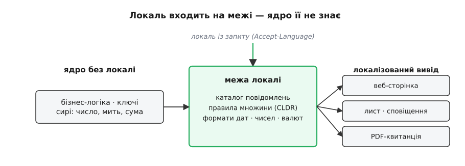
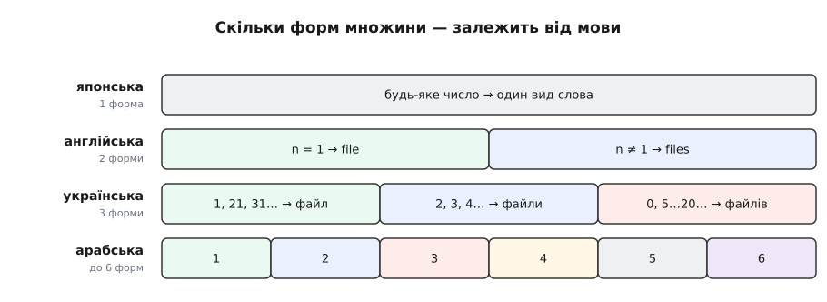
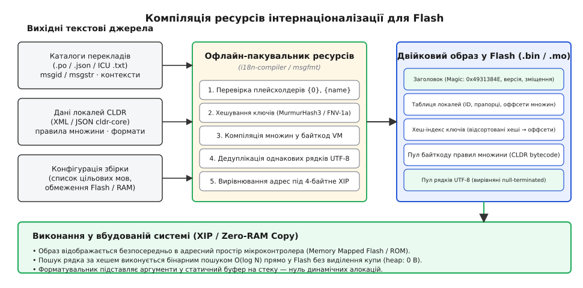
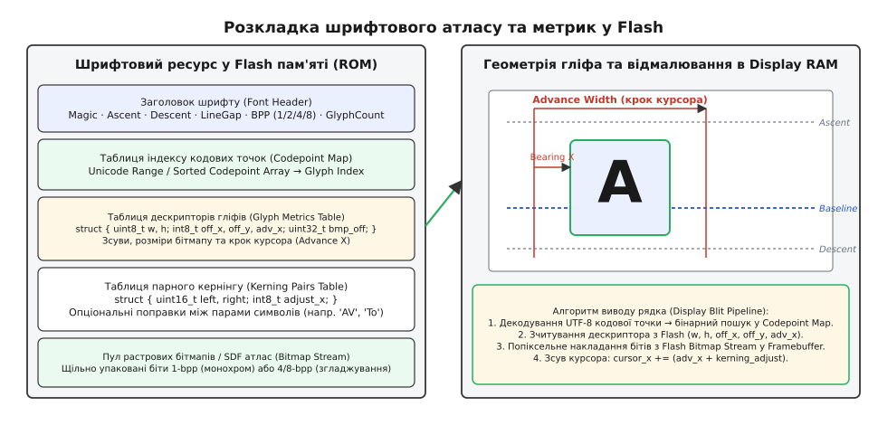

# Локалізація документів і інтерфейсу як архітектурна межа

<preknowlist>
- [ASCII і UTF-8](root:sf-data/ascii-utf8) — кодування тексту, представлення кодових точок Unicode змінною кількістю байтів (1–4 байти), порядок байтів (Endianness).
- [Абстрактне синтаксичне дерево (AST)](root:sf-lang/abstract-syntax-tree) — розбір параметризованих шаблонів у вузли виразів і гілок.
- [Узгодження вмісту](root:com-protocol/content-negotiation) — механізми протоколу HTTP для передавання переваг локалі через заголовок `Accept-Language`.
- [Файлові системи на Flash-пам'яті](root:sf-data/flash-filesystem) — фізичні особливості Flash-пам'яті, структура секторів і блоків, організація збереження даних.
</preknowlist>

Коли інженер намагається додати багатомовність до готової програми звичайною заміною рядкових літералів у коді, архітектура зазнає краху на першому ж динамічному виклику. Конструкція `sprintf(buf, "Вилучено %d файлів із теки %s", count, folder)` містить у собі одразу чотири неявні лінгвістичні припущення, кожне з яких хибне за межами англійської мови. Вона припускає, що слово «файл» має лише одну форму множини; що число завжди стоїть безпосередньо перед іменником; що назва теки завжди розташована наприкінці речення; і що візуальний потік тексту завжди спрямований зліва направо. 

В українській мові для цілих чисел 1, 2 та 5 потрібні три різні форми («1 файл», «2 файли», «5 файлів»), а для дробового залишку — четверта («1,5 файлу»). В арабській мові діють шість граматичних категорій множини (нуль, однина, двоїна, мала множина, велика множина, загальна форма). У японській мові порядок членів речення вимагає винесення назви теки на початок фрази з обов'язковим додаванням лічильного суфікса, а в івриті та арабському письмі весь екранний макет розгортається справа наліво.

Спроба залатати ці відмінності каскадом умовних операторів `if (locale == LOCALE_UK) ... else if (locale == LOCALE_JA) ...` миттєво руйнує модульність системи: правила граматики сотень мов розсіюються по бізнес-логіці, змішуються з обчисленнями й роблять додавання наступного мовного пакету залежним від повної перекомпіляції та повторного тестування всієї кодової бази.

Єдиним надійним інженерним рішенням є побудова жорсткої архітектурної межі локалізації. Бізнес-ядро програми залишається повністю вільним від будь-якої мови чи регіональних конвенцій: воно оперує виключно інваріантними семантичними ключами повідомлень та чистими числовими значеннями. Перетворення сирих даних на послідовність символів, зрозумілу людині, відбувається виключно на межі представлення за участі спеціалізованого рушія локалізації, який поєднує скомпільовані двійкові ресурси, правила Unicode CLDR, підсистему двонапрямленого тексту та шрифтові атласи.

---

## 1. Анатомія локалі: ідентифікація, теги BCP 47 та каскадний відкат

Поняття «мова» описує лише лінгвістичну систему спілкування (словниковий запас і граматику), тоді як програмна система взаємодіє з **локальними конвенціями (локаллю)** — цілісним комплексом регіональних, культурних, числових, часових та графічних правил певної спільноти користувачів. 

Англійська мова в США (`en-US`) вимагає форматування дати у вигляді `08/28/2026`, розділення тисяч комою (`1,234.56`) та початку тижня в неділю. Та сама англійська мова у Великій Британії (`en-GB`) вимагає дати `28/08/2026`, крапки як десяткового роздільника та початку тижня в понеділок. Німецька мова в Німеччині (`de-DE`) записує числа як `1.234,56`, а в Швейцарії (`de-CH`) використовує апостроф як роздільник груп розрядів: `1'234.56`.

Стандарт IETF BCP 47 (RFC 5646) формалізує структуру канонічного тегу локалі як послідовність стандартизованих субтегів, з'єднаних дефісами:

```
language[-script][-region][-variant][-extension]
```

Компоненти формуються за суворими міжнародними реєстрами:
- **Language (мова)**: дволітерний код ISO 639-1 (`uk`, `en`, `de`) або трилітерний код ISO 639-2/3 (`azb`, `fil`).
- **Script (писемність)**: чотирилітерний код ISO 15924 з великої літери (`Cyrl` — кирилиця, `Latn` — латиниця, `Arab` — арабське письмо, `Hant` — традиційне китайське письмо). Вживається, коли та сама мова використовує різні абетки (наприклад, сербська `sr-Cyrl` та `sr-Latn`, узбецька `uz-Latn` та `uz-Cyrl`).
- **Region (регіон/країна)**: дволітерний код країни ISO 3166-1 alpha-2 (`UA`, `US`, `DE`, `CH`) або тризначний числовий код регіону UN M.49 (`001` — світ, `150` — Європа, `419` — Латинська Америка).
- **Variant (діалектний варіант)**: зареєстровані спеціальні субтеги (наприклад, `sl-nedis` — надісонський діалект словенської мови).
- **Extension (розширення Unicode)**: префікс `-u-` з наступними парами ключ-значення, що перевизначають окремі конвенції без зміни мови (наприклад, `ar-EG-u-nu-arab` — арабська мова в Єгипті з примусовим використанням східноарабських цифр замість європейських; `th-TH-u-ca-buddhist` — тайська мова з буддійським календарем).


*Ядро тримає лише логіку, ключі й сирі значення; локаль входить на межі й лише там перетворює їх на текст для людини.*

### Алгоритми фільтрації та пошуку локалей (RFC 4647)

Стандарт RFC 4647 визначає два фундаментальні алгоритми зіставлення мовних пріоритетів користувача з доступними локалями системи:

1. **Базова фільтрація (Basic Filtering)**: зіставляє запитаний префіксний діапазон (наприклад, `de-DE`) з наявними тегами. Якщо користувач запитує `de`, фільтрація повертає всі доступні діалекти: `de-DE`, `de-AT`, `de-CH`.
2. **Розширений пошук відповідності (Extended Lookup)**: покроково скорочує тег користувача справа наліво, відкидаючи розширення, варіанти, регіон та писемність, поки не знайде перший точний збіг у списку скомпільованих мовних пакетів.

Клієнтський пристрій передає список бажаних локалей. У протоколі HTTP для цього слугує заголовок узгодження вмісту `Accept-Language`:

```http
Accept-Language: uk-UA,uk;q=0.9,en-US;q=0.8,en;q=0.7
```

Число `q` (quality factor від 0.0 до 1.0) позначає рівень переваги користувача. Рушій локалізації виконує розбір рядка заголовка, сортує елементи за спаданням коефіцієнта `q` і для кожного запису запускає ланцюжок відкату (fallback chain):

```
uk-Cyrl-UA  -->  uk-UA  -->  uk  -->  мова-основа (default fallback)  -->  сирий ключ
```

Цей механізм гарантує детермінізм поведінки інтерфейсу:
1. Якщо для діалекту `de-CH` (німецька у Швейцарії) відсутній специфічний переклад певного рядка, рушій автоматично бере загальнонімецький переклад `de`.
2. Якщо рядок відсутній і в `de`, береться переклад з мови за замовчуванням (наприклад, `en-US`).
3. Якщо ключ відсутній у всіх каталогах, рушій повертає сам рядок ключа (наприклад, `sensor.err.overheat`), одночасно записуючи діагностичне повідомлення в системний журнал розробника.

[Звідки взялися ці числові скорочення й перші каталоги перекладів](root:sf-apps/i18n-as-architecture/hist-i18n-numeronyms.md) — окрема історія інженерного побуту, що визначила сучасні стандарти.

---

## 2. Фізика тексту в пам'яті: стандарти Unicode, UTF-8 та нормалізація

Текст у сучасній комп'ютерній системі — це багаторівнева ієрархія абстракцій. Змішування рівнів цієї ієрархії є джерелом найнебезпечніших дефектів обробки пам'яті, псування буферів і вразливостей переповнення.

```
[Байти у пам'яті: 0xD0 0xB9] 
         │ (Декодування UTF-8)
         ▼
[Кодова точка: U+0439] 
         │ (Аналіз контексту UAX #29)
         ▼
[Графемний кластер: «й»] 
         │ (Шейпінг OpenType / Атлас гліфів)
         ▼
[Растровий гліф у фреймбуфері: індекс #42]
```

### Кодові точки проти графемних кластерів

1. **Кодова точка Unicode (Code Point)** — числовий індекс у просторі від `U+0000` до `U+10FFFF` (1 114 112 можливих позицій).
   - Основна багатомовна площина (BMP, Plane 0: `U+0000..U+FFFF`) містить практично всі сучасні писемності світу.
   - Додаткові площини (Planes 1–16: `U+10000..U+10FFFF`) містять історичні писемності, математичні символи та емодзі.
   - Діапазон сурогатів `U+D800..U+DFFF` (2048 кодових точок) виділено виключно для механізму кодування UTF-16 і заборонено для використання як самостійні символи в UTF-8 або UTF-32. Коректні кодові точки, за винятком сурогатів, називаються **скалярними значеннями Unicode (Unicode Scalar Values)**.

2. **Графемний кластер (User-Perceived Character за стандартом UAX #29)** — мінімальна графічна одиниця, яку людина сприймає як один символ. 
   Графемний кластер може складатися як з однієї кодової точки, так і з довгого ланцюжка модифікаторів:
   - Базова літера + комбіновані діакритичні знаки: наприклад, «e» (`U+0065`) + `U+0301` (Combining Acute Accent) = «é».
   - Прапори держав: послідовність двох символів регіональних індикаторів (Regional Indicator Symbols), наприклад `U+1F1FA` (REGIONAL INDICATOR SYMBOL LETTER U) + `U+1F1E6` (LETTER A) = 🇺🇦.
   - Складні емодзі: базова фігура + модифікатор кольору шкіри + поєднувач нульової ширини (ZWJ, `U+200D`) + додатковий предмет. Наприклад, символ жінки-техніка 👩‍💻 складається з 5 кодових точок і займає 17 байтів в UTF-8, але для інтерфейсу є єдиним символом шириною в одне знакомісце.

### Правила сегментації графемних кластерів (UAX #29)

Стандарт UAX #29 визначає алгоритм знаходження меж між графемними кластерами за допомогою набору правил переходу між категоріями символів. Межа між двома сусідніми кодовими точками `A` та `B` **забороняється** за таких умов:
- **Правило GB3/GB4**: заборонено розривати послідовність `CR` (`\r`) та `LF` (`\n`). `CR × LF`.
- **Правило GB6–GB8 (Корейські склади Хангиль)**: поєднання початкового приголосного `L`, голосного `V` та кінцевого приголосного `T` є єдиним кластером: `L × L`, `L × V`, `LV × V`, `V × T`, `LVT × T`.
- **Правило GB9/GB9a**: заборонено розривати базовий символ і комбінований знак або діакритику. `Base × Extend`, `Base × SpacingMark`.
- **Правило GB11 (ZWJ-ланцюжки емодзі)**: заборонено розривати послідовність розширеного піктографічного символу через ZWJ. `ExtPict × Extend* × ZWJ × ExtPict`.
- **Правило GB12/GB13 (Прапори)**: дозволено об'єднувати лише пари символів регіональних індикаторів: `sot × RI × RI`. Третій регіональний індикатор утворює новий кластер.

Якщо графічний редактор чи термінал обрізає рядок посередині графемного кластера, користувач отримує візуальне спотворення або відрив діакритики у вигляді окремого символу пунктуації на новому рядку.

### Структура кодування UTF-8

Кодування UTF-8 розроблено Кеном Томпсоном та Робом Пайком у 1992 році. Воно повністю сумісне з 7-бітним ASCII, самосинхронізоване (жоден байт продовження не збігається з байтом заголовка) і не залежить від порядку байтів процесора (Endianness-agnostic):

| Діапазон кодових точок (Hex) | Байт 1 | Байт 2 | Байт 3 | Байт 4 | Опис |
|---|---|---|---|---|---|
| `00000000..0000007F` | `0xxxxxxx` | — | — | — | ASCII (1 байт) |
| `00000080..000007FF` | `110xxxxx` | `10xxxxxx` | — | — | Кирилиця, грецька, арабська (2 байти) |
| `00000800..0000FFFF` | `1110xxxx` | `10xxxxxx` | `10xxxxxx` | — | Символи Азії, математика (3 байти) |
| `00010000..0010FFFF` | `11110xxx` | `10xxxxxx` | `10xxxxxx` | `10xxxxxx` | Емодзі, рідкісні ієрогліфи (4 байти) |

:::tabs
```c
/* Високопродуктивний потоковий декодер UTF-8 на C99 */
uint32_t utf8_decode_next(const uint8_t **p_src, const uint8_t *src_end) {
    if (!p_src || !*p_src || *p_src >= src_end) return 0xFFFD; /* U+FFFD REPLACEMENT CHARACTER */
    
    const uint8_t *s = *p_src;
    uint8_t b0 = *s++;
    
    if (b0 < 0x80) {
        *p_src = s;
        return b0;
    }
    
    uint32_t cp = 0;
    size_t needed = 0;
    
    if ((b0 & 0xE0) == 0xC0) {
        cp = b0 & 0x1F;
        needed = 1;
        if (cp < 0x02) return 0xFFFD; /* Заборона надлишкового кодування (Overlong) */
    } else if ((b0 & 0xF0) == 0xE0) {
        cp = b0 & 0x0F;
        needed = 2;
    } else if ((b0 & 0xF8) == 0xF0) {
        cp = b0 & 0x07;
        needed = 3;
        if (cp > 0x04) return 0xFFFD; /* Вихід за межі U+10FFFF */
    } else {
        *p_src = s;
        return 0xFFFD; /* Невалідний лідируючий байт */
    }
    
    if ((size_t)(src_end - s) < needed) {
        *p_src = src_end;
        return 0xFFFD; /* Обрізаний потік байтів */
    }
    
    for (size_t i = 0; i < needed; ++i) {
        uint8_t bi = *s++;
        if ((bi & 0xC0) != 0x80) {
            *p_src = s;
            return 0xFFFD; /* Невірний байт продовження */
        }
        cp = (cp << 6) | (bi & 0x3F);
    }
    
    /* Перевірка на діапазон сурогатів UTF-16 та оверлонг для 3 байт */
    if ((cp >= 0xD800 && cp <= 0xDFFF) || (needed == 2 && cp < 0x0800) || (needed == 3 && cp < 0x10000)) {
        *p_src = s;
        return 0xFFFD;
    }
    
    *p_src = s;
    return cp;
}
```
```cpp
// Ідіоматичний потоковий декодер UTF-8 на C++20
#include <cstdint>
#include <cstddef>
#include <span>
#include <optional>

struct Utf8DecodeResult {
    char32_t code_point{0xFFFD};
    size_t   bytes_consumed{1};
};

[[nodiscard]] constexpr Utf8DecodeResult utf8_decode_next(std::span<const uint8_t> bytes) noexcept {
    if (bytes.empty()) return {0xFFFD, 0};
    
    uint8_t b0 = bytes[0];
    if (b0 < 0x80) {
        return {static_cast<char32_t>(b0), 1};
    }
    
    char32_t cp = 0;
    size_t needed = 0;
    
    if ((b0 & 0xE0) == 0xC0) {
        cp = b0 & 0x1F;
        needed = 1;
        if (cp < 0x02) return {0xFFFD, 1}; // Overlong
    } else if ((b0 & 0xF0) == 0xE0) {
        cp = b0 & 0x0F;
        needed = 2;
    } else if ((b0 & 0xF8) == 0xF0) {
        cp = b0 & 0x07;
        needed = 3;
        if (cp > 0x04) return {0xFFFD, 1}; // Out of range (> U+10FFFF)
    } else {
        return {0xFFFD, 1}; // Invalid lead byte
    }
    
    if (bytes.size() < 1 + needed) {
        return {0xFFFD, bytes.size()}; // Truncated
    }
    
    for (size_t i = 1; i <= needed; ++i) {
        uint8_t bi = bytes[i];
        if ((bi & 0xC0) != 0x80) {
            return {0xFFFD, i}; // Invalid continuation byte
        }
        cp = (cp << 6) | (bi & 0x3F);
    }
    
    if ((cp >= 0xD800 && cp <= 0xDFFF) || (needed == 2 && cp < 0x0800) || (needed == 3 && cp < 0x10000)) {
        return {0xFFFD, 1 + needed};
    }
    
    return {cp, 1 + needed};
}
```
:::

### Форми нормалізації Unicode (UAX #15)

Через історичну еволюцію стандарту однакові візуальні символи можуть бути представлені різними послідовностями кодових точок:
- Попередня композиція (Precomposed): літера «і» з крапкою `U+0069` або кирилична «й» `U+0439` (одна кодова точка).
- Декомпозиція (Decomposed): базова літера + комбінований символ `U+0438` + `U+0306` (дві кодові точки).

Стандарт Unicode визначає 4 алгоритмічні форми нормалізації:

1. **NFC (Canonical Decomposition, followed by Canonical Composition)**: приводить символи до максимально скомпонованої канонічної форми. Є обов'язковим стандартом для веб-технологій W3C, файлових систем Linux та баз даних.
2. **NFD (Canonical Decomposition)**: розкладає всі комбіновані символи на базові кодові точки та послідовність відокремлених діакритичних знаків у строго канонічному порядку. Застосовується перед порівнянням рядків без діакритики.
3. **NFKC (Compatibility Decomposition, followed by Canonical Composition)**: додатково замінює сумісні символи на їхні стандартні еквіваленти (наприклад, типографічну лігатуру `fi` `U+FB01` на два окремі символи `f` + `i`, символ дробу `½` `U+00BD` на `1/2`, римську цифру `Ⅷ` на латинські літери `VIII`). Застосовується в пошукових індексах та нормалізації логінів.
4. **NFKD (Compatibility Decomposition)**: повне сумісне розкладання без наступної композиції.

```
Слово: «Київ»
NFC:  [0x041A] [0x0438] [0x0457] [0x0432]         (4 кодові точки, 8 байтів UTF-8)
NFD:  [0x041A] [0x0438] [0x0456] [0x0308] [0x0432] (5 кодових точок, 10 байтів UTF-8)
      (де U+0456 — 'і', а U+0308 — Combining Diaeresis ' ̈')
```

#### Канонічний клас комбінування (Canonical Combining Class, CCC)

Кожен комбінований символ у базі даних Unicode (UCD) має числовий атрибут CCC від 0 до 255:
- Базові літери мають `CCC = 0`.
- Діакритичні знаки під літерою (наприклад, седиль `U+0327` ¸) мають `CCC = 202`.
- Діакритичні знаки над літерою (наприклад, тильда `U+0303` ̃) мають `CCC = 230`.
- Знаки праворуч (наприклад, знак наголосу `U+0300` ̀) мають `CCC = 232`.

Алгоритм канонічного впорядкування (Canonical Ordering Algorithm) вимагає, щоб будь-яка послідовність комбінованих символів із `CCC > 0`, яка слідує за базовим символом, була відсортована за зростанням значень CCC за допомогою стабільного сортування. Якщо дві діакритики мають однаковий ненульовий CCC, їхній взаємний порядок зберігається, оскільки він впливає на вертикальне накладання знаків.

Якщо система зберігає ключі в базі даних або каталозі в NFC, а запит від користувача надійшов у NFD (що регулярно відбувається на пристроях Apple macOS/iOS), пряме побітове порівняння поверне хибний результат відсутності запису. Перед будь-якою операцією зіставлення чи хешування текст повинен обов'язково пройти етап канонічної нормалізації NFC.

### Алгоритм упорядкування Unicode (UCA, UTS #10)

Впорядкування рядків за абеткою не збігається зі зростанням числових кодів кодових точок (код `strcmp` непридатний для сортування списків у UI). В українській абетці літера «Ґ» (`U+0490`) стоїть після «Г» (`U+0413`), але її числовий код більший за код літери «Я» (`U+042F`). У шведській мові літера «Ö» йде наприкінці абетки, а в німецькій — сортується разом із «O».

Unicode Collation Algorithm порівнює рядки через генерацію багатошарових ключів сортування (Collation Elements), де кожен символ оцінюється на кількох рівнях ваги:

```
SortKey = [L1 ... L1] | [L2 ... L2] | [L3 ... L3] | [L4 ... L4]
```

- **Рівень 1 (Primary)**: базова літера (ігнорує регістр і діакритику: `e` == `E` == `é`).
- **Рівень 2 (Secondary)**: діакритичні знаки (`e` != `é`).
- **Рівень 3 (Tertiary)**: регістр символу (`e` != `E`).
- **Рівень 4 (Quaternary)**: пунктуація та спеціальні знаки.

UCA підтримує спеціальні лінгвістичні явища:
- **Контракції (Contractions)**: пара символів сортується як єдина літера (наприклад, «ch» у чеській та іспанській мовах іде після літери «h», а не між «cg» та «ci»).
- **Експансії (Expansions)**: один символ розгортається у два вагові вектори (німецька есцет «ß» сортується еквівалентно до «ss»).
- **Ігноровані символи (Ignorable Characters)**: м'які переноси (`U+00AD`) та невидимі роздільники (`U+200B`) отримують нульові ваги на рівнях L1–L3 і не впливають на абетковий порядок слів.

---

## 3. Моделі каталогів ресурсів: gettext (PO/MO) та ICU

Індустрія сформувала два провідних підходи до організації сховищ перекладів: модель пар «оригінал-переклад» (GNU gettext) та ієрархічну модель ключів і дерев ресурсів (ICU / Resource Bundles).

### Модель GNU gettext: структура файлів PO та двійкових MO

Формат GNU gettext спирається на використання самого англійського тексту як ідентифікатора повідомлення (`msgid`). Джерелом є людиночитний текстовий файл `.po` (Portable Object):

```po
msgid ""
msgstr ""
"Project-Id-Version: SensorController 2.4\n"
"Content-Type: text/plain; charset=UTF-8\n"
"Plural-Forms: nplurals=3; plural=(n%10==1 && n%100!=11 ? 0 : n%10>=2 && n%10<=4 && (n%100<10 || n%100>=20) ? 1 : 2);\n"

#: src/ui/storage.c:142
msgctxt "battery_alert"
msgid "Low voltage on node %d"
msgstr "Низька напруга на вузлі %d"

#: src/ui/sensors.c:89
msgid "%d log entry deleted"
msgid_plural "%d log entries deleted"
msgstr[0] "Вилучено %d запис журналу"
msgstr[1] "Вилучено %d записи журналу"
msgstr[2] "Вилучено %d записів журналу"
```

Для швидкої роботи на цільовій системі файл `.po` компілюється утилітою `msgfmt` у компактний бінарний файл `.mo` (Machine Object). Бінарний файл розроблено так, щоб операційна система могла відобразити його в пам'ять через `mmap()` і здійснювати пошук перекладів за `O(log N)` за допомогою бінарного пошуку без додаткового парсингу.

#### Структура заголовка та таблиць бінарного файлу `.mo`

Бінарний образ `.mo` складається з п'яти основних розділів:

```
+-------------------------------------------------------------+
| Заголовок: Magic Number (0x950412DE або 0xDE120495)         |
| Версія формату (0 або 1)                                   |
| Кількість рядків N                                          |
| Зміщення таблиці оригіналів O (Offset of Originals Table)   |
| Зміщення таблиці перекладів T (Offset of Translations Table)|
| Розмір хеш-таблиці S                                        |
| Зміщення хеш-таблиці H (Offset of Hash Table)               |
+-------------------------------------------------------------+
| Таблиця оригіналів (N пар: довжина, зміщення на рядок)      |
+-------------------------------------------------------------+
| Таблиця перекладів (N пар: довжина, зміщення на рядок)      |
+-------------------------------------------------------------+
| Хеш-таблиця (S 32-бітних індексів для прискореного пошуку)   |
+-------------------------------------------------------------+
| Пул рядків UTF-8 (null-terminated рядки msgid та msgstr)    |
+-------------------------------------------------------------+
```

Для ключів із контекстом (`msgctxt`) рядок в таблиці оригіналів зберігається як `контекст\x04ключ`. Для множинних форм `msgid` та `msgid_plural` розділяються байтом `\x00`, а всі форми перекладу `msgstr[0]`, `msgstr[1]` записуються послідовно через нульовий байт.

### Двійкова структура та парсер файлів .mo на C99 та C++20

Нижче наведено повну системну реалізацію прямого зчитування та пошуку повідомлень у скомпільованому двійковому файлі GNU gettext `.mo` з пам'яті без динамічного виділення купи:

:::tabs
```c
#include <stdint.h>
#include <stddef.h>
#include <string.h>
#include <stdbool.h>

#define MO_MAGIC_LE 0x950412DE
#define MO_MAGIC_BE 0xDE120495

typedef struct {
    uint32_t length;
    uint32_t offset;
} mo_string_desc_t;

typedef struct {
    const uint8_t *data;
    size_t size;
    uint32_t num_strings;
    const mo_string_desc_t *orig_table;
    const mo_string_desc_t *trans_table;
    bool swap_endian;
} mo_file_reader_t;

static inline uint32_t mo_swap32(uint32_t val, bool swap) {
    if (!swap) return val;
    return ((val >> 24) & 0xFF) |
           ((val >> 8)  & 0xFF00) |
           ((val << 8)  & 0xFF0000) |
           ((val << 24) & 0xFF000000);
}

bool mo_reader_init(mo_file_reader_t *reader, const uint8_t *buffer, size_t size) {
    if (!reader || !buffer || size < 28) return false;
    
    reader->data = buffer;
    reader->size = size;
    
    uint32_t magic;
    memcpy(&magic, buffer, sizeof(uint32_t));
    
    if (magic == MO_MAGIC_LE) {
        reader->swap_endian = false;
    } else if (magic == MO_MAGIC_BE) {
        reader->swap_endian = true;
    } else {
        return false;
    }
    
    uint32_t num_strings, orig_offset, trans_offset;
    memcpy(&num_strings,  buffer + 8,  sizeof(uint32_t));
    memcpy(&orig_offset,  buffer + 12, sizeof(uint32_t));
    memcpy(&trans_offset, buffer + 16, sizeof(uint32_t));
    
    reader->num_strings = mo_swap32(num_strings, reader->swap_endian);
    uint32_t off_orig   = mo_swap32(orig_offset, reader->swap_endian);
    uint32_t off_trans  = mo_swap32(trans_offset, reader->swap_endian);
    
    size_t table_bytes = (size_t)reader->num_strings * sizeof(mo_string_desc_t);
    if (off_orig + table_bytes > size || off_trans + table_bytes > size) {
        return false;
    }
    
    reader->orig_table  = (const mo_string_desc_t *)(buffer + off_orig);
    reader->trans_table = (const mo_string_desc_t *)(buffer + off_trans);
    return true;
}

const char *mo_reader_lookup(const mo_file_reader_t *reader, const char *msgid) {
    if (!reader || !reader->data || !msgid) return msgid;
    
    size_t target_len = strlen(msgid);
    int32_t low = 0;
    int32_t high = (int32_t)reader->num_strings - 1;
    
    while (low <= high) {
        int32_t mid = low + ((high - low) >> 1);
        uint32_t str_len = mo_swap32(reader->orig_table[mid].length, reader->swap_endian);
        uint32_t str_off = mo_swap32(reader->orig_table[mid].offset, reader->swap_endian);
        
        if (str_off + str_len >= reader->size) break;
        
        const char *cand = (const char *)(reader->data + str_off);
        int cmp = strcmp(msgid, cand);
        
        if (cmp == 0) {
            uint32_t tr_len = mo_swap32(reader->trans_table[mid].length, reader->swap_endian);
            uint32_t tr_off = mo_swap32(reader->trans_table[mid].offset, reader->swap_endian);
            if (tr_off + tr_len < reader->size) {
                return (const char *)(reader->data + tr_off);
            }
            break;
        } else if (cmp < 0) {
            high = mid - 1;
        } else {
            low = mid + 1;
        }
    }
    return msgid;
}
```
```cpp
#include <cstdint>
#include <cstddef>
#include <string_view>
#include <span>
#include <optional>
#include <bit>
#include <algorithm>
#include <cstring>

class MoFileReader {
public:
    struct StringDesc {
        uint32_t length;
        uint32_t offset;
    };

    constexpr MoFileReader() = default;

    static std::optional<MoFileReader> create(std::span<const uint8_t> memory) noexcept {
        if (memory.size() < 28) return std::nullopt;

        uint32_t magic = read_u32(memory.data());
        bool swap = false;
        if (magic == 0x950412DE) {
            swap = false;
        } else if (magic == 0xDE120495) {
            swap = true;
        } else {
            return std::nullopt;
        }

        uint32_t count     = swap_val(read_u32(memory.data() + 8), swap);
        uint32_t orig_off  = swap_val(read_u32(memory.data() + 12), swap);
        uint32_t trans_off = swap_val(read_u32(memory.data() + 16), swap);

        size_t table_bytes = static_cast<size_t>(count) * sizeof(StringDesc);
        if (orig_off + table_bytes > memory.size() || trans_off + table_bytes > memory.size()) {
            return std::nullopt;
        }

        MoFileReader reader;
        reader.raw_data_    = memory;
        reader.num_strings_ = count;
        reader.orig_table_  = reinterpret_cast<const StringDesc*>(memory.data() + orig_off);
        reader.trans_table_ = reinterpret_cast<const StringDesc*>(memory.data() + trans_off);
        reader.swap_endian_ = swap;
        return reader;
    }

    [[nodiscard]] std::string_view lookup(std::string_view msgid) const noexcept {
        if (raw_data_.empty()) return msgid;

        int32_t low = 0;
        int32_t high = static_cast<int32_t>(num_strings_) - 1;

        while (low <= high) {
            int32_t mid = low + ((high - low) >> 1);
            uint32_t len = swap_val(orig_table_[mid].length, swap_endian_);
            uint32_t off = swap_val(orig_table_[mid].offset, swap_endian_);

            if (off + len >= raw_data_.size()) break;

            std::string_view candidate(reinterpret_cast<const char*>(raw_data_.data() + off), len);
            if (msgid == candidate) {
                uint32_t tr_len = swap_val(trans_table_[mid].length, swap_endian_);
                uint32_t tr_off = swap_val(trans_table_[mid].offset, swap_endian_);
                if (tr_off + tr_len < raw_data_.size()) {
                    return { reinterpret_cast<const char*>(raw_data_.data() + tr_off), tr_len };
                }
                break;
            } else if (msgid < candidate) {
                high = mid - 1;
            } else {
                low = mid + 1;
            }
        }
        return msgid;
    }

private:
    std::span<const uint8_t> raw_data_{};
    uint32_t num_strings_{0};
    const StringDesc *orig_table_{nullptr};
    const StringDesc *trans_table_{nullptr};
    bool swap_endian_{false};

    static inline uint32_t read_u32(const uint8_t *ptr) noexcept {
        uint32_t v;
        std::memcpy(&v, ptr, sizeof(v));
        return v;
    }

    static inline uint32_t swap_val(uint32_t val, bool swap) noexcept {
        return swap ? std::byteswap(val) : val;
    }
};
```
:::

### Модель ICU (International Components for Unicode) та формат MessageFormat

Бібліотека ICU (International Components for Unicode), яка є спільним проектом IBM та консорціуму Unicode, представляє індустріальний стандарт для високорівневих систем (Android, iOS, Chromium, Java, Node.js).

На відміну від gettext, ICU оперує структурованим синтаксисом **ICU MessageFormat**, де логіка вибору роду, множини та форматування чисел інкапсульована безпосередньо в тіло повідомлення:

```
{actor, select, 
    female {{actor} завантажила} 
    other  {{actor} завантажив}} 
{count, plural, 
    one   {# файл} 
    few   {# файли} 
    many  {# файлів} 
    other {# файлу}} 
у сховище.
```

Переваги моделі ICU:
1. **Іменовані плейсхолдери**: параметри передаються у вигляді словника `{ "actor": "Оксана", "count": 3 }`, що дозволяє перекладачеві вільно міняти порядок слів у реченні відповідно до синтаксису цільової мови.
2. **Вкладені вирази**: правила вибору форми узгоджуються між собою в єдиному синтаксичному дереві.
3. **Пряма інтеграція з CLDR**: усі правила множини, назви місяців, регіональні формати чисел та валют витягуються зі спільного версійованого репозиторію даних.

---

## 4. Математика плюралізації CLDR та складні контекстні шаблони

Формування повідомлень із числовими значеннями вимагає суворого математичного апарату. Проблема полягає в тому, що правила граматичної множини не є лінійними функціями.

### Повна система операндів Unicode CLDR

Для розрахунку форми множини консорціум Unicode у репозиторії CLDR формалізував 8 операндів, які витягуються з числа:

| Операнд | Математичне визначення | Приклад для `"-12.340"` | Приклад для `"1.0"` |
|---|---|---|---|
| `n` | Абсолютне значення вихідного числа | `12.34` | `1.0` |
| `i` | Ціла частина числа | `12` | `1` |
| `v` | Кількість видимих десяткових розрядів (разом із нулями) | `3` | `1` |
| `w` | Кількість видимих десяткових розрядів без нулів у кінці | `2` | `0` |
| `f` | Видима дробова частина як ціле число | `340` | `0` |
| `t` | Видима дробова частина без кінцевих нулів як ціле число | `34` | `0` |
| `c` | Компактний десятковий експонент (для виразів типу «10K») | `0` | `0` |
| `e` | Синонім для `c` (зарезервовано) | `0` | `0` |

Завдяки операндам `v` та `f` правила розрізняють числа `1` (`v = 0`) та `1.0` (`v = 1`). В українській мові «1 файл» (`v = 0 -> one`), але «1,0 файлу» (`v = 1 -> other`).


*Та сама кількість членує слово на різне число форм — і поділ цей у кожної мови свій; ось чому вибір форми не можна зашити в код.*

```
Повна карта категорій множини для української мови (CLDR Plural Rules):
┌─────────┬────────────────────────────────────────────────────────┬──────────────────────┐
│ Категорія│ Умова (CLDR Expression)                                │ Приклади чисел       │
├─────────┼────────────────────────────────────────────────────────┼──────────────────────┤
│ one     │ v = 0 and i % 10 = 1 and i % 100 != 11                 │ 1, 21, 31, 51, 101   │
│ few     │ v = 0 and i % 10 = 2..4 and i % 100 != 12..14          │ 2, 3, 4, 22, 23, 104 │
│ many    │ v = 0 and (i % 10 = 0 or i % 10 = 5..9 or i % 100 = 11..14) │ 0, 5..19, 20, 100│
│ other   │ усі інші випадки (дробові значення)                    │ 0.5, 1.2, 1.0, 10.75 │
└─────────┴────────────────────────────────────────────────────────┴──────────────────────┘
```

Для порівняння, польська мова має схожу, але відмінну структуру: для `i = 1` діє форма `one`, для `i % 10 ∈ [2..4]` при `i % 100 ∉ [12..14]` — `few`, а для решти цілих чисел — `many`. Російська та білоруська мови мають структуру, схожу на українську, тоді як литовська мова виділяє форми для закінчень на 1 (`one`: 1, 21, 31), закінчень на 2–9 (`few`: 2–9, 22–29) та нулів/підліткових чисел (`other`: 0, 10–20).

[Робочий формувальник повідомлень та розбір синтаксичного дерева шаблонів](root:sf-apps/i18n-as-architecture/proj-plural-message-format.md) показує, як ці вирази інтегруються в синтаксис ICU MessageFormat на високорівневих мовах.

---

## 5. Форматування чисел, валют, одиниць вимірювання та дат

Перетворення числових і часових величин на текст не може виконуватися простим викликом функцій сімейства `printf("%f")`. Кожна культура має власні правила групування розрядів, позначення знаків і одиниць.

### Числа та валюти

1. **Роздільники розрядів**:
   - Англосаксонська система (`en-US`): кома як роздільник тисяч, крапка як десятковий роздільник (`1,234,567.89`).
   - Континентальна європейська система (`de-DE`, `it-IT`): крапка для тисяч, кома для дробів (`1.234.567,89`).
   - Франкомовна та українська система (`fr-FR`, `uk-UA`): нерозривний пробіл (`U+00A0`) або вузький нерозривний пробіл (`U+202F`) для тисяч, кома для дробів (`1 234 567,89`). Використання звичайного пробілу ASCII `0x20` заборонено, оскільки рядок може розірватися на переносі рядка, залишивши частину числа на іншому рядку.
   - Швейцарська система (`de-CH`, `fr-CH`): прямий апостроф (`1'234'567.89`).

2. **Символи та позиціонування валют**:
   - Префіксне розміщення: знак стоїть перед числом без пробілу (`$100`, `£100`).
   - Суфіксне розміщення: знак стоїть після числа з обов'язковим нерозривним пробілом (`100 ₴`, `100 €`).
   - Фінансові звіти ISO 4217: трилітерний код валюти розміщується відповідно до локалі (`100 UAH`, `USD 100`).

### Форматування дат: скелети проти жорстких шаблонів

Традиційна помилка програмістів — задавати формат дати фіксованим рядком на зразок `"dd.MM.yyyy"`. 

Стандарт Unicode CLDR вводить концепцію **скелетів дати і часу (DateTime Skeletons)**. Скелет описує, які саме поля потрібні, без зазначення їхнього порядку, роздільників та закінчень:

- Скелет `yMMMd` вимагає: рік (число), місяць (скорочена назва), день (число).
- Рушій локалізації транслює скелет у регіональний шаблон:
  - Для `uk-UA`: `28 серп. 2026 р.`
  - Для `en-US`: `Aug 28, 2026`
  - Для `de-DE`: `28. Aug. 2026`
  - Для `ja-JP`: `2026年8月28日`

### Форматування списків (ListFormatter)

Об'єднання кількох елементів у перелік також залежить від граматики мови:
- В англійській мові (`en-US`): `"A, B, and C"` (з так званою оксфордською комою).
- В українській мові (`uk-UA`): `"A, B і C"` або `"A, B та C"` (кома перед сполучником «і» в переліку не ставиться).
- У китайській мові (`zh-CN`): `"A、B和C"` (використовується спеціальна краплеподібна кома `U+3001` Ideographic Comma).

---

## 6. Розрив слів, рядків і графемних кластерів (UAX #14 та UAX #29)

Перенесення слів на новий рядок у графічному інтерфейсі спирається на алгоритм розриву рядків Unicode (UAX #14).

Спроба розбивати рядок на слова за пробілами (`strtok(str, " ")` або `split(' ')`) призводить до фатальних помилок у мовах, які не використовують пробіли між словами:
- **Китайська та японська писемності**: слова записуються підряд без роздільників (`これはテストです`). Розрив рядка дозволений майже між будь-якими двома ієрогліфами, за винятком знаків пунктуації, які заборонено виносити на початок рядка (правила Кінсоку Сьорі).
- **Тайська, кхмерська, лаоська, бірманська мови**: слова пишуться суцільним текстом, але переносити рядок дозволено лише на межі слів. Для знаходження цих меж графічний рушій змушений виконувати морфологічний аналіз за словником або нейромережевою моделлю.

Спеціальні невидимі керуючі символи для верстки:
- `U+00AD` (Soft Hyphen, SHY) — м'який перенос: невидимий у середині рядка, але якщо слово не влазить у блок, розриває його та відображає дефіс.
- `U+200B` (Zero Width Space, ZWSP) — пробіл нульової ширини: вказує рушію верстки допустиме місце для розриву рядка без відображення візуального пробілу чи дефіса.
- `U+2060` (Word Joiner, WJ) — з'єднувач слів: забороняє перенесення рядка в цій точці (наприклад, між числом та одиницею вимірювання).

### Алгоритми сегментації слів CJK (Forward та Backward Maximum Matching)

Оскільки в японському та китайському письмі пробіли між словами відсутні, верстка тексту у вузьких контейнерах інтерфейсу (діалогові вікна, спливаючі підказки) вимагає інтелектуального знаходження меж слів перед виконанням переносу рядка.

Для цього рушії верстки застосовують комбінацію словникових алгоритмів:
1. **Пряме максимальне зіставлення (Forward Maximum Matching / FMM)**:
   Алгоритм починає зіставляти послідовність ієрогліфів від поточної позиції зі словниковим бором (Prefix Trie), намагаючись знайти найдовше відоме слово максимальної довжини (зазвичай до 6–8 ієрогліфів). Знайдене слово фіксується як неподільний токен, а вказівник переміщується на його кінець.
2. **Зворотне максимальне зіставлення (Backward Maximum Matching / BMM)**:
   Сканування тексту виконується справа наліво від кінця речення. Дослідження показують, що для китайської та японської мов точність алгоритму BMM на 2–3% вища за FMM, оскільки модифікатори та залежні слова в цих мовах частіше розташовуються попереду базових коренів.
3. **Двонапрямлене зіставлення (Bi-directional Matching)**:
   Якщо результати FMM та BMM розходяться, рушій обирає варіант із найменшою сумарною кількістю слів або найменшою кількістю поодиноких односимвольних залишків, що мінімізує неприродні розриви фраз.

### Граматичний рід і узгодження відмінків у мовах флективного типу

Спроба підставити довільний іменник у шаблон із прикметником або дієсловом минулого часу призводить до граматичної катастрофи у мовах флективного типу (слов'янські, романські, семітські):
- В англійській мові фраза `"{0} is deleted"` є універсальною для будь-якого об'єкта (`"File is deleted"`, `"Folder is deleted"`).
- В українській мові прикметник та дієслово зобов'язані узгоджуватися з родом іменника:
  - Чоловічий рід: `«Файл вилучено / видалений»`
  - Жіночий рід: `«Теку вилучено / видалена»`
  - Середній рід: `«Повідомлення вилучено / видалене»`

Якщо програма дозволяє користувачеві оперувати різними типами сутностей, архітектура локалізації вимагає передачі контексту граматичного роду (Grammatical Gender Category) у семантичний формувальник. Замість динамічної склейки слів розробник формує явні гілки селектора:

```
{entity_type, select,
    file   {Файл успішно видалений}
    folder {Теку успішно видалено}
    device {Пристрій успішно видалено}
    other  {Об'єкт успішно видалено}
}
```

Це запобігає комбінаторному вибуху та зберігає природне звучання інтерфейсу для носіїв мови.

---

## 7. Зберігання ресурсів у Flash і бюджет пам'яті у вбудованих системах

У мікроконтролерних системах без операційної системи (Bare-Metal або FreeRTOS/Zephyr) пам'ять жорстко обмежена: типовий чип має від 64 КБ до 512 КБ SRAM та від 512 КБ до 2 МБ вбудованої або зовнішньої QSPI NOR Flash.

Використання стандартних високорівневих бібліотек (ICU4C займає від 15 до 30 МБ дискового простору, а мінімальний JSON-парсер виділяє динамічну пам'ять під дерево вузлів) у таких умовах неможливе.

### Концепція прямого виконання (Execute-In-Place / XIP)

Зовнішня флеш-пам'ять NOR підключається через апаратний контролер QSPI/Octal-SPI, який транслює операції читання шини AHB/AXI процесора безпосередньо в команди протоколу SPI (наприклад, Quad-Read command `0xEB`). Процесор бачить пам'ять як звичайний діапазон адрес лише для читання (наприклад, `0x90000000..0x90FFFFFF` на мікроконтролерах STM32F7/H7).


*Компілятор ресурсів пакує текстові джерела та правила CLDR у двійковий образ для прямого відображення у Flash.*

Вимоги до проектування формату ресурсів для XIP Flash:

1. **Суворе вирівнювання за межами 4 байтів**:
   Невирівняне зчитування 32-бітного слова за непарною адресою на ядрах ARM Cortex-M0/M0+/M1 призводить до апаратного винятку `HardFault`. На ядрах Cortex-M3/M4/M7 невирівняний доступ викликає затримку шини на кілька тактів. Усі зміщення й таблиці в двійковому образі локалізації повинні бути кратними 4.

2. **Заміна рядкових ключів на 32-бітні хеші**:
   Замість збереження рядків `dialog.warning.battery_low` у пам'яті формується хеш MurmurHash3_x86_32:
   ```
   "dialog.warning.battery_low"  -->  0x8A4F3B12
   ```
   Таблиця відповідностей містить лише відсортовані пари `(uint32_t key_hash, uint32_t string_offset)`. Розмір одного запису зменшується з 30–50 байтів до фіксованих 8 байтів.

3. **Дедуплікація та злиття суфіксів (Suffix Sharing)**:
   Якщо пул рядків містить слова `«Помилка»` та `«Критична помилка»`, компілятор ресурсів зберігає лише довгий рядок `«Критична помилка\0»`, а дескриптор короткого рядка посилається на зміщення всередині довгого.

### Мінімальне ідеальне хешування (MPHF) у ресурсах

Для великих каталогів (понад 1000 повідомлень) навіть бінарний пошук `O(log N)` забирає 10–12 порівнянь і звернень до Flash-пам'яті, що через затримки шини SPI сповільнює відмалювання UI.

Рішенням є використання алгоритмів мінімального ідеального хешування (наприклад, CHD — Compress, Hash, Displace або BDZ). Алгоритм під час збірки прошивки будує дві 32-бітні функції хешування `h0(k)`, `h1(k)` і компактну мапу зміщень розміром лише 2.5–3.0 біти на ключ:
```
Index = (h0(k) + g[h1(k) % r]) % N
```

Пошук виконується рівно за 1 звернення до таблиці без колізій і без порівнянь рядків (`O(1)` time complexity).

Повний інженерний код для офлайн-компілятора та прошивки мікроконтролера наведено у практичній вставці [компактного рушія локалізації для вбудованих систем](root:sf-apps/i18n-as-architecture/proj-embedded-i18n-engine.md).

---

## 8. Рендеринг шрифтів у Flash та керування пам'яттю

Відмалювання тексту на графічних дисплеях вбудованих систем вимагає перетворення послідовності кодових точок у растрові пікселі на екрані.

### Анатомія та типографічна сітка гліфа


*Шрифтовий ресурс у Flash організовано у вигляді діапазонів кодових точок, таблиці метрик і бітового потоку растеризованих гліфів.*

Кожен символ у шрифті описується набором геометричних параметрів відносно **базової лінії (Baseline)**:

1. **Bounding Box (`w`, `h`)**: розмір растрової матриці, що містить тільки зафарбовані пікселі символу (без порожнечі навколо).
2. **Bearing X (`off_x`)**: горизонтальний відступ від поточної координати курсора до лівого краю Bounding Box. Для літери «j» або курсивних символів може бути від'ємним.
3. **Bearing Y (`off_y`)**: вертикальний відступ від базової лінії до верхнього краю Bounding Box.
4. **Advance Width (`adv_x`)**: відстань, на яку переміщується курсор вправо після відмалювання символу.
5. **Ascent**: висота найвищого гліфа шрифту над базовою лінією.
6. **Descent**: глибина опускання «хвостів» літер (як у «р», «у», «g», «q») нижче базової лінії.

```
                      +-------------------+  ^
                      |     ***           |  |
                      |    *   *          |  |  Glyph Height (h)
                      |   *******         |  |
                      |  *       *        |  |
Baseline -------------+-------------------+--v--------
                      |<->| Bearing X (off_x)
                      |<----------------->| Advance Width (adv_x)
```

### Формати збереження растру гліфів у Flash

1. **1-bpp (Monochrome Bitmap)**: кожен піксель кодується одним бітом (0 — прозоро, 1 — колір тексту). Ідеально для дисплеїв на контролерах SSD1306, ST7565 або швидкого монохромного тексту. Байт містить 8 горизонтальних пікселів.
2. **2-bpp / 4-bpp (Anti-Aliased Alpha)**: кожен піксель займає 2 або 4 біти, визначаючи коефіцієнт змішування (alpha blend) між кольором тексту та тлом. Забезпечує високу якість згладжування літер при скромному обсязі Flash.
3. **8-bpp (Full Alpha Map)**: 1 байт на піксель (256 градацій альфа-каналу). Використовується в системах із 2D-прискорювачами (Chrom-ART DMA2D на STM32), що виконують апаратний альфа-блендинг рядка прямо у фреймбуфер без участі ядра CPU.
4. **SDF / MSDF (Signed Distance Fields)**: пікселі растру зберігають відстань до контуру літери. Дозволяє збільшувати шрифт у 4–8 разів без появи характерних «сходів» пікселізації, використовуючи простий шейдер або порогову фільтрацію на боці дисплейного контролера.

### Таблиці парного кернінгу (Kerning Tables)

Візуальна відстань між певними парами літер виглядає надлишковою через їхню геометричну форму (наприклад, похилі краї літер у парі «AV», нависаючий капелюшок у парі «To» чи «Ta»). Без кернінгу текст виглядає розірваним.

Таблиця кернінгу зберігає поправки `Δx` для конкретних пар кодових точок:
```
cursor_x += adv_x + kerning_lookup(cp_prev, cp_curr)
```

У вбудованих шрифтах таблиця зберігається у вигляді відсортованого масиву пар `(uint32_t pair_key, int8_t adjust_x)`, де `pair_key = (cp1 << 16) | cp2`.

### Структури дескрипторів шрифту на C99 та C++20

:::tabs
```c
#include <stdint.h>
#include <stdbool.h>

typedef struct {
    uint32_t unicode_first;
    uint32_t unicode_last;
    uint32_t glyph_index_offset;
} font_unicode_range_t;

typedef struct {
    uint8_t  box_w;       /* Ширина растру в пікселях */
    uint8_t  box_h;       /* Висота растру в пікселях */
    int8_t   off_x;       /* Горизонтальний зсув від курсора (Bearing X) */
    int8_t   off_y;       /* Вертикальний зсув від базової лінії */
    uint8_t  adv_w;       /* Крок курсора (Advance Width) */
    uint8_t  reserved;
    uint32_t bitmap_offset; /* Зміщення бітів у загальному потоці Flash */
} font_glyph_desc_t;

typedef struct {
    uint32_t magic;           /* 0x464F4E54 ('FONT') */
    uint8_t  version;
    uint8_t  bpp;             /* 1, 2, 4 або 8 біт на піксель */
    int8_t   ascent;          /* Висота над базовою лінією */
    int8_t   descent;         /* Глибина під базовою лінією */
    uint16_t range_count;
    uint32_t glyph_count;
    const font_unicode_range_t *ranges;
    const font_glyph_desc_t    *glyphs;
    const uint8_t              *bitmap_data;
} embedded_font_t;

const font_glyph_desc_t *font_find_glyph(const embedded_font_t *font, uint32_t codepoint) {
    if (!font || !font->ranges || !font->glyphs) return NULL;
    
    for (uint32_t r = 0; r < font->range_count; ++r) {
        if (codepoint >= font->ranges[r].unicode_first && 
            codepoint <= font->ranges[r].unicode_last) {
            uint32_t idx = font->ranges[r].glyph_index_offset + 
                           (codepoint - font->ranges[r].unicode_first);
            if (idx < font->glyph_count) {
                return &font->glyphs[idx];
            }
            break;
        }
    }
    return NULL; /* Символ відсутній у шрифті */
}
```
```cpp
#include <cstdint>
#include <cstddef>
#include <span>
#include <optional>
#include <string_view>

struct FontUnicodeRange {
    uint32_t unicode_first;
    uint32_t unicode_last;
    uint32_t glyph_index_offset;
};

struct FontGlyphDesc {
    uint8_t  box_w;
    uint8_t  box_h;
    int8_t   off_x;
    int8_t   off_y;
    uint8_t  adv_w;
    uint8_t  reserved;
    uint32_t bitmap_offset;
};

class EmbeddedFont {
public:
    struct Header {
        uint32_t magic;
        uint8_t  version;
        uint8_t  bpp;
        int8_t   ascent;
        int8_t   descent;
        uint16_t range_count;
        uint32_t glyph_count;
    };

    constexpr EmbeddedFont(const Header &header,
                           std::span<const FontUnicodeRange> ranges,
                           std::span<const FontGlyphDesc> glyphs,
                           std::span<const uint8_t> bitmap_data) noexcept
        : header_(header), ranges_(ranges), glyphs_(glyphs), bitmap_data_(bitmap_data) {}

    [[nodiscard]] std::optional<FontGlyphDesc> find_glyph(uint32_t codepoint) const noexcept {
        for (const auto &range : ranges_) {
            if (codepoint >= range.unicode_first && codepoint <= range.unicode_last) {
                size_t idx = range.glyph_index_offset + (codepoint - range.unicode_first);
                if (idx < glyphs_.size()) {
                    return glyphs_[idx];
                }
                break;
            }
        }
        return std::nullopt;
    }

    [[nodiscard]] std::span<const uint8_t> get_bitmap_slice(const FontGlyphDesc &desc) const noexcept {
        size_t bytes_per_row = (desc.box_w * header_.bpp + 7) / 8;
        size_t total_bytes = bytes_per_row * desc.box_h;
        if (desc.bitmap_offset + total_bytes <= bitmap_data_.size()) {
            return bitmap_data_.subspan(desc.bitmap_offset, total_bytes);
        }
        return {};
    }

    [[nodiscard]] int8_t ascent() const noexcept { return header_.ascent; }
    [[nodiscard]] int8_t descent() const noexcept { return header_.descent; }
    [[nodiscard]] uint8_t bpp() const noexcept { return header_.bpp; }

private:
    Header header_;
    std::span<const FontUnicodeRange> ranges_;
    std::span<const FontGlyphDesc> glyphs_;
    std::span<const uint8_t> bitmap_data_;
};
```
:::

---

## 9. Архітектура динамічного перемикання мов без рестарту

У пристроях безперервного моніторингу (панелі керування верстатами, медичне обладнання) зміна мови користувача не повинна переривати робочий цикл системи.

### Патерн Observer та потік сповіщень інтерфейсу

Для реалізації безшовного перемикання застосовується підписка візуальних компонентів на шину подій контексту локалізації:

```
[Подія: Користувач обрав «uk-UA»]
               │
               ▼
   [I18n Context Dispatcher]
   ├─ 1. Активація каталогу «uk-UA» у Flash
   ├─ 2. Активація кириличного шрифтового атласу
   └─ 3. Розіслати сповіщення LanguageChangedEvent
               │
   ┌───────────┼───────────┐
   ▼           ▼           ▼
[Віджет 1]  [Віджет 2]  [Звіти/PDF]
   │           │           │
   └───────────┴───────────┘
               │
   [Інвалідація розкладки (Relayout / Reflow)]
   (Перерахунок ширини написів, оновлення геометрії вікон)
```

### Проблема зміни довжини рядків (Text Expansion Ratio)

Переклад англійського тексту іншими мовами призводить до зміни кількості символів та загальної геометричної ширини написів у пікселях:
- Німецька мова: розширення на +30% .. +45% (довгі складні слова).
- Французька та іспанська: розширення на +20% .. +35%.
- Українська та польська: розширення на +15% .. +30%.
- Китайська, японська, корейська: скорочення за кількістю символів на -30% .. -50%, але кожен ієрогліф має фіксовану подвійну ширину та вимагає більшого міжрядкового інтервалу (Line Height).

Графічний макет інтерфейсу повинен проектуватись за адаптивними правилами:
1. Заборона фіксованої ширини кнопок у пікселях для текстових елементів.
2. Використання контейнерів автоматичного компонування (Flex Layout / Auto-sizing bounds).
3. Визначення стратегії поведінки при переповненні: динамічне зменшення кегля шрифту (Auto Font Scaling), плавне обрізання з трикрапкою (Ellipsis `...`) або циклічний бігучий рядок (Marquee) для обмежених LCD-екранів.

### Реалізація диспетчера локалі та контексту виводу на C99 та C++20

:::tabs
```c
#include <stdint.h>
#include <stdbool.h>
#include <stddef.h>

#define MAX_I18N_OBSERVERS 16

typedef void (*i18n_change_callback_t)(void *user_data, const char *new_locale);

typedef struct {
    i18n_change_callback_t callback;
    void *user_data;
} i18n_observer_entry_t;

typedef struct {
    const char *current_locale;
    const void *active_catalog;
    const void *active_font;
    i18n_observer_entry_t observers[MAX_I18N_OBSERVERS];
    size_t observer_count;
} i18n_context_manager_t;

static i18n_context_manager_t g_i18n_ctx;

bool i18n_register_observer(i18n_change_callback_t cb, void *user_data) {
    if (!cb || g_i18n_ctx.observer_count >= MAX_I18N_OBSERVERS) return false;
    
    g_i18n_ctx.observers[g_i18n_ctx.observer_count].callback = cb;
    g_i18n_ctx.observers[g_i18n_ctx.observer_count].user_data = user_data;
    g_i18n_ctx.observer_count++;
    return true;
}

void i18n_set_locale(const char *locale_tag, const void *catalog, const void *font) {
    if (!locale_tag) return;
    
    g_i18n_ctx.current_locale = locale_tag;
    g_i18n_ctx.active_catalog = catalog;
    g_i18n_ctx.active_font    = font;
    
    for (size_t i = 0; i < g_i18n_ctx.observer_count; ++i) {
        if (g_i18n_ctx.observers[i].callback) {
            g_i18n_ctx.observers[i].callback(g_i18n_ctx.observers[i].user_data, locale_tag);
        }
    }
}
```
```cpp
#include <string_view>
#include <functional>
#include <vector>
#include <algorithm>
#include <span>

class I18nContextManager {
public:
    using ObserverCallback = std::function<void(std::string_view new_locale)>;

    static I18nContextManager& instance() noexcept {
        static I18nContextManager manager;
        return manager;
    }

    void register_observer(ObserverCallback observer) {
        observers_.push_back(std::move(observer));
    }

    void set_locale(std::string_view locale_tag, 
                    const void *catalog_ptr = nullptr, 
                    const void *font_ptr = nullptr) {
        current_locale_ = locale_tag;
        active_catalog_ = catalog_ptr;
        active_font_    = font_ptr;

        for (const auto &cb : observers_) {
            if (cb) {
                cb(current_locale_);
            }
        }
    }

    [[nodiscard]] std::string_view current_locale() const noexcept {
        return current_locale_;
    }

    [[nodiscard]] const void* active_catalog() const noexcept {
        return active_catalog_;
    }

    [[nodiscard]] const void* active_font() const noexcept {
        return active_font_;
    }

private:
    I18nContextManager() = default;
    std::string_view current_locale_{"en-US"};
    const void *active_catalog_{nullptr};
    const void *active_font_{nullptr};
    std::vector<ObserverCallback> observers_;
};
```
:::

---

## 10. Двонапрямлений текст (BiDi) та дзеркальне відображення інтерфейсу (RTL)

Підтримка семітських писемностей (арабська мова, іврит, перська, урду) — це не просто віддзеркалення байтів у масиві. Спроба розвернути рядок функцією на кшталт `strrev()` перетворює текст на нечитний хаос, оскільки числа всередині арабського тексту продовжують писатися зліва направо.

### Двонапрямлений алгоритм Unicode (BiDi — UAX #9)

Алгоритм BiDi перетворює **логічний порядок (Logical Order)** збереження символів у пам'яті (у послідовності їх набору та читання людиною) на **візуальний порядок (Visual Order)** позицій гліфів на екрані.

Алгоритм виконує таку послідовність дій:
1. **Визначення базового рівня абзацу (Paragraph Embedding Level)**:
   Якщо першим сильним символом тексту є символ арабської мови чи івриту, базовий рівень абзацу встановлюється в 1 (RTL). Якщо першим символом є латиниця чи кирилиця — 0 (LTR).
2. **Класифікація типів символів**:
   - Сильні типи (Strong Types): `L` (Left-to-Right: латиниця, кирилиця), `R` (Right-to-Left: іврит), `AL` (Arabic Letter: арабські літери).
   - Слабкі типи (Weak Types): `EN` (European Number: 0..9), `ES` (European Separator: +, -), `ET` (European Terminator: %, $), `AN` (Arabic Number: ٠..٩), `CS` (Common Separator: кома, двокрапка, крапка).
   - Нейтральні типи (Neutral Types): `WS` (Whitespace: пробіли), `ON` (Other Neutral: дужки, лапки, математичні знаки).
3. **Розв'язання напрямку нейтральних символів**:
   Пробіли та розділові знаки між двома символами одного напрямку набувають їхнього напрямку. Дужки підлягають дзеркальному відображенню: символ `(` `U+0028` у візуальному потоці RTL відображається відкриваючим гліфом праворуч `)`.
4. **Формування візуальних відрізків (Visual Runs)**:
   Текст розбивається на однорідні ділянки однакового рівня вкладеності, які перевпорядковуються на екрані.

```
Логічний порядок у пам'яті:   "Помилка 404 у вузлі 12"
Арабський логічний порядок:   "خطأ 404 في العقدة 12"
Візуальне відображення RTL:    "12 خطأ 404 في العقدة"
(де арабські слова читаються справа наліво, а число 404 — зліва направо)
```

### Формування арабського зв'язного письма (Arabic Text Shaping)

В арабській графіці літери слова фізично з'єднуються між собою базовою лінією. Кожна кодова точка арабського блоку (`U+0600..U+06FF`) залежно від контексту набуває однієї з 4 гліфічних форм:

```
Літера «Бейт» (ب / U+0628):
- Ізольована (Isolated):  ﺏ  (наприклад, окремо стояча літера)
- Початкова (Initial):    ﺑـ  (на початку слова: з'єднується з літерою зліва)
- Серединна (Medial):    ـﺒـ (у середині слова: з'єднується з обох боків)
- Кінцева (Final):        ـﺐ  (наприкінці слова: з'єднується з літерою справа)
```

Крім того, комбінація літер Лям `U+0644` (ل) та Аліф `U+0627` (ا) зобов'язана замінюватися на обов'язкову лігатуру Лям-Аліф (لا / `U+FEFB`).

### Дзеркальне відображення інтерфейсу (UI Mirroring)

Перехід на локаль RTL вимагає повного інвертування структури користувацького інтерфейсу:

```
LTR Layout (Українська / English):
┌──────────────────────────────────────────────────────────┐
│ [<- Назад]  [Панель приладів]              [Профіль (O)] │
├──────────────────────────────────────────────────────────┤
│ [*] Датчик тиску ............................. 12.4 bar  │
│ [*] Температура ..............................  85.0 °C  │
│ [X] Помпа увімкнена                                      │
└──────────────────────────────────────────────────────────┘

RTL Layout (Арабська / Іврит):
┌──────────────────────────────────────────────────────────┐
│ [(O) الملف]              [لوحة القيادة]  [رجوع ->] │
├──────────────────────────────────────────────────────────┤
│  bar 12.4 ............................. مستشعر الضغط [*] │
│  °C 85.0 .............................. درجة الحرارة [*] │
│                                         المضخة تعمل [X]  │
└──────────────────────────────────────────────────────────┘
```

Правила інвертування UI:
1. Горизонтальний напрямок розкладки контейнерів змінюється на протилежний (`flex-direction: row-reverse`).
2. Поля та відступи: `margin-left` міняється місцями з `margin-right` (вживання логічних властивостей `margin-inline-start` та `margin-inline-end`).
3. Вирівнювання тексту за замовчуванням перемикається на правий край.
4. Навігаційні іконки напрямку («Назад», «Вперед», стрілки розкриття списків) дзеркаляться по горизонталі.
5. **Винятки з дзеркального відображення**:
   - Кнопки керування медіа (Play, Pause, Fast Forward) не дзеркаляться, оскільки символізують фізичний потік часу зліва направо.
   - Кругові діаграми за годинниковою стрілкою не змінюють напрямок обертання.
   - Номери телефонів та графіки з віссю часу `t >= 0` зберігають орієнтацію LTR.

---

## 11. Комплексна реалізація рушія локалізації на C99 та C++20

Нижче наведено повний модульний рушій інтернаціоналізації з підтримкою вибору локалі, каскадного відкату, хешованого пошуку повідомлень у пам'яті XIP Flash та інтерполяції аргументів без виділення динамічної купи.

:::tabs
```c
/* ============================================================================
 * i18n_engine.h — Компактний рушій локалізації на C99 (XIP / Zero-RAM Heap)
 * ============================================================================ */
#ifndef I18N_ENGINE_H
#define I18N_ENGINE_H

#include <stdint.h>
#include <stddef.h>
#include <stdbool.h>

#define I18N_MAGIC 0x4931384E /* 'I18N' */

typedef enum {
    PLURAL_ZERO = 0,
    PLURAL_ONE  = 1,
    PLURAL_TWO  = 2,
    PLURAL_FEW  = 3,
    PLURAL_MANY = 4,
    PLURAL_OTHER= 5
} i18n_plural_cat_t;

typedef struct {
    uint32_t key_hash;     /* MurmurHash3 ключа */
    uint32_t string_offset;/* Зміщення рядка в байтах від початку пулу */
} i18n_index_entry_t;

typedef struct {
    uint32_t magic;
    uint16_t version;
    uint16_t locale_id;
    uint32_t entry_count;
    uint32_t index_offset;
    uint32_t string_pool_offset;
    uint32_t plural_rule_id;
} i18n_binary_header_t;

typedef struct {
    const uint8_t *blob;
    size_t size;
    const i18n_index_entry_t *index;
    const char *string_pool;
    uint32_t entry_count;
    uint32_t plural_rule_id;
} i18n_catalog_t;

/* Обчислення MurmurHash3_32 для рядка ключа */
uint32_t i18n_hash_key(const char *key);

/* Ініціалізація каталогу з пам'яті Flash */
bool i18n_catalog_init(i18n_catalog_t *cat, const uint8_t *blob, size_t size);

/* Пошук локалізованого рядка за хешем ключа */
const char *i18n_get_by_hash(const i18n_catalog_t *cat, uint32_t hash);

/* Пошук локалізованого рядка за текстовим ключем */
const char *i18n_get(const i18n_catalog_t *cat, const char *key);

/* Розрахунок категорії множини за числом для заданого правила */
i18n_plural_cat_t i18n_eval_plural(uint32_t rule_id, int32_t n);

/* Форматування рядка з підстановкою цілого числа у буфер на стеку */
size_t i18n_format_i32(char *dst, size_t dst_max, const char *fmt, int32_t val);

#endif /* I18N_ENGINE_H */

/* ============================================================================
 * i18n_engine.c — Реалізація рушія на C99
 * ============================================================================ */
#include <string.h>

uint32_t i18n_hash_key(const char *key) {
    if (!key) return 0;
    uint32_t h = 0x9747b28c;
    const uint8_t *data = (const uint8_t *)key;
    while (*data) {
        uint32_t k = (uint32_t)(*data++);
        k *= 0xcc9e2d51;
        k = (k << 15) | (k >> 17);
        k *= 0x1b873593;
        
        h ^= k;
        h = (h << 13) | (h >> 19);
        h = h * 5 + 0xe6546b64;
    }
    h ^= (uint32_t)strlen(key);
    h ^= h >> 16;
    h *= 0x85ebca6b;
    h ^= h >> 13;
    h *= 0xc2b2ae35;
    h ^= h >> 16;
    return h;
}

bool i18n_catalog_init(i18n_catalog_t *cat, const uint8_t *blob, size_t size) {
    if (!cat || !blob || size < sizeof(i18n_binary_header_t)) return false;
    
    const i18n_binary_header_t *hdr = (const i18n_binary_header_t *)blob;
    if (hdr->magic != I18N_MAGIC) return false;
    
    if (hdr->index_offset + hdr->entry_count * sizeof(i18n_index_entry_t) > size ||
        hdr->string_pool_offset >= size) {
        return false;
    }
    
    cat->blob = blob;
    cat->size = size;
    cat->entry_count = hdr->entry_count;
    cat->plural_rule_id = hdr->plural_rule_id;
    cat->index = (const i18n_index_entry_t *)(blob + hdr->index_offset);
    cat->string_pool = (const char *)(blob + hdr->string_pool_offset);
    return true;
}

const char *i18n_get_by_hash(const i18n_catalog_t *cat, uint32_t hash) {
    if (!cat || !cat->index || cat->entry_count == 0) return NULL;
    
    int32_t low = 0;
    int32_t high = (int32_t)cat->entry_count - 1;
    
    while (low <= high) {
        int32_t mid = low + ((high - low) >> 1);
        uint32_t cur_hash = cat->index[mid].key_hash;
        
        if (cur_hash == hash) {
            uint32_t off = cat->index[mid].string_offset;
            return cat->string_pool + off;
        } else if (hash < cur_hash) {
            high = mid - 1;
        } else {
            low = mid + 1;
        }
    }
    return NULL;
}

const char *i18n_get(const i18n_catalog_t *cat, const char *key) {
    if (!key) return "";
    uint32_t hash = i18n_hash_key(key);
    const char *res = i18n_get_by_hash(cat, hash);
    return res ? res : key;
}

i18n_plural_cat_t i18n_eval_plural(uint32_t rule_id, int32_t n) {
    int32_t abs_n = n < 0 ? -n : n;
    
    switch (rule_id) {
        case 1: /* Англійська (en): one/other */
            return (abs_n == 1) ? PLURAL_ONE : PLURAL_OTHER;
            
        case 2: { /* Українська (uk): one/few/many/other */
            int32_t rem10 = abs_n % 10;
            int32_t rem100 = abs_n % 100;
            if (rem10 == 1 && rem100 != 11) {
                return PLURAL_ONE;
            }
            if (rem10 >= 2 && rem10 <= 4 && (rem100 < 10 || rem100 >= 20)) {
                return PLURAL_FEW;
            }
            return PLURAL_MANY;
        }
        
        case 3: /* Японська (ja): завжди other */
        default:
            return PLURAL_OTHER;
    }
}

size_t i18n_format_i32(char *dst, size_t dst_max, const char *fmt, int32_t val) {
    if (!dst || dst_max == 0 || !fmt) return 0;
    
    size_t d_idx = 0;
    const char *p = fmt;
    
    char num_buf[16];
    int num_len = 0;
    
    /* Конвертація числа в рядок */
    int32_t temp = val;
    bool neg = temp < 0;
    if (neg) temp = -temp;
    
    do {
        num_buf[num_len++] = (char)('0' + (temp % 10));
        temp /= 10;
    } while (temp > 0 && num_len < 14);
    
    if (neg) num_buf[num_len++] = '-';
    
    while (*p && d_idx < dst_max - 1) {
        if (p[0] == '{' && p[1] == '0' && p[2] == '}') {
            p += 3;
            /* Вставка числа у зворотному порядку цифр */
            for (int i = num_len - 1; i >= 0 && d_idx < dst_max - 1; --i) {
                dst[d_idx++] = num_buf[i];
            }
        } else {
            dst[d_idx++] = *p++;
        }
    }
    dst[d_idx] = '\0';
    return d_idx;
}
```
```cpp
// ============================================================================
// i18n_engine.hpp — Ідіоматичний рушій локалізації на C++20 (Zero-Heap / XIP)
// ============================================================================
#pragma once

#include <cstdint>
#include <cstddef>
#include <string_view>
#include <span>
#include <optional>
#include <array>
#include <algorithm>
#include <format>

namespace i18n {

enum class PluralCategory : uint8_t {
    Zero,
    One,
    Two,
    Few,
    Many,
    Other
};

struct IndexEntry {
    uint32_t key_hash;
    uint32_t string_offset;
};

struct BinaryHeader {
    uint32_t magic;
    uint16_t version;
    uint16_t locale_id;
    uint32_t entry_count;
    uint32_t index_offset;
    uint32_t string_pool_offset;
    uint32_t plural_rule_id;
};

constexpr uint32_t hash_key(std::string_view key) noexcept {
    uint32_t h = 0x9747b28c;
    for (uint8_t b : key) {
        uint32_t k = b;
        k *= 0xcc9e2d51;
        k = (k << 15) | (k >> 17);
        k *= 0x1b873593;
        
        h ^= k;
        h = (h << 13) | (h >> 19);
        h = h * 5 + 0xe6546b64;
    }
    h ^= static_cast<uint32_t>(key.size());
    h ^= h >> 16;
    h *= 0x85ebca6b;
    h ^= h >> 13;
    h *= 0xc2b2ae35;
    h ^= h >> 16;
    return h;
}

class Catalog {
public:
    constexpr Catalog() = default;

    static constexpr std::optional<Catalog> create(std::span<const uint8_t> memory) noexcept {
        if (memory.size() < sizeof(BinaryHeader)) return std::nullopt;

        const auto *hdr = reinterpret_cast<const BinaryHeader*>(memory.data());
        if (hdr->magic != 0x4931384E) return std::nullopt;

        size_t index_size = hdr->entry_count * sizeof(IndexEntry);
        if (hdr->index_offset + index_size > memory.size() ||
            hdr->string_pool_offset >= memory.size()) {
            return std::nullopt;
        }

        Catalog cat;
        cat.raw_data_ = memory;
        cat.entry_count_ = hdr->entry_count;
        cat.plural_rule_id_ = hdr->plural_rule_id;
        cat.index_ = reinterpret_cast<const IndexEntry*>(memory.data() + hdr->index_offset);
        cat.string_pool_ = reinterpret_cast<const char*>(memory.data() + hdr->string_pool_offset);
        return cat;
    }

    [[nodiscard]] constexpr std::string_view get(std::string_view key) const noexcept {
        uint32_t hash = hash_key(key);
        auto opt_str = get_by_hash(hash);
        return opt_str.value_or(key);
    }

    [[nodiscard]] constexpr std::optional<std::string_view> get_by_hash(uint32_t hash) const noexcept {
        if (!index_ || entry_count_ == 0) return std::nullopt;

        int32_t low = 0;
        int32_t high = static_cast<int32_t>(entry_count_) - 1;

        while (low <= high) {
            int32_t mid = low + ((high - low) >> 1);
            uint32_t cur = index_[mid].key_hash;

            if (cur == hash) {
                uint32_t off = index_[mid].string_offset;
                const char *str_ptr = string_pool_ + off;
                return std::string_view(str_ptr);
            } else if (hash < cur) {
                high = mid - 1;
            } else {
                low = mid + 1;
            }
        }
        return std::nullopt;
    }

    [[nodiscard]] constexpr PluralCategory select_plural(int32_t n) const noexcept {
        int32_t abs_n = n < 0 ? -n : n;
        switch (plural_rule_id_) {
            case 1: // English
                return (abs_n == 1) ? PluralCategory::One : PluralCategory::Other;
            case 2: { // Ukrainian
                int32_t rem10 = abs_n % 10;
                int32_t rem100 = abs_n % 100;
                if (rem10 == 1 && rem100 != 11) return PluralCategory::One;
                if (rem10 >= 2 && rem10 <= 4 && (rem100 < 10 || rem100 >= 20)) {
                    return PluralCategory::Few;
                }
                return PluralCategory::Many;
            }
            default:
                return PluralCategory::Other;
        }
    }

private:
    std::span<const uint8_t> raw_data_{};
    const IndexEntry *index_{nullptr};
    const char *string_pool_{nullptr};
    uint32_t entry_count_{0};
    uint32_t plural_rule_id_{0};
};

} // namespace i18n
```
:::

---

## 12. Практичні виклики та крайові випадки інженерії локалізації

Розробка локалізованих систем неминуче стикається з тонкими крайовими випадками, які вимагають суворої архітектурної дисципліни:

### 1. Ін'єкції у форматувальниках (Format String Injection)

Якщо перекладач випадково або зловмисно вставить у переклад рядок `%s%s%s%s%n` замість очікуваного плейсхолдера, стандартний виклик `printf()` спричинить читання довільних адрес пам'яті стека або аварійне падіння процесу. 

Тому промислові рушії i18n:
- Повністю відмовляються від сирих специфікаторів `printf` на користь безпечних позиційних або іменованих плейсхолдерів (`{0}`, `{name}`).
- Проводять обов'язкову автоматичну валідацію типів і кількості аргументів на етапі компіляції файлу ресурсів.

### 2. Багатопоточність і локалі потоків

У багатопотокових серверах глобальний стан локалі (`setlocale(LC_ALL, "uk_UA")`) є джерелом небезпечних гонок даних (Race Conditions), оскільки змінює поведінку функцій форматування для всіх потоків одночасно.

Стандарт POSIX.1-2008 вводить функції локалей потоку (`newlocale()`, `uselocale()`, `freelocale()`), які інкапсулюють дескриптор `locale_t` всередині контексту конкретного потоку обробки запиту (Thread-Local Storage). У сучасних C++20 рушіях локаль передається явно аргументом у функції `std::format` / `std::vformat_to`, що забезпечує повну реентрабельність (Thread Safety).

### 3. Локалізація діагностичних логів проти інтерфейсу

Жорстке системне правило: **службові логи операційної системи, трейси винятків, дампи регістрів мікроконтролера та повідомлення протоколу Syslog ніколи не локалізуються.**

Вони генеруються виключно єдиною фіксованою мовою розробника (зазвичай англійською в кодуванні UTF-8) із часовими мітками за шкалою UTC. Локалізація системного логу унеможливлює централізований моніторинг, автоматичний синтаксичний аналіз (Elasticsearch / ClickHouse) та спільний аналіз аварій розподіленими інженерними командами.

### 4. Граматичний рід та динамічне узгодження частин мови

У синтетичних та флективних мовах (слов'янські, романські, семітські) форма дієслів минулого часу та прикметників залежить від граматичного роду суб'єкта.

В англійській мові шаблон `"Alex updated the profile"` залишається незмінним незалежно від статі користувача. В українській мові необхідні дві різні форми: `«Олександр оновив профіль»` (чоловічий рід) та `«Олена оновила профіль»` (жіночий рід).

Архітектурний рушій не повинен створювати окремі ключі під кожну стать у бізнес-коді. Натомість контекст сесії передає атрибут `gender` на межу представлення, де шаблон ICU MessageFormat за допомогою оператора `select` обирає граматично узгоджену форму дієслова:
```
{gender, select, 
    female {{actor} оновила профіль} 
    other  {{actor} оновив профіль}}
```

У системах на базі GNU gettext для подібних випадків застосовують дескриптори контексту `pgettext("action.updated.female", "%s updated profile")`.

---

## 13. Життєвий цикл i18n у CI/CD: псевдолокалізація та контроль якості

Інтернаціоналізація — це не одноразова дія, а неперервний інженерний процес, інтегрований у конвеєр автоматизованого тестування та розгортання (CI/CD).

### Метод псевдолокалізації (Pseudolocalization Testing)

Найбільш підступні дефекти локалізації — це не помилки перекладу, а структурні вади коду: наявність непомічених захардкодджених рядків, конкатенація фрагментів через `+`, та обрізання тексту в контейнерах із фіксованими піксельними розмірами. 

Для виявлення цих проблем до залучення перекладачів застосовують автоматичну генерацію **псевдолокалі** (зазвичай позначається тегом `qps-ploc` або `en-XA`):

1. **Заміна символів на діакритичні розширення (Character Accenting)**:
   Кожна латинська літера замінюється на візуально схожий розширений символ Unicode:
   ```
   "Account Settings"  -->  "[Àççôûñţ Šéţţîñğš]"
   ```
   Якщо розробник бачить на екрані чисте англійське `"Save"`, це миттєво сигналізує про дефект: рядок не пройшов крізь межу `gettext()` чи каталог ресурсів.

2. **Штучне подовження на 30–50% (Text Expansion Padding)**:
   Оскільки переклад німецькою, французькою чи українською мовами займає значно більше місця, псевдолокалізатор автоматично доточує наприкінці кожного повідомлення заповнювачі:
   ```
   "[Àççôûñţ Šéţţîñğš !!! !!!]"
   ```
   Це дозволяє тестувальникам і автоматичним скріншотним тестам (Playwright, Cypress) виявити накладання кнопок та обрізання тексту (UI Overflow/Clipping) ще на етапі розробки макета.

3. **Маркування меж фрази (Delimiter Brackets)**:
   Повідомлення береться у квадратні дужки `[` та `]`. Якщо в коді відбулася незаконна конкатенація на зразок `t("File ") + name + t(" deleted")`, на екрані з'явиться потворне `[Fîlé ] report.pdf [ délétéd]`, що відразу демонструє розрив речення на частини.

### Автоматизація вилучення та синхронізації ресурсів

Конвеєр неперервної інтеграції реалізує замкнений цикл обробки мовних ресурсів:

```
[Сирцевий код C/C++/TS] 
         │ (Компіляція PR)
         ▼
[xgettext / AST Parser] ──> [Генерація базового шаблону .pot / keys.json]
                                         │
                                         ▼ (Синхронізація через API)
                             [Система керування перекладом (TMS)]
                             (Weblate, Crowdin, Transifex)
                                         │
                                         ▼ (Автоматичний PR із перекладами)
[Офлайн-компілятор ресурсів (i18n-compiler)]
         │ (Валідація типів аргументів {0}, {1})
         ▼
[Двійкові образи Flash .bin / .mo] ──> [Прошивка мікроконтролера]
```

---

## 14. Інженерні компроміси та підсумковий синтез

Вибір архітектури локалізації визначається жорстким співвідношенням ресурсних обмежень платформи та складності бізнес-вимог:

| Архітектурний вектор | Повний ICU / CLDR (Десктоп, Web, Backend) | Вбудований XIP-рушій (MCU, RTOS, Embedded) |
|---|---|---|
| **Обсяг носія (Flash/ROM)** | 15–35 МБ (повні таблиці CLDR) | 2–8 КБ на локаль (скомпільований двійковий блоб) |
| **Оперативна пам'ять (RAM)** | 2–16 МБ динамічної купи під об'єкти | **0 байтів динамічної купи** (лише буфер на стеку) |
| **Швидкість пошуку рядка** | `O(1)` через внутрішні кеші та AST | `O(log N)` бінарний пошук або `O(1)` через MPHF прямо у Flash |
| **Масштабованість шрифтів** | Векторний FreeType / HarfBuzz на льоту | Растрові атласи та SDF-гліфи у Flash |
| **Гнучкість перекладу** | Повний синтаксис ICU MessageFormat | Компактний шаблон із числовим індексом |

Головний інженерний висновок: **інтернаціоналізація — це не переклад, а архітектурне рішення про збереження чистоти бізнес-логіки.** Хто відділив представлення від логіки на першому етапі проектування, масштабує систему на будь-яку кількість ринків через просту поставку файлів даних. Хто знехтував цим — сплачує повторним переписуванням кожного модуля системи.

