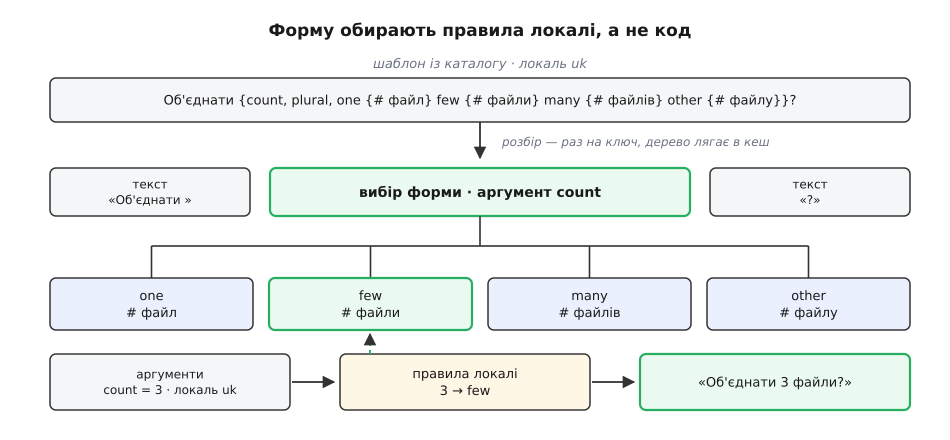

# ⚙️ Формувальник повідомлень: як усередині обирається форма й складається фраза

Нижче — робочий формувальник на півтори сотні рядків: він бере локаль, ключ повідомлення й торбу іменованих значень, а віддає готову фразу — і не містить жодного слова про граматику якоїсь мови. Скільки форм має слово, яку з них узяти для числа 21, у якому місці речення стоїть саме число — усе це лежить у даних поруч із перекладом, і тому нову мову доливають, не торкаючись коду.

<preknowlist>
- [Абстрактне синтаксичне дерево (AST)](root:sf-lang/abstract-syntax-tree) — текст розбирають один раз у дерево вузлів, а далі працюють із деревом, а не з рядком; тут шаблон повідомлення стає саме таким деревом.
- [Рекурсія](root:sf-algorithms/recursion) — гілка вибору всередині шаблону є повноцінним повідомленням, тож і розбір, і обчислення природно викликають самі себе.
</preknowlist>

## Що має вміти межа

Домовмося про контракт, перш ніж писати. На вхід приходять три речі:

```
locale = "uk-UA"            локаль читача
key    = "files.added"      КЛЮЧ повідомлення, а не текст
args   = { actor: "Оксана", gender: "female", count: 3, folder: "Звіти" }
```

На виході — один рядок, готовий до показу.

Дві заборони роблять цей контракт нетривіальним. Перша: у коді не сміє з'явитися жодне порівняння з числом — ані `count === 1`, ані `count % 10`. Друга: код не сміє склеювати фразу зі шматків. Обидві про одне. Щойно програма пише `"У вас " + count + " нових повідомлень"`, вона вже мовчки ухвалила два рішення про мову: що число стоїть посередині й що слово після нього не міняється. Для японської неправда і перше, і друге.

## Три речі, що залежать від мови

Покладімо поруч шаблони одного ключа для трьох мов — і відмінності стануть видимі:

```
uk  {gender, select, female {{actor} додала} other {{actor} додав}}
    {count, plural, one {# файл} few {# файли} many {# файлів} other {# файлу}}
    до теки «{folder}»

en  {actor} added {count, plural, one {# file} other {# files}} to “{folder}”

ja  {actor}が「{folder}」に{count}件のファイルを追加しました
```

Відмінностей три — і кожну з них інакше довелося б зашивати в код. **Скільки гілок** має вибір: англійській вистачає двох, українській треба чотирьох. **Яку гілку взяти** для конкретного числа: правило в кожної мови своє. І **де що стоїть**: японська виносить теку на початок речення, число супроводжує лічильним словом 件 і нічого не змінює в самому слові «файл»; українська натомість змінює ще й дієслово за родом того, хто діяв, — чого англійська не робить узагалі.

Звідси випливає, чому місця в шаблоні **іменовані**, а не позиційні. Аргументи приходять торбою `{actor, gender, count, folder}`; кожна мова бере з неї те, що їй потрібно, і в тому порядку, який їй потрібен, а значення, яких вона не вживає, просто лишаються в торбі. Позиційне `%1 %2 %3` цього не дозволяє: воно нав'язує перекладачеві порядок і не дає йому дотягтися до значення, яке його мові раптом знадобилося, а англійській — ні. Рід діяча — саме такий випадок: англійський шаблон `gender` не згадує жодного разу, український без нього не складеться.

## Половина перша: яка форма

Вибір форми — чиста функція від двох речей: локалі й числа. Її вже написали за нас: таблиця правил CLDR лежить усередині рушія. У браузері та Node її віддає вбудований `Intl`, у Python — Babel, бо в стандартній бібліотеці таблиці CLDR немає.

:::tabs
:::code proj-plural-message-format/ts/polovyna-persha-iaka-forma.ts
:::code proj-plural-message-format/py/main.py
:::

Усередині немає магії — є правило, записане мовою CLDR. Для української воно таке:

```
uk · кількісні числівники
one    v = 0 і i % 10 = 1 і i % 100 ≠ 11              1, 21, 31, 101, 1001
few    v = 0 і i % 10 = 2..4 і i % 100 ≠ 12..14       2, 3, 4, 22, 102
many   v = 0 і (i % 10 = 0 або i % 10 = 5..9
                або i % 100 = 11..14)                 0, 5..19, 100, 1000
other  решта                                          0.5, 1.5, 10.0
```

Літери — це операнди, які CLDR добуває з числа: `n` — його модуль, `i` — ціла частина, `v` — скільки в записі числа **видимих** десяткових знаків разом із нулями в кінці. Останній операнд пояснює найдивнішу на позір гілку. Українська для цілих чисел має три форми, а четверта, `other`, чекає на дробові: «1,5 файлу», «0,5 ставки». Умова `v = 0` у перших трьох гілках якраз і відводить дроби до неї. А «1» і «1,0» для правила — різні числа, хоч для арифметики однакові: у першого `v` дорівнює нулю, у другого — одиниці.

Це правило написане не для того, щоб його переписували в код. Найгірше, що можна зробити, — скопіювати його в ланцюжок `if`: CLDR час від часу правила уточнює, копія з ними розійдеться, і розійдеться мовчки — вивід стане граматично неправильним, але програма не впаде.

## Половина друга: шаблон — це дерево

Друга половина роботи — сам шаблон. Його синтаксис навмисне бідний, бо його редагує перекладач, а не програміст:

```
повідомлення := ( текст | місце )*
місце        := '{' ім'я '}'
              | '{' ім'я ',' 'plural' ',' [ 'offset:' ціле ] гілка+ '}'
              | '{' ім'я ',' 'select' ',' гілка+ '}'
гілка        := ( мітка | '=' число ) '{' повідомлення '}'
```

Плюс одна дрібниця: `#` усередині гілки означає саме число, уже відформатоване за локаллю. Останній рядок граматики — найважливіший: тіло гілки саме́ є повідомленням, тож усередині нього знову можуть стояти місця й вибори. Звідси рекурсія і в розбирачі, і в обчислювачі.

Це підмножина ICU MessageFormat — нотації з бібліотеки ICU (International Components for Unicode), що стала спільною мовою каталогів перекладу. Мітки гілок (`one`, `few`, `many`, `other`) — ті самі, що їх видає таблиця правил; саме на цьому стику дві половини й сходяться.


*Розбір відбувається раз на ключ, а далі кожен показ — це обхід готового дерева з торбою аргументів.*

## Розбір

Розбирач — рекурсивний спуск на індексі `i`. Два взаємні виклики: `body` збирає текст із дірками, `hole` розбирає одне місце й кличе `body` для кожної гілки.

:::code proj-plural-message-format/ts/rozbir.ts

Гілка про апостроф посеред `body` варта окремого погляду. В ICU апостроф — знак цитування: він каже «далі йде дослівний текст, не чіпай його». Для української це була б катастрофа, бо апостроф у нас стоїть усередині слів: «п'ять», «об'єднати», «ім'я». Тому починаючи з ICU 4.8 діє послаблене правило: апостроф відкриває цитату лише тоді, коли **одразу за ним** стоїть символ, який узагалі потребує цитування — `{`, `}` або `#`. Перед літерою це просто апостроф. Наш розбирач повторює цю поведінку рівно так само — а разом із нею успадковує й пастку, яку вона несе.

## Обчислення

Дерево обходять із торбою аргументів. Єдина хитрість — параметр `hash`: спускаючись у гілку вибору, обчислювач несе туди вже відформатоване число, щоб вузол `#` знав, що́ підставити.

:::code proj-plural-message-format/ts/obchyslennia.ts

Гілка `plural` і гілка `select` різняться лише способом дібрати мітку: перша питає правила локалі, друга просто зіставляє рядок. Усе інше — спільне, і це не збіг: вибір форми множини є окремим випадком загальнішої дії «обрати гілку за значенням аргументу».

## Межа

Лишилося зв'язати каталог, запасний ланцюжок локалей і кеш дерев. Функцію на самій межі за традицією i18n звуть найкоротше з можливого — `t`, бо трапляється вона в коді на кожному кроці:

:::code proj-plural-message-format/ts/mezha.ts

Виклик і те, що з нього виходить:

```ts
const who = { actor: "Оксана", gender: "female", folder: "Звіти" };
for (const n of [1, 3, 5, 21, 1000, 1.5])
  console.log(t("uk-UA", "files.added", { ...who, count: n }));
```

```
Оксана додала 1 файл до теки «Звіти»
Оксана додала 3 файли до теки «Звіти»
Оксана додала 5 файлів до теки «Звіти»
Оксана додала 21 файл до теки «Звіти»
Оксана додала 1 000 файлів до теки «Звіти»
Оксана додала 1,5 файлу до теки «Звіти»

Oksana added 1 file to “Reports”          ← t("en", …, { count: 1 })
Oksana added 3 files to “Reports”
オクサナが「レポート」に3件のファイルを追加しました   ← t("ja", …, { count: 3 })
```

Дві дрібниці в цьому виводі ніхто спеціально не програмував. «1 000» — це нерозривний пробіл між розрядами, бо так групує числа українська локаль; англійська в тому самому місці поставила б кому. «1,5» — кома десятковим роздільником, з тієї самої причини. Обидві приїхали разом із локаллю, бо число проходить через `Intl.NumberFormat`, а не через `String(n)`.

> 🔧 **Навіщо це.** Найтонше місце всієї конструкції — рядок, де `nf` і `pr` дістають **той самий** об'єкт опцій. Категорію обирають не за математичним значенням числа, а за тим, як воно **виглядає** після форматування. Покажіть 1.4 з нульовою точністю — читач побачить «1» і чекатиме «1 файл»; правило, спитане про сире 1.4, поверне `other` і дасть «1 файлу». Один спільний набір опцій робить цю помилку структурно неможливою, тоді як два окремі виклики роблять її неминучою.

Ось як ця розбіжність виглядає, коли опції розходяться:

```ts
new Intl.NumberFormat("uk", { maximumFractionDigits: 0 }).format(1.4);  // '1'
new Intl.PluralRules("uk").select(1.4);                                 // 'other' → «1 файлу»
new Intl.PluralRules("uk", { maximumFractionDigits: 0 }).select(1.4);   // 'one'   → «1 файл»
```

## Синтаксичний парсер ICU MessageFormat зі статичним буфером (C99 та C++20)

У високорівневих середовищах (V8, Node.js, Python) синтаксичний розбір рядків спирається на регулярні вирази, створення динамічних об'єктів у купі та збирання сміття. Однак у системному програмуванні, на вбудованих контролерах та у високопродуктивних рушіях рендерингу виділення пам'яті в купі (`malloc`/`new`) є неприпустимим через недетермінований час виконання та небезпеку вичерпання RAM.

Для таких середовищ парсер ICU MessageFormat будується за принципом **нульового динамічного виділення пам'яті (Zero-Allocation AST)**.

### Архітектура детермінованого розбору

1. **Лексичний автомат і сканування токенів (LL(1) Lexer)**:
   Сканер обробляє вхідний потік символів UTF-8 за один послідовний прохід. На відміну від складних граматик, формат MessageFormat вимагає глибини попереднього перегляду лише в 1 символ (LL(1)). Символ `{` ініціює перехід автомата в режим розбору аргументу або керуючої конструкції (`select` / `plural`), символ `}` позначає завершення поточного блоку або гілки, а кома `,` слугує роздільником параметрів.
2. **Представлення AST у статичному пулі вузлів**:
   Замість виділення динамічних об'єктів для кожного вузла абстрактного синтаксичного дерева, парсер використовує фіксований плоский масив структур `msg_node_t` або `std::array<Node, N>`. Усі текстові фрагменти зберігаються не як копії рядків, а як легковажні зрізи пам'яті (вказівник на початок у вихідному шаблоні плюс довжина `size_t len` або `std::string_view`).
3. **Екранування та сумісність з апострофами ICU**:
   Специфікація ICU вимагає коректної обробки одинарного апострофа `'`. Парсер підтримує правило швидкого екранування: послідовність `''` перетворюється на один літеральний апостроф, а фрагмент `'{'` інтерпретується як звичайний символ фігурної дужки, а не початок блоку підстановки.
4. **Обчислення в обмежений вихідний буфер**:
   Під час виконання (Evaluation Phase) сформоване дерево вузлів рекурсивно обходиться із записом результату безпосередньо у наданий викликачем статичний вихідний буфер. Контроль меж гарантує відсутність переповнення буфера (Buffer Overflow Protection): якщо згенерований рядок перевищує ємність, вивід безпечно обрізається з коректним додаванням нульового байта `\0`.
5. **Роздільна диспетчеризація числових форм**:
   Вузол типу `#` усередині гілки множини автоматично підставляє активне числове значення, передане в контексті обчислення, забезпечуючи точну відповідність формі слова без дублювання аргументів у торбі значень.

### Граматичні інваріанти та крайові випадки синтаксичного розбору

Реалізація парсера ICU MessageFormat на мовах системного програмування C99 та C++20 вимагає суворого дотримання низки інваріантів граматики:

1. **Вкладеність конструкцій вибору (Nested Choice Resolution)**:
   Шаблони часто комбінують вибір за родом та множиною, наприклад: `{gender, select, female {{count, plural, one {Вона додала # файл} few {Вона додала # файли} other {Вона додала # файлів}}} other {{count, plural, one {Він додав # файл} few {Він додав # файли} other {Він додав # файлів}}}}`.
   Парсер обробляє таку вкладеність через рекурсивний спуск: кожна гілка вибору розбирається як ізольоване повідомлення, чиї дочірні вузли посилаються на діапазон у загальному масиві вузлів `[child_start .. child_start + child_count)`. Це дозволяє уникнути будь-яких динамічних алокацій для побудови ієрархічних зв'язків між вузлами.

2. **Пріоритет точних числових збігів (`=0`, `=1`) над лінгвістичними категоріями**:
   У граматиці ICU точний числовий збіг (наприклад, `=0 {Немає файлів}`) має абсолютний пріоритет над граматичною категорією множини (`zero`, `one`, `few`, `many`, `other`). Під час оцінки гілок формувальник спочатку зіставляє строковий вигляд числа з префіксом `=` (наприклад, перевіряє наявність мітки `=0` для значення `0`), і лише за відсутності прямого збігу звертається до таблиці або функції категорій CLDR.

3. **Обробка модифікатора `offset:N`**:
   Якщо блок множини містить параметр зміщення `offset:N`, точне порівняння `=value` перевіряється за повним значенням аргументу `n`, тоді як граматична категорія та підстановка у маркер `#` обчислюються для скоригованого значення `n - offset`. Це забезпечує коректне формулювання фраз на зразок «Ви та ще 2 користувачі вподобали це» при загальній кількості користувачів 3.

4. **Захист від некоректних шаблонів та безпечний відкат (Fail-Safe Evaluation)**:
   Якщо переданий шаблон містить незакриту дужку `}`, відсутню обов'язкову гілку `other` або невідомий тип селектора, парсер не перериває виконання програми та не викликає аварійного завершення. Натомість повертається статус помилки `MSG_ERR_*` або `std::unexpected(ParseError)`, а підсистема інтерфейсу користувача безпечно виводить сирий текст шаблону або ім'я ключа без зависання системи.

:::tabs
:::code proj-plural-message-format/c/main.c
:::code proj-plural-message-format/cpp/main.cpp
:::

## Скільки це коштує

Розбір — один прохід по рядку, лінійний від його довжини, без вороття назад: індекс `i` тільки зростає. Але робиться він **раз на ключ**, а не раз на показ: `trees` тримає готове дерево, і кожен наступний виклик — це обхід дерева, лінійний від кількості вузлів. Тому вартість формування фрази близька до вартості її склеювання вручну; уся різниця пішла в одноразовий розбір.

Другий кеш важливіший, ніж здається. Побудова `Intl.NumberFormat` чи `Intl.PluralRules` — не дешеве присвоєння: рушій розбирає тег локалі й піднімає її дані. Створювати їх усередині циклу по тисячі рядків таблиці — надійний спосіб зробити локалізацію найповільнішою частиною відповіді. Тому обидва загорнуті в [мемоізацію](root:sf-algorithms/memoization) за ключем «локаль + опції».

Вибір категорії — стала вартість: правило локалі — це кілька остач від ділення.

## Пастки

**Гілки, якої бракує, ніхто не помітить.** Перекладач заповнив дві гілки, як в англійському зразку, і не помітив, що українських треба чотири, — програма не впаде: `run` тихо візьме `other`, і користувач прочитає «Оксана додала 3 файлу». Ловити це треба на збірці, звіряючи каталог зі списком категорій, який видає сама локаль:

:::code proj-plural-message-format/ts/pastky.ts

**Апостроф з'їдає місце.** Наслідок правила цитування, яке ми повторили в розбирачі. Шаблон `Ключ '{key}' не знайдено` — спроба взяти назву ключа в лапки-апострофи — дає на виході дослівне «Ключ {key} не знайдено»: апостроф стоїть перед `{`, отже відкриває цитату, і місце всередині вже не місце, а текст. Лікується подвоєнням (`''`) або, краще, справжніми лапками — «…» чи “…”, яких ICU взагалі не чіпає. А от «п'ять» і «об'єднати» безпечні, бо там за апострофом стоїть літера.

**`=0` — не те саме, що `zero`.** Мітка `zero` — граматична категорія, і вона є, наприклад, в арабській, де нуль справді має власну форму слова. В українській нуль потрапляє в `many` — «0 файлів», і це граматично правильно. `=0` натомість — точний збіг за значенням, і потрібен він не для граматики, а для іншого формулювання: замість «0 файлів» написати «Немає файлів». Це рішення перекладача, тому й живе воно в шаблоні:

```ts
"{count, plural, offset:1 =0 {Ніхто ще не вподобав} =1 {{you} вподобали} " +
"one {{you} і ще # людина} few {{you} і ще # людини} " +
"many {{you} і ще # людей} other {{you} і ще # людини}}"

// count = 0 → Ніхто ще не вподобав
// count = 1 → Ви вподобали
// count = 3 → Ви і ще 2 людини
```

`offset:1` тут відкладає вбік самого читача: форму й `#` рахують від `count − 1`, тоді як точні збіги `=0` і `=1` звіряють із повним `count`. Через це «3» перетворюється на «Ви і ще 2 людини» — і форма береться під двійку, а не під трійку.

**Порядкові числівники — інша таблиця.** `{ type: "ordinal" }` вмикає окремий звід правил, і збігу з кількісним немає навіть у наборі міток: серед порядкових в української є лише `few` — для чисел, що закінчуються на 3, крім 13 (3-тя, 23-тя, 33-тя), — і `other` для решти. Кількісне правило кинуло б у ту саму `few` ще й двійку з четвіркою, і «2-га спроба» стала б «2-тя».

**Мова шаблону й мова читача можуть розійтися.** Коли українського перекладу для ключа немає й запасний ланцюжок дійшов до англійського шаблону, обирати гілку треба за англійськими правилами: у цьому шаблоні є `one` і `other`, а `few` немає. Тому `t` форматує в мові **шаблону**, а не в мові запиту. Інакше вийшло б найгірше з обох світів: англійське речення з українською комою в дробах і провалом у `other` там, де правило шукало `few`.

**Одне повідомлення — одне речення.** Спокуса зекономити й розбити фразу на два ключі («У вас » + ключ із множиною) повертає всі проблеми, заради яких це все й будувалося: перекладач отримує уламки без контексту й не може ані переставити їх місцями, ані узгодити між собою. Ключ має покривати ціле речення, навіть якщо частина його виглядає нудною сталою.

**Рядок на виході — це текст, а не розмітка.** Формувальник повертає звичайний рядок; якщо вставити його в сторінку як HTML, то будь-який каталог перекладу стає каналом для чужого коду. Розмітку тримають поза перекладом або віддають окремим механізмом, що збирає готові вузли, а не рядок.

**Стара нотація рахує гілки числами.** Каталоги `gettext` описують множину виразом, що дає **індекс** — `nplurals=3; plural=(n%10==1 && n%100!=11 ? 0 : …)` — і перекладач заповнює `msgstr[0]`, `msgstr[1]`, `msgstr[2]`. Мітки CLDR (`one`, `few`, `many`) з цими індексами не збігаються ані за порядком, ані за кількістю: сама лише українська має в CLDR чотири категорії проти трьох індексів. Переносячи каталог із такого формату, індекси доводиться зіставляти з мітками руками — механічний переклад «нульовий індекс → one» ламається на першій же мові, де вираз написано в іншому порядку.
