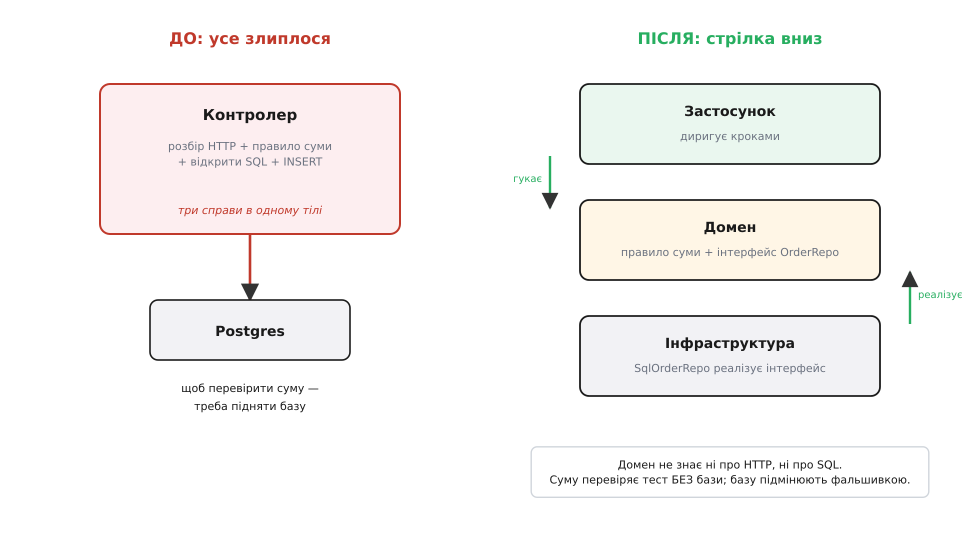
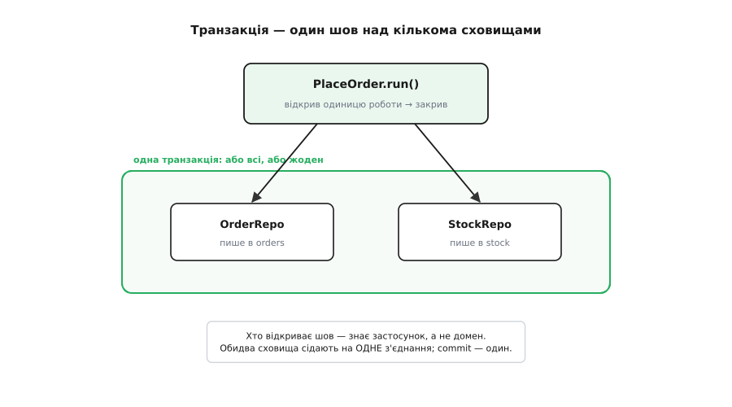

# ⚙️ Розтягуємо злиплений контролер на шари

Є один обробник запиту, у якому зійшлося все. Він читає HTTP-тіло, рахує суму замовлення зі знижкою, відкриває з'єднання з базою, вписує рядки й повертає JSON. Двадцять рядків, які працюють — і за які тебе не похвалять, коли доведеться щось у них змінити. Спробуй перевірити правило знижки тестом: доведеться підняти справжню базу, зімітувати HTTP-запит і виколупати число з відповіді. Спробуй перейти з Postgres на іншу базу: правило знижки написане просто над відкритим курсором, тож зачепиш і його.

Тут ми не переказуватимемо, **чому** шари корисні — ми візьмемо саме такий обробник і крок за кроком розтягнемо його на домен, застосунок та інфраструктуру, щоразу дивлячись, що конкретно ця дія купує. Наприкінці правило знижки перевірятиметься тестом за мілісекунди без жодної бази, а сама база стане деталлю, яку можна вийняти й замінити. Уся магія — в одному: **куди дивиться стрілка залежності**.

## Пацієнт: обробник, де все зрослося

Ось із чого починаємо. Один ендпойнт «оформити замовлення»: перевірити наявність товару, порахувати суму зі знижкою за промокодом, записати замовлення й зменшити залишок. Усе в одному тілі.

:::tabs
:::code proj-layered-refactor/py/app.py
:::code proj-layered-refactor/ts/server.ts
:::

Придивись, що тут стряслося. Правило «SPRING дає 10%, VIP — 20%» — це серце бізнесу, найцінніший рядок у файлі. А стоїть він затиснутий між `cur.execute(...)` і `INSERT`, приклеєний до конкретного драйвера бази й конкретного формату HTTP-тіла. Щоб дізнатися, чи правильно рахується знижка, немає способу коротшого, ніж підняти всю цю машину. Три різні життя — екран, правило, база — злиплися в одну грудку, і кожне тягне за собою два інші.

*Ліва картина — те, з чого ми починаємо. Права — куди йдемо: правило переїжджає в домен, а база опиняється на кінці стрілки, куди й належить.*

Мета — дійти від лівої картини до правої. Робитимемо це не одним стрибком, а маленькими кроками, після кожного з яких код лишається робочим.

## Крок 1. Виколупати правило в домен

Перше, що треба врятувати, — правило. Воно не повинно знати ні про HTTP, ні про SQL; воно має оперувати числами й поняттями бізнесу. Витягуємо `Order` як окрему сутність, яка вміє порахувати власну суму, і промокод як окреме поняття.

Ключове тут — **жодного імпорту бази чи вебфреймворку** в цьому файлі. Якщо він з'явиться, ми провалили крок.

:::tabs
:::code proj-layered-refactor/py/order.py
:::code proj-layered-refactor/ts/order.ts
:::

Одразу видно виграш. Правило знижки тепер живе в місці, куди не дотягується ні база, ні мережа, і його можна перевірити прямим тестом — без Flask, без sqlite, без нічого:

:::tabs
:::code proj-layered-refactor/py/test_order.py
:::code proj-layered-refactor/ts/order.test.ts
:::

Зверни увагу на одну свідому відмову: `Line` несе `price` у собі, домен ціну **не шукає**. Це не дрібниця. Якби `total()` сам ходив у базу по ціну, ми б протягли базу назад у домен через чорний хід і зіпсували все, що щойно зробили. Домен рахує з тих чисел, які йому дали; звідки взялися числа — не його клопіт. Це та сама межа, тільки видна зблизька.

## Крок 2. Винести обіцянку сховища — інтерфейс у домені

Правило врятоване, але замовлення ще треба десь зберігати й десь брати ціни та залишки. Спокуса — дати домену клас `Database`. Це і є та пастка, через яку шари протікають вниз: щойно домен назве конкретну базу на ім'я, він від неї залежить, і замінити її вже не можна.

Прийом, який усе рятує, — **інверсія залежності**. Домен не називає базу; він оголошує **інтерфейс** — обіцянку «хтось уміє знайти товар і зберегти замовлення», не кажучи хто. Це називають сховищем, або репозиторієм (від англ. *repository* — сховище): колекцієподібний фасад над збереженням, що ховає, чи там SQL, чи файл, чи мережа.

> 🔧 **Навіщо це.** Інтерфейс сховища — це шов, уздовж якого домен відривається від бази. Поки домен бачить лише обіцянку, а не драйвер, будь-що по той бік обіцянки замінне: жива база в проді, файл у прототипі, фальшивка в тесті. Без цього інтерфейсу база вросла б у правила, і кожен тест волік би її за собою.

Ось де тонкість, на якій багато хто спотикається. Інтерфейс `ProductRepo` **оголошено в домені**, а реалізацію — в інфраструктурі. У коді файл інфраструктури імпортує файл домену (щоб побачити інтерфейс), а не навпаки. Тому стрілка **залежності** дивиться вниз, до абстракції домену, хоча текст реалізації сидить «нижче». Про цей поворот докладніше — стаття [про інверсію залежностей](root:sf-apps/dependency-inversion); тут ми його просто застосовуємо.

:::tabs
:::code proj-layered-refactor/py/repos.py
:::code proj-layered-refactor/ts/repos.ts
:::

Тут варто зупинитися на одному рішенні, яке легко проґавити. Хто **вигадує** цей інтерфейс — домен чи інфраструктура? Відповідь принципова: **домен**, під свою потребу. Інтерфейс формулюють у словах бізнесу («знайти товар», «додати замовлення»), а не в словах бази («виконати SELECT»). Це те, що інколи звуть відокремленим інтерфейсом (англ. *Separated Interface*): абстракцію оголошує той, хто нею **користується**, а не той, хто її **реалізує**. Якби інтерфейс диктувала база, він би просочився деталями бази, і сенс зник би.

## Крок 3. Реалізувати сховище в інфраструктурі

Тепер — конкретика, яку ми стільки відсували. SQL-реалізація сидить в інфраструктурі, імпортує інтерфейси з домену й виконує обіцянку. Уся мова бази замкнена тут; вище цей файл ніхто не імпортує.

:::tabs
:::code proj-layered-refactor/py/sql_repos.py
:::code proj-layered-refactor/ts/sqlRepos.ts
:::

Дрібна, але промовиста різниця між мовами. У Python `SqlProductRepo` **ніде не називає** `ProductRepo` — його достатньо, щоб він мав потрібні методи (структурна, «качина» відповідність через `Protocol`). У TypeScript ми пишемо `implements ProductRepo` явно. Обидва підходи дають те саме: конкретний клас задовольняє обіцянку домену. Але напрямок імпорту в обох однаковий — інфраструктура тягне домен, домен про інфраструктуру не чув.

## Крок 4. Диригент у шарі застосунку

Правило в домені, база в інфраструктурі — між ними бракує того, хто веде сценарій: «знайди товари, перевір залишок, порахуй, збережи, зменши». Це не правило (правило — лише сама формула суми) і не техніка бази — це **координація**, і живе вона в шарі застосунку. Дехто зве такий клас службою або варіантом використання (англ. *use case*).

Найважливіше в ньому — він приймає сховища **ззовні**, через конструктор, і бачить їх лише як інтерфейси. Він не знає, що всередині SQL. Саме тут стрілка розвертається остаточно: застосунок залежить від обіцянок домену, а конкретний `SqlOrderRepo` підставлять пізніше й іззовні.

:::tabs
:::code proj-layered-refactor/py/place_order.py
:::code proj-layered-refactor/ts/placeOrder.ts
:::

Помітив, що обробник HTTP іще ніде не згаданий? І `PlaceOrder`, і `Order` про Flask чи Express не чули. Це навмисно: сценарій оперує звичайними списками й словниками, а переклад HTTP ↔ ці структури — робота найверхнього шару, до якого ми зараз дійдемо.

## Крок 5. Тонкий контролер угорі

Тепер від пацієнта лишається лише шкірка — контролер, чия єдина робота перекласти HTTP-запит у виклик сценарію й відповідь сценарію назад у HTTP. Жодного правила, жодного SQL: розібрав тіло, гукнув, склав відповідь, перетворив помилки домену на коди статусу.

:::tabs
:::code proj-layered-refactor/py/routes.py
:::code proj-layered-refactor/ts/routes.ts
:::

Тепер увесь код розкладено на чотири зрозумілі теки — `web`, `application`, `domain`, `infra` — і залежності течуть строго вниз. Але лишилося невимовлене питання: **хто ж усіх їх знайомить?** `PlaceOrder` вимагає `ProductRepo`, `SqlProductRepo` вимагає з'єднання — а нікого з них ніхто ще не створює. Ці нитки сходяться в одну точку.

## Крок 6. Збірка на вершечку

Є єдине місце, де конкретні класи можна називати на ім'я безкарно, — **найвища точка входу**, з якої стартує програма. Тут (і лише тут) з'являються слова `SqlOrderRepo`, `connect`, `Express`. Створюємо драйвер, загортаємо його у сховища, віддаємо сценарію, чіпляємо контролер. Цей прийом — «складання на вершечку»; коли деталь **дістають ззовні**, а не творять усередині, це і є впровадження залежностей (стаття [про впровадження залежностей](root:sf-apps/dependency-injection) розбирає його як окремий інструмент).

:::tabs
:::code proj-layered-refactor/py/main.py
:::code proj-layered-refactor/ts/main.ts
:::

Ця точка входу — єдина частина програми, яка знає **всіх** учасників поіменно. Її іноді звуть коренем композиції (англ. *composition root*). Уся решта коду знає лише своїх сусідів через інтерфейси; конкретні імена стягуються в цю одну верхню точку — і саме тому їх так легко підмінити.

## Заради чого все — підміна бази фальшивкою в тесті

Тепер найсолодше, задля чого й крутили стрілку. Оскільки `PlaceOrder` приймає сховища **ззовні** й бачить їх як інтерфейси, у тесті ми даємо йому не SQL, а фальшивку (англ. *fake*) — сховище в пам'яті, що поводиться правдиво, але тримає дані в словнику. Жодної бази, жодного файлу; тест увесь сценарій ганяє за мілісекунди.

Тут корисно назвати речі точно. Загальний термін для будь-якого підставного об'єкта в тесті ввів Джерард Мезарос (Gerard Meszaros) у книзі *xUnit Test Patterns* (2007) — **тест-дублер** (англ. *Test Double*), за прямою аналогією з дублером-каскадером у кіно; Мартін Фаулер саме так це й пояснює: «загальний термін, який він уживає, — Test Double (уяви каскадера-дублера)» *(джерело: bliki Мартіна Фаулера «TestDouble»; усталена термінологія)*. Фальшивка (fake) — один із п'яти його різновидів: на відміну від заглушки, що лише повертає завчене, фальшивка має **робочу**, хоч і спрощену, реалізацію. Наша пам'ятна база — саме фальшивка.

:::tabs
:::code proj-layered-refactor/py/test_place_order.py
:::code proj-layered-refactor/ts/placeOrder.test.ts
:::

Ось воно — те, що обіцяла стрілка. Ми перевірили **весь сценарій оформлення** — пошук, перевірку залишку, знижку, запис, списання — не піднявши жодної бази. Тест `test_rejects_when_out_of_stock` навіть ловить тонку річ: коли товару замало, залишок чіпати не можна, і фальшивка це доводить прямою перевіркою словника. У початковому злиплому обробнику така перевірка вимагала б справжньої бази, справжнього HTTP-запиту й виколупування числа з відповіді. Тепер це три рядки й мілісекунди. **Це не побічний бонус чистоти — це і є те, задля чого стрілку розвертали.**

## Складність і пастки

Малюнок гарний, але живий рефакторинг наштовхується на кілька гострих кутів. Пройдімося по тих, що ріжуть найчастіше.

**Транзакція — це не деталь одного сховища.** Наш сценарій пише у дві таблиці: додає замовлення й зменшує залишок. Якщо між ними впаде живлення, замовлення є, а товар не списаний — база розповзлась. Ці дві дії мусять бути **однією транзакцією**: або обидві, або жодної. І тут криється пастка: транзакція охоплює **кілька сховищ**, тож нею не може керувати жодне з них поодинці. Керує той, хто бачить увесь сценарій, — шар застосунку.

*Межу транзакції відкриває застосунок і накриває нею обидва сховища. Домен про транзакції не знає — це технічна межа, а не правило бізнесу.*

Патерн, що загортає групу змін у один атомарний шов, каталогізував Мартін Фаулер (Martin Fowler) у книзі *Patterns of Enterprise Application Architecture* (2002) під іменем **одиниця роботи** (англ. *Unit of Work*) — поряд із самим **репозиторієм** *(джерело: каталог патернів PoEAA; усталена термінологія)*. Ідея проста: об'єкт, що тримає одне з'єднання й один `commit`, а сховища всередині сідають на нього. Ось як це виглядає в збірці — застосунок відкриває шов, обидва сховища працюють на спільному з'єднанні, а `commit` один:

:::tabs
:::code proj-layered-refactor/py/place_order-2.py
:::code proj-layered-refactor/ts/placeOrder-2.ts
:::

Тонкість, яку легко провалити: обидва сховища мусять сидіти на **тому самому** з'єднанні, інакше кожне відкриє свою транзакцію й атомарність зникне. Тому одиниця роботи роздає з'єднання сховищам, а не кожне саме собі його бере. У тесті ж фальшивка транзакцій не потребує зовсім — `atomic` там може просто виконати тіло, бо словник у пам'яті або зміниться весь, або кине виняток до першого запису.

**Не роби шар домену анемічним.** Найпоширеніша хиба після такого поділу — витягти з домену *усі* дані в `dataclass`, а *усю* поведінку зсунути в сценарій. Тоді домен стає мішком геттерів без правил, а вся логіка тече в застосунок — це звуть анемічною моделлю. Лінія проста: якщо метод — це **правило предметної області** (як рахувати суму, чи валідне замовлення), він у домені; якщо це **послідовність кроків** (знайди, перевір, збережи), він у застосунку. Правило `total()` лишилось у `Order` саме тому.

**Не плоди інтерфейс на кожен клас.** Інверсія залежності цінна там, де реалізацію справді підмінюють: база, платіжний шлюз, черга. Огортати інтерфейсом кожен внутрішній клас домену — марна церемонія, що роздуває код без користі. Інтерфейс — це вартість; плати її лише за справжній шов, де по той бік буде більш ніж одна реалізація (жива й тестова — вже дві, і цього досить).

**Repository — не діркою в абстракції.** Спокуса дати сховищу метод на кожен химерний запит («знайти замовлення, старші за 30 днів, зі знижкою VIP, посортовані…») перетворює чисту абстракцію на решето, крізь яке деталі бази протікають назад у домен через сигнатури методів. Тримай інтерфейс сховища у словах бізнесу й вузьким; коли запити стають складними й специфічними для читання, їх часто варто винести окремим шляхом читання (це вже територія розділення команд і запитів, але то інша розмова).

**Крос-процесна транзакція — це вже не та транзакція.** Усе сказане про одиницю роботи тримається, поки сховища сидять в **одній базі** й ділять з'єднання. Щойно одне сховище пише в Postgres, а друге шле повідомлення в чергу, спільного `commit` немає — база й черга не діляться транзакцією. Тоді атомарність доводиться будувати іншими засобами (наприклад, писати намір у ту саму базу й досилати його окремо), і це окрема, серйозна тема. Тут важливо лише не обманюватися: `Unit of Work` рятує в межах одного сховища даних, а не через мережу.

Підсумок усього руху вміщується в одну думку. Ми не додали функцій — обробник як робив замовлення, так і робить. Ми **пересунули стрілки**: правило переїхало в домен, база сховалася за інтерфейс, конкретні імена стеклися в одну верхню точку. І щойно стрілка залежності лягла вниз, домен став тестованим без бази, а база — замінною без страху за правила. Шари — це не спосіб зробити складніше; це спосіб зробити так, щоб **найдорожчі зміни били в один шар і там спинялися**.
