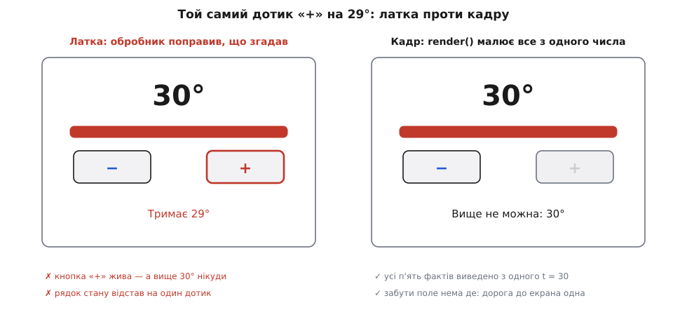
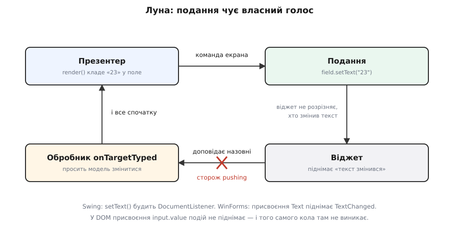

# ⚙️ Термостат у робочому коді: пасивне подання, тест без екрана й керівний контролер поряд

Пасивне подання легко переказати й важко зробити правильно. Щойно на екрані опиняється не одна цифра, а кілька речей, які мусять мінятися разом, головне рішення виявляється не в тому, які команди має контракт подання, а в тому, **коли і як презентер їх викликає**. Тож зберемо термостат цілком — модель, контракт екрана, презентер, справжнє подання, фальшивку й тест, що ганяє весь застосунок без жодного віджета, — а поряд поставимо той самий екран на керівному контролері й порахуємо, чого коштує кожен варіант.

## Задача: п'ять видимих фактів з одного числа

Екран з одним написом нічого не доводить: там будь-яка розкладка виглядає охайно. Відчути пасивне подання можна лише там, де з одного числа росте кілька видимих наслідків одразу.

```
Екран термостата:
  напис        «23°»                          ← бажана температура
  смужка       гарячий / спокійний / холодний колір
  кнопка «−»   згасла на 5°
  кнопка «+»   згасла на 30°
  рядок стану  «Тримає 23°» / «Вище не можна: 30°» / «Нижче не можна: 5°»

Правило моделі: бажана температура ∈ [5, 30], крок ±1.
Кольори:       > 24 → #c0392b   < 18 → #2457d6   інакше → #6b7280
```

П'ять фактів, і всі п'ять — функція від одного числа. Отут і живе цілий клас помилок, який не ловиться ні компілятором, ні винятком.

Уяви: тримали «+», доки не вперлися в стелю. Напис каже «30°», смужка почервоніла — а кнопка «+» жива, і внизу все ще «Тримає 29°». Нічого не впало, жоден виняток не полетів. Екран просто бреше, і бреше тихо.

Причина не в неуважності автора. Коли обробник події править поля поіменно, він щоразу мусить пригадати повний список наслідків. А список росте: додали режим «відпустка» — і кожен обробник має про нього дізнатися. Шляхів до екрана стає стільки, скільки подій помножити на поля, і забутого шляху не видно нізвідки — він не помилка, він просто відсутність рядка.

## Ідея: не латати поля, а малювати кадр

Тому в презентері має бути **рівно одна дорога до подання** — функція, що з поточного стану моделі виводить увесь видимий кадр. Кожна подія робить дві речі: просить модель змінитися і кличе цю функцію. Ніхто більше подання не торкається.

Тоді забути поле неможливо за побудовою: кадр або цілий, або його нема. Шляхів уже не «події × поля», а один; додаючи нову видиму річ, ти правиш одне місце й одразу бачиш усі її випадки поруч.

Здається марнотратним переписувати п'ять речей через одну змінену. Але екран міняється в людському темпі — кілька подій на секунду, — і п'ять присвоєнь на кожну з них не важать нічого. Якщо в кадрі колись з'явиться довгий список, дорогою стане робота віджета, а не рішення презентера; лікують це в поданні — порівняти й оновити точково, — не повертаючи рішень назад в обробники.


*Ліворуч поля правили поіменно з обробника — цифра й колір оновилися, а кнопка «+» і рядок стану відстали; праворуч презентер вивів увесь кадр з одного `t = 30`, і відстати нема чому.*

Звідси й два правила для самого контракту подання, обидва з тієї самої причини — не пустити рішення назад у ту половину, якої тест не бачить.

**Команди говорять про екран, не про предмет.** `showTemperature(text)`, а не `show(thermostat)`: якщо в подання передати модель, воно мусить знати її будову й саме дібрати, що звідти показати, — і ця дрібна думка вже поза тестом. З тієї ж причини команда зветься `setPlusEnabled(false)`, а не `atMaximum(true)`: у другому випадку подання вирішує, як саме виглядає «на стелі», а це рішення — про те, що побачить людина.

**Рядки приїжджають готовими.** Не число з градусами, а вже складений напис «23°». Інакше формат — знак градуса, роздільник дробу, «°C» проти «°F» — живе у віджеті, і жоден тест його не звірить.

## Робочий код: модель, контракт, презентер

Модель нічого не знає про екран і сама стереже свою межу — обрізає значення, а не сподівається, що хтось перевірить до неї.

Пишемо двома мовами, якими такі екрани й пишуть: TypeScript — сьогоднішній клієнт, Java — дім цієї розкладки з часів Swing, GWT і раннього Android. Ідіоми різні, будова однакова.

:::tabs
:::code proj-passive-view/ts/robochyi-kod-model.ts
:::code proj-passive-view/java/robochyi-kod-model.java
:::

Дві дрібниці в презентері варті окремого слова.

Підписка живе в `start()`, а не в конструкторі. По-перше, конструктор, що роздає посилання на ще недобудований об'єкт, — джерело дивних падінь. По-друге, підписці потрібна пара: те, що вмикається, колись доведеться вимкнути, і симетрична точка для цього має бути видима. По-третє, саме тут природно лягає **перший кадр**: якщо його не намалювати, екран стоїть порожній, доки людина чогось не натисне.

І презентер не будує собі подання — його приносять ззовні, у конструкторі. Це та сама [ін'єкція залежностей](root:sf-apps/dependency-injection), і без неї весь задум не працює: тест не має де вставити свою реалізацію, якщо об'єкт створює її сам.

## Справжнє подання: жодного `if` на весь клас

Тепер найцікавіше — код екрана, який не має права ні на одну думку.

:::tabs
:::code proj-passive-view/ts/spravzhnie-podannia.ts
:::code proj-passive-view/java/spravzhnie-podannia.java
:::

Придивись до форми цього класу: кожен метод — один рядок, і в жодному нема ні умови, ні обчислення, ні склеювання рядка. Переклад типів дозволений — `Color.decode("#c0392b")` перетворює рядок на те, що вміє віджет, — але вибору кольору тут нема, колір уже приїхав готовим.

> 🔧 **Навіщо це.** З цього виходить перевірка, яку видно очима, без жодної теорії: **розгорни клас подання й пошукай у ньому `if`, арифметику й складання рядків**. Знайшов — рішення втекло назад у ту половину, яку тест не бачить, і саме там воно колись розійдеться з рештою екрана. Ця перевірка сувора рівно настільки, наскільки треба: у класі вище нема жодного `if`, і тому про саме подання нема чого питати — воно не може помилитися, бо йому нема де.

## Тест: увесь застосунок без жодного віджета

Фальшиве подання реалізує той самий контракт, але замість пікселів тримає **останній кадр** — п'ять полів, які презентер у нього поклав.

Те, що воно тримає саме кадр, а не журнал викликів, — рішення, а не дрібниця. Дублер, що записує послідовність викликів, робить тест чутливим до того, **як** презентер малює: переставив два рядки в `render()` — і тест червоний, хоча екран той самий. Дублер, що тримає стан, звіряє те, що людина побачила б. Це давня межа між перевіркою стану і перевіркою взаємодій — про те, коли доречна яка, є окремий розбір, [дублери як рішення дизайну](root:progarch/test-doubles-when); для екрана майже завжди доречний стан.

:::tabs
:::code proj-passive-view/ts/test-uves-zastosunok-bez.ts
:::code proj-passive-view/java/test-uves-zastosunok-bez.java
:::

Перевірки тут навмисне голі — у справжньому проєкті це JUnit або Vitest, і від назви каркаса не міняється нічого. Важливе інше: третій випадок — рівно той, на якому ламається латання полів. Він проходить за мілісекунди, не піднімає вікна, не чекає анімації — його можна ганяти на складальному сервері, де графічної підсистеми немає зовсім.

І зверни увагу, чого тут **нема**: жодного `wait`, жодного пошуку кнопки за назвою, жодного скриншота. Тест звертається до застосунку тими самими словами, якими з ним говорить екран.

## Скільки коштує пасивність

Ціна пасивного подання — не такти, а рядки. Кожен видимий факт лишає слід у чотирьох місцях: команда в контракті, її реалізація у справжньому поданні, поле у фальшивці й рядок у `render()`.

```
Один видимий факт ≈ 4 рядки «водопроводу»:
  контракт        showStatus(text)
  подання         status.setText(text)
  фальшивка       this.status = text
  render()        view.showStatus(...)

Наш екран: 5 фактів → ≈ 20 рядків, з яких жоден нічого не вирішує.
```

Це і є та балакучість, за яку пасивне подання лають. Помнож на форму з тридцятьма полями — і водопровід стане більшим за логіку.

Тут же й межа розумного розміру контракту. П'ять команд читаються з одного погляду; сорок означають, що екран робить забагато, і фальшивку до нього ліньки писати навіть тим, хто любить тести. Знак, що екран пора ділити на частини — кожна зі своїм контрактом і своїм презентером, — з'являється раніше, ніж здається.

## Той самий екран на керівному контролері

Керівний контролер торгує частиною цієї балакучості. Просте — те, що є прямим відбитком одного поля моделі, — подання бере на себе; складне лишається презентерові.

Щоб подання могло взяти цифру саме, модель мусить уміти сказати «я змінилася» — тобто стати спостережуваною, з підпискою в дусі [спостерігача](root:sf-apps/observer). Стала ниточка «цей напис завжди показує це число» і зветься [прив'язкою даних](root:sf-apps/data-binding).

:::code proj-passive-view/ts/toi-samyi-ekran-na.ts

Порахуймо чесно, що змінилося.

| що міряємо | пасивне подання | керівний контролер |
|---|---|---|
| команд у контракті | 5 | 4 |
| фактів, які бачить тест із фальшивкою | 5 з 5 | 4 з 5 |
| хто зв'язує напис із числом | презентер, щоразу вручну | прив'язка, раз назавжди |
| що додалося натомість | — | спостережувана модель і сама прив'язка |
| що може розійтися тихо | нічого: кадр цілий | напис — і тест цього не побачить |

Висновок виходить не той, якого чекаєш. На **одному** прямому полі прив'язка коштує більше, ніж заощаджує: підписка в моделі й ниточка в поданні — це більше коду, ніж один рядок у `render()`. Вигравати вона починає тоді, коли збігаються дві умови: прямих полів десяток і каркас дає прив'язку задарма — тоді ти не пишеш ні підписки, ні ниточки, а платиш лише тим, що ці поля зникають з-під тесту. Доведена до кінця, ця торгівля стає окремою розкладкою — [MVVM](root:sf-apps/model-view-viewmodel), де прив'язок стільки, що презентер перетворюється на об'єкт, з якого екран сам себе читає.

Ознака, за якою ділити, коротка: **прив'язуй те, у чому нема жодного `if`**. Прямий, безумовний відбиток одного поля — віддай поданню. Усе, де є поріг, умова, вибір слова чи формату, який колись перепишуть, — лишай презентерові, бо саме це й ламається, і саме це має бачити тест.

## Луна: подання чує власний голос

Тепер додай на екран поле, куди температуру можна ввести руками. У контракті з'явиться пара:

```
showTargetField(text: string)                  // презентер кладе значення в поле
onTargetTyped(handler: (text: string) => void) // поле доповідає, що там набрали
```

І тут пасивне подання показує свою найпідступнішу пастку. `render()` кладе в поле «23». Віджет чесно повідомляє: «текст змінився». Обробник вирішує, що це людина набрала, просить модель змінитися, кличе `render()`, той знову кладе текст у поле — і так, доки не скінчиться стек.


*Коло замикається тому, що віджет не розрізняє, хто змінив текст — людина чи презентер. Сторож усередині подання розриває коло: поки подання пише саме, воно мовчить.*

Найгірше в цій пастці те, що вона залежить від платформи. У Swing `setText()` міняє документ поля, а разом з ним будить `DocumentListener` — програмна зміна нічим не відрізняється від набраної. У WinForms присвоєння `Text` піднімає `TextChanged`; від нескінченного кола там часом рятує оптимізація «те саме значення — події нема», але спиратися на неї не можна, бо варто формату злегка змінитися — і вона перестає рятувати. А в браузері `input.value = "23"` не піднімає ні `input`, ні `change`: DOM навмисне розрізняє зміну від людини й зміну з коду. Той самий на вигляд правильний презентер в одному середовищі працює, а в іншому падає зі стеком.

Лікують це в поданні, і саме там, де хвороба:

:::code proj-passive-view/java/luna-podannia-chuie.java

Прапорець мусить жити в поданні, не в презентері. Це властивість віджета, а не логіки; винесеш його в презентер — і фальшивці доведеться вдавати ще й цю дивину, а презентер почне знати, на чому його малюють. Контракт від цього не міняється зовсім: назовні подання й далі просто виконує команду й доповідає про те, що зробила людина.

## Кадр б'є по руках: каретка й фокус

Друга пастка росте з тієї самої правильної звички малювати весь кадр. Людина набирає в полі «2», презентер відповідає кадром і кладе туди своє значення — каретка стрибає в кінець, а половина набраного зникає. У Swing `setText()` заміняє вміст документа цілком; у браузері присвоєння `value` робить те саме.

Правило просте: **не перемальовуй те, що зараз у руках людини**. Перевірку ставлять у поданні, поруч із віджетом:

```ts
showTargetField(text: string): void {
  const input = this.el<HTMLInputElement>("target");
  if (document.activeElement === input) return;   // поле зараз у людини — не чіпаємо
  input.value = text;
}
```

Формально це `if` у поданні — і правило «жодного `if`» ніби порушене. Насправді ні: заборонені рішення про те, **що** показати, а тут вирішується, чи безпечно взагалі торкатися віджета зараз. Це знання про віджет, а не про предмет, і жити воно має саме тут.

## Презентер переживає екран

Підписка без пари рано чи пізно кусає. На Android екран помирає від повороту телефона, у настільному застосунку — коли закрили вкладку; а презентер живе далі, бо на нього хтось посилається. Звідси два лиха одразу: презентер тримає ціле дерево віджетів, і воно не збирається сміттярем, а перший же кадр після смерті екрана малюється в порожнечу.

Тому підписка має віддавати спосіб від неї відмовитися, а презентер — мати `stop()`, симетричний до `start()`:

:::code proj-passive-view/ts/prezenter-perezhyvaie.ts

`stop()` кличе той, хто володіє екраном, у мить його смерті. А `this.off === null` заодно стає простою відповіддю на питання «чи є ще куди малювати» — і ця відповідь знадобиться зараз же.

## Коли модель повільна, кадр обростає станами

Дотягни задачу до правди: справжній термостат не міняє число в пам'яті, а посилає команду котлові по мережі. Виклик стає повільним і може не вдатися — отже, на екрані з'являються ще два стани, «чекаємо» і «не вийшло». Робота з таким викликом — звичайне [асинхронне очікування](root:sf-tasks/async-await), і в презентері воно виглядає так:

:::code proj-passive-view/ts/koly-model-povilna-kadr.ts

Дві перевірки перед останнім кадром — не перестраховка, а два справжні випадки. Людина тисне «+» двічі поспіль; відповіді приходять у будь-якому порядку, і без мітки повільніша перша відповідь затре собою свіжішу другу. А закритий екран — це те саме `stop()`: відповідь, що приїхала після смерті подання, малювати нікуди.

Далі найважливіше. Обидва нові стани не розповзаються по обробниках — вони просто входять у кадр:

:::code proj-passive-view/ts/koly-model-povilna-kadr-2.ts

Один стан — одна правка в одній функції, і всі його наслідки видно поруч. А тест дістає новий випадок задарма: підсунь моделі повільну відповідь, звір кадр «надсилаю…» з погашеними кнопками, дай відповіді приїхати — і звір кадр після неї. Так само без вікна, без циклу подій і без жодного віджета.
