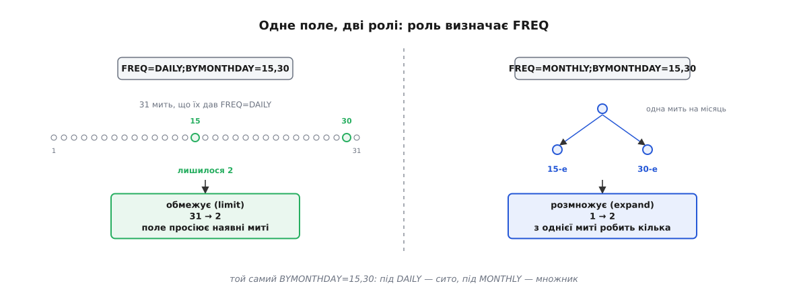
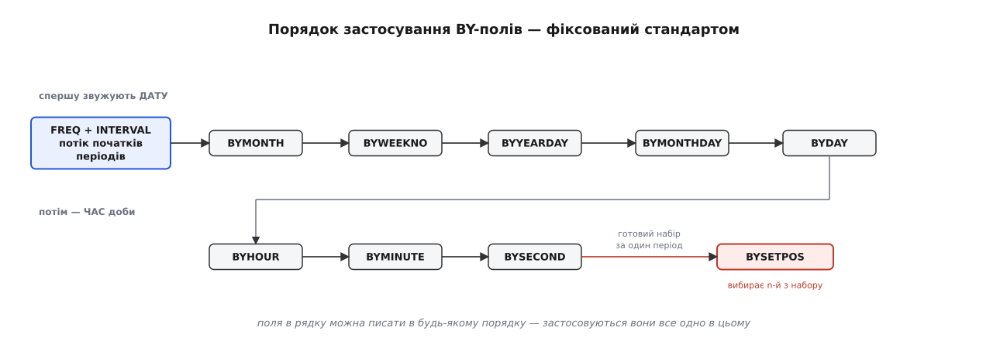

# 📋 RRULE: поля й повна граматика правила повторення

Кількадесят байтів у рядку `RRULE` кодують нескінченний ряд дат — і саме тому кожне поле означає рівно те, що написано в стандарті, ані на йоту більше. Нижче зібрано повний перелік полів, точну граматику рядка, фіксований порядок, у якому поля застосовуються, і те, що стандарт оголошує помилкою. Довідка потрібна в конкретну хвилину: коли ти пишеш розбирач або читаєш чуже правило й хочеш знати, які дати воно **насправді** дасть, а не які здається, що дасть.

Джерело — RFC 5545 «Internet Calendaring and Scheduling Core Object Specification (iCalendar)», редактор Бернар Дерюїсо (Bernard Desruisseaux), вересень 2009; він замінив RFC 2445 від 1998 року. Розділ 3.3.10 означує тип значення `RECUR` — тобто саму граматику; розділ 3.8.5.3 означує властивість `RRULE`, яка це значення носить. Розширення RFC 7529 (травень 2015) додає ще два поля — про них наприкінці.

## Де живе рядок

`RRULE` — не окремий файл і не самостійна сутність, а один рядок усередині календарного компонента (`VEVENT`, `VTODO`, `VJOURNAL`):

```
BEGIN:VEVENT
UID:9f3c1e7a@example.com
DTSTART;TZID=Europe/Kyiv:20260130T090000
RRULE:FREQ=MONTHLY;BYMONTHDAY=-1;COUNT=12
END:VEVENT
```

Форма рядка проста: ім'я властивості, двокрапка, значення. Значення — список полів через `;`, кожне поле — `ІМ'Я=значення`, кілька значень усередині одного поля — через `,`. Пробілів немає, імена й літерні значення — у верхньому регістрі. Мітки часу записано в базовому форматі [ISO 8601](root:sf-data/iso-8601) — злитно, без розділових знаків: `20260130T090000` це 30 січня 2026 року, 09:00:00, а суфікс `Z` (як у `19971224T000000Z`) означає, що мить подано в UTC.

Правило ніколи не працює саме. Набір повторень (recurrence set) складають кілька властивостей разом, і `RRULE` — лише одна з них:

| Властивість | Роль у наборі |
|---|---|
| `DTSTART` | Початок відліку й **перше спрацювання**. Дає всі складники дати й часу, про які правило мовчить. |
| `RRULE` | Правило, що породжує решту ряду. За RFC 5545 має бути не більш ніж одне на компонент. |
| `RDATE` | Окремі дати, дописані до набору поза правилом. |
| `EXDATE` | Окремі дати, викинуті з набору; віднімання відбувається після додавання. |
| `RECURRENCE-ID` | Набору не змінює: позначає один екземпляр, який винесли в окремий компонент, щоб змінити тільки його (перенести, скасувати, переназвати). |

## Граматика значення

Стандарт записує граматику в нотації ABNF: `/` читається «або», `*` — повторення, квадратні дужки — необов'язкова частина, а `1*2DIGIT` означає «від однієї до двох цифр». Якщо сама ідея описувати мову правилами виводу для тебе нова — про це є окрема тема, [формальні граматики](root:computability/formal-grammar).

```
recur           = recur-rule-part *( ";" recur-rule-part )

recur-rule-part = ( "FREQ" "=" freq )
                / ( "UNTIL" "=" enddate )
                / ( "COUNT" "=" 1*DIGIT )
                / ( "INTERVAL" "=" 1*DIGIT )
                / ( "BYSECOND" "=" byseclist )
                / ( "BYMINUTE" "=" byminlist )
                / ( "BYHOUR" "=" byhrlist )
                / ( "BYDAY" "=" bywdaylist )
                / ( "BYMONTHDAY" "=" bymodaylist )
                / ( "BYYEARDAY" "=" byyrdaylist )
                / ( "BYWEEKNO" "=" bywknolist )
                / ( "BYMONTH" "=" bymolist )
                / ( "BYSETPOS" "=" bysplist )
                / ( "WKST" "=" weekday )

freq        = "SECONDLY" / "MINUTELY" / "HOURLY" / "DAILY"
            / "WEEKLY" / "MONTHLY" / "YEARLY"
enddate     = date / date-time

weekday     = "SU" / "MO" / "TU" / "WE" / "TH" / "FR" / "SA"
weekdaynum  = [[plus / minus] ordwk] weekday      ; напр. -1FR
plus        = "+"
minus       = "-"
ordwk       = 1*2DIGIT

byseclist   = seconds     *("," seconds)      ; seconds     = 1*2DIGIT
byminlist   = minutes     *("," minutes)      ; minutes     = 1*2DIGIT
byhrlist    = hour        *("," hour)         ; hour        = 1*2DIGIT
bywdaylist  = weekdaynum  *("," weekdaynum)
bymodaylist = monthdaynum *("," monthdaynum)  ; monthdaynum = [plus/minus] 1*2DIGIT
byyrdaylist = yeardaynum  *("," yeardaynum)   ; yeardaynum  = [plus/minus] 1*3DIGIT
bywknolist  = weeknum     *("," weeknum)      ; weeknum     = [plus/minus] 1*2DIGIT
bymolist    = monthnum    *("," monthnum)     ; monthnum    = 1*2DIGIT
bysplist    = setposday   *("," setposday)    ; setposday   = yeardaynum
```

Граматика сама собою нічого не забороняє поставити двічі чи в дивному порядку — обмеження стандарт формулює текстом поруч, і їх три:

- Поля **не впорядковані**: `FREQ=DAILY;COUNT=10` і `COUNT=10;FREQ=DAILY` — те саме правило. Виняток єдиний: `FREQ` мусить стояти першим у значенні, і це зроблено заради сумісності зі старішими розбирачами.
- Кожне поле може з'явитися **лише раз**. `BYDAY=MO;BYDAY=FR` — недійсний рядок; правильно `BYDAY=MO,FR`.
- `UNTIL` і `COUNT` **не можуть стояти разом**: обидва обмежують ряд, і два обмеження давали б неоднозначність.

## Що правило замовчує: роль DTSTART

Правило описує лише те, що змінюється. Усе інше воно мовчки бере з `DTSTART` — і саме через це `RRULE` без `DTSTART` не має жодного сенсу.

| Правило | Чого воно не каже | Звідки береться |
|---|---|---|
| `FREQ=YEARLY` | місяць, день місяця, час доби | з `DTSTART` |
| `FREQ=MONTHLY` | день місяця, час доби | з `DTSTART` |
| `FREQ=WEEKLY` | день тижня, час доби | з `DTSTART` |
| `FREQ=DAILY` | час доби | з `DTSTART` |
| `FREQ=HOURLY` | хвилина й секунда | з `DTSTART` |

Тому `FREQ=YEARLY` при `DTSTART:20260317T140000` — це «щороку 17 березня о 14:00», хоч у самому правилі немає ні березня, ні сімнадцятого, ні чотирнадцятої.

Друга обов'язкова умова: `DTSTART` мусить **сам справджувати правило**. RFC 5545 прямо каже, що набір, породжений з `DTSTART`, не синхронізованим із правилом, — невизначений. `DTSTART:20260317T140000` разом із `FREQ=MONTHLY;BYMONTHDAY=1` — це не «почни з 17-го, далі щопершого», це рядок, на якому дві бібліотеки законно дадуть різні відповіді.

## Поля: повний перелік

| Поле | Значення | Якщо не задано | Обмеження |
|---|---|---|---|
| `FREQ` | `SECONDLY` `MINUTELY` `HOURLY` `DAILY` `WEEKLY` `MONTHLY` `YEARLY` | рядок недійсний | обов'язкове, рівно раз, першим у значенні |
| `INTERVAL` | додатне ціле | `1` | `FREQ=WEEKLY;INTERVAL=3` — кожен третій тиждень |
| `COUNT` | ціле | ряд нескінченний | не разом з `UNTIL`; `DTSTART` рахується першим спрацюванням |
| `UNTIL` | `DATE` або `DATE-TIME` | ряд нескінченний | не разом з `COUNT`; межа **включна**; тип значення — як у `DTSTART`; якщо `DTSTART` у UTC або з `TZID`, `UNTIL` мусить бути в UTC (із суфіксом `Z`) |
| `BYSECOND` | `0`–`60` | секунда з `DTSTART` | 60 — місце для високосної секунди |
| `BYMINUTE` | `0`–`59` | хвилина з `DTSTART` | |
| `BYHOUR` | `0`–`23` | година з `DTSTART` | |
| `BYDAY` | `SU MO TU WE TH FR SA`, кожен — з необов'язковим `±n` попереду | день тижня з `DTSTART` (для `FREQ=WEEKLY`) | `±n` дозволено лише при `FREQ=MONTHLY` або `YEARLY`; при `YEARLY` — лише якщо немає `BYWEEKNO` |
| `BYMONTHDAY` | `1`–`31` або `-31`–`-1` | день місяця з `DTSTART` | заборонено при `FREQ=WEEKLY` |
| `BYYEARDAY` | `1`–`366` або `-366`–`-1` | — | заборонено при `FREQ=DAILY`, `WEEKLY`, `MONTHLY` |
| `BYWEEKNO` | `1`–`53` або `-53`–`-1` | — | лише при `FREQ=YEARLY` |
| `BYMONTH` | `1`–`12` | місяць із `DTSTART` | |
| `BYSETPOS` | `1`–`366` або `-366`–`-1` | — | лише разом із щонайменше одним іншим `BY…` |
| `WKST` | `SU MO TU WE TH FR SA` | `MO` | важить лише у двох випадках (див. нижче) |

Від'ємні числа скрізь означають відлік з кінця періоду, і це не прикраса, а єдиний спосіб виразити «останній» без знання довжини місяця: `BYMONTHDAY=-1` — останній день, `BYMONTHDAY=-2` — передостанній, `BYYEARDAY=-1` — 31 грудня. Правило `FREQ=MONTHLY;BYMONTHDAY=-1` спрацьовує дванадцять разів на рік, тоді як `BYMONTHDAY=31` — сім.

## BYDAY: день тижня з порядковим номером

`BYDAY` — єдине поле зі складеним значенням: перед двобуквеним днем тижня може стояти число зі знаком, і воно перетворює «кожен понеділок» на «конкретний понеділок».

| Запис | При `FREQ=MONTHLY` | При `FREQ=YEARLY` |
|---|---|---|
| `MO` | кожен понеділок місяця | кожен понеділок року |
| `1MO` або `+1MO` | перший понеділок місяця | перший понеділок **року** |
| `-1MO` | останній понеділок місяця | останній понеділок **року** |
| `2FR` | друга п'ятниця місяця | друга п'ятниця **року** |
| `MO,WE,FR` | кожні пн, ср, пт місяця | кожні пн, ср, пт року |

Пастка тут одна, зате глибока: **номер рахується в межах періоду, який задає `FREQ`**, а не в межах місяця «за замовчуванням». `FREQ=YEARLY;BYDAY=2FR` — це друга п'ятниця січня, одне спрацювання на рік, а не дванадцять. Щоб дістати другу п'ятницю кожного місяця, треба `FREQ=MONTHLY;BYDAY=2FR`.

Число заборонено ставити, коли `FREQ` не `MONTHLY` і не `YEARLY`: `FREQ=WEEKLY;BYDAY=1MO` — недійсний рядок, бо «перший понеділок тижня» не означає нічого. І окремо: при `FREQ=YEARLY` разом із `BYWEEKNO` число в `BYDAY` теж заборонено — тижнева нумерація вже сама визначає, про який тиждень мова.

## Обмежити чи розмножити

Це головна семантика всієї граматики, і саме її найчастіше розуміють навпаки. `FREQ` разом з `INTERVAL` дають потік «початків періодів»: щосекунди, щогодини, щомісяця, щороку. Далі кожне `BY…`-поле робить із цим потоком одну з двох речей — або **обмежує** його (просіює наявні миті), або **розмножує** (з однієї миті робить кілька). Що саме — залежить не від поля, а від пари «поле + `FREQ`».



*Роль поля визначає частота: під `DAILY` воно сито, під `MONTHLY` — множник.*

Правило просте на слух: якщо поле дрібніше за період `FREQ`, воно розмножує (місяць має багато днів — є що породжувати); якщо поле грубіше або того самого масштабу, воно обмежує (день має рівно одне число місяця — лишається тільки перевірити). Повна таблиця з RFC 5545:

| Поле | `SECONDLY` | `MINUTELY` | `HOURLY` | `DAILY` | `WEEKLY` | `MONTHLY` | `YEARLY` |
|---|---|---|---|---|---|---|---|
| `BYMONTH` | обмеж. | обмеж. | обмеж. | обмеж. | обмеж. | обмеж. | **розмнож.** |
| `BYWEEKNO` | — | — | — | — | — | — | **розмнож.** |
| `BYYEARDAY` | обмеж. | обмеж. | обмеж. | — | — | — | **розмнож.** |
| `BYMONTHDAY` | обмеж. | обмеж. | обмеж. | обмеж. | — | **розмнож.** | **розмнож.** |
| `BYDAY` | обмеж. | обмеж. | обмеж. | обмеж. | **розмнож.** | увага ¹ | увага ² |
| `BYHOUR` | обмеж. | обмеж. | обмеж. | **розмнож.** | **розмнож.** | **розмнож.** | **розмнож.** |
| `BYMINUTE` | обмеж. | обмеж. | **розмнож.** | **розмнож.** | **розмнож.** | **розмнож.** | **розмнож.** |
| `BYSECOND` | обмеж. | **розмнож.** | **розмнож.** | **розмнож.** | **розмнож.** | **розмнож.** | **розмнож.** |
| `BYSETPOS` | обмеж. | обмеж. | обмеж. | обмеж. | обмеж. | обмеж. | обмеж. |

«—» означає, що поле з цією частотою взагалі не дозволене. Дві клітинки з приміткою:

- **¹ `BYDAY` при `FREQ=MONTHLY`:** обмежує, якщо в правилі є `BYMONTHDAY`; інакше розмножує в межах місяця.
- **² `BYDAY` при `FREQ=YEARLY`:** обмежує, якщо є `BYYEARDAY` або `BYMONTHDAY`; інакше розмножує в межах тижня, якщо є `BYWEEKNO`; інакше в межах місяця, якщо є `BYMONTH`; інакше — в межах усього року.

Різниця між обмеженням і розмноженням — це різниця між правилом, що спрацьовує двічі на місяць, і правилом, що не спрацьовує ніколи. `FREQ=MONTHLY;BYMONTHDAY=15,30` дає два спрацювання щомісяця. `FREQ=WEEKLY;BYMONTHDAY=15,30` не дало б нічого корисного — і саме тому стандарт цю пару просто забороняє.

## Порядок застосування

Поля не просто «застосовуються всі разом»: стандарт фіксує послідовність, і кожне наступне працює з набором, який лишило попереднє.

```
BYMONTH → BYWEEKNO → BYYEARDAY → BYMONTHDAY → BYDAY
        → BYHOUR → BYMINUTE → BYSECOND → BYSETPOS
```



*Спершу поля дати, потім поля часу доби, останнім — `BYSETPOS`, який вибирає з уже готового набору.*

Ось як це виглядає на прикладі з самого RFC 5545 — правило «кожного другого року, у січні, щонеділі о 8:30 і 9:30»:

**Правило: `FREQ=YEARLY;INTERVAL=2;BYMONTH=1;BYDAY=SU;BYHOUR=8,9;BYMINUTE=30`, `DTSTART` = 1997-01-05 08:30**

```
FREQ=YEARLY;INTERVAL=2  →  по одній миті на кожен 2-й рік: 1997, 1999, 2001 …
BYMONTH=1               →  розмножує в межах року: лишається січень  ─ 1 мить
BYDAY=SU                →  розмножує в межах січня: кожна неділя     ─ 4–5 митей
BYHOUR=8,9              →  розмножує ×2: 08:xx і 09:xx               ─ 8–10 митей
BYMINUTE=30             →  розмножує ×1: 08:30 і 09:30               ─ 8–10 митей
BYSECOND                →  поля немає → секунда з DTSTART (:00)
```

Порядок у самому рядку значення не має: `BYHOUR=8,9;FREQ=YEARLY;BYMONTH=1;…` дало б ті самі дати. Значення має лише порядок **застосування**, і він завжди такий, як угорі.

## BYSETPOS: вибір n-го з готового набору

`BYSETPOS` — єдине поле, що не працює з календарем безпосередньо. Воно застосовується останнім, до вже зібраного набору **одного періоду `FREQ`**, і вибирає з нього миті за номером: `1` — перша, `-1` — остання, `-2` — передостання.

| Правило | Що означає |
|---|---|
| `FREQ=MONTHLY;BYDAY=MO,TU,WE,TH,FR;BYSETPOS=-1` | останній робочий день місяця |
| `FREQ=MONTHLY;BYDAY=MO,TU,WE,TH,FR;BYSETPOS=-2` | передостанній робочий день місяця |
| `FREQ=MONTHLY;BYDAY=TU,WE,TH;BYSETPOS=3` | третій із вівтірків, серед і четвергів місяця |
| `FREQ=YEARLY;BYMONTH=12;BYDAY=SU;BYSETPOS=-1` | остання неділя грудня |

Приклад із RFC 5545 показує, що номер справді рахується заново щоперіоду:

```
DTSTART;TZID=America/New_York:19970904T090000
RRULE:FREQ=MONTHLY;COUNT=3;BYDAY=TU,WE,TH;BYSETPOS=3
==> 1997: 4 вересня, 7 жовтня, 6 листопада
```

Поле безглузде саме собою — вибирати нема з чого, поки набір не зібрано, — тому стандарт вимагає, щоб поруч було щонайменше одне інше `BY…`.

## WKST: де починається тиждень

`WKST` каже, який день вважати першим у тижні; усталено — понеділок. Здається дрібницею, але це поле впливає на дати рівно у двох випадках:

1. `FREQ=WEEKLY` з `INTERVAL` більшим за 1 і з `BYDAY` — бо «кожен другий тиждень» треба від чогось відлічувати, і межа тижня вирішує, які дні потрапили в «той самий» тиждень;
2. `FREQ=YEARLY` з `BYWEEKNO` — бо нумерація тижнів починається від межі тижня.

Приклад із RFC 5545 — одне й те саме правило, різниця лише в двох літерах:

```
DTSTART;TZID=America/New_York:19970805T090000
RRULE:FREQ=WEEKLY;INTERVAL=2;COUNT=4;BYDAY=TU,SU;WKST=MO
==> серпень 1997: 5, 10, 19, 24

DTSTART;TZID=America/New_York:19970805T090000
RRULE:FREQ=WEEKLY;INTERVAL=2;COUNT=4;BYDAY=TU,SU;WKST=SU
==> серпень 1997: 5, 17, 19, 31
```

Три дати з чотирьох різні. При `WKST=MO` неділя 10 серпня належить до того самого тижня, що й вівторок 5-го, тож обидві дати потрапляють у набір; при `WKST=SU` неділя вже відкриває **наступний** тиждень, а наступний тиждень при `INTERVAL=2` пропускається.

Для `BYWEEKNO` стандарт бере нумерацію [ISO 8601](root:sf-data/iso-8601): тиждень перший — той, що містить щонайменше чотири дні нового року. Через це 1 січня цілком може належати до 52-го або 53-го тижня попереднього року, а `BYWEEKNO=1` — припасти на кінець грудня.

## Межі ряду: COUNT і UNTIL

Без `COUNT` і без `UNTIL` правило породжує нескінченний ряд — це нормальний, найчастіший випадок.

`COUNT` рахує **екземпляри набору**, і `DTSTART` завжди рахується першим із них: `FREQ=DAILY;COUNT=10` дасть день `DTSTART` плюс дев'ять наступних. Дати, які правило згенерувало, але стандарт наказав відкинути (про це нижче), у цей рахунок не входять.

`UNTIL` задає межу **включно** і має збігатися з `DTSTART` за типом значення: якщо `DTSTART` — це `DATE` (лише дата), то й `UNTIL` мусить бути `DATE`. Найчастіше порушують інше правило: якщо `DTSTART` подано в UTC або з `TZID`, то `UNTIL` **мусить** бути в UTC, із суфіксом `Z`.

```
DTSTART;TZID=Europe/Kyiv:20260901T090000
RRULE:FREQ=WEEKLY;BYDAY=MO;UNTIL=20261231T235959Z    ← правильно: Z
RRULE:FREQ=WEEKLY;BYDAY=MO;UNTIL=20261231T235959     ← порушення стандарту
```

Причина не формальна. `UNTIL` — це абсолютна мить, а не настінний час: правило живе в поясі, пояс змінює свій відступ, і межа, записана без `Z`, поповзла б разом із ним. Про розділення абсолютної миті й настінного часу є окрема тема — [прикладний час](root:sf-apps/time-and-scheduling).

## Що стандарт вважає помилкою

| Ситуація | Що каже RFC 5545 |
|---|---|
| немає `FREQ` | `FREQ` обов'язкове — рядок недійсний |
| `FREQ` не першим у значенні | порушення (вимога сумісності) |
| `UNTIL` і `COUNT` разом | заборонено |
| одне поле двічі | заборонено |
| `1MO` у `BYDAY` при `FREQ` не `MONTHLY`/`YEARLY` | заборонено |
| `BYDAY` із числом при `FREQ=YEARLY` разом із `BYWEEKNO` | заборонено |
| `BYWEEKNO` при `FREQ` не `YEARLY` | заборонено |
| `BYYEARDAY` при `FREQ=DAILY`/`WEEKLY`/`MONTHLY` | заборонено |
| `BYMONTHDAY` при `FREQ=WEEKLY` | заборонено |
| `BYSETPOS` без жодного іншого `BY…` | заборонено |
| `UNTIL` іншого типу, ніж `DTSTART` | недійсний рядок |
| `DTSTART` не справджує правило | набір **невизначений** |
| правило дало неіснуючу дату (30 лютого) або неіснуючий місцевий час | мить **мусить** бути відкинута й **не рахується** в набір |

Останній рядок — той самий випадок, задля якого й пишуть розкладів. Приклад із RFC 5545:

```
DTSTART;TZID=America/New_York:20070115T090000
RRULE:FREQ=MONTHLY;BYMONTHDAY=15,30;COUNT=5
==> 2007: 15 і 30 січня, 15 лютого, 15 і 30 березня
```

30 лютого просто не з'явилося, і `COUNT=5` дорахував п'яту дату аж у березні. Так само зникає мить, що припала на неіснуючий місцевий час: якщо годинники стрибають з 03:00 на 04:00, то правило «щодня о 03:30» цієї доби не спрацює взагалі.

> 🔧 **Навіщо це.** Перевіряй рядок на межі системи, а не в мить спрацювання. Стандарт каже, що́ **заборонено**, але не каже, як поводитися розбирачеві, коли заборону порушено, — тож `FREQ=WEEKLY;BYDAY=1MO` одна бібліотека відкине винятком, а друга мовчки прочитає як `BYDAY=MO` і роками слатиме листи не тими днями. Ті самі граблі з `UNTIL` без `Z`. Приймаючи правило від користувача чи з чужого API, звіряй його з таблицею вище одразу — інакше помилка проявиться через місяці, у вигляді «чомусь не прийшло нагадування», і шукати її доведеться в даних, а не в коді.

## RSCALE і SKIP: розширення RFC 7529

RFC 7529 «Non-Gregorian Recurrence Rules in the Internet Calendaring and Scheduling Core Object Specification (iCalendar)» (Cyrus Daboo, Apple; Gregory Yakushev, Google; травень 2015) додає до граматики два поля.

| Поле | Значення | Усталене | Обмеження |
|---|---|---|---|
| `RSCALE` | ім'я календарної системи з реєстру CLDR: `GREGORIAN`, `HEBREW`, `CHINESE`, `ISLAMIC-CIVIL`, `INDIAN`… | григоріанський календар | без нього `SKIP` не дозволено |
| `SKIP` | `OMIT` / `BACKWARD` / `FORWARD` | `OMIT` | лише разом із `RSCALE` |

`SKIP` — це якраз відповідь на «а що, як я **хочу** підтягнути неіснуючу дату, а не пропускати її»:

- `OMIT` — поведінка RFC 5545: неіснуючу дату відкинути;
- `BACKWARD` — зсунути назад до найближчої наявної (30 лютого → 28 або 29 лютого);
- `FORWARD` — зсунути вперед (30 лютого → 1 або 2 березня).

```
DTSTART;VALUE=DATE:20120229
RRULE:RSCALE=GREGORIAN;FREQ=YEARLY;SKIP=FORWARD
==> 29 лютого у високосні роки, 1 березня в решті
```

Зверни увагу на `RSCALE=GREGORIAN` у цьому рядку: щоб дістати `SKIP` для звичайного календаря, доводиться явно назвати календар. Це не примха — це спосіб сказати старому розбирачеві «правило не таке, як ти звик»: не знаєш `RSCALE` — не вдавай, що зрозумів рядок.

## Мінімальний робочий виклик

У щоденній роботі рядок майже ніколи не розбирають руками. Дві реалізації, що вкрили галузь, — `rrule` для JavaScript/TypeScript і `dateutil.rrule` для Python.

:::tabs
```ts
import { rrulestr } from "rrule";

// DTSTART входить у той самий текст: правило без нього неповне
const rule = rrulestr(
  "DTSTART;TZID=Europe/Kyiv:20260115T090000\n" +
  "RRULE:FREQ=MONTHLY;BYMONTHDAY=15,30;COUNT=5",
);

rule.all();                        // усі п'ять митей
rule.after(new Date(), true);      // найближча після «зараз»
rule.between(from, to);            // усе у вікні [from, to]
rule.toString();                   // назад у рядок RFC 5545
```
```py
from datetime import datetime
from dateutil.rrule import rrulestr

# dtstart передають окремим аргументом
rule = rrulestr(
    "RRULE:FREQ=MONTHLY;BYMONTHDAY=15,30;COUNT=5",
    dtstart=datetime(2026, 1, 15, 9, 0),
)

list(rule)                         # усі п'ять митей
rule.after(datetime.now(), inc=True)  # найближча після «зараз»
rule.between(frm, to)              # усе у вікні
rule.count()                       # скільки всього (скінченне правило)
```
:::

Імена полів у бібліотеках збігаються з іменами в рядку майже скрізь — з одним винятком, на якому спотикаються постійно:

| Поле рядка | `rrule` (TS) | `dateutil.rrule` (Python) |
|---|---|---|
| `FREQ` | `freq` | перший аргумент `freq` |
| `INTERVAL` | `interval` | `interval` |
| `COUNT` / `UNTIL` | `count` / `until` | `count` / `until` |
| `BYDAY` | **`byweekday`** | **`byweekday`** |
| `BYMONTHDAY` | `bymonthday` | `bymonthday` |
| `BYYEARDAY` | `byyearday` | `byyearday` |
| `BYWEEKNO` | `byweekno` | `byweekno` |
| `BYMONTH` | `bymonth` | `bymonth` |
| `BYHOUR` / `BYMINUTE` / `BYSECOND` | `byhour` / `byminute` / `bysecond` | так само |
| `BYSETPOS` | `bysetpos` | `bysetpos` |
| `WKST` | `wkst` | `wkst` |
| `RSCALE` / `SKIP` | немає | немає |
| — | — | `byeaster` (нестандартне, від Великодня) |

Три застереження, які варто прочитати до того, як довіришся результату:

- **`rrule` (TS) повертає `Date` з нульовим зсувом.** Бібліотека працює з «плаваючими» значеннями: повернуті об'єкти виглядають як UTC, але читати їх треба як настінний час потрібного поясу. Переведення в справжню мить — твоя робота, навіть коли ти передав `tzid`.
- **`dateutil` (Python) віддає такі самі `datetime`, які отримав.** Дав наївний `dtstart` — дістанеш наївні дати; хочеш зонованих — сам додай `tzinfo` й сам зважай на переходи.
- **Ні `RSCALE`, ні `SKIP` не підтримує жодна з двох.** У переліку опцій `rrule` і в сигнатурі `dateutil.rrule` цих полів немає — тобто підтягування неіснуючих дат доведеться робити самому, поверх бібліотеки.

## Еталонний розбирач, валідатор та генератор (C99 / C++20)

У високонавантажених сервісах обробки розкладів, системних демонах та шлюзах календарної синхронізації протоколів CalDAV текстовий рядок `RRULE` розбирають один раз — під час валідації запиту або збереження в базу даних. Зберігати правило у вигляді неперевіреного рядка небезпечно: помилка в синтаксисі чи суперечливі поля (наприклад, одночасна присутність `UNTIL` та `COUNT` або порядковий номер дня тижня при тижневій частоті) проявляться лише під час спроби обчислення чергової дати через тижні або місяці.

Системний інтерфейс розбору `RRULE` вирішує три взаємопов'язані задачі:
1. **Лексичний та синтаксичний аналіз рядка:** сканування пар `КЛЮЧ=ЗНАЧЕННЯ`, розбиття списків значень через кому та виділення числових параметрів без динамічного виділення пам'яті (`zero-heap allocation`).
2. **Семантична валідація за стандартом RFC 5545:** перевірка обов'язковості поля `FREQ`, заборона конфліктуючих полів (`COUNT` разом із `UNTIL`), контроль допустимих діапазонів числових значень (знакові місячні дні від `-31` до `+31` без нуля, місяці від `1` до `12`, позиції `BYSETPOS` від `-366` до `+366`) та перевірка взаємної сумісності полів (`BYSETPOS` вимагає наявності хоча б одного іншого правила `BY...`, `BYMONTHDAY` заборонено при `FREQ=WEEKLY`).
3. **Канонічна серіалізація назад у рядок:** генерація нормалізованого тексту правила у фіксованому порядку полів для стабільного хешування, індексування та передачі через мережеві протоколи.

### Діагностика помилок розбору

Помилки розбору кодуються строго типізованим переліком статусів. Це дозволяє викликаючому коду точно локалізувати причину відхилення правила та повернути інформативне повідомлення клієнту API:

| Код помилки | Опис причини відхилення правила |
|---|---|
| `ERR_EMPTY_INPUT` | Вхідний рядок порожній або містить лише пробільні символи |
| `ERR_MISSING_FREQ` | Поле `FREQ` відсутнє в рядку (порушення розділу 3.3.10 RFC 5545) |
| `ERR_FREQ_NOT_FIRST` | Поле `FREQ` стоїть не першим у списку частин правила |
| `ERR_DUPLICATE_PART` | Одне й те саме поле зустрілося в рядку більше одного разу |
| `ERR_MUTUAL_UNTIL_COUNT` | Правило містить одночасно і `UNTIL`, і `COUNT` |
| `ERR_INVALID_INTERVAL` | Значення `INTERVAL` дорівнює нулю або є від'ємним |
| `ERR_INVALID_COUNT` | Значення `COUNT` дорівнює нулю |
| `ERR_INVALID_UNTIL` | Некоректний формат дати/часу `UNTIL` або відсутність суфікса `Z` |
| `ERR_INVALID_BYMONTH` | Номер місяця в `BYMONTH` виходить за межі `1..12` |
| `ERR_INVALID_BYMONTHDAY` | Значення `BYMONTHDAY` дорівнює 0 або виходить за межі `-31..31` |
| `ERR_INVALID_BYDAY` | Невідома назва дня тижня або некоректний числовий префікс |
| `ERR_INVALID_BYSETPOS` | Позиція `BYSETPOS` дорівнює 0 або виходить за межі `-366..366` |
| `ERR_BYSETPOS_WITHOUT_BY` | Поле `BYSETPOS` задано без жодного іншого фільтра `BY...` |
| `ERR_BYMONTHDAY_ON_WEEKLY` | Поле `BYMONTHDAY` неприпустиме при частоті `FREQ=WEEKLY` |
| `ERR_ORDINAL_BYDAY_INVALID` | Порядковий номер у `BYDAY` дозволений лише для `MONTHLY` та `YEARLY` |
| `ERR_BUFFER_TOO_SMALL` | Розмір вихідного буфера недостатній для серіалізації правила |

:::tabs
```c
/* ============================================================================
 * rrule_spec.h & rrule_spec.c — еталонний C99 парсер, валідатор та генератор
 * ========================================================================== */
#include <stdio.h>
#include <string.h>
#include <stdbool.h>
#include <stdint.h>
#include <ctype.h>

typedef enum {
    RRULE_OK = 0,
    RRULE_ERR_EMPTY_INPUT,
    RRULE_ERR_INVALID_SYNTAX,
    RRULE_ERR_MISSING_FREQ,
    RRULE_ERR_FREQ_NOT_FIRST,
    RRULE_ERR_DUPLICATE_PART,
    RRULE_ERR_MUTUAL_UNTIL_COUNT,
    RRULE_ERR_INVALID_INTERVAL,
    RRULE_ERR_INVALID_COUNT,
    RRULE_ERR_INVALID_UNTIL,
    RRULE_ERR_INVALID_BYMONTH,
    RRULE_ERR_INVALID_BYMONTHDAY,
    RRULE_ERR_INVALID_BYDAY,
    RRULE_ERR_INVALID_BYSETPOS,
    RRULE_ERR_INVALID_WKST,
    RRULE_ERR_BYSETPOS_WITHOUT_BY,
    RRULE_ERR_BYMONTHDAY_ON_WEEKLY,
    RRULE_ERR_ORDINAL_BYDAY_INVALID,
    RRULE_ERR_BUFFER_TOO_SMALL
} rrule_status_t;

typedef enum {
    FREQ_UNSET = 0,
    FREQ_SECONDLY,
    FREQ_MINUTELY,
    FREQ_HOURLY,
    FREQ_DAILY,
    FREQ_WEEKLY,
    FREQ_MONTHLY,
    FREQ_YEARLY
} rrule_freq_t;

typedef struct {
    int8_t ord;   /* 0 = будь-який, +1..+53, -53..-1 */
    uint8_t wday; /* 0 = SU, 1 = MO, 2 = TU, 3 = WE, 4 = TH, 5 = FR, 6 = SA */
} rrule_wday_spec_t;

typedef struct {
    rrule_freq_t freq;
    uint32_t interval;
    uint32_t count;
    bool has_count;
    char until_str[32];
    bool has_until;
    uint16_t bymonth_mask;        /* Біти 1..12 */
    uint32_t bymonthday_pos_mask; /* Біти 1..31 */
    uint32_t bymonthday_neg_mask; /* Біти 1..31 для -1..-31 */
    rrule_wday_spec_t byday[16];
    uint8_t byday_count;
    int16_t bysetpos[16];
    uint8_t bysetpos_count;
    uint8_t wkst;                 /* 0 = SU..6 = SA, усталено 1 (MO) */
} rrule_spec_t;

static const char* kFreqNames[] = {
    "", "SECONDLY", "MINUTELY", "HOURLY", "DAILY", "WEEKLY", "MONTHLY", "YEARLY"
};

static const char* kWdayNames[] = {
    "SU", "MO", "TU", "WE", "TH", "FR", "SA"
};

static inline int parse_wday_code(const char *s, size_t len) {
    if (len < 2) return -1;
    for (int i = 0; i < 7; i++) {
        if (strncmp(s, kWdayNames[i], 2) == 0) return i;
    }
    return -1;
}

static rrule_status_t parse_integer(const char *s, const char *end, int32_t *out) {
    if (s >= end) return RRULE_ERR_INVALID_SYNTAX;
    bool neg = false;
    if (*s == '-') { neg = true; s++; }
    else if (*s == '+') { s++; }
    if (s >= end || !isdigit((unsigned char)*s)) return RRULE_ERR_INVALID_SYNTAX;
    int64_t v = 0;
    while (s < end && isdigit((unsigned char)*s)) {
        v = v * 10 + (*s - '0');
        if (v > 1000000) return RRULE_ERR_INVALID_SYNTAX;
        s++;
    }
    if (s != end) return RRULE_ERR_INVALID_SYNTAX;
    *out = (int32_t)(neg ? -v : v);
    return RRULE_OK;
}

rrule_status_t rrule_spec_validate(const rrule_spec_t *spec) {
    if (spec->freq == FREQ_UNSET) return RRULE_ERR_MISSING_FREQ;
    if (spec->has_count && spec->has_until) return RRULE_ERR_MUTUAL_UNTIL_COUNT;
    if (spec->interval == 0) return RRULE_ERR_INVALID_INTERVAL;
    if (spec->has_count && spec->count == 0) return RRULE_ERR_INVALID_COUNT;

    if (spec->has_until) {
        size_t ulen = strlen(spec->until_str);
        if (ulen < 8) return RRULE_ERR_INVALID_UNTIL;
        if (ulen > 8 && spec->until_str[ulen - 1] != 'Z') {
            return RRULE_ERR_INVALID_UNTIL; /* UTC дата-час мусить мати Z */
        }
    }

    if (spec->freq == FREQ_WEEKLY && (spec->bymonthday_pos_mask || spec->bymonthday_neg_mask)) {
        return RRULE_ERR_BYMONTHDAY_ON_WEEKLY;
    }

    if (spec->bysetpos_count > 0) {
        bool has_by = (spec->bymonth_mask != 0) ||
                      (spec->bymonthday_pos_mask != 0) ||
                      (spec->bymonthday_neg_mask != 0) ||
                      (spec->byday_count != 0);
        if (!has_by) return RRULE_ERR_BYSETPOS_WITHOUT_BY;
    }

    for (uint8_t i = 0; i < spec->byday_count; i++) {
        if (spec->byday[i].ord != 0) {
            if (spec->freq != FREQ_MONTHLY && spec->freq != FREQ_YEARLY) {
                return RRULE_ERR_ORDINAL_BYDAY_INVALID;
            }
        }
    }

    return RRULE_OK;
}

rrule_status_t rrule_spec_parse(const char *str, rrule_spec_t *out) {
    if (!str || !*str) return RRULE_ERR_EMPTY_INPUT;
    memset(out, 0, sizeof(*out));
    out->interval = 1;
    out->wkst = 1; /* Понеділок за замовчуванням */

    const char *p = str;
    if (strncmp(p, "RRULE:", 6) == 0) p += 6;

    bool is_first_part = true;
    uint32_t seen_parts_mask = 0;

    while (*p) {
        const char *semicolon = strchr(p, ';');
        const char *part_end = semicolon ? semicolon : p + strlen(p);
        const char *equals = memchr(p, '=', (size_t)(part_end - p));
        if (!equals) return RRULE_ERR_INVALID_SYNTAX;

        size_t key_len = (size_t)(equals - p);
        const char *val = equals + 1;
        size_t val_len = (size_t)(part_end - val);
        if (val_len == 0) return RRULE_ERR_INVALID_SYNTAX;

        if (key_len == 4 && strncmp(p, "FREQ", 4) == 0) {
            if (!is_first_part) return RRULE_ERR_FREQ_NOT_FIRST;
            if (seen_parts_mask & (1 << 0)) return RRULE_ERR_DUPLICATE_PART;
            seen_parts_mask |= (1 << 0);

            for (int i = 1; i <= 7; i++) {
                if (strlen(kFreqNames[i]) == val_len && strncmp(val, kFreqNames[i], val_len) == 0) {
                    out->freq = (rrule_freq_t)i;
                    break;
                }
            }
            if (out->freq == FREQ_UNSET) return RRULE_ERR_INVALID_SYNTAX;
        } else if (key_len == 8 && strncmp(p, "INTERVAL", 8) == 0) {
            if (seen_parts_mask & (1 << 1)) return RRULE_ERR_DUPLICATE_PART;
            seen_parts_mask |= (1 << 1);
            int32_t iv = 0;
            if (parse_integer(val, part_end, &iv) != RRULE_OK || iv <= 0) {
                return RRULE_ERR_INVALID_INTERVAL;
            }
            out->interval = (uint32_t)iv;
        } else if (key_len == 5 && strncmp(p, "COUNT", 5) == 0) {
            if (seen_parts_mask & (1 << 2)) return RRULE_ERR_DUPLICATE_PART;
            seen_parts_mask |= (1 << 2);
            int32_t cnt = 0;
            if (parse_integer(val, part_end, &cnt) != RRULE_OK || cnt <= 0) {
                return RRULE_ERR_INVALID_COUNT;
            }
            out->count = (uint32_t)cnt;
            out->has_count = true;
        } else if (key_len == 5 && strncmp(p, "UNTIL", 5) == 0) {
            if (seen_parts_mask & (1 << 3)) return RRULE_ERR_DUPLICATE_PART;
            seen_parts_mask |= (1 << 3);
            if (val_len >= sizeof(out->until_str)) return RRULE_ERR_INVALID_UNTIL;
            memcpy(out->until_str, val, val_len);
            out->until_str[val_len] = '\0';
            out->has_until = true;
        } else if (key_len == 7 && strncmp(p, "BYMONTH", 7) == 0) {
            if (seen_parts_mask & (1 << 4)) return RRULE_ERR_DUPLICATE_PART;
            seen_parts_mask |= (1 << 4);
            const char *item = val;
            while (item < part_end) {
                const char *comma = memchr(item, ',', (size_t)(part_end - item));
                const char *item_end = comma ? comma : part_end;
                int32_t m = 0;
                if (parse_integer(item, item_end, &m) != RRULE_OK || m < 1 || m > 12) {
                    return RRULE_ERR_INVALID_BYMONTH;
                }
                out->bymonth_mask |= (1 << m);
                item = item_end + (comma ? 1 : 0);
            }
        } else if (key_len == 10 && strncmp(p, "BYMONTHDAY", 10) == 0) {
            if (seen_parts_mask & (1 << 5)) return RRULE_ERR_DUPLICATE_PART;
            seen_parts_mask |= (1 << 5);
            const char *item = val;
            while (item < part_end) {
                const char *comma = memchr(item, ',', (size_t)(part_end - item));
                const char *item_end = comma ? comma : part_end;
                int32_t md = 0;
                if (parse_integer(item, item_end, &md) != RRULE_OK || md == 0 || md < -31 || md > 31) {
                    return RRULE_ERR_INVALID_BYMONTHDAY;
                }
                if (md > 0) out->bymonthday_pos_mask |= (1U << md);
                else out->bymonthday_neg_mask |= (1U << (-md));
                item = item_end + (comma ? 1 : 0);
            }
        } else if (key_len == 5 && strncmp(p, "BYDAY", 5) == 0) {
            if (seen_parts_mask & (1 << 6)) return RRULE_ERR_DUPLICATE_PART;
            seen_parts_mask |= (1 << 6);
            const char *item = val;
            while (item < part_end) {
                const char *comma = memchr(item, ',', (size_t)(part_end - item));
                const char *item_end = comma ? comma : part_end;
                if (out->byday_count >= 16) return RRULE_ERR_INVALID_BYDAY;

                int8_t ord = 0;
                const char *wptr = item;
                if (item_end - item > 2) {
                    int32_t ord_val = 0;
                    if (parse_integer(item, item_end - 2, &ord_val) != RRULE_OK || ord_val < -53 || ord_val > 53 || ord_val == 0) {
                        return RRULE_ERR_INVALID_BYDAY;
                    }
                    ord = (int8_t)ord_val;
                    wptr = item_end - 2;
                }
                int wd = parse_wday_code(wptr, (size_t)(item_end - wptr));
                if (wd < 0) return RRULE_ERR_INVALID_BYDAY;
                out->byday[out->byday_count].ord = ord;
                out->byday[out->byday_count].wday = (uint8_t)wd;
                out->byday_count++;
                item = item_end + (comma ? 1 : 0);
            }
        } else if (key_len == 8 && strncmp(p, "BYSETPOS", 8) == 0) {
            if (seen_parts_mask & (1 << 7)) return RRULE_ERR_DUPLICATE_PART;
            seen_parts_mask |= (1 << 7);
            const char *item = val;
            while (item < part_end) {
                const char *comma = memchr(item, ',', (size_t)(part_end - item));
                const char *item_end = comma ? comma : part_end;
                if (out->bysetpos_count >= 16) return RRULE_ERR_INVALID_BYSETPOS;
                int32_t sp = 0;
                if (parse_integer(item, item_end, &sp) != RRULE_OK || sp == 0 || sp < -366 || sp > 366) {
                    return RRULE_ERR_INVALID_BYSETPOS;
                }
                out->bysetpos[out->bysetpos_count++] = (int16_t)sp;
                item = item_end + (comma ? 1 : 0);
            }
        } else if (key_len == 4 && strncmp(p, "WKST", 4) == 0) {
            if (seen_parts_mask & (1 << 8)) return RRULE_ERR_DUPLICATE_PART;
            seen_parts_mask |= (1 << 8);
            int wd = parse_wday_code(val, val_len);
            if (wd < 0) return RRULE_ERR_INVALID_WKST;
            out->wkst = (uint8_t)wd;
        }

        is_first_part = false;
        p = semicolon ? semicolon + 1 : part_end;
    }

    return rrule_spec_validate(out);
}

int rrule_spec_to_string(const rrule_spec_t *spec, char *buf, size_t buf_size) {
    if (!spec || !buf || buf_size == 0) return -1;
    if (spec->freq == FREQ_UNSET) return -1;

    size_t off = 0;
    int written = snprintf(buf + off, buf_size - off, "FREQ=%s", kFreqNames[spec->freq]);
    if (written < 0 || (size_t)written >= buf_size - off) return -1;
    off += (size_t)written;

    if (spec->interval > 1) {
        written = snprintf(buf + off, buf_size - off, ";INTERVAL=%u", spec->interval);
        if (written < 0 || (size_t)written >= buf_size - off) return -1;
        off += (size_t)written;
    }
    if (spec->has_count) {
        written = snprintf(buf + off, buf_size - off, ";COUNT=%u", spec->count);
        if (written < 0 || (size_t)written >= buf_size - off) return -1;
        off += (size_t)written;
    } else if (spec->has_until) {
        written = snprintf(buf + off, buf_size - off, ";UNTIL=%s", spec->until_str);
        if (written < 0 || (size_t)written >= buf_size - off) return -1;
        off += (size_t)written;
    }
    if (spec->bymonth_mask != 0) {
        written = snprintf(buf + off, buf_size - off, ";BYMONTH=");
        if (written < 0 || (size_t)written >= buf_size - off) return -1;
        off += (size_t)written;
        bool first = true;
        for (int m = 1; m <= 12; m++) {
            if (spec->bymonth_mask & (1 << m)) {
                written = snprintf(buf + off, buf_size - off, "%s%d", first ? "" : ",", m);
                if (written < 0 || (size_t)written >= buf_size - off) return -1;
                off += (size_t)written;
                first = false;
            }
        }
    }
    if (spec->bymonthday_pos_mask != 0 || spec->bymonthday_neg_mask != 0) {
        written = snprintf(buf + off, buf_size - off, ";BYMONTHDAY=");
        if (written < 0 || (size_t)written >= buf_size - off) return -1;
        off += (size_t)written;
        bool first = true;
        for (int d = 1; d <= 31; d++) {
            if (spec->bymonthday_pos_mask & (1U << d)) {
                written = snprintf(buf + off, buf_size - off, "%s%d", first ? "" : ",", d);
                if (written < 0 || (size_t)written >= buf_size - off) return -1;
                off += (size_t)written;
                first = false;
            }
        }
        for (int d = 1; d <= 31; d++) {
            if (spec->bymonthday_neg_mask & (1U << d)) {
                written = snprintf(buf + off, buf_size - off, "%s-%d", first ? "" : ",", d);
                if (written < 0 || (size_t)written >= buf_size - off) return -1;
                off += (size_t)written;
                first = false;
            }
        }
    }
    if (spec->byday_count > 0) {
        written = snprintf(buf + off, buf_size - off, ";BYDAY=");
        if (written < 0 || (size_t)written >= buf_size - off) return -1;
        off += (size_t)written;
        for (uint8_t i = 0; i < spec->byday_count; i++) {
            if (spec->byday[i].ord != 0) {
                written = snprintf(buf + off, buf_size - off, "%s%d%s",
                                   i == 0 ? "" : ",", spec->byday[i].ord, kWdayNames[spec->byday[i].wday]);
            } else {
                written = snprintf(buf + off, buf_size - off, "%s%s",
                                   i == 0 ? "" : ",", kWdayNames[spec->byday[i].wday]);
            }
            if (written < 0 || (size_t)written >= buf_size - off) return -1;
            off += (size_t)written;
        }
    }
    if (spec->bysetpos_count > 0) {
        written = snprintf(buf + off, buf_size - off, ";BYSETPOS=");
        if (written < 0 || (size_t)written >= buf_size - off) return -1;
        off += (size_t)written;
        for (uint8_t i = 0; i < spec->bysetpos_count; i++) {
            written = snprintf(buf + off, buf_size - off, "%s%d",
                               i == 0 ? "" : ",", spec->bysetpos[i]);
            if (written < 0 || (size_t)written >= buf_size - off) return -1;
            off += (size_t)written;
        }
    }
    if (spec->wkst != 1) {
        written = snprintf(buf + off, buf_size - off, ";WKST=%s", kWdayNames[spec->wkst]);
        if (written < 0 || (size_t)written >= buf_size - off) return -1;
        off += (size_t)written;
    }

    return (int)off;
}
```
```cpp
// ============================================================================
// rrule_spec.hpp — еталонний C++20 парсер, валідатор та генератор RRULE
// ============================================================================
#include <string>
#include <string_view>
#include <array>
#include <vector>
#include <optional>
#include <expected>
#include <cstdint>
#include <algorithm>
#include <charconv>
#include <format>
#include <sstream>

namespace rrule_api {

enum class Freq : uint8_t {
    Unset = 0, Secondly, Minutely, Hourly, Daily, Weekly, Monthly, Yearly
};

enum class Weekday : uint8_t {
    SU = 0, MO = 1, TU = 2, WE = 3, TH = 4, FR = 5, SA = 6
};

enum class ErrorCode {
    EmptyInput,
    InvalidSyntax,
    MissingFreq,
    FreqNotFirst,
    DuplicatePart,
    MutualUntilCount,
    InvalidInterval,
    InvalidCount,
    InvalidUntil,
    InvalidByMonth,
    InvalidByMonthDay,
    InvalidByDay,
    InvalidBySetPos,
    InvalidWkst,
    BySetPosWithoutBy,
    ByMonthDayOnWeekly,
    OrdinalByDayInvalidFreq,
    BufferTooSmall
};

struct WeekdayNum {
    int8_t ord{0}; // 0 = кожен, +1..+53, -53..-1
    Weekday wday{Weekday::MO};
};

struct RuleSpec {
    Freq freq{Freq::Unset};
    uint32_t interval{1};
    std::optional<uint32_t> count{std::nullopt};
    std::optional<std::string> until{std::nullopt};
    uint16_t bymonth_mask{0};
    uint32_t bymonthday_pos_mask{0};
    uint32_t bymonthday_neg_mask{0};
    std::vector<WeekdayNum> byday{};
    std::vector<int16_t> bysetpos{};
    Weekday wkst{Weekday::MO};

    [[nodiscard]] constexpr bool has_by_filters() const noexcept {
        return (bymonth_mask != 0) || (bymonthday_pos_mask != 0) ||
               (bymonthday_neg_mask != 0) || (!byday.empty());
    }
};

class RRuleParser {
public:
    static constexpr std::string_view freq_to_string(Freq f) noexcept {
        switch (f) {
            case Freq::Secondly: return "SECONDLY";
            case Freq::Minutely: return "MINUTELY";
            case Freq::Hourly:   return "HOURLY";
            case Freq::Daily:    return "DAILY";
            case Freq::Weekly:   return "WEEKLY";
            case Freq::Monthly:  return "MONTHLY";
            case Freq::Yearly:   return "YEARLY";
            default:             return "";
        }
    }

    static constexpr std::string_view wday_to_string(Weekday w) noexcept {
        switch (w) {
            case Weekday::SU: return "SU";
            case Weekday::MO: return "MO";
            case Weekday::TU: return "TU";
            case Weekday::WE: return "WE";
            case Weekday::TH: return "TH";
            case Weekday::FR: return "FR";
            case Weekday::SA: return "SA";
        }
        return "MO";
    }

    static constexpr std::optional<Weekday> parse_wday(std::string_view sv) noexcept {
        if (sv == "SU") return Weekday::SU;
        if (sv == "MO") return Weekday::MO;
        if (sv == "TU") return Weekday::TU;
        if (sv == "WE") return Weekday::WE;
        if (sv == "TH") return Weekday::TH;
        if (sv == "FR") return Weekday::FR;
        if (sv == "SA") return Weekday::SA;
        return std::nullopt;
    }

    static std::expected<RuleSpec, ErrorCode> parse(std::string_view input) noexcept {
        if (input.empty()) return std::unexpected(ErrorCode::EmptyInput);
        if (input.starts_with("RRULE:")) input.remove_prefix(6);

        RuleSpec spec{};
        bool is_first = true;
        uint32_t seen_mask = 0;

        while (!input.empty()) {
            size_t semi = input.find(';');
            std::string_view part = (semi == std::string_view::npos) ? input : input.substr(0, semi);
            input = (semi == std::string_view::npos) ? std::string_view{} : input.substr(semi + 1);

            size_t eq = part.find('=');
            if (eq == std::string_view::npos) return std::unexpected(ErrorCode::InvalidSyntax);
            std::string_view key = part.substr(0, eq);
            std::string_view val = part.substr(eq + 1);
            if (val.empty()) return std::unexpected(ErrorCode::InvalidSyntax);

            if (key == "FREQ") {
                if (!is_first) return std::unexpected(ErrorCode::FreqNotFirst);
                if (seen_mask & (1 << 0)) return std::unexpected(ErrorCode::DuplicatePart);
                seen_mask |= (1 << 0);

                if (val == "SECONDLY") spec.freq = Freq::Secondly;
                else if (val == "MINUTELY") spec.freq = Freq::Minutely;
                else if (val == "HOURLY") spec.freq = Freq::Hourly;
                else if (val == "DAILY") spec.freq = Freq::Daily;
                else if (val == "WEEKLY") spec.freq = Freq::Weekly;
                else if (val == "MONTHLY") spec.freq = Freq::Monthly;
                else if (val == "YEARLY") spec.freq = Freq::Yearly;
                else return std::unexpected(ErrorCode::InvalidSyntax);
            } else if (key == "INTERVAL") {
                if (seen_mask & (1 << 1)) return std::unexpected(ErrorCode::DuplicatePart);
                seen_mask |= (1 << 1);
                uint32_t iv = 0;
                auto [p, ec] = std::from_chars(val.data(), val.data() + val.size(), iv);
                if (ec != std::errc{} || p != val.data() + val.size() || iv == 0) {
                    return std::unexpected(ErrorCode::InvalidInterval);
                }
                spec.interval = iv;
            } else if (key == "COUNT") {
                if (seen_mask & (1 << 2)) return std::unexpected(ErrorCode::DuplicatePart);
                seen_mask |= (1 << 2);
                uint32_t cnt = 0;
                auto [p, ec] = std::from_chars(val.data(), val.data() + val.size(), cnt);
                if (ec != std::errc{} || p != val.data() + val.size() || cnt == 0) {
                    return std::unexpected(ErrorCode::InvalidCount);
                }
                spec.count = cnt;
            } else if (key == "UNTIL") {
                if (seen_mask & (1 << 3)) return std::unexpected(ErrorCode::DuplicatePart);
                seen_mask |= (1 << 3);
                if (val.size() < 8) return std::unexpected(ErrorCode::InvalidUntil);
                if (val.size() > 8 && !val.ends_with('Z')) return std::unexpected(ErrorCode::InvalidUntil);
                spec.until = std::string(val);
            } else if (key == "BYMONTH") {
                if (seen_mask & (1 << 4)) return std::unexpected(ErrorCode::DuplicatePart);
                seen_mask |= (1 << 4);
                std::string_view remaining = val;
                while (!remaining.empty()) {
                    size_t comma = remaining.find(',');
                    std::string_view token = (comma == std::string_view::npos) ? remaining : remaining.substr(0, comma);
                    remaining = (comma == std::string_view::npos) ? std::string_view{} : remaining.substr(comma + 1);

                    int m = 0;
                    auto [p, ec] = std::from_chars(token.data(), token.data() + token.size(), m);
                    if (ec != std::errc{} || p != token.data() + token.size() || m < 1 || m > 12) {
                        return std::unexpected(ErrorCode::InvalidByMonth);
                    }
                    spec.bymonth_mask |= (1 << m);
                }
            } else if (key == "BYMONTHDAY") {
                if (seen_mask & (1 << 5)) return std::unexpected(ErrorCode::DuplicatePart);
                seen_mask |= (1 << 5);
                std::string_view remaining = val;
                while (!remaining.empty()) {
                    size_t comma = remaining.find(',');
                    std::string_view token = (comma == std::string_view::npos) ? remaining : remaining.substr(0, comma);
                    remaining = (comma == std::string_view::npos) ? std::string_view{} : remaining.substr(comma + 1);

                    int md = 0;
                    auto [p, ec] = std::from_chars(token.data(), token.data() + token.size(), md);
                    if (ec != std::errc{} || p != token.data() + token.size() || md == 0 || md < -31 || md > 31) {
                        return std::unexpected(ErrorCode::InvalidByMonthDay);
                    }
                    if (md > 0) spec.bymonthday_pos_mask |= (1U << md);
                    else spec.bymonthday_neg_mask |= (1U << (-md));
                }
            } else if (key == "BYDAY") {
                if (seen_mask & (1 << 6)) return std::unexpected(ErrorCode::DuplicatePart);
                seen_mask |= (1 << 6);
                std::string_view remaining = val;
                while (!remaining.empty()) {
                    size_t comma = remaining.find(',');
                    std::string_view token = (comma == std::string_view::npos) ? remaining : remaining.substr(0, comma);
                    remaining = (comma == std::string_view::npos) ? std::string_view{} : remaining.substr(comma + 1);

                    int8_t ord = 0;
                    std::string_view wstr = token;
                    if (token.size() > 2) {
                        int ord_val = 0;
                        auto [p, ec] = std::from_chars(token.data(), token.data() + token.size() - 2, ord_val);
                        if (ec != std::errc{} || p != token.data() + token.size() - 2 || ord_val < -53 || ord_val > 53 || ord_val == 0) {
                            return std::unexpected(ErrorCode::InvalidByDay);
                        }
                        ord = static_cast<int8_t>(ord_val);
                        wstr = token.substr(token.size() - 2);
                    }
                    auto wd_opt = parse_wday(wstr);
                    if (!wd_opt) return std::unexpected(ErrorCode::InvalidByDay);
                    spec.byday.push_back(WeekdayNum{ord, *wd_opt});
                }
            } else if (key == "BYSETPOS") {
                if (seen_mask & (1 << 7)) return std::unexpected(ErrorCode::DuplicatePart);
                seen_mask |= (1 << 7);
                std::string_view remaining = val;
                while (!remaining.empty()) {
                    size_t comma = remaining.find(',');
                    std::string_view token = (comma == std::string_view::npos) ? remaining : remaining.substr(0, comma);
                    remaining = (comma == std::string_view::npos) ? std::string_view{} : remaining.substr(comma + 1);

                    int sp = 0;
                    auto [p, ec] = std::from_chars(token.data(), token.data() + token.size(), sp);
                    if (ec != std::errc{} || p != token.data() + token.size() || sp == 0 || sp < -366 || sp > 366) {
                        return std::unexpected(ErrorCode::InvalidBySetPos);
                    }
                    spec.bysetpos.push_back(static_cast<int16_t>(sp));
                }
            } else if (key == "WKST") {
                if (seen_mask & (1 << 8)) return std::unexpected(ErrorCode::DuplicatePart);
                seen_mask |= (1 << 8);
                auto wd_opt = parse_wday(val);
                if (!wd_opt) return std::unexpected(ErrorCode::InvalidWkst);
                spec.wkst = *wd_opt;
            }

            is_first = false;
        }

        return validate(spec);
    }

    static std::expected<RuleSpec, ErrorCode> validate(const RuleSpec& spec) noexcept {
        if (spec.freq == Freq::Unset) return std::unexpected(ErrorCode::MissingFreq);
        if (spec.count.has_value() && spec.until.has_value()) return std::unexpected(ErrorCode::MutualUntilCount);
        if (spec.interval == 0) return std::unexpected(ErrorCode::InvalidInterval);

        if (spec.freq == Freq::Weekly && (spec.bymonthday_pos_mask || spec.bymonthday_neg_mask)) {
            return std::unexpected(ErrorCode::ByMonthDayOnWeekly);
        }

        if (!spec.bysetpos.empty() && !spec.has_by_filters()) {
            return std::unexpected(ErrorCode::BySetPosWithoutBy);
        }

        for (const auto& d : spec.byday) {
            if (d.ord != 0 && spec.freq != Freq::Monthly && spec.freq != Freq::Yearly) {
                return std::unexpected(ErrorCode::OrdinalByDayInvalidFreq);
            }
        }

        return spec;
    }

    static std::string to_string(const RuleSpec& spec) {
        std::ostringstream ss;
        ss << "FREQ=" << freq_to_string(spec.freq);

        if (spec.interval > 1) ss << ";INTERVAL=" << spec.interval;
        if (spec.count.has_value()) ss << ";COUNT=" << *spec.count;
        else if (spec.until.has_value()) ss << ";UNTIL=" << *spec.until;

        if (spec.bymonth_mask != 0) {
            ss << ";BYMONTH=";
            bool first = true;
            for (int m = 1; m <= 12; ++m) {
                if (spec.bymonth_mask & (1 << m)) {
                    if (!first) ss << ',';
                    ss << m;
                    first = false;
                }
            }
        }

        if (spec.bymonthday_pos_mask || spec.bymonthday_neg_mask) {
            ss << ";BYMONTHDAY=";
            bool first = true;
            for (int d = 1; d <= 31; ++d) {
                if (spec.bymonthday_pos_mask & (1U << d)) {
                    if (!first) ss << ',';
                    ss << d;
                    first = false;
                }
            }
            for (int d = 1; d <= 31; ++d) {
                if (spec.bymonthday_neg_mask & (1U << d)) {
                    if (!first) ss << ',';
                    ss << '-' << d;
                    first = false;
                }
            }
        }

        if (!spec.byday.empty()) {
            ss << ";BYDAY=";
            for (size_t i = 0; i < spec.byday.size(); ++i) {
                if (i > 0) ss << ',';
                if (spec.byday[i].ord != 0) ss << static_cast<int>(spec.byday[i].ord);
                ss << wday_to_string(spec.byday[i].wday);
            }
        }

        if (!spec.bysetpos.empty()) {
            ss << ";BYSETPOS=";
            for (size_t i = 0; i < spec.bysetpos.size(); ++i) {
                if (i > 0) ss << ',';
                ss << spec.bysetpos[i];
            }
        }

        if (spec.wkst != Weekday::MO) {
            ss << ";WKST=" << wday_to_string(spec.wkst);
        }

        return ss.str();
    }
};

} // namespace rrule_api
```
:::

### Архітектурні висновки для надійних систем

Розбір рекурентних правил за наведеною схемою гарантує три критичні властивості:
- **Передбачуваність пам'яті:** структура `rrule_spec_t` займає менше ніж 80 байтів на стеку та не викликає системний менеджер пам'яті під час аналізу рядків.
- **Невразливість до атак виснаження ресурсів (ReDoS/DoS):** синтаксичний автомат проходить вхідний рядок строго за один лінійний прохід `O(N)` без регулярних виразів та бектрекінгу.
- **Суворе дотримання семантики RFC 5545:** валідатор усуває невизначені стани календаря ще на етапі вхідного шлюзу API, не допускаючи збереження недійсних або неоднозначних комбінацій параметрів.

## Простеження розбору складного правила: крок за кроком

Розглянемо повне проходження вхідного рядка через автомат розбору та валідації на прикладі складного комбінованого правила:

`RRULE:FREQ=MONTHLY;INTERVAL=2;BYDAY=1MO,-1FR;BYMONTHDAY=10,11,12,13,14,15;BYSETPOS=1,-1;UNTIL=20271231T235959Z`

1. **Сканування префікса та першого поля:** Лексер перевіряє префікс `RRULE:` і зсуває покажчик на початок першої пари ключ-значення. Першим токеном зчитується `FREQ=MONTHLY`. Прапорець першого поля скидається, а значення частоти записується в поле структури `freq = FREQ_MONTHLY`.
2. **Розбір кроку `INTERVAL=2`:** Парсер виділяє ключ `INTERVAL`, перевіряє відсутність повторення поля через бітову маску `seen_mask` та конвертує число `2`. Перевірка `iv > 0` проходить успішно.
3. **Обробка складеного поля `BYDAY=1MO,-1FR`:**
   - Перший елемент списку `1MO` має довжину 3 символи. Автомат відтинає останні 2 символи `MO` (понеділок, індекс 1), а префікс `+1` парсить як знакову позицію `ord = +1` (перший понеділок).
   - Другий елемент списку `-1FR` розбивається на токен `FR` (п'ятниця, індекс 5) та знаковий префікс `ord = -1` (остання п'ятниця).
   - Обидва елементи додаються до масиву `byday` структури.
4. **Розбір списку чисел місяця `BYMONTHDAY=10,11,12,13,14,15`:** Автомат ітерує по значеннях, розділених комами, перевіряє діапазон кожного числа (`1 <= md <= 31`) та встановлює біти з 10-го по 15-й у бітовій масці `bymonthday_pos_mask`.
5. **Розбір відбору `BYSETPOS=1,-1`:** Значення `+1` (перший елемент відфільтрованого набору) та `-1` (останній елемент) записуються до масиву `bysetpos`.
6. **Перевірка межі `UNTIL=20271231T235959Z`:** Рядок перевіряється на наявність кінцевого символу `Z` (ознака абсолютного часу UTC). Прапорець `has_until` встановлюється в `true`.
7. **Фінальна семантична валідація:**
   - `FREQ` присутній та валідний (успіх).
   - `has_count` (`false`) та `has_until` (`true`) не конфліктують (успіх).
   - Для частоти `MONTHLY` наявність `BYMONTHDAY` є дозволеною (успіх).
   - `BYSETPOS` спирається на наявні фільтри `BYDAY` та `BYMONTHDAY` (успіх).
   - Порядкові префікси `+1MO` та `-1FR` використовуються разом із `FREQ=MONTHLY`, що дозволено стандартом (успіх).

На виході з валідатора система отримує повністю перевірену двійкову структуру, готову до швидкого виконання розгортачем або збереження в базу даних.

## Збереження та індексація у сховищах CalDAV

У виробничих серверах календарів (наприклад, SabreDAV, Radicale, Apple Calendar Server) рекурентні події не розгортаються наперед у нескінченні таблиці окремих записів бази даних. Замість цього застосовується дворівнева схема зберігання:

1. **Майстер-компонент (Master VEVENT):** Зберігає повний рядок `DTSTART`, `RRULE`, `RDATE` та `EXDATE` у нормалізованому текстовому або двійковому форматі. У таблиці створюється унікальний індекс за ідентифікатором події `UID`.
2. **Індекс часових меж (Bounding Box Index):** Під час збереження правила парсер витягує часові межі активності розкладу:
   - Мінімальний час `min_time` = абсолютне значення `DTSTART` в UTC.
   - Максимальний час `max_time` = значення `UNTIL` в UTC або спеціальний маркер `+INFINITY` (якщо правило нескінченне).
3. **Обробка виняткових екземплярів (Exception Overrides):** Якщо користувач переносить або редагує окреме входження серії (наприклад, скасовує мітинг 15 березня), сервер зберігає окремий запис із властивістю `RECURRENCE-ID:20260315T090000Z`. Під час запиту діапазону дат розгортач спочатку генерує базовий набір за `RRULE`, викидає дати, що містяться в списку `EXDATE`, та замінює відповідні екземпляри даними зі знайдених перекриттів `RECURRENCE-ID`.

Такий підхід забезпечує виконання календарних вибірок `CALDAV:calendar-query` за логарифмічний час `O(log N)` за допомогою стандартних B-Tree або GiST-індексів бази даних, усуваючи необхідність збереження мільйонів порожніх рядків у дисковому сховищі.
