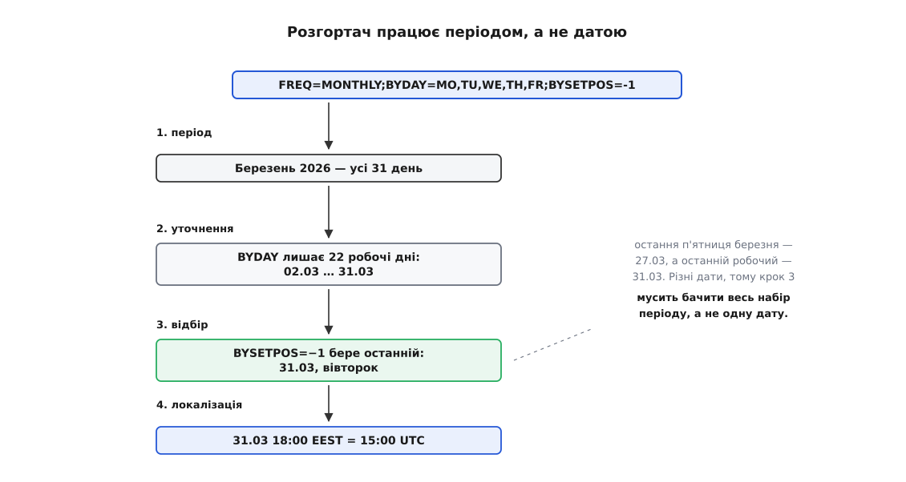
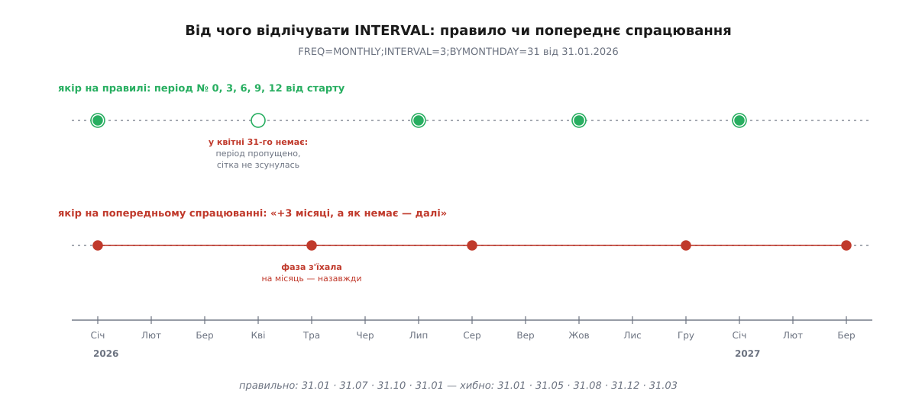

# ⚙️ Розгортач: правило на вході, миті на виході

Розгортач — це функція, яка приймає рекурентне правило й повертає наступні N абсолютних митей; ось вона цілком, робочим кодом двома мовами, і поряд — сім місць, де такий код дає хибну відповідь, жодного разу не впавши.

---

## Що має вміти функція

Операція потрібна одна: **дай наступні N спрацювань після миті X**. З неї виводиться решта. Показ календаря на місяць — спитати з першого числа й брати, доки не вийдеш за межу місяця. Планувальник — спитати одне наступне. Перевірка правила під час збереження — спитати п'ять дат і показати людині: чи справді вона мала на увазі це.

На вході чотири речі: правило, початок відліку в настінному часі, ідентифікатор поясу й мить, після якої шукаємо. На виході — миті в UTC.

Перша домовленість, від якої залежить уся решта: **правило — це дані, а не рядок**. Розбір тексту `FREQ=MONTHLY;BYMONTHDAY=31` у структуру — окрема механічна задача, і робити її треба один раз, під час збереження. Доки правило лишається рядком, кожне питання на кшталт «а чи є тут BYSETPOS» перетворюється на копирсання в тексті всередині найгарячішого циклу.

## Одиниця роботи — період, а не дата

Найприродніший начерк звучить так: тримати поточну дату й шукати наступну, яка справджує правило. Він розсипається на трьох різних рівнях, і кожен варто побачити окремо, бо кожен пояснює свою частину остаточної конструкції.

Перший рівень. Для частини правил «наступна дата» просто не означена локально. Візьми «останній робочий день місяця». Дивлячись на одну лише дату 31 березня, відповісти неможливо: щоб знати, чи вона остання робоча, треба знати всі робочі дні березня. Предиката `чи_підходить(дата)` тут не існує — існує вибір із готового набору.

Другий рівень. Коли кандидата немає (31-го квітня не буває), наївний код «підсуває» дату до найближчої придатної — і крок правила зсувається назавжди. Нижче це показано з числами.

Третій рівень. Перевірка «чи справджується уточнення» відбувається в настінному часі: «31-е» й «п'ятниця» — властивості місцевого календаря. А перевірка «чи вже минуло» відбувається на осі митей. Один цикл, що змішує ці дві осі, порівнює різні речі й помиляється рівно тоді, коли пояс зсувається.

Тому цикл будують не навколо дати, а навколо **періоду** — одного кроку частоти: доба для `DAILY`, тиждень для `WEEKLY`, місяць для `MONTHLY`, рік для `YEARLY`. З кожним періодом роблять чотири дії:

1. згенерувати **всі** календарні дати періоду;
2. відсіяти їх уточненнями `BYxxx`;
3. якщо є `BYSETPOS` — узяти з того, що лишилося, елемент за порядковим номером;
4. кожну вцілілу настінну мітку перевести в мить на осі часу.

Це й означає «розгорнути»: не крок до наступної дати, а повний перебір одного періоду — і аж тоді перехід до наступного.



*Відбір за порядковим номером неможливо зробити, дивлячись на одну дату: третій крок працює лише з готовим набором усього періоду.*

> 🔧 **Навіщо це.** Номер періоду відлічуй від періоду початку, а не від останнього виданого спрацювання: `k = i · interval` замість `поточна + interval`. Тоді пропущений період не зсуває сітку — наступний кандидат лишається там, куди його поставило правило. Це один рядок коду й водночас межа між розкладом, що тримається роками, і розкладом, який тихо з'їжджає після першого ж лютого.

## Календарна половина

Спершу — те, що працює виключно з настінним календарем і поясу взагалі не бачить: структура правила, дати періоду, уточнення, відбір.

:::tabs
```python
# -*- coding: utf-8 -*-
"""Розгортання рекурентного правила: календарна половина."""
from dataclasses import dataclass, field
from datetime import date, datetime, timedelta, time
from calendar import monthrange


@dataclass(frozen=True)
class Rule:
    freq: str                         # DAILY | WEEKLY | MONTHLY | YEARLY
    interval: int = 1
    by_month: tuple = ()              # 1..12
    by_monthday: tuple = ()           # 1..31 і -1..-31 (рахує з кінця місяця)
    by_day: tuple = ()                # ((номер|None, день тижня), …); «-1FR» → (-1, 4)
    by_setpos: tuple = ()             # відбір у межах ОДНОГО періоду
    count: int | None = None
    until: datetime | None = None     # мить в UTC, включно
    exdates: set = field(default_factory=set)  # множина дат-винятків (EXDATE)
    workday_only: bool = False        # вимагати лише робочі дні (пн-пт)
    shift_weekend: str = "NONE"       # "NONE" | "FORWARD" (до пн) | "BACKWARD" (до пт)


def period_dates(rule: Rule, start: datetime, i: int) -> list[date]:
    """Дати i-го періоду. i рахується від періоду ПОЧАТКУ, а не від
    останнього спрацювання — саме це тримає крок INTERVAL на місці."""
    k = i * rule.interval
    if rule.freq == "DAILY":
        return [start.date() + timedelta(days=k)]
    if rule.freq == "WEEKLY":
        first = start.date() - timedelta(days=start.weekday()) + timedelta(weeks=k)
        return [first + timedelta(days=j) for j in range(7)]
    if rule.freq == "MONTHLY":
        y, m = divmod(start.year * 12 + start.month - 1 + k, 12)
        return _month_dates(y, m + 1)
    if rule.freq == "YEARLY":
        # звужуємо ще на породженні: перебирати 366 дат, щоб лишити 28, — марно
        months = rule.by_month or tuple(range(1, 13))
        return [d for m in sorted(months) for d in _month_dates(start.year + k, m)]
    raise ValueError("невідома частота: " + rule.freq)


def _month_dates(y: int, m: int) -> list[date]:
    return [date(y, m, j) for j in range(1, monthrange(y, m)[1] + 1)]


def matches(rule: Rule, d: date, dates: list[date]) -> bool:
    """Чи справджують уточнення саме цю дату. dates — увесь період:
    без нього не порахувати «остання п'ятниця»."""
    if rule.by_month and d.month not in rule.by_month:
        return False
    if rule.by_monthday:
        last = monthrange(d.year, d.month)[1]
        if not any(d.day == (v if v > 0 else last + 1 + v) for v in rule.by_monthday):
            return False
    if rule.by_day:
        same = [x for x in dates if x.weekday() == d.weekday()]
        for ordinal, wd in rule.by_day:
            if wd != d.weekday():
                continue
            if ordinal is None:
                return True
            pos = same.index(d) + 1 if ordinal > 0 else same.index(d) - len(same)
            if pos == ordinal:
                return True
        return False
    return True


def apply_weekend_shift(d: date, mode: str) -> date:
    """Зсув дати, якщо вона припадає на суботу або неділю."""
    wd = d.weekday()
    if wd == 5:  # Субота
        if mode == "FORWARD":
            return d + timedelta(days=2)  # Понеділок
        if mode == "BACKWARD":
            return d - timedelta(days=1)  # П'ятниця
    elif wd == 6:  # Неділя
        if mode == "FORWARD":
            return d + timedelta(days=1)  # Понеділок
        if mode == "BACKWARD":
            return d - timedelta(days=2)  # П'ятниця
    return d


def candidates(rule: Rule, start: datetime, i: int) -> tuple[date, list[datetime]]:
    """Упорядкований набір настінних міток i-го періоду після всіх уточнень."""
    dates = period_dates(rule, start, i)
    kept = [d for d in dates if matches(rule, d, dates)]
    if rule.by_setpos:                       # відбір бачить УВЕСЬ набір періоду
        n = len(kept)
        idx = sorted({(p - 1 if p > 0 else n + p) for p in rule.by_setpos})
        kept = [kept[j] for j in idx if 0 <= j < n]
    
    # Застосування бізнес-правил вихідних днів
    if rule.shift_weekend != "NONE":
        kept = [apply_weekend_shift(d, rule.shift_weekend) for d in kept]
    elif rule.workday_only:
        kept = [d for d in kept if d.weekday() < 5]

    tod = start.time()
    return dates[0], [datetime.combine(d, tod) for d in kept]
```
```ts
// Розгортання рекурентного правила: календарна половина.
type Freq = "DAILY" | "WEEKLY" | "MONTHLY" | "YEARLY";
type WeekendShift = "NONE" | "FORWARD" | "BACKWARD";

interface Rule {
  freq: Freq;
  interval?: number;
  byMonth?: number[];                    // 1..12
  byMonthDay?: number[];                 // 1..31 і -1..-31 (рахує з кінця місяця)
  byDay?: [number | null, number][];     // «-1FR» → [-1, 4]; 0 = понеділок
  bySetPos?: number[];                   // відбір у межах ОДНОГО періоду
  count?: number;
  until?: number;                        // мить в UTC, мс, включно
  exdates?: Set<number>;                 // миті-винятки в UTC
  workdayOnly?: boolean;                 // лише понеділок-п'ятниця
  shiftWeekend?: WeekendShift;           // зсув вихідних днів
}

const DAY = 86_400_000;
// Календарну дату кодуємо як опівніч UTC: це НЕ мить, а координата в сітці.
const civil = (y: number, m: number, d: number) => Date.UTC(y, m - 1, d);
const dow = (c: number) => (new Date(c).getUTCDay() + 6) % 7;   // 0 = понеділок
const daysIn = (y: number, m: number) => new Date(Date.UTC(y, m, 0)).getUTCDate();
const dayOf = (wall: number) => { const d = new Date(wall);
  return Date.UTC(d.getUTCFullYear(), d.getUTCMonth(), d.getUTCDate()); };
const monthDates = (y: number, m: number) =>
  Array.from({ length: daysIn(y, m) }, (_, j) => civil(y, m, j + 1));

function shiftWeekendDay(c: number, mode: WeekendShift): number {
  const w = dow(c);
  if (w === 5) { // Субота
    if (mode === "FORWARD") return c + 2 * DAY;
    if (mode === "BACKWARD") return c - 1 * DAY;
  } else if (w === 6) { // Неділя
    if (mode === "FORWARD") return c + 1 * DAY;
    if (mode === "BACKWARD") return c - 2 * DAY;
  }
  return c;
}

// i рахується від періоду ПОЧАТКУ, а не від останнього спрацювання —
// саме це тримає крок INTERVAL на місці, коли період випадає.
function periodDates(r: Rule, start: number, i: number): number[] {
  const k = i * (r.interval ?? 1);
  const s = new Date(start);
  switch (r.freq) {
    case "DAILY":
      return [dayOf(start) + k * DAY];
    case "WEEKLY": {
      const mon = dayOf(start) - dow(dayOf(start)) * DAY + k * 7 * DAY;
      return Array.from({ length: 7 }, (_, j) => mon + j * DAY);
    }
    case "MONTHLY": {
      const t = s.getUTCFullYear() * 12 + s.getUTCMonth() + k;
      return monthDates(Math.floor(t / 12), (t % 12) + 1);
    }
    case "YEARLY": {
      // звужуємо ще на породженні: перебирати 366 дат, щоб лишити 28, — марно
      const y = s.getUTCFullYear() + k;
      const months = r.byMonth ?? Array.from({ length: 12 }, (_, j) => j + 1);
      return [...months].sort((a, b) => a - b).flatMap((m) => monthDates(y, m));
    }
  }
}

/** Чи справджують уточнення саме цю дату. dates — увесь період:
 *  без нього не порахувати «остання п'ятниця». */
function matches(r: Rule, c: number, dates: number[]): boolean {
  const d = new Date(c);
  const [y, m, day] = [d.getUTCFullYear(), d.getUTCMonth() + 1, d.getUTCDate()];
  if (r.byMonth && !r.byMonth.includes(m)) return false;
  if (r.byMonthDay) {
    const last = daysIn(y, m);
    if (!r.byMonthDay.some((v) => day === (v > 0 ? v : last + 1 + v))) return false;
  }
  if (r.byDay) {
    const same = dates.filter((x) => dow(x) === dow(c));
    return r.byDay.some(([ord, wd]) => {
      if (wd !== dow(c)) return false;
      if (ord === null) return true;
      const at = same.indexOf(c);
      return (ord > 0 ? at + 1 : at - same.length) === ord;
    });
  }
  return true;
}

/** Упорядкований набір настінних міток i-го періоду після всіх уточнень. */
function candidates(r: Rule, start: number, i: number): [number, number[]] {
  const dates = periodDates(r, start, i);
  let kept = dates.filter((c) => matches(r, c, dates));
  if (r.bySetPos) {                        // відбір бачить УВЕСЬ набір періоду
    const n = kept.length;
    const idx = [...new Set(r.bySetPos.map((p) => (p > 0 ? p - 1 : n + p)))]
      .sort((a, b) => a - b);
    kept = idx.filter((j) => j >= 0 && j < n).map((j) => kept[j]);
  }

  if (r.shiftWeekend && r.shiftWeekend !== "NONE") {
    kept = kept.map((c) => shiftWeekendDay(c, r.shiftWeekend!));
  } else if (r.workdayOnly) {
    kept = kept.filter((c) => dow(c) < 5);
  }

  const tod = start - dayOf(start);
  return [dates[0], kept.map((c) => c + tod)];
}
```
:::

Три речі варто помітити. `matches` приймає **увесь період** третім аргументом — інакше не порахувати, котра з п'ятниць остання. `by_setpos` застосовується **після** всіх уточнень і **до** перекладу в миті — саме тому він потрапляє в `candidates`, а не в `matches`. І `period_dates` для `YEARLY` звужується місяцями ще на породженні: перебирати 366 дат, щоб лишити з них 28, дорого і без потреби.

Порядковий номер у `BYDAY` (`-1FR`) стандарт дозволяє лише для `MONTHLY` та `YEARLY` — у тижневому правилі він не мав би значення, бо в тижні кожен день трапляється один раз. Ця реалізація рахує його в межах місяця.

## Половина, що знає про пояс

Друга частина робить одну річ, яку календар зробити не може: перекладає настінну мітку в мить. Тут і живуть переходи на літній час.

Питання «яка мить відповідає цій мітці» має три різні відповіді. Зазвичай одна мить. У ніч весняного переходу — жодної: години просто немає в цьому місці. У ніч осіннього — дві. Що таке настінний час і чим він відрізняється від абсолютної миті, розібрано в статті про [прикладний час](root:sf-apps/time-and-scheduling); тут важливий сам факт, що переклад не є функцією в математичному сенсі.

Перевірити існування можна без доступу до таблиці переходів — обертанням. Признач мітці пояс, переведи в UTC, поверни назад у пояс і подивись, чи вийшла та сама мітка. Для неіснуючого часу не вийде: хоч який відступ узяти, мить покаже інший настінний час.

:::tabs
```python
"""Друга половина: локалізація й головний цикл."""
from datetime import timezone
from zoneinfo import ZoneInfo


def to_instant(local: datetime, tz: ZoneInfo, disambiguate: str = "compatible") -> datetime | None:
    """Перетворює настінний час у зоновану мить UTC.
    Підтримує режими обробки часових аномалій (весняна прогалина, осінній дубль)."""
    aware = local.replace(tzinfo=tz)
    # Перевірка обертанням: чи існує такий настінний час без спотворення
    roundtrip = aware.astimezone(timezone.utc).astimezone(tz).replace(tzinfo=None)
    if roundtrip == local:
        return aware.astimezone(timezone.utc)

    # Якщо час потрапив у весняну прогалину (DST Spring Forward)
    if disambiguate == "compatible" or disambiguate == "forward":
        # Зсуваємо вперед на 1 годину до найближчого дійсного часу
        shifted = local + timedelta(hours=1)
        shifted_aware = shifted.replace(tzinfo=tz)
        if shifted_aware.astimezone(timezone.utc).astimezone(tz).replace(tzinfo=None) == shifted:
            return shifted_aware.astimezone(timezone.utc)
    elif disambiguate == "reject":
        return None

    return None


def expand(rule: Rule, start_local: datetime, tzid: str, after: datetime,
           limit: int, horizon_years: int = 10, disambiguate: str = "compatible") -> list[datetime]:
    """Головний генератор наступних спрацювань із фільтрацією винятків та DST."""
    tz = ZoneInfo(tzid)
    start_utc = to_instant(start_local, tz, disambiguate)
    if start_utc is None:
        start_utc = start_local.replace(tzinfo=timezone.utc)

    horizon = date(after.year + horizon_years, 12, 31)   # запобіжник від вічного циклу
    out: list[datetime] = []
    seen, i = 0, 0

    while len(out) < limit:
        first, marks = candidates(rule, start_local, i)
        if first > horizon:
            break
        i += 1
        for local in marks:
            inst = to_instant(local, tz, disambiguate)
            if inst is None or inst < start_utc:
                continue                                 # неіснуючі або попередні не беремо

            # Фільтрація дат винятків EXDATE
            if inst in rule.exdates:
                continue

            seen += 1
            if rule.count is not None and seen > rule.count:
                return out
            if rule.until is not None and inst > rule.until:
                return out
            if inst > after:                             # строго після — не включно
                out.append(inst)
                if len(out) == limit:
                    return out
    return out


def demo_suite():
    """Тестова валідація типових сценаріїв розгортача."""
    # 1. Щомісяця остання п'ятниця
    rule_last_fri = Rule(freq="MONTHLY", by_day=((-1, 4),), count=5)
    start = datetime(2026, 1, 1, 9, 0)
    res1 = expand(rule_last_fri, start, "Europe/Kyiv", after=start, limit=5)
    assert len(res1) == 5, "Має бути рівно 5 останніх п'ятниць"

    # 2. Зсув вихідних днів до понеділка з винятком EXDATE
    ex_date = datetime(2026, 3, 16, 7, 0, tzinfo=timezone.utc)
    rule_billing = Rule(freq="MONTHLY", by_monthday=(15,), shift_weekend="FORWARD", exdates={ex_date})
    res2 = expand(rule_billing, datetime(2026, 1, 15, 9, 0), "Europe/Kyiv", after=start, limit=4)
    assert ex_date not in res2, "Виняток EXDATE не повинен потрапити у видачу"

    # 3. Весняний стрибок через прогалину 03:30 (Київ, 29 березня 2026)
    rule_daily = Rule(freq="DAILY", count=5)
    res3 = expand(rule_daily, datetime(2026, 3, 27, 3, 30), "Europe/Kyiv", after=datetime(2026, 3, 27, 0, 0), limit=5)
    assert len(res3) == 5, "Має згенерувати 5 послідовних дійсних митей"
    return res1, res2, res3
```
```ts
// Друга половина: локалізація й головний цикл.
const FMT = new Map<string, Intl.DateTimeFormat>();      // побудова форматувача дорога

function offsetMs(tz: string, instant: number): number {
  let f = FMT.get(tz);
  if (!f) {
    f = new Intl.DateTimeFormat("en-US", {
      timeZone: tz, hour12: false, year: "numeric", month: "2-digit", day: "2-digit",
      hour: "2-digit", minute: "2-digit", second: "2-digit",
    });
    FMT.set(tz, f);
  }
  const p: Record<string, string> = {};
  for (const { type, value } of f.formatToParts(instant)) p[type] = value;
  // «24» замість «00» — відома примха hour12:false у частині рушіїв
  return Date.UTC(+p.year, +p.month - 1, +p.day, +p.hour % 24, +p.minute, +p.second) - instant;
}

/** null, якщо такого місцевого часу не існує (весняний стрибок).
 *  Двозначний час (осінній відкат) → ПЕРШЕ з двох проходжень. */
function toInstant(tz: string, wall: number, disambiguate = "compatible"): number | null {
  const before = offsetMs(tz, wall - 26 * 3600_000);     // завідомо до переходу
  const after = offsetMs(tz, wall + 26 * 3600_000);      // завідомо після
  for (const off of before >= after ? [before, after] : [after, before]) {
    const inst = wall - off;
    if (inst + offsetMs(tz, inst) === wall) return inst; // обертання зійшлося
  }
  if (disambiguate === "compatible" || disambiguate === "forward") {
    // Зсув на 1 годину вперед при потраплянні в прогалину
    const shiftedWall = wall + 3600_000;
    const off = offsetMs(tz, shiftedWall - 3600_000);
    const inst = shiftedWall - off;
    if (inst + offsetMs(tz, inst) === shiftedWall) return inst;
  }
  return null;
}

function expand(r: Rule, startWall: number, tz: string, after: number,
                limit: number, horizonYears = 10, disambiguate = "compatible"): number[] {
  const startUtc = toInstant(tz, startWall, disambiguate) ?? startWall;
  // запобіжник від вічного циклу на правилі, що не справджується ніколи
  const horizon = Date.UTC(new Date(after).getUTCFullYear() + horizonYears, 11, 31);
  const out: number[] = [];
  let seen = 0;
  for (let i = 0; out.length < limit; i++) {
    const [first, marks] = candidates(r, startWall, i);
    if (first > horizon) break;
    for (const wall of marks) {
      const inst = toInstant(tz, wall, disambiguate);
      if (inst === null || inst < startUtc) continue;    // неіснуючі НЕ рахуємо

      // Фільтрація винятків EXDATE
      if (r.exdates && r.exdates.has(inst)) continue;

      if (r.count !== undefined && ++seen > r.count) return out;
      if (r.until !== undefined && inst > r.until) return out;
      if (inst > after) {                                // строго після — не включно
        out.push(inst);
        if (out.length === limit) return out;
      }
    }
  }
  return out;
}

function runDemoSuite(): { lastFridays: number[]; billing: number[]; dstLeap: number[] } {
  // 1. Щомісяця остання п'ятниця
  const ruleLastFri: Rule = { freq: "MONTHLY", byDay: [[-1, 4]], count: 5 };
  const start = Date.UTC(2026, 0, 1, 9, 0);
  const lastFridays = expand(ruleLastFri, start, "Europe/Kyiv", start, 5);
  if (lastFridays.length !== 5) throw new Error("Має бути 5 дат");

  // 2. Зсув вихідних днів до понеділка з винятком EXDATE
  const exDate = Date.UTC(2026, 2, 16, 7, 0); // 16 березня 2026
  const ruleBilling: Rule = {
    freq: "MONTHLY", byMonthDay: [15], shiftWeekend: "FORWARD",
    exdates: new Set([exDate]),
  };
  const billing = expand(ruleBilling, Date.UTC(2026, 0, 15, 9, 0), "Europe/Kyiv", start, 4);
  if (billing.includes(exDate)) throw new Error("EXDATE не відфільтровано");

  // 3. Весняний стрибок через прогалину 03:30
  const ruleDaily: Rule = { freq: "DAILY", count: 5 };
  const dstLeap = expand(ruleDaily, Date.UTC(2026, 2, 27, 3, 30), "Europe/Kyiv", Date.UTC(2026, 2, 27, 0, 0), 5);
  if (dstLeap.length !== 5) throw new Error("Невірна кількість дат при переході");

  return { lastFridays, billing, dstLeap };
}
```
:::

## Винятки EXDATE, робочі календарі та виробнича інтеграція

У корпоративних системах планування задач (фінансовий білінг, нарахування заробітної плати, випуск звітів) рекурентне правило рідко працює у вакуумі. До нього висуваються дві додаткові вимоги:
1. **Виключення окремих дат через `EXDATE`:** Коли зустріч скасовано на конкретний день або регулярний платіж вручну пропущено, відповідна мить додається до списку `EXDATE`. Порівняння `EXDATE` обов'язково здійснюється на осі абсолютного часу UTC після локалізації. Якщо порівнювати лише дату й час у настінному календарі, переведення годинника або зміна поясу призведе до того, що виняток не спрацює і задача виконається повторно.
2. **Зсув вихідних днів (`Business Day Shifting`):** Якщо щомісячний білінг призначено на 15-те число, а воно припадає на неділю, банківський шлюз вимагає перенесення або вперед (на понеділок, 16-те), або назад (на п'ятницю, 13-те). Зсув застосовується на етапі відбору кандидатів періоду **до** перетворення в миті UTC. Це гарантує, що час доби (наприклад, 09:00) зберігається для зміщеної робочої дати, а подальша локалізація враховує часовий пояс саме нового дня.

Згідно зі специфікацією RFC 5545, виключення через `EXDATE` не відновлює лічильник `COUNT`: якщо правило має обмеження `COUNT=10`, а один із екземплярів викинуто через `EXDATE`, клієнт отримає рівно 9 виконаних задач. Це запобігає нескінченному зсуву завершення контракту чи серії зустрічей.

Головний цикл вартий повільного прочитання, бо в ньому чотири різні лічильники, і кожен рахує своє. `i` — номер періоду від початку. `seen` — скільки спрацювань уже вийшло **від початку ряду**, а не від запитаної миті: без цього неможливо чесно порахувати `COUNT`. `out` — те, що вже пішло у відповідь. `horizon` — межа, за якою шукати припиняємо взагалі.

## Що воно видає

Той самий вхід, обидві реалізації, той самий вихід. Пояс скрізь `Europe/Kyiv`, база поясів — випуск 2026c.

**«Щомісяця 31-го, 09:00», починаючи з 31 січня 2026 року:**
```
2026-01-31 09:00 EET   =  2026-01-31T07:00Z
2026-03-31 09:00 EEST  =  2026-03-31T06:00Z
2026-05-31 09:00 EEST  =  2026-05-31T06:00Z
2026-07-31 09:00 EEST  =  2026-07-31T06:00Z
2026-08-31 09:00 EEST  =  2026-08-31T06:00Z
2026-10-31 09:00 EET   =  2026-10-31T07:00Z
2026-12-31 09:00 EET   =  2026-12-31T07:00Z
```

Настінна дев'ята стоїть непорушно, а мить в UTC гуляє між 06:00 і 07:00 — рівно те, чого від правильного перекладу й чекаєш.

**Два правила, які плутають, бо звучать однаково:**
```
FREQ=MONTHLY;BYDAY=MO,TU,WE,TH,FR;BYSETPOS=-1   (останній робочий день)
   30.01  27.02  31.03  30.04  29.05  30.06

FREQ=MONTHLY;BYDAY=-1FR                          (остання п'ятниця)
   30.01  27.02  27.03  24.04  29.05
```

У січні, лютому й травні відповіді збігаються — і саме тому помилку так легко не помітити на швидкій перевірці. У березні розходження на чотири дні: 31 березня 2026 року — вівторок.

**«Щодня о 03:30» навколо весняного переходу:**
```
2026-03-27 03:30 EET   =  2026-03-27T01:30Z
2026-03-28 03:30 EET   =  2026-03-28T01:30Z
                          ← 29 березня спрацювання немає
2026-03-30 03:30 EEST  =  2026-03-30T00:30Z
2026-03-31 03:30 EEST  =  2026-03-31T00:30Z
```

## Сім місць, де розгортач спотикається

### 1. Якір `INTERVAL` — на правилі, а не на попередньому спрацюванні

Це найдорожча помилка, бо вона не проявляється одразу. Візьми «кожного третього місяця 31-го», старт 31 січня 2026 року. Правило хоче періоди січень, квітень, липень, жовтень, січень. У квітні 31-го немає — період порожній, і правильна відповідь просто оминає його, не зачепивши сітку.

А код, який тримає останню видану мить і додає до неї три місяці, натрапляє на неіснуюче 31 квітня й мусить кудись подітися. Найчастіше він «підсовує» дату вперед — і бере 31 травня. Далі відлік іде вже від травня.

```
правило (якір на періоді) :  31.01  31.07  31.10  31.01  31.07
підсування (якір на миті) :  31.01  31.05  31.08  31.12  31.03
```

Дві послідовності розходяться після першого ж пропуску і більше ніколи не сходяться: зсув фази на місяць лишається назавжди. Помітять це не наступного дня, а за пів року, коли квартальний звіт піде не тоді.



*Порожній період не повинен нічого зсувати: сітку задає правило, а не те, що вдалося видати минулого разу.*

Той самий якір рятує і від добової версії тієї ж помилки. Наступне спрацювання «щодня о 09:00» не можна отримати, додавши 24 години до попередньої миті: у добу переходу їх 23 або 25. Період — це крок у **настінному** календарі, і мить щоразу вираховується наново.

### 2. Місцевого часу може не існувати

Правило «щодня о 03:30» 29 березня 2026 року в Києві не має куди стати: тієї ночі о 03:00 годинники стрибають на 04:00. RFC 5545 (§3.3.10) висловлюється категорично: такі спрацювання «MUST be ignored and MUST NOT be counted as part of the recurrence set» — їх треба проігнорувати й не рахувати частиною ряду.

Але це не єдина поведінка, яку ти зустрінеш у житті. У JavaScript метод `Temporal.ZonedDateTime.from` за замовчуванням (`disambiguation: "compatible"`) неіснуючий час не викидає, а **зсуває вперед** на довжину провалу: 03:30 стає 04:30. Обидві поведінки мають резон. Стандарт календарів каже: сенс правила однаковий у всіх реалізаціях, тому краще пропустити, ніж вгадувати. Бібліотека дат каже: людина чекає на щось цієї ночі, і зсунута година корисніша за тишу.

Небезпечно не вибрати одне з двох, а не знати, що вибираєш. Різниця виявиться раз на рік, о третій ночі, коли ніхто не дивиться.

### 3. Той самий місцевий час може трапитися двічі

25 жовтня 2026 року в тому самому поясі 03:30 буває двічі: годинники відкочуються з 04:00 на 03:00, і година повторюється. Стандарт тут мовчить, і мовчання виправдане — обидві миті справжні.

Домовленість, якої тримаються і `zoneinfo` у Python (`fold=0`), і `Temporal` за замовчуванням, — брати **першу**. Наш код бере її ж: у Python — просто не чіпаючи `fold`, у TypeScript — упорядковуючи два можливі відступи так, щоб більший ішов першим.

І ось у чому справжня ціна цього пункту. Якби розгортач шукав миті перебором осі UTC й питав «а чи місцевий час тут дорівнює 03:30», відповідь була б «так» **двічі** — і лист пішов би двічі. Перебір іде настінними мітками саме тому: у настінному календарі 25 жовтня 03:30 — одна мітка, а не дві.

### 4. `COUNT` рахує видані спрацювання, а не переглянуті дні

Продовження попереднього правила стандарту: якщо неіснуючий кандидат «не рахується частиною ряду», то й бюджету `COUNT` він не витрачає. Шість спрацювань правила «31-го щомісяця» — це не пів року:

```
COUNT=6, старт 31.01.2026 → 31.01 · 31.03 · 31.05 · 31.07 · 31.08 · 31.10
                            десять місяців, а не шість
```

Тому в коді `seen += 1` стоїть **після** відсіву неіснуючих, а не перед ним. Один рядок вище — і правило замовкло б у липні.

### 5. Правило, яке не справджується ніколи

`FREQ=YEARLY;BYMONTH=2;BYMONTHDAY=30` синтаксично бездоганне. Кандидатів воно не дає ніколи. Цикл «шукай, доки не знайдеш» на такому правилі не завершиться — а правила приходять від користувачів, тож це не курйоз, а спосіб покласти планувальник одним рядком у формі.

Запобіжник — горизонт: далі цієї дати не шукаємо, повертаємо порожньо. Розмір горизонту вибирають не навмання. «29 лютого щороку» вимагає заглянути на чотири роки вперед — з горизонтом у рік чи два ти зламав би цілком осмислене правило. Десять років покривають усе, що люди справді мають на увазі, і водночас обмежують найгірший випадок кількома тисячами дешевих перевірок.

### 6. Межа «після» мусить бути строгою

Планувальник питає: «що після миті, яку я щойно виконав?» Якщо порівняння нестроге (`>=` замість `>`), відповіддю буде та сама мить — і після рестарту робітник виконає її знову, і знову, і знову. Ряд митей — це напіввідкритий проміжок: те, що вже видано, більше не видається.

Звідси й вимога до курсора для гортання: курсор — це **мить**, а не порядковий номер. Номер втрачає сенс, щойно правило відредагують, а мить лишається однозначною межею.

### 7. `UNTIL` живе в UTC, а початок може не пасувати до правила

Дві дрібниці, які легко пропустити під час розбору рядка.

Перша: коли початок задано з ідентифікатором поясу, `UNTIL` за стандартом мусить бути миттю в UTC. Порівнювати його з настінною міткою — помилка, що дає розбіжність на години рівно наприкінці ряду. У коді вище порівняння `inst > rule.until` навмисно стоїть після перекладу в мить.

Друга: початок може взагалі не справджувати власне правило — «щомісяця 15-го» зі стартом 3 березня. RFC 5545 називає такий ряд невизначеним, і бібліотеки поводяться по-різному: одні видають початок як перше спрацювання, інші мовчки його викидають. Вибирати між реалізаціями не треба — треба **нормалізувати правило під час збереження**: посунути початок на першу дату, яку правило справді дає, і зберегти вже узгоджену пару.

## Скільки це коштує

Вартість одного періоду — це довжина періоду в днях помножити на кількість уточнень: одна дата для `DAILY`, сім для `WEEKLY`, 28–31 для `MONTHLY`, до 366 для `YEARLY` без `BYMONTH`. Періодів переглядають рівно стільки, скільки треба, щоб набрати `N` відповідей, плюс порожні — і саме порожні періоди роблять найгірший випадок, тому їх обмежує горизонт.

На звичайній робочій машині розгортання дванадцяти спрацювань місячного правила займає порядок **0.8 мс**, а трьох спрацювань «29 лютого щороку» (з переглядом чотирьох річних періодів) — близько **0.3 мс**. Для одного правила це нічого. Для мільйона правил щохвилини це три доби роботи процесора на хвилину календарного часу — і саме тут проходить межа між «працює» і «не масштабується».

Отже, розгортання не викликають у циклі опитування. Викликають один раз після кожного спрацювання, а результат — наступну мить — кладуть у покажчик, за яким планувальник вибирає готові до виконання. Тоді щохвилинна робота пропорційна кількості правил, що **справді спрацьовують**, а не кількості правил узагалі.

Друге місце витрат специфічне для JavaScript і виміряне: побудова `Intl.DateTimeFormat` коштує близько **42 мкс**, а виклик `formatToParts` на вже побудованому — близько **3.3 мкс**. Різниця дванадцятикратна, а `toInstant` викликає `offsetMs` до трьох разів на кандидата. Тому форматувач у коді вище лежить у мапі за назвою поясу, а не створюється щоразу.

## Як перевіряти, що воно не бреше

Приклади в тестах ловлять те, про що ти вже здогадався. Пастки з цієї вставки ловляться інакше — інваріантами, які мусять справджуватися для **будь-якого** правила.

Зсув. `expand(r, після=t, n)` мусить дорівнювати хвостові `expand(r, після=початок, n+k)`, обрізаному по `t`. Це один рядок перевірки, який ловить і хибний якір `INTERVAL`, і нестрогу межу, і збитий лічильник `COUNT`.

Монотонність. Результат строго зростає, без повторів. Ловить подвійне спрацювання в годину осіннього відкату.

Стійкість до поясу. Те саме правило в поясі `UTC` і в `Europe/Kyiv` дає різні миті, але **однакові настінні дати** — крім днів, викинутих весняним провалом. Ловить змішування двох осей.

А коли інваріанти вже тримаються, найдешевший спосіб знайти решту — [фуззинг](root:sf-release/fuzzing) з оракулом: генеруй випадкові правила й звіряй вихід із зрілою бібліотекою (`dateutil` у Python, `rrule.js` у JavaScript). Розбіжність або знайде твою помилку, або покаже місце, де стандарт справді неоднозначний, — і те, і те варте знання.
