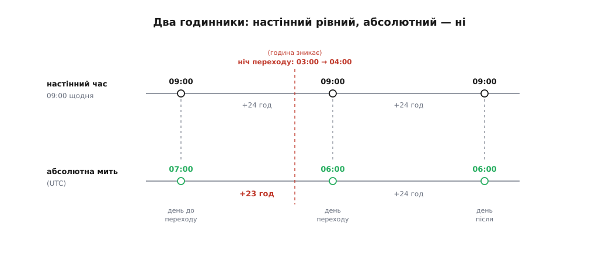
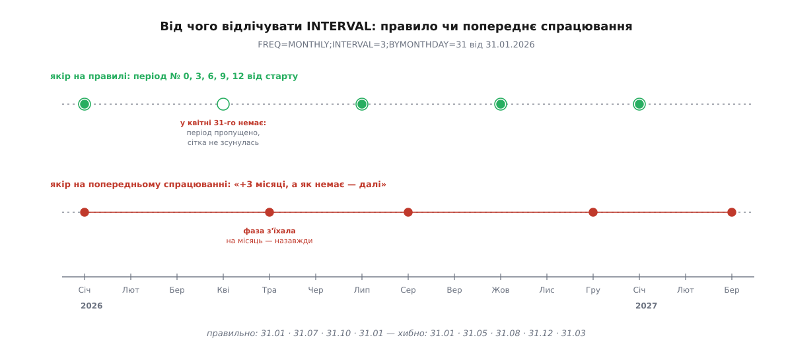
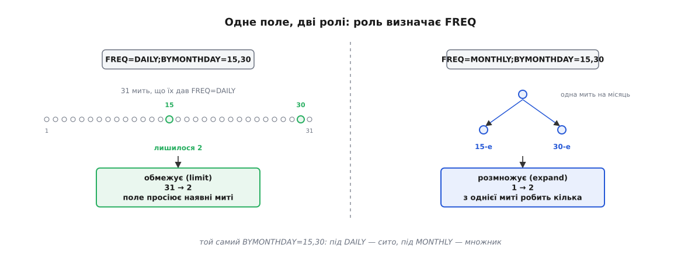
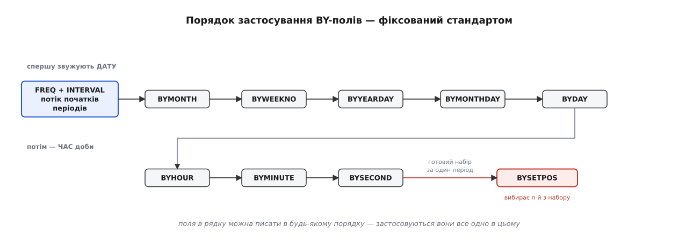
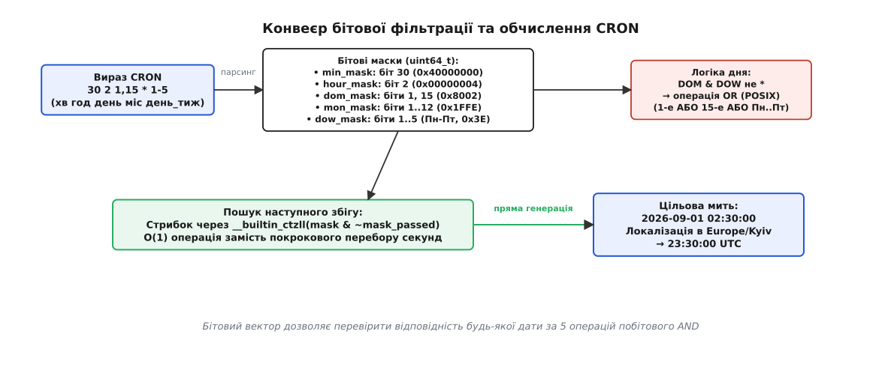
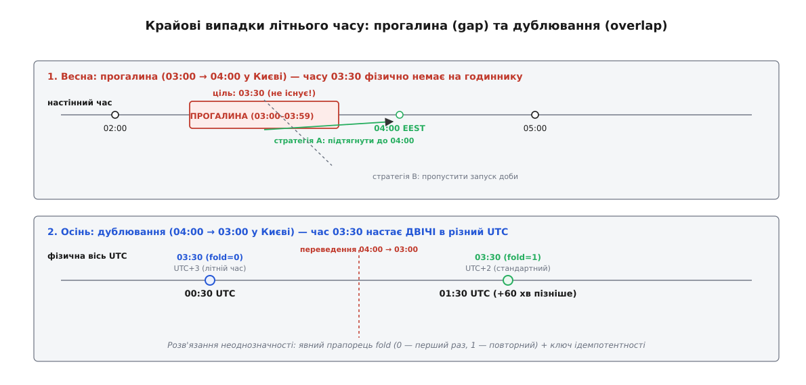
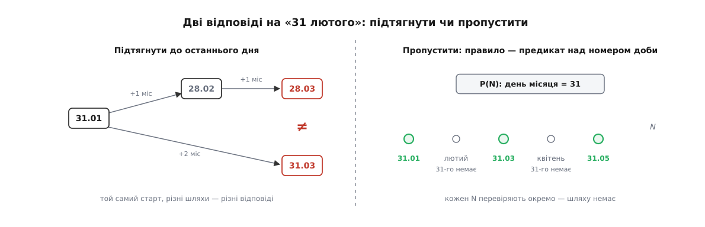
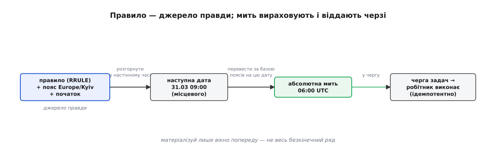

# Рекурентне планування: календарні розклади, RRULE та CRON

<preknowlist>
- [Прикладний час](root:sf-apps/time-and-scheduling) — навіщо сервери зберігають час у UTC, що таке часовий пояс і як настінний час відрізняється від фізичної осі.
- [Черга задач](root:sf-web/background-jobs) — асинхронне виконання відкладеної роботи за таймерами й подіями.
- [Ідемпотентність](root:sf-distributed/idempotency) — захист від повторного виконання запланованих задач при рестартах та збоях.
- [Формальні граматики](root:computability/formal-grammar) — розбір синтаксичних правил та виразів.
</preknowlist>

Користувач налаштовує щоденне резервне копіювання бази даних: «запускати щодня о 03:30 за київським часом». Наївний планувальник бере поточну мітку часу в секундах Unix і додає 86 400 секунд для наступного запуску. У ніч на останню неділю березня стрілки годинників у зоні `Europe/Kyiv` о 03:00 перескакують на 04:00. Настінного часу 03:30 цієї ночі взагалі не існує. Планувальник, який сліпо додав 86 400 секунд, призначає задачу на 02:30 UTC, що після переходу відповідає 05:30 настінного часу, або взагалі зависає в очікуванні неіснуючої хвилини. Восени, коли 03:30 настає двічі з різницею в годину, той самий сервіс створює дві резервні копії або пропускає другу.

Причина таких збоїв криється у фундаментальній невідповідності: фізичний час монотонний і рівномірний, тоді як людський календар — це нерівномірна, дискретна й політично мінлива сітка. Місяці мають від 28 до 31 доби, роки бувають високосними й звичайними, а уряди періодично зсувають настінний час або скасовують переходи. Рекурентність (від латинського *recurrere* — «бігти назад, повертатися») вимагає вираження повторюваних подій через формальні правила та їх детерміністичного відображення на фізичну вісь часу.

## Два годинники та календарна нерівномірність

Для побудови надійного планувальника необхідно чітко розмежовувати дві системи координат часу.

Перша система — **абсолютна фізична мить** (UTC або час Unix). Це монотонно зростаюче число (секунди або наносекунди від епохи 1970-01-01 00:00:00 UTC). У цій системі працюють таймери ядра, черги задач і мережеві протоколи. Вона не знає про країни, пори року чи переведення стрілок.

Друга система — **настінний цивільний час** (wall-clock time). Це кортеж календаря `(рік, місяць, день, година, хвилина, секунда)`, що інтерпретується в контексті конкретного часового поясу за геополітичними правилами. Коли людина створює подію «щовівторка о 09:00» або «31-го числа щомісяця о 18:00», вона мислить виключно категоріями настінного часу.



*Настінний час каже «рівно 24 години й та сама дев'ята», а абсолютна мить «9:00» цього дня настає на годину раніше — доба переходу коротша на годину.*

Збереження рекурентного правила у вигляді фіксованого числового зміщення від UTC (`+02:00` або `+03:00`) є грубою архітектурною помилкою. Зміщення правильне лише в поточний момент часу. Правило мусить зберігати **символьний ідентифікатор часового поясу IANA** (наприклад, `Europe/Kyiv`, `America/New_York`), який дозволяє обчислювачу звертатися до актуальної бази правил переведення годинників. Історія та механізми доставки цієї бази детально розібрані в нарисі про [базу часових поясів tzdb](root:sf-apps/recurrence-scheduling/hist-tzdata.md).

```
Весняний перехід (Europe/Kyiv):
Субота:   09:00 (EET,  UTC+2)  =  07:00 UTC
── Ніч переходу: 03:00 → 04:00 (година зникає) ──
Неділя:   09:00 (EEST, UTC+3)  =  06:00 UTC
Різниця між запусками: 23 години фізичного часу

Осінній перехід (Europe/Kyiv):
Субота:   09:00 (EEST, UTC+3)  =  06:00 UTC
── Ніч переходу: 04:00 → 03:00 (година повторюється) ──
Неділя:   09:00 (EET,  UTC+2)  =  07:00 UTC
Різниця між запусками: 25 годин фізичного часу
```

Додавання фіксованого фізичного інтервалу 86 400 секунд (24 години) між запусками руйнує стабільність настінного часу: після весняного переходу задача починає запускатися о 10:00, а після осіннього — о 08:00. Планувальник зобов'язаний виконувати крок у календарній площині й лише потім розраховувати абсолютну мить UTC для отриманої дати.

### Формат бінарних файлів часових поясів (tzfile)

В операційних системах сімейства POSIX правила часових поясів компілюються у файли формату `tzfile(5)` (зазвичай розташовані в `/usr/share/zoneinfo/`). Файл містить заголовок з магічним числом `TZif2` або `TZif3`, таблицю 64-бітних міток часу переходу (transitions), типи зміщень `ttinfo` (зміщення в секундах, прапорець літнього часу `isdst`, індекс абревіатури), таблицю секунд координації (leap seconds) та рядок у форматі POSIX TZ для розрахунку майбутніх переходів за межами таблиці.

Високопродуктивний планувальник під час завантаження кешує інтервали переходів у вигляді масиву структур:

```
struct tz_transition {
    int64_t  utc_timestamp;   /* Момент переходу в UTC */
    int32_t  offset_seconds;  /* Зміщення від UTC (наприклад, +7200 або +10800) */
    bool     is_dst;          /* Чи діє літній час */
    char     abbrev[8];       /* EET, EEST тощо */
};
```

Пошук чинного зміщення для довільної миті `T` здійснюється за `O(log N)` за допомогою бінарного пошуку в масиві переходів (`std::upper_bound` або `bsearch`), що усуває системні виклики та парсинг рядків під час роботи гарячого циклу планувальника.

### Секунди координації (Leap Seconds) та POSIX-час

Фізичне обертання Землі поступово сповільнюється під дією припливного тертя. Міжнародна служба обертання Землі (IERS) періодично оголошує додавання секунди координації (23:59:60 UTC), щоб узгодити шкалу UTC з астрономічним часом UT1.

Стандарт POSIX Time (IEEE Std 1003.1) свідомо ігнорує секунди координації: за стандартом кожна доба містить рівно 86 400 секунд. Коли настає секунда координації, годинник операційної системи або повторює секунду 59 (UTC 23:59:59), або сповільнює хід через NTP-згладжування (slew). Для календарної математики це означає, що перетворення номера доби `days_from_civil` залишається строго неперервним цілочисловим відображенням, на яке секунди координації не впливають.

## Специфікація RFC 5545: анатомія та семантика RRULE

Індустріальним стандартом для опису календарних повторень є специфікація **iCalendar** (RFC 5545, що прийшла на зміну RFC 2445). У ній повторення описуються властивістю `RRULE` (Recurrence Rule), яка разом із початковою міткою `DTSTART` формує детерміністичний генератор митей.

Правило є самодостатнім декларативним виразом. Замість зберігання мільйонів окремих записів у базі даних система зберігає один рядок вигляду `FREQ=MONTHLY;BYDAY=-1FR`, з якого за потреби генеруються наступні входження на будь-який часовий горизонт.

### Структурні параметри: FREQ та INTERVAL

Основою будь-якого правила `RRULE` є обов'язковий параметр частоти `FREQ`, який задає базову одиницю періоду квантування часу:
- `SECONDLY` — щосекунди;
- `MINUTELY` — щохвилини;
- `HOURLY` — щогодини;
- `DAILY` — щодня;
- `WEEKLY` — щотижня;
- `MONTHLY` — щомісяця;
- `YEARLY` — щороку.

Параметр `INTERVAL` (ціле додатне число, за замовчуванням 1) задає множник кроку: `FREQ=MONTHLY;INTERVAL=3` означає «кожні три місяці».

Критично важливим є правило прив'язки інтервалу: **крок інтервалу відлічується від точки початку `DTSTART`, а не від останнього фактично знайденого входження**. Якщо правило `FREQ=MONTHLY;INTERVAL=3;BYMONTHDAY=31` стартувало 31 січня, періодами генерації будуть квітень, липень, жовтень і січень наступного року. Оскільки у квітні немає 31-го числа, цей період не дасть жодного результату. Але наступним періодом розрахунку все одно залишиться липень (індекс 2 від старту), а не травень (три місяці після невдалої спроби). Помилка прив'язки до попереднього успішного запуску назавжди зсуває фазу розкладу.



*Якір на правилі зберігає фіксовану сітку періодів навіть тоді, коли окремий місяць не містить потрібної дати.*

### Фільтри та розширювачі (BY-частини)

Додаткові параметри `BY*` уточнюють множину кандидатів у межах кожного базового періоду:
- `BYMONTH` — список номерів місяців (1..12);
- `BYWEEKNO` — список номерів тижнів року за ISO 8601 (1..53 або -53..-1);
- `BYYEARDAY` — список номерів днів року (1..366 або -366..-1);
- `BYMONTHDAY` — список чисел місяця (1..31 або -31..-1, де від'ємні значення рахуються від кінця місяця);
- `BYDAY` — список днів тижня (`SU`, `MO`, `TU`, `WE`, `TH`, `FR`, `SA`), які можуть мати числовий префікс, наприклад `2MO` (другий понеділок періоду), `-1FR` (остання п'ятниця періоду) або `-2TU` (передостанній вівторок);
- `BYHOUR`, `BYMINUTE`, `BYSECOND` — списки відповідних часток часу;
- `BYSETPOS` — список порядкових номерів (1..N або -N..-1), що фільтрують уже згенерований і впорядкований набір кандидатів у межах одного періоду;
- `WKST` — день початку тижня (за замовчуванням `MO`).

Семантика полів `BY*` залежить від базової частоти `FREQ`. Якщо поле менше за період `FREQ`, воно **розмножує** (expand) кількість точок; якщо більше або рівне — **обмежує** (filter/limit) наявний потік.



*Поле BYMONTHDAY=15,30 під час щоденного кроку відсіює 29 днів із 31, а під час щомісячного — породжує дві точки з однієї.*

Повна граматика в нотації ABNF та матриця сумісності полів викладені в довіднику [граматика й повний синтаксис RRULE](root:sf-apps/recurrence-scheduling/api-rrule.md).

### Суворий конвеєр обчислення BY-полів

RFC 5545 встановлює жорсткий, стандартизований порядок застосування полів, незалежно від того, як вони розташовані в рядку:

```
FREQ + INTERVAL (базовий потік початків періодів)
       ↓
  1. BYMONTH
       ↓
  2. BYWEEKNO
       ↓
  3. BYYEARDAY
       ↓
  4. BYMONTHDAY
       ↓
  5. BYDAY
       ↓
  6. BYHOUR
       ↓
  7. BYMINUTE
       ↓
  8. BYSECOND
       ↓
  9. BYSETPOS (вибирає елементи з готового зрізу періоду)
```



*Спершу звужується або розмножується календарна дата, потім час доби, і лише над готовим набором періоду спрацьовує BYSETPOS.*

Поле `BYSETPOS` застосовується виключно після всіх інших `BY*`-модифікаторів до повністю сформованого масиву кандидатів конкретного періоду. Наприклад, правило «останній робочий день місяця о 18:00» формулюється так: `FREQ=MONTHLY;BYDAY=MO,TU,WE,TH,FR;BYSETPOS=-1;BYHOUR=18;BYMINUTE=0;BYSECOND=0`. Обчислювач генерує всі робочі дні поточного місяця (20–23 дати), а `BYSETPOS=-1` обирає рівно один — останній з них.

Розрахунок тижнів за стандартом ISO 8601 (`BYWEEKNO`) має особливість: першим тижнем року вважається той, що містить перший четвер січня (або містить 4 січня). Тому дні кінця грудня можуть належати до першого тижня наступного року, а перші дні січня — до 52-го або 53-го тижня попереднього року. Обчислювач `RRULE` зобов'язаний коректно визначати межі таких тижнів через пошук опорного четверга.

### Множини винятків: EXDATE, RDATE та RECURRENCE-ID

Календарний компонент у RFC 5545 рідко складається з одного лише правила `RRULE`. Повний набір повторень формується як операція над множинами:

```
RecurrenceSet = (Generate(RRULE) ∪ RDATE) \ EXDATE
```

Властивість `EXDATE` містить перелік конкретних дат, вилучених із графіка (наприклад, скасована зустріч на свято). Властивість `RDATE` містить додаткові дати, вставлені поза правилом.

Коли окремий екземпляр події переноситься на інший час (наприклад, зустріч 24 березня перенесено на 25 березня), створюється окремий дочірній об'єкт `VEVENT` із властивістю `RECURRENCE-ID:20260324T090000Z`, який перевизначає параметри конкретної ітерації, залишаючи решту ряду недоторканою.

### Критерії завершення: COUNT проти UNTIL

Послідовність повторень може бути нескінченною або завершуватися за однією з двох взаємовиключних умов:
1. `COUNT=N` — генерується рівно N входжень, починаючи з `DTSTART` (якщо `DTSTART` задовольняє правило).
2. `UNTIL=timestamp` — генерація припиняється, щойно наступний кандидат перевищить вказану межу.

Стандарт вимагає: якщо `DTSTART` задано у форматі UTC (із суфіксом `Z`) або з прив'язкою до часового поясу `TZID`, поле `UNTIL` **обов'язково має бути записане у форматі UTC (`Z`)**. Змішування локального `UNTIL` без поясу та локалізованого `DTSTART` є грубим порушенням специфікації.

## Синтаксис та семантика виразів CRON

Поряд із календарним стандартом iCalendar у серверній інфраструктурі, демонах операційних систем і хмарних планувальниках домінує формат **CRON**. Створений Крієном Спенсером (Ken Thompson / Brian Kernighan lineage, Bell Labs V7 утиліта 1979 року), синтаксис CRON орієнтований на короткий періодичний запуск системних утиліт.

### 5-польний та 6-польний формати

Класичний POSIX CRON складається з 5 полів, розділених пропусками:

```
 ┌───────────── хвилини (0 - 59)
 │ ┌───────────── години (0 - 23)
 │ │ ┌───────────── день місяця (1 - 31)
 │ │ │ ┌───────────── місяць (1 - 12 або JAN - DEC)
 │ │ │ │ ┌───────────── день тижня (0 - 7 або SUN - SAT, де 0 і 7 = неділя)
 │ │ │ │ │
 * * * * *
```

Розширені версії (Quartz Scheduler, Spring Framework, AWS EventBridge, Kubernetes CronJob) додають шосте поле для секунд на початку або рік наприкінці:

```
 ┌───────────── секунди (0 - 59)
 │ ┌───────────── хвилини (0 - 59)
 │ │ ┌───────────── години (0 - 23)
 │ │ │ ┌───────────── день місяця (1 - 31)
 │ │ │ │ ┌───────────── місяць (1 - 12)
 │ │ │ │ │ ┌───────────── день тижня (0 - 6 або 1 - 7)
 │ │ │ │ │ │
 0 30 2 1 * ?
```

У середовищі `systemd` календарні події задаються директивою `OnCalendar=` (наприклад, `OnCalendar=Tue *-*-* 09:00:00 Europe/Kyiv`), яка поєднує виразність CRON з явним зазначенням часового поясу та можливістю встановлення допустимої точності таймера ядра `AccuracySec=1us`.

### Спеціальні символи та оператори

У полях CRON використовуються такі оператори:
- `*` (asterisk) — усі можливі значення поля;
- `,` (comma) — перелік значень (`1,15,30`);
- `-` (hyphen) — замкнений діапазон (`9-17`);
- `/` (slash) — крок інкременту (`*/15` у хвилинах означає `0,15,30,45`);
- `L` (last) — останній день місяця (`L`) або останній певний день тижня (`5L` — остання п'ятниця);
- `W` (weekday) — найближчий робочий день до вказаного числа місяця (`15W` — якщо 15-те субота, спрацює в п'ятницю 14-го; якщо неділя — у понеділок 16-го);
- `#` — n-й день тижня в місяці (`2#3` — третій вівторок);
- `?` (no specific value) — символ ігнорування поля в діалектах Quartz, де вимагається взаємовиключення між днем місяця та днем тижня.

### Семантична пастка: DOM та DOW (логіка OR проти AND)

Найбільш неочевидним правилом класичного POSIX V7 CRON є взаємодія між днем місяця (Day of Month, DOM) та днем тижня (Day of Week, DOW):

**Якщо обидва поля (DOM і DOW) мають явні значення, відмінні від `*`, вони об'єднуються через логічне «АБО» (OR), а не «І» (AND).**

Розгляньмо вираз:
```
30 4 1,15 * 5
```

Програміст, який звик до логічного множення фільтрів, може очікувати запуск «о 04:30 у п'ятницю, якщо вона припадає на 1-ше або 15-те число». Проте за стандартом POSIX цей вираз означає:
«Запускати о 04:30 кожного 1-го числа місяця, кожного 15-го числа місяця, **а також кожної п'ятниці**, незалежно від числа».

Якщо ж одне з полів містить зірочку `*` (або `?` у розширених діалектах), умова перетворюється на звичайну кон'юнкцію: `30 4 * * 5` спрацьовує суто щоп'ятниці.

Ця поведінка кардинально відрізняється від моделі RFC 5545 RRULE, де всі `BY*`-обмеження завжди діють через послідовне звуження множини (кон'юнкцію).



*Вираз CRON транслюється у 64-бітні маски; перевірка дати виконується через швидкі побітові операції.*

## Крайові випадки: переходи DST, високосні роки та короткі місяці

Надійний планувальник перевіряється на крайових станах календаря. Будь-яка система, що не враховує розриви й накладання часу, дасть системний збій під час зміни сезону або в кінці лютого.

### Весняний перехід (DST Gap — прогалина часу)

Під час переходу на літній час годинникова стрілка переводиться на годину вперед (зазвичай з 02:00 на 03:00 або з 03:00 на 04:00). Інтервал настінного часу тривалістю в одну годину просто не настає.

Якщо розклад вимагає запуску о 03:30 (наприклад, `0 30 3 * * *`), виникає колізія відсутності точки на осі. Існує три інженерні стратегії обробки прогалини:

1. **Пропуск запуску (RFC 5545 Skip):** Відповідно до розділу 3.3.10 RFC 5545, якщо локальний час потрапляє в прогалину переходу, це входження ігнорується і не зараховується в послідовність.
2. **Зсув уперед до межі (Clamping to Gap End):** Подія зміщується на першу валідну секунду після стрибка — 04:00:00. Це стандартна поведінка для критичних фонових задач (наприклад, генерація щоденних банківських виписок), які не можна втрачати.
3. **Зсув на величину інтервалу (Offset Shift):** Час зміщується на довжину прогалини вперед (03:30 стає 04:30).



*Під час прогалини час 03:30 зсувається на 04:00 або пропускається; під час накладання прапорець fold визначає, котру з двох однакових настінних годин обрати.*

### Осінній перехід (DST Overlap — накладання часу)

Під час повернення на зимовий час стрілка годинника переводиться на годину назад (з 04:00 на 03:00). Усі настінні мітки між 03:00:00 та 03:59:59 настають **двічі**.

Для однозначного розрізнення двох фізичних моментів використовується концепція **fold** (уведена в Python PEP 495, прийнята в C++20 `std::chrono::choose` та стандарті ISO 8601-2):
- `fold = 0` позначає перше настання настінного часу (літній час, більше зміщення від UTC, наприклад UTC+3);
- `fold = 1` позначає друге настання того самого настінного часу (стандартний час, менше зміщення, UTC+2).

Якщо щоденна задача має розклад на 03:30, планувальник зобов'язаний виконати її лише один раз (зазвичай при `fold = 0`). Щоб запобігти повторному спрацюванню при настанні `fold = 1`, система зобов'язана використовувати **ключ ідемпотентності**, сформований із комбінації ідентифікатора правила, запланованої настінної дати та індексу періоду.

### Високосні роки та математика номера доби

Розрахунок високосних років за григоріанським календарем визначається правилом: рік є високосним, якщо він ділиться на 4, крім тих, що діляться на 100, але роки, кратні 400, все одно високосні. Кількість високосних років від початку ери до року y включно обчислюється замкненою формулою:

```
L(y) = ⌊y/4⌋ − ⌊y/100⌋ + ⌊y/400⌋
```

Формули взаємного перетворення між трійкою `(рік, місяць, день)` та лінійним порядковим номером доби (Civil Days from Epoch) без умовних переходів та циклів детально виведені у статті про [математику календаря та афінні перетворення дат](root:sf-apps/recurrence-scheduling/math-calendar.md).

### Короткі місяці: пропуск чи підтягування

Розклад `FREQ=MONTHLY;BYMONTHDAY=31` стикається з відсутністю 31-го числа в лютому, квітні, червні, вересні та листопаді.

Специфікація RFC 5545 вимагає строго **пропускати** такі місяці. Підтягування (clamping) 31 лютого до 28 лютого створює залежність від історії обчислень:

```
Шлях 1: (31 січня + 1 місяць) = 28 лютого; 28 лютого + 1 місяць = 28 березня
Шлях 2:  31 січня + 2 місяці  = 31 березня
```

Результат залежить від того, чи виконувався крок дискретно, чи стрибком. Математично коректним і детерміністичним для розподілених систем є предикативний підхід: правило є предикатом над віссю номерів діб, і неіснуючі дати просто не дають істинного значення.



*Підтягування дає неоднозначні результати залежно від кроку; предикатне пропускання дає єдину детерміністичну підмножину діб.*

## Алгоритми обчислення наступного моменту (Next-Occurrence Engine)

Побудова обчислювача вимагає вибору між аналітичним прямим розрахунком та ітеративним вибірковим алгоритмом.

### Прямий розрахунок

Прямий розрахунок застосовується для простих інтервалів фіксованої довжини без складних `BY*`-фільтрів:
- Секундні, хвилинні та годинні інтервали в межах однієї доби або за відсутності переходу DST.
- Щоденні розклади в фіксованому часовому поясі (додавання цілого числа діб до номера цивільного дня).

Для дати початку `DTSTART` та поточної миті обчислюється кількість повних періодів, що минули:

```
periods_passed = ⌊(current_days - start_days) / INTERVAL⌋
next_period = periods_passed + 1
target_days = start_days + next_period * INTERVAL
```

Отриманий номер доби конвертується назад у календарну трійку за сталий час за алгоритмом Говарда Хіннанта, після чого локалізується в часовому поясі.

### Ітеративний алгоритм розгортання періодів

Для загального випадку `RRULE` (з багатьма `BYDAY`, `BYMONTH`, `BYSETPOS`) використовується алгоритм сканування періодів:

1. **Крок періоду:** Обчислювач бере базовий період від початку відліку `DTSTART`.
2. **Генерація базового масиву:** Для місячного правила генеруються всі дні поточного місяця (від 1 до 28..31).
3. **Фільтрація:** Послідовно застосовуються фільтри `BYMONTH`, `BYMONTHDAY`, `BYDAY`.
4. **Впорядкування та вибір:** Якщо задано `BYSETPOS`, масив сортується, і обирається елемент із зазначеною позицією.
5. **Локалізація та перевірка:** Кожен знайдений кандидат перетворюється на UTC через базу часових поясів. Якщо настання потрапляє в прогалину DST, застосовується політика gap (пропуск або зсув).
6. Якщо знайдений момент часу строго більший за запитуваний поріг, він повертається як наступне входження. Якщо в поточному періоді кандидатів немає або всі вони вже минули, алгоритм переходить до наступного періоду.

### Бітовий конвеєр для швидкого розрахунку CRON

Для CRON-виразів найефективнішим є представлення допустимих значень у вигляді бітових масок (bitsets). Оскільки хвилини вміщуються в 60 біт, години — у 24 біти, дні — у 32 біти, а місяці — у 12 біт, кожне поле представляється одним цілим числом `uint64_t`.

Алгоритм пошуку наступного збігу після заданої миті виконує такі кроки:

1. Перевіряється місяць. Якщо біт у масці скинутий, обчислюється наступний доступний місяць за допомогою інструкції підрахунку кінцевих нулів (Bit Scan Forward / `ctzll`):
   ```
   uint64_t mask = cron->mon_mask & ~((1ULL << dt->month) - 1);
   if (mask == 0) {
       dt->year++;
       dt->month = ctz64(cron->mon_mask);
   } else {
       dt->month = ctz64(mask);
   }
   ```
2. Аналогічно обчислюється день місяця з урахуванням масок дня місяця та дня тижня (з логікою OR/AND). Якщо день змінюється, години й хвилини скидаються в мінімально дозволені за їхніми масками.
3. Година та хвилина шукаються аналогічними бітовими масками.

Апаратна інструкція `CTZ` (Count Trailing Zeros, `TZCNT` на x86 з розширенням BMI1 або `CLZ` на ARM) виконується процесором за 1 такт з пропускною здатністю 1 такт на операцію. Завдяки цьому обчислення наступного входження виконується за лічені наносекунди, що робить бітові маски ідеальними для високочастотних торговельних систем та планувальників мільйонів підписок.

## Реалізація обчислювального рушія на C99 та C++20

Нижче наведено закінчену інженерну реалізацію базових структур, високопродуктивного бітового рушія CRON та календарної математики з нульовим динамічним виділенням пам'яті.

:::tabs
```c
/* ============================================================================
 * recurrence_engine.h / recurrence_engine.c (C99)
 * Високопродуктивний рушій обчислення рекурентності без виділення купи.
 * ========================================================================== */
#include <stdint.h>
#include <stdbool.h>
#include <time.h>

#if defined(_MSC_VER)
#  include <intrin.h>
   static inline int ctz64(uint64_t mask) {
       unsigned long idx;
       _BitScanForward64(&idx, mask);
       return (int)idx;
   }
#else
   static inline int ctz64(uint64_t mask) {
       return __builtin_ctzll(mask);
   }
#endif

/* Структура бітового розбору CRON */
typedef struct {
    uint64_t sec_mask;   /* Біти 0..59 */
    uint64_t min_mask;   /* Біти 0..59 */
    uint32_t hour_mask;  /* Біти 0..23 */
    uint32_t dom_mask;   /* Біти 1..31 (біт 0 не використовується) */
    uint16_t mon_mask;   /* Біти 1..12 (біт 0 не використовується) */
    uint8_t  dow_mask;   /* Біти 0..6 (0 = Неділя, 1 = Понеділок... 6 = Субота) */
    bool     dom_is_star;
    bool     dow_is_star;
} cron_schedule_t;

/* Календарна дата */
typedef struct {
    int32_t year;
    int8_t  month;   /* 1..12 */
    int8_t  day;     /* 1..31 */
    int8_t  hour;    /* 0..23 */
    int8_t  minute;  /* 0..59 */
    int8_t  second;  /* 0..59 */
} civil_datetime_t;

/* Чи є рік високосним за григоріанським календарем */
static inline bool is_leap_year(int32_t y) {
    return (y % 4 == 0 && y % 100 != 0) || (y % 400 == 0);
}

/* Кількість днів у місяці */
static inline int days_in_month(int32_t y, int m) {
    static const int8_t kDays[13] = { 0, 31, 28, 31, 30, 31, 30, 31, 31, 30, 31, 30, 31 };
    if (m == 2 && is_leap_year(y)) return 29;
    return kDays[m];
}

/* Переведення (Y, M, D) у кількість днів від 1970-01-01 (Алгоритм Говарда Хіннанта) */
static inline int64_t days_from_civil(int32_t y, int m, int d) {
    y -= (m <= 2) ? 1 : 0;
    const int64_t era = (y >= 0 ? y : y - 399) / 400;
    const uint32_t yoe = (uint32_t)(y - era * 400);
    const uint32_t doy = (153 * (m > 2 ? m - 3 : m + 9) + 2) / 5 + (uint32_t)(d - 1);
    const uint32_t doe = yoe * 365 + yoe / 4 - yoe / 100 + doy;
    return era * 146097 + (int64_t)doe - 719468;
}

/* Переведення кількості днів від 1970-01-01 у (Y, M, D) */
static inline void civil_from_days(int64_t z, int32_t *out_y, int8_t *out_m, int8_t *out_d) {
    z += 719468;
    const int64_t era = (z >= 0 ? z : z - 146096) / 146097;
    const uint32_t doe = (uint32_t)(z - era * 146097);
    const uint32_t yoe = (doe - doe / 1020 + doe / 1460 - doe / 146096) / 365;
    const int32_t y = (int32_t)yoe + (int32_t)(era * 400);
    const uint32_t doy = doe - (365 * yoe + yoe / 4 - yoe / 100);
    const uint32_t mp = (5 * doy + 2) / 153;
    const uint32_t d = doy - (153 * mp + 2) / 5 + 1;
    const uint32_t m = mp < 10 ? mp + 3 : mp - 9;
    *out_y = y + (m <= 2 ? 1 : 0);
    *out_m = (int8_t)m;
    *out_d = (int8_t)d;
}

/* День тижня: 0 = Неділя, 1 = Понеділок... 6 = Субота */
static inline int day_of_week(int64_t days_since_epoch) {
    int dow = (int)((days_since_epoch + 4) % 7);
    return dow < 0 ? dow + 7 : dow;
}

/* Обчислення наступного входження CRON */
bool cron_next(const cron_schedule_t *cron, civil_datetime_t *dt) {
    /* Починаємо пошук із наступної секунди */
    dt->second++;
    
    int loop_guard = 0;
    while (loop_guard++ < 5000) {
        /* 1. Перевірка місяця */
        if (!((cron->mon_mask >> dt->month) & 1)) {
            uint64_t mask = cron->mon_mask & ~((1ULL << dt->month) - 1);
            if (mask == 0) {
                dt->year++;
                dt->month = (int8_t)ctz64(cron->mon_mask);
            } else {
                dt->month = (int8_t)ctz64(mask);
            }
            dt->day = 1;
            dt->hour = 0;
            dt->minute = 0;
            dt->second = 0;
            continue;
        }

        /* 2. Перевірка дня місяця та дня тижня */
        int max_d = days_in_month(dt->year, dt->month);
        if (dt->day > max_d) {
            dt->month++;
            if (dt->month > 12) {
                dt->month = 1;
                dt->year++;
            }
            dt->day = 1;
            dt->hour = 0;
            dt->minute = 0;
            dt->second = 0;
            continue;
        }

        int64_t days_epoch = days_from_civil(dt->year, dt->month, dt->day);
        int dow = day_of_week(days_epoch);

        bool dom_match = (cron->dom_mask >> dt->day) & 1;
        bool dow_match = (cron->dow_mask >> dow) & 1;
        bool day_valid;

        if (!cron->dom_is_star && !cron->dow_is_star) {
            day_valid = dom_match || dow_match; /* POSIX OR семантика */
        } else if (!cron->dom_is_star) {
            day_valid = dom_match;
        } else if (!cron->dow_is_star) {
            day_valid = dow_match;
        } else {
            day_valid = true;
        }

        if (!day_valid) {
            dt->day++;
            dt->hour = 0;
            dt->minute = 0;
            dt->second = 0;
            continue;
        }

        /* 3. Перевірка години */
        if (!((cron->hour_mask >> dt->hour) & 1)) {
            uint64_t mask = cron->hour_mask & ~((1ULL << dt->hour) - 1);
            if (mask == 0) {
                dt->day++;
                dt->hour = (int8_t)ctz64(cron->hour_mask);
            } else {
                dt->hour = (int8_t)ctz64(mask);
            }
            dt->minute = 0;
            dt->second = 0;
            continue;
        }

        /* 4. Перевірка хвилини */
        if (!((cron->min_mask >> dt->minute) & 1)) {
            uint64_t mask = cron->min_mask & ~((1ULL << dt->minute) - 1);
            if (mask == 0) {
                dt->hour++;
                dt->minute = (int8_t)ctz64(cron->min_mask);
                if (dt->hour > 23) {
                    dt->hour = 0;
                    dt->day++;
                }
            } else {
                dt->minute = (int8_t)ctz64(mask);
            }
            dt->second = 0;
            continue;
        }

        /* 5. Перевірка секунди */
        if (!((cron->sec_mask >> dt->second) & 1)) {
            uint64_t mask = cron->sec_mask & ~((1ULL << dt->second) - 1);
            if (mask == 0) {
                dt->minute++;
                dt->second = (int8_t)ctz64(cron->sec_mask);
                if (dt->minute > 59) {
                    dt->minute = 0;
                    dt->hour++;
                    if (dt->hour > 23) {
                        dt->hour = 0;
                        dt->day++;
                    }
                }
            } else {
                dt->second = (int8_t)ctz64(mask);
            }
            continue;
        }

        /* Усі поля валідні — знайдено точну дату */
        return true;
    }
    return false;
}
```
```cpp
// ============================================================================
// recurrence_engine.hpp (C++20)
// Ідіоматичний рушій на std::chrono, std::bitset та константних виразах.
// ============================================================================
#include <chrono>
#include <bitset>
#include <optional>
#include <string_view>
#include <cstdint>
#include <bit>

namespace scheduling {

struct CronSchedule {
    std::bitset<60> sec_mask;
    std::bitset<60> min_mask;
    std::bitset<24> hour_mask;
    std::bitset<32> dom_mask; // Біти 1..31
    std::bitset<13> mon_mask; // Біти 1..12
    std::bitset<7>  dow_mask; // Біти 0..6 (0 = Неділя)
    bool dom_is_star{true};
    bool dow_is_star{true};
};

class RecurrenceEngine {
public:
    [[nodiscard]] static constexpr bool is_leap_year(std::chrono::year y) noexcept {
        return y.is_leap();
    }

    [[nodiscard]] static std::optional<std::chrono::sys_seconds> next_cron_occurrence(
        const CronSchedule& cron,
        std::chrono::sys_seconds from_utc,
        const std::chrono::time_zone* tz)
    {
        using namespace std::chrono;

        // Переводимо UTC у локальний цивільний час поясу
        auto local_tp = tz->to_local(from_utc);
        auto local_days_tp = floor<days>(local_tp);
        year_month_day ymd{local_days_tp};
        hh_mm_ss hms{floor<seconds>(local_tp - local_days_tp)};

        int y = static_cast<int>(ymd.year());
        int m = static_cast<unsigned>(ymd.month());
        int d = static_cast<unsigned>(ymd.day());
        int hour = hms.hours().count();
        int min = hms.minutes().count();
        int sec = hms.seconds().count() + 1; // Шукаємо строго після заданого моменту

        int iterations = 0;
        while (iterations++ < 5000) {
            // 1. Місяць
            if (!cron.mon_mask.test(m)) {
                uint64_t raw = cron.mon_mask.to_ullong() & ~((1ULL << m) - 1);
                if (raw == 0) {
                    y++;
                    m = std::countr_zero(cron.mon_mask.to_ullong());
                } else {
                    m = std::countr_zero(raw);
                }
                d = 1; hour = 0; min = 0; sec = 0;
                continue;
            }

            // 2. День місяця та день тижня
            year_month_day current_ymd{year{y}, month{static_cast<unsigned>(m)}, day{static_cast<unsigned>(d)}};
            if (!current_ymd.ok()) {
                m++;
                if (m > 12) { m = 1; y++; }
                d = 1; hour = 0; min = 0; sec = 0;
                continue;
            }

            weekday wd{sys_days{current_ymd}};
            unsigned dow = wd.c_encoding(); // 0 = Неділя, 1 = Понеділок...

            bool dom_match = cron.dom_mask.test(d);
            bool dow_match = cron.dow_mask.test(dow);
            bool day_valid = false;

            if (!cron.dom_is_star && !cron.dow_is_star) {
                day_valid = dom_match || dow_match; // POSIX OR
            } else if (!cron.dom_is_star) {
                day_valid = dom_match;
            } else if (!cron.dow_is_star) {
                day_valid = dow_match;
            } else {
                day_valid = true;
            }

            if (!day_valid) {
                d++;
                hour = 0; min = 0; sec = 0;
                continue;
            }

            // 3. Година
            if (!cron.hour_mask.test(hour)) {
                uint64_t raw = cron.hour_mask.to_ullong() & ~((1ULL << hour) - 1);
                if (raw == 0) {
                    d++;
                    hour = std::countr_zero(cron.hour_mask.to_ullong());
                } else {
                    hour = std::countr_zero(raw);
                }
                min = 0; sec = 0;
                continue;
            }

            // 4. Хвилина
            if (!cron.min_mask.test(min)) {
                uint64_t raw = cron.min_mask.to_ullong() & ~((1ULL << min) - 1);
                if (raw == 0) {
                    hour++;
                    min = std::countr_zero(cron.min_mask.to_ullong());
                    if (hour > 23) { hour = 0; d++; }
                } else {
                    min = std::countr_zero(raw);
                }
                sec = 0;
                continue;
            }

            // 5. Секунда
            if (!cron.sec_mask.test(sec)) {
                uint64_t raw = cron.sec_mask.to_ullong() & ~((1ULL << sec) - 1);
                if (raw == 0) {
                    min++;
                    sec = std::countr_zero(cron.sec_mask.to_ullong());
                    if (min > 59) {
                        min = 0; hour++;
                        if (hour > 23) { hour = 0; d++; }
                    }
                } else {
                    sec = std::countr_zero(raw);
                }
                continue;
            }

            // Складання локального часу та переведення в UTC з урахуванням DST
            local_seconds target_local{
                sys_days{year{y}/month{static_cast<unsigned>(m)}/day{static_cast<unsigned>(d)}} +
                hours{hour} + minutes{min} + seconds{sec}
            };

            try {
                // choose::earliest розв'язує накладання на користь першої появи (fold=0)
                auto info = tz->get_info(target_local);
                if (info.result == local_info::nonexistent) {
                    // Стратегія Gap: зміщення до першого валідного моменту після розриву
                    return info.second.begin;
                }
                return tz->to_sys(target_local, choose::earliest);
            } catch (...) {
                return std::nullopt;
            }
        }
        return std::nullopt;
    }
};

} // namespace scheduling
```
:::

Повний синтез обох протоколів із парсером нульового копіювання, верифікатором граматики та таблицями переходів викладений у практичній роботі [рушій парсингу й обчислення RRULE та CRON без динамічного виділення пам'яті](root:sf-apps/recurrence-scheduling/proj-rrule-cron-engine.md).

## Архітектурні патерни планування в розподілених системах

Окремий алгоритм обчислення наступного входження є лише математичним серцем планувальника. Для надійної експлуатації в розподіленому оточенні навколо нього будується конвеєр виконання.

```
┌─────────────────┐       ┌──────────────────────┐       ┌─────────────────┐
│ Рекурентне      │       │ Матеріалізація       │       │ Черга задач     │
│ правило (RRULE) │ ───→  │ вікна вперед         │ ───→  │ (Redis / Kafka) │
│ + Пояс IANA     │       │ [T_now, T_now + Δt]  │       │ (Мить у UTC)    │
└─────────────────┘       └──────────────────────┘       └─────────────────┘
                                                                  │
                                                                  ▼
                                                         ┌─────────────────┐
                                                         │ Робітник        │
                                                         │ (Ідемпотентний  │
                                                         │  запуск)        │
                                                         └─────────────────┘
```



*Правило з поясом — джерело правди; конкретну мить вираховують на вимогу й лише тоді ставлять у чергу на виконання.*

### 1. Збереження правил проти матеріалізації розкладу

Зберігати повну розгорнуту історію повторень у базі даних (наприклад, мільйон рядків дат на 10 років уперед) категорично не рекомендується:
- Будь-яке оновлення правила вимагає масової мутації або видалення майбутніх рядків.
- Зміна часового поясу в базі `tzdata` (рішення парламенту) робить усі попередньо згенеровані мітки UTC невалідними.

Надійний патерн — зберігати рядок правила та ідентифікатор поясу як **єдине джерело правди** (Single Source of Truth), матеріалізуючи конкретні записи лише на коротке ковзне вікно вперед (наприклад, на найближчі 7 діб або 1 місяць).

### 2. Індексація та таймерні структури даних

Для ефективного пошуку найближчих подій серед мільйонів активних розкладів застосовуються спеціалізовані структури:
- **Мінімальна купа (Min-Heap / Priority Queue):** Дозволяє отримати найближчу подію за `O(1)` та оновити її після спрацювання за `O(log N)`.
- **Таймерне колесо (Hashed and Hierarchical Timing Wheels за Варгасом):** Забезпечує додавання, видалення та спрацювання таймерів за амортизований час `O(1)`, що критично для високонавантажених брокерів повідомлень.
- **Впорядковані множини (Redis Sorted Sets / `ZSET`):** Використовують мітку часу UTC як score, що дозволяє виконувати вибірку готових до запуску задач запитом `ZRANGEBYSCORE queue -inf <current_utc_timestamp> LIMIT 0 100`.

### 3. Ідемпотентність і запобігання подвійним запускам

У розподілених системах із реплікацією та рестартами воркерів та сама задача може бути надіслана на виконання двічі. Ключем ідемпотентності для періодичних завдань виступає детерміністичний рядок:

```
idempotency_key = hash(schedule_id + ":" + scheduled_utc_timestamp)
```

Воркер перед початком роботи захоплює унікальний лок за цим ключем або перевіряє таблицю виконаних операцій. Якщо задачу вже виконано (наприклад, під час осіннього переходу годинника або мережевого повтору повідомлення), повторний запуск миттєво відхиляється. Принципи побудови відмовостійких черг та координації кластера розкриті в темі про [розподілений cron](root:sf-distributed/distributed-cron).

### 4. Робота з монотонним часом і стрибками NTP

Під час безпосереднього очікування настання моменту виконання планувальник не повинен використовувати системний настінний годинник `CLOCK_REALTIME` для вимірювання пауз (`sleep`). Корекція часу за протоколом NTP або ручне переведення годинника адміністратором може миттєво змінити поточний час на секунди чи години назад або вперед.

Для очікування настання обчисленої миті `T_target` планувальник виконує конвертацію в монотонний інтервал:

```
delay_seconds = target_utc_timestamp - current_utc_timestamp;
if (delay_seconds > 0) {
    /* Очікування за монотонним таймером CLOCK_MONOTONIC */
    struct timespec ts = { .tv_sec = delay_seconds, .tv_nsec = 0 };
    nanosleep(&ts, NULL);
}
```

Це гарантує, що жодні стрибки мережевого часу не спричинять дострокового або нескінченно заблокованого виконання завдання.

### 5. Інженерні стратегії тестування та валідації розкладів

Для забезпечення високої надійності рекурентних планувальників у тестових середовищах застосовуються спеціалізовані часові макети (Time Mocking) та віртуальні годинники. Замість реального очікування спрацювання таймерів тестовий фреймворк прокручує віртуальну шкалу часу вперед за допомогою детерміністичних стрибків (Time Travel Testing).

Обов'язковий набір регресійних тестів включає:
- Проходження повного 400-річного циклу григоріанського календаря з перевіркою коректності стрибків 29 лютого на столітніх межах (2000, 2100, 2400).
- Симуляцію зміни часових поясів (весняний стрибок через прогалину та осіннє дублювання годин) для щоденних, щотижневих та щомісячних розкладів.
- Перевірку стійкості черги задач при масовому рестарті воркерів під час обробки тисяч одночасних рекурентних подій з однаковими мітками часу.

Рекурентне планування — це точна дисципліна перетворення людського настінного календаря на фізичну вісь часу: збереження символьних правил, відлік інтервалів від фіксованого якоря, швидка бітова фільтрація та суворе дотримання стандарту RFC 5545 гарантують безперебійну роботу планувальника в будь-яку пору року.
