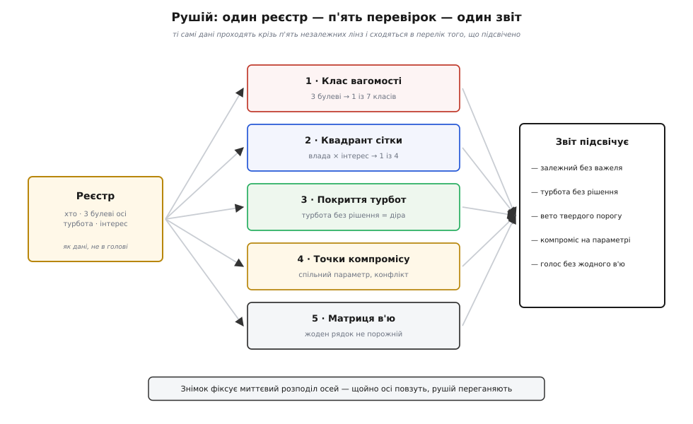

# ⚙️ Рушій аналізу стейкхолдерів

Скласти список людей, дотичних до системи, — робота на чверть години, і найдешевша її автоматизація вже щось дає: пройтися турботами й підсвітити ті, що не закриті жодним рішенням. Та щойно список готовий, починається справжня механіка, і вона не про «хто в переліку», а про чотири питання, на які плаский стовпчик імен не відповідає. Скільки важить **кожен**, коли їх дюжина, а бюджет один? Куди й якого роду увагу винен їм архітектор? Де двоє однаково правих людей упираються в **одне** рішення й тягнуть його в протилежні боки? І чи кожен голос узагалі має документ, з якого почує відповідь на свою турботу?

Кожне з цих питань має точну, обчислювану відповідь — і саме тому їх варто не тримати в голові, а звести в **рушій**: маленьку програму, що бере реєстр стейкхолдерів як дані й механічно, без пам'яті про те, хто голосніше кричав на нараді, видає п'ять висновків одразу. Домен тут — звичайне архітектурне рахівництво, без регістрів і байтів, тож код лягає ідіоматично на TypeScript і Python; обидва варіанти нижче — той самий рушій, слово в слово за поведінкою.

## Що саме має порахувати рушій

Розкладімо задачу на п'ять незалежних перевірок, які всі живляться з одного реєстру. Кожна відповідає рівно на одне з питань вище, і жодна не потребує людського судження в мить обчислення — судження вже вкладене у **вхідні дані**.



*Рушій не ухвалює рішень за архітектора — він механічно підсвічує п'ять місць, де рішення потрібне: хто вагомий, куди дивитись, чия турбота провисла, де неминучий компроміс і чий голос не має жодного в'ю.*

Вхід — чотири прості таблиці. **Стейкхолдери**: у кожного ім'я, три булеві осі вагомості (влада, легітимність, терміновість), булевий інтерес і одна головна турбота — назва [якісного атрибута](root:sf-apps/quality-attributes), тобто вимірної властивості системи на кшталт доступності чи безпеки, про яку ця людина найбільше дбає. **Рішення**: кожне свідомо закриває один атрибут. **Параметри устрою**: кожен тягне якісь атрибути вгору чи вниз — це «ручки», крутячи які, псуєш одне заради іншого. **В'ю**: кожне показує (обрамлює) певний набір турбот.

Наскрізний приклад — платіжний сервіс. Сім стейкхолдерів: замовник і спонсор дбають про вартість, оператор — про доступність, аудитор — про безпеку (і його вимога — закон), супровід — про змінюваність, користувач — про швидкодію, постачальник — про вартість. З цього входу рушій має видати п'ять відповідей, і кожну ми зараз зберемо в код.

## Структури даних

Спершу — форма даних. Вона навмисно пласка: жодної ієрархії, жодних посилань одне на одного, тільки записи з полями. Уся хитрість рушія — не в структурах, а в тому, що з них вичитується; структури мусять лишатися тупими, щоб їх легко було заповнити руками або витягти з таблиці.

:::tabs
:::code proj-stakeholder-register/ts/struktury-danykh.ts
:::code proj-stakeholder-register/py/struktury-danykh.py
:::

Зверни увагу на поле `hard`. Воно виглядає дрібницею, але саме воно відрізняє дорослий рушій від наївного: турбота буває **порогом** (закон про приватність — або дотримано, або штраф) чи **вподобанням** (дешевше краще). Плутати їх — найдорожча помилка в цьому ремеслі, і ми повернемось до неї, коли рушій рахуватиме покриття.

## Дві миттєві класифікації: вагомість і квадрант

Перші дві перевірки — найдешевші: кожна дивиться на **одного** стейкхолдера й нікого більше. Почнемо з вагомості. Три булеві осі дають 2³ = 8 сполучень, але одне з них — «ні влади, ні права, ні поспіху» — це взагалі не стейкхолдер, бо в такої людини немає до системи жодної ставки. Лишається **сім** класів, і кожен — це готовий діагноз, як з людиною поводитись. Найчистіший спосіб їх порахувати — не гілка `if` на десять рядків, а **таблиця пошуку**: ключ із трьох бітів, значення — назва класу.

:::tabs
:::code proj-stakeholder-register/ts/dvi-myttievi-klasyfikatsii.ts
:::code proj-stakeholder-register/py/dvi-myttievi-klasyfikatsii.py
:::

Тут ховається важлива стриманість рушія: `salienceScore` — це **лічильник осей**, а не оцінка «наскільки слухатися». Він каже «дві осі важать більше за одну», але навмисно не каже, що визначальний замовник переможе визначального аудитора, — цього рушій не знає й знати не повинен, бо це судження людей, а не арифметика. Класифікація вагомості — вхід у розмову, а не її підміна. І `quadrant` про те саме іншими словами: він відповідає не «чия воля переможе», а «скільки уваги й якого роду»; «тримати в курсі» означає «дай канал голосу», а не «зроби, як він скаже».

## Незакриті турботи — і чому вето не є низьким балом

Третя перевірка — та сама, з якої починає найдешевший реєстр: чи кожну турботу хтось закрив рішенням. Але наївна версія лише друкує «не закрито»; доросла — розрізняє два **сорти** незакритих турбот, бо провалений закон і непокращена швидкодія — це не одне й те саме на різних рядках, а речі різної природи.

:::tabs
:::code proj-stakeholder-register/ts/nezakryti-turboty-i-chomu.ts
:::code proj-stakeholder-register/py/nezakryti-turboty-i-chomu.py
:::

Множина `covered` — це весь секрет швидкості: одне рішення закрило атрибут — і всі стейкхолдери з цією турботою вважаються обслуженими за одну перевірку належності до множини. А поле `veto` витягує на світло глибокий поділ. Незакрита **м'яка** турбота — це попередження: швидкодія трохи гірша, ніж хтось хотів, живемо далі. Незакрита **тверда** — це вето: система, що не тримає законної межі приватності, не «гірший варіант», а **недійсний**, за нього штрафують і закривають. Сортування ставить вето першими не тому, що вони «важливіші за балами», а тому, що їх не можна виторгувати назад жодною сумою переваг.

> 🔧 **Навіщо це.** Найпоширеніша дорога помилка — звести тверде обмеження до ваги в загальній сумі. Даєш кожному атрибуту бал, множиш, складаєш — і виходить «об'єктивне» число, яке спокійно обміняло дотримання закону на дешевизну, бо в сумі так вигідніше. Рушій навмисне тримає `veto` **осторонь** від `score`: поріг не змагається з уподобаннями, він їх відсіює. Хто змішав ці дві природи в одному числі, той рано чи пізно виторгує назад те, що торгуватися не мало.

## Точки компромісу: з'єднання, а не сліпий перебір

Четверта перевірка — найтвердіша частина ремесла й найцікавіша для коду. Дерево турбот можна чесно зібрати, але не всі вони вміщаються разом: рано чи пізно два високоставкові бажання впираються в **один** параметр устрою й вимагають протилежного. Словник для таких місць приходить з методу оцінювання [ATAM](root:sf-apps/atam-lite), який варто знати рівно в одному: **точка чутливості** — це параметр, від якого сильно залежить *один* атрибут (крутнув розмір пулу потоків — стрибнула швидкодія); **точка компромісу** — параметр, що чіпає *два або більше* атрибути в *протилежні* боки (ширше реплікуєш дані — росте доступність, але більшає місць, звідки вони витечуть за межу). Нас цікавить саме друге, і не будь-яке, а те, де на двох кінцях параметра сидять **двоє високовагомих** людей: це і є місце, де на кресленні фізично зустрічаються стейкхолдери.

Спокуса — перебрати всі пари стейкхолдерів проти всіх параметрів. Це працює, але дорого й незграбно: O(P · S²) на порожньому місці, бо для кожного параметра ми міряли б кожну людину проти кожної. Розумніший хід — **згрупувати** високовагомих за їхньою турботою один раз, а тоді для кожного параметра з'єднати (як у реляційному з'єднанні) тих, хто сидить на «плюсовому» атрибуті, з тими, хто на «мінусовому».

:::tabs
:::code proj-stakeholder-register/ts/tochky-kompromisu.ts
:::code proj-stakeholder-register/py/tochky-kompromisu.py
:::

Три тонкощі роблять цей код правильним, а не просто робочим. Перша: розділення `pushes` на `up` і `down` за знаком — і перебір **добутку** `up × down` — гарантує, що ми беремо лише пари з протилежними напрямами. Параметр, що тягне два атрибути в **один** бік, — це не компроміс, а синергія (обом краще або обом гірше), і він тут законно не спрацьовує. Друга: та сама розбивка автоматично рятує від подвійного рахунку — пара (доступність, безпека) не з'явиться ще раз як (безпека, доступність), бо один атрибут завжди в `up`, а другий у `down`, ніколи навпаки. Третя: фільтр `HIGH_SALIENCE` — це те, що відрізняє **архітектурний** компроміс від **стейкхолдерського**. Параметр може чесно псувати один атрибут заради іншого, та якщо на постраждалому боці немає нікого вагомого, це просто інженерна ручка, а не зіткнення людей. Рушій підсвічує лише останнє — місця, де треба не крутити ручку, а **домовлятися**.

## Матриця «стейкхолдер × в'ю»: жоден рядок не порожній

П'ята перевірка замикає коло: турбота, названа й зважена, мусить дійти до людини **назад** — через в'ю, яке вона здатна прочитати. Головний стандарт опису архітектури, **ISO/IEC/IEEE 42010**, ставить тут жорстке правило відповідності: опис виписує стейкхолдерів та їхні турботи й мусить містити в'ю так, щоб **кожну турботу обрамлювало хоча б одне в'ю**. Турбота без в'ю — це стейкхолдер, якому ти не відповів, хай навіть архітектурно все вирішив: розв'язав мовчки й не сказав тому, хто питав.

Перевірка проста до банальності — і саме в її простоті пастка, до якої дійдемо. Будуємо булеву матрицю «людина × в'ю» й шукаємо **рядок** без жодної позначки.

:::tabs
```ts
function viewMatrix(reg: Stakeholder[], views: View[]): boolean[][] {
  return reg.map(s => views.map(v => v.frames.includes(s.concern)));
}

// Правило 42010 читається ПО РЯДКАХ: індекси стейкхолдерів, чию турботу не показує жодне в'ю.
function emptyRows(matrix: boolean[][]): number[] {
  return matrix.flatMap((row, i) => row.some(Boolean) ? [] : [i]);
}
```
```py
def view_matrix(reg: list[Stakeholder], views: list[View]) -> list[list[bool]]:
    return [[s.concern in v.frames for v in views] for s in reg]

# Правило 42010 читається ПО РЯДКАХ: індекси тих, чию турботу не показує жодне в'ю.
def empty_rows(matrix: list[list[bool]]) -> list[int]:
    return [i for i, row in enumerate(matrix) if not any(row)]
```
:::

Матриця тут — не прикраса звіту, а сам механізм перевірки: рядок — людина, стовпець — в'ю, клітинка — «це в'ю відповідає на цю турботу». Порожній рядок кричить точно про класичну поразку: показати операторові діаграму класів і вважати, що «задокументував». Діаграма є, красива, але оператор із неї не дістане відповіді на «чи побачу я збій о третій ночі» — цю відповідь дає в'ю розгортання, а не класи, тож його рядок лишається порожнім, скільки б не коштувала діаграма.

## Усе разом — і що воно друкує

Лишається зібрати п'ять перевірок під одним викликом і згодувати їм наш платіжний сервіс. Ось повний вхід і драйвер, що друкує звіт.

:::tabs
:::code proj-stakeholder-register/ts/use-razom-i-shcho-vono.ts
:::code proj-stakeholder-register/py/use-razom-i-shcho-vono.py
:::

Обидва варіанти друкують те саме:

```
ВАГОМІСТЬ І КУДИ СПРЯМУВАТИ УВАГУ
  Замовник     панівний      → вести щільно
  Спонсор      панівний      → тримати вдоволеним
  Оператор     залежний      → тримати в курсі
  Аудитор      визначальний  → вести щільно
  Супровід     на-розсуд     → тримати в курсі
  Користувач   на-розсуд     → тримати в курсі
  Постачальник на-розсуд     → спостерігати

НЕЗАКРИТІ ТУРБОТИ
  ВЕТО  Аудитор    дбає про безпека (осей: 3)
  warn  Оператор   дбає про доступність (осей: 2)

ТОЧКИ КОМПРОМІСУ
  «ширина реплікації даних»: Оператор(доступність ↑) проти Аудитор(безпека ↓)

МАТРИЦЯ В'Ю — порожні рядки
  ✗ Супровід (змінюваність) — жодне в'ю не показує
```

Прочитай цей звіт як лікарський знімок. Вагомість розкидала сімох по класах, і залежний оператор із визначальним аудитором опинилися вгорі не за посадою, а за осями. Покриття підсвітило дві діри, але різної природи: безпека аудитора — **вето** (закон не закрито, реліз недійсний), доступність оператора — лише попередження. Компроміс знайшовся рівно один, хоч параметрів було три: «розмір пулу потоків» чіпає один атрибут (точка чутливості, не компроміс), «рівень кешування» тягне два в різні боки, але на боці швидкодії немає високовагомого — тож рушій мовчить; а от «ширина реплікації» зіштовхнула двох вагомих людей, і це справжнє місце для явної домовленості. І нарешті матриця впіймала порожній рядок: супровід дбає про змінюваність, а жодне з чотирьох в'ю її не показує — його голос не має документа. Що робити з тим компромісом далі — вже не рахівництво, а мистецтво [аналізу компромісів](root:sf-apps/tradeoff-analysis); рушій лише не дав його проґавити.

## Складність: чому перебір не вибухає

Варто окремо оцінити, скільки все це коштує, — бо аналіз стейкхолдерів **виглядає** комбінаторним, а насправді ним не є. Позначмо S — кількість стейкхолдерів, D — рішень, P — параметрів, V — в'ю.

```
перевірка               вартість        чому саме стільки
клас вагомості          O(S)            таблиця з 2³ входів — стала на людину
квадрант сітки          O(S)            дві булеві осі — стала на людину
покриття турбот          O(S + D)        множина закритих + один прохід реєстром
точки компромісу         O(P · k²)       k — найбільша група вагомих на один атрибут
матриця «×в'ю»           O(S · V)        побудова сітки + прохід рядками
```

Тут і криється головна пастка **оцінки** складності, яку варто назвати вголос. Новачок бачить «аналіз стейкхолдерів» і думає про коаліції: якщо їх S, то підмножин 2ˢ, а це вибух. Але жодна з п'яти перевірок не питає про підмножини — усі вони або **на людину** (вагомість, квадрант, покриття), або **на пару** (компроміс). Єдиний по-справжньому показниковий об'єкт — ґратка вагомості — має рівно 2³ = 8 клітин, і ця вісімка **не залежить** від S: осей завжди три, скільки б людей не було. Тому весь рушій лишається поліноміальним, а не експоненційним; те, що лякало виглядом, згорнулось у сталу.

Найдорожча перевірка — компроміс, і навіть її наївний варіант O(P · S²) стелиться до O(P · k²) простим групуванням: замість «кожен проти кожного» ми зіштовхуємо лише мешканців двох конкретних атрибутних груп, а групи високовагомих малі. Практично P, V і k — це одиниці, тож увесь звіт для реального проєкту рахується швидше, ніж людина відкриє файл.

## Пастки

Рушій оманливо простий, і рівно тому в нього легко вкласти помилку, яка тихо збреше. Найгостріші місця такі.

**Посада замість осей.** Найспокусливіше — годувати рушій титулами: «директор — вагомий, стажер — ні». Тоді вся математика працює бездоганно над хибним входом. Три булеві осі треба ставити чесно: гучний директор часто має владу й терміновість, але не легітимність **конкретної** технічної вимоги, а тихий оператор має право й поспіх без важеля. Рушій рахує те, що ти заклав; заклади посаду — отримаєш карту посад, а не ставок.

**Поріг, зведений до ваги.** Ми винесли `veto` окремим полем не для краси. Щойно тверду вимогу («доступність ≥ 99.9%, це закон») кладуть просто ще одним доданком у зважену суму, вона починає **торгуватися** — і достатньо гарної ціни, щоб «об'єктивне» число обміняло дотримання закону на дешевизну. Обмеження відсіюють недійсні варіанти **до** зважування вподобань, а не змагаються з ними в одній сумі.

**Порожній рядок, а не порожній стовпець.** Правило 42010 — про **рядки** (стейкхолдерів), не про стовпці (в'ю). Спокуса перевірити не ту вісь цілком природна, а результат оманливо схожий — тому пастка й підступна. В'ю, якого ніхто не читає, — це, може, зайва праця, але не порушення: система лишається описаною. А от **стейкхолдер без жодного в'ю** — це нечутий голос, справжня діра. Переплутати осі — означає з чистою совістю пропустити оператора, у якого немає свого в'ю, бо «всі діаграми ж комусь та потрібні».

**Однаковий знак — не компроміс.** Легко написати детектор, що зчіпляє будь-які два атрибути на спільному параметрі. Але параметр, який тягне обидва в **один** бік, — це синергія, дармовий виграш або спільна втрата, а не місце для домовленості. Компроміс — лише протилежні знаки; переплутавши це, дістанеш звіт, повний несправжніх конфліктів, і за галасом проґавиш той єдиний, що справжній.

**Знімок, а не істина.** Усі три осі **повзуть**: новий закон миттю додає аудиторові терміновості й підіймає його з «на-розсуд» у «визначальні»; пішов віцепрезидент-чемпіон — і супровід із «визначального» осів у «залежного», бо сила зникла разом із важелем. Рушій рахує **миттєвий** розподіл; вважати його вічним — те саме, що звіритися з торішнім розкладом потягів. Тому реєстр переганяють на кожну зміну в наборі людей, а найнадійніше — прив'язують його виходи до [фітнес-функцій](root:sf-apps/fitness-functions): турботу, перетворену на автоматичну перевірку в конвеєрі, система не дасть тихо забути, навіть коли і стейкхолдер, і архітектор давно вийшли з кімнати.

Зведене докупи, це й є вся цінність рушія: він не думає за архітектора й не важиться перемогти чиюсь волю числом. Він робить дешевшу, але незамінну річ — механічно, без пам'яті про те, хто голосніше кричав, підсвічує п'ять місць, де мовчазний пропуск коштує найдорожче: забутого вагомого, провислу турботу, поріг, який хтось хотів виторгувати, неминучий компроміс і голос, що не має документа. Далі — робота людей; але жодного з цих п'яти вже не проґавиш випадково.
