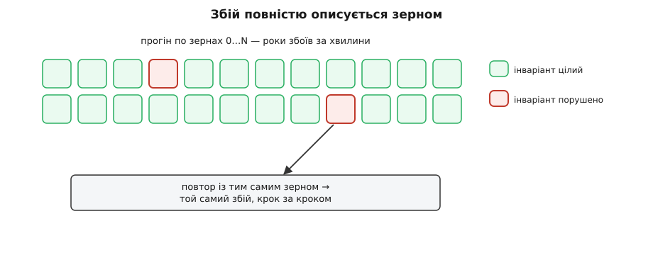

# ⚙️ Детермінований симулятор: коли збій — це просто число

Є один клас помилок, від якого досвідчений інженер холоне. Система впала раз — уночі, у проді, під навантаженням. У логах — уламки, з яких не складається картина. Ти відтворюєш той самий запит на стенді сто разів — усе працює. Додаєш докладніше логування, щоб підгледіти, — і помилка зникає, бо логування ледь змінило тайминг. Це [гейзенбаг](root:sf-release/heisenbug) — баг, який тікає щоразу, щойно на нього наводять прилад: він живе в **порядку** подій, а порядок щоразу інший, бо його диктують капризи планувальника потоків, дрож мережі й системний годинник.

Тепер уяви іншу реальність. Уся поведінка системи — **чиста функція** від двох речей: входів і одного числа-зерна. Той самий вхід і те саме зерно дають той самий прогін — до останнього біта, до порядку кожного повідомлення. Тоді збій перестає бути привидом: він **повністю описується зерном**. Спіймав раз — записав число — відтворюєш скільки завгодно разів, ставиш точки зупину, крутиш назад. А головне — можна не чекати, поки рідкісний порядок трапиться сам: женеш мільйон зерен на мільйоні ядер і **перебираєш** порядки, стискаючи роки природної роботи в хвилини машинного часу. Це і є детерміноване симуляційне тестування, і в цій вставці ми зберемо його робочий кістяк власними руками — небагато коду, але код, що справді бігає.

## Задача: приручити три джерела недетермінізму

Сформулюймо ціль без ілюзій. Ми хочемо ганяти справжню логіку системи — не її макет, а той самий код, що піде в бій, — крізь злий світ, де повідомлення губляться, приходять не по черзі, вузли падають і оживають; і хочемо, щоб кожен такий прогін був **відтворний за одним числом**. Що заважає? Рівно три джерела, з яких у код проникає непередбачуваність.

Перше — **час**. Код, що зве `time.Now()` чи спить `sleep(200ms)`, прив'язаний до справжнього годинника: той самий прогін завтра піде інакше, а «почекати 200 мс» робить кожен тест повільним і хитким.

Друге — **випадковість**. Виклик глобального `rand()` бере зерно з годинника чи ентропії ОС — і кожен запуск інший.

Третє, найпідступніше, — **порядок паралельних подій**. Кілька потоків, черга мережі, диск, що відповідає «колись», — усе це джерела, чий порядок вирішує не твоя програма, а планувальник ОС і фізика заліза. Саме тут родяться перегони, і саме цей порядок неможливо відтворити на замовлення.

Ключове спостереження: **усі три можна перехопити**. Час — якщо код не читає годинник сам, а бере його ззовні. Випадковість — якщо генератор засіяний відомим числом. Порядок — якщо всю паралельність згорнути на **один потік** і зробити чергу подій, якою керуємо **ми**, а не ОС. Перехопивши всі три й прив'язавши до одного зерна, ми й отримуємо чисту функцію `f(входи, зерно) → результат`.

## Ідея: згорнути весь недетермінізм в одне зерно

Уся конструкція тримається на одному несподіваному ході: **відмовитися від справжньої паралельності**. Замість потоків, що по-справжньому біжать разом, ми моделюємо кожну одночасну дію як **подію в черзі**, впорядкованій за віртуальним часом. Один потік по черзі витягує найранішу подію, посуває на її час віртуальний годинник і виконує її. Ніяких перегонів немає — бо в кожну мить виконується рівно одна подія, і обирає її **симулятор**, а не ОС.

Це той самий [подієвий цикл](root:sf-tasks/event-loop), що крутить асинхронні рушії, — але з двома доважками, які й роблять його детермінованим. По-перше, годинник тут **віртуальний і впорснутий**: він не тікає сам, а стрибає рівно на час наступної події; «почекати 200 мс» стає безкоштовним стрибком числа. По-друге, скрізь, де система інакше сягнула б по недетермінізм — по годинник, по випадкове число, по мережу чи диск, — ми підставляємо **керовану симулятором** реалізацію. Це буквально [впорскування залежностей](root:sf-apps/dependency-injection), застосоване не до бази чи логера, а до всього довкілля системи: код залежить від інтерфейсів «годинник», «генератор», «мережа», а в симуляції ми даємо йому детерміновані підстановки.

І тоді вся недетермінованість світу конденсується в **одне зерно**. Симулятор має єдиний засіяний генератор; з нього він бере кожне рішення — яку затримку дати повідомленню, чи впустити його зовсім, чи впорснути падіння вузла саме тепер. Порядок доставки, збої, тайминги — усе виводиться з зерна. Зміни зерно — дістанеш інший, але так само відтворний світ. Це і є [чиста функція](root:sf-apps/pure-functions-side-effects) від (входи, зерно): жодного прихованого входу, жодного дотику до реального годинника чи ентропії.


*Уся недетермінованість світу впорскується через шви й конденсується в одне число. Симулятор сам обирає порядок доставки й впорскує збої — але кожне таке рішення бере із засіяного генератора, тож зерно повністю описує прогін.*

## Робочий симулятор

Зберемо все це живим кодом, і то двома мовами відразу — ідея від мови не залежить, а обидві тут доречні. C++ — мова високопродуктивних систем, де ця техніка й живе насправді. Go дає ту саму логіку максимально читабельно, і в ньому ховається іронія, що добре запам'ятовується: мова вся про конкурентність, а ми **свідомо не вживаємо** горутин усередині симуляції — детермінізм купуємо, від паралельності відмовившись. Перемикай вкладки й зіставляй. Почнемо з фундаменту — засіяного генератора.

**Крок 1. Засіяний генератор: увесь стан — одне число.** Візьмемо SplitMix64 — крихітний, але справжній генератор: його весь стан — одне 64-бітове число, а `next()` — чиста функція від нього. Ніякого глобального `rand`, ніякої ентропії ОС.

:::tabs
:::code proj-deterministic-simulation/cpp/robochyi-symuliator.cpp
:::code proj-deterministic-simulation/go/robochyi-symuliator.go
:::

**Крок 2. Планувальник: черга подій за віртуальним часом.** Серце симулятора — купа (min-heap) подій, упорядкована за часом. Головний цикл витягує найранішу, посуває годинник на її мить і виконує. Тонкий, але критичний момент — **розрив нічиїх**: якщо дві події призначені на той самий час, порядок між ними має вирішувати не випадок, а щось детерміноване. Беремо порядковий номер народження події (`seq`) — так однаковий час завжди розкладається однаково.

:::tabs
:::code proj-deterministic-simulation/cpp/robochyi-symuliator-2.cpp
:::code proj-deterministic-simulation/go/robochyi-symuliator-2.go
:::

Зверни увагу на `now = e.at`: між двома подіями віртуальний час **стрибає** через порожнечу. У симуляції немає «зачекати секунду» — є лише «наступна подія аж на секунді пізніше». Саме тому симулятор жене на логічній швидкості, ні на що не чекаючи: тисяча симульованих секунд минає за стільки, скільки треба на обробку самих подій.

**Крок 3. Симульована мережа: долю кожного повідомлення обирає симулятор.** Ось де народжується злий світ. Мережа не доставляє повідомлення «одразу» — вона дає йому затримку із засіяного діапазону (а різні затримки в різних повідомлень і **перетасовують порядок** — те, що вилетіло першим, може дійти другим) і час від часу **губить** його зовсім. Кожне таке рішення — з генератора, тобто з зерна.

:::tabs
:::code proj-deterministic-simulation/cpp/robochyi-symuliator-3.cpp
:::code proj-deterministic-simulation/go/robochyi-symuliator-3.go
:::

Тим самим механізмом впорскують і **падіння вузлів**: досить запланувати подію «вузол помер» (яка вимикає його прапорець `alive` і глушить його відповіді) і пізнішу «вузол ожив» — обидві на моменти, узяті з зерна. Тут ми лишаємо код тонким і зупиняємося на мережі, але принцип той самий: будь-який збій — це просто подія, вкинута симулятором за рішенням генератора.

**Крок 4. Система під тестом.** Тепер — власне логіка, яку перевіряємо. Навмисно проста, щоб баг було видно, але баг **справжній**, з тих, що валять справжні системи. Клієнт шле серверові операцію «додай одиницю» й, якщо не діждався підтвердження за таймаут, **повторює** її тим самим ідентифікатором. Сервер застосовує операції. У наївній версії сервер застосовує **все, що прийшло**; у виправленій — дедуплікує за ідентифікатором.

:::tabs
:::code proj-deterministic-simulation/cpp/robochyi-symuliator-4.cpp
:::code proj-deterministic-simulation/go/robochyi-symuliator-4.go
:::

**Крок 5. Один прогін — чиста функція від зерна.** Складаємо світ, вкидаємо `K` операцій у різні моменти, женемо цикл до порожньої черги й перевіряємо **інваріант**. Інваріант тут — **безпековий**: жодну операцію не пораховано двічі, тобто `value ≤ K`. (Окремо існує інваріант живучості — «кожну операцію зрештою пораховано», тобто `value ≥ K`; його ламають справжні втрати, і це вже інша розмова. Тому безпеку пишемо як `≤`, а не `==`.)

:::tabs
:::code proj-deterministic-simulation/cpp/robochyi-symuliator-5.cpp
:::code proj-deterministic-simulation/go/robochyi-symuliator-5.go
:::

**Крок 6. Перебір зерен: знайти рідкісний збій і тут-таки його відтворити.** Ось фінальний акорд — те, заради чого все й будувалося. Женемо зерна поспіль; на першому, що ламає інваріант, друкуємо його — і **повторюємо той самий прогін**, щоб дістати той самий журнал крок за кроком.

:::tabs
:::code proj-deterministic-simulation/cpp/robochyi-symuliator-6.cpp
:::code proj-deterministic-simulation/go/robochyi-symuliator-6.go
:::

Це весь симулятор — планувальник, генератор, впорснутий час, симульована мережа, система під тестом і перебір зерен. Кількасот рядків, а поводиться як машина часу.

## Ключова властивість: збій — це число

Тепер придивімося, що саме ми виграли, бо тут криється вся сила методу.

**Відтворюваність до біта.** Наївний перебір спиниться на першому зерні, що ламає інваріант, і надрукує журнал. Запусти програму завтра, на іншій машині, в іншому годиннику — те саме зерно дасть **той самий** журнал: ті самі затримки, той самий порядок доставок, той самий повтор, та сама подвійна лічба. Гейзенбага більше немає: баг перестав жити в невловному таймінгу ОС і став оселений у числі. Ти можеш скільки завгодно разів заходити в цей самий збій із точкою зупину — він нікуди не втече, бо порядок подій щоразу відтворюється з зерна.

**Стискання часу.** А що дає перебір? Розберімо на числах, **чому** баг рідкісний — і чому його все одно ловлять.

**Умова збою.** Наївний сервер порахує операцію двічі, лише коли повтор спрацює **раніше**, ніж дійде підтвердження. Підтвердження — це два переходи мережею; кожен бере затримку від 1 до 12 тіків.

```
round-trip = lat(cli→srv) + lat(srv→cli)
таймер повтору спрацьовує на 24-му тіку

збій ⟺ round-trip ≥ 24  (тоді таймер за seq виграє в ack, що прийшов тим самим тіком)
у діапазоні [1..12] це можливо лише так:  12 + 12 = 24
```

**Висновок.** З 12 × 12 = 144 пар затримок збій дає рівно **одна** — обидва переходи по максимуму. Це ≈ 0.7 % на операцію; на п'ять операцій — близько 3.4 % зерен. Тобто ~97 % зерен «зелені», і наївним оком, ганяючи систему руками, ти на цей кут майже не натрапиш. Але перебір **бере його штурмом**: зелені зерна коштують часток мілісекунди, тож симулятор перемелює тисячі за секунду й натикається на червоне за лічені кроки. У справжній системі вікно вужче на порядки — там збій ховається за точним збігом кількох затримок, падіння й повтору, і трапляється раз на мільярди прогонів; саме тому його женуть на тисячах ядер, а не в один потік.



*Перебір зерен — це розвідка простору порядків. Кожне зерно — окремий відтворний світ; більшість цілі, зрідка трапляється зерно-вбивця. Знайшовши його число, збій відтворюють до біта — скільки завгодно разів.*

І остання, найтихіша перемога: **виправлення легко довести**. Той самий перебір на виправленому сервері (`sweep(false, …)`) не знайде **жодного** червоного зерна — надрукує «усі зерна пройшли інваріант». Дедуплікація за ідентифікатором ([ідемпотентність](root:sf-distributed/idempotency): повтор тієї самої операції застосовується один раз) закриває дірку, і симулятор це підтверджує не міркуванням, а мільйоном прогонів злого світу.

> 🔧 **Навіщо це.** Ось конкретне правило, що випливає з усього кістяка. **Жодна частина коду під тестом не має права сама сягати по час, випадковість чи введення-виведення.** Годинник, генератор, мережа, диск, черга — усе входить у систему **ззовні, через інтерфейс**, точку якого називають **швом (англ. *seam*)**. Порахуй шви — і ти знатимеш, наскільки система придатна до детермінованої симуляції: кожен незакритий шов (прямий `time.Now()`, глобальний `rand()`, схована горутина) — це дірка, крізь яку в прогін просочується недетермінізм, і однієї такої дірки досить, щоб «відтворний за зерном» перетворилося на «майже відтворний», тобто ні на що. Симуляція — це нагорода за дисципліну швів, а не безкоштовний трюк.

## Реальні системи й де проходить межа

Це не академічна вправа — на цьому стоять одні з найнадійніших систем у світі.

**FoundationDB** зробила детерміновану симуляцію своїм способом існування. База написана мовою **Flow** — синтаксичним розширенням C++, що додає асинхронні примітиви (async/await) поверх однопотокового циклу на колбеках. Симуляційний каркас підмінює фізичні інтерфейси (мережу, диск, годинник) заглушками, а справжній цикл на `epoll` — часовим симулятором, і так проганяє **цілий кластер в одному потоці** детерміновано. За переказом інженерів, перші ~18 місяців FoundationDB будували **виключно в симуляції**, ще до того, як система надіслала перший справжній мережевий пакет. Наслідок став легендою: Кайл Кінгсбері (aphyr), автор жорсткої серії тестів Jepsen на коректність розподілених систем, свого часу зауважив, що не тестував FoundationDB, бо їхнє власне тестування «значно суворіше за моє» *(документована публічна репліка; статус — підтверджене свідчення практика, не маркетинг вендора)*.

**TigerBeetle** (фінансова база, написана мовою Zig) веде цю лінію далі й дає їй ім'я — **VOPR** (*Viewstamped Operation Replicator*, з поклоном комп'ютерові WOPR із фільму «Військові ігри» 1983 року). VOPR симулює цілі кластери з реальним кодом консенсусу, впорскуючи мережеві збої (втрати, перетасовки, поділ мережі) й дискові (пошкодження читань і записів), і все — від одного зерна плюс git-коміт. Знайдений збій відтворюється **ідеально**: записано зерно й точний розклад подій. Ту саму базу симулятор жене цілодобово на тисячі ядер, стискаючи, за їхнім описом, величезний простір станів у короткий машинний час — рівно та властивість, яку ми щойно зібрали руками.

**Antithesis** — це та сама ідея, доведена до межі. Її заснували 2018 року Вілл Вілсон і Девід Шерер, вихідці з FoundationDB, і поставили питання руба: а що, коли переписати всю систему як чисту функцію **неможливо** — код чужий, замкнений, тягне за собою цілу ОС? Їхня відповідь — **детермінований гіпервізор**: детермінізм спускають на рівень **усієї віртуальної машини**, тож будь-який бінарник під нею виконується відтворно, і ті самі входи дають ту саму трасу. Це й окреслює **межу** нашого методу. Симуляція «система як чиста функція» вимагає, щоб ти сам провів **усі** джерела недетермінізму крізь шви — розкіш, доступна, лише коли будуєш систему з нуля під це. Де так не можна, лишаються два виходи: або спустити детермінізм нижче за код (гіпервізор, як в Antithesis), або, там де недетермінізм справді зовнішній і невпорсний, — **записати** реальний недетермінований прогін і потім **відтворювати** його з запису. Симуляція не скасовує недетермінізму світу — вона переносить його в місце, яким ти керуєш.

## Складність і пастки

Обчислювально тут усе дешеве: планувальник — `O(log n)` на подію (купа), генератор і мережа — константа. Уся вага не в машині, а в **дисципліні**, і саме там чигають пастки.

**Одне протікання губить усе.** Детермінізм — властивість «усе або нічого». Досить одного `time.Now()`, одного глобального `rand()`, однієї схованої горутини чи одного `select` по каналах — і прогін перестає відтворюватися з зерна. Найпідступніша пастка саме в Go: **ітерація по мапі навмисно рандомізована**. Код, що приймає рішення, обходячи `map` циклом `range`, недетермінований, хай навіть усе решта чисте, — той самий баг то відтворюється, то ні. Ліки — упорядковані структури або сортування ключів перед обходом; але спершу цю дірку треба **помітити**, а вона тиха.

**Нічиї — теж джерело недетермінізму.** Ми не дарма ввели `seq`. Дві події на той самий віртуальний тік мусять мати **визначений** порядок; лишиш його на розсуд купи чи мапи — і дістанеш недетермінізм усередині самого «детермінованого» симулятора. У нашому прикладі саме тай-брейк за `seq` вирішує долю збою на межі (`round-trip = 24`): таймер, народжений раніше, законно випереджає підтвердження, що прийшло тим самим тіком.

**Симулятор ловить лише ті збої, які ти модельуєш.** Мережа, що вміє губити й затримувати, але не вміє **дублювати** чи спотворювати пакети, ніколи не знайде багів дуплікації. Ніколи не впорснеш перекіс годинників — не спіймаєш багів на перекосі годинників. Фантазія симулятора — це і є стеля його знахідок; розширення моделі збоїв прямо коштує новими класами зловлених помилок.

**Сліпий перебір — не всесильний.** Гнати випадкові зерна — це, по суті, [фазинг](root:sf-release/fuzzing) простору порядків. Він чудово знаходить кути з помірною ймовірністю (як наш 1-з-144), але баг, схований за глибокою точною послідовністю подій, випадкове зерно може не зачепити й за мільярд спроб. Тому серйозні симулятори додають **скерування покриттям** (як у фазингу): помічають, які зерна ведуть у нові стани, і копають довкола них, а не сіють наосліп.

**Слабкі перевірки — порожні прогони.** Симулятор ловить не «падіння», а **порушення інваріантів**. Прожени мільярд зерен без жодного `assert` по дорозі — і не знайдеш нічого, бо нема чому спрацювати. Сила методу — не в переборі самому по собі, а в переборі, помноженому на **гострі, змістовні інваріанти**: «баланс ніколи не від'ємний», «жодну операцію не пораховано двічі», «два вузли ніколи не головні водночас». Симулятор лише **штовхає** систему в рідкісні кути; ловлять баг твої твердження.

І над усім — чесна ціна. Щоб отримати цю машину часу, систему треба **будувати під неї**: провести весь час, усю випадковість і все введення-виведення крізь шви, відмовитися від прямої паралельності на користь керованого циклу, написати й супроводжувати сам симулятор мережі й диска. Це відчутна інвестиція, і вона окупається не на кожному проєкті — а там, де ціна тихого рідкісного багу висока: у базах даних, платіжних системах, консенсусі. Там детермінований симулятор перетворює найстрашніший клас помилок — невідтворний перегін — на буденну річ, яку описує одне число.
