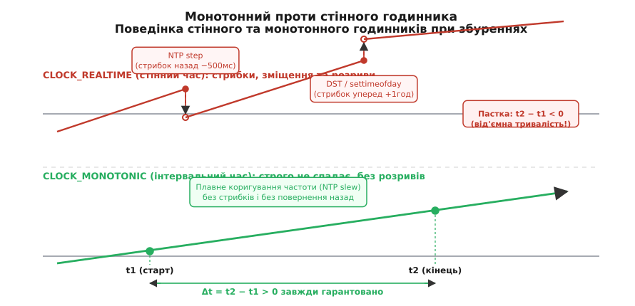
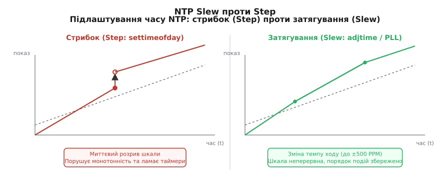

# Прикладний час: фізичні основи, системні годинники та архітектура планувальників

<preknowlist>
- [Доповняльний код](root:hw-arch/twos-complement) — представлення цілих чисел зі знаком у пам'яті комп'ютера, розрядна сітка та механіка двійкового переповнення.
- [Серіалізація даних](root:com-protocol/data-serialization) — формати передачі структур між мережевими вузлами та представлення часових міток на дроті.
- [Двійкова купа](root:sf-algorithms/binary-heap-implementation) — будова черг із пріоритетом, алгоритми просіювання та оцінка часової складності операцій над деревами.
- [Червоно-чорні дерева](root:sf-algorithms/red-black-tree) — самобалансовані бінарні дерева пошуку, структура вузлів та накладні витрати на покажчики.
</preknowlist>

Розподілена база даних раптово обрала двох одночасних лідерів у кластері Raft після того, як фонова служба NTP стрибком перевела системний годинник на 400 мілісекунд назад. Мережевий сервіс обробки платежів заблокував тисячі користувацьких транзакцій на кілька годин через таймаут, розрахований простим відніманням двох значень `gettimeofday()`. Щомісячний звіт аналітичної системи за березень недорахував рівно одну годину продажів у країнах Європейського Союзу, а сервіс планування фонових завдань виконав нічне резервне копіювання двічі поспіль під час осіннього переведення годинників.

Ці інциденти не є чотирма різними програмними помилками. Усі вони виникають через одну фундаментальну хибу проєктування: ставлення до «часу» як до єдиного монолітного скаляра.

У сучасній обчислювальній системі одночасно співіснують кілька принципово різних фізичних та інформаційних сутностей, кожна з яких має власне призначення, власні апаратні джерела, математичні властивості та обмеження:
1. **Астрономічний стінний час (Wall-Clock Time):** прив'язаний до обертання планети навколо своєї осі, сонячного полудня та геополітичних кордонів часових поясів. Він відповідає на питання «*яка календарна дата й година зафіксована в конкретній географічній точці*».
2. **Монотонний інтервальний час (Monotonic Interval Time):** безперервний, строго не спадний потік тактів фізичного апаратного генератора вузла. Він відповідає на питання «*скільки реального фізичного часу минуло між двома подіями на цьому процесорі*».
3. **Логічний та гібридний розподілений час (Logical & Hybrid Clocks):** причинно-наслідкові лічильники (порядок Лампорта, векторні годинники, TrueTime, HLC), що встановлюють частковий або строгий порядок подій між вузлами без надійної фізичної синхронізації.
4. **Правила розкладу (Recurrence Schedules):** людиноорієнтовані календарні формули («щодня о 09:00 за київським часом», «кожного першого понеділка місяця»), які вимагають динамічного проєктування на всесвітню вісь миттєвостей через базу часових поясів.

Плутанина між цими сутностями руйнує розподілені консенсуси, ламає мережеві таймаути та спотворює фінансову аналітику.


*Поведінка системних годинників: стінний час зазнає стрибків та зворотного ходу при синхронізації, тоді як монотонний час гарантує строге зростання.*

---

## 1. Фундаментальний розкол та анатомія часових катастроф

### Небезпека обчислення тривалостей через стінний час

Розглянемо класичний патерн вимірювання тривалості мережевого запиту або очікування відповіді на сокеті:

:::tabs

@tab C
```c
/* НАЇВНИЙ І НЕБЕЗПЕЧНИЙ КОД (C): */
struct timeval t_start, t_end;
gettimeofday(&t_start, NULL);

/* ... виконання мережевої операції ... */

gettimeofday(&t_end, NULL);
long elapsed_ms = (t_end.tv_sec - t_start.tv_sec) * 1000 + 
                  (t_end.tv_usec - t_start.tv_usec) / 1000;
```

@tab C++
```cpp
/* НАЇВНИЙ І НЕБЕЗПЕЧНИЙ КОД (C++): */
auto t_start = std::chrono::system_clock::now();

/* ... виконання мережевої операції ... */

auto t_end = std::chrono::system_clock::now();
auto elapsed_ms = std::chrono::duration_cast<std::chrono::milliseconds>(t_end - t_start).count();
```
:::

Якщо під час виконання мережевої операції фоновий демон `ntpd` виявив накопичений зсув і скоригував годинник стрибком на 200 мілісекунд назад, значення `t_end` виявиться меншим за `t_start`.

У результаті змінна `elapsed_ms` отримає від'ємне значення (наприклад, `-150` мілісекунд). Якщо це число далі передається в беззнакову змінну таймауту типу `uint64_t`, у [доповняльному коді](root:hw-arch/twos-complement) воно перетворюється на гігантське додатне число:

```
Переповнення від'ємного інтервалу в uint64:
-150 у форматі int64 = 0xFFFFFFFFFFFFFF6A
Як uint64             = 18 446 744 073 709 551 466 мілісекунд
                     ≈ 584 мільйони років!
```

Потік, який мав зачекати 5 секунд і відпустити заблокований ресурс, засинає практично назавжди, вичерпуючи пул робочих потоків сервера й зупиняючи обробку запитів.

### Розкол лідерства у консенсусних протоколах (Split-Brain)

У розподілених системах координації (Raft, Paxos, ZooKeeper, etcd) вузол-лідер отримує право одноосібного запису на основі тимчасової оренди лідерства (Leader Lease). Лідер вважає себе повноважним протягом інтервалу, наприклад, 5 секунд від моменту останнього підтвердження від більшості реплік (кворуму).

Якщо розрахунок закінчення лізингу спирається на `CLOCK_REALTIME`, виникає катастрофічний сценарій:

```
Хронологія розколу лідерства:
1. Вузол A отримує лізинг на 5 секунд: дедлайн о 12:00:05.000.
2. О 12:00:02.000 на вузлі A демон NTP стрибком переводить годинник назад на 4 секунди (до 11:59:58.000).
3. Вузол A обчислює залишок лізингу: 12:00:05.000 - 11:59:58.000 = 7 секунд (хоча фізично минуло вже 2 секунди).
4. Решта кластера через 5 секунд фізичного часу констатує втрату зв'язку з вузлом A й обирає нового лідера — Вузол B.
5. Вузол A і Вузол B одночасно вважають себе чинними лідерами й приймають конфліктні записи від клієнтів.
```

Цей стан називається **Split-Brain (розкол мозку)** і неминуче призводить до розбіжності даних у розподіленому реєстрі. Використання монотонного часу (`CLOCK_MONOTONIC`) унеможливлює такий розвиток подій, оскільки монотонний лічильник ніколи не повертається назад.

---

## 2. Фізичний рівень: від кварцового кристала до лічильника тактів

### П'єзоелектричний ефект і термодинаміка кварцу

Будь-який комп'ютерний відлік часу починається з механічних коливань кристала діоксиду кремнію (SiO₂). Завдяки прямому та зворотному п'єзоелектричному ефекту прикладання змінного електричного поля викликає пружну механічну деформацію пластинки кварцу, а деформація генерує зворотний електричний потенціал на її металізованих гранях.

Електричний еквівалент кварцового резонатора описується моделлю Баттерворта-Ван Дайка (BVD-модель), яка містить послідовну динамічну вітку (динамічна індуктивність L_m, динамічна ємність C_m, динамічний опір втрат R_m) та паралельну статичну ємність контактів C_0. Резонатор має дві надзвичайно близькі резонансні частоти: послідовного резонансу f_s та паралельного резонансу f_p. Завдяки високій добротності Q (Q ≈ 10⁴..10⁶) кварцовий контур фільтрує сторонні шуми й забезпечує високу стабільність генерованого сигналу.

У годинниках реального часу (RTC) використовують низькочастотні резонатори камертонного типу на частоту 32 768 Гц. Вибір цього числа зумовлений двійковою математикою:

```
Частота RTC:
f0 = 2^15 = 32768 Гц
```

Послідовний ланцюг із 15 двійкових тригерів-дільників перетворює цю частоту на стабільний секундний імпульс з мінімальним споживанням енергії (менше 1 мікровата), що дозволяє мікросхемі RTC роками живитися від невеликої літієвої батарейки CR2032.

Для системних лічильників процесора потрібна значно вища роздільна здатність, тому на материнських платах встановлюють високочастотні генератори AT-зрізу на частоти від 24 МГц до 100 МГц.

Фізична пластинка кварцу нездатна підтримувати абсолютно незмінну частоту коливань. Її геометричні розміри та модуль пружності змінюються під впливом температури. Для низькочастотних камертонних резонаторів температурна характеристика описується параболою:

```
Температурна нестабільність кварцового кристала:
f(T) = f0 · [ 1 - β · (T - T0)² ]

де:
f0 — номінальна частота при калібрувальній температурі
T0 — температура вершини параболи (зазвичай 25°C)
β  — параболічний коефіцієнт (0.035..0.040 ppm/°C²)
```

Для високочастотних резонаторів AT-зрізу залежність описується кубічною функцією з точкою перегину:

```
Кубічна температурна залежність AT-зрізу:
Δf / f0 = a1 · (T - T0) + a2 · (T - T0)² + a3 · (T - T0)³
```

Якщо робоча температура всередині сервера під час навантаження зростає від кімнатних 25°C до 55°C, відносне зміщення частоти низькочастотного генератора становить:

```
ΔT = 55 - 25 = 30°C
Δf / f0 = -0.035 · (30)² = -31.5 ppm
```

Одиниця вимірювання **ppm** (parts per million — частин на мільйон) показує кількість помилкових мікросекунд на кожну секунду фізичного плину часу:

```
Похибка за 1 секунду = 31.5 мкс
Похибка за 1 годину  = 31.5 · 3600 мкс ≈ 113.4 мс
Похибка за 1 добу    = 31.5 · 86400 мкс ≈ 2.7216 секунди
```

За місяць автономної роботи без синхронізації з зовнішніми джерелами серверний годинник відхилиться від реального астрономічного часу більш ніж на 1.3 хвилини.

Крім температури, на кристал впливають:
1. **Старіння (Aging):** поступова міграція молекул на поверхні кристала та релаксація внутрішніх механічних напружень змінюють частоту на 1..3 ppm за перший рік експлуатації.
2. **Флуктуації напруги живлення:** зміна напруги на виході стабілізатора живлення зміщує робочу точку генератора Пірса.
3. **Механічні вібрації:** обертання серверних кулерів охолодження на швидкості 15 000 об/хв породжує акустичний шум, який деформує кристал і додає фазове тремтіння (jitter).
4. **Варіація Аллана (Allan Variance, σ_y²(τ)):** метрологічна характеристика стабільності частоти генератора в часовій області, що дозволяє відокремити білий фазовий шум від флікер-шуму та довготривалого випадкового блукання частоти.

```
Класифікація та стабільність генераторів частоти:

+-----------------------------+-------------------+----------------------+--------------------+
| Тип генератора              | Нестабільність    | Дрейф за добу        | Сфера застосування |
+-----------------------------+-------------------+----------------------+--------------------+
| Простий кварц (XO)          | 20..50 ppm        | 1.7..4.3 с           | Споживча техніка   |
| Термокомпенсований (TCXO)   | 0.5..2 ppm        | 43..170 мс           | Мережеві комутатори|
| Термостатований (OCXO)      | 0.001..0.01 ppm   | 86..860 мкс          | Базові станції 5G  |
| Рубідієвий атомний еталон   | 10^(-5) ppm       | 0.86 мкс             | Датацентри, PTP GM |
| Цезієвий первинний еталон   | 10^(-8) ppm       | 0.86 нс              | Лабораторії часу SI|
+-----------------------------+-------------------+----------------------+--------------------+
```

### Схемотехніка генератора Пірса та фазовий шум

Класичний генератор Пірса складається з інвертуючого логічного елемента CMOS (або транзистора), резистора зворотного зв'язку R_f, вхідного та вихідного навантажувальних конденсаторів C_1, C_2 і кварцового резонатора.

Інвертор забезпечує фазовий зсув 180°, а π-подібна мережа з резонатора та конденсаторів C_1, C_2 додає решту 180°, створюючи загальний фазовий зсув 360° (0°), необхідний для виконання критерію генерації Баркгаузена.

Для гарантованого збудження коливань схема повинна мати достатній запас негативного динамічного опору (negative resistance, -R_neg):

```
Критерій надійного запуску генератора:
|-R_neg| > 3 · R_m ... 5 · R_m
де R_m — динамічний опір втрат резонатора з BVD-моделі
```

Фазовий шум (Phase Noise) генератора вимірюється у вигляді спектральної густини потужності L(f) в одиницях dBc/Hz на фіксованому зміщенні від несучої частоти. Фазовий шум безпосередньо транслюється у часове тремтіння тактових фронтів (Timing Jitter, RMS Jitter):

```
Зв'язок фазового шуму та середньоквадратичного джитера:
Jitter_RMS = (1 / (2π · f0)) · sqrt( 2 · ∫ 10^(L(f)/10) df )
```

У високошвидкісних цифрових шинах (PCIe 5.0/6.0, 100GbE, USB4) джитер понад 0.5 ps призводить до закриття «ока» сигнальної діаграми та виникнення бітових помилок передачі (Bit Error Rate, BER).

### Архітектура системних лічильників CPU та міжсокетна когерентність

Сучасні комп'ютерні процесори не опитують зовнішній кварцовий генератор безпосередньо. Вони використовують внутрішні апаратні таймери та лічильники тактів:

1. **TSC (Time Stamp Counter) в архітектурі x86-64:**
   64-бітний внутрішній регістр процесора, що інкрементується на кожному такті. В інструкціях процесора він доступний через опкод `RDTSC`.
   У ранніх процесорах частота лічильника TSC залежала від енергозберігаючих станів процесора (P-states, SpeedStep): при зниженні тактової частоти ядра для економії енергії лічильник TSC сповільнював свій хід, а при зупинці ядра в C-states взагалі припиняв відлік.
   Сучасні процесори підтримують **Invariant TSC** (`constant_tsc` та `nonstop_tsc` у прапорцях `/proc/cpuinfo`). Invariant TSC функціонує з фіксованою базовою частотою незалежно від поточного розгону ядра, не зупиняється при переході в енергозберігаючі стани та апаратно калібрується для синхронного ходу на всіх ядрах процесорного сокета.

2. **Синхронізація TSC у багатосокетних NUMA-серверах:**
   У серверах із двома або чотирма фізичними сокетами процесорів кожен сокет має власний вбудований генератор тактів.
   Під час ініціалізації апаратні шини когерентності (Intel Ultra Path Interconnect — UPI, AMD Infinity Fabric) надсилають спеціальні міжпроцесорні синхронізаційні пакети для вирівнювання лічильників тактів між сокетами.
   Під час завантаження ядра Linux тестова функція `check_tsc_sync_source()` проганяє мільйони перехресних зчитувань між ядрами через міжпроцесорні переривання (IPI). Якщо виявляється апаратне розходження фаз (TSC warping), ядро дискваліфікує TSC як надійне джерело годинника й автоматично перемикається на повільніший, але гарантовано глобальний HPET.

3. **HPET (High Precision Event Timer):**
   Апаратний таймер на материнській платі, що працює на частоті не менше 10 МГц. Він забезпечує стабільний відлік, але доступ до нього вимагає читання регістрів через системну шину пам'яті (MMIO), що коштує від 500 до 1500 наносекунд на одне звернення, порівняно з 10–15 наносекундами для читання Invariant TSC.

4. **ARM Generic Timer:**
   В архітектурах ARMv8-A лічильник системи реалізовано через системний регістр `CNTVCT_EL0`, який функціонує на базовій частоті `CNTFRQ_EL0` (зазвичай від 1 МГц до 50 МГц) і доступний безпосередньо з простору користувача.

### vDSO: доступ до часу за 15 наносекунд

У ранніх версіях Unix кожен виклик `gettimeofday()` або `time()` вимагав повноцінного перемикання контексту з простору користувача в простір ядра через програмне переривання (`int 0x80`) або інструкцію `SYSCALL`. Це створювало затримку близько 100–300 наносекунд і скидало кеш конвеєра інструкцій.

Сучасні ядра Linux використовують механізм **vDSO (virtual Dynamic Shared Object)**. Ядро відображає одну сторінку пам'яті в режимі лише для читання в адресний простір кожної програми. На цій сторінці ядро записує поточний стан лічильника Invariant TSC, базову точку астрономічного часу та масштабувальні множники.

```
Структура даних vDSO для швидкого обчислення часу (спрощено):
struct vdso_time_data {
    uint32_t seq;               /* Лічильник блокування без блокувань (seqcount) */
    uint64_t tsc_timestamp;     /* Значення TSC на момент останнього калібрування */
    uint64_t base_realtime_ns;  /* Відповідний стінний час у наносекундах */
    uint64_t base_monotonic_ns; /* Відповідний монотонний час у наносекундах */
    uint32_t mult;              /* Множник для переведення тактів TSC у наносекунди */
    uint32_t shift;             /* Зсув для ділення без апаратної інструкції DIV */
};
```

Коли програма викликає `clock_gettime(CLOCK_MONOTONIC, &ts)`, бібліотека C виконує простий алгоритм у просторі користувача:
1. Читає парне число `seq` (seqcount).
2. Виконує інструкцію `RDTSC` для зчитування поточних тактів T_current.
3. Обчислює пройдені такти:
```
[Пройдені такти]
ΔT = T_current - T_timestamp
```
4. Переводить такти в наносекунди за допомогою множення й бітового зсуву:
```
[Пройдений час у наносекундах]
Δt_ns = (ΔT * mult) >> shift
```
5. Додає результат до базового значення часу.
6. Повторно перевіряє `seq`. Якщо ядро не оновлювало структуру під час обчислень, результат повертається негайно.

Цей механізм дозволяє виконувати мільйони викликів вимірювання часу на секунду з накладними витратами менше 15 наносекунд на виклик без жодного переходу в простір ядра.

---

## 3. Шкали часу: TAI, UT1, UTC та високосні секунди

### Фізичні відмінності між TAI, UT1 та UTC

Людство використовує три принципово різні шкали часу, які часто помилково вважають синонімами:

```
Зв'язок між трьома шкалами часу:

1. TAI (Міжнародний атомний час):
   Безперервна монотонна шкала, що базується на квантових переходах атома цезію-133.
   1 секунда SI = 9 192 631 770 періодів випромінювання атома цезію.

2. UT1 (Всесвітній астрономічний час):
   Шкала, що базується на реальному фізичному обертанні планети Земля навколо своєї осі.
   Доба UT1 — це інтервал між двома послідовними сонячними полуднями на меридіані Ґрінвіча.

3. UTC (Всесвітній координований час):
   Компромісна шкала: тривалість секунди береться від TAI, але абсолютне значення
   коригується високосними секундами, щоб утримувати:
   |UTC - UT1| < 0.9 секунди
```

Земля не є ідеальним маховиком. Її обертання сповільнюється через припливне тертя океанічних вод, викликане гравітацією Місяця і Сонця. Крім того, перерозподіл мас рідкого ядра планети, танення льодовиків та сезонні рухи повітряних мас атмосфери призводять до нерегулярних коливань швидкості обертання.

Через це атомна секунда SI, зафіксована в 1967 році за результатами астрономічних спостережень XIX століття, виявилася трохи коротшою за середню частку поточної сонячної доби. Атомний годинник TAI невпинно випереджає повільне обертання планети.

```
Поточне співвідношення шкал (станом на 2026 рік):
TAI - UTC = 37 секунд
```

Детальний історичний шлях людства від перших залізничних стандартів через конференцію у Вашингтоні 1884 року до створення атомних еталонів розкрито у дослідженні [як людство домовилося про єдиний час](root:sf-apps/time-and-scheduling/hist-time-standards.md).

### Проблема високосної секунди у програмному забезпеченні

Щоб компенсувати відставання планети, Міжнародна служба обертання Землі (IERS) періодично оголошує про вставку **високосної секунди** (leap second) наприкінці 30 червня або 31 грудня. У цей момент астрономічний годинник показує:

```
23:59:58 UTC
23:59:59 UTC
23:59:60 UTC  <--- Високосна секунда
00:00:00 UTC
```

Стандарт POSIX (IEEE Std 1003.1) містить фундаментальну архітектурну суперечність: він жорстко постулює, що кожна доба повинна містити **рівно 86400 секунд**:

```
Секунд у добі за стандартом POSIX:
Секунд = 24 · 60 · 60 = 86400
```

POSIX не дозволяє існування секунди з номером `86401` або часової мітки `23:59:60`. Коли ядро операційної системи отримує сигнал про високосну секунду, воно змушене або заморозити час на одну секунду, або повторити секунду `23:59:59` двічі:

```
Послідовність таймстемпів POSIX при вставці високосної секунди:
Секунда 1341100799 -> 23:59:59 UTC
Секунда 1341100799 -> 23:59:59 UTC  (повтор того самого цілого числа!)
Секунда 1341100800 -> 00:00:00 UTC
```

Повторення часової мітки призводить до катастрофічних наслідків у розподілених системах:
- **Порушення монотонності логів:** подія, що сталася пізніше, отримує часову мітку, ідентичну або меншу за попередню подію.
- **Блокування баз даних (Deadlocks):** транзакційні рушії, що використовують `gettimeofday()` для генерації унікальних ключів сортування версій рядків (MVCC), стикаються з колізіями первинних ключів.
- **Збій Futex у ядрі Linux (2012 рік):** 30 червня 2012 року через баг у підсистемі `hrtimer` ядра Linux системні виклики `futex()` почали входити в стан 100% споживання CPU у безкінечному циклі. Коли демон NTP передав прапорець вставки високосної секунди `STA_INS`, функція ядра `timekeeping_update()` скоригувала зміщення стінного часу, але не оновила внутрішні базові таймери тайм-вейтів `CLOCK_REALTIME`. Усі потоки, що спали на м'ютексах Java JVM, MySQL та Erlang, миттєво визнали свої таймаути простроченими, почали перевіряти стан пам'яті й негайно засинати знову з нульовим дедлайном. Це згенерувало лавиноподібний шторм переривань і поклало тисячі серверів по всьому світу.

### Технологія Leap Smear

Щоб уникнути стрибків та повторів часу, провідні технологічні компанії (Google, Cloudflare, Amazon Web Services, Meta) впровадили підхід **Leap Smearing (розмазування високосної секунди)**.

Замість додавання цілої секунди в один момент, сервери NTP протягом так званого вікна змазування (зазвичай 24 години: 12 годин до півночі та 12 годин після) штучно сповільнюють тактову частоту своїх годинників на крихітну величину:

```
Розрахунок відхилення частоти при Leap Smear:
Тривалість вікна: W = 24 години = 86400 секунд
Необхідне уповільнення:
Δf / f = 1 секунда / 86400 секунд ≈ 11.574 ppm
```

Уповільнення частоти на 11.57 ppm знаходиться далеко в межах стандартного діапазону регулювання частоти ядра (до 500 ppm). Протягом доби годинник плавно накопичує необхідну одну секунду відставання без жодного порушення монотонності чи повторення значень секунд.

У листопаді 2022 року на 27-й Генеральній конференції з мір і ваг (CGPM) було ухвалено історичне рішення: **до 2035 року припинити практику додавання високосних секунд до UTC**, дозволивши розходженню між TAI та UTC зростати без штучних розривів шкали.

---

## 4. Мережева синхронізація часу: NTP та PTP

### Математика протоколу NTP

Протокол мережевого часу NTP (Network Time Protocol, RFC 5905) синхронізує годинник клієнта з віддаленим сервером через несиметричну мережу з випадковими затримками передачі пакетів.

Обмін пакетами між клієнтом і сервером фіксує чотири часові мітки:

```
Схема обміну часовими мітками в NTP:

Клієнт                            Сервер
  |                                 |
T1|--- (Запит NTP: мітка T1) ------>|
  |                                 |T2 (Час прийому запиту сервером)
  |                                 |
  |                                 |T3 (Час відправки відповіді сервером)
  |<-- (Відповідь NTP: T1,T2,T3) ---|
T4|
  v                                 v
```

Позначення міток:
- T_1: локальний час клієнта в момент відправки запиту.
- T_2: час сервера в момент отримання запиту.
- T_3: час сервера в момент відправки відповіді.
- T_4: локальний час клієнта в момент отримання відповіді.

На основі цих міток клієнт розраховує дві фундаментальні величини:

```
[Кругова затримка мережі]
δ = (T4 - T1) - (T3 - T2)

[Фазовий зсув годинника]
θ = ((T2 - T1) + (T3 - T4)) / 2
```

Цей розрахунок спирається на базове припущення про симетричність мережевих шляхів: час проходження пакета від клієнта до сервера (d_req) вважається рівним часу проходження від сервера до клієнта (d_resp).

Якщо маршрутизація в інтернеті асиметрична (d_req != d_resp), виникає систематична похибка визначення часу:

```
Похибка через асиметрію мережі:
E_offset = (d_req - d_resp) / 2
```

### Алгоритм перетину інтервалів Марцулло

Коли клієнт опитує кілька серверів NTP (типово від 4 до 8 джерел), деякі з них можуть повертати некоректний час через збої або асиметрію мережі (такі джерела називаються falsetickers).

Для виявлення достовірних джерел (truechimers) демон NTP використовує **алгоритм Марцулло (Marzullo's Algorithm)**:
1. Для кожного сервера i будується довірчий інтервал:
```
[Довірчий інтервал сервера i]
I_i = [ θ_i - δ_i / 2,  θ_i + δ_i / 2 ]
```
2. Кінцеві точки всіх інтервалів сортуються в єдиний числовий масив.
3. Алгоритм знаходить неперервний діапазон, у якому перетинається максимальна кількість інтервалів (не менше ніж N - f, де f — максимальна кількість допустимих збійних серверів).
4. Сервери, чиї інтервали не перетинаються з цією областю, повністю відкидаються, а підсумковий зсув розраховується як зважене середнє решти валідних джерел.

### Дисципліна системного годинника: Step проти Slew

Отримавши значення зсуву θ, демон синхронізації часу (`chronyd` або `ntpd`) повинен скоригувати системний годинник операційної системи. Для цього існують два взаємовиключні механізми:

```
Порівняння Step та Slew:

1. Стрибок (Step) через settimeofday() / clock_settime():
   - Зсув годинника коригується миттєво в один момент.
   - Якщо θ < 0, годинник стрибає назад!
   - Порушує монотонність, ламає активні таймаути.
   - Застосовується лише під час початкового завантаження вузла при розходженні > 128 мс.

2. Затягування частоти (Slew) через adjtime() / adjtimex():
   - Зсув коригується поступовою зміною швидкості ходу годинника.
   - Ядро прискорює або сповільнює тіки на фіксовану величину (до ±500 ppm).
   - Час завжди тече строго вперед: монотонність не порушується.
```


*Механізми NTP: різкий стрибок ламає неперервність часової шкали, тоді як плавне затягування коригує темп ходу без розривів.*

У ядрі Linux максимальна швидкість затягування обмежена константою `MAXPHASE` і становить **500 ppm** (0.05%). Це означає, що для виправлення накопиченого зсуву в 1 секунду за допомогою плавного затягування системі знадобиться:

```
Час коригування зсуву в 1 секунду:
T_slew = 1 с / (500 · 10^(-6)) = 2000 секунд ≈ 33.3 хвилини
```

### Апаратні мітки часу та протокол PTP (IEEE 1588)

У високочастотному трейдингу та телекомунікаціях мілісекундна точність NTP є недостатньою. Протокол точного часу **PTP (Precision Time Protocol, IEEE 1588v2)** забезпечує синхронізацію з точністю до одиниць наносекунд.

Ця точність досягається за рахунок трьох факторів:
1. **Апаратне проставлення міток (Hardware Timestamping):** мережева карта (NIC) фіксує момент відправки та прийому пакета безпосередньо на фізичному рівні PHY/MAC в момент проходження електричного сигналу крізь трансивер, виключаючи затримки черг операційної системи та обробки переривань.
2. **Прозорі комутатори (Boundary / Transparent Clocks):** мережеві комутатори вимірюють час перебування пакета всередині своїх буферів комутації та записують цю затримку в спеціальне поле корекції пакета PTP.
3. **Пряме підключення Grandmaster Clock до супутникових систем GPS/Galileo/ГЛОНАСС.**

### Технологія White Rabbit та Synchronous Ethernet

Для прискорювачів елементарних частинок у CERN та базових станцій 5G було розроблено протокол **White Rabbit**, що розширює PTP:
- **Synchronous Ethernet (SyncE, ITU-T G.8261):** тактова частота фізичного рівня передається безпосередньо через бітовий потік оптоволоконного кабелю 1.25 Гбіт/с або 10 Гбіт/с, повністю усуваючи пакетні затримки при передачі частоти.
- **Цифровий фазовий детектор DDMTD (Dual Digital Mixer Time Difference):** вимірює суб-пікосекундну різницю фаз між тактовими сигналами Master і Slave, забезпечуючи точність синхронізації кращу за 100 ps на відстанях до 10 км.

---

## 5. Системні годинники ядра Linux: семантика та вибір

Стандарт POSIX та ядро Linux надають кілька ідентифікаторів годинників для виклику `clock_gettime(clockid_t clk_id, struct timespec *tp)`. Кожен із них має строго окреслену математичну семантику:

```
Зведена таблиця системних годинників POSIX / Linux:

+-------------------------+-------------+-------------+---------------+------------------------+
| Ідентифікатор годинника | Монотонний? | Вплив NTP   | Рахує в сні?  | Основне призначення    |
+-------------------------+-------------+-------------+---------------+------------------------+
| CLOCK_REALTIME          | НІ (стрибає)| Step + Slew | ТАК           | Стінний час, дати, UI  |
| CLOCK_REALTIME_COARSE   | НІ (стрибає)| Step + Slew | ТАК           | Швидкий низькоточний час|
| CLOCK_MONOTONIC         | ТАК         | Лише Slew   | НІ (зупинка)  | Таймаути, інтервали    |
| CLOCK_MONOTONIC_RAW     | ТАК         | Жодного     | НІ (зупинка)  | Калібрування генератора|
| CLOCK_MONOTONIC_COARSE  | ТАК         | Лише Slew   | НІ (зупинка)  | Швидкі інтервали       |
| CLOCK_BOOTTIME          | ТАК         | Лише Slew   | ТАК (включає) | Мережеві таймаути ОС   |
| CLOCK_TAI               | НІ (стрибає)| Лише Slew   | ТАК           | Атомний час без leap   |
+-------------------------+-------------+-------------+---------------+------------------------+
```

### Аналіз семантики кожного типу годинника

1. **`CLOCK_REALTIME`:**
   Системний годинник астрономічного часу, що рахує секунди з 1 січня 1970 року (Unix Epoch). Будь-який процес із привілеями суперкористувача або служба NTP може миттєво змінити його значення через виклик `settimeofday()`.
   **Категорично заборонено** використовувати `CLOCK_REALTIME` для вимірювання тривалості операцій, розрахунку таймаутів сокетів чи профілювання швидкодії. Стрибок годинника назад перетворює різницю t_2 - t_1 на від'ємне число, що ламає внутрішні інваріанти програм.

2. **`CLOCK_MONOTONIC`:**
   Годинник, який гарантує строгу монотонність: кожне наступне зчитування повертає значення, більше або рівне за попереднє. Він стартує від довільної точки (зазвичай від моменту ввімкнення живлення процесора) і ніколи не зазнає стрибків назад (Step). Проте служба NTP плавно підлаштовує його частоту (Slew) у межах ±500 ppm, щоб тривалість локальної секунди відповідала міжнародному еталону.
   **Основний годинник** для бенчмарків, вимірювання затримок (latency), розрахунку таймаутів запитів та черг задач.

3. **`CLOCK_MONOTONIC_RAW`:**
   Апаратний монотонний час, отриманий безпосередньо з лічильника тактів процесора без застосування будь-яких програмних поправок NTP частотного дисциплінування ядра. Ідеальний для фізичного калібрування дрейфу та вимірювання апаратних параметрів кристала.

4. **`CLOCK_BOOTTIME`:**
   Аналогічний до `CLOCK_MONOTONIC`, але на відміну від нього продовжує інкрементуватися, коли операційна система перебуває у стані сну (suspend/hibernate). Якщо мережевий сервер або мобільний пристрій заснув на 10 хвилин, `CLOCK_MONOTONIC` «втратить» цей час, тоді як `CLOCK_BOOTTIME` врахує тривалість сну, що дозволить коректно розірвати протухлі мережеві з'єднання після пробудження.

---

## 6. Часові пояси, DST та архітектура бази IANA tzdb

### Зсув (Offset) проти іменованої зони (Timezone)

Поширена помилка розробників полягає у зрівнянні понять «часовий пояс» і «числовий зсув від UTC»:

```
Зсув (Fixed Offset):       +02:00
Іменована зона (Timezone): Europe/Kyiv
```

Числовий зсув `+02:00` — це статичне математичне число, яке фіксує різницю між локальним і всесвітнім часом у конкретну мить.

Іменована зона `Europe/Kyiv` — це **звід історичних, поточних та майбутніх юридичних правил**, ухвалених урядом відповідної території:
- Коли саме відбувається перехід на літній час (Daylight Saving Time, DST).
- На скільки хвилин пересувається стрілка годинника.
- Які зміни часових поясів відбувалися в минулому (наприклад, переходи на декретний час).

Зберігання користувацького розкладу як фіксованого зсуву призводить до помилок:

```
Помилка збереження зсуву замість зони:
Користувач ставить нагадування влітку: "Щодня о 09:00 за Києвом"
Наївна програма зберігає:             09:00+03:00 (літній зсув)
В еквіваленті UTC це:                 06:00 UTC

Настає зима. Київ переходить на зимовий час (зсув +02:00).
Сервер бачить подію на 06:00 UTC:     06:00 UTC + 02:00 = 08:00 на стіні!
Результат: нагадування спрацьовує на годину раніше запланованого.
```

Правильне архітектурне рішення — зберігати сутність як **пару з настінного часу та назви зони за класифікацією IANA**: `("09:00", "Europe/Kyiv")`.

Повний цикл обробки часу на архітектурній межі системи наведено у практичному посібнику [обіг через межу: настінний час, база даних і вивід назад](root:sf-apps/time-and-scheduling/proj-utc-boundary.md).

### Крайові випадки переходів DST: весняна діра та осінній дубль

Переведення годинників двічі на рік породжує два математичні розриви настінного календаря:

1. **Весняний перехід (Spring Forward — перехід на літній час):**
   О 03:00 стрілка годинника переводиться на одну годину вперед — на 04:00.
   **Проміжок часу з 03:00:00 до 03:59:59 не існує в природі.**
   Якщо користувач створює зустріч на 03:30 у день весняного переходу, парсер календаря зобов'язаний обробити цю неіснуючу мить (зазвичай шляхом автоматичного зміщення на 04:00 або повернення явної помилки валідації).

2. **Осінній перехід (Fall Back — повернення на зимовий час):**
   О 04:00 стрілка годинника переводиться на одну годину назад — на 03:00.
   **Проміжок часу з 03:00:00 до 03:59:59 повторюється двічі.**
   Настінний час «25 жовтня 2026 року, 03:30» є неоднозначним, оскільки йому відповідають дві різні фізичні миті на осі UTC, розділені інтервалом в одну годину:
```
[Дві миті однакового настінного часу]
03:30 EEST = 00:30 UTC
03:30 EET  = 01:30 UTC
```

Стандарти мов програмування (наприклад, C++20 `std::chrono::zoned_time` та Python `zoneinfo` з прапорцем `fold`) вимагають явного зазначення стратегії розв'язання неоднозначності: брати першу за хронологією мить (`fold = 0`) чи другу (`fold = 1`).

### Рекурентні розклади (RFC 5545 RRULE)

У корпоративних календарях та планувальниках повторювані завдання формулюються за допомогою виразів RRULE стандарту iCalendar:

```
Приклад складного правила повторення:
RRULE:FREQ=MONTHLY;BYDAY=1MO,-1FR;BYHOUR=9;BYMINUTE=0
(Кожен перший понеділок та остання п'ятниця місяця о 09:00)
```

Спроба розрахувати наступний момент настання події шляхом простого додавання фіксованої кількості секунд є фатальною помилкою. Тривалість астрономічної доби для користувача у Києві змінюється протягом року:
- У звичайний день тривалість становить рівно 24 години (86 400 секунд).
- У день весняного переходу DST доба триває рівно 23 години (82 800 секунд).
- У день осіннього повернення DST доба триває рівно 25 годин (90 000 секунд).

Тому планувальник повинен обчислювати наступний час за триетапним конвеєром:
1. Поточний фізичний момент часу переводиться в локальні компоненти (рік, місяць, день, година) цільової зони `Europe/Kyiv`.
2. За календарними правилами знаходиться наступна валідна дата (наприклад, наступний місяць, перша середа).
3. Отримана трійка значень транслюється назад на всесвітню вісь UTC через актуальну таблицю переходів IANA tzdb із явним вибором значення `fold`.

---

## 7. Розподілений час: логічні годинники, TrueTime та HLC

У розподілених системах без спільної пам'яті фізичні годинники на різних вузлах неминуче мають похибку відносної синхронізації ε. Це робить неможливим побудову глобального порядку транзакцій виключно за показами фізичних годинників.

### Логічні годинники Лампорта

У 1978 році Леслі Лампорт (Leslie Lamport) увів концепцію **логічного часу** та відношення «трапилося раніше» (happens-before, ->):
1. Якщо події a і b сталися в одному процесі і a передує b, то a -> b.
2. Якщо a — відправка повідомлення, а b — його отримання іншим процесом, то a -> b.
3. Відношення транзитивне: якщо a -> b і b -> c, то a -> c.

Кожен вузол підтримує цілочисельний лічильник L:
- Перед кожною локальною подією: `L = L + 1`.
- При відправці повідомлення вузол прикріплює своє L.
- При отриманні повідомлення з міткою L_msg вузол оновлює свій стан:
```
[Оновлення годинника Лампорта]
L = max(L, L_msg) + 1
```

Годинник Лампорта гарантує: якщо a -> b, то L(a) < L(b). Проте зворотне твердження невірне: з L(a) < L(b) не випливає, що a -> b (події могли бути причинно незалежними, concurrent).

### Векторні годинники (Vector Clocks)

Векторні годинники усувають цей недолік, зберігаючи на кожному вузлі вектор із N лічильників V = [v_1, v_2, ..., v_N], де N — кількість вузлів кластера:
- Локальна подія на вузлі i: `V[i] = V[i] + 1`.
- Прийом повідомлення з вектором V_msg:
```
[Оновлення векторного годинника для всіх k != i]
V[k] = max(V[k], V_msg[k])
V[i] = V[i] + 1
```

Векторні годинники дозволяють однозначно визначити причинну незалежність подій: якщо ні V(a) < V(b), ні V(b) < V(a), події a і b відбулися одночасно без взаємного впливу. Це основа вирішення конфліктів у базах даних Dynamo та Riak. Недолік підходу — розмір вектора лінійно зростає з кількістю вузлів (O(N)), що обмежує масштабування.

### Google Spanner та TrueTime API

СУБД Google Spanner розв'язала проблему глобальної синхронізації транзакцій на апаратному рівні за допомогою TrueTime API.

У кожному датацентрі Google встановлено два незалежні джерела часу: GPS-приймачі з антенами на дахах та атомні рубідієві генератори. TrueTime повертає час не як скаляр, а як **довірчий інтервал**:

```
Інтервал TrueTime:
tt.now() = [ earliest, latest ]
де:
latest - earliest = 2 · ε
ε — гарантована максимальна похибка (типово ε ≤ 7 мс)
```

Для гарантії лінеаризовності транзакцій Spanner використовує правило **Commit Wait**: після підготовки транзакції координатор обирає час фіксації t_commit = tt.now().latest і **чекає 2ε** перед тим, як повернути успішну відповідь клієнту. Це гарантує, що будь-яка наступна транзакція в будь-якій точці планети отримає час фіксації строго більший за t_commit, забезпечуючи глобальний порядок без блокувань між датацентрами.

### Гібридні логічні годинники (Hybrid Logical Clocks, HLC)

У системах, що не мають дорогого апаратного обладнання TrueTime (наприклад, CockroachDB, MongoDB), застосовують гібридні логічні годинники HLC (Kulkarni et al., 2014).

Вузол HLC зберігає часову мітку з двох компонентів (l, c), де l — фізичний час, а c — логічний лічильник. HLC прив'язується до локального монотонного годинника, але ніколи не відстає від фізичного плину часу й не вимагає пересилки векторів розміру N, обмежуючись 64-бітними або 128-бітними мітками.

---

## 8. Алгоритми та структури даних планувальників таймерів

### Проблема масштабування мережевих таймаутів

Розглянемо мережевий сервер, що обслуговує 1 000 000 одночасних веб-сокетних з'єднань. Кожне з'єднання має власний таймаут очікування повідомлення (Inactivity Timeout = 60 секунд).

Кожні 60 секунд усі мільйон таймерів мають бути перевірені. При цьому щосекунди надходить 100 000 нових пакетів, кожен із яких вимагає скидання (cancel + re-add) свого таймауту.

```
Порівняння обчислювальної складності:

1. Бінарна купа (Min-Heap):
   Вставка:    O(log N) = log2(10^6) ≈ 20 операцій
   Скасування: O(log N) ≈ 20 операцій
   Для 100 000 операцій на секунду:
   Навантаження = 100 000 · 40 = 4 000 000 операцій з нелокальною пам'яттю!

2. Ієрархічне таймерне колесо (Hierarchical Timer Wheel):
   Вставка:    O(1) = 4 побітові операції + 1 вставка в двозв'язний список
   Скасування: O(1) = 2 переписування покажчиків у списку
   Для 100 000 операцій на секунду:
   Навантаження = детерміновані константні виклики без промахів кешу L3.
```

### Будова 4-рівневого ієрархічного таймерного колеса

Ієрархічне колесо розбиває 64-бітний простір монотонного часу на бітові поля:

```
Діапазони та роздільність 4 рівнів таймерного колеса:

+--------+---------------+-------------+-------------------+----------------------+
| Рівень | Розмір (слоти)| Біти маски  | Крок одного слота | Повний діапазон колеса|
+--------+---------------+-------------+-------------------+----------------------+
| L0     | 256 (8 біт)   | 0..7        | 1 мс              | 256 мс               |
| L1     | 64  (6 біт)   | 8..13       | 256 мс            | 16.384 с             |
| L2     | 64  (6 біт)   | 14..19      | 16.384 с          | 1048.576 с (≈17.4 хв)|
| L3     | 64  (6 біт)   | 20..25      | 1048.576 с        | 67108.864 с (≈18.6 г)|
+--------+---------------+-------------+-------------------+----------------------+
```

Вставка виконується за єдиним математичним правилом:
1. Розраховується зміщення дедлайну від поточного тіка:
```
[Зміщення дедлайну]
Δ = T_expires - T_current
```
2. За величиною Δ визначається цільовий рівень (L0..L3).
3. Індекс слота обчислюється бітовим зсувом та маскуванням:
```
[Індекс слота]
index = (T_expires >> shift) & mask
```
4. Вузол додається в початок двозв'язного списку слота за O(1).
5. У бітовій масці зайнятості відповідного колеса встановлюється 1.

### Покроковий механізм одометричного каскадування

Каскадування в HTW функціонує за принципом одометра:
- Коли лічильник `current_tick` проходить значення 255 і стає 256, слот Рівня 0 знову стає рівним `0` (256 & 0xFF = 0).
- У цей момент диспетчер витягує весь зв'язаний список із поточного активного слота Рівня 1.
- Кожен таймер із цього слота тепер має залишок часу до дедлайну строго менший за 256 мілісекунд, тому він перерозподіляється у відповідний точний слот Рівня 0.
- Коли лічильник досягає 16384 мілісекунд (повний оберт Рівня 1), каскадування підіймається на Рівень 2: його поточний слот вивантажує таймери на Рівень 1 та Рівень 0.

Оскільки за весь час свого існування кожен таймер може переміститися вниз не більше трьох разів (L3 -> L2 -> L1 -> L0), середня амортизована складність вставки та обробки залишається строго рівною O(1).

### Кеш-локальність та інструзивні списки

Щоб уникнути зайвих алокацій пам'яті через `malloc()` на кожен таймер, у високопродуктивних диспетчерах застосовують **інструзивні двозв'язні списки (Intrusive Linked Lists)**.

Покажчики `next` та `prev` вбудовуються безпосередньо в тіло самої структури користувацького завдання (наприклад, дескриптора мережевого з'єднання `connection_t`). Це дає три переваги:
- Нульові витрати пам'яті на вузли-обгортки.
- Відсутність фрагментації динамічної пам'яті (Heap Fragmentation).
- Повне вміщення масиву слотів усіх 4 коліс (загалом 448 слотів) у 4 кілобайти пам'яті, що гарантує їх постійне перебування в найшвидшому кеші процесора L1 Data Cache (32–48 КБ).

Повна практична реалізація диспетчера з фільтрацією дрейфу представлена у проєкті [високоточного диспетчера на C99/C++20](root:sf-apps/time-and-scheduling/proj-time-sync-scheduler.md).

---

## 9. Реалізація ієрархічного планувальника мовами C99 та C++20

Нижче наведено порівняльні реалізації компактного ядра ієрархічного таймерного колеса, розроблені з дотриманням найвищих стандартів швидкодії та безпеки пам'яті.

:::tabs

@tab C
```c
#include <stdint.h>
#include <stdbool.h>
#include <stddef.h>
#include <string.h>

#define WHEEL_L0_BITS  8
#define WHEEL_L0_SIZE  (1U << WHEEL_L0_BITS)
#define WHEEL_L0_MASK  (WHEEL_L0_SIZE - 1)

#define WHEEL_LVL_BITS 6
#define WHEEL_LVL_SIZE (1U << WHEEL_LVL_BITS)
#define WHEEL_LVL_MASK (WHEEL_LVL_SIZE - 1)

typedef struct timer_entry timer_entry_t;
typedef void (*timer_fn)(timer_entry_t *entry, void *arg);

struct timer_entry {
    uint64_t expires_tick;
    timer_fn callback;
    void *arg;
    timer_entry_t *next;
    timer_entry_t *prev;
    int wheel;
    int slot;
    bool active;
};

typedef struct {
    timer_entry_t *head;
} wheel_bucket_t;

typedef struct {
    uint64_t current_tick;
    wheel_bucket_t l0[WHEEL_L0_SIZE];
    wheel_bucket_t l1[WHEEL_LVL_SIZE];
    wheel_bucket_t l2[WHEEL_LVL_SIZE];
    wheel_bucket_t l3[WHEEL_LVL_SIZE];
    uint64_t l0_mask[WHEEL_L0_SIZE / 64];
    uint64_t l1_mask;
    uint64_t l2_mask;
    uint64_t l3_mask;
} htw_scheduler_t;

void htw_init(htw_scheduler_t *s) {
    memset(s, 0, sizeof(*s));
}

static void list_push(wheel_bucket_t *b, timer_entry_t *e) {
    e->next = b->head;
    e->prev = NULL;
    if (b->head) b->head->prev = e;
    b->head = e;
}

static void list_del(wheel_bucket_t *b, timer_entry_t *e) {
    if (e->prev) e->prev->next = e->next;
    else b->head = e->next;
    if (e->next) e->next->prev = e->prev;
    e->next = e->prev = NULL;
}

void htw_add(htw_scheduler_t *s, timer_entry_t *e, uint64_t expires, timer_fn cb, void *arg) {
    e->expires_tick = expires;
    e->callback = cb;
    e->arg = arg;
    e->active = true;

    if (expires <= s->current_tick) {
        int slot = (int)(s->current_tick & WHEEL_L0_MASK);
        list_push(&s->l0[slot], e);
        s->l0_mask[slot / 64] |= (1ULL << (slot % 64));
        e->wheel = 0;
        e->slot = slot;
        return;
    }

    uint64_t delta = expires - s->current_tick;
    if (delta < (1ULL << 8)) {
        int slot = (int)(expires & WHEEL_L0_MASK);
        list_push(&s->l0[slot], e);
        s->l0_mask[slot / 64] |= (1ULL << (slot % 64));
        e->wheel = 0; e->slot = slot;
    } else if (delta < (1ULL << 14)) {
        int slot = (int)((expires >> 8) & WHEEL_LVL_MASK);
        list_push(&s->l1[slot], e);
        s->l1_mask |= (1ULL << slot);
        e->wheel = 1; e->slot = slot;
    } else if (delta < (1ULL << 20)) {
        int slot = (int)((expires >> 14) & WHEEL_LVL_MASK);
        list_push(&s->l2[slot], e);
        s->l2_mask |= (1ULL << slot);
        e->wheel = 2; e->slot = slot;
    } else {
        int slot = (int)((expires >> 20) & WHEEL_LVL_MASK);
        list_push(&s->l3[slot], e);
        s->l3_mask |= (1ULL << slot);
        e->wheel = 3; e->slot = slot;
    }
}

void htw_cancel(htw_scheduler_t *s, timer_entry_t *e) {
    if (!e->active) return;
    if (e->wheel == 0) {
        list_del(&s->l0[e->slot], e);
        if (!s->l0[e->slot].head) s->l0_mask[e->slot / 64] &= ~(1ULL << (e->slot % 64));
    } else if (e->wheel == 1) {
        list_del(&s->l1[e->slot], e);
        if (!s->l1[e->slot].head) s->l1_mask &= ~(1ULL << e->slot);
    } else if (e->wheel == 2) {
        list_del(&s->l2[e->slot], e);
        if (!s->l2[e->slot].head) s->l2_mask &= ~(1ULL << e->slot);
    } else if (e->wheel == 3) {
        list_del(&s->l3[e->slot], e);
        if (!s->l3[e->slot].head) s->l3_mask &= ~(1ULL << e->slot);
    }
    e->active = false;
}
```

@tab C++
```cpp
#include <array>
#include <cstdint>
#include <functional>
#include <concepts>
#include <memory>
#include <bit>

namespace timing {

constexpr size_t L0_BITS = 8;
constexpr size_t L0_SIZE = 1U << L0_BITS;
constexpr size_t L0_MASK = L0_SIZE - 1;

constexpr size_t LVL_BITS = 6;
constexpr size_t LVL_SIZE = 1U << LVL_BITS;
constexpr size_t LVL_MASK = LVL_SIZE - 1;

class TimerWheel {
public:
    struct TimerNode {
        uint64_t expires_tick{0};
        std::function<void()> callback;
        TimerNode* next{nullptr};
        TimerNode* prev{nullptr};
        int wheel{-1};
        int slot{-1};
        bool active{false};
    };

    explicit TimerWheel(uint64_t start_tick = 0) : current_tick_(start_tick) {
        l0_mask_.fill(0);
    }

    void add(TimerNode* node, uint64_t expires, std::function<void()> cb) {
        node->expires_tick = expires;
        node->callback = std::move(cb);
        node->active = true;

        if (expires <= current_tick_) {
            int slot = static_cast<int>(current_tick_ & L0_MASK);
            list_push(l0_[slot], node);
            l0_mask_[slot / 64] |= (1ULL << (slot % 64));
            node->wheel = 0; node->slot = slot;
            return;
        }

        uint64_t delta = expires - current_tick_;
        if (delta < (1ULL << 8)) {
            int slot = static_cast<int>(expires & L0_MASK);
            list_push(l0_[slot], node);
            l0_mask_[slot / 64] |= (1ULL << (slot % 64));
            node->wheel = 0; node->slot = slot;
        } else if (delta < (1ULL << 14)) {
            int slot = static_cast<int>((expires >> 8) & LVL_MASK);
            list_push(l1_[slot], node);
            l1_mask_ |= (1ULL << slot);
            node->wheel = 1; node->slot = slot;
        } else if (delta < (1ULL << 20)) {
            int slot = static_cast<int>((expires >> 14) & LVL_MASK);
            list_push(l2_[slot], node);
            l2_mask_ |= (1ULL << slot);
            node->wheel = 2; node->slot = slot;
        } else {
            int slot = static_cast<int>((expires >> 20) & LVL_MASK);
            list_push(l3_[slot], node);
            l3_mask_ |= (1ULL << slot);
            node->wheel = 3; node->slot = slot;
        }
    }

    void cancel(TimerNode* node) {
        if (!node->active) return;
        if (node->wheel == 0) {
            list_del(l0_[node->slot], node);
            if (!l0_[node->slot]) l0_mask_[node->slot / 64] &= ~(1ULL << (node->slot % 64));
        } else if (node->wheel == 1) {
            list_del(l1_[node->slot], node);
            if (!l1_[node->slot]) l1_mask_ &= ~(1ULL << node->slot);
        } else if (node->wheel == 2) {
            list_del(l2_[node->slot], node);
            if (!l2_[node->slot]) l2_mask_ &= ~(1ULL << node->slot);
        } else if (node->wheel == 3) {
            list_del(l3_[node->slot], node);
            if (!l3_[node->slot]) l3_mask_ &= ~(1ULL << node->slot);
        }
        node->active = false;
    }

private:
    static void list_push(TimerNode*& head, TimerNode* node) noexcept {
        node->next = head;
        node->prev = nullptr;
        if (head) head->prev = node;
        head = node;
    }

    static void list_del(TimerNode*& head, TimerNode* node) noexcept {
        if (node->prev) node->prev->next = node->next;
        else head = node->next;
        if (node->next) node->next->prev = node->prev;
        node->next = node->prev = nullptr;
    }

    uint64_t current_tick_{0};
    std::array<TimerNode*, L0_SIZE> l0_{};
    std::array<TimerNode*, LVL_SIZE> l1_{};
    std::array<TimerNode*, LVL_SIZE> l2_{};
    std::array<TimerNode*, LVL_SIZE> l3_{};
    std::array<uint64_t, L0_SIZE / 64> l0_mask_{};
    uint64_t l1_mask_{0};
    uint64_t l2_mask_{0};
    uint64_t l3_mask_{0};
};

} // namespace timing
```
:::

---

## 10. Календарна арифметика та проблема 2038 року (Y2038)

### Проблема знакового 32-бітного часу

Історичний тип `time_t` у мові C було визначено як 32-бітне ціле число зі знаком (`int32_t`). Воно зберігає кількість секунд, що минули від 00:00:00 UTC 1 січня 1970 року (Unix Epoch).

Максимальне додатне число, яке вміщує 32-бітне знакове ціле в [доповняльному коді](root:hw-arch/twos-complement), становить:

```
Максимальне значення int32:
Max = 2^31 - 1 = 2 147 483 647
```

Ця мить настане у вівторок, **19 січня 2038 року о 03:14:07 UTC**.

На наступній секунді лічильник зазнає двійкового переповнення знакового біта:

```
Стан лічильника після переповнення:
2 147 483 647 + 1 = -2 147 483 648
Відповідна дата:    13 грудня 1901 року, 20:45:52 UTC
```

Усі програми, скомпільовані з 32-бітним `time_t`, миттєво інтерпретують поточний час як початок XX століття:
- Сертифікати TLS/SSL будуть визнані простроченими або ще недійсними, що повністю заблокує захищені з'єднання HTTPS.
- Бази даних відсортують нові записи як найстаріші в історії.
- Диспетчери завдань cron визнають усі таймери простроченими на 137 років і спробують запустити їх одночасно.

Сучасні 64-бітні операційні системи використовують 64-бітний `time_t` (`int64_t`), який вичерпає свій числовий діапазон лише через 292 мільярди років, що у 20 разів перевищує поточний вік Всесвіту.

### Алгоритм Говарда Гіннанта для цивільного календаря

Переведення лічильника днів від Unix Epoch у календарну трійку (рік, місяць, день) зазвичай реалізують через повільні цикли з розгалуженнями або виклики функції `gmtime()`, яка захоплює глобальні блокування в деяких версіях libc.

Американський інженер Говард Гіннант (Howard Hinnant, автор бібліотеки `date.h` та частини стандарту C++20 `std::chrono`) розробив математично строгий алгоритм, що переводить кількість днів у григоріанську дату за фіксовану кількість цілочисельних операцій без жодного циклу.

Ключова ідея алгоритму полягає у зміщенні початку року на **1 березня**:
- Лютий (який має змінну довжину 28 або 29 днів) стає останнім місяцем року.
- Це робить довжини попередніх місяців (березень–січень) строго регулярними, дозволяючи обчислювати номер місяця та день простим цілочисельним діленням на сталі коефіцієнти.
- Число **146097** — це точна кількість днів у повному 400-річному циклі григоріанського календаря (`400 * 365 + 97 = 146097`), де враховано 97 високосних років (кожен 4-й рік високосний, крім кожного 100-го, але включаючи кожен 400-й).
- Число **719468** — це кількість днів від 1 березня 0000 року до початку епохи Unix (1 січня 1970 року).
- Множник **153 / 5** походить від властивості 5-місячного циклу (березень–липень: 31, 30, 31, 30, 31 день, що у сумі дає рівно 153 дні). Ця строга періодичність дозволяє визначити номер місяця й день без жодної умовної конструкції чи табличного пошуку в пам'яті.

:::tabs

@tab C
```c
#include <stdint.h>
#include <stdbool.h>

typedef struct {
    int32_t year;
    uint32_t month;
    uint32_t day;
} civil_date_t;

/* Алгоритм Говарда Гіннанта: дні від 1970-01-01 -> Рік-Місяць-День без циклів */
civil_date_t days_to_civil(int64_t z) {
    z += 719468; /* Зсув епохи до 0000-03-01 */
    const int64_t era = (z >= 0 ? z : z - 146096) / 146097;
    const uint32_t doe = (uint32_t)(z - era * 146097);                 /* День в ері [0, 146096] */
    const uint32_t yoe = (doe - doe / 1020 + doe / 1461 - doe / 146096) / 365; /* Рік в ері [0, 399] */
    const int64_t y = (int64_t)yoe + era * 400;
    const uint32_t doy = doe - (365 * yoe + yoe / 4 - yoe / 100);      /* День у році [0, 365] */
    const uint32_t mp = (5 * doy + 2) / 153;                           /* [0, 11] */
    const uint32_t d = doy - (153 * mp + 2) / 5 + 1;                  /* [1, 31] */
    const uint32_t m = mp < 10 ? mp + 3 : mp - 9;                     /* [1, 12] */
    
    civil_date_t res;
    res.year = (int32_t)(y + (m <= 2 ? 1 : 0));
    res.month = m;
    res.day = d;
    return res;
}
```

@tab C++
```cpp
#include <cstdint>
#include <tuple>

namespace timing {

struct CivilDate {
    int32_t year{0};
    uint32_t month{0};
    uint32_t day{0};
};

/* C++20 constexpr реалізація алгоритму Говарда Гіннанта */
[[nodiscard]] constexpr CivilDate days_to_civil(int64_t z) noexcept {
    z += 719468;
    const int64_t era = (z >= 0 ? z : z - 146096) / 146097;
    const auto doe = static_cast<uint32_t>(z - era * 146097);
    const auto yoe = static_cast<uint32_t>((doe - doe / 1020 + doe / 1461 - doe / 146096) / 365);
    const int64_t y = static_cast<int64_t>(yoe) + era * 400;
    const auto doy = static_cast<uint32_t>(doe - (365 * yoe + yoe / 4 - yoe / 100));
    const auto mp = static_cast<uint32_t>((5 * doy + 2) / 153);
    const auto d = static_cast<uint32_t>(doy - (153 * mp + 2) / 5 + 1);
    const auto m = static_cast<uint32_t>(mp < 10 ? mp + 3 : mp - 9);

    return CivilDate{
        .year = static_cast<int32_t>(y + (m <= 2 ? 1 : 0)),
        .month = m,
        .day = d
    };
}

} // namespace timing
```
:::

---

## 11. Швидкий парсинг ISO-8601 та RFC 3339 без регулярних виразів

У високонавантажених REST/gRPC мікросервісах розбір вхідних рядків дат формату `2026-08-28T21:08:23.123456Z` стає помітною статтею витрат CPU.

Використання регулярних виразів або універсальної функції `strptime()` призводить до розбору шаблону при кожному виклику, численних розгалужень та створення об'єктів у купі.

Оскільки формат RFC 3339 має фіксовану довжину та жорсткі позиції роздільників, розбір можна виконати за допомогою прямого цілочисельного декодування без жодного динамічного виділення пам'яті:

:::tabs

@tab C
```c
#include <stdint.h>
#include <stdbool.h>
#include <string.h>

/* Швидкий парсер рядка YYYY-MM-DDTHH:MM:SSZ у секунди від Unix Epoch */
bool parse_rfc3339_fast(const char *str, int64_t *out_epoch_sec) {
    if (strlen(str) < 20) return false;
    if (str[4] != '-' || str[7] != '-' || (str[10] != 'T' && str[10] != 't') ||
        str[13] != ':' || str[16] != ':') {
        return false;
    }

    int year = (str[0] - '0') * 1000 + (str[1] - '0') * 100 + 
               (str[2] - '0') * 10 + (str[3] - '0');
    int month = (str[5] - '0') * 10 + (str[6] - '0');
    int day = (str[8] - '0') * 10 + (str[9] - '0');
    int hour = (str[11] - '0') * 10 + (str[12] - '0');
    int min = (str[14] - '0') * 10 + (str[15] - '0');
    int sec = (str[17] - '0') * 10 + (str[18] - '0');

    if (month < 1 || month > 12 || day < 1 || day > 31 ||
        hour > 23 || min > 59 || sec > 60) {
        return false;
    }

    int y = year - (month <= 2 ? 1 : 0);
    int m = month <= 2 ? month + 9 : month - 3;
    int era = (y >= 0 ? y : y - 399) / 400;
    unsigned yoe = (unsigned)(y - era * 400);
    unsigned doy = (153 * (unsigned)m + 2) / 5 + (unsigned)day - 1;
    unsigned doe = yoe * 365 + yoe / 4 - yoe / 100 + doy;
    int64_t days = (int64_t)era * 146097 + (int64_t)doe - 719468;

    *out_epoch_sec = days * 86400LL + hour * 3600LL + min * 60LL + sec;
    return true;
}
```

@tab C++
```cpp
#include <string_view>
#include <optional>
#include <cstdint>

namespace timing {

/* Безпечний і швидкий розбір ISO-8601 / RFC 3339 у C++20 */
[[nodiscard]] constexpr std::optional<int64_t> parse_rfc3339_fast(std::string_view str) noexcept {
    if (str.size() < 20) return std::nullopt;
    if (str[4] != '-' || str[7] != '-' || (str[10] != 'T' && str[10] != 't') ||
        str[13] != ':' || str[16] != ':') {
        return std::nullopt;
    }

    auto parse_2 = [&](size_t idx) -> int {
        return (str[idx] - '0') * 10 + (str[idx + 1] - '0');
    };

    int year = (str[0] - '0') * 1000 + (str[1] - '0') * 100 + 
               (str[2] - '0') * 10 + (str[3] - '0');
    int month = parse_2(5);
    int day = parse_2(8);
    int hour = parse_2(11);
    int min = parse_2(14);
    int sec = parse_2(17);

    if (month < 1 || month > 12 || day < 1 || day > 31 ||
        hour > 23 || min > 59 || sec > 60) {
        return std::nullopt;
    }

    int y = year - (month <= 2 ? 1 : 0);
    int m = month <= 2 ? month + 9 : month - 3;
    int era = (y >= 0 ? y : y - 399) / 400;
    unsigned yoe = static_cast<unsigned>(y - era * 400);
    unsigned doy = (153 * static_cast<unsigned>(m) + 2) / 5 + static_cast<unsigned>(day) - 1;
    unsigned doe = yoe * 365 + yoe / 4 - yoe / 100 + doy;
    int64_t days = static_cast<int64_t>(era) * 146097 + static_cast<int64_t>(doe) - 719468;

    return days * 86400LL + hour * 3600LL + min * 60LL + sec;
}

} // namespace timing
```
:::

---

## 12. Низькорівневе ядро Linux: jiffies, tickless та підсистема hrtimer

### Змінна `HZ` та переповнення лічильника `jiffies`

У класичній архітектурі ядра Linux відлік часу спирався на періодичні апаратні переривання системного таймера (Timer Interrupt). Частота переривань задається параметром збірки ядра `CONFIG_HZ` (зазвичай 100, 250, 300 або 1000 Гц).

На кожному перериванні ядро інкрементує глобальний лічильник `jiffies` (32 біти) та `jiffies_64` (64 біти).

При `HZ = 1000` (1 переривання кожну мілісекунду) 32-бітний лічильник `jiffies` переповнюється надзвичайно швидко:

```
Час переповнення 32-бітного jiffies при HZ=1000:
T_overflow = 2^32 / 1000 с = 4 294 967 секунд ≈ 49.71 діб
```

Щоб запобігти помилкам порівняння при переповненні (коли нове значення `jiffies` стає чисельно меншим за старе), вихідний код ядра Linux використовує спеціальні макроси перевірки, засновані на знаковій арифметиці доповняльного коду:

:::tabs

@tab C
```c
/* Безпечне порівняння jiffies у ядрі Linux (C): */
#define time_after(a,b)     \
    ((long)(b) - (long)(a) < 0)
#define time_before(a,b)    time_after(b,a)

#define time_after_eq(a,b)  \
    ((long)(a) - (long)(b) >= 0)
#define time_before_eq(a,b) time_after_eq(b,a)
```

@tab C++
```cpp
/* Безпечне порівняння лічильників тіків у C++20: */
template <std::integral T>
[[nodiscard]] constexpr bool time_after(T a, T b) noexcept {
    using SignedT = std::make_signed_t<T>;
    return static_cast<SignedT>(b - a) < 0;
}

template <std::integral T>
[[nodiscard]] constexpr bool time_before(T a, T b) noexcept {
    return time_after(b, a);
}
```
:::

Завдяки властивостям знакового віднімання макрос `time_after(a, b)` повертає істину навіть тоді, коли `a` перейшло через нульову межу, доки різниця між ними не перевищує 2³¹ - 1 тактів (близько 24.8 діб).

### Режими NO_HZ (Tickless Kernel)

Періодичні переривання змушують процесорні ядра прокидатися 1000 разів на секунду, навіть якщо на ядрі немає жодної активної задачі. Це викликає постійні втрати електроенергії на мобільних пристроях і серверах, а також додає затримки перемикання контексту.

Ядро Linux підтримує два режими динамічних тіків (Tickless):
1. **`CONFIG_NO_HZ_IDLE`:** якщо процесорне ядро переходить у стан очікування (idle), періодичні переривання таймера вимикаються. Ядро програмує апаратний таймер (Local APIC Timer) на момент настання дедлайну найближчого зареєстрованого таймауту.
2. **`CONFIG_NO_HZ_FULL`:** повна ізоляція обчислювальних ядер. Якщо на виділеному ядрі виконується єдиний потік користувача, періодичні переривання таймера вимикаються навіть під час активної роботи програми, усуваючи будь-який джитер операційної системи.

### Підсистема `hrtimer` проти таймерного колеса ядра

У ядрі Linux співіснують дві незалежні підсистеми таймерів:

1. **Timer Wheel ядра (`timer_list`):**
   Оптимізований для мережевих таймаутів сокетів та дискових операцій. Основна вимога — низькі накладні витрати на вставку й видалення, допускається похибка спрацювання до кількох мілісекунд (таймери можуть групуватися для збереження енергії — timer coalescing).
2. **`hrtimer` (High-Resolution Timers):**
   Розроблений Інго Молнаром (Ingo Molnar) та Томасом Глейкснером (Thomas Gleixner) для задач, що вимагають наносекундної точності (системні виклики `nanosleep()`, `clock_nanosleep()`, мультимедійні драйвери ALSA, протоколи Industrial Ethernet).
   Підсистема `hrtimer` базується на самобалансованих червоно-чорних деревах (`struct rb_node`), відсортованих за абсолютним наносекундним часом дедлайну, і прив'язується безпосередньо до апаратних таймерів процесора.
   Усередині структури ядра кожен процесор має окрему структуру `struct hrtimer_cpu_base`, яка містить окремі бази годинників: для монотонного часу (`HRTIMER_BASE_MONOTONIC`), стінного часу (`HRTIMER_BASE_REALTIME`), часу з урахуванням сну (`HRTIMER_BASE_BOOTTIME`) та атомного часу (`HRTIMER_BASE_TAI`). Коли таймер додається, він вставляється в дерево своєї бази за час O(log K). Якщо дедлайн нового таймера виявляється найближчим серед усіх зареєстрованих задач на цьому ядрі, ядро миттєво перепрограмує локальний апаратний таймер Local APIC у режимі разового спрацьовування (oneshot mode) без очікування наступного періодичного переривання.

### Механізм Timer Slack та Timer Coalescing

Для зменшення енергоспоживання портативних пристроїв ядро Linux використовує механізм **Timer Slack** (системний виклик `prctl(PR_SET_TIMERSLACK, ns)`).

Якщо процес встановлює таймаут, наприклад, на 100 мікросекунд зі значенням slack у 50 мікросекунд, ядро має право відкласти пробудження до 150 мікросекунд, щоб об'єднати це переривання з перериванням іншого процесу (Timer Coalescing). Це мінімізує кількість пробуджень процесора зі стану C-states.

Для задач жорсткого реального часу (HFT-трейдинг, керування верстатами) параметр timer slack завжди встановлюють у **0**, вимагаючи абсолютно точного детермінованого спрацьовування.

---

## 13. Математичний апарат фільтрації Калмана для дисципліни годинника

У прецизійних системах вимірювання часу замість простого евристичного PI-контролера застосовують оптимальну лінійну фільтрацію на основі фільтра Калмана (Kalman Filter).

Стан фізичного осцилятора описується двовимірним вектором стану:

```
Вектор стану годинника:
x[k] = [ θ[k] ]   (фазовий зсув, секунди)
       [ γ[k] ]   (відносний дрейф частоти, безрозмірний або ppm)
```

Дискретна модель переходу стану між послідовними кроками вимірювань Δt:

```
Рівняння динаміки системи:
x[k] = F · x[k-1] + w[k]

де матриця переходу стану:
F = [ 1   Δt ]
    [ 0    1 ]
```

Процесний шум w[k] враховує випадкові фізичні збурення частоти генератора (білий частотний шум q_γ та білий фазовий шум q_θ). Матриця коваріації процесного шуму Q має вигляд:

```
Матриця коваріації процесу:
Q = [ q_θ · Δt + (q_γ · Δt³) / 3     (q_γ · Δt²) / 2 ]
    [      (q_γ · Δt²) / 2               q_γ · Δt     ]
```

Модель спостереження пов'язує виміряний мережевий зсув z[k] із вектором стану:

```
Рівняння вимірювання:
z[k] = H · x[k] + v[k],   де H = [ 1  0 ]
```

Шум спостереження v[k] описує мережевий джитер пакетів із дисперсією R = σ_network².

Покроковий рекурентний алгоритм оцінки:
1. **Апріорний прогноз стану та коваріації похибки:**
```
[Прогноз стану]
x_pred = F * x_prev

[Прогноз коваріації]
P_pred = F * P_prev * F^T + Q
```
2. **Розрахунок невязки вимірювань (Innovation Residual):**
```
[Невязка спостереження]
y = z - H * x_pred

[Коваріація невязки]
S = H * P_pred * H^T + R
```
3. **Оптимальний коефіцієнт підсилення Калмана (Kalman Gain):**
```
[Коефіцієнт підсилення Калмана]
K = P_pred * H^T * (1 / S)
```
4. **Апостеріорне оновлення оцінки та коваріації:**
```
[Оновлений стан]
x_est = x_pred + K * y

[Оновлена коваріація]
P_est = (I - K * H) * P_pred
```

На відміну від статичного PI-контролера, коефіцієнт підсилення Калмана автоматично зменшується, коли зростає дисперсія мережевого шуму R, і збільшується при зростанні нестабільності процесу Q (наприклад, під час швидкого нагрівання процесора), забезпечуючи мінімальну дисперсію похибки оцінки часу в сенсі найменших квадратів.

---

## 14. Синхронізація часу у віртуалізованих середовищах та контейнерах

У хмарних платформах (AWS EC2, Google Cloud Engine, Microsoft Azure) програми виконуються всередині віртуальних машин під керуванням гіпервізорів KVM, Xen або ESXi. Це створює специфічні аномалії відліку часу.

### Проблема вкраденого часу (Steal Time)

Коли фізичне процесорне ядро перевантажене кількома віртуальними машинами (CPU Overcommit), гіпервізор призупиняє виконання віртуального процесора vCPU однієї гостьової ОС, щоб надати квант часу іншій.

Інтервал, протягом якого гостьова ОС мала виконуватися, але була примусово заморожена гіпервізором, називається **Steal Time (вкрадений час)**.

Якщо гостьова система покладається на простий підрахунок переривань або апаратні регістри, після «розморозки» тривалістю 200 мілісекунд усі внутрішні таймаути ядра спрацьовують лавиноподібно, що призводить до хибних розривів з'єднань.

### Паравіртуалізований годинник `pvclock` / `kvm-clock` та хмарні служби NTP

Для розв'язання цієї проблеми розроблено протокол паравіртуалізованого часу (`pvclock`).

Гіпервізор KVM виділяє спеціальну область оперативної пам'яті гостьової ОС, куди напряму записує структуру даних:

:::tabs

@tab C
```c
struct pvclock_vcpu_time_info {
    uint32_t version;
    uint32_t pad0;
    uint64_t tsc_timestamp;     /* Значення TSC хоста */
    uint64_t system_time;       /* Відповідний наносекундний час хоста */
    uint32_t tsc_to_system_mul; /* Коефіцієнт масштабування тактів */
    int8_t   tsc_shift;         /* Зсув ділення */
    uint8_t  flags;             /* Прапорці стабільності */
    uint8_t  pad[2];
};
```

@tab C++
```cpp
struct alignas(32) PvclockVcpuTimeInfo {
    uint32_t version{0};
    uint32_t pad0{0};
    uint64_t tsc_timestamp{0};
    uint64_t system_time{0};
    uint32_t tsc_to_system_mul{0};
    int8_t   tsc_shift{0};
    uint8_t  flags{0};
    std::array<uint8_t, 2> pad{};
};
```
:::

При поверненні віртуальної машини до виконання гостьове ядро читає `pvclock` і миттєво компенсує весь накопичений за час паузи інтервал без виклику розривних корекцій NTP step.

Крім того, апаратні розширення віртуалізації процесорів Intel VT-x та AMD-V надають спеціальні регістри масштабування та зсуву TSC (MSR `IA32_TSC_ADJUST`, `TSC_OFFSET`, `TSC_MULTIPLIER`). Це дозволяє гіпервізору виконувати операцію `RDTSC` всередині гостьової системи на повній швидкості заліза без необхідності перехоплення (VM-Exit), навіть якщо гостьова віртуальна машина мігрувала (Live Migration) на інший фізичний сервер з відмінною тактовою частотою.

У хмарній інфраструктурі AWS віртуальні машини синхронізуються через сервіс **Amazon Time Sync Service**, доступний за локальною link-local IP-адресою `169.254.169.123` безпосередньо з апаратних платформ AWS Nitro. Служба спирається на мережу надлишкових атомних і супутникових годинників у кожному регіоні та автоматично застосовує 24-годинне плавне розмазування високосних секунд (Leap Smear).

Аналогічно у Google Cloud Platform сервіс `metadata.google.internal` транслює згладжений час за протоколом NTP, гарантуючи суб-мілісекундну синхронізацію між інстансами Compute Engine без ризику стрибків або повторів часових міток.

### Тайм-неймспейси в контейнерах (Time Namespaces)

Починаючи з версії Linux 5.6, ядро підтримує ізоляцію просторів імен часу (`CLONE_NEWTIME`).

Раніше всі контейнери Docker / LXC на одному хості спільно використовували системний годинник материнської ОС. Завдяки Time Namespaces кожен контейнер має власні віртуальні зміщення для `CLOCK_MONOTONIC` та `CLOCK_BOOTTIME`, доступні через файл `/proc/self/timens_offsets`:

```
Формат зсувів часового простору імен:
monotonic  1234567890 0
boottime   9876543210 0
```

Це дозволяє здійснювати безшовну міграцію контейнерів (Container Checkpoint/Restore in Userspace, CRIU) між фізичними серверами зі збереженням безперервності внутрішніх таймерів запущених застосунків.

---

## 15. Стиснення часових міток у базах даних часових рядів (TSDB)

У моніторингових системах (Prometheus, VictoriaMetrics, InfluxDB, Gorilla від Meta) щосекунди генеруються мільйони часових міток для метрик серверів, мережевого трафіку та бізнес-показників.

Збереження кожного 64-бітного значення `int64_t` у сирому вигляді вимагає 8 байт на кожну часову точку, що призводить до гігабайтних витрат оперативної пам'яті.

Для компактного збереження застосовують алгоритм **Delta-of-Delta Compression**:
1. Перша часова мітка t_0 записується повністю у 64 біти.
2. Для другої мітки записується перша різниця D_1 = t_1 - t_0 (зазвичай 14 біт).
3. Для всіх наступних міток t_i розраховується друга похідна часу — різниця дельт (Delta-of-Delta, D):
```
[Різниця дельт]
D = (t_i - t_{i-1}) - (t_{i-1} - t_{i-2})
```

Оскільки метрики збираються з фіксованим кроком (наприклад, кожні 10 або 15 секунд), значення другої різниці D у більшості випадків строго дорівнює нулю.

Бітове кодування другої різниці виконується за схемою змінної довжини:
- Якщо D = 0: записується єдиний біт `0`.
- Якщо -63 <= D <= 64: записуються біти `10` та 7 біт значення D.
- Якщо -255 <= D <= 256: записуються біти `110` та 9 біт значення D.
- Якщо -2047 <= D <= 2048: записуються біти `1110` та 12 біт значення D.
- В інших випадках: записуються біти `1111` та повні 32 біти значення D.

Завдяки цьому алгоритму середній розмір однієї 64-бітної часової мітки зменшується з 64 біт до **1.37 біта**, забезпечуючи коефіцієнт стиснення понад 97% без жодної втрати точності.

---

## 16. Профайлінг та усунення затримок реального часу (RT Latency Tuning)

У високочастотних торговельних системах (HFT), промисловій автоматизації та системах керування робототехнікою неприпустимі затримки реакції диспетчера на таймери (Scheduling Jitter) понад 10–20 мікросекунд.

Джерелами часового тремтіння у стандартному Linux є:
- Обробка апаратних переривань мережевих карт і дисків (Hard IRQs).
- Виконання відкладених дій ядра (Softirqs, Tasklets).
- Фоновий збір сміття RCU (Read-Copy-Update Grace Periods).
- Переходи процесора в енергозберігаючі стани C-states (вихід зі стану C6/C7 займає від 50 до 200 мікросекунд).

### Комплексний чек-лист оптимізації Linux для систем реального часу

1. **Застосування патча `PREEMPT_RT`:**
   Перетворює всі спінлоки ядра на блокуючі м'ютекси, робить обробники апаратних переривань витіснюваними потоками ядра та гарантує детермінований час реакції на події.

2. **Ізоляція ядер процесора в конфігурації завантажувача GRUB:**
   ```bash
   isolcpus=2-7 nohz_full=2-7 rcu_nocbs=2-7 processor.max_cstate=0 idle=poll
   ```
   - `isolcpus=2-7`: планувальник операційної системи CFS ніколи не розміщує фонові процеси на ядрах 2–7.
   - `nohz_full=2-7`: вимикає тіки таймера на ізольованих ядрах.
   - `rcu_nocbs=2-7`: переносить виконання RCU-колбеків на ядра 0–1.
   - `processor.max_cstate=0`: забороняє процесору засинати в C-states, ліквідуючи затримку пробудження.

3. **Блокування C-states з простору користувача:**
   Програма може динамічно заборонити процесору переходити в стани сну, відкривши спеціальний файл інтерфейсу ядра:

:::tabs

@tab C
```c
int fd = open("/dev/cpu_dma_latency", O_RDWR);
int32_t max_latency_us = 0;
write(fd, &max_latency_us, sizeof(max_latency_us));
/* Доки файловий дескриптор відкритий, CPU не засинає */
```

@tab C++
```cpp
// RAII блокування переходів CPU в C-states
class CpuDmaLatencyLock {
public:
    explicit CpuDmaLatencyLock(int32_t latency_us = 0) {
        fd_ = ::open("/dev/cpu_dma_latency", O_RDWR | O_CLOEXEC);
        if (fd_ >= 0) {
            ::write(fd_, &latency_us, sizeof(latency_us));
        }
    }
    ~CpuDmaLatencyLock() {
        if (fd_ >= 0) ::close(fd_);
    }
private:
    int fd_{-1};
};
```
:::

4. **Встановлення пріоритету реального часу та прив'язка до ядра:**

:::tabs

@tab C
```c
/* Прив'язка до виділеного ізольованого ядра (C) */
cpu_set_t cpuset;
CPU_ZERO(&cpuset);
CPU_SET(2, &cpuset);
pthread_setaffinity_np(pthread_self(), sizeof(cpu_set_t), &cpuset);

/* Встановлення політики SCHED_FIFO */
struct sched_param param;
param.sched_priority = 99; /* Найвищий пріоритет RT */
sched_setscheduler(0, SCHED_FIFO, &param);
```

@tab C++
```cpp
/* Прив'язка потоку до виділеного ядра та RT-пріоритет (C++20) */
void configure_realtime_thread(std::jthread& th, int core_id, int priority = 99) {
    cpu_set_t cpuset;
    CPU_ZERO(&cpuset);
    CPU_SET(core_id, &cpuset);
    pthread_setaffinity_np(th.native_handle(), sizeof(cpu_set_t), &cpuset);

    sched_param param{.sched_priority = priority};
    pthread_setschedparam(th.native_handle(), SCHED_FIFO, &param);
}
```
:::

5. **Блокування пам'яті процесу в RAM (`mlockall`):**
   Щоб виключити затримки підкачки сторінок пам'яті з диска (Page Faults), вся адресна просторова пам'ять програми фіксується в оперативній пам'яті:

:::tabs

@tab C
```c
if (mlockall(MCL_CURRENT | MCL_FUTURE) != 0) {
    perror("mlockall failed");
}
```

@tab C++
```cpp
// RAII блокування сторінок процесу в оперативній пам'яті
struct MemoryLock {
    MemoryLock() {
        if (::mlockall(MCL_CURRENT | MCL_FUTURE) != 0) {
            throw std::system_error(errno, std::generic_category(), "mlockall failed");
        }
    }
    ~MemoryLock() {
        ::munlockall();
    }
};
```
:::

---

## 17. Інженерний чек-лист безпечної роботи з часом у високонавантажених системах

1. **Суворе розділення ролей часу:**
   - Для вимірювання інтервалів, таймаутів, SLA, бенчмарків та профілювання використовуйте **виключно монотонний годинник** (`CLOCK_MONOTONIC` або `CLOCK_BOOTTIME`).
   - Для зберігання історичних подій, фінансових транзакцій та взаємодії між сервісами використовуйте **мить у форматі UTC (тип `timestamptz`)**.
   - Для повторюваних розкладів користувача зберігайте **настінний час разом з іменованою зоною IANA** (наприклад, `"09:00", "Europe/Kyiv"`).
2. **Конфігурація NTP-демонів:**
   - Завжди налаштовуйте `chrony` або `ntpd` у режимі плавного затягування (Slew) з увімкненою опцією `makestep 0` після початкового старту системи, щоб унеможливити стрибки годинника назад під час роботи бази даних.
3. **Вибір структури планувальника:**
   - Якщо кількість одночасних таймерів перевищує 10 000, відмовтеся від бінарних куп (`std::priority_queue`) та червоно-чорних дерев (`std::map`) на користь ієрархічного таймерного колеса (HTW) із константною складністю O(1).
4. **Обробка крайових випадків:**
   - Перевіряйте таймери на додавання в минуле (Δ <= 0).
   - Відокремлюйте список вузлів від слота перед виконанням колбеків для захисту від повторного входу (Reentrancy).
   - Використовуйте 64-бітний `time_t` для гарантії безпеки системи після 2038 року.
