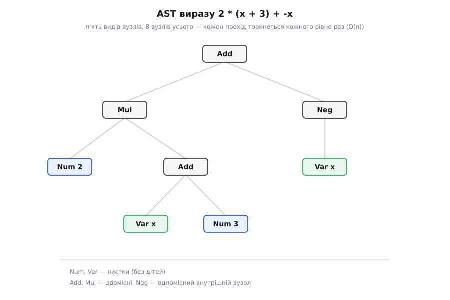
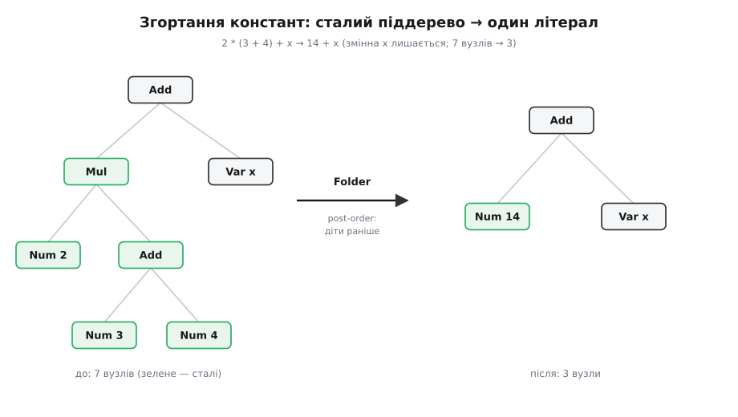

# ⚙️ Дерево виразів і четверо відвідувачів

Візьмімо крихітну мову арифметики зі змінними: вираз `2 * (x + 3) + -x`. Розібраний, він живе у пам'яті як дерево — [абстрактне синтаксичне дерево](root:sf-lang/abstract-syntax-tree), де кожен вузол відповідає одній синтаксичній формі, а діти вузла — його підвирази. Наша мова тримається на п'яти видах вузлів: `Num` — число-літерал, `Var` — ім'я змінної, `Add` і `Mul` — двомісні дії, `Neg` — унарний мінус. Будь-який вираз цієї мови — дерево, складене лише з цих п'яти цеглинок, і нічого шостого нам не знадобиться.

А от **робіт** над таким деревом хочеться дедалі більше. Спершу — обчислити значення, підставивши число замість `x`. Потім — надрукувати дерево назад рядком, і то з мінімальними дужками, а не з хащею `(((…)))`. Далі — порахувати, скільки в ньому вузлів. Тоді — згорнути сталі підвирази (щоб `2 * (3 + 4)` перетворилося на `14` ще до запуску). А за ними чекають генерація коду, перевірка типів, підрахунок глибини… Набір вузлів стоїть, набір операцій росте без кінця — і саме це співвідношення робить дерево виразів канонічним домом відвідувача. Зберімо чотири такі операції як чотири відвідувачі над одним деревом, проженімо їх на конкретному виразі, а тоді на власні очі побачимо, як ціна змін перевертається, щойно ми чіпаємо не операцію, а сам набір вузлів.

## Підклад: вузли й обв'язка accept/visit

Спершу — контракт. Вузли вміють єдину річ: «прийняти відвідувача» методом `accept`, який тут-таки кличе назад той його метод, що відповідає саме цьому виду вузла. Відвідувач, дзеркально, має по методу на кожен вид вузла. Обидва інтерфейси параметризуємо типом результату `R` — бо обчислювач поверне число, друкар — рядок, а оптимізатор — узагалі нове дерево, і жодних зведень типів це коштувати не має:

:::tabs
:::code proj-visitor-ast/ts/pidklad-vuzly-i-obviazka.ts
:::code proj-visitor-ast/py/pidklad-vuzly-i-obviazka.py
:::

Кожен `accept` — це один рядок: «я знаю, який я вузол, тож кличу свій метод у відвідувача». Виклик `expr.accept(v)` спершу диспетчеризується за справжнім типом вузла (у, скажімо, `Mul.accept`), а вже той упевнено кличе `v.visitMul(this)`, диспетчеризуючись удруге — за справжнім типом відвідувача. Два віртуальні виклики поспіль обрали метод за двома типами; прийом зветься подвійною диспетчеризацією, і тут ми ним просто користуємося, як готовим інструментом. Уся інша вага статті — не в цих п'яти рядках `accept`, а в тому, що ми над цим підкладом збудуємо.

## Хто веде обхід

Перш ніж писати операції, треба відповісти на питання, від якого залежить увесь код: **хто крокує деревом углиб?** Вузли самі по собі нікуди не спускаються — `Add.accept` лише передає себе відвідувачеві й на тому все. Отже, спуск у дітей мусить хтось ініціювати, і в нашій схемі це роблять **самі методи `visit`**: тіло `visitAdd` кличе `e.left.accept(this)` та `e.right.accept(this)`, передаючи того самого відвідувача (`this`) далі вниз. Спуск, таким чином, іде **через `accept`** — на кожному рівні дерева подвійна диспетчеризація спрацьовує знову, — а веде його відвідувач. Це і є [рекурсія](root:sf-algorithms/recursion), розкладена по методах `visit`.

Чому не інакше — чому б не змусити `accept` самому спершу обійти дітей, а тоді покликати відвідувача, сховавши обхід у структуру? Бо тоді **всі** операції обходили б дерево однаково й — головне — однаково склеювали б результати дітей, а вони цього не хочуть. Обчислювач додає значення лівого й правого піддерева; друкар склеює їхні рядки через « + » і, можливо, дужки; лічильник бере суму дитячих лічб і додає одиницю; оптимізатор із двох перероблених піддерев будує новий вузол. Кожна операція комбінує результати дітей **по-своєму**, тож саме місце цієї комбінації — тіло `visit` — і мусить тримати рекурсію. Тому відповідь однозначна: обхід веде відвідувач, спускаючись у дітей через їхній `accept`. (Форма, де `accept` сам передобходить дітей, лягає лише для пасивних проходів, що нічого не повертають, — наприклад, чистого друку в потік з побічним ефектом; наші чотири операції не такі.)

## Чотири операції — чотири класи

Тепер кожна операція — окремий клас, у якому зібрані всі гілки за видами вузлів. Почнімо з двох найпростіших — обчислювача й лічильника.

**Обчислювач** повертає число. Єдина тонкість — `Var`: щоб дати змінній значення, потрібне **середовище** (англ. *environment*), таблиця «ім'я → число». Незв'язана змінна — це помилка, і чесніше впасти з нею, ніж мовчки підставити нуль:

:::tabs
:::code proj-visitor-ast/ts/chotyry-operatsii-chotyry.ts
:::code proj-visitor-ast/py/chotyry-operatsii-chotyry.py
:::

**Лічильник** повертає кількість вузлів у піддереві: лист — це один, а внутрішній вузол — одиниця плюс лічби дітей. Ту саму рекурсію, лише з іншим склеюванням («+1» замість арифметики):

:::tabs
```ts
class Counter implements ExprVisitor<number> {
  visitNum(e: Num): number { return 1; }
  visitVar(e: Var): number { return 1; }
  visitNeg(e: Neg): number { return 1 + e.arg.accept(this); }
  visitAdd(e: Add): number { return 1 + e.left.accept(this) + e.right.accept(this); }
  visitMul(e: Mul): number { return 1 + e.left.accept(this) + e.right.accept(this); }
}
```
```py
class Counter(ExprVisitor):
    def visit_num(self, e): return 1
    def visit_var(self, e): return 1
    def visit_neg(self, e): return 1 + e.arg.accept(self)
    def visit_add(self, e): return 1 + e.left.accept(self) + e.right.accept(self)
    def visit_mul(self, e): return 1 + e.left.accept(self) + e.right.accept(self)
```
:::

**Гарний друкар** цікавіший. Наївний варіант — обгортати кожну дію в дужки — дає нечитабельне `((2 * (x + 3)) + (-x))`. Ми хочемо мінімум дужок: ставити їх лише там, де без них дерево прочиталося б інакше. А це залежить від **пріоритету** дій: множення чіпкіше за додавання, унарний мінус — ще чіпкіший. Дужки потрібні тоді, коли дитина слабша за те місце, куди її вставляють: `x + 3` під множенням треба взяти в дужки (`2 * (x + 3)`), а `2 * x` під додаванням — ні (`2 * x + 3`).

Щоб друкар знав, чи слабша дитина, кожен `visit` повертає не голий рядок, а **пару**: сам текст і пріоритет його кореня. Це той випадок, коли `R` вигідно зробити багатшим за «очевидну відповідь»: батько отримує від дитини і рядок, і число, за яким вирішує, чи брати її в дужки. Пріоритети: атом (`Num`, `Var`) — 4, `Neg` — 3, `Mul` — 2, `Add` — 1.

:::tabs
:::code proj-visitor-ast/ts/chotyry-operatsii-chotyry-2.ts
:::code proj-visitor-ast/py/chotyry-operatsii-chotyry-2.py
:::

**Оптимізатор** — згортання констант (англ. *constant folding*), класична [оптимізація компілятора](root:sf-lang/compiler-optimizations): де обидва операнди вже сталі, порахувати їх наперед і замінити піддерево готовим числом. Цей відвідувач унікальний тим, що повертає `R = Expr` — **нове дерево**, а не число чи рядок. Ключ — обробляти дітей **першими** (post-order): коли `visitAdd` дивиться на своїх дітей, вони вже згорнуті, тож досить перевірити, чи не стали вони обидва `Num`. Заразом підбираємо кілька алгебричних тотожностей — `x + 0`, `x * 1`, `x * 0`:

:::tabs
:::code proj-visitor-ast/ts/chotyry-operatsii-chotyry-3.ts
:::code proj-visitor-ast/py/chotyry-operatsii-chotyry-3.py
:::

Тут `instanceof Num` — не той заборонений розбір за типом, від якого тікає відвідувач. Він не питає «котрий із п'яти видів переді мною?» (це досі робить `accept`/`visit`), а лише вузьке «а чи згорнулася дитина до літерала?» — так/ні. Дистпетч по сім'ї типів лишається на подвійній диспетчеризації; `instanceof` тут — локальна перевірка одного факту.

## Прогін на конкретному дереві

Зберімо наш вираз і проженімо всіх чотирьох. `2 * (x + 3) + -x` — це дерево з восьми вузлів:

:::tabs
```ts
const e: Expr = new Add(
  new Mul(new Num(2), new Add(new Var("x"), new Num(3))),
  new Neg(new Var("x")),
);

e.accept(new Evaluator({ x: 5 }));   // 11
e.accept(new Printer()).text;        // "2 * (x + 3) + -x"
e.accept(new Counter());             // 8
```
```py
e = Add(
    Mul(Num(2), Add(Var("x"), Num(3))),
    Neg(Var("x")),
)

e.accept(Evaluator({"x": 5}))    # 11
e.accept(Printer())[0]           # "2 * (x + 3) + -x"
e.accept(Counter())              # 8
```
:::



*П'ять видів вузлів, вісім вузлів усього. Кожен прохід торкнеться кожного вузла рівно раз.*

Простежмо обчислювача з `x = 5`, і подвійна диспетчеризація перестане бути абстракцією. Корінь — `Add`, тож `visitAdd` кличе `accept` на лівому й правому піддереві. Ліве — `Mul`: воно множить `2` на результат внутрішнього `Add`, а той додає `x` (тобто `5`) і `3`, даючи `8`; отже, `Mul` повертає `2 · 8 = 16`. Праве — `Neg` над `Var x`: `−5`. Корінь складає: `16 + (−5) = 11`. Значення повертаються знизу вгору, у порядку post-order — діти раніше за батька:


*Обчислювач із x = 5: кожен visit повертає число вгору. Вісім вузлів — вісім викликів visit, жодного зайвого проходу.*

Ось звідки береться **складність**. Кожен вузол приймає відвідувача рівно раз, кожен `visit` робить сталу роботу (плюс склеювання результатів дітей) — тож повний прохід коштує **O(n)** за кількістю вузлів `n`. Лічильник це підтверджує буквально: `8`. Друкар видав `2 * (x + 3) + -x` — мінімальні дужки: `x + 3` під множенням узято в дужки, а `2 * (x + 3)` під додаванням — уже ні, бо множення й так чіпкіше.

Оптимізатор на цьому виразі нічого не змінить: `x` — вільна змінна, сталих піддерев тут немає. Тож дамо йому поживу — вираз `2 * (3 + 4) + x`:

:::tabs
```ts
const g: Expr = new Add(new Mul(new Num(2), new Add(new Num(3), new Num(4))), new Var("x"));
g.accept(new Folder());              // Add(Num 14, Var x)
g.accept(new Folder()).accept(new Printer()).text;   // "14 + x"
```
```py
g = Add(Mul(Num(2), Add(Num(3), Num(4))), Var("x"))
g.accept(Folder())                          # Add(Num 14, Var x)
g.accept(Folder()).accept(Printer())[0]     # "14 + x"
```
:::

Піддерево `3 + 4` згорнулося у `7`, тоді `2 * 7` — у `14`, а `x` лишився недоторканим: сім вузлів стали трьома. Згортання не творить чудес — воно прибирає лише те, що справді стале:



*Оптимізатор — єдиний із чотирьох, хто повертає нове дерево. Сталий кущ згортається в один літерал; змінна лишається.*

Якби ми додали ще й `-(x * 0)`, тобто взяли `2 * (3 + 4) + -(x * 0)`, згортання дійшло б до кінця: `x * 0 → 0`, `-0 → 0`, `14 + 0 → 14` — усе дерево з десяти вузлів сплюснулося б в один-єдиний `Num 14`. І все це — за **один** прохід: оскільки дітей згортаємо перш ніж батька, до моменту, коли `visitAdd` дивиться на своїх, вони вже максимально згорнуті. Другого проходу для нашої граматики не треба.

## Асиметрія ціни наживо

Тепер — заради чого відвідувача й затіяно. Покрутімо корбу в обидва боки й подивімося, чого коштує кожна зміна.

**Нова операція.** Скомпілюймо вираз у програму для **стекової машини** — списку інструкцій `push`/`load`/`add`/`mul`/`neg`, які по черзі кладуть числа на стек і згортають його вершину. Це рівно те, у що компілюють вирази справжні [байткодові віртуальні машини](root:sf-lang/bytecode-vm), і виходить це відвідувачем настільки прямо, що аж дивно:

:::tabs
:::code proj-visitor-ast/ts/asymetriia-tsiny-nazhyvo.ts
```py
class Compiler(ExprVisitor):
    def visit_num(self, e): return [("push", e.value)]
    def visit_var(self, e): return [("load", e.name)]
    def visit_neg(self, e): return e.arg.accept(self) + [("neg",)]
    def visit_add(self, e): return e.left.accept(self) + e.right.accept(self) + [("add",)]
    def visit_mul(self, e): return e.left.accept(self) + e.right.accept(self) + [("mul",)]

e.accept(Compiler())
# [('push', 2), ('load', 'x'), ('push', 3), ('add',), ('mul',), ('load', 'x'), ('neg',), ('add',)]
```
:::

Проженімо цей список на стеку з `x = 5`: `push 2` → `[2]`, `load x` → `[2, 5]`, `push 3` → `[2, 5, 3]`, `add` → `[2, 8]`, `mul` → `[16]`, `load x` → `[16, 5]`, `neg` → `[16, −5]`, `add` → `[11]`. Вершина — `11`, тобто рівно те, що дав обчислювач: два різні відвідувачі над одним деревом дійшли одного числа. І — головне — щоб додати компілятор, ми **не відкрили жодного класу вузла**. `Num`, `Var`, `Add`, `Mul`, `Neg` стоять недоторкані; наявні відвідувачі теж. Нова операція приїхала одним новим файлом. Дешево.

**Новий тип вузла.** А тепер додаймо ділення `Div`:

```ts
class Div implements Expr {
  constructor(readonly left: Expr, readonly right: Expr) {}
  accept<R>(v: ExprVisitor<R>): R { return v.visitDiv(this); }   // ← методу visitDiv ще немає
}
```

Сам клас написати легко — але його `accept` кличе `v.visitDiv(this)`, а такого методу в `ExprVisitor` **немає**. Щойно ми додамо його в інтерфейс, компілятор TypeScript почервоніє в **п'яти** місцях одразу: `Evaluator`, `Printer`, `Counter`, `Folder`, `Compiler` — кожен перестане реалізовувати контракт, доки не отримає власний `visitDiv`. Один новий тип вузла прокотився по **всіх** наявних відвідувачах:

```ts
interface ExprVisitor<R> { /* … */ visitDiv(e: Div): R; }         // +1 рядок у контракті

// і по одному методу в КОЖЕН із п'яти відвідувачів:
// Evaluator: const d = e.right.accept(this); if (d === 0) throw new Error("ділення на нуль"); return e.left.accept(this) / d;
// Printer:   { text: this.wrap(l, 2) + " / " + this.wrap(r, 3), prec: 2 }   // праворуч потрібен вищий поріг!
// Counter:   return 1 + e.left.accept(this) + e.right.accept(this);
// Folder:    if (r instanceof Num && r.value === 0) return new Div(l, r);   // на нуль НЕ згортаємо
// Compiler:  return [...e.left.accept(this), ...e.right.accept(this), { op: "div" }];
```

І `Div` не просто механічний — він оголює, що в кожному відвідувачі логіка **своя**. Обчислювач мусить стерегтися ділення на нуль. Оптимізатор — не сміти згортати `x / 0`. А друкар натикається на тонку пастку: ділення, на відміну від додавання й множення, **не асоціативне**, тож правий операнд треба брати в дужки навіть за рівного пріоритету — `a / (b * c)` і `a / (b / c)` не те саме, що `a / b * c`. Тому праворуч від `/` поріг дужок вищий (`3`, а не `2`). П'ять різних дописувань, кожне зі своєю думкою, — ось у що обходиться один новий вузол.

Це і є **[проблема вираження](root:sf-apps/expression-problem)** у чистому вигляді: базовими засобами ООП не можна зробити дешевими **обидві** осі росту заразом. Відвідувач обрав бік — дешева нова операція ціною дорогого нового типу. Тішить одне: «дорого» тут означає не «тихо забув десь обробити `Div`», а список помилок компіляції, який просто закриваєш пункт за пунктом. Ціну видно, і вона перевірена системою типів.

## Дуальний бік: сумарний тип і зіставлення зі зразком

Уся ця церемонія `accept`/`visit` — це спосіб зімітувати одну конструкцію в мові, де її немає: **сумарний тип** (одне з кількох, англ. *sum type*) плюс **зіставлення зі зразком** (англ. *pattern matching*). Там, де ця пара рідна — як у Rust, — відвідувач не потрібен зовсім: вузол стає варіантом переліку, а операція — звичайною функцією з `match` за видом вузла:

:::code proj-visitor-ast/rust/main.rs

Функція `eval` в одному тілі обробляє всі п'ять видів — це достеменно наш `Evaluator`, лише замість інтерфейсу `ExprVisitor` і п'яти `visit`-методів тут одна конструкція мови. І тягар — дзеркально той самий. Додати операцію (`print`, `compile`) — це нова `fn`, що не чіпає жодного типу: дешево. А додати варіант `Div` — і компілятор Rust відмовиться збирати проєкт, підсвітивши **кожен** `match` як неповний, доки той не отримає гілку `Expr::Div`. Та сама асиметрія «легко операції, важко типи», лише перевірку повноти тут дає мова задарма — тоді як у нашій OO-версії ту саму роль грає інтерфейс, а кожне `implements` перевіряється замість кожного `match`.

Тобто відвідувач і «сумарний тип + `match`» стоять на **одному** боці проблеми вираження — обидва роблять операції дешевими, а типи дорогими. Різниця лише в тому, що перше — ручна імітація другого для мов без сумарних типів. Про самі сумарні типи, на яких стоїть цей дуальний погляд, — у статті [типи як дизайн](root:sf-apps/type-driven-design).

## Складність і пастки

- **Час — O(n), пам'ять — O(h).** Кожен прохід торкається кожного з `n` вузлів рівно раз зі сталою роботою на вузлі. Але рекурсія витрачає стек углиб дерева: **O(h)**, де `h` — висота. Для збалансованого дерева `h ≈ log n`, а от для виродженого — довгого ланцюга `a + a + a + … + a` — `h ≈ n`, і на дуже глибокому виразі рекурсивний відвідувач може переповнити стек. Ліки — явний власний стек замість рекурсії викликів, ціною громіздкішого коду.
- **Дужки друкаря — це пріоритет І асоціативність.** Мінімальні дужки вимагають повертати пріоритет угору (багатший `R`, ніж «просто рядок»). А для неасоціативних чи ліво-асоціативних дій — ділення, віднімання — правому операндові треба **вищий** поріг, ніж лівому, інакше друк спотворить структуру дерева. Наші `Add` і `Mul` асоціативні, тож нам це зійшло з рук; `Div` одразу нагадав.
- **Оптимізатор мусить будувати нове дерево, а не правити старе.** `Folder` повертає нові вузли, лишаючи вхідне дерево цілим — це [незмінність](root:sf-apps/immutability) у дії. Мутувати на місці спокусливо, але небезпечно: на те саме дерево можуть посилатися інші, та й спільні піддерева (див. нижче) мутація зіпсує. Порядок post-order при цьому гарантує повне згортання за один прохід — діти готові раніше за батька.
- **Відвідувач припускає дерево, а не граф.** Якщо піддерево **спільне** (на один вузол вказують два батьки — це вже орієнтований ациклічний граф), відвідувач обійде його двічі: лічильник подвоїть лік, а прохід із побічним ефектом — подвоїть ефект. Хочеш обробляти графи — запам'ятовуй уже пройдені вузли за їхньою тотожністю (мемоізація).
- **Забута рекурсія тиха.** Оскільки спуск веде відвідувач, у кожному `visit` над внутрішнім вузлом треба **не забути** покликати `accept` на дітях. Забудеш — прохід мовчки обробить лише корінь і поверне неповний результат, без жодної помилки. Це плата за те, що кожна операція сама керує обходом.

Відвідувач окупається саме тут: п'ять видів вузлів усталені, а проходів над деревом — обчислити, надрукувати, порахувати, згорнути, скомпілювати — п'ять, і буде більше. Поки набір вузлів стоїть, кожна нова операція коштує один новий клас збоку. Щойно ж набір вузлів почне рости щотижня — відвідувач із помічника обернеться на тягар, і чесніше буде або мова із сумарними типами, або звичайні методи в самих вузлах.
