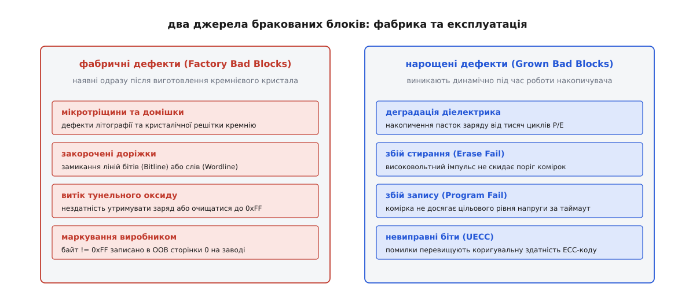
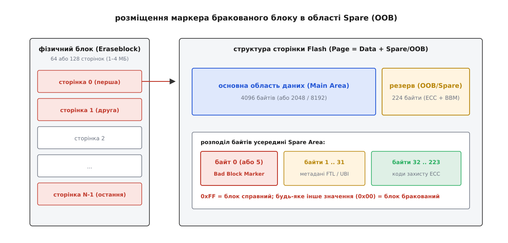
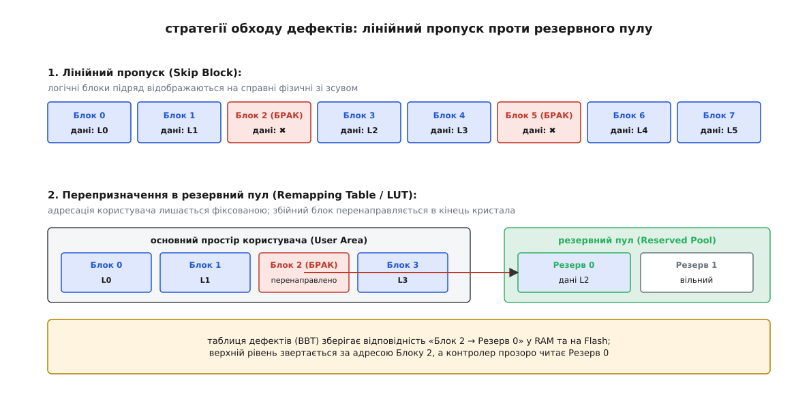
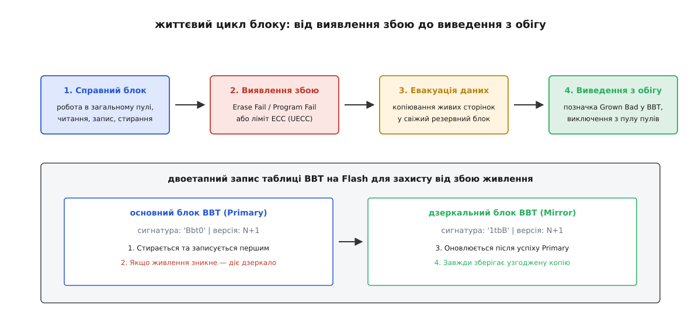

# Управління бракованими блоками NAND Flash

<preknowlist>
- [Фізика та будова Flash-пам'яті](root:hw-components/flash-internals) — сторінки, блоки, оксидна ізоляція та несиметричність читання й стирання.
- [Зношування комірок і wear leveling](root:sf-data/wear-leveling) — обмежений ресурс P/E циклів, деградація діелектрика плаваючого затвора.
- [Шар трансляції флешу (FTL)](root:sf-data/ftl-flash-translation) — відображення логічних адрес LBA на фізичні сторінки та блоки.
- [ECC і виявлення помилок](root:sf-data/ecc-memory) — виправлення бітових спотворень та синдромне декодування.
</preknowlist>

Сучасний кремнієвий кристал NAND Flash місткістю 64 гігабайти містить 32 768 фізичних блоків стирання. Одразу після виходу з літографічної фабрики від одного до двох відсотків цих блоків — тобто від 300 до 650 штук — є фізично непрацездатними: вони не здатні надійно утримувати електричний заряд у плаваючому затворі або не реагують на імпульси стирання через мікроскопічні вади кристалічної решітки. Якщо контролер або операційна система проігнорує цю фізичну реальність і спробує записати системні таблиці послідовно у фізичні блоки 0, 1, 2, 3, накопичувач натрапить на дефект на перших же мегабайтах, що спричинить невиправне пошкодження файлової системи та повну відмову пристрою під час першого ввімкнення.

На відміну від оперативної пам'яті DRAM або пам'яті програм NOR Flash, де наявність хоча б однієї пошкодженої комірки бракує весь чип, технологія NAND спочатку спроєктована в розрахунку на неідеальність напівпровідникового кристала. Здатність накопичувача функціонувати роками без втрати даних спирається на програмно-апаратну підсистему, яка виявляє пошкоджені ділянки, ізолює їх від операційної системи та прозоро перенаправляє потоки запису на справні резервні ділянки кремнію.

---

### Природа дефектів: фабричний брак проти експлуатаційного зносу

Усі пошкоджені блоки у масиві NAND поділяються на дві принципово різні категорії за часом та фізичними причинами їх виникнення.


*Фабричні дефекти виникають на етапі літографії та хімічного травлення кремнію; експлуатаційні дефекти накопичуються динамічно внаслідок деградації оксидного діелектрика під час тисяч високовольтних циклів програмування та стирання.*

Першу категорію складають **первинні або фабричні браковані блоки** (англ. *Factory Bad Blocks* або *Initial Bad Blocks*). Вони виникають безпосередньо у процесі вирощування кремнієвого злитка, фотолітографічного нанесення шарів та нарізання пластини на окремі кристали. 

Фізичною основою фабричного браку є:
1. **Кристалічні дислокації** (лат. *dislocatio* — зміщення, від *dis-* — нарізно та *locare* — розташовувати) — зсуви атомних площин у кристалі кремнію, що створюють паразитні шляхи витоку струму між суміжними транзисторами.
2. **Короткі замикання та обриви провідників** — субмікронні дефекти металізації, які закорочують сусідні вертикальні лінії бітів (Bitline) або горизонтальні лінії керуючих затворів (Wordline).
3. **Локальні дефекти тунельного оксиду** — ділянки підзатворного діелектрика товщиною менше ніж 8 нанометрів із високою концентрацією сторонніх хімічних домішок, крізь які заряд плаваючого затвора витікає практично миттєво.
4. **Неоднорідність легування каналу** — локальні флуктуації концентрації домішок, через які порогова напруга транзистора зміщується за межі робочого діапазону схеми зчитування.

Цей стан називають **дефектом** (лат. *defectus* — вада, недолік, від *deficere* — бракувати, слабшати). Фабрика тестує кристал екстремальними напругами, знаходить усі неробочі блоки та маркує їх спеціальним кодом перед фінальним пакуванням у корпус. Подробиці того, як цей компроміс уперше дозволив знизити вартість твердотільної пам'яті на порядок, висвітлено в [історії компромісу між виходом придатних кристалів та алгоритмічним контролем браку](root:sf-data/bad-block-management/hist-nand-tolerance.md).

Другу категорію складають **нарощені або експлуатаційні браковані блоки** (англ. *Grown Bad Blocks* або *Operational Bad Blocks*). Це ділянки пам'яті, які зійшли з конвеєра повністю справними, але втратили працездатність під час експлуатації накопичувача. 

Причиною є поступова **деградація** (лат. *degradatio* — зниження щабля, від *de-* — вниз та *gradus* — крок, ступінь) тунельного діелектрика:
- Кожен цикл програмування та стирання (P/E cycle) змушує електрони тунелювати крізь оксидний бар'єр під дією сильного електричного поля понад 15–20 вольтів за квантовомеханічним механізмом Фаулера-Нордгейма.
- Високоенергетичні електрони поступово руйнують міжатомні зв'язки `Si-O` в діелектрику, створюючи стійкі пастки заряду (англ. *electron traps*).
- Виникає явище струму витоку, індукованого напругою (SILC, англ. *Stress-Induced Leakage Current*): пастки утворюють провідні ланцюжки, крізь які накопичений заряд поступово стікає з плаваючого затвора навіть за кімнатної температури.
- З часом розвивається часовий пробій діелектрика (TDDB, англ. *Time-Dependent Dielectric Breakdown*): провідний місток стає незворотним, після чого комірка перестає реагувати на імпульси стирання або створює масив бітових помилок, кількість яких перевищує виправну здатність [блока корекції помилок ECC](root:sf-data/ecc-memory).

---

### Порівняння 2D Planar та 3D Charge Trap Flash

Фізика виникнення дефектів помітно відрізняється залежно від просторової топології кристала.

У класичній планарній пам'яті (2D Planar NAND) комірки розташовані в одній площині, а затвор є ізольованим полікремнієвим провідником (Floating Gate). Через зменшення техпроцесу до 15 нм відстань між затворами скоротилася настільки, що ємнісне наведення сусідніх комірок (англ. *cell-to-cell crosstalk*) викликало катастрофічний ріст дефектів утримання заряду.

У сучасній об'ємній пам'яті (3D V-NAND / BiCS) комірки будуються вертикальними циліндричними колонами (від 64 до 232 шарів), а плаваючий затвор замінено пастковим діелектриком (Charge Trap Flash, шар нітриду кремнію `Si3N4`). Товщина тунельного оксиду тут більша, що знижує витоки заряду. Проте 3D-архітектура породила новий клас дефектів:
- **Нерівномірність вертикального травлення:** отвори діаметром 100 нм протравлюються на глибину до кількох мікрометрів (аспектне співвідношення понад 60:1), через що верхні та нижні шари колони мають різну товщину стінок і різну швидкість зносу.
- **Замикання шарів Wordline:** мікротріщини в ізоляції між горизонтальними шарами призводять до виходу з ладу цілих площин (Planes).

---

### Анатомія сторінки Flash і маркування браку в OOB

Щоб програмне забезпечення верхнього рівня могло відрізнити заводський дефект від справного масиву комірок, кожен виробник чипів використовує виділений службовий простір сторінки.

Фізична сторінка NAND Flash складається з двох суміжних областей:
1. **Основна область даних (Main Area):** призначена для зберігання корисного навантаження файлової системи (типово 2048, 4096, 8192 або 16384 байти).
2. **Службова область (Spare Area або Out-Of-Band, OOB):** додаткові байти наприкінці сторінки (від 64 до 448 байтів), що використовуються апаратним контролером для збереження контрольних сум ECC, метаданих логічної адресації та маркерів браку.


*Кожен фізичний блок складається з десятків сторінок. Маркер заводського браку записується у перший байт області Spare (OOB) нульової або першої сторінки блоку. Значення 0xFF свідчить про справність; значення 0x00 позначає брак.*

У повністю стертому, неушкодженому блоці Flash усі комірки знаходяться в логічному стані `1`. Відповідно, будь-яке зчитування даних зі справного порожнього блоку повертає байти зі значенням `0xFF`.

Виробники мікросхем (Micron, Kioxia, Samsung, SK Hynix, Western Digital) дотримуються жорсткого стандарту: якщо блок визнано фабрично дефектним, тестовий стенд заводу записує значення `0x00` (або будь-яке значення, відмінне від `0xFF`) у перший байт області Spare (`Offset 0` всередині OOB) для **сторінки 0** або **сторінки 1** даного блоку (а на деяких архітектурах MLC/TLC — також для останньої сторінки блоку `N-1`).

Таке дублювання на кількох сторінках є життєво необхідним. У багатошарових структурах 3D NAND або комірках MLC/TLC дефект може проявлятися асиметрично: наприклад, сторінка 0 має пошкоджену нижню лінію слів і читається як `0x00`, тоді як через паразитний ємнісний зв'язок випадковий шукач міг би помилитися. Тому алгоритм сканування зобов'язаний перевіряти як мінімум дві граничні сторінки кожного блоку.

> ⚠️ **Критична помилка ініціалізації: фатальне стирання (Blind Chip Erase).**
> Якщо розробник низькорівневого драйвера або утиліти програмування запустить операцію масового апаратного стирання чипа (Chip Erase / Block Erase) до того, як прочитає та збереже заводські маркери OOB, високовольтний імпульс подасть напругу на всі блоки без винятку. 
> Навіть у дефектному блоці більшість комірок під дією сильного поля перейдуть у стан `1`, а байт маркера перетвориться з `0x00` на `0xFF`. Заводське маркування буде **знищено назавжди**. Накопичувач сприйматиме фізично непридатний кремній як ідеально справний, доки перший реальний запис не завершиться раптовою втратою інформації.

---

### Побудова та структура таблиці дефектних блоків (BBT)

Опитувати область OOB кожного фізичного блоку через зовнішню шину під час кожної операції введення-виведення неприпустимо повільно: операція читання OOB триває від 25 до 75 мікросекунд на сторінку, що для масиву на 4096 блоків створило б затримку монтування понад 300 мілісекунд.

Тому під час першого старту пристрою або під час заводської прошивки драйвер виконує одноразове первинне сканування кристала та будує компактну структуру даних у пам'яті — **таблицю бракованих блоків** (BBT, англ. *Bad Block Table*).

Кожен фізичний блок у таблиці кодується рівно двома бітами:

| Бітовий стан (`b1 b0`) | Числове значення | Семантичний стан блоку | Опис поведінки драйвера |
|---|---|---|---|
| `00b` | `0` | **Factory Bad** | Заводський брак, виявлений під час сканування OOB. Блок назавжди ізольовано. |
| `01b` | `1` | **Reserved** | Блок зарезервовано для службових потреб (збереження BBT або резервний пул заміни). |
| `10b` | `2` | **Grown Bad** | Експлуатаційний збій (помилка стирання, запису або ліміт ECC під час роботи). |
| `11b` | `3` | **Good Block** | Повністю справний блок, відкритий для розподілу даних. |

Чому саме 2 біти? Це забезпечує максимальну компактність у RAM. Для чипа на 4096 блоків:

```
Розмір бітової карти = (4096 блоків × 2 біти) ÷ 8 біт/байт
                     = 8192 біти ÷ 8
                     = 1024 байти (рівно 1 КБ оперативної пам'яті)
```

Такий підхід дозволяє розмістити стан усього накопичувача в крихітному буфері навіть на найпростіших мікроконтролерах із суворим обмеженням оперативної пам'яті.

#### Збереження BBT у постійній пам'яті (On-Flash Persistent BBT)

Щоб не повторювати сканування OOB під час кожного завантаження системи, сформовану таблицю BBT записують безпосередньо у саму флеш-пам'ять. Для цього виділяють останні справні блоки кристала.

Щоб захистити саму таблицю від раптового зникнення живлення (англ. *sudden power loss*) під час її оновлення, використовують **дзеркальну пару блоків**:
1. **Основний блок BBT (Primary BBT):** починається з магічної сигнатури `"Bbt0"` (байти `0x42, 0x62, 0x74, 0x30`) та 8-бітного лічильника версії `Version`.
2. **Дзеркальний блок BBT (Mirror BBT):** починається з сигнатури `"1tbB"` (байти `0x31, 0x74, 0x62, 0x42`) та власного лічильника версії.

```
Алгоритм оновлення On-Flash BBT:
1. Зафіксувати зміни в оперативній пам'яті (RAM).
2. Інкрементувати версію: NewVersion = CurrentVersion + 1.
3. Стерти блок Primary BBT і записати оновлену таблицю з сигнатурою "Bbt0" та NewVersion.
4. Якщо запис успішний — стерти Mirror BBT і записати ту саму таблицю з сигнатурою "1tbB" та NewVersion.
5. При завантаженні: драйвер читає обидва блоки, перевіряє цілісність контрольних сум (CRC)
   і вибирає копію з більшим номером версії.
```

Якщо живлення зникне в момент стирання або запису основного блоку, дзеркальний блок збереже попередню узгоджену версію таблиці, запобігаючи руйнуванню накопичувача.

---

### Стратегії ізоляції та перепризначення браку

Знати, які блоки дефектні — лише половина задачі. Необхідно надати вищому програмному рівню (файловій системі або блоковому драйверу) суцільний, неперервний логічний простір адрес, повністю приховавши наявність дірок у фізичному масиві.

Для цього застосовують три класичні інженерні стратегії.


*При лінійному пропуску (вгорі) логічні блоки зсуваються повз дефектні ділянки, що руйнує фіксовані межі розділів; при перепризначенні в пул (внизу) адресація користувача лишається фіксованою, а збійні блоки перенаправляються в кінець чипа.*

#### 1. Лінійний пропуск (Skip Block Method)

Найпростіший метод, характерний для первинних завантажувачів мікроконтролерів (наприклад, U-Boot SPL):
- Драйвер транслює логічний блок `i` у перший зустрінутий справний фізичний блок.
- Якщо фізичний блок `k` виявляється дефектним, драйвер просто інкрементує фізичний лічильник і записує дані в блок `k + 1`.

*Переваги:* не потребує таблиць трансляції в RAM, алгоритм займає кількадесят байтів коду асемблера.  
*Недоліки:* виникнення дефекту під час роботи (Grown Bad Block) вимагає зсуву абсолютно всіх наступних блоків розділу, що робить динамічне оновлення неможливим. Метод придатний лише для статичних образів завантажувача та ядер ОС.

#### 2. Перепризначення в резервний пул (Reserved Pool Remapping / LUT)

Кристал ділиться на дві нерівні зони:
- **Зона користувача (User Data Area):** перші `N_USER` блоків (наприклад, 95–98% ємності).
- **Резервний пул (Reserved Area Pool):** останні `N_RESERVED` блоків (2–5% ємності).

Драйвер підтримує таблицю відповідностей (LUT, англ. *Look-Up Table*). Якщо блок у зоні користувача справний, запит іде напряму: `PhysicalBlock = UserBlock`. Якщо ж блок `B_bad` у зоні користувача є бракованим, драйвер виділяє вільний фізичний блок `B_spare` з резервного пулу та фіксує запис `B_bad -> B_spare` у таблиці ремапінгу.

*Переваги:* логічні адреси користувача залишаються фіксованими, геометрія розділів не змінюється при появі нових збоїв.

#### 3. Динамічний FTL-пул і віртуалізація UBI

У повноцінних SSD, картах пам'яті та накопичувачах eMMC/UFS управління браком повністю інтегровано в [шар трансляції флешу (FTL)](root:sf-data/ftl-flash-translation). У такій системі поняття фіксованої прив'язки відсутнє взагалі:
- Усі фізичні блоки об'єднані в єдиний глобальний пул вільних блоків (Free Block Pool).
- Коли операція [збирання сміття (Garbage Collection)](root:sf-data/flash-garbage-collection) або запису виявляє збій у блоці, цей фізичний блок просто позначається як `Retired/Bad` у службовій таблиці станів і ніколи більше не повертається у вільний пул.
- Дані негайно записуються у будь-який інший вільний фізичний блок із пулу, а таблиця L2P (Logical-to-Physical) оновлює відповідний логічний покажчик.

В операційних системах Linux для "сирих" чипів NAND без вбудованого контролера аналогічну функцію виконує шар **UBI (Unsorted Block Images)**. UBI транслює фізичні блоки стирання (PEB, *Physical Eraseblock*) у логічні блоки стирання (LEB, *Logical Eraseblock*), прозоро поглинаючи як фабричні дефекти, так і експлуатаційний брак.

Підсистема UBI записує у кожну першу сторінку фізичного блоку заголовок лічильника стирань (EC Header, англ. *Erase Counter Header*), а в другу сторінку — заголовок ідентифікатора тому (VID Header, англ. *Volume Identifier Header*). Якщо під час монтування розділу UBI виявляє, що блок марковано як збійний у MTD, він просто виключає даний PEB з глобальної карти та виділяє для відповідного LEB інший неушкоджений фізичний блок.

#### Поведінка SLC-кешу у багаторівневих масивах TLC/QLC
У сучасних SSD контролер динамічно переводить частину фізичних блоків у режим псевдо-SLC (запис лише 1 біта на комірку замість 3 або 4) для швидкого прийому вхідного потоку даних. Навантаження на діелектрик у режимі SLC значно менше, тому дефекти в таких блоках виникають рідше. Проте під час операції згортання (англ. *folding*), коли дані трьох SLC-блоків ущільнюються в один повноцінний TLC-блок, контролер проводить ретельну перевірку кількості бітових помилок. Якщо TLC-блок демонструє понад 80% допустимих помилок ECC під час первинного програмування, він негайно виводиться з експлуатації, запобігаючи втраті користувацьких файлів у майбутньому.

---

### Виявлення збоїв у реальному часі та життєвий цикл блоку

Дефектний блок рідко заявляє про себе повною електричною відмовою всього інтерфейсу. Найчастіше збій виявляється як відхилення від допустимих часових чи порогових характеристик під час виконання однієї з трьох базових операцій.


*Справний блок експлуатується у загальному пулі, доки операція стирання або запису не поверне апаратний прапорець FAIL, або кількість бітових помилок не перевищить ліміт ECC. Дані негайно евакуюються, блок маркується як Grown Bad у BBT і назавжди виводиться з обігу.*

Розгляньмо ланцюжок реакції драйвера на кожен тип помилки:

#### 1. Збій операції стирання (Erase Failure)
Під час виконання команди стирання блоку (`0x60 ... 0xD0`) внутрішній генератор чипа подає серію високовольтних імпульсів на підкладку. Після завершення контролер надсилає команду опитування статусу `0x70` (Read Status). Якщо **біт 0 (FAIL)** у регістрі стану дорівнює `1`, це означає, що поріг напруги частини комірок не опустився нижче контрольного рівня за відведений тайм-аут.
- *Дія:* Блок негайно оголошується `Grown Bad`. Оскільки стирання відбувається до запису нових даних, евакуація не потрібна — драйвер просто маркує блок у BBT і вибирає інший вільний блок.

#### 2. Збій операції програмування (Program Failure)
Під час запису сторінки (`0x80 ... 0x10`) комірки заряджаються ступінчастими імпульсами за алгоритмом ISPP (англ. *Incremental Step Pulse Programming*). Якщо біт `FAIL` регістра статусу встановлюється в `1`, комірка не змогла прийняти необхідний заряд.
- *Дія:* Частина сторінок блоку вже могла бути успішно записана раніше! Драйвер негайно виділяє свіжий резервний блок, копіює туди всі раніше записані сторінки з аварійного блоку, дописує поточну збійну сторінку та оновлює таблицю ремапінгу. Старий блок позначається як `Grown Bad`.

#### 3. Перевищення порогу помилок ECC (Bitflip Refresh & UECC)
Коли дані зчитуються зі сторінки, апаратний блок ECC виправляє помилки утримання заряду або наведення сусідніх комірок (Read/Program Disturb). 
- Якщо кількість спотворених бітів на сектор перевищує профілактичний поріг (наприклад, понад 75% від максимальної виправної здатності алгоритму BCH або LDPC), драйвер запускає фонове перенесення даних (англ. *Read Scrubbing*).
- Якщо ж виникає невиправна помилка (UECC, англ. *Uncorrectable ECC Error*), сектор вважається втраченим. Блок тестується циклом стирання/запису, і при повторному збої виводиться з експлуатації.

Повні сигнатури системних викликів ядра Linux, точні коди бітів регістрів ONFI та формати дескрипторів MTD деталізовано у [специфікації інтерфейсу BBM: регістри ONFI, зміщення OOB та дескриптори Linux MTD](root:sf-data/bad-block-management/api-nand-ecc-bbt.md).

---

### Програмна реалізація драйвера таблиці дефектів

Нижче наведено робочу реалізацію модуля управління дефектними блоками мовами C та C++. Модуль містить сканер заводських маркерів OOB, бітову карту станів (2 біти на блок), таблицю ремапінгу в резервний пул та процедуру динамічної заміни пошкодженого блоку.

:::tabs
:::code bad-block-management-d/c/main.c
:::code bad-block-management-d/cpp/main.cpp
:::

Повну архітектуру емулятора з обробкою раптових збоїв живлення та верифікацією CRC наведено у [проєкті драйвера керування дефектами NAND: сканування OOB, бітова карта та перепризначення в резервний пул](root:sf-data/bad-block-management/proj-bbt-remapper.md).

---

### Практика розробки та апаратні пастки

> 🔧 **Навіщо це в реальній розробці:**
> Робота з сирою NAND Flash (без вбудованого контролера) — класична задача для вбудованих пристроїв на базі Linux, RTOS (FreeRTOS, Zephyr) та завантажувачів U-Boot. Якщо не врахувати вимоги BBM, випуск першої ж партії пристроїв обернеться 100% поверненням браку через пошкоджені кореневі файлові системи.

П'ять золотих правил інженера під час роботи з NAND Flash:

1. **Завжди створюйте On-Flash BBT під час першої ініціалізації на стенді.** У ядрі Linux переконайтеся, що драйвер MTD увімкнув прапорець `NAND_BBT_USE_FLASH`. Це гарантує створення постійної таблиці `Bbt0`/`1tbB` у кінці кристала до початку будь-яких операцій запису користувача.
2. **Ніколи не застосовуйте команду повної очистки (Bulk Erase) у програматорі.** Програматори (J-Link, DediProg) мають спеціальний режим «Preserve Bad Block Markers». Якщо цей режим вимкнено, програматор зітре службову область, перетворивши фабричний брак на невидиму міну уповільненої дії.
3. **Блок 0 вимагає особливого захисту.** Стандарт ONFI гарантує, що фізичний блок 0 відвантажується з заводу без браку і витримує мінімум 1000 циклів без застосування ECC. Саме тому сюди розміщують первинний завантажувач (ROM Bootloader). Проте записувати туди динамічні дані суворо заборонено: якщо зноситься Блок 0, процесор більше ніколи не зможе завантажитися з цього чипа.
4. **Резервуйте щонайменше 2–5% ємності під резервний пул.** Для промислових пристроїв із ресурсом роботи понад 10 років обсяг резервного пулу для заміни дефектів, що з'являються з часом, повинен становити не менше 5% від загальної кількості фізичних блоків.
5. **Синхронізуйте виведення блоків із механізмом [вирівнювання зносу (Wear Leveling)](root:sf-data/wear-leveling).** Підсистеми FTL та UBI повинні оновлювати лічильники циклів стирання (Erase Counters) одночасно з таблицею BBT, щоб зношені блоки виводилися плавно, не викликаючи лавиноподібного вичерпання резервного пулу.
