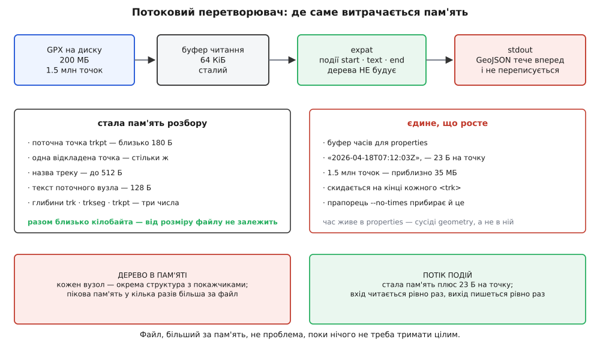
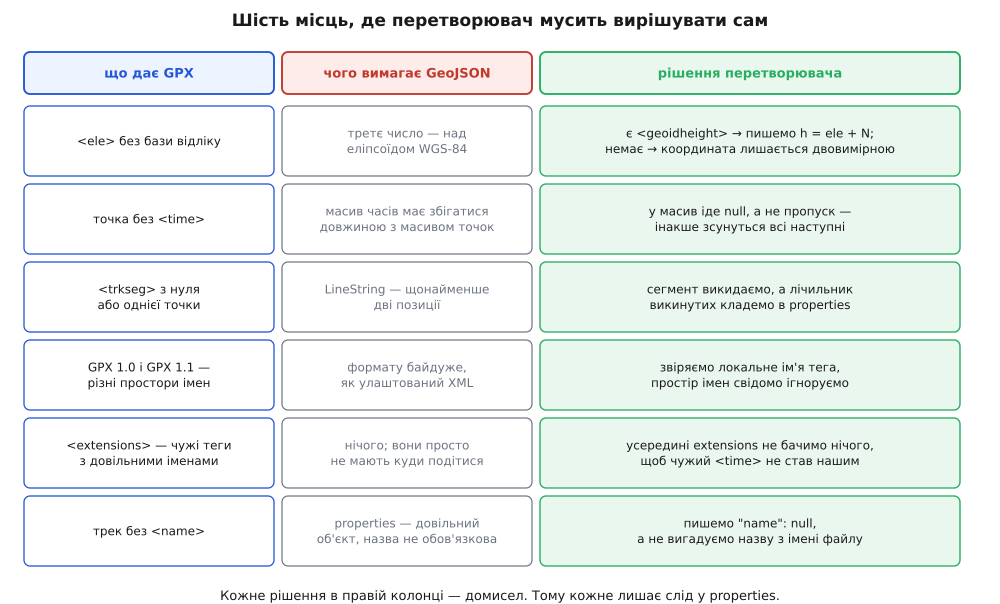

# ⚙️ GPX → GeoJSON: перетворювач, що записує кожен свій домисел

Це робоча програма на кілька сотень рядків, яка читає GPX-трек будь-якого розміру й видає GeoJSON, ніде не збрехавши мовчки. Її цінність не в тому, що вона перекладає теги в дужки — це найлегша частина. Цінність у тому, що GPX і GeoJSON описують різні речі, тож у півдюжині місць перетворювач мусить **вирішити сам**, і кожне таке рішення програма записує в самий файл, який видає.

Причина, чому це не переклад слово в слово, одна: GPX — журнал вимірювань приладу, а GeoJSON — опис геометричних об'єктів. Прилад пише, коли він був у точці і як упевнено її знав; веб-карта хоче знати, які об'єкти є і які в них властивості. Там, де журнал каже більше, ніж уміє записати опис, перетворювач мусить вибрати, куди це подіти. Там, де опис вимагає більше, ніж каже журнал, — мусить це звідкись узяти. Другий випадок і є домисел, і саме він робить конвертери непорівнянними між собою.

## Задача

Вхід — файл GPX 1.0 або 1.1, можливо на сотні мегабайтів, із одним чи кількома треками (`trk`). Кожен трек ділиться на сегменти (`trkseg`), сегмент — послідовність точок (`trkpt`) з обов'язковими атрибутами `lat`/`lon` і необов'язковими дочірніми `ele`, `time`, `geoidheight`.

Вихід — `FeatureCollection`, де кожен трек стає одним `Feature`: геометрія `MultiLineString`, у ній один внутрішній масив на кожен сегмент, час усіх точок — паралельним масивом у `properties`.

Три обмеження, які й формують усю конструкцію:

1. **Пам'ять не залежить від розміру файлу.** Це не примха: GPX-логер за тиждень польотів дає файли, більші за вільну пам'ять машини, на якій їх обробляють.
2. **Числа виходять із тією точністю, з якою зайшли.** Ні на знак менше через недбалий формат друку, ні на знак більше через удаваний запас.
3. **Жодного тихого домислу.** Усе, що програма вирішила за нас, лежить у `properties` готового файлу — не в логах, не в документації, а в даних.

Щоб уявити масштаб: типовий `trkpt` з висотою й часом займає в GPX близько 130 байтів, тож файл на 200 МБ — це приблизно півтора мільйона точок.

## Ідея

Уся конструкція виростає з чотирьох спостережень, і кожне наступне спирається на попереднє.

**Перше: обидва боки читаються й пишуться строго вперед.** XML-документ розбирається зліва направо, JSON-текст так само зліва направо будується. Значить, тримати в пам'яті дерево немає жодної потреби: досить, щоб хтось повідомляв «почався елемент», «ось його текст», «елемент закінчився», а ми на кожне повідомлення дописували щось у вихід. Це і є [розбір потоку](root:com-protocol/stream-parser) в проштовхувальному вигляді: замість того щоб ми питали парсер про наступний вузол, парсер сам кличе наші функції. Різниця з деревом принципова — дерево тримає всі вузли водночас, потік не тримає жодного.

**Друге: вкладеність GPX і вкладеність GeoJSON збігаються.** `trk` → `Feature`, `trkseg` → внутрішній масив, `trkpt` → позиція. Отже, весь стан розбору — це три числа: на якій глибині відкрито `trk`, на якій `trkseg`, на якій `trkpt`. Нуль означає «зараз не всередині». Жодних стеків, жодних дерев.

**Третє: рівно одна річ ламає потоковість — час.** У GeoJSON геометрія і властивості — сусіди в одному об'єкті, а не вкладені одне в одне. Координати ми виводимо одразу, а часи мусимо десь притримати, щоб дописати їх після геометрії. Тримаємо не точки, а лише готовий текст масиву часів — двадцять три байти на точку — і скидаємо його на кінці кожного треку. Півтора мільйона точок дають близько 35 МБ, і це єдина величина в програмі, що росте.

**Четверте: одна точка затримки прибирає цілий клас поганих виходів.** `LineString` за RFC 7946 має щонайменше дві позиції, а GPX цілком законно містить сегмент з однією точкою або й порожній. Якщо виводити точки одразу, ми дізнаємося про однокрапковий сегмент тоді, коли вже написали в файл відкриту дужку й позицію. Тому кожна точка чекає на наступну: перша точка сегмента виводиться лише тоді, коли прийшла друга. Черга з одного елемента — і невалідні сегменти зникають самі, без відкоту й без другого проходу.


*Уся стала частина — дві точки розбору по сотні з гаком байтів, пів кілобайта на назву треку й буфер читання. Росте лише текст масиву часів, і саме тому його вимикають прапорцем, коли час не потрібен.*

> 🔧 **Навіщо це.** Спокуса зробити інакше велика: узяти бібліотеку, що читає XML у дерево, пройтися по ньому вкладеними циклами й скласти структуру GeoJSON у пам'яті, а потім серіалізувати. Такий код пишеться за годину й на тестовому файлі в кілька кілобайтів працює бездоганно. Ламається він у роботі, на справжньому тижневому логу, і ламається найгіршим способом — процес не падає з помилкою, а починає своп, і машина перестає відповідати. Дерево XML тримає кожен вузол як окрему структуру з покажчиками на батька, дітей і сусідів; елемент `<ele>179.2</ele>` — це шістнадцять байтів у файлі й два вузли по сотні з гаком байтів кожен у пам'яті. Звідси проста оцінка: **пікова пам'ять у кілька разів більша за файл**, і жодна оптимізація коду навколо цього не рятує — рятує тільки відмова тримати дерево.

## Розбирати XML самотужки не треба

Одразу приберімо очевидне запитання: чому б не написати свій розбір, адже GPX виглядає простим?

Бо він не простий. [XML](root:sf-data/xml-markup) — це дерево елементів із атрибутами, і разом із ним у файл приходять простори імен, сутності `&amp;` і власні сутності з `DOCTYPE`, секції `CDATA`, оголошене в першому рядку кодування, яке не зобов'язане бути UTF-8, коментарі й інструкції обробки. Кожна з цих дрібниць у чиємусь реальному файлі вже трапилася. Свій розбір «на `strstr`» ламається на першому ж треку, названому `Дніпро &amp; Десна`.

Тому беремо **expat** — бібліотеку, що робить рівно те, що нам потрібно: читає байти шматками й кличе наші три функції. Вона є в кожному дистрибутиві, важить кількасот кілобайтів і не має залежностей. Її угода з нами така: рядки, які вона передає в обробники, **завжди в UTF-8**, незалежно від того, в якому кодуванні був файл. Це знімає з нас цілий шар роботи, бо JSON теж обмінюють у [UTF-8](root:sf-data/ascii-utf8) — байти назви треку йдуть із входу у вихід без перекодування.

І одразу про безпеку. Файл із чужих рук може містити `DOCTYPE` з рекурсивними сутностями — класична «мільярд смішинок», де десяток рядків оголошень розгортається в гігабайти тексту. Expat від версії 2.4.0 має власний запобіжник із типовим коефіцієнтом розгортання 100, але надійніше просто заборонити оголошення сутностей узагалі: у GPX їх не буває. Ставимо обробник оголошення сутності, який зупиняє розбір, — і цілий клас атак зникає. Зовнішні сутності expat і так не тягне: без явно поставленого обробника посилання на них мовчки ігноруються.

## Код

Обидві версії — та сама програма й той самий алгоритм. C — прямий шлях: expat має C-інтерфейс, а вся робота зводиться до байтів, лічильників і форматування чисел. C++ виграє в трьох конкретних місцях, і саме заради них варто подивитися другу вкладку: `std::string` знімає ручне перевиділення буфера, `std::optional` робить «висоти немає» окремим станом замість пари «значення плюс прапорець», а `std::to_chars` і `std::from_chars` перетворюють числа **незалежно від локалі за визначенням** — не через дисципліну виклику `setlocale`, а тому, що інакше не вміють.

:::tabs
:::code proj-gpx-to-geojson/c/gpx2geojson.c
:::code proj-gpx-to-geojson/cpp/gpx2geojson.cpp
:::

Одна різниця між вкладками не косметична, а змістовна. У версії на C рядок `setlocale(LC_NUMERIC, "C")` — обов'язковий, і про нього легко забути; у версії на C++ його немає, бо `std::to_chars` і `std::from_chars` за визначенням локалі не бачать. Про те, чому це не дрібниця, — трохи нижче.

## Що в цьому коді неочевидне

### Простір імен ми ігноруємо свідомо

GPX 1.0 і GPX 1.1 — різні простори імен: `http://www.topografix.com/GPX/1/0` і `http://www.topografix.com/GPX/1/1`. Бібліотека, налаштована шукати елементи в просторі 1.1, файл версії 1.0 просто не побачить: назви елементів збігаються, але для XML вони — різні імена.

Тому парсер створюємо **без обробки просторів імен** (`XML_ParserCreate(NULL)`, а не `XML_ParserCreateNS`) і звіряємо лише локальне ім'я, відрізавши префікс. Ціна — перетворювач у принципі не відрізнив би `trkpt` із чужого простору імен від справжнього; вигода — він читає обидві версії GPX і ту купу файлів, де експортер узагалі забув оголосити простір імен. Для перетворювача такий обмін вигідний, для валідатора був би неприйнятний, і різниця саме в призначенні інструмента.

Заразом видно, чому елемент `time` не можна ловити тільки за іменем: у GPX 1.1 усе своє виробники складають у `extensions`, а туди дозволено класти теги з будь-якого чужого простору імен, зокрема з іменами, що збігаються з нашими. Тому щойно відкрився `extensions`, ми запам'ятовуємо його глибину й до відповідного закриття не бачимо нічого. Той самий механізм відсіює `name` у `metadata` і в `wpt` — ім'я треку ми беремо лише там, де відкрито `trk` і ще не відкрито `trkseg`.

### Текст приходить шматками

Найтихіша пастка всіх проштовхувальних парсерів: обробник тексту може бути покликаний **кілька разів на один текстовий вузол**. Документація expat формулює це прямо — суцільний блок тексту без розмітки все одно може дати послідовність викликів. Причини технічні: межа буфера читання лягла посеред числа, у тексті трапилася сутність `&amp;`, почалася секція `CDATA`.

Наслідок для коду: обробник мусить **дописувати** в накопичувач, а не перезаписувати його. Код, що робить `strcpy(dst, t)`, працює на всіх малих файлах і ламається на великому — причому не помилкою, а тим, що `<time>2026-04-18T07:12:03Z</time>` перетворюється на `3Z`. Знайти таке потім у логах неможливо: воно залежить від того, куди випадково лягла межа шматка. Саме тому накопичення відкривається на початку елемента (`cap_begin`), а розбирається значення на його закритті.

### Точка збирається на закритті, а виводиться із затримкою

`trkpt` віддає свої дані двома шляхами: `lat` і `lon` — атрибутами на відкритті, `ele`, `time`, `geoidheight` — дочірніми елементами. Тому точка готова лише тоді, коли прийшло `</trkpt>`. Це заразом рятує від пастки порядку: у GPX 1.1 порядок дітей точки жорсткий, у GPX 1.0 він інший (там між `time` і `geoidheight` стоять `course` і `speed`, яких у 1.1 уже немає), а нам байдуже — ми не покладаємося на порядок узагалі.

Далі готова точка не виводиться, а стає **відкладеною**. Виводиться попередня. На закритті сегмента виводиться остання відкладена — але **тільки якщо сегмент уже відкритий**, тобто в ньому вже була хоч одна виведена точка. Простежмо три випадки:

```
сегмент із 3 точок:  P1→черга · P2→вивід P1, черга P2 · P3→вивід P2, черга P3
                     </trkseg> → вивід P3   ⇒ у файлі 3 позиції ✓

сегмент з 1 точки:   P1→черга · </trkseg> → сегмент не відкритий,
                     P1 просто зникає      ⇒ у файлі нічого ✓

порожній сегмент:    </trkseg> одразу      ⇒ у файлі нічого ✓
```

Одна змінна затримки — і в вихід фізично не може потрапити `LineString` з однієї позиції. Альтернативи гірші: буферувати весь сегмент означає повернути залежність пам'яті від даних, а «написати й відкотити» в потоковому виводі неможливо, бо байти вже пішли.

### Висота — єдине місце, де ми рахуємо, а не переписуємо

GPX каже про `ele` лише «висота в метрах» і не уточнює, від чого її міряно. GeoJSON, навпаки, визначає третій елемент позиції однозначно: висота над еліпсоїдом WGS-84. Тобто перенести число як є — означає оголосити висоту над рівнем моря висотою над еліпсоїдом і зсунути точку по вертикалі на десятки метрів, не змінивши жодної цифри.

Порятунок — окремий елемент `geoidheight`, який є і в GPX 1.0, і в GPX 1.1: він несе хвилю геоїда в цій точці, тобто те, наскільки [рівень моря відхиляється від еліпсоїда](root:math-geometry/geoid-and-amsl). Обидва числа приймач бере просто з рядка NMEA GGA, де вони й лежать поруч, тому в файлі приладу вони зазвичай є обидва. Перерахунок тривіальний:

```
h = H + N

H — те, що лежить у <ele>, коли прилад пише висоту над рівнем моря
N — те, що лежить у <geoidheight>
h — те, чого вимагає GeoJSON: висота над еліпсоїдом WGS-84
```

**Одна точка з реального логу.**

```
<ele>179.20</ele>  <geoidheight>25.40</geoidheight>

h = 179.20 + 25.40 = 204.60 м над еліпсоїдом
```

Понад двадцять п'ять метрів різниці на рівному місці. Якщо перенести `179.20` як є, трек на моделі рельєфу піде під землею — і це єдиний спосіб помітити помилку, бо файл лишається валідним.

А якщо `geoidheight` немає? Тоді ми не знаємо, що́ таке `ele` в цьому файлі, і чесних варіантів рівно два: не писати третє число зовсім або зажадати, щоб користувач сказав прямо. Обидва в програмі є — `--ele auto` (типово) мовчки переходить на двовимірні координати, `--ele ellipsoid` означає «я знаю цей прилад, його `ele` — уже `h`». Чого програма не робить ніколи — не бере `ele` з невідомою базою й не оголошує його висотою над еліпсоїдом. Це той єдиний варіант, який виглядає найзручнішим і є єдиним неправильним.

### Крапка як десятковий роздільник — з обох боків

Рядок `setlocale(LC_NUMERIC, "C")` у версії на C виглядає зайвим: типова локаль програми на C і так «C». Він потрібен тому, що варто комусь у цій же програмі покликати `setlocale(LC_ALL, "")` — а це роблять бібліотеки, що показують повідомлення мовою користувача, — і в українській чи німецькій локалі десятковим роздільником стає **кома**. Наслідки миттєві й двобічні:

```
LC_NUMERIC = uk_UA.UTF-8

printf("%.7f", 30.5234)  →  "30,5234000"   вивід перестає бути JSON
strtod("179.2", &end)    →  179.0, end = ".2"   вхідне число зіпсовано
```

Друга помилка страшніша за першу: криву JSON помітить перший же читач, а тихо втрачений дріб у висоті не помітить ніхто. Саме тому функція `num()` вимагає, щоб після числа не лишалося ані символу: у комовій локалі вона поверне «це не число», і висота просто зникне — видимою дірою замість невидимого зсуву. Перетворити мовчазне псування на гучну відмову — узагалі найдешевший спосіб убезпечити розбір даних.

У C++ проблема знята на рівні мови: `std::to_chars` і `std::from_chars` не мають доступу до локалі за визначенням. Це і є причина, чому в другій вкладці немає `setlocale`.

### Скільки знаків друкувати

Типове значення — сім знаків після коми, і цей вибір варто пояснити, бо він трохи не збігається з рекомендацією RFC 7946, де названо шість.

Один градус широти — це приблизно 111.1 км, тож знак після коми коштує так:

```
6 знаків: 0.000001° ≈ 0.111 м  ≈ 11 см
7 знаків: 0.0000001° ≈ 0.0111 м ≈ 1.1 см
```

Одинадцять сантиметрів справді точніше за побутовий приймач, і як межа осмисленості шість знаків правильні. Але перетворювач не міряє — він переписує. Прилади пишуть у GPX шість-сім знаків, і якщо ми друкуємо шість, то на кожній точці, де в джерелі був сьомий, ми додаємо власне округлення до ±5.5 см. На одному файлі це дурниця; на ланцюжку «GPX → GeoJSON → GPX → GeoJSON» це похибка, що накопичується без жодної причини, окрім формату друку. Сьомий знак робить перетворення практично тотожним, а зайвий байт на координату нічого не вартий. Прапорець `-d` лишається для того, хто свідомо хоче менший файл.

І головне про сам друк: **фіксована точність, ніколи `%g`**. У `%g` типова точність — шість **значущих** цифр, тобто цілі розряди з'їдають дробові:

```
printf("%g",   30.5234567)  →  "30.5235"     4 знаки — крок сітки  7 м
printf("%g",  130.5234567)  →  "130.523"     3 знаки — крок сітки 71 м
printf("%.7f", 30.5234567)  →  "30.5234567"

(крок для довготи на широті 50.45°: 111.32 км · cos 50.45° · крок у градусах)
```

Найпідступніше тут те, що втрата залежить від самого числа: у Києві, де довгота має два цілі розряди, файл виглядає майже правильним, а за сто вісімдесятим меридіаном той самий код кладе точки на сітку в сімдесят метрів. Такі помилки живуть у робочих системах роками.

## Домисли, записані у файл


*Права колонка — не переклад, а вибір. Тому кожен вибір лишає слід у `properties`: назва бази висоти, кількість знаків, скільки сегментів викинуто, скільки точок лишилися без часу, скільки разів висоту продовжено з попередньої точки.*

Час заслуговує окремого слова, бо тут домисел найтонший. GeoJSON не має де тримати час на точці: позиція — це два або три числа, і стандарт прямо застерігає не додавати четвертого, бо семантика зайвих елементів не визначена. Тому час іде в `properties` паралельним масивом за домовленістю **geojson-coordinate-properties**, яку запровадив Mapbox і яку розуміють поширені перетворювачі GPX: об'єкт `coordinateProperties`, у ньому член `times`, і вкладеність масиву часів мусить збігатися з вкладеністю геометрії. Для `MultiLineString` це означає масив масивів — по одному на сегмент.

Звідси залізне правило: **точка без `time` дає `null`, а не пропуск**. Пропустити елемент означає зсунути всі наступні часи на одну точку — і жодна перевірка цього не помітить, бо довжини все одно розійдуться лише в одному з масивів. `null` домовленість дозволяє прямо, і сам факт дірки видно.

Формат самого рядка ми не чіпаємо: GPX вимагає [ISO 8601](root:sf-data/iso-8601) у всесвітньому часі, і ми переносимо текст як є, лише екранувавши його для JSON. Спокуса «розібрати й нормалізувати» тут шкідлива — розбір дати додає власні помилки (місцевий час, дробові секунди, зсув замість `Z`), а користь нульова, бо приймач і так пише UTC.

**Що виходить із трикрапкового треку, де другий сегмент має лише одну точку.**

```json
{"type":"FeatureCollection","features":[
{"type":"Feature","geometry":{"type":"MultiLineString","coordinates":[
 [[30.5234000,50.4501000,204.60],[30.5235100,50.4501800,204.80]]]},
 "properties":{"name":"обхід ділянки",
  "elevation":"wgs84-ellipsoid (ele + geoidheight)",
  "conversion":{"digits":7,"points":2,"segments":1,"segments_dropped":1,
                "points_without_time":0,"elevation_carried":0,
                "geoidheight_carried":0,"points_dropped":0},
  "coordinateProperties":{"times":[
   ["2026-04-18T07:12:03Z","2026-04-18T07:12:04Z"]]}}}
]}
```

(Програма пише все це щільно, без переносів; тут вони додані для читання.)

Поле `segments_dropped: 1` — і є та річ, заради якої все затівалося. Читач цього файлу не мусить вірити перетворювачеві на слово: він бачить, що один сегмент зник, і може піти шукати чому. Конвертер, який робить те саме мовчки, віддає такий самий валідний GeoJSON — і не лишає жодного сліду.

## Складність

**За часом — один прохід, лінійно від байтів входу.** Кожен байт файлу проходить через expat рівно раз; на кожен елемент припадає кілька `strcmp` по коротких іменах, на кожну точку — два-чотири розбори числа й один `snprintf`. Другого проходу немає ніде, повернень назад немає ніде.

**За пам'яттю — стала частина плюс буфер часів:**

```
буфер читання              64 КіБ
внутрішній стан expat      пропорційний глибині дерева (у GPX це 4–5)
                           і довжині найдовшого тексту
наш стан розбору           ≈ 1 КіБ (дві точки, назва, текст вузла, глибини)
буфер часів                23 Б на точку; скидається на кінці кожного треку,
                           місткість росте подвоєнням — тож пік удвічі більший

файл 200 МБ ≈ 1.5 млн точок:
  з часами     ≈ 35 МБ даних, до 70 МБ піку
  --no-times   ≈ 100 КіБ піку, скільки б не важив файл
```

Подвоєння місткості — та сама угода, що й у будь-якому масиві, який росте: пам'яті витрачається до вдвічі більше за корисні дані, зате сумарна робота на перевиділення лишається лінійною — кожен байт копіюється в середньому двічі, а не на кожній вставці.

Порівняння з деревом виходить не на відсотки, а на порядок: DOM тримав би всі півтора мільйона точок водночас, кожну як кілька вузлів із покажчиками, і пікова пам'ять пішла б у гігабайти. Різниця не в майстерності написання коду, а в тому, що ми **відмовилися від довільного доступу** до документа — і виявилося, що для цієї задачі він і не потрібен.

## Пастки

**`[довгота, широта]`, а не навпаки.** У коді вище позиція друкується одним виразом, де `p->lon` стоїть першим, і саме тому помилка неможлива. Щойно координати починають ходити масивом `double c[2]`, порядок стає питанням пам'яті програміста — а переставлені числа дають валідний файл із точкою в іншій півкулі.

**`%g` замість фіксованої точності.** Шість значущих цифр на довготі з трьома цілими розрядами лишають три знаки після коми — крок сітки в сімдесят метрів на широті Києва й у сто одинадцять на екваторі. Втрата тим більша, чим далі від нульового меридіана.

**Локаль із комою.** Ламає і друк, і розбір. `setlocale(LC_NUMERIC, "C")` у C, `to_chars`/`from_chars` у C++.

**Обробник тексту, що перезаписує накопичувач.** Працює на малих файлах, псує дані на великих, залежно від того, куди лягла межа буфера.

**Простори імен GPX 1.0 і 1.1.** Парсер, налаштований на один простір, мовчки не бачить файлів іншої версії — жодної помилки, просто порожній вихід.

**Байтова позначка порядку на початку файлу.** Для XML вона допустима, expat її з'їсть; але якщо ви колись писатимете GeoJSON із BOM, частина читачів JSON на ньому спіткнеться. Пишіть вихід без BOM.

**Обірваний вивід.** Якщо диск закінчився на середині, у файлі лишиться синтаксично неповний JSON. Це радше добре — помилка гучна. Погано інше: не перевірити `fflush`/`ferror` і повернути нуль, ніби все гаразд. Тому в конвеєрі пишіть у тимчасовий файл і перейменовуйте його лише після успішного завершення.

**Антимеридіан.** Наш перетворювач його не обробляє, і це свідома межа. Трек, що перетинає ±180°, RFC 7946 велить різати на частини — а `MultiLineString` для цього вже готовий, місце для розрізу є. Ідея латки на кілька рядків: якщо між сусідніми точками довгота стрибнула більш ніж на 180°, закрити внутрішній масив і відкрити наступний. Тонкість у тому, що після такого розрізу шматок може лишитися з однієї точки — тобто чергу з однієї точки довелося б поширити й на цей випадок. Тому чесніше сказати «не вміє», ніж зробити наполовину: недорізаний антимеридіан малює лінію навколо світу, а обмежувальний прямокутник розтягує на всю планету.

**`extensions` як прохідний двір.** Виробники кладуть туди пульс, каденс і температуру, і імена їхніх тегів ніхто не координує. Перетворювач, який шукає елементи за іменем не зважаючи на місце, рано чи пізно прочитає чужий `time` як свій.

**Мовчазне округлення тексту в `float`.** Наш код тримає координати в `double` від першого до останнього рядка. Варто десь у конвеєрі трапитися 32-бітному типу — і сусідні представні значення біля широти 50° розійдуться на сорок два сантиметри, тобто всі старанно збережені сьомі знаки просто зникнуть. Це властивість [чисел із рухомою комою](root:hw-arch/floating-point), а не помилка коду, і саме тому її не видно ніде, крім результату.
