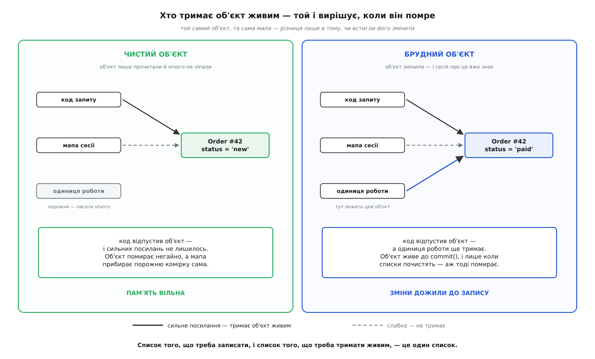
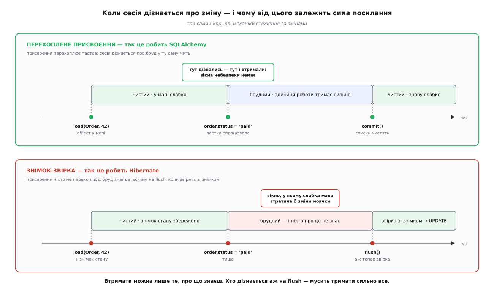

# ⚙️ Робоча карта тотожності: мапа, яку не соромно ввімкнути

Мапа «(тип, ключ) → об'єкт» на шляху завантаження вже робить головне: не дає другому об'єктові народитися на той самий рядок. Це умова правильності, і поки її немає, решта розмови безпредметна. Але ввімкнути таку мапу в живому застосунку ще не можна. Вона протримається до першого нічного пакета — і з'їсть усю пам'ять, бо чесно тримає геть усе, що колись прочитала.

Доростимо її до придатної. Мінімальна мапа не ставить трьох питань, а без відповіді на них у прод не йдуть.

**Хто запише зміни?** Мапа знає, які об'єкти в неї є, але гадки не має, кого з них чіпали. Хтось мусить вести список змін і наприкінці вилити його в базу — це [одиниця роботи](root:sf-data/unit-of-work): вона накопичує, що́ за час сесії народилося, змінилося й зникло, і записує все одним заходом замість того, щоб бити в базу після кожного присвоєння. Нам вона знадобиться в несподіваній ролі — не лише як список.

**Хто відпустить пам'ять?** Мапа тримає сильні посилання, тобто вона — корінь досяжності. А [слабке посилання](root:sf-lang/weak-references) дає дістатися до об'єкта, але для [збирача сміття](root:sf-lang/garbage-collection) не рахується: якщо на об'єкт лишились самі слабкі, його заберуть, а посилання спорожніє. Сильне — рахується. Уся дисципліна пам'яті сесії стоїть рівно на цій різниці.

**Хто закриє сесію?** Об'єкт, що пережив свою сесію, гарантії тотожності вже не має, зате й далі поводиться так, ніби має. Межа мусить бути не домовленістю, а кодом.

І понад те — **як довести, що воно працює?** «Начебто працює» тут не аргумент: хвороба, яку ми лікуємо, тиха. Тож наприкінці буде тест, який рахує зниклі оплати до й після, і другий — який рахує пам'ять.

### Одне правило замість трьох механізмів

Спокуса — зробити три окремі механізми: список змін, політику пам'яті, дисципліну меж. Але вони не окремі, і ось чому.

Збирач сміття не питає, що ти думаєш про об'єкт. Він дивиться рівно на одне: чи веде до об'єкта ланцюжок сильних посилань від живого кореня. Отже, дисципліна посилань у мапі — це і є політика пам'яті сесії, і вибирати її треба не «як зручніше», а з одного правила:

```
об'єкт, чиї зміни ще не записані, померти НЕ МАЄ ПРАВА
об'єкт, чиї зміни записані або яких не було,  — має
```

Тепер подивись, що з цього випливає. Список того, що треба **записати**, — це три списки одиниці роботи: нові, брудні, вилучені. Список того, що треба **тримати живим**, — це… ті самі об'єкти. Не схожі списки, не паралельні — один список.

А отже, окремого механізму «втримати об'єкт» не треба взагалі. Одиниця роботи й так веде свій облік — і сам факт, що вона тримає об'єкт у списку, **уже є** тим сильним посиланням, яке не дає йому померти. Нічого дописувати не доведеться: воно виходить задарма, з самої побудови. Мапа ж тримає всіх слабко й не тримає живим нікого.



*Дві колонки — той самий об'єкт і та сама мапа; уся різниця в тому, чи встиг хтось його змінити.*

> 🔧 **Навіщо це.** Коли в пакетному завданні сесія з'їдає пам'ять, звична порада — «ріж на менші транзакції». Але спершу спитай, **що саме** тримає ці об'єкти. Якщо мапа тримає сильно — вона тримає й ті сотні тисяч рядків, які ти прочитав і забув, і різати доведеться завжди. Якщо слабко — живими лишаються рівно ті, кого ти змінив і ще не записав, і пакет на пів мільйона рядків проходить в одній сесії без жодного `clear()`. Це різниця не в налаштуванні, а в тому, хто кому винен посилання.

Ця конструкція має одну умову, і вона не дрібна. **Втримати можна лише те, про що знаєш.** Якщо сесія дізнається про зміну в мить присвоєння, вона тоді ж і кладе об'єкт у список бруду — вікна, у якому об'єкт уже брудний, але ще нікому не відомий, просто не існує. А якщо сесія звіряє поля зі знімком аж на записі, то від присвоєння до запису об'єкт брудний — і **ніхто про це не знає**. Слабка мапа в цьому вікні спокійно віддасть його збирачеві разом зі змінами. Мовчки.



*Механіка стеження за змінами вирішує, чи можна взагалі дозволити собі слабку мапу.*

Це не абстрактна дилема, а рівно те, що розводить два найвідоміші ORM — і розводить не за смаком авторів, а за наслідком. SQLAlchemy перехоплює присвоєння, тож може дозволити собі слабку мапу: у його коді видно, як у мить зміни атрибута об'єктові дописують сильне посилання `_strong_obj` — і лише тоді, коли об'єкт уже під опікою сесії. Hibernate звіряє зі знімком, тож мусить тримати весь контекст персистентності сильно — і саме звідси славнозвісна порада різати пакет на `flush()` + `clear()`. Причина й наслідок, а не традиція.

Отже, будувати починаємо не з мапи. Починаємо з об'єкта, який уміє зізнатися.

### Крок 1: сутність, яка зізнається в мить зміни

Потрібно перехопити присвоєння — але не всяке. Складання об'єкта з рядка бази бруду не робить: об'єкт щойно прочитали, він точна копія того, що в базі, писати нічого. Бруд — це коли **справжній стовпець** змінює значення на **інше**, і об'єкт при цьому вже під опікою сесії.

:::tabs
:::code proj-identity-map/py/krok-1-sutnist-iaka.py
:::code proj-identity-map/ts/krok-1-sutnist-iaka.ts
:::

Дві мови роблять те саме двома різними знаряддями, і це не переклад одного в інше. Python має `__setattr__` — гак прямо в самому об'єкті, тож перехоплення вбудоване в клас. У JavaScript такого гака немає, зате є `Proxy` — обгортка, крізь яку йдуть усі звертання. Звідси й наслідок, якого в Python-версії просто не буває: у JS **об'єкт і його проксі — це дві різні речі**, і далі нам доведеться пильнувати, щоб в обігу була рівно одна з них.

Зверни увагу на `old != value`. Присвоєння того самого значення бруду не робить, і це не мікрооптимізація: без цієї звірки будь-яке `order.status = order.status` породило б зайвий UPDATE, а разом із ним — усі ризики затирання, які ми взагалі-то й лікуємо.

### Крок 2: мапа, яка нікого не тримає

Тепер мапа. Проти мінімальної версії тут одна зміна — значення слабкі, — і кілька наслідків, що з неї випливають.

:::tabs
:::code proj-identity-map/py/krok-2-mapa-iaka-nikoho-ne.py
:::code proj-identity-map/ts/krok-2-mapa-iaka-nikoho-ne.ts
:::

Python дає слабку мапу однією назвою: `WeakValueDictionary` — словник, який відпускає значення, щойно на них не лишилось сильних посилань, і сам прибирає спорожнілі комірки. У JavaScript такого словника немає, тож його доводиться скласти з двох частин: `WeakRef` тримає слабко, а `FinalizationRegistry` прибирає комірку, коли об'єкта не стало. Обидві частини з'явилися в мові одночасно (ES2021) — і саме тому, що поодинці кожна з них неповна.

Тут причаїлася перша пастка, і причаїлася вона в документації. MDN про реєстр фіналізації каже прямо: реалізація **не зобов'язана** викликати зворотний виклик — «коли й чи взагалі» це станеться, вирішує рушій. Отже, покладатися на прибиральника не можна, і `get` мусить сам уміти впізнати надгробок: комірка є, `deref()` порожній — забираємо комірку тут-таки. Реєстр лишається оптимізацією («менше сміття в мапі»), а не частиною логіки. Саме так MDN і радить його вживати.

А тепер приємне. Перевірка на двійника в `add` зі слабкими посиланнями стає **точнішою**, а не слабшою, як можна було б злякатися. Двійник — це біда лише тоді, коли обидва об'єкти живі: два господарі, дві правди, затирання. Якщо ж перший давно помер і його ніхто не тримає, то другий — не двійник, а звичайне перечитування рядка, і сваритися нема на що. Слабка мапа розрізняє ці два випадки сама, задарма, самою своєю природою: мертвого в ній уже немає, тож `add` мовчить. Сильна мапа так не вміє — для неї мертвих не буває.

### Крок 3: одиниця роботи — вона ж і сильне посилання

Тепер той самий список у двох ролях. Він каже, що́ писати, — і водночас, поки в ньому лежить об'єкт, той не помре.

:::tabs
:::code proj-identity-map/py/krok-3-odynytsia-roboty.py
:::code proj-identity-map/ts/krok-3-odynytsia-roboty.ts
:::

Фаулер у «Patterns of Enterprise Application Architecture» дає одиниці роботи чотири реєстратори: `registerNew`, `registerDirty`, `registerDeleted` і `registerClean` — і зауважує, що останній потрібен саме тоді, коли карта тотожності є: він кладе прочитаний об'єкт у мапу. У нас цю роль виконує `_attach` у сесії, тож окремого `register_clean` немає — але роль нікуди не поділася, просто називається інакше.

Три дрібниці, у яких сидить сенс. **Ключ усюди — пара, а не число**, бо `_dirty` індексує тотожність рівно так само, як мапа. **`register_dirty` мовчить для нового об'єкта**, бо новий і так запишеться цілком, і позначати в ньому окремі стовпці — марна робота. І головне: **`forget()` наприкінці `commit` — це не прибирання за собою, а відпускання**. Доки ключ лежить у `_dirty`, об'єкт тримається за сильне посилання. Почистили списки — і об'єкт умить став таким самим слабким, як усі чисті. Саме це й описано в документації SQLAlchemy одним реченням: після повного запису колекції порожні, і всі об'єкти знову під слабкими посиланнями.

### Крок 4: сесія та її межі

Лишилося зшити все докупи й провести межу.

:::tabs
:::code proj-identity-map/py/krok-4-sesiia-ta-ii-mezhi.py
:::code proj-identity-map/ts/krok-4-sesiia-ta-ii-mezhi.ts
:::

Порядок у `_attach` — не випадковий, і в JS-версії він критичний: проксі створюють **перед** тим, як покласти в мапу, бо в мапу має лягти саме та річ, яку потім віддадуть назовні. Про це — окремо в пастках, бо саме тут ламаються.

`close()` робить дві речі, і обидві — про межу. По-перше, **кричить**, якщо в списках лишилися незаписані зміни: тихо їх загубити означало б власноруч відтворити ту саму хворобу, від якої вся ця конструкція й лікує. По-друге, **відчіпає** тих, хто ще живий. Без цього відчеплений об'єкт, який хтось тримає у в'ю чи в черзі, і далі кликав би `_mark_dirty` на мертвій сесії — і його зміни падали б у список, з якого їх ніхто ніколи не запише. Знову тиха втрата, тільки з іншого боку.

Порівняй два способи задати межу. Python має `with`, тож сесія сама себе закриває на виході з блоку — хоч нормальному, хоч через виняток. JavaScript такого немає, тому межу доводиться задавати функцією `Session.run`, де `finally` грає роль `__exit__`. Різні знаряддя, та сама думка: **межа сесії має бути конструкцією мови, а не обіцянкою програміста її не забути**.

### Тисяча оплат: тест, що рахує втрати

Тепер доведімо, що воно працює. Знадобиться найтонший шар над базою — і дві мапи-самозванки для порівняння.

:::code proj-identity-map/py/tysiacha-oplat-test-shcho.py

А ось і сам тест — той самий сюжет, тисяча разів поспіль: один запит, дві незалежні гілки коду дістають те саме замовлення різними шляхами.

:::code proj-identity-map/py/tysiacha-oplat-test-shcho-2.py

Вивід:

```
мапа               втрачених оплат   двійників   SELECT-ів
NoIdentityMap          1000/1000        1000        2000
IdentityMap               0/1000           0        1000
```

Тисяча з тисячі. Не «іноді», не «під навантаженням», не «на перегонах» — **щоразу**. Ось чому цю хворобу так важко спіймати очима: вона не рідкісна й не випадкова, вона просто тиха. Код відпрацював без жодної помилки, транзакція закрилася чисто, у журналі — два законні UPDATE, і оплати немає.

Придивись, як саме вона гине, бо це найповчальніше місце в усьому тесті. Двійників — рівно тисяча, тобто `order is not same` щоразу. І тоді `_dirty[(Order, 42)] = obj` спрацьовує **двічі на один ключ**: другий об'єкт просто витісняє зі словника перший. Одиниця роботи індексує свої списки тотожністю — а тотожностей у неї дві на один рядок. Вона має два записи про той самий рядок із різними значеннями і жодного способу обрати правильний. Тож обирає останній.

Це варте того, щоб сказати вголос: **одиниця роботи без карти тотожності не просто гірша — вона неспроможна**. Не тому, що погано написана, а тому, що її ключ перестав бути ключем. Карта тотожності — не сусідній патерн, а передумова, без якої одиниця роботи не тримається.

І ще стовпчик SELECT-ів: 2000 → 1000. Мапа вполовинила походи в базу — ось він, той доказ, яким її щоразу намагаються перевести в розряд оптимізацій. Але зістав дві колонки цієї таблиці. Тисяча заощаджених SELECT-ів — і тисяча оплат. Обидва числа з одного прогону, обидва однакові за величиною, і саме тому їх так легко переплутати. Різниця в тому, що перше число можна віддати назад: вимкни мапу — заплатиш тисячею запитів і житимеш далі. Друге назад не віддається.

### Двісті тисяч рядків: тест, що рахує пам'ять

Другий тест — про те, заради чого ми взагалі взялися за слабкі посилання. Одна сесія, двісті тисяч рядків, і лише кожен тисячний змінюємо.

:::code proj-identity-map/py/dvisti-tysiach-riadkiv.py

Вивід:

```
мапа                пік мапи   брудних у списку   UPDATE-ів
FullIdentityMap       200000             200         200
IdentityMap              200             200         200
```

Ці числа треба прочитати повільно.

Сильна мапа доросла до двохсот тисяч живих об'єктів — рівно стільки, скільки рядків проїхало. Вона тримає геть усе, включно зі 199 800 об'єктами, яких ніхто ніколи більше не гляне. Це і є той OOM у нічному пакеті, який усі бачили.

Слабка мапа зупинилася на **двохстах**. І тепер найголовніше: двісті — це рівно кількість брудних у списку. Не приблизно, не «десь така» — **та сама**. Ті самі об'єкти, той самий список. Мапа не тримає нікого; єдине, що тримає ці двісті, — сильні посилання з `_dirty`. Щойно черговий чистий об'єкт випав з-під локальної змінної `order`, він помер, а мапа прибрала комірку сама, без жодного `clear()`.

Ось те правило з початку, доведене числом. Список того, що треба записати, і список того, що треба тримати живим, — це справді один список, і мірою тут служить не аргумент, а `len()`. UPDATE-ів двісті в обох випадках: правильність не постраждала, заплатили самою лише пам'яттю.

Одна чесна засторога до методики. Ці числа такі рівні тому, що CPython рахує посилання й убиває об'єкт **умить**, щойно лічильник упав до нуля. У V8 такої люб'язності немає: там збирач приходить, коли схоче, тож той самий тест на JS показав би пилку, а не рівну поличку, і «пік» залежав би від того, коли рушій востаннє прибирав. Дисципліна та сама, вимірюваність — різна; для демонстрації ми взяли мову, у якій видно чисто.

### Чого це коштує

Ціна кожної операції — і чому вона така.

```
влучання load        O(1)   два пошуки в хеш-таблиці, до бази не йдемо
промах load          O(1)   + один SELECT
присвоєння           O(1)   звірка зі старим значенням, вставляння в множину
commit               O(k)   k = скільки об'єктів СПРАВДІ змінили
```

Остання стрічка — уся суть. Перехоплене присвоєння дає `commit` за `O(k)`, і `k` тут — не «скільки лежить у мапі», а «скільки ти чіпав».

Порівняй зі знімком-звіркою. Там `commit` коштує `O(n · c)`: `n` об'єктів у контексті, `c` стовпців у кожному — **незалежно від того, скільки з них змінили**. Прочитав десять тисяч рядків, змінив один — Hibernate однаково перебере всі десять тисяч і звірить кожне поле з його знімком, бо інакше просто не дізнається, який саме з них брудний. І перебір цей трапляється не конче раз на транзакцію: у режимі за замовчуванням Hibernate зливає контекст ще й перед запитами, чиї таблиці перетинаються з незаписаними змінами.

За це знімок-звірка платить, але й купує дещо справжнє: вона працює зі **звичайними об'єктами**, яких не треба ні загортати в проксі, ні перебудовувати клас. Пастка на присвоєнні дешевша в роботі, зате нав'язує сутностям свою механіку. Це чесний обмін, а не чиясь помилка, — і корисно знати, чим саме платиш.

Пам'ять: `O(живих)` на мапу проти `O(прочитаних)` у сильної. Різниця між цими двома рядками — це і є ті 200 проти 200 000 з тесту.

### Пастки

**Знімок-звірка зі слабкою мапою — тихо втрачені зміни.** Найдорожча помилка з можливих: узяти дисципліну «мапа слабка» від SQLAlchemy й механіку «звіримо на записі» від Hibernate. Тоді від присвоєння до `flush` об'єкт брудний, але про це не знає ніхто — і збирач сміття законно забирає його разом зі змінами. Ні винятку, ні запису, ні сліду в журналі. Ці два рішення не вільні одне від одного: **втримати можна лише те, про що вже знаєш**.

**У JS в мапу мусить лягти проксі, а не ціль.** Поміняй у `#attach` два рядки місцями — спершу `identityMap.add(raw)`, потім `return track(raw, this)` — і все зовні лишиться таким самим. А насправді мапа зберігатиме голий об'єкт, кожне завантаження ліпитиме **новий** проксі, `a === b` знову брехатиме, і — найгірше — перевірка на двійника мовчатиме, бо в мапі лежить `raw`, і з ним же вона й звіряється. Помилка, яка не має жодного зовнішнього прояву, доки не зникне чиясь оплата.

**`WeakMap` — це слабкі КЛЮЧІ, не значення.** По ім'я — саме те, що треба; по суті — ні. `WeakMap` слабко тримає **ключ**, а нам треба слабко тримати **значення**; до того ж ключами там можуть бути лише об'єкти, тож числовий `pk` туди й не покласти. Правильна збірка — `Map<Pk, WeakRef<Entity>>` плюс прибиральник, як вище.

**Об'єкт, що тримає сесію, тримає й усе, що в ній.** Наше поле `_session` — сильне посилання від об'єкта до сесії. Один відчеплений об'єкт, який хтось приберіг у кеші в'ю, тримає живою всю сесію, а з нею й одиницю роботи, а з нею — кожен брудний об'єкт у списках. Витік розміром із запит через одну змінну. SQLAlchemy цю пастку обходить наочно: у стані об'єкта лежить не сесія, а `session_id` — просто число, — а сама сесія шукається в реєстрі `_sessions`, оголошеному як `weakref.WeakValueDictionary[int, Session]`. Число нікого не тримає.

**Об'єкт без первинного ключа не має ключа в мапі.** Наш `session.add(obj)` вимагає готового `pk` — і це не лінощі, а справжня межа патерна. Ключ мапи — тотожність **бази**; поки база її не видала, класти об'єкт нема під що. Наслідок цього видно в живому інструменті: генератор `IDENTITY` у Hibernate віддає ідентифікатор лише **після** INSERT, тож на `persist()` Hibernate мусить сходити в базу негайно — і пакетне вставляння на цьому вмирає. Тому для пакетів радять `SEQUENCE`: він дає ключ **до** запису, і об'єкт потрапляє в мапу одразу, а INSERT-и складаються в пачку. Патерн, який ми будували заради коректності, дотягнувся аж до вибору генератора ключів — і це не збіг, а та сама причина.

**Реєстр фіналізації не гарантує нічого.** MDN каже це прямо, тож повторимо: комірка може лишитися надгробком назавжди. `get`, який не вміє впізнати порожній `deref()`, рано чи пізно віддасть `undefined` замість того, щоб перечитати рядок.

---

Якщо стягнути все в одну думку — вона про досяжність. Мінімальна мапа була про те, як **не дати** об'єктові народитися двічі. Робоча — про те, як точно вирішити, **коли** йому померти. І відповідь не в мапі: мапа тримає всіх слабко й не тримає нікого. Відповідь у списку, який і так уже є, — тому що об'єкт, чиї зміни ще не записані, це рівно той об'єкт, який комусь потрібен.
