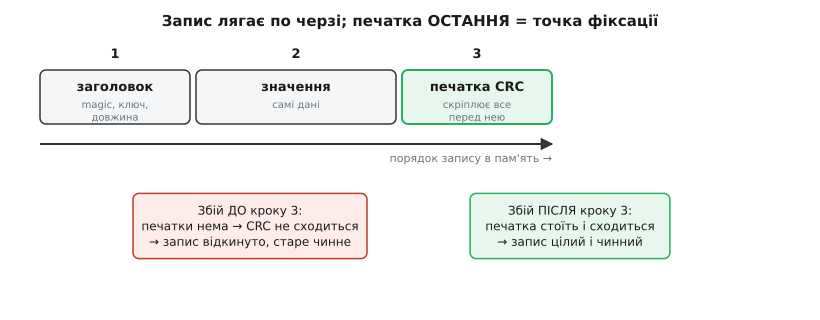

# ⚙️ Append-only сховище «ключ → значення»: покажчик у RAM, печатка й ущільнення

> Кістяк журналу зі статті — це серце ідеї, але ще не сховище, яке можна лишити працювати роками. У ньому читання сканує весь журнал, запис нічим не захищений від збою на півдорозі, а коли місце скінчиться — сховище просто впирається в стіну. Тут ми доростимо той кістяк до чогось справжнього: покладемо в оперативну пам'ять **покажчик** «ключ → де лежить остання версія», щоб читати без скану; поставимо наприкінці кожного запису **печатку**, яка робить його або цілим, або невидимим; і навчимося **ущільнювати** повний журнал так, щоб раптове вимкнення посеред прибирання не з'їло жодного байта. Усе — робочим C, який компілюється й працює.

## Задача

Дано ділянку енергонезалежної пам'яті — назвімо її «журналом»; уявляйте [сектор Flash](root:hw-components/flash-internals) чи файл на картці, куди можна лише **дописувати в кінець** і час від часу **стирати цілими блоками**. Над цим треба збудувати сховище пар «короткий ключ → значення» з трьома чесними обіцянками:

1. **Читання без скану.** `store_get("volume")` має віддавати чинне значення миттєво, не пробігаючи щоразу весь журнал від кінця. Журнал може містити сто версій одного ключа — читач не повинен за це платити.
2. **Атомарність при збої живлення.** Якщо струм зникне **посеред** запису, сховище при наступному старті мусить побачити або **старе** значення (наче нового запису й не було), або **нове** (запис ліг повністю) — але **ніколи** напіврозбитий уламок, якому воно повірить як справжнім даним.
3. **Вічна робота.** Коли журнал заповнюється мертвими версіями, сховище має **ущільнитися** — переписати лише живі записи в чисте місце й звільнити старе, — і зробити це так, щоб збій **посеред** ущільнення теж нікого не осиротив: жодна пара «ключ → значення», що була в сховищі до ущільнення, не має зникнути.

Це рівно той набір, що тримає справжні сховища на кшталт **NVS** на мікроконтролері чи **Bitcask** — рушія, з якого починалася база даних Riak. Bitcask так само пише дані в append-only журнал, тримає в пам'яті хеш-таблицю «ключ → зсув запису в файлі» й періодично зливає старі файли, лишаючи по кожному ключу лише найновішу версію. Ми зберемо його зменшену, але чесну модель — таку, що влізе в мікроконтролер і в голову.

## Формат запису: печатка мусить бути останньою

Почнімо з того, як виглядає **один запис** у журналі, бо саме тут закладається атомарність — або втрачається. Наївний запис «ключ + значення» з кістяка нічого не гарантує: якщо струм зникне, коли ліг ключ, а значення ще ні, ми матимемо запис, що **виглядає** цілим, а всередині — сміття. Треба, щоб сам формат запису вмів відрізнити **дописане до кінця** від **обірваного на півслові**.

Прийом простий і старий, як самі журнали баз даних: до корисних даних додають **контрольну суму** (англ. *checksum*) — коротке число, порахуване з байтів запису, — і кладуть її **в самий кінець**, останнім кроком. Ось у чому вся сіль: печатка виявляється на своєму місці **лише тоді**, коли все перед нею вже лягло. Немає печатки в кінці, або вона не сходиться з тим, що перед нею, — значить, запис обірвано, його ігнорують, наче й не було.

> 🔧 **Навіщо це.** Саме так журнали з попереднім записом (*write-ahead log*) у справжніх базах відрізняють цілий запис від обірваного після збою: кожен запис несе поле довжини й [контрольну суму](root:sf-data/write-integrity), і при відновленні беруть лише ті записи, що **проходять суму до кінця**. Обірваний останній запис просто відкидають — і база стартує з коректного стану, а не з половинки транзакції.

Опишімо запис так, щоб «дописати до кінця» природно збігалося з «поставити печатку»:

:::code proj-append-only-store/c/format-zapysu-pechatka.c

Печатка тут — **CRC-32**: число, що з дуже високою певністю зміниться, якщо зіпсувати чи недописати бодай байт даних. Нам не треба знати, як його рахувати, — досить домовитися, що є функція `crc32(дані, довжина)`, яка з байтів робить ці чотири байти; її внутрішній устрій розібрано окремо в [цілісності запису](root:sf-data/write-integrity). Важливе одне: **печатку кладемо в пам'ять останнім записом**, уже після заголовка й значення.

Тепер сам допис. Зверніть увагу на послідовність — вона тут не косметична, а несе всю атомарність:

:::code proj-append-only-store/c/format-zapysu-pechatka-2.c

Проживімо подумки збій на кожному кроці, щоб побачити, чому цей порядок рятує. Струм зник **після кроку 1** — у журналі лежить самий заголовок без значення й без печатки; читач дійде до місця, де мала б бути печатка, порахує CRC з того, що є, і не збіжеться — запис відкинуто. Зник **після кроку 2** — є заголовок і значення, але печатки нема; знову не збіжиться, знову відкинуто. І лише коли ліг **крок 3** — печатка стоїть і сходиться, — запис уважається справжнім. Виходить **атомарний перемикач**: один останній коротенький запис перетворює купку байтів на дійсний запис. До нього — нічого не сталося; після — сталося все.

*Запис лягає по черзі: заголовок, значення, печатка. Доки печатка не стала останньою, запис недійсний — збій до неї лишає старе значення чинним. Печатка сходиться з даними перед нею лише коли все лягло: один останній запис фіксує зміну.*

Якби ми зробили навпаки — поклали печатку **першою**, а значення дописували після неї, — збій між ними лишив би запис із «правильною» печаткою над **недописаним** значенням, і сховище повірило б у половинку. Тому «печатка останньою» — не стиль, а сама умова атомарності.

## Покажчик у RAM: читати без скану

Тепер друга обіцянка — швидке читання. Кістяк зі статті на кожен `get` сканував увесь журнал з кінця, шукаючи найновіший запис ключа. Поки записів десяток, це дрібниця; коли їх десятки тисяч, кожне читання перетворюється на пробіг усього сховища — неприйнятно.

Ліки — це те, що робить кожне серйозне журнальне сховище: тримати в **оперативній пам'яті** невеликий **покажчик** (англ. *index*) — таблицю «ключ → зсув, за яким у журналі лежить його **остання** версія». Тоді читання перестає бути скануванням: зазирнув у покажчик, дізнався зсув, стрибнув просто туди, прочитав. Журнал на диску лишається джерелом правди (він переживе вимкнення), а покажчик у RAM — це швидкий провідник до потрібного місця. У Bitcask цю саму таблицю звуть *KeyDir*, і вона теж тримає в пам'яті **всі** ключі, віддаючи кожне читання за один стрибок.

> 🔧 **Навіщо це.** Розплата за цей провідник — пам'ять: покажчик мусить умістити **всі ключі** сховища одразу. На мікроконтролері з кілобайтами RAM це прямо обмежує, скільки різних ключів ви можете тримати, — тому в них ключі короткі, а самі значення (потенційно великі) лишаються в журналі й підтягуються лише за потреби. Компроміс «швидке читання ↔ зайнята пам'ять» тут видно як на долоні.

Для нашої моделі досить найпростішого покажчика — плаского масиву записів «ключ → зсув»; на великих обсягах його замінили б хеш-таблицею, але суть та сама:

:::code proj-append-only-store/c/pokazhchyk-u-ram-chytaty.c

Покажчик живе лише в RAM, тож при кожному старті його треба **відбудувати** — один-єдиний раз пробігши журнал від початку до кінця. Пробігаючи, ми для кожного дійсного запису (того, чия печатка сходиться) кладемо в покажчик «ключ → цей зсув», **перетираючи** попереднє значення тим самим ключем. Оскільки журнал ми читаємо по порядку, а пізніші записи лежать далі, у покажчику природно осідає **найновіший** зсув кожного ключа — саме те, що треба. Обірваний останній запис (без печатки) відкидаємо тут-таки — і саме так збій під час запису «зникає» при старті:

:::code proj-append-only-store/c/pokazhchyk-u-ram-chytaty-2.c

Тут криється тонкість, варта слова: натрапивши на **перший** обірваний чи невалідний запис, ми зупиняємо весь розбір (`break`), а не пропускаємо його й читаємо далі. Чому? Бо в append-only журналі обірватися міг лише **останній** запис — той, що писався, коли зник струм. Усе перед ним лягло цілим свого часу. Тож перший, хто не сходиться, — це і є хвіст журналу; за ним лежить або чиста стерта пам'ять, або недописане сміття, якому вірити не можна. `write_off` після цього чесно вказує на кінець цілих даних — саме туди й піде наступний допис, затерши обірваний уламок.

Маючи покажчик, `get` і `put` стають короткими. Читання — це стрибок за зсувом із покажчика; запис — це допис у кінець журналу **і** оновлення покажчика на новий зсув:

:::code proj-append-only-store/c/pokazhchyk-u-ram-chytaty-3.c

Ось де ховається пастка, про яку в статті сказано «як не осиротити покажчик», — і побачити її треба чітко. У `store_put` **важить порядок двох дій**: спершу запис **лягає у журнал із печаткою**, і тільки потім покажчик починає на нього вказувати. Перевернемо — і біда. Якби ми оновили `s->offset` на нове місце **до** того, як запис туди повністю ліг, то збій між цими двома кроками лишив би покажчик, що вказує на **недописаний** запис: у RAM ключ уже веде «туди», а «там» — половинка без печатки. При наступному старті `store_mount` цю половинку відкине (печатки нема), і покажчик відбудується правильно — але **в межах одного сеансу**, доти, поки не перезавантажилися, читання чесно повірило б покажчику й дало сміття. Правило просте: **покажчик оновлюють лише на те, що вже надійно лягло**. Спершу — цілий запис на диску, аж тоді — стрілка покажчика на нього.

## Ущільнення: переписати живе, не осиротивши нікого

Лишилася третя, найтонша обіцянка. Журнал росте від кожного `put`; рано чи пізно `store_put` упреться в `write_off + rec_size(vlen) > LOG_SIZE` — місце скінчилося. Але **корисних** даних у журналі — жменька: лише найновіша версія кожного ключа, а решта — мертві попередні версії, які покажчик давно перестав згадувати. Треба **ущільнення** (англ. *compaction*): зібрати живі записи, переписати їх компактно, а старий захаращений простір звільнити.

Наївний план — «стерти журнал і записати наново лише живе» — виглядає очевидним і водночас **смертельно небезпечним**. Уявіть, що ми стерли старий журнал, почали писати в нього живі записи — і на половині зник струм. Старе вже стерте, нове ще не дописане: сховище щойно **втратило дані**, яких до ущільнення нікому не бракувало. Так робити не можна.

Правильний прийом — той самий, що рятує оновлення конфігу: **нове поряд зі старим, і один крок-перемикач**. Ущільнюємо не поверх старого журналу, а в **окрему**, заздалегідь чисту область (другий сектор чи файл). Поки збираємо туди живе, старий журнал стоїть **недоторканим** — уся правда й далі в ньому. Коли новий журнал **повністю** зібрано й скріплено, робимо **один** атомарний крок: перемикаємо «активним» новий і аж тоді стираємо старий. Збій **до** перемикача → активним лишається старий, цілий; ми просто повторимо ущільнення при наступному старті. Збій **після** → активний новий, теж цілий. Проміжку, де правди немає ніде, не існує.

*Живі записи з журналу A переписуємо в чистий журнал B; A увесь час стоїть недоторканим запасом. Лише коли B зібрано, одна атомарна печатка-покоління — на більше число, ніж у A — робить активним саме B, і тоді A можна стерти. Збій до печатки лишає чинним A, після — B; втратити дані ніде.*

Що саме переписувати? Тільки **живе** — а покажчик у RAM якраз і є готовим переліком живого: у ньому по одному запису на кожен ключ, і кожен веде на найновіший зсув. Тож ущільнення — це просто «пройди покажчик, для кожного ключа перечитай його чинне значення зі старого журналу й допиши в новий»:

:::code proj-append-only-store/c/ushchilnennia-perepysaty.c

Простежмо збій на кожному кроці — саме заради цього все й будувалося. Струм зник під час кроку 1 або 2 (чистимо новий журнал чи пишемо в нього живе) — **новий журнал іще без печатки-покоління**, а старий стоїть цілий, зі своєю дійсною печаткою. При старті ми порівняємо печатки, побачимо, що дійсна лише старого, піднімемося з нього — наче ущільнення й не починалося; повторимо його згодом. Зник під час кроку 3 (пишемо саму печатку) — тут рятує те, що печатка має **власний CRC** й кладеться атомарно: недописана печатка не сходиться, її наче нема, і ми знову лишаємося на старому журналі. Зник під час кроку 4 (стираємо старий) — але новий журнал **уже** несе більше покоління й цілий, тож саме його й оберемо; старий недостерся, та він із меншим поколінням більше нікому не потрібен — дочистимо його при наступному ущільненні. У жодній точці не буває миті, коли жоден журнал не є цілим і активним. Ось що означає «нове поряд + один крок-перемикач»: правда переходить із A на B **однією** незламною дією — появою старшої печатки-покоління в щойно зібраному журналі.

При старті `store_mount` має спершу дізнатися, **який** журнал активний, і піднімати покажчик уже з нього. Питати нема в кого окремого — відповідь лежить у самих журналах: активний той, чия печатка-покоління дійсна й несе **більше** число. Читаємо обидві печатки й беремо старшу:

:::code proj-append-only-store/c/ushchilnennia-perepysaty-2.c

Тобто `store_mount` починається не з `off = 0`, а з `active_base = read_active(&active_gen); off = active_base;` — і далі точнісінько як раніше, лише читаючи активний журнал у його межах `[active_base, LOG_END(active_base))` (так само й `store_put` тепер міряє повноту до `LOG_END(active_base)`, а не до `LOG_SIZE`, лишаючи хвіст під печатку). Один зайвий крок, зате саме він робить ущільнення непомітним для збою: **старша дійсна печатка-покоління — єдине джерело правди про те, де тепер живуть дані**. А недописана печатка нового журналу (збій посеред ущільнення) не пройде CRC — і старшою лишиться печатка старого журналу, наче ущільнення й не було. Двом журналам мати однакове покоління ніяк: нове число завжди на 1 більше за поточне й лягає лише в неактивний журнал, тож старший завжди один.

## Складність і пастки

Зберімо докупи, що коштує ця надійність і об де найлегше спіткнутися.

- **Підсилення запису.** Кожен байт корисних даних ми фізично пишемо **не раз**: спершу коли `put` кладе його в журнал, потім знову коли ущільнення переносить його в новий журнал (а живий ключ переживе багато ущільнень). Це **підсилення запису** (англ. *write amplification* — «на кожен байт логічних даних припадає кілька фізично записаних»), і воно прямо точить ресурс Flash. Що частіше ущільнюємо й що більше живих даних відносно мертвих — то менше вигоди за той самий знос. Тому ущільнюють **не щоразу**, а коли частка мертвого справді велика: інакше переписуватимемо переважно живе, платячи зносом майже дарма.
- **Покажчик з'їдає RAM за всі ключі.** Швидке читання куплене тим, що **всі** ключі лежать у пам'яті одночасно (`MAX_KEYS` слотів). Переповнили покажчик — і новий ключ нема куди покласти (`store_put` чесно вертає −1). На мікроконтролері це реальна стеля: кількість ключів обмежена не журналом, а вільною RAM під покажчик.
- **Печатка — тільки останньою, і покажчик — тільки на лягле.** Дві помилки порядку, обидві тихі й підступні. Печатка **перед** даними → сховище повірить у недописане значення. Оновлення покажчика **до** того, як запис ліг на диск → у пам'яті стрілка веде на половинку, і читання в цьому сеансі дасть сміття. Обидва місця треба тримати саме в тому порядку, що в коді: **дані → печатка**, і **лягло → покажчик**.
- **Ущільнення — тільки «нове поряд + печатка-покоління».** Спокуса «стерти й переписати на місці» коштує втрати даних при збої посеред. Правильно — збирати живе в **окремий** чистий журнал, а старий чіпати (стирати) **лише після** того, як новий скріплено печаткою на більше покоління.
- **«Хто активний» не тримають в одній комірці, яку переписують.** Здавалося б, простіше завести окреме фіксоване місце й писати в нього «зараз активний A» або «зараз активний B», чергуючи. Але це **пастка**, і саме [фізика Flash](root:hw-components/flash-internals) її ставить: запис уміє лише **гасити** біти 1→0, а підняти 0→1 без стирання цілого сектора не можна. Прапорець, що мусив би чергуватися «A↔B» на тому самому місці, рано чи пізно вимагав би підняти вже погашений біт — і тихо застряг би на старому значенні, тимчасом як дані вже переїхали. Тому активність визначають **не** перезаписом однієї комірки, а печаткою-поколінням, яку кожне ущільнення кладе у **щойно стертий** хвіст свого журналу: там усі біти свіжі, запис завжди лягає чисто, а старша дійсна печатка й каже, хто активний.
- **Печатка ловить псування, а не підміну.** CRC надійно виявляє **випадковий** обрив чи побитий біт, але його легко підробити навмисне — це **не** захист від зловмисної підміни даних. Де потрібен саме захист від підробки, печаткою служить криптографічний підпис ([secure boot](root:sf-security/firmware-secure-boot)), а не контрольна сума; для звичайного сховища налаштувань CRC цілком досить.
- **Ключ фіксованої довжини — спрощення моделі.** Ми взяли `KEY_LEN = 12`, щоб покажчик був простим масивом. Справжні сховища тримають ключі змінної довжини (і в журналі, і в хеш-таблиці покажчика), та ціною складнішого обліку; на суть атомарності й ущільнення це не впливає, тож у моделі ми свідомо спростили.

> ⚙️ **Навіщо це.** Ось і все сховище: **допиши в кінець із печаткою останньою** (атомарність), **тримай у RAM покажчик «ключ → останній зсув»** (читання без скану), а коли журнал заповниться — **перепиши живе в чистий журнал поряд і скріпи його печаткою-поколінням** (вічна робота без втрати даних при збої). Три обіцянки — три прийоми, і всі троє тримаються на одній думці: **міняй стан однією незламною дією** — печаткою запису, стрілкою покажчика, печаткою-поколінням журналу. І кожна така дія лягає в **чисте** місце, а не переписує зайняте, — тільки так вона й буває незламною на Flash. Зрозумівши цей кістяк, ви читаєте будову NVS, Bitcask і будь-якого журнального сховища як відкриту книгу — вони роблять те саме, лише з хешами замість масивів і з більшою кількістю файлів замість двох.

## Звідки взялася ця конструкція

Наостанок — справжня деталь про родовід. Схема «append-only журнал + хеш-покажчик у пам'яті + злиття старого» — не абстрактна вигадка, а описаний і працюючий рушій **Bitcask**, який 2010 року представили **Джастін Шіхі** (*Justin Sheehy*) і **Девід Сміт** (*David Smith*) із компанії Basho як сховище для розподіленої бази даних **Riak**. У їхньому короткому описі все, що ми зібрали, названо своїми іменами: дані пишуться лише в кінець активного файлу; в пам'яті живе *KeyDir* — хеш-таблиця «ключ → (файл, зсув, розмір)», що віддає кожне читання за один стрибок до диска; а коли непотрібних версій назбирується забагато, процес **злиття** (*merge*) проходить старі файли й лишає по кожному ключу тільки найновіший запис. Bitcask додав ще й розумну дрібницю для швидкого старту — *hint-файли* поряд із даними, які містять не значення, а лише «ключ і його зсув», щоб піднімати KeyDir, не перечитуючи всі значення; наша модель відбудовує покажчик простим пробігом журналу, але думка та сама. Сама ж ідея «пиши послідовно, стару версію не чіпай, час від часу зливай» старша за Bitcask на десятиліття — вона тягнеться від журнальних файлових систем кінця 1980-х і лягла в основу цілого класу сучасних сховищ; коротку історію цього роду зібрано у вставці [журнальні файлові системи й LSM-дерева](root:sf-data/log-structured-storage/hist-log-structured.md).
