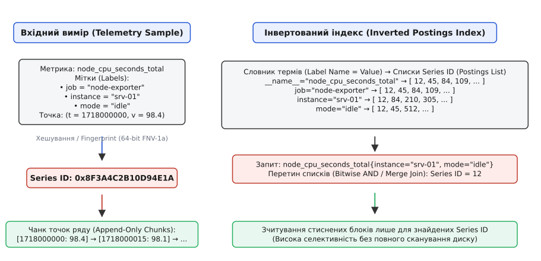
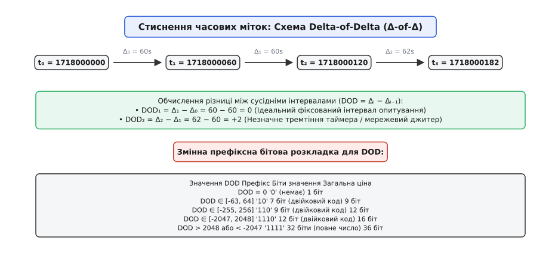
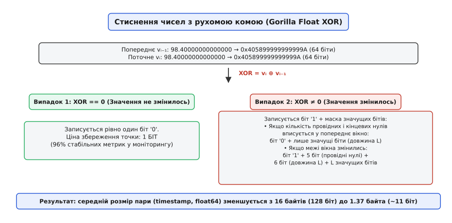
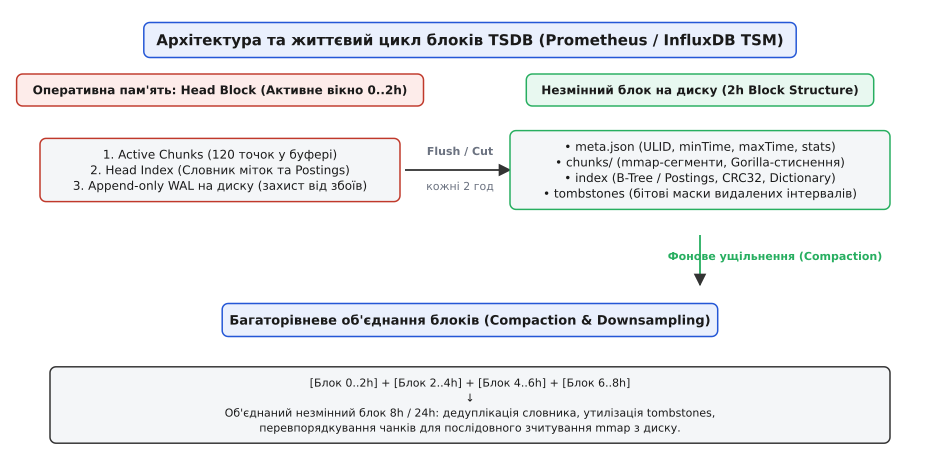

# Сховища часових рядів (Time-Series Storage)

<preknowlist>
- [LSM-дерево та Log-Structured запис](root:sf-data/lsm-tree) — архітектура послідовного запису через буфер у пам'яті (MemTable) та незмінні дискові файли (SSTable).
- [Стовпцеве зберігання](root:sf-data/columnar-storage) — вертикальна організація однотипних полів для ефективного стиснення та векторної обробки аналітичних запитів.
- [Журнал випереджального запису (WAL)](root:sf-data/write-ahead-log) — механізм фіксації операцій у дисковому журналі до їхнього збереження в основних структурах даних.
- [Індекси баз даних](root:sf-data/database-indexes) — структури швидкого пошуку рядків за значеннями атрибутів без повного перебору таблиці.
</preknowlist>

Сучасна хмарна інфраструктура з 10 000 серверних вузлів, на кожному з яких збирається 500 показників продуктивності щосекунди, генерує потік у 5 000 000 вимірів за секунду — понад 430 мільярдів точок на добу. Спроба зберегти цей потік у класичній реляційній базі даних, де кожен вимір записується окремим рядком таблиці `(metric_id, timestamp, value)` з індексом B-дерева, спричиняє негайний збій системи: випадковий дисковий ввід-вивід під час розщеплення вузлів індексу, коефіцієнт посилення запису (write amplification) понад 50x та гігантське споживання пам'яті під службові заголовки транзакцій. Традиційні СУБД оптимізовані для транзакційних змін довільних записів (OLTP), тоді як потік телеметрії має кардинально іншу природу: виміри записуються суто додаванням у кінець (append-only), ніколи не змінюються ретроспективно і зчитуються майже виключно у вигляді послідовних часових діапазонів над багатьма сутностями одночасно.

Для розв'язання цієї задачі створено спеціалізовані рушії — сховища часових рядів (англ. *Time-Series Database*, TSDB). Їхня архітектура відкидає накладні витрати універсальних транзакцій заради трьох цілей: потокового бітового стиснення вимірів без втрати точності, інвертованого індексування багатовимірних міток та сегментації даних на незмінні часові блоки.

## Анатомія та багатовимірна модель даних часового ряду

Одиничний вимір у системі моніторингу або телеметрії складається з часової мітки (числової точки на осі часу), числового значення фізичної або програмної величини та контексту — набору атрибутів, які однозначно ідентифікують джерело виміру.

У реляційних схемах атрибути намагалися нормалізувати через таблиці зв'язків: таблиця серверів, таблиця сервісів, таблиця типів метрик. Проте в динамічних середовищах (наприклад, у кластерах контейнеризації), де мікросервіси, поди та віртуальні мережеві інтерфейси виникають і знищуються щохвилини, статична схема бази даних руйнується. 

Сучасні TSDB спираються на багатовимірну модель даних (англ. *multi-dimensional data model*). У цій моделі кожен вимір позначається назвою метрики та довільним набором міток у форматі `ключ=значення` (англ. *labels* / *tags*):

```
node_cpu_seconds_total{instance="srv-01", mode="idle", zone="eu-west-1a"} 98.4 @1718000000
```

Унікальна комбінація імені метрики та всіх її пар міток визначає один **часовий ряд** (англ. *time series*). Часовий ряд — це неперервна, строго впорядкована за часом послідовність пар `(timestamp, float64)`, що належать одному й тому самому ідентифікатору.


*Зв'язок між потоком багатовимірних вимірів, обчисленням унікального Series ID та інвертованим індексом для швидкого пошуку за мітками.*

Коли до рушія надходить новий вимір, система перетворює весь текстовий набір міток на єдиний 64-бітний числовий ідентифікатор — `Series ID` (або `Fingerprint`). Для цього використовується швидке некриптографічне хешування (наприклад, алгоритм FNV-1a або MurmurHash3) над відсортованим за алфавітом рядком міток:

```
хеш("node_cpu_seconds_total" + "instance=srv-01" + "mode=idle" + "zone=eu-west-1a") 
= 0x8F3A4C2B10D94E1A
```

Після обчислення `Series ID` числова пара `(timestamp, value)` надсилається до активного буфера пам'яті цього конкретного ряду. Усі складні рядкові мітки відсікаються від гарячого шляху запису: дані зберігаються як щільні масиви однакових чисел.

Кількість унікальних часових рядів, що одночасно існують у системі, називається **кардинальністю** (лат. *cardinalis* — головний, фундаментальний; у математиці — потужність множини). Якщо розробник помилково додає до міток динамічний ідентифікатор запиту (наприклад, `user_id` або `request_id` з мільйонами значень), кардинальність зростає вибухоподібно. Це явище має назву «вибух кардинальності» (англ. *cardinality explosion*): воно вичерпує оперативну пам'ять, виділену під індекси, і є головною загрозою стабільності TSDB.

## Дворівнева індексація: інвертований індекс міток

Користувацькі аналітичні запити майже ніколи не звертаються до одного відомого `Series ID`. Замість цього аналітик або система алертингу фільтрує ряди за підмножиною міток, наприклад: «порахувати середнє навантаження CPU для всіх серверів у зоні `eu-west-1a`, де `mode="idle"`».

Повний перебір усіх мільйонів рядів у пам'яті для перевірки збігу текстових міток під час кожного запиту є неприпустимо повільним. Тому TSDB використовує **інвертований індекс** (лат. *invertere* — перевертати, обертати).

Замість того, щоб зберігати список міток для кожного ряду (прямий індекс), інвертований індекс зберігає список усіх `Series ID`, які містять конкретну пару `мітка=значення`. Цей список ідентифікаторів називається **списком входжень** або **постингом** (англ. *postings list*):

- `zone="eu-west-1a"` → `[12, 18, 45, 84, 109, 210, 305, 512]`
- `mode="idle"` → `[12, 45, 84, 109, 512, 640]`
- `__name__="node_cpu_seconds_total"` → `[12, 45, 84, 109, 210, 512]`

Списки `Series ID` у постингах зберігаються у строго зростаючому порядку. Це дозволяє знаходити перетин умов запиту за лінійний час за допомогою алгоритму злиття списків або порозрядного множення бітових карт (Bitwise AND над Roaring Bitmaps):

```
Matched_Series = Postings(zone="eu-west-1a") ∩ Postings(mode="idle") ∩ Postings(__name__="node_cpu_seconds_total")
               = [12, 45, 84, 109, 512]
```

Отримавши масив `Matched_Series`, рушій миттєво переходить до зчитування числових чанків лише знайдених рядів, повністю уникаючи сканування нерелевантних даних. Детальний внутрішній двійковий макет цих структур розглянуто у вставці [Структура двійкового чанка та контракт індексу TSDB](root:sf-data/time-series-storage/api-tsdb-query-and-chunk.md).

## Потокове стиснення часових міток: схема Delta-of-Delta

У нестисненому вигляді кожна точка виміру займає 16 байтів: 8 байтів (64 біти) під UNIX-час у мілісекундах (`int64`) та 8 байтів під дійсне число (`float64`). За інтенсивності 5 000 000 точок на секунду зберігання сирих даних потребувало б:

```
5 000 000 · 16 = 80 000 000 байтів/с ≈ 76.3 МБ/с ≈ 6.44 ТБ на добу
```

Це створило б колосальне навантаження на шину пам'яті та дискову підсистему. Проте послідовні часові мітки мають високий ступінь надмірності.

Розглянемо часовий ряд вимірів, що надходять з інтервалом опитування 60 секунд:
`t₀ = 1718000000`, `t₁ = 1718000060`, `t₂ = 1718000120`, `t₃ = 1718000182`.

Якщо обчислити першу різницю (дельту, грец. *delta* — літера грецького алфавіту `Δ`, що позначає зміну величини):
- `Δ₀ = t₁ - t₀ = 60`
- `Δ₁ = t₂ - t₁ = 60`
- `Δ₂ = t₃ - t₂ = 62` (затримка 2 секунди через навантаження мережі)

Збереження значень `60` все одно вимагає виділення принаймні 8 або 16 бітів на кожне число. Але якщо обчислити **різницю різниць** — дельту дельт (англ. *Delta-of-Delta*, `DOD`):
- `DOD₁ = Δ₁ - Δ₀ = 60 - 60 = 0`
- `DOD₂ = Δ₂ - Δ₁ = 62 - 60 = +2`


*Формування різниць другого порядку та змінна префіксна бітова розкладка алгоритму Gorilla.*

Для регулярних вимірів величина `DOD` у переважній більшості випадків дорівнює нулю. Алгоритм Gorilla використовує префіксний код змінної довжини (англ. *variable-length prefix encoding*), де для нульового значення `DOD` виділяється рівно один біт:

1. `DOD = 0`: записується один біт `'0'`.
2. `-63 ≤ DOD ≤ 64`: записується бітовий префікс `'10'` (2 біти) та значення `DOD` у 7 бітах (загалом 9 бітів).
3. `-255 ≤ DOD ≤ 256`: записується бітовий префікс `'110'` (3 біти) та значення `DOD` у 9 бітах (загалом 12 бітів).
4. `-2047 ≤ DOD ≤ 2048`: записується бітовий префікс `'1110'` (4 біти) та значення `DOD` у 12 бітах (загалом 16 бітів).
5. `DOD` поза діапазоном: записується бітовий префікс `'1111'` (4 біти) та повне значення `DOD` у 32 бітах (загалом 36 бітів).

Завдяки цьому для систем із фіксованим інтервалом опитування часова мітка кодується рівно 1 бітом замість 64 бітів — компресія у 64 рази.

:::tabs
:::code time-series-storage-d/c/potokove-stysnennia.c
:::code time-series-storage-d/cpp/potokove-stysnennia.cpp
:::

## Стиснення дійсних чисел: алгоритм Gorilla XOR

Дійсні числа подвійної точності стандарту IEEE 754 складаються з 1 знакового біта, 11 бітів порядку та 52 бітів мантиси. Звичайні алгоритми стиснення загального призначення (gzip, zstd) неефективні для масивів чисел із рухомою комою, оскільки навіть найменша зміна дробової частини змінює випадковий бітовий візерунок молодших розрядів мантиси.

Проте операція побітового виключного «АБО» (`XOR`, позначається `⊕`) між двома сусідніми значеннями `v[i]` та `v[i-1]` має унікальну властивість:
1. Якщо значення взагалі не змінилося (`v[i] == v[i-1]`), то `v[i] ⊕ v[i-1] = 0x0000000000000000` (всі 64 біти дорівнюють нулю).
2. Якщо значення змінилося незначно (наприклад, температура змінилася з `24.500` на `24.505`), знаковий біт, порядок і більшість старших бітів мантиси залишаються незмінними. В результаті операції `XOR` утворюється число з великою кількістю провідних нулів (англ. *leading zeros*) на початку та кінцевих нулів (англ. *trailing zeros*) у кінці.


*Схема розгалуження алгоритму Gorilla XOR під час кодування 64-бітних чисел із рухомою комою.*

Алгоритм кодування дійсного числа `v[i]` складається з таких кроків:

1. Обчислюється `XOR = bits(v[i]) ⊕ bits(v[i-1])`.
2. **Випадок А (`XOR == 0`):** записується рівно один біт `'0'`. Це означає, що число збігається з попереднім.
3. **Випадок Б (`XOR ≠ 0`):** записується біт `'1'`, що свідчить про наявність змін. Далі перевіряються межі ненульових бітів:
   - **Блокове перевикористання:** Якщо кількість провідних і кінцевих нулів поточного `XOR` не менша, ніж у попереднього закодованого числа, записується контрольний біт `'0'`. Після цього записуються лише значущі біти фіксованої довжини попереднього вікна.
   - **Нове вікно:** Якщо межі змінилися, записується контрольний біт `'1'`, після чого:
     - 5 бітів зберігають кількість провідних нулів (`leading zeros`, від 0 до 31).
     - 6 бітів зберігають довжину значущої частини (`length`, від 1 до 64).
     - `length` бітів зберігають саме значуще наповнення числа.

:::tabs
:::code time-series-storage-d/c/stysnennia-diisnykh-chysel.c
:::code time-series-storage-d/cpp/stysnennia-diisnykh-chysel.cpp
:::

Повний робочий проєкт компресора з побітовими операціями введення-виведення наведено у вставці [Реалізація потокового компресора Gorilla на C та C++](root:sf-data/time-series-storage/proj-gorilla-compressor.md). Теоретичні ентропійні оцінки та математичне виведення коефіцієнтів стиснення подано у матеріалі [Ентропійний аналіз та математичне обґрунтування алгоритмів стиснення часових рядів](root:sf-data/time-series-storage/math-compression-entropy.md).

## Життєвий цикл блоків та архітектура сховища на диску

Поєднання алгоритмів стиснення та інвертованого індексу реалізується в архітектурі рушія зберігання даних. Замість одного монолітного файлу даних, сучасні TSDB розбивають часову вісь на дискретні незмінні інтервали — **часові блоки** (англ. *time-partitioned immutable blocks*).


*Конвеєр обробки даних у TSDB: від оперативної пам'яті (Head Block) та журналу WAL до незмінних дискових сегментів і багаторівневої компактифікації.*

Життєвий цикл вимірів у системі складається з чотирьох послідовних етапів:

### 1. Буфер оперативної пам'яті (Head Block)
Усі нові виміри потрапляють у так званий головний блок (англ. *Head Block*). У ньому утримуються:
- **Активні чанки (Active Chunks):** масиви пам'яті, куди побітово дописуються нові виміри (зазвичай по 120 точок на чанк).
- **Індекс у пам'яті (Head Index):** хеш-таблиці та прямі списки для миттєвого пошуку активних рядів.
- **Журнал випереджального запису (WAL):** кожен вимір негайно дописується у файл журналу на диску блоками по 32 КБ. Це гарантує нульову втрату даних при раптовому вимкненні живлення сервера.

### 2. Скидання на диск (Block Cut & Flush)
Коли часовий діапазон Head Block досягає встановленого ліміту (у Prometheus TSDB — рівно 2 години), блок «розрізається» (англ. *cut*):
- Створюється новий каталог блоку на диску з унікальним ідентифікатором ULID.
- Усі закриті чанки записуються в підкаталог `chunks/` послідовними сегментами розміром до 512 МБ.
- Формується фінальний незмінний файл `index`, що містить словник символів та стиснені списки входжень.
- Створюється дескриптор `meta.json`.
- Після успішної фіксації блоку відповідний сегмент старого журналу WAL видаляється з диска.

### 3. Відображення пам'яті (Memory Mapping via `mmap`)
Незмінні дискові блоки ніколи не завантажуються в адресний простір процесу повністю за допомогою системних викликів `read()` або `malloc()`. Замість цього рушій відкриває файли чанків та індексів через виклик ядра ОС `mmap()` (лат. *mappa* — карта, полотно).

Завдяки `mmap` віртуальні сторінки пам'яті відображаються безпосередньо на системний дисковий кеш (Page Cache). Якщо запит вимагає зчитування чанка за минулий тиждень, ядро підвантажує лише потрібні 4 КБ сторінки з диска без подвійного копіювання пам'яті (Zero-Copy Read). Блоки, до яких немає звернень, автоматично витісняються ядром ОС під час дефіциту оперативної пам'яті.

### 4. Багаторівневе ущільнення (Compaction & Downsampling)
З часом у системі накопичується велика кількість двогодинних блоків. Щоб зменшити накладні витрати файлової системи та прискорити вибірку довготривалих запитів, фоновий процес виконує **компактифікацію** (лат. *compactio* — з'єднання, ущільнення):

- Декілька двогодинних блоків (наприклад, чотири блоки за 8 годин або дванадцять блоків за 24 години) зливаються в один великий незмінний блок.
- Під час злиття дедуплікуються словники символів і об'єднуються суміжні чанки одного й того самого ряду.
- Фізично очищаються дані, позначені для видалення у файлі `tombstones` (англ. *tombstone* — надгробний камінь; мітка логічного видалення часового інтервалу).
- Опціонально застосовується **даунсемплінг** (англ. *downsampling* — зниження частоти дискретизації): старі детальні 1-секундні точки замінюються на 5-хвилинні агрегати (середнє, мінімум, максимум) для довгострокового зберігання роками.

Історичний шлях розвитку цих концепцій від найперших кільцевих буферів RRDtool до архітектури Facebook Gorilla описано у вставці [Історія спеціалізованих сховищ часових рядів: від RRDtool до Gorilla та сучасних TSDB](root:sf-data/time-series-storage/hist-gorilla-and-tsdb.md).

## Складні інженерні виклики: запізнілі виміри та видалення даних

У реальних виробничих середовищах потік вимірів стикається з відхиленнями від ідеальної моделі строгого монотонного запису:

### 1. Неупорядковані виміри (Out-of-Order Writes)
Якщо агент моніторингу або граничний IoT-пристрій втрачає інтернет-зв'язок на кілька хвилин, після відновлення мережі він надсилає пакет накопичених історичних точок із мітками часу за минулі інтервали. 

Оскільки потоковий алгоритм Gorilla розрахований на монотонне зростання часу (`t[i] > t[i-1]`), дописування старішої точки в активний стиснений чанк призвело б до руйнування бітового потоку. Для вирішення цієї проблеми сучасні TSDB (зокрема Prometheus починаючи з версії 2.39+) реалізують спеціальний механізм буферизації неупорядкованих даних (англ. *Out-of-Order Ingestion*):
- У блоці оперативної пам'яті Head Block виділяється паралельний динамічний буфер (на основі сортованих списків пропусків або невеликих нестиснених масивів).
- Неупорядковані точки накопичуються окремо від активних чанків і періодично впорядковуються за часом.
- Під час процедури скидання Head Block на диск впорядковані масиви зливаються з основними чанками та кодуються компресором Gorilla в єдиний монотонний бітовий потік.
- Якщо запізніла точка надходить із часовою міткою, що виходить за межі вікна Head Block (наприклад, старша за 2 години і належить уже закритому незмінному блоку на диску), вона відхиляється, або для її інтеграції запускається процедура фонового перезапису історичного блоку.

### 2. Логічне видалення та надгробні камені (Tombstones)
Через незмінність файлів на диску (`immutable blocks`) пряме видалення окремого ряду або часового діапазону (наприклад, для виконання вимог конфіденційності GDPR) не може бути виконане миттєвим перезаписом гігабайтних сегментів.

Замість цього рушій створює легковажний файл `tombstones`, у якому фіксуються інтервали видалення: `(SeriesID, minTime, maxTime)`. Під час виконання запитів рушій накладає бітову маску tombstones на знайдені чанки, миттєво відфільтровуючи видалені виміри без зміни файлів на диску. Фізичне видалення даних та вивільнення дискового простору відбувається пізніше — під час чергового циклу фонової компактифікації.

## Порівняння архітектурних рішень у сучасних TSDB

Різні промислові рушії адаптують описані принципи під специфічні інженерні компроміси:

| Характеристика | Prometheus TSDB | InfluxDB (TSM / IOx) | TimescaleDB |
| :--- | :--- | :--- | :--- |
| **Основна парадигма** | Локальний незмінний блоковий рушій | Розподілене сховище / Колоночний рушій | Реляційне розширення над PostgreSQL |
| **Модель даних** | Метрики + мітки `key=value` + `float64` | Поля, теги, вимірювання (Measurement) | Реляційні таблиці + партиції (Hypertables) |
| **Індексація** | Інвертований індекс у файлі `index` | Інвертований індекс серій у TSM / Arrow | B-tree + GiST/GIN індекси PostgreSQL |
| **Стиснення даних** | Gorilla (DoubleDelta + Float XOR) | Gorilla, Snappy, RLE, Apache Parquet | Гібридне колоночне стиснення (Gorilla + RLE) |
| **Мова запитів** | PromQL (векторні часові зрізи) | InfluxQL / Flux / SQL (IOx) | Стандартний SQL + часові гіперфункції |
| **Основна перевага** | Мінімальні витрати CPU/RAM на моніторинг | Гнучкі типи даних (рядки, цілі, булеві) | Повна підтримка ACID, JOIN та екосистеми SQL |

> 🔧 **Навіщо це в реальній розробці.**
> Розуміння внутрішнього устрою TSDB безпосередньо впливає на дизайн систем моніторингу та бізнес-метрик:
> 1. **Контроль кардинальності:** Ніколи не вставляйте динамічні значення (UUID, хеші паролів, IP-адреси клієнтів, URL з динамічними шляхами `/users/{id}`) у мітки метрик. Кожне нове унікальне значення створює новий часовий ряд, роздуваючи пам'ять інвертованого індексу та уповільнюючи виконання абсолютно всіх запитів у системі. Для відстеження унікальних подій слід використовувати системи збору логів або трасувань (Distributed Tracing).
> 2. **Швидкість збереження:** Завдяки Delta-of-Delta та XOR компресії, збереження постійних або повільно змінюваних величин коштує мізерні 1.5–2 байти на точку. Це дозволяє проектувати телеметрію з високою частотою опитування (1–5 секунд) без страху передчасного вичерпання дискового масиву.
> 3. **Швидкі діапазонні запити:** Оскільки чанки відсортовані за часом і відображаються через `mmap`, запити за великі проміжки часу (наприклад, `rate(http_requests_total[1h])`) зчитують диск строго послідовно на швидкості шини накопичувача (кілька гігабайтів на секунду), не створюючи випадкового позиціонування голівок HDD або блокування SSD.
