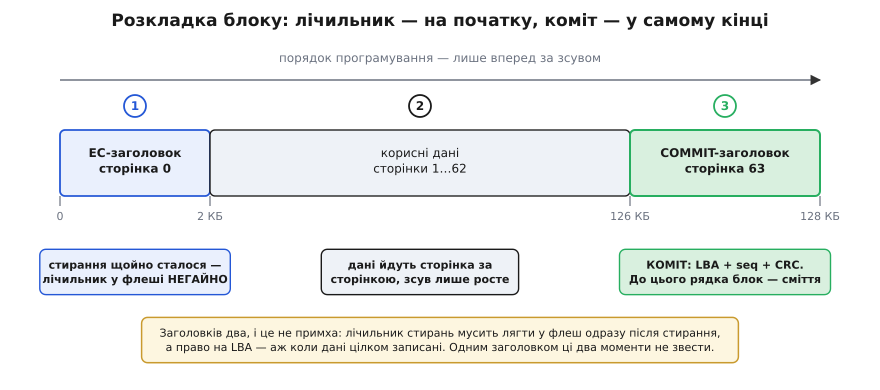
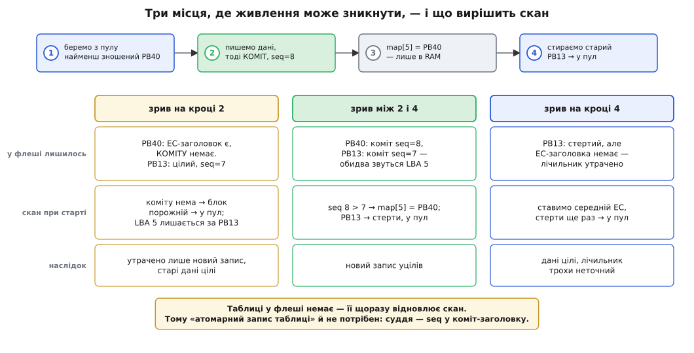
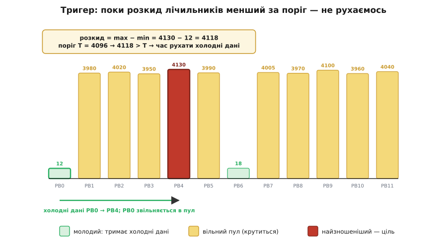

# ⚙️ Шар вирівнювання зносу на C: код, що переживає зникнення живлення

<preknowlist>
- [Flash зсередини](root:hw-components/flash-internals) — писати можна лише в стерте; стирання йде цілим блоком і повертає біти в одиниці; програмування в межах блоку йде сторінками й лише за зростанням зсуву.
- [Черга за пріоритетом](root:sf-algorithms/priority-queue-adt) — двійкова купа в масиві: батько за індексом (i−1)/2, діти 2i+1 і 2i+2; мінімум лежить у корені, вставка й видалення коштують O(log n) просіюванням.
- [CRC](root:com-modulation/crc-algorithm) — контрольна сума, що ловить обірваний чи побитий запис; рахується потоково, шматок за шматком.
</preknowlist>

Сам алгоритм вирівнювання зносу вміщується в один абзац: тримай лічильник стирань на блок, пиши в той вільний блок, де лічильник найменший, і час від часу зрушуй холодні дані. Написати це — година роботи. Проблема в тому, що написане так працюватиме рівно доти, доки в розетці є струм.

Бо флеш живе там, де живлення зникає без попередження: акумулятор від'єднали, ногу об кабель зачепили, авто заглушили. І зникнути воно може між будь-якими двома рядками — зокрема між «записали дані» і «оновили таблицю». Таблиця та лежить в оперативній пам'яті, якої після вимкнення просто немає. Виходить, кожен рядок цього коду треба писати з питанням: **а що побачить наступний старт, якщо обірватися саме тут?**

Зберімо такий шар цілком — від інтерфейсу до відновлення після зриву. Мова тут не обговорюється: це прошивка контролера флешу, де є голі регістри, немає динамічного розподілу пам'яті, а розкладка структури мусить збігатися з байтами в чипі до одного біта. Це територія C.

### Що на столі

Знизу — драйвер чипа. Він уміє рівно три речі, і кожна працює у своїх одиницях: стирання — цілим **блоком**, а читання й запис — цілою **сторінкою**. Дрібніше не буває, і це не примха драйвера, а фізика масиву комірок.

```c
#include <stdint.h>
#include <string.h>

// Драйвер чипа. Три операції — більше нам нічого й не треба.
int flash_erase(uint16_t pbn);                                   // стерти блок цілком
int flash_write_page(uint16_t pbn, uint16_t page, const void *buf);  // рівно сторінка
int flash_read_page (uint16_t pbn, uint16_t page, void *buf);        // рівно сторінка
```

Зверху — програма, яка хоче звичайну адресовану пам'ять і нічого не знає про знос:

```c
int wl_mount(void);                              // підняти шар: зібрати стан із чипа
int wl_write(uint32_t lba, const void *data);    // записати логічний блок
int wl_read (uint32_t lba, void *buf);           // прочитати логічний блок
```

Між ними — те, що ми пишемо. Домовмося про спрощення відразу, чесно: **один логічний блок = один фізичний блок**. Це найпростіша з можливих трансляцій, і в неї є справжня ціна — щоб змінити чотири кілобайти всередині логічного блоку, доведеться перечитати й перезаписати всі сто двадцять вісім. Промислові шари відображають дрібніше, сторінками або гібридно, і платять за це вже пам'яттю під таблицю; ця розвилка — окрема тема [шару трансляції флешу](root:sf-data/ftl-flash-translation), і тут ми йдемо найпростішою гілкою, щоб алгоритм зносу було видно без риштувань.

### Головне рішення: у флеші живуть заголовки, а не таблиця

Перш ніж писати структури, треба відповісти на питання, від якого залежить усе інше: **що саме зберігати в чипі?**

Спокуса очевидна — зберігати таблицю. Вона ж головна структура, вона ж і потрібна при старті. Але подумаймо, що це означає. Таблицю правлять за кожного запису; отже, у флеші вона була б найгарячішим об'єктом із можливих і спалила б свій блок першою — та сама пастка, від якої ми рятуємо всіх інших. А ще її довелося б оновлювати **атомарно**: запис даних і запис нового рядка таблиці мусили б або статися обидва, або не статися жодного. Флеш такого не вміє. Атомарність довелося б будувати самотужки — журналом, подвійним буфером, комітами. Багато коду, і кожен його рядок — новий шанс помилитися.

Розвернімо задачу. Таблиця відповідає на питання «де зараз лежить логічний блок 5?». А що, як питати не таблицю, а **самі блоки**? Хай кожен фізичний блок носить у собі коротку записку: «я — логічний блок 5, версія така-то». Тоді таблиця стає простою **похідною** від чипа: пройшовся по блоках, зібрав записки — маєш таблицю. Зберігати її не треба взагалі. Вона живе в RAM, вмирає з живленням і відроджується при старті з того, що написано у флеші.

І тоді питання атомарності зникає — не розв'язується, а **зникає**. Немає чого оновлювати атомарно, бо у флеші немає таблиці. Є лише записки в блоках, і кожна з них пишеться в один прийом, в один блок.

> 🔧 **Навіщо це.** Це прийом ширший за флеш: коли структуру важко оновлювати атомарно, спитай, чи можна її взагалі не зберігати — а виводити з даних, які й так лежать поруч і пишуться природно. Так само працює відновлення файлової системи за журналом, збирання індексу з сегментів у [журнальних сховищах](root:sf-algorithms/key-value-store), відбудова стану сервісу з потоку подій. Ціна завжди одна й та сама: старт довшає, бо стан треба зібрати наново. Вигода теж одна: **зникає цілий клас помилок узгодженості** — узгоджувати нічого, джерело правди одне.

Лишається дрібниця, яка насправді не дрібниця: якщо записка каже «я — логічний блок 5», а таких блоків при старті знайдеться **два**, кому вірити? Саме тут і працює версія. Дамо кожному запису наскрізний номер, що лише зростає, — і суперечка вирішується арифметикою: більший номер свіжіший. Цей номер, `seq`, і є той суддя, що замінює атомарність.

### Розкладка блоку: чому заголовків мусить бути два

Тепер розкладемо блок по сторінках. Здавалося б, записка потрібна одна. Але в неї два зовсім різні за часом наповнення поля, і саме через це заголовків доводиться робити два.

Перше поле — **лічильник стирань**. Він мусить лягти у флеш **негайно після стирання**. Не пізніше. Бо якщо живлення зникне після стирання, але до запису лічильника, то знання про те, скільки разів цей блок стирали, зникне назавжди: у стертому блоці самі одиниці, він ні про що не пам'ятає. Ми втратимо не дані — ми втратимо **пам'ять про знос**, і блок далі вдаватиме молодого, поки не помре передчасно.

Друге поле — **право на логічну адресу**. Його, навпаки, можна записувати лише **в самому кінці**, коли дані вже цілком лежать у блоці. Бо саме воно оголошує світові: цей блок тепер і є логічний блок 5. Скажи це зарано — і зрив живлення посеред запису лишить блок, який голосно претендує на адресу, тримаючи в собі половину даних.

Ці два моменти — «одразу після стирання» і «аж коли все записано» — розділені всім часом запису блоку. Одним заголовком їх не звести. Тому заголовків два, і сидять вони на протилежних кінцях блоку:


*Розкладка блоку в 64 сторінки. Сторінка 0 — EC-заголовок із лічильником стирань: його пишуть одразу після стирання, поки пам'ять про знос ще існує. Сторінки 1…62 — корисні дані. Сторінка 63 — COMMIT-заголовок: логічна адреса, наскрізний номер `seq` і CRC даних. Порядок програмування йде лише вперед за зсувом, як того й вимагає NAND, — тому коміт природно опиняється останнім записом у блоці, і саме він робить блок дійсним.*

Те, що коміт стоїть у **кінці**, а не на початку, — не питання смаку. NAND дозволяє програмувати сторінки в межах блоку лише за зростанням номера; повернутися й дописати нульову сторінку після шістдесятої не можна. Отже, останній запис у блоці фізично не може статися раніше за дані. Обмеження заліза саме поставило коміт туди, куди його й треба було поставити.

Ось ці домовленості в коді:

:::code proj-wear-leveling/c/rozkladka-bloku-chomu.c

`crc` стоїть **останнім полем** не випадково: так контрольна сума накриває рівно все, що перед нею, і рахується як `crc32(h, sizeof *h - 4)` — без жодного окремого опису полів. Потрібні дві форми CRC — разова й потокова, бо блок ми копіюватимемо сторінка за сторінкою:

```c
#define CRC32_INIT 0xFFFFFFFFu
uint32_t crc32_update(uint32_t crc, const void *p, uint32_t n);   // потокове
static inline uint32_t crc32(const void *p, uint32_t n) {
    return crc32_update(CRC32_INIT, p, n) ^ 0xFFFFFFFFu;          // разове: init + фінальна інверсія
}
```

### Стан у пам'яті

Тепер видно, що тримати в RAM. Усе тут — **кеш**, який відновлюється з чипа; жоден із цих масивів не записується у флеш ніколи.

:::code proj-wear-leveling/c/stan-u-pamiati.h

Один буфер на сторінку — це принципово. Спокусливо було б завести буфер на цілий блок і копіювати блок одним махом, але сто двадцять вісім кілобайтів RAM у контролері зазвичай просто немає. Уся робота з даними йтиме сторінками.

Пара `heap` / `hpos` заслуговує на слово. `heap` — звичайна двійкова купа вільних блоків, упорядкована за `ec[]`. А `hpos` — зворотний покажчик: де саме в купі сидить конкретний блок. Він потрібен, бо статичне вирівнювання забиратиме з пулу не корінь, а **довільний** блок — той найзношеніший, куди ми переселятимемо холодні дані. Без `hpos` довелося б шукати його в купі перебором, і вся вигода від O(log n) розтанула б.

### Купа: витягти не лише мінімум

Купа тут звичайна, з однією поправкою — кожен обмін мусить оновити ще й `hpos`, інакше зворотний покажчик збреше:

:::code proj-wear-leveling/c/kupa-vytiahty-ne-lyshe.c

Цікаве починається на видаленні. Витягти корінь уміє кожен; нам треба витягти блок із **будь-якої** позиції:

:::code proj-wear-leveling/c/kupa-vytiahty-ne-lyshe-2.c

Два просіювання поспіль виглядають як перестраховка — насправді це рівно те, що треба, і тільки одне з них колись спрацює. Гляньмо чому. Хай на позицію `i` став елемент `last`, узятий десь із хвоста купи. Про нього не відомо нічого: він може бути меншим за батька `i` або більшим за дітей `i`. Обидва разом — ні: батько `i` завжди не більший за колишніх дітей `i`, тож щойно `last` більший за дитину, він тим паче не менший за батька.

А якщо `sift_down` таки зробив обмін? Тоді на позицію `i` піднялася найменша з дітей. Вона більша або рівна тому, що там стояло раніше, а те — більше або рівне батькові. Отже, вона теж не менша за батька, і наступний `sift_up(i)` не зробить жодного кроку. Просто виходить вхолосту. Тому пара `sift_down` + `sift_up` завжди дає рівно один справжній прохід — і жодних розборів випадків у коді.

### Стирання: єдине місце, де росте знос

Виділимо в окрему функцію те, чим блок повертається у пул. Це важлива точка коду: **лічильник зносу росте тільки тут**, у єдиному місці на весь шар.

:::code proj-wear-leveling/c/styrannia-iedyne-mistse-de.c

Між `flash_erase` і `write_ec_hdr` — той самий небезпечний проміжок у кілька мілісекунд, коли лічильник існує лише в RAM. Зробити його нульовим неможливо: стерти й записати одним неподільним рухом чип не вміє. Тому все, що ми можемо, — зробити його **якнайкоротшим** і навчитися розпізнавати наслідки при старті. Обидва завдання код виконує: запис заголовка стоїть відразу за стиранням, а що робити з блоком без заголовка — розберемо нижче.

### Шлях запису

Тепер головна функція. Читати її варто не як послідовність дій, а як послідовність станів чипа — бо саме їх побачить наступний старт, якщо обірватися.

:::code proj-wear-leveling/c/shliakh-zapysu.c

Читання поруч із цим виглядає майже образливо простим — і це правильно. За знос платить лише той, хто пише:

```c
int wl_read(uint32_t lba, void *buf) {
    if (lba >= N_LOG || map[lba] == NO_BLOCK) return -1;
    for (uint16_t p = 0; p < DATA_PAGES; p++)
        if (flash_read_page(map[lba], DATA_PAGE + p,
                            (uint8_t *)buf + p * PAGE_SIZE) != 0) return -1;
    return 0;
}
```

Тепер поставмо `wl_write` головне питання — вимкнімо живлення в кожному з можливих місць і подивімося, що лишиться в чипі:


*Чотири кроки запису й три способи їх обірвати. Крок 3 узагалі не залишає слідів у флеші — таблиця живе тільки в RAM, тож обриватися на ньому нема на чому. Зрив на кроці 2 лишає блок без коміту: скан визнає його порожнім, і логічна адреса тихо лишається за старим блоком — утрачено лише новий запис. Зрив між 2 і 4 лишає двох претендентів на одну адресу — суперечку вирішує `seq`. Зрив на кроці 4 губить лічильник стирань, і це єдина втрата, яку не відшкодувати точно.*

Придивімося до середнього випадку — того, заради якого все й будувалося. Коміт у `PB40` уже записаний, старий `PB13` ще не стертий. Живлення зникає. У чипі два блоки кажуть «я — логічний блок 5»: один із `seq = 7`, другий із `seq = 8`. Ніякої неоднозначності немає й близько: восьмий запис стався пізніше за сьомий, крапка. Скан бере `PB40`, а `PB13` відправляє в пул.

Ось воно, головне: **атомарного оновлення таблиці не знадобилося взагалі**. Ми не робили його швидшим, не захищали журналом, не ховали за подвійним буфером — ми прибрали саму потребу в ньому. Коміт-заголовок пишеться в один прийом в один блок; він або записався й дійсний за CRC, або ні. Третього стану немає, а `seq` розсуджує, хто новіший. Уся стійкість до зривів тримається на цих двох полях по дванадцять байтів.

Щодо `seq`: він шістдесятичотирибітний, і це не марнотратство, а спосіб узагалі не думати про переповнення. Порахуймо межу.

**Приклад (чи може `seq` обернутися).** Хай шар пише з неможливою для флешу швидкістю — мільйон записів на секунду, без упину:

```
номерів у seq:        2⁶⁴ ≈ 1.84 × 10¹⁹
витрата:              10⁶ записів/с
                      10⁶ × 3600 × 24 × 365 ≈ 3.15 × 10¹³ записів/рік

до переповнення:      1.84 × 10¹⁹ / 3.15 × 10¹³ ≈ 5.8 × 10⁵ років
```

Пів мільйона років безперервної роботи на швидкості, якої флеш не витримає й хвилини. Шістдесятичотирибітний лічильник — це не запас, а **скасування цілого класу помилок за вісім байтів на блок**: код для обробки обертання не треба ні писати, ні тестувати, ні згадувати про нього через десять років.

### Тригер статичного вирівнювання

Динамічна частина вже готова: `heap_pop_min` роздає записи по колу серед вільних. Лишилося зрушувати холодні дані — інакше блоки, де роками лежить прошивка, назавжди лишаться молодими, а весь знос ляже на менший клапоть чипа.

Питання лише в тому, **коли** рухатися. Рухатися щоразу — безглуздо: кожне перенесення саме собою стирає блок, тобто зношує чип заради того, щоб зменшити знос. Не рухатися ніколи — теж зрозуміло чим погано. Треба поріг, і природна величина для нього одна: **розкид лічильників**. Поки найзношеніший і наймолодший блоки йдуть поруч — усе гаразд, вирівнювання працює саме собою. Щойно вони роз'їхалися далі, ніж на поріг, — час утручатися.


*Лічильники стирань дванадцяти блоків. Десять крутяться у вільному пулі й дружно дійшли до чотирьох тисяч; два тримають холодні дані й лишилися майже незайманими — динамічне вирівнювання їх ніколи не чіпало, бо у пул вони не потрапляли. Розкид 4130 − 12 = 4118 переріс поріг 4096: беремо наймолодший зайнятий блок PB0, переселяємо його вміст у найзношеніший вільний PB4 і віддаємо звільнений PB0 у пул. Тепер холодні дані сидять на старому блоці й більше його не зношують, а молодий пішов працювати.*

Числа тут не з голови. Саме так це зроблено в UBI — шарі керування блоками для NAND у ядрі Linux. Його параметр `CONFIG_MTD_UBI_WL_THRESHOLD` описано так: «максимальна різниця між найбільшим і найменшим значеннями лічильників стирань», а коли її перевищено, UBI переносить дані з блока з малим лічильником у блок із великим. Стандартне значення — **4096**, і воно розраховане на SLC-NAND та NOR із ресурсом від ста тисяч стирань; для MLC, де ресурс менший за десять тисяч, довідка радить зменшувати поріг до 128 чи 256. Логіка прозора: поріг має бути малою часткою ресурсу, інакше «допустимий» розкид з'їсть помітний шматок життя чипа.

Тепер сам крок. Він рідкісний, тому може дозволити собі прохід по всьому чипу:

:::code proj-wear-leveling/c/tryher-statychnoho.c

Умова `dst_ec - src_ec < WL_THRESHOLD` — це і є «розкид більший за поріг», лише сказане про ті два блоки, яких перенесення справді торкнеться. `src` — наймолодший **зайнятий** блок, тобто той самий, що тримає найхолодніші дані; `dst` — найзношеніший **вільний**. Питати ширше немає сенсу: якщо наймолодший блок чипа лежить у пулі, то жодного перенесення й не треба — його й так візьме найближчий `heap_pop_min`.

І погляньмо, як тут відпрацював коміт-у-кінці. Мітка `drop_dst` — це шлях «щось пішло не так посеред копіювання». Ми вже записали в `dst` десятки сторінок — і просто йдемо геть, стерши його. Ніякого відкату, ніякого прибирання за собою: **без коміту блок ніщо**, і жодна душа в системі про нього не дізнається. Ту саму гарантію ми будували проти зникнення живлення, а користуємося нею проти помилки читання. Так буває з правильно поставленим інваріантом: платиш за нього раз, а віддача приходить із боку, з якого не чекав.

### Підйом: як таблиця збирається з порожнього місця

Лишилося найцікавіше — старт. Тут ми маємо чип і жодного байта в RAM, і саме тут окупається все, що ми заклали в заголовки.

:::code proj-wear-leveling/c/pidiom-iak-tablytsia.c

Третій прохід приховує пастку, на яку легко наступити. Найпростіше було б прогнати `free_block` по всіх незайнятих блоках — і код став би на два рядки коротший. І тихо вбивав би чип: кожне вмикання **стирало б увесь вільний пул**. Пристрій, який вмикають десять разів на день десять років, накрутив би так тридцять шість тисяч зайвих стирань на кожен блок пулу — тобто спалив би десяток ресурсів SLC на самих лише перезавантаженнях. Шар вирівнювання зносу, що зношує флеш просто від того, що його вмикають.

Тому перед стиранням треба спитати: а чи не порожній він уже? Питання не пусте — після обірваного запису EC-заголовок на місці, а в сторінках даних недописане сміття, і зовні ці два випадки не відрізнити:

```c
// Чи блок справді порожній — самі одиниці поза EC-заголовком?
static int block_is_clean(uint16_t b) {
    for (uint16_t p = DATA_PAGE; p < PAGES; p++) {
        if (flash_read_page(b, p, pbuf) != 0) return 0;
        for (uint32_t i = 0; i < PAGE_SIZE; i++)
            if (pbuf[i] != 0xFF) return 0;     // хоч один запрограмований біт — не порожній
    }
    return 1;
}
```

Той самий підхід рятує й блок із загубленим лічильником. Якщо заголовка немає, а сам блок чистий, то стирання встигло **завершитися** — обірвався лише запис заголовка. Стирати вдруге безглуздо: досить записати заголовок із середнім лічильником, і блок готовий. Так само чинить UBI — коли зникнення живлення застало проміжок між стиранням і записом заголовка, він після сканування пише новий заголовок із **середнім** лічильником стирань. Вибір саме середнього не випадковий: поставити нуль означало б збрехати вниз, і мін-купа тягала б цей блок на кожен запис, поки не спалила б; поставити максимум — збрехати вгору, і блок би передчасно пішов «на пенсію» під холодні дані. Середнє — єдина оцінка, що не має систематичного нахилу в жоден бік.

### Чого це коштує

Складімо ціни. `n` — число фізичних блоків, `K` — `WL_CHECK_EVERY`.

```
wl_read           O(1)         одне звертання до map[]
wl_write          O(log n)     pop із купи + push назад під час стирання старого
free_block        O(log n)     просіювання вгору
heap_take         O(log n)     просіювання вниз (порожнє вгору — не рахується)
static_wl_step    O(n) / K     прохід по чипу, але раз на K записів
wl_mount          O(n) читань  повне сканування чипа
```

Перевірмо, чи купа тут узагалі щось важить.

**Приклад (купа проти лінійного пошуку на нашому чипі).** `n` = 1024 блоки по 128 КБ, `K` = 256:

```
вибір блоку купою:      log₂(1024) = 10 порівнянь
вибір лінійним пошуком: 1024 порівняння
різниця:                ~1014 порівнянь ≈ 1 мкс

запис 62 сторінок:      62 × ~300 мкс ≈ 18 600 мкс
стирання блоку:         ~2000 мкс
разом на wl_write:      ≈ 20 600 мкс

частка вибору блоку:    1 / 20 600 ≈ 0.005%
```

Висновок незручний, але чесний: **на цьому чипі купа не дає нічого**. Лінійний пошук з обіцянки статті потонув би у шумі, а сто рядків просіювань — це сто рядків, де можна помилитися. Купа виправдовується деінде — там, де `n` виростає на порядки:

**Приклад (той самий вибір на серверному накопичувачі).** Терабайт, блок стирання 4 МБ, отже `n` = 262 144 блоки:

```
лінійний пошук:         262 144 порівняння ≈ 260 мкс
купа:                   log₂(262 144) = 18 порівнянь ≈ 0.02 мкс

запис блоку 4 МБ:       ≈ 1000 мкс

частка лінійного:       260 / 1000 = 26%   ← чверть часу на пошук мінімуму
частка купи:            0.02 / 1000 ≈ 0.002%
```

Ось де вона окупається: чверть бюджету запису проти двох тисячних. І це ще без урахування того, що накопичувач тримає десятки таких записів у польоті одночасно, а лінійний пошук усі їх серіалізує.

Тому вибір структури тут — не питання смаку й не «купа завжди краща». Він залежить від того, у скільки разів `n` менше за вартість самої операції з флешем. На мікроконтролері з тисячею блоків чесна відповідь — масив; на накопичувачі з сотнями тисяч — купа або червоно-чорне дерево. Саме дерево, до речі, і стоїть у UBI: вільні блоки живуть там у `rb`-дереві за лічильником стирань, бо звідти дешево дістати обидва кінці — і наймолодший, і найзношеніший.

Статична перевірка розмазується так само мирно:

```
прохід static_wl_step:  1024 кроки, раз на 256 записів
                        1024 / 256 = 4 кроки на один запис — на тлі 20 600 мкс це ніщо
```

А от `wl_mount` — єдине місце, де лінійність по-справжньому кусається, і кусається вона тим сильніше, чим більший чип. Тут доводиться прочитати заголовки всіх блоків, а для вільних ще й перевірити чистоту. Ті самі розробники UBI кажуть про це прямо: час підняття прямо пропорційний числу блоків, і на 4-гігабайтному NAND повне сканування триває **кілька секунд**. Для пристрою, який мусить завантажитися за мить, це вирок. Відповідь UBI — `fastmap`: контрольна точка просто у флеші, де вже лежать усі лічильники, стани блоків і сама таблиця, тож замість сканування треба лише її знайти. Числа промовисті: чип на 4096 блоків підіймається за 1172 мс скануванням і за 95 мс через fastmap — у дванадцять разів швидше.

Але зверніть увагу, у що впирається fastmap. Контрольна точка — це та сама таблиця у флеші, від якої ми відмовилися на самому початку: гарячий об'єкт, який може застаріти й сам потребує вирівнювання. Тому вона й не може бути повною правдою — fastmap тримає **пул блоків**, які все одно доводиться сканувати (близько 5% від їх числа), бо вони могли змінитися після останньої контрольної точки. Компроміс чесний: не «сканування або таблиця», а «таблиця плюс сканування маленького хвоста». Ми свій шар лишаємо на чистому скануванні — на 128 МБ це десятки мілісекунд, і платити за них складністю не варто.

### Пастки

Код вище працює, але кілька речей у ньому зроблено найпростішим способом, а не найкращим. Розберімо їх — це якраз ті місця, де реальні шари відрізняються від навчальних.

**Найзношеніший вільний блок — небезпечна ціль.** `static_wl_step` бере в `dst` блок із найбільшим лічильником. Виглядає бездоганно: найстарішому — найспокійніші дані. Розробники UBI пояснюють у коментарі, чому так робити не можна: якщо просто брати блок із найвищим лічильником, у певних навантаженнях це веде до **необмеженого зносу одного блока**. Уяви, що переселені «холодні» дані виявилися не такими вже й холодними — їх скоро переписали. Блок стирається, його лічильник знову найбільший у чипі, наступний крок вирівнювання знову обирає його ціллю — і так по колу, аж поки він не помре, тимчасом як решта чипа дивиться збоку. Вирівнювання, що зношує один блок. UBI ставить стелю: ціль не може мати лічильник більший за найменший серед вільних плюс `WL_FREE_MAX_DIFF`, себто подвоєний поріг. Латка вміщується в один рядок нашого проходу:

```c
uint32_t cap = ec[heap[0]] + 2 * WL_THRESHOLD;      // стеля для цілі
...
if (state[b] == BS_FREE && ec[b] > dst_ec && ec[b] <= cap) { dst_ec = ec[b]; dst = b; }
```

**Щойно записаний блок — гарячий за визначенням.** Пастка тонша, і в нашому коді вона є. `wl_write` бере з пулу **наймолодший** блок; після коміту той стає зайнятим — і моментально виявляється блоком із найменшим лічильником серед зайнятих, тобто ідеальним `src` для наступного `static_wl_step`. Той сумлінно переселить із нього дані. Дані, які щойно записали й от-от перепишуть знову. Перенесення виходить чистою витратою — зайве стирання заради даних, що й так уже мандрують. Ліки — не чіпати блоки, у які писали недавно; UBI тримає для цього окрему **чергу захисту**. У нас вистачить наскрізного номера, який уже є:

```c
static uint64_t written_at[N_PHYS];        // seq, на якому в блок востаннє писали
#define PROTECT_SEQ 1024

// у wl_write, відразу за комітом:
written_at[nb] = c->seq;

// у static_wl_step, у проході по блоках:
if (state[b] == BS_USED && seq_next - written_at[b] < PROTECT_SEQ) continue;  // ще гарячий
```

**Поріг — це важіль між рівністю зносу й підсиленням запису.** Заманливо поставити поріг маленьким: розкид триматиметься щільніше, знос ляже рівніше. Ціна — кожне перенесення додає фізичних записів, яких програма не просила, тобто прямо збільшує [підсилення запису](root:sf-data/write-amplification): за один логічний запис чип робить кілька справжніх. Занадто малий поріг — і шар весь час перетасовує холодні дані замість роботи. Занадто великий — і вирівнювання вмикається так рідко, що майже нічого не вирівнює. Тому в UBI поріг і різний для SLC та MLC: він мусить бути малою часткою ресурсу, а ресурси відрізняються на порядок.

**Статичне вирівнювання й прибирання ділять один пул.** Обидва механізми споживають вільні блоки й обидва їх виробляють — і легко зчепитися. Перенесення бере блок із пулу; якщо пул уже на межі, [збирачеві сміття](root:sf-data/flash-garbage-collection) не буде на чому працювати, і шар стане намертво: щоб звільнити блок, потрібен вільний блок. Саме проти цього стоїть `WL_RESERVE` — кілька блоків, яких вирівнювання не торкається ніколи. Правило універсальне: **фонова оптимізація не має права з'їсти останній ресурс, потрібний основній роботі.**

**Найдовше лежить те, що покладено на найслабші комірки.** Ця тонкість не з коду, а з фізики, і вона неприємна. Статичне вирівнювання свідомо кладе холодні дані — ті, що лежатимуть роками недоторканими, — у **найзношеніший** блок чипа. А зношена комірка гірше тримає заряд: ізолятор уже побитий тунельним струмом, витік більший. Виходить, ми віддали найдовше зберігання найдірявішій посудині. Саме тому реальні шари не покладаються на це наосліп: заряд підпирає ECC, а окремий обхід періодично перечитує давно не читані блоки й переписує ті, де кількість виправлених помилок підповзає до межі. UBI тримає для таких блоків окреме дерево `scrub`; ширше про сам механізм — [профілактичне перечитування пам'яті](root:hw-arch/memory-scrubbing).

**Погані блоки — не виняток, а норма.** NAND приїжджає з заводу вже з дефектними блоками, і нові з'являються за життя. Тому `state[b] = BS_BAD` у коді стоїть після кожної відмови: блок, який не стерся чи не записався, назавжди вибуває. Пул від цього поволі тане, а `N_LOG < N_PHYS` існує саме як запас під це танення. Облік і мітки таких блоків — окрема дисципліна, [керування поганими блоками](root:sf-data/bad-block-management).

**Ціна таблиці в RAM росте разом із чипом.** У нас `map` — 960 елементів по два байти, менше двох кілобайтів: дрібниця. Але масштабуймо. Той самий терабайтний накопичувач із відображенням по сторінках у 4 КБ — це 268 мільйонів рядків по чотири байти, тобто **гігабайт RAM тільки під таблицю**. Ось звідки в накопичувачах узялася власна DRAM, а в дешевих — підкачування таблиці шматками з самого ж флешу. Наше грубе відображення блоками платить за дешеву таблицю нещадним підсиленням запису: зміна чотирьох кілобайтів тягне перезапис усіх ста двадцяти восьми, тобто множник 32. Обидва краї погані по-своєму, і справжні шари живуть посередині — гібридом.

---

Що з усього цього варто винести. Вирівнювання зносу як таке — двадцять рядків: лічильник, купа, поріг. Решта коду — і майже вся його складність — це відповідь на єдине питання: **що побачить наступний старт, якщо обірватися саме тут?** І виявляється, що відповідь дає не хитрий механізм, а вдало розкладені байти: лічильник, записаний одразу після стирання; право на адресу, записане в останню сторінку блоку; наскрізний номер, що розсуджує двох претендентів. Таблиця не зберігається — вона виводиться, і тому не може розійтися з дійсністю. Атомарність не будується — вона стає непотрібною. А те, за що доводиться платити насправді, — це не такти процесора (на тлі мілісекундного стирання їх не видно), а секунди підйому й зайві записи від перенесень. Саме там, а не в купі, лежать справжні компроміси цього шару.
