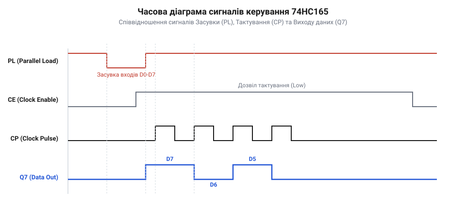
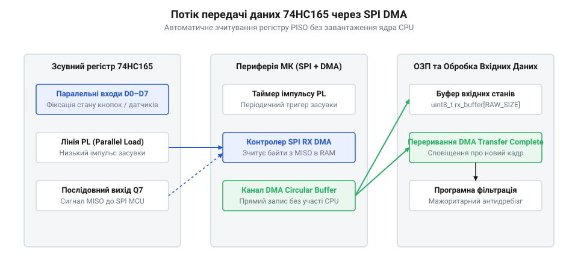
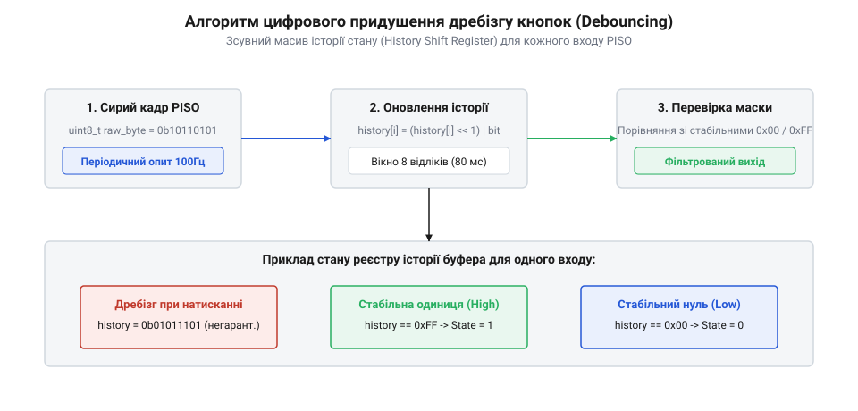

# Зсувний регістр 74HC165 у схемах вводу

## Початкові концепції та фізичні принципи

Уявімо розробку промислового пульта керування або шафи автоматики, де необхідно опитувати стан 32 кінцевих вимикачів, оптичних датчиків та кнопкових перемикачів. Якщо підключати кожен датчик до окремого виводу загального призначення мікроконтролера, розробник миттєво зіштовхнеться з дефіцитом апаратних ресурсів. Вибір мікроконтролера у корпусі на 100 або 144 виводи виправданий далеко не завжди, оскільки це суттєво здорожує друковану плату, ускладнює трасування сигнальних доріжок, збільшує паразитичні наводки та вимагає розведення великої кількості провідників по всьому корпусу пристрою. Використання складних периферифійних розширювачів вводу-виводу на базі інтерфейсів I2C або SPI із внутрішніми регістрами конфігурації створює додаткові програмні накладні витрати на передачу команд, обробку квитувань та арбітраж шини. Для систем реального часу потрібне просте, високошвидкісне та детерміноване апаратне рішення, яке дозволяє зафіксувати стан усіх дискретних входів в один точний момент часу та передати їх у мікроконтролер через мінімальну кількість фізичних ліній.

Таке завдання вирішує 8-бітний @@en|паралельний вхід, послідовний вихід@@ (від англ. *Parallel-In Serial-Out*, PISO, з грец. *para* — поруч, *allelon* — взаємно, та лат. *series* — ряд) @@en|зсувний регістр@@ (від англ. *shift register*, з лат. *regestum* — записане, внесене) 74HC165. Цей цифровий чип є класичним представником логічних мікросхем КМОП-структури (англ. *CMOS*), призначеним для перетворення паралельного набору бінарних сигналів у послідовну пачку бітів. Завдяки 74HC165 розробник може зчитувати 8, 16, 32 або більше дискретних входів, використовуючи лише три або чотири виводи мікроконтролера: лінію стробування фіксації даних, лінію тактування та лінію послідовного зчитування даних.

Фізична будова мікросхеми містить вісім послідовно з'єднаних D-тригерів із додатковими вхідними комбінаційними селекторами. Функціонування чипа визначається чотирма основними групами керуючих та сигнальних виводів:

1. Паралельні входи `D0–D7` (у деяких специфікаціях позначаються як `A–H`): призначені для підключення зовнішніх цифрових сигналів від кнопок, датчиків або логічних рівнів. 2. Вхід завантаження та зсуву `PL` (від англ. *Parallel Load*, або `SH/LD`): інверсний апаратний сигнал керування. Коли на виводі `PL` встановлюється низький логічний рівень напруги, відбувається @@en|паралельне завантаження@@ (від англ. *parallel load*, з лат. *load* / франк. *hladan* — вантаж). У цьому стані внутрішня комбінаційна логіка чипа безпосередньо комутує рівні з входів `D0–D7` на входи фіксації тригерів. Оскільки це @@en|асинхронне завантаження@@ (від англ. *asynchronous load*, з грец. *a-* — без, та *synchronos* — одночасний), запис даних відбувається миттєво по спаду напруги і не залежить від стану тактового сигналу. Коли `PL` повертається до високого рівня, мікросхема переходить у режим послідовного зсуву. 3. Тактовий вхід `CP` (від англ. *Clock Pulse*, або `CLK`): приймає прямокутні тактові імпульси від мікроконтролера. По кожному позитивному фронту (перехід з логічного 0 в 1) тактового сигналу відбуваються послідовні зсуви вмісту внутрішніх тригерів від молодшого до старшого розряду. 4. Вхід блокування тактування `CE` (від англ. *Clock Enable*, або `CLK INH`): інверсний вхід дозволу тактування. Якщо на `CE` подано високий логічний рівень, внутрішня логіка блокує проходження імпульсів з входу `CP`, що заморожує поточний стан регістра. У більшості стандартних схем вводу цей вивід підключають до загального проводу (GND), залишаючи тактування постійно активним. 5. Послідовний вхід `DS` (від англ. *Serial Data Input*, або `SER`): призначений для подачі даних у найперший тригер ланцюжка (`D0`) під час зсуву. Цей вивід забезпечує фізичну можливість послідовного з'єднання (каскадування) кількох мікросхем. 6. Послідовний вихід `Q7` (або `QH`) та його інверсний двівник `~Q7` (або `~QH`): відображають логічний стан останнього (восьмого) тригера. Вихід `Q7` підключається до вхідного виводу GPIO мікроконтролера або до входу `DS` наступної мікросхеми в каскаді.

Для надійної вибірки даних прошивка повинна чітко дотримуватися електричних та часових параметрів, викладених у специфікації чипа. Найважливішими з них є:

- @@en|час встановлення@@ (від англ. *setup time*, з давньоангл. *settan* — ставити) `t_su`: мінімальний інтервал часу, протягом якого логічні рівні на паралельних входах `D0–D7` повинні залишатися незмінними до моменту підняття сигналу `PL` у високий стан. Якщо рівень на вхідній ніжці зміниться безпосередньо під час переходу `PL`, внутрішній D-тригер може потрапити у метастабільний стан, що призведе до зчитування хаотичного значення. - @@en|час утримання@@ (від англ. *hold time*, з давньоангл. *healdan* — тримати) `t_h`: мінімальний час збереження стабільного сигналу на входах `D0–D7` після відновлення високого рівня на лінії `PL`. - Мінімальна тривалість імпульсу `t_w_PL`: час, протягом якого лінія `PL` має утримуватися в низькому стані для гарантованого перемикання всіх восьми внутрішніх засувок. Для серії 74HC при напрузі живлення 4.5V цей час становить від 12 до 20 наносекунд. - Затримка розповсюдження `t_pd`: час від позитивного фронту на тактовій лінії `CP` до появи стабільного нового логічного рівня на послідовному виході `Q7`.

Часова декомпозиція транзакції зчитування дозволяє розрахувати граничну швидкість опитування периферії. Повний час `T_transfer`, необхідний для фіксації та передачі стану `N` каскадованих регістрів (загалом `8 × N` біт), обчислюється як сума тривалості імпульсу фіксації та сумарного часу зсуву всіх бітів шиною.

    T_transfer = T_load + T_shift
    = t_w_PL + 8 × N × T_clock      [декомпозиція фаз фіксації та зсуву]
    = t_w_PL + 8 × N × (t_high + t_low) [підстановка періоду тактового сигналу]

У цьому виразі символ `T_transfer` позначає підсумковий час оновлення масиву входів, `T_load` — час асинхронного засуву даних, `T_shift` — тривалість послідовної вибірки, `t_w_PL` — мінімальна тривалість низького рівня на лінії PL, `N` — кількість мікросхем 74HC165 у каскадному ланцюжку, `T_clock` — період прямокутного сигналу тактування CP, а `t_high` та `t_low` — тривалості високого та низького рівнів тактового імпульсу відповідно.

З наведеного виразу видно, що при частоті тактування 10 МГц (період `T_clock = 100` нс) та тривалості імпульсу `t_w_PL = 50` нс зчитати стан 32 дискретних входів (`N = 4`) можна за:

    T_transfer = 50 нс + 8 × 4 × 100 нс = 3250 нс = 3.25 мкс

Це свідчить про високу ефективність зсувних регістрів: за кілька мікросекунд мікроконтролер дістає повний зріз стану десятків зовнішніх кнопок і датчиків, витративши мінімальну кількість процесорних тактів.

На відміну від складних системних шин, зсувний регістр 74HC165 не має внутрішньої регістрової карти або адресних байтів. Для запобігання помилкам під час [координації вибірки з периферією](root:sf-devices/draiver-chypa) в прошивці реалізується суворий детермінований часовий алгоритм. Якщо у системі виникають високі вимоги до швидкодії, розробник обирає між викликом [опитування прапорців чи переривань](root:sf-devices/opytuvannia-pereryvannia-chy-dma-u-draiveri) для контролера SPI або програмного таймера.

## Внутрішня будова та алгоритми роботи

Внутрішня функціональна схема 74HC165 складається з восьми тригерних осередків, включених послідовно від розряду `D0` до `D7`. Кожен осередок містить D-тригер та вхідний логічний селектор на базі елементів І-НЕ (NAND) та АБО-НЕ (NOR). Коли лінія `PL` перебуває у високому стані (1), вхідні селектори блокують сигнали з паралельних виводів `D0–D7` і комутують вихід `Q` попереднього тригера на вхід `D` наступного. На першому розряді (`D0`) замість попереднього тригера підключається послідовний вхід `DS`.

При кожному позитивному фронті на тактовому виводі `CP` бітовий стан зсувається вздовж ланцюжка: значення з `D6` переходить у `D7`, з `D5` у `D6`, і так далі до `D0`, куди записується поточний стан з лінії `DS`. При цьому стан тригера `D7` негайно відображається на вихідному виводі `Q7`.

Найбільш потужною властивістю 74HC165 є @@en|каскадування@@ (від англ. *cascading*, з італ. *cascata* — водоспад). Воно дозволяє об'єднувати довільну кількість мікросхем у єдиний довгий послідовний зсувний регістр вводу без збільшення кількості керуючих ліній мікроконтролера. Для створення каскаду з `N` корпусів виконуються наступні апаратні з'єднання:
1. Послідовний вихід `Q7` першої мікросхеми підключається до послідовного входу `DS` другої мікросхеми, вихід `Q7` другої — до входу `DS` третьої, і так далі. 2. Вихід `Q7` останньої мікросхеми в ланцюжку підключається до вхідного виводу GPIO (або MISO) мікроконтролера. 3. Усі паралельні виводи `PL` всіх корпусів об'єднуються і підключаються до одного виходу GPIO мікроконтролера (лінія Latch / Load). 4. Усі тактові виводи `CP` об'єднуються і підключаються до виходу тактування мікроконтролера (лінія Clock / SCK). 5. Усі входи `CE` заземлюються.

У результаті подачі одного короткого від'ємного імпульсу на спільну лінію `PL` уся група з `N` мікросхем одночасно засуває `8 × N` паралельних входів у свої внутрішні тригери. Після повернення `PL` у високий стан вихід `Q7` останньої мікросхеми одразу представляє найстарший біт останнього регістра.

Діаграма часових співвідношень керуючих та вихідних сигналів показує чітку послідовність фаз фіксації та зсуву:

*Часова діаграма взаємодії керуючих ліній PL та CP для зчитування 8-бітного значення з регістра 74HC165.*

Програмне зчитування даних із 74HC165 може бути реалізовано двома основними шляхами: через @@en|програмне формування сигналів@@ (від англ. *bit-banging*) на виводах GPIO загального призначення, або за допомогою апаратного периферійного модуля SPI (Serial Peripheral Interface).

При розробці [апаратної абстракції транзакцій](root:sf-devices/riven-tranzaktsii) у прошивці низькорівневий драйвер відокремлює фізичне керування лініями від бізнес-логіки додатка.

Алгоритм вибірки даних методом bit-banging складається з таких послідовних кроків:
1. Формування від'ємного імпульсу на лінії `PL`: встановлення 0, виконання короткої затримки (або кількох інструкцій NOP), повернення в 1. Цей крок виконує @@en|стробування@@ (від англ. *strobe*, з грец. *strobos* — обертання) вхідного сигналу. 2. Прочитати поточний стан лінії даних (`Q7`) і зберегти його як найстарший біт (MSB) отримуваного байта. 3. У циклі від 1 до 7 (для одного регістра) виконувати:
   - Подати позитивний імпульс на лінію `CP` (встановити 1, потім 0). На позитивному фронті мікросхема висуває наступний біт на лінію `Q7`. - Зчитати стан лінії `Q7` та змістити його у відповідну позицію змінного @@en|буфер даних@@ (від англ. *data buffer*, з старофранц. *buffe* — поштовх). 4. Зберегти отримані байти у вихідний масив.

Якщо 74HC165 підключається до апаратного блоку SPI мікроконтролера, лінія `PL` управляється виводом Chip Select (CS) або довільним GPIO, лінія `CP` підключається до виходу SCK, а вихід `Q7` — до входу MISO. Налаштування SPI відповідає режиму SPI Mode 0 (CPOL = 0, CPHA = 0): тактовий сигнал у спокійному стані низький, зчитування даних відбувається по першому позитивному фронту.

Для запобігання невизначеним станам під час [ініціалізації периферійних портів](root:sf-devices/poslidovnist-initsializatsii-iakoi-nikhto) керуючі виводи GPIO встановлюються у відомий вихідний стан ще до активації генератора тактування. Своєчасна обробка помилок та [відновлення після збоїв](root:sf-devices/taimauty-pomylky-i-povtorna-initsializatsiia-chypa) гарантує стійкість системи при виникненні електромагнітних завад на довгих шлейфах вводу.

Нижче наведено практичні реалізації драйвера зсувного регістра 74HC165 мовами C та C++.

:::tabs
@tab C (Bare-Metal)
:::code root\eng\sf-devices\74hc165-shift-register/74hc165-shift-register-d/c/baremetal/shift165-init.c c
@tab C++ (STM32 / Driver)
:::code root\eng\sf-devices\74hc165-shift-register/74hc165-shift-register-d/cpp/stm32/shiftregister165.cpp cpp
:::

Представлений алгоритм забезпечує детерміновану та надійну вибірку бінарних станів. Завдяки ізоляції апаратного рівня функціями зворотного виклику, драйвер легко переноситься між різними мікроконтролерними платформами (STM32, ESP32, AVR, RISC-V) без зміни алгоритмічної частини.

Для забезпечення детермінованості виконання та мінімізації накладних витрат обробка даних у критичних секціях здійснюється за допомогою цілочисельної арифметики з атомарним оновленням прапорців станів @@en|atomic flags@@, що виключає дрейф фази та блокування переривань.

## Апаратна реалізація та низькорівневий C/C++ код

При побудові високонавантажених систем керування або складних пристроїв автоматики реального часу програмне опитування дискретних входів шляхом прямих маніпуляцій з виводами GPIO створює помітні накладні витрати на процесорні такти. Кожна операція перемикання лінії тактування `CP` або зчитування лінії `Q7` через бітові зсуви вимагає виконання десятків інструкцій ядра мікроконтролера. Якщо система містить каскад із 8 або 16 мікросхем 74HC165 (що відповідає 64–128 дискретним входам), а частота оновлення стану становить 1 кГц, використання програмного формування сигналів споживає значну частку обчислювальної потужності.

Для усунення цієї проблеми в професійній прошивці використовують комбінацію апаратного модуля SPI та контролера, що реалізує @@en|прямий доступ до пам'яті@@ (від англ. *Direct Memory Access*, DMA, з лат. *directus* — прямий, та *memoria* — пам'ять). Така архітектура дозволяє повністю вивільнити процесорне ядро від рутинної роботи з тактування та зсуву бітів: мікроконтролер лише видає короткий апаратний або програмний імпульс на лінію `PL`, після чого контролер DMA автоматично вичищає весь масив байтів із послідовного виходу регістра безпосередньо в оперативну пам'ять (RAM).

Послідовність функціонування апаратного DMA-трансферу організовано за чітким детермінованим циклом. Спочатку таймер або процесор формує негативний строб на лінії `PL`, фіксуючи поточний стан усіх паралельних входів `D0–D7` у внутрішніх засувках каскаду. Після підняття `PL` активується канал DMA RX, прив'язаний до приймального буфера модуля SPI. Мікроконтролер ініціює передачу `N` фіктивних байтів через SPI у режимі прийому. Під час генерації тактових імпульсів на лінії SCK/CP апаратний блок SPI зчитує кожен біт з виходу `Q7` і формує з них байти, які DMA миттєво записує в системний буфер пам'яті.

*Архітектура безпосереднього переміщення даних із зсувного регістра в RAM без залучення ядра CPU.*

Коли вибірку всіх `N` байтів завершено, контролер DMA генерує переривання про закінчення транзакції. У цей момент операційна система реального часу дістає повністю оновлений зріз станів усіх входів пристрою.

Щоб оцінити переваги апаратного підходу, виконаємо розрахунок процесорного часу, необхідного для зчитування 4 каскадованих регістрів (32 дискретні входи) при двох різних підходах: програмному опитуванні (bit-banging) та апаратному SPI з DMA.

Припустимо, що мікроконтролер працює на тактовій частоті 72 МГц (період такту `T_cpu = 13.88` нс). При програмному опитуванні для формування одного тактового імпульсу `CP` та зчитування одного біта з урахуванням викликів функцій і програмних циклів витрачається приблизно 25 тактів CPU.

    CPU_time_polling = N_bits × T_bit_cycles × T_cpu
    = 32 × 25 × 13.88 нс          [підстановка кількості бітів та тактів]
    = 800 × 13.88 нс              [обчислення загальної кількості тактів]
    = 11104 нс ≈ 11.1 мкс         [підсумкові витрати часу ядра CPU]

При використанні апаратного SPI з DMA процесор бере участь лише на етапах ініціалізації транзакції (імпульс `PL` та запуск DMA) та обробки фінального переривання. Запуск передачі займає близько 15 тактів, а обробник переривання — близько 35 тактів.

    CPU_time_dma = (T_init_cycles + T_isr_cycles) × T_cpu
    = (15 + 35) × 13.88 нс        [підстановка тактів ініціалізації та ISR]
    = 50 × 13.88 нс               [сумарна кількість тактів ядра]
    = 694 нс ≈ 0.69 мкс           [підсумкові витрати часу ядра CPU]

Порівняльний аналіз показує, що використання DMA зменшує навантаження на ядро процесора у `11104 / 694 ≈ 16` разів. Це дає змогу вивільнити обчислювальні ресурси для виконання основних задач обробки бізнес-логіки або обчислення цифрових алгоритмів.

При підключенні 74HC165 до модуля SPI слід ураховувати особливість порядку висування бітів. Мікросхема 74HC165 висуває біти, починаючи з найстаршого розряду `D7` (MSB First). У той же час фізичне розташування кнопок на платі часто вимагає прямої відповідності: біт 0 буфера має відповідати входу `D0`, біт 1 — входу `D1`, і так далі. Якщо модуль SPI мікроконтролера налаштовано на прийом MSB First, зчитаний байт буде містити дзеркальне відображення бітів.

Для відновлення коректного порядку бітів у прошивці застосовують апаратну інструкцію @@en|зворотний порядок бітів@@ (від англ. *bit reversal*, з лат. *reversio* — повернення). На архітектурах ARM Cortex-M3/M4/M7 для цього існує ассемблерна інструкція `__RBIT`. Якщо ж цільовий мікроконтролер не має апаратної підтримки цієї операції, використовують табличне перетворення (Look-Up Table, LUT) або швидкі інверсійні бітові маски.

    reversed_byte = ((byte × 0x0202020202ULL & 0x010884422010ULL) % 1023) [інверсія бітів у байті без розгалужень]

У середовищі операційних систем реального часу (RTOS, наприклад FreeRTOS або Zephyr) передача даних від переривання DMA до задач обробки вимагає забезпечення потікобезпечності. Прямий доступ кількох задач до одного й того самого масиву даних вводу може призвести до стану конфлікту доступу, коли одна частина байта оновлюється під час зчитування іншої.

Для запобігання цьому застосовується техніка @@en|подвійна буферизація@@ (від англ. *double buffering*, з старофр. *buffe* — поштовх, удар) у поєднанні з @@en|атомне знімок станів@@ (від англ. *atomic state snapshot*, з грец. *atomos* — неподільний). Драйвер утримує два буфери в RAM: теневий буфер, куди контролер DMA безпосередньо вивантажує нові значення з послідовної шини, та робочий буфер, з якого додаток безпечно читає стан входів. Після завершення чергової вибірки в обробнику переривання DMA здійснюється швидке атомне перемикання вказівників на буфери або копіювання даних під захистом критичної секції.

Правильна [послідовність ініціалізації периферії](root:sf-devices/poslidovnist-initsializatsii-iakoi-nikhto) та чіткий розподіл обов'язків між блоками дозволяє [відділити чип від шини](root:sf-devices/riven-tranzaktsii), розробляючи універсальний модуль драйвера. При цьому вибір між класичним опитуванням та DMA визначається вимогами системи, як детально розглянуто у матеріалі про [опитування прапорців чи DMA](root:sf-devices/opytuvannia-pereryvannia-chy-dma-u-draiveri).

Нижче подано повні прикладні реалізації апаратного драйвера 74HC165 на C та C++ з підтримкою DMA та потікобезпечної подвійної буферизації.

:::tabs
@tab C (STM32 HAL / SPI DMA)
:::code root\eng\sf-devices\74hc165-shift-register/74hc165-shift-register-d/c/stm32/shift165-dma-init.c c
@tab C++ (FreeRTOS / Object-Oriented)
:::code root\eng\sf-devices\74hc165-shift-register/74hc165-shift-register-d/cpp/freertos/shiftregisterinputdma.cpp cpp
:::

## Практичне застосування та відлагодження

Впровадження зсувних регістрів 74HC165 у серійні промислові вироби вимагає ретельної обробки апаратних та фізичних граничних випадків. На відміну від лабораторних стендів, реальне експлуатаційне середовище насичене механічними перехідними процесами, електромагнітними завадами та електричними перешкодами по лініях живлення.

Першою та найпоширенішою апаратною проблемою дискретних входів є @@en|дребезг контактів@@ (від англ. *contact bounce*, з давньоангл. *bouncen* — битися, відбиватися). Під час замикання або розмикання механічних кнопок, реле чи кінцевих вимикачів їхні металеві контакти не переходять у новий стан миттєво. Протягом інтервалу тривалістю від 1 до 15 мілісекунд відбувається серія хаотичних розмикань та замикань. Якщо в цей момент мікроконтролер виконає фіксацію даних імпульсом `PL`, у зсувний регістр потрапить випадкове значення.

Для боротьби з дребезгом застосовують двокомпонентний підхід: первинну апаратну фільтрацію та подальшу цифрову обробку в прошивці. Апаратне пригнічення реалізують за допомогою підключення пасивних RC-кіл (`R = 10 кОм`, `C = 100 нФ`, що задає сталу часу `τ = R × C = 1 мс`) безпосередньо біля входів `D0–D7` з подальшим пропущенням через інвертувальні тригери Шмітта (наприклад, мікросхему 74HC14).

У випадках, коли додавання додаткових корпусів логіки небажане через обмеження площі друкованої плати, завдання пригнічення перекладається на @@en|програмний фільтр дребезгу@@ (від англ. *software debouncer*, з фр. *dé-* — видалення, та англ. *bounce* — відскок). Найбільш детермінованим алгоритмом фільтрації є метод 8-бітного ковзного зсувного вікна (Sliding Window Filtering).

Суть методу полягає в тому, що для кожного дискретного входу драйвер підтримує 8-бітний накопичувальний регістр історії станів. Опитування регістра 74HC165 виконується періодично з фіксованим інтервалом (наприклад, кожні 2 мілісекунди). При кожній новій вибірці поточний стан біта зсувається в накопичувач історії.

*Структура накопичувального 8-бітного буфера для фільтрації механічного дребезгу входів.*

Новий логічний стан кнопки або датчика визнається стабільним та приймається бізнес-логікою додатка лише тоді, коли всі 8 послідовних вибірок збігаються. Тобто значення накопичувального регістра дорівнює `0xFF` (вхід стабільно у високому рівні протягом 16 мс) або `0x00` (вхід стабільно у низькому рівні). Проміжні значення ігноруються як шумові перехідні процеси.

Другою критичною загрозою є @@en|ефект плаваючого входу@@ (від англ. *floating input effect*, з давньоангл. *flotian* — плавати). Виводи `D0–D7` мікросхеми 74HC165 мають надзвичайно високий вхідний опір КМОП-структур (понад `10¹² Ом`). Якщо дискретний вхід залишається фізично непідключеним, він працює як ефективна антена, що збирає наводки від мережі 50 Гц, імпульсних джерел живлення та радіозавад. Напруга на ньому хаотично коливається навколо порогу перемикання логічного елемента, створюючи хибні спрацьовування.

Щоб усунути плавання, кожен паралельний вхід обов'язково підтягують резистором номіналом `4.7–10 кОм` до лінії живлення VCC (Pull-Up) або до загального проводу GND (Pull-Down). При підтяжці Pull-Up кнопка комутує вхід на мікроконтролерний мінус, а у спокійному стані резистор гарантує надійний логічний 1.

При винесенні блоку кнопок чи датчиків на віддалені панелі через довгі кабельні шлейфи (довжиною понад 0.5–2 метри) виникають проблеми цілісності сигналів. Основні з них:

1. Паразитна ємність та індуктивність лінії зв'язку завалюють фронти тактового сигналу `CP`. 2. Ехо-відбиття сигналу від кінців кабелю викликають зворотне відбиття хвилі, через що на фронтах з'являються ложні повторні імпульси тактування, які призводять до зсуву даних одразу на кілька бітів. 3. Електричне зміщення потенціалу землі під час одночасного перемикання багатьох навантажених виводів.

Для розв'язання цих проблем застосовують @@en|узгодження імпедансу@@ (від англ. *impedance matching*, з лат. *impedio* — перешкоджати) шляхом встановлення послідовних термінуючих резисторів номіналом `33–100 Ом` безпосередньо біля виводів мікроконтролера на лініях `CP` та `PL`. Це згладжує високочастотні викиди напруги. Крім того, поруч із кожним корпусом 74HC165 обов'язково встановлюють керамічний розв'язувальний конденсатор ємністю `0.1 мкФ` з найкоротшими доріжками до виводів VCC та GND.

Під час налагодження та діагностики плати першим кроком є осцилографічний або логічний аналіз ліній керування. Потрібно перевірити дотримання часу встановлення `t_su` та відсутність спадаючих глічтів на лінії `PL` у момент підняття тактового сигналу `CP`.

Для автоматизованого тестування працездатності каскаду в прошивці реалізують функцію самодіагностики (Loopback Test). Вільний послідовний вхід `DS` першої мікросхеми в каскаді підключають не до GND, а до окремого виводу GPIO мікроконтролера. Подаючи на вхід `DS` тестувальні бітові послідовності (наприклад, тестовий паттерн `0xA5`) та роблячи серію зсувів при низькому рівні `PL`, прошивка перевіряє, чи повертається цей паттерн на вихід `Q7` останнього чипа без спотворень.

Якщо пристрій не відповідає або передає суцільні логічні 0 чи 1, драйвер ініціює [повторну ініціалізацію чипа](root:sf-devices/taimauty-pomylky-i-povtorna-initsializatsiia-chypa) та реєструє апаратну помилку. При розробці складних вимірювальних систем дані з регістра 74HC165 можуть комбінуватися з обробкою таких інтерфейсів, як [зчитування даних первинних перетворювачів](root:sf-devices/max31865-software-driver) або [декодування вимірювальних протоколів](root:sf-devices/digimatic-spc-protocol-decoding).

Нижче наведено приклад практичної реалізації мовами C та C++ модуля цифрового фільтрування дребезгу та генератора подій натискання кнопок на основі вибірок із 74HC165.

:::tabs
@tab C (Debounce Filter & Event Detector)
:::code root\eng\sf-devices\74hc165-shift-register/74hc165-shift-register-d/c/baremetal/debounce-init.c c
@tab C++ (Input Event Processor)
:::code root\eng\sf-devices\74hc165-shift-register/74hc165-shift-register-d/cpp/embedded/inputeventprocessor.cpp cpp
:::