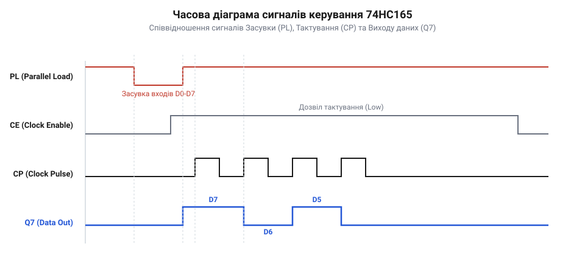

# Зсувний регістр 74HC165 у схемах вводу

## Дефіцит виводів та паралельна фіксація

Пряме підключення десятків кнопок чи датчиків швидко вичерпує виводи @@en|GPIO@@ (від англ. *general-purpose input/output* — виводи загального призначення) мікроконтролера, а шинні розширювачі вносять протокольні затримки.

Синхронне захоплення контактів виконує логічна мікросхема @@en|PISO@@ (від англ. *Parallel-In Serial-Out*; паралельний вхід, послідовний вихід) — зсувний регістр @@en|shift register@@ 74HC165, що передає стан восьми ліній трьома провідниками керування.

Захоплення запускає низький рівень на інверсному вході завантаження `PL` (від англ. *Parallel Load*): вентилі асинхронно комутують входи `D0–D7` на внутрішні засувки за 15–20 нс. Повернення `PL` у високий стан блокує паралельні входи й переводить регістр у режим зсуву.

Для надійної фіксації сигнали повинні відповідати часу встановлення @@en|setup time@@ `t_su` до фронту `PL` та часу утримання @@en|hold time@@ `t_h` після нього. Порушення цих меж вводить засувку в стан метастабільності @@en|metastability@@ із невизначеною напругою на виході, що запобігають фільтрацією та витримкою інтервалів у [драйвері периферійного чипа](root:sf-devices/draiver-chypa).

## Послідовний зсув, каскадування та зчитування

Усередині 74HC165 дані зберігає ланцюжок із восьми тригерів — @@en|D-тригер@@ (від англ. *delay* — затримка та *trigger* — заскочка; синхронний тригер фіксації сигналу). Коли лінія `PL` у високому рівні, вихід кожного тригера з'єднується зі входом наступного, а останній виводить біт на `Q7`. По кожному наростаючому фронту тактового сигналу `CP` (від англ. *Clock Pulse*, або `CLK`) біти зсуваються від молодшого розряду до старшого, а в розряд `D0` записується рівень із послідовного входу `DS` (від англ. *Serial Data Input*).

Вхід `DS` уможливлює @@en|каскадування@@ (від англ. *cascading*, з італ. *cascata* — водоспад; послідовне об'єднання функціональних блоків). Для опитування 16 чи більше датчиків вихід `Q7` першого чипа з'єднують із входом `DS` наступного, об'єднуючи строби `PL` і такти `CP`. Один імпульс завантаження заморожує всі входи, після чого мікроконтролер вичитує послідовний потік через єдиний вивід, застосовуючи [каскадування зсувних регістрів](root:sf-devices/piso-shift-register-cascading).

Взаємодію сигналів у часі демонструє діаграма стробування та послідовного зсуву:


*Часова діаграма зсувного регістра 74HC165: асинхронний строб завантаження PL фіксує входи, а тактові імпульси CP висувають біти на лінію Q7.*

Покроковий алгоритм зчитування байта методом @@en|bit-banging@@ (від англ. *bit* — двійковий розряд та *bang* — бити; пряме маніпулювання виводами):
1. **Стробування входу**: встановити на лінії `PL` логічний нуль на час фіксації (від 20 нс) і повернути в одиницю. 2. **Зчитування старшого розряду**: стан `D7` установлюється на виході `Q7` одразу після наростання `PL`, тому перший біт зчитують без подачі такту. 3. **Тактування та вибірка**: для решти семи бітів формують імпульси на `CP`. На кожному наростаючому фронті чип висуває наступний біт, який додають до накопичувального байта.

Розрахуємо сумарний час опитування одного регістра `T_read` через тривалість стробування `t_load` і період тактування `T_clk`:

```
T_read = t_load + 8 × T_clk
= 20 + 8 × 100    [підстановка значень у наносекундах для тактової частоти 10 МГц]
= 820             [мінімальний час зчитування одного байта в наносекундах]
```

Збір 8 бітів триває менше 1 мкс. Для вищої швидкодії тактування підключають до SCK, а лінію даних — до MISO, передаючи опитування під керування [апаратного модуля SPI](root:sf-devices/spi-mode-0-shift-register-emulation).